# ROS 2 学习图谱

主线：ROS 2 Jazzy / Ubuntu 24.04。资料核对：2026-11-07。

已在本机分轮构建通信2包、基础10包及动作/组件/生命周期/测试/模型各1包。数值、协议、录放、模型TF、软件差速、Harmonic传感器桥接、SLAM建图与恢复、Nav2静态房间规划和仿真车导航执行按各自记录验证。其他仿真、GUI、Docker及硬件范围见VALIDATION.md。

## 1. ROS 2 的分层与通信选型

节点是计算图中的功能实体，进程是操作系统的隔离单位；一个进程可以包含多个节点。包则负责代码、依赖与安装组织，三者不能混为一谈。

### 学习目标

- 把应用、客户端库、RMW、中间件与工具放到正确的位置

- 根据数据流选择 Topic、Service 或 Action

### 先修

已安装 ROS 2 Jazzy；每个新终端先 source /opt/ros/jazzy/setup.bash。

### 概念

节点是计算图中的功能实体，进程是操作系统的隔离单位；一个进程可以包含多个节点。包则负责代码、依赖与安装组织，三者不能混为一谈。

话题传输持续数据；服务表达较短的请求与回应；动作适合需要反馈、结果和取消的长期任务。动作并不是一个普通话题。

rclcpp 与 rclpy 共用接口定义和通信图。语言不同不妨碍通信，但类型、名称、QoS 与发现环境必须匹配。

### 1. 先把机器人问题拆成可验证的数据流

假设你要让一台巡检车看见障碍物并停下。摄像头驱动负责取得图像，感知程序负责判断前方是否有人，任务程序决定继续或停车，底盘程序把速度要求转换成电机动作。若把它们写成一个不断增长的循环，修改摄像头可能影响控制周期，回放数据也需要模拟所有硬件。ROS 2 提供的价值，是让这些功能通过明确接口协作，从而可以独立替换和验证。

ROS 2 不是替代 Linux 的操作系统，也不会自动给机器人提供导航能力。Linux 仍负责进程、驱动、文件和网络；ROS 2 提供通信机制、客户端库、构建组织和调试工具；Nav2、MoveIt、ros2_control 等项目再在这些机制上解决具体机器人问题。学习时应先认识这些层之间的连接，避免一遇到机器人问题就寻找一个所谓的万能 ROS 节点。

设计的起点是接口契约：谁产生什么数据，单位和坐标系是什么，允许多久没有新数据，失败时由谁处理。机器人能启动只是第一层结果；输入停止、通信延迟和节点退出时能否保持可解释的行为，才说明接口边界划分得合理。

### 2. 包、可执行程序、进程和节点是四个概念

包是发布与依赖管理的单位。一个包可以包含源码、模型、参数、启动文件，也可以只有消息定义。可执行程序是安装后能够启动的程序入口；同一个包可以安装多个入口。进程是操作系统创建的运行实例，具有自己的地址空间；同一可执行程序启动两次，会形成两个进程。节点则是 ROS 图中的逻辑实体，拥有名称、接口和参数。

最初的教程通常让一个程序创建一个节点，所以四个名字容易被混为一谈。实际上，一个包可生成发布者和订阅者两个可执行程序；一个组件容器进程可容纳多个节点；同一类节点也可创建多个实例，并分别放在不同命名空间下。由此可见，看到两个 ROS 节点不能推断一定有两个操作系统进程。

执行 ros2 run demo_nodes_cpp talker 时，前一个参数指定包，后一个参数指定安装入口。运行后再用 ros2 node list 看节点名称。程序入口名和节点名可以一样，也可以不同；重命名节点不会修改磁盘上的程序文件，更不会改动包名。

#### 认识三个查询层级

代码类型：commands

```bash

# 【中文教学注释】 认识三个查询层级
# 本例作用：前两条检查已安装的软件包，最后一条查询当前运行的计算图；没有节点运行时，列表为空并不代表没有安装软件。
# 输入输出：输入是已启动节点及当前终端的 ROS 环境；输出是节点、话题、接口类型的发现结果。
# 执行顺序与边界：先启动相容的发布/订阅端，再查询计算图；发现端点不能证明业务处理完成，图中数量也不是发送频率。
# 在当前shell加载/opt/ros/jazzy/setup.bash；它影响本终端的包索引/库路径，另一个终端必须单独加载。
source /opt/ros/jazzy/setup.bash
# 查询当前叠加环境实际选中的包安装前缀，用于识别overlay覆盖或包未找到。
ros2 pkg prefix demo_nodes_cpp
# 列出已安装可执行入口；源码文件存在不代表入口已按CMake/console_scripts安装。
ros2 pkg executables demo_nodes_cpp
# 列出本发现域中可见节点；节点存在不证明其回调、生命周期或业务状态正常。
ros2 node list

```

前两条检查已安装的软件包，最后一条查询当前运行的计算图；没有节点运行时，列表为空并不代表没有安装软件。

输入输出：输入是已启动节点及当前终端的 ROS 环境；输出是节点、话题、接口类型的发现结果。
执行顺序与边界：先启动相容的发布/订阅端，再查询计算图；发现端点不能证明业务处理完成，图中数量也不是发送频率。

### 3. 从应用一路到网络，中间发生了什么

应用使用 rclcpp 或 rclpy 创建节点及发布者。客户端库把语言层对象转换成 ROS 核心层可操作的实体，再经过 RMW 适配层交给具体中间件。RMW 的作用是隔离中间件差异，使应用通常不需要直接操作 DDS 的参与者和发现协议。Jazzy 的常见实现有基于 Fast DDS 或 Cyclone DDS 的 RMW，选择时要安装对应实现并保持配置一致。

消息定义负责双方共享的数据结构。发布端将内存中的消息交给通信层，接收端再恢复成自己的语言对象。C++ 的结构类型和 Python 的消息类来自同一接口定义，因此它们可以通信；双方源程序采用不同编程语言并不要求额外桥接。反过来，名字碰巧相同却结构不同的接口，不能视为兼容。

发现机制让端点知道彼此存在，传输机制负责实际数据到达，执行器负责何时运行你的回调。这是三个不同环节。节点列表里看得到对方，只证明图信息已经被发现；消息类型、QoS、网络路径和回调调度仍可能阻止你的程序获得可用数据。

#### 通信分层示意

代码类型：concept

```text

应用逻辑：巡检、规划、控制
        ↓
rclcpp / rclpy：节点、发布订阅、服务、动作
        ↓
rcl / RMW：核心机制和中间件适配
        ↓
具体中间件：发现、序列化、传输、QoS
        ↓
操作系统、网络接口、计算与存储资源

```

这是理解职责的示意图，不表示每条消息都必须跨机器，也不是运行命令。

输入输出：输入是已启动节点及当前终端的 ROS 环境；输出是节点、话题、接口类型的发现结果。
执行顺序与边界：先启动相容的发布/订阅端，再查询计算图；发现端点不能证明业务处理完成，图中数量也不是发送频率。
这是概念/数据表达，保留原文以避免插入非法语法；请结合正文解释，不能直接当成完整可执行工程。

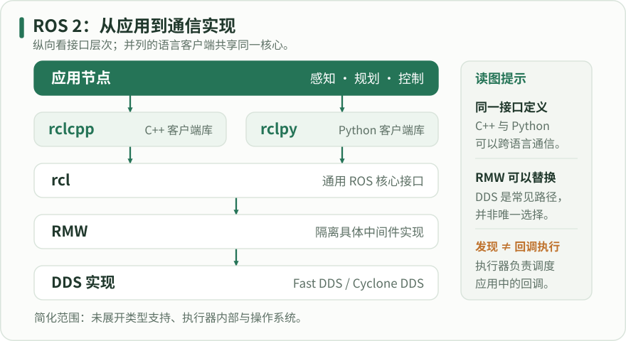

从上向下读接口层次：应用可选择并列的 rclcpp 或 rclpy，两者都位于共同的 rcl 之上，再经 RMW 接入具体通信实现。图中只画常见 DDS 路径，省略类型支持、执行器内部和操作系统；不表示所有 RMW 都基于 DDS。

### 4. Topic、Service、Action 怎样选

话题适合连续或事件式数据流，例如图像、里程计和速度要求。发布者不需要知道订阅者数量；记录器、可视化和算法都能消费同一数据。发布动作不会返回订阅者业务处理成功的结果，因此不能仅凭 publish 调用成功，就认为电机已经达到目标速度。需要确认真实状态时，应由状态反馈接口表达。

服务包含一个请求和一个响应，适合短时查询、重置计数器或触发一次配置操作。它使调用者能把响应与请求对应起来，却不自带连续进度和完整任务取消语义。如果服务响应迟迟不到，客户端必须设计等待上限；客户端超时也不表示服务端一定没有执行，涉及状态修改时应考虑重复调用是否安全。

动作将长任务表达成目标、反馈和最终结果，并具有目标接受与取消过程。导航到某个位置适合动作，因为用户需要知道走到哪里、能否取消以及是否到达。动作接口比单一话题复杂，是因为它把任务协议标准化；不应为图像流使用动作，也不应把所有长期任务都塞进一个阻塞服务。

- 连续感知：Topic；短查询或配置操作：Service；需要进度与取消的长期任务：Action。

- 参数用于配置节点的行为，不适合替代高速传感器或控制数据通道。

### 5. 名字、命名空间和类型共同定义接口

把相机接口命名成 image，表示它是相对名称，最终路径会受到节点命名空间影响。处于 /robot1 的节点使用相对话题 telemetry，得到的是 /robot1/telemetry；以斜杠开头的 /telemetry 是绝对名称，不随命名空间移动。这种规则允许同一套软件分别部署到多台机器人，而不需要在源码里写死机器人编号。

重映射是在启动时改变名称解析的配置方式。一个节点在源码里发布 chatter，启动时可以把它重映射成 telemetry。重映射不改变消息类型，也不会转换数值单位。若两个系统都叫 cmd_vel，却一个使用 Twist、另一个使用 TwistStamped，仅修改名称仍无法通信，必须明确适配接口。

接口契约还应写出类型之外的含义。float64 velocity 没有告诉读者它是米每秒还是弧度每秒；Header 中有时间戳和 frame_id，也仍然需要约定采样时间和坐标关系。把这些约定写进接口说明，能避免程序编译通过但机器人运动含义相反的错误。

### 6. 第一次跨语言实验：从输出推断系统结构

先选择系统自带的演示节点，这样可以将通信问题与自己写代码的问题分开。打开三个终端，每个终端独立加载 Jazzy 环境。终端 A 启动 C++ talker，终端 B 启动 Python listener；终端 C 不承担业务逻辑，只负责观察。这里没有摄像头、机器人模型或电机依赖，实验目的仅是证明一个图中的跨语言通信链能够建立。

发布者输出周期性日志，订阅者输出接收到的文本。两边计数可能从不同位置开始，因为订阅者启动前的 volatile 消息不必补发给它。停止订阅者并不会让发布者自动停止；再次启动订阅者后，应看到新的消息。这个现象说明话题耦合较弱，同时提醒你：业务若要求消费者确认，必须另行设计确认机制。

观察完把两端语言交换：使用 demo_nodes_py talker 和 demo_nodes_cpp listener。若行为仍相同，说明接口语义不依赖某一种语言。最后一次只改变一个条件，例如重映射话题，让实验能清楚指出哪项配置导致收不到消息。

#### 终端 A / B / C 各自运行对应命令

代码类型：commands

```bash

# 【中文教学注释】 终端 A / B / C 各自运行对应命令
# 本例作用：命令按终端分组执行，持续运行的 ros2 run 不会返回到下一行；请不要把所有组顺序粘贴到同一个终端。
# 输入输出：输入是已启动节点及当前终端的 ROS 环境；输出是节点、话题、接口类型的发现结果。
# 执行顺序与边界：先启动相容的发布/订阅端，再查询计算图；发现端点不能证明业务处理完成，图中数量也不是发送频率。
# 每个终端先执行
# 在当前shell加载/opt/ros/jazzy/setup.bash；它影响本终端的包索引/库路径，另一个终端必须单独加载。
source /opt/ros/jazzy/setup.bash
# 终端 A
# 从已安装包demo_nodes_cpp启动talker；此进程通常持续运行，另用新终端执行观察命令，Ctrl+C结束。
ros2 run demo_nodes_cpp talker
# 终端 B
# 从已安装包demo_nodes_py启动listener；此进程通常持续运行，另用新终端执行观察命令，Ctrl+C结束。
ros2 run demo_nodes_py listener
# 终端 C
# 查询指定节点的发布、订阅、服务和动作端点，由端点证据核对实际接口。
ros2 node info /talker
# 查询实际消息类型与发布/订阅端点；--verbose显示QoS等证据，先查类型再选择发送消息结构。
ros2 topic info /chatter --verbose
# 临时创建订阅者观察消息；--once收到一条后退出，持续模式用Ctrl+C结束，其QoS也须匹配。
ros2 topic echo /chatter

```

命令按终端分组执行，持续运行的 ros2 run 不会返回到下一行；请不要把所有组顺序粘贴到同一个终端。

输入输出：输入是已启动节点及当前终端的 ROS 环境；输出是节点、话题、接口类型的发现结果。
执行顺序与边界：先启动相容的发布/订阅端，再查询计算图；发现端点不能证明业务处理完成，图中数量也不是发送频率。

### 7. 将演示映射回真实机器人

在移动机器人中，底盘驱动报告轮速，状态估计输出里程计，规划模块产生路线，控制模块产生速度要求。可以把每条接口画为箭头，但还要标明箭头负责的是测量值、估计值还是命令值。命令与反馈具有不同用途，把它们混在一个未经说明的话题里，会使故障定位和录包回放变得困难。

进程拆分需要结合故障与性能，而非越多越好。将相机和任务逻辑分开有助于隔离故障；把某些高带宽处理节点组合在一起可能减少开销，但需要考虑共享进程崩溃的影响。先确定接口，再测量部署布局，能避免过早让进程结构反过来决定业务结构。

本章的验收不是背诵缩写，而是拿到一个启动命令后，说出它属于哪个包、创建几个节点、通过什么接口协作，并指出一个节点退出后其他部分应怎样表现。只有这些关系清楚，后续的 QoS、执行器、组件、生命周期和导航框架才有具体落点。

### 节点、上下文与资源生命周期

| 责任 | C++ / rclcpp | Python / rclpy | 执行细节与边界 |
| --- | --- | --- | --- |
| 初始化上下文 | `rclcpp::init(argc, argv)` | `rclpy.init(args=args)` | 在创建节点前调用；ROS 参数和普通业务参数应分清。不要在每次回调里重复初始化。 |
| 创建节点 | `std::make_shared<MyNode>()`，类继承 `rclcpp::Node` | `node = MyNode()`，类继承 `rclpy.node.Node` | 节点名和命名空间共同确定完全限定名称；Python 节点同样需要保留有效对象引用。 |
| 调度回调 | `rclcpp::spin(node)` | `rclpy.spin(node)` | spin 通常阻塞当前线程并处理就绪回调，不是一次性启动后立即返回；构造 timer 不等于自动运行回调。 |
| 停止和释放 | 退出执行器后释放节点/实体，再结束上下文 | `node.destroy_node()`；上下文仍有效时调用 `rclpy.shutdown()` | 教学示例在 finally 或作用域退出时清理；多节点共享上下文时，由拥有者统一管理，不能由任意业务回调提前关闭整个进程。 |

C++ 智能指针管理对象寿命，Python 垃圾回收时机与显式资源释放是不同概念。两个语言版本应比较可观察行为、名称与消息类型，而不是逐行对应。

### 为巡检车建立第一版接口说明

同一台机器人要持续接收激光、接受巡检目标，并允许操作者随时取消任务。

1. 将激光观测定义为 sensor_msgs/msg/LaserScan 话题，并记录采样坐标系与时间戳含义。

2. 把巡检目标定义为 Action，反馈当前航点，结果说明成功或失败原因。

3. 将最大速度作为可校验参数；实际速度要求使用控制话题，测量速度由状态话题反馈。

4. 启动最小演示验证跨语言通信，然后分别替换发布者和消费者。

验收：接口表同时描述数据、时间、单位、任务生命周期和故障行为，后续可以逐模块实现。

### 深入练习 1

一个包安装三个程序，其中一个程序创建两个节点。运行这个程序一次，会有几个包、进程和节点？

参考答案：安装组织上仍涉及一个包；本次启动创建一个进程，程序内部创建两个 ROS 节点。其他未运行入口不因此生成进程。

### 深入练习 2

把 chatter 重映射成 telemetry，能否让 String 发布者与 Float64 订阅者通信？

参考答案：不能。重映射只改变名称解析，不改变接口类型和序列化结构；应修改两端接口或实现明确的转换节点。

### 深入练习 3

服务客户端超时后立即重试“扣减库存”，可能发生什么？

参考答案：第一次请求可能已经被执行，只是响应迟到；重试可能重复修改状态。应设计请求 ID、幂等处理或可查询的任务状态，不能把网络超时等同于未执行。

### 基础验证流程

画出传感器 → 定位 → 规划 → 控制的数据流。

对每条边标注消息类型、频率、是否需要响应与取消。

先启动 demo talker/listener，再把图中的进程和节点分别标出来。

#### 终端 A：C++ 发布者

```bash

# 【中文教学注释】 终端 A：C++ 发布者
# 本例作用：终端 A：C++ 发布者
# 输入输出：输入是已启动节点及当前终端的 ROS 环境；输出是节点、话题、接口类型的发现结果。
# 执行顺序与边界：先启动相容的发布/订阅端，再查询计算图；发现端点不能证明业务处理完成，图中数量也不是发送频率。
# 从已安装包demo_nodes_cpp启动talker；此进程通常持续运行，另用新终端执行观察命令，Ctrl+C结束。
ros2 run demo_nodes_cpp talker

```

#### 终端 B：Python 订阅者

```bash

# 【中文教学注释】 终端 B：Python 订阅者
# 本例作用：终端 B：Python 订阅者
# 输入输出：输入是已启动节点及当前终端的 ROS 环境；输出是节点、话题、接口类型的发现结果。
# 执行顺序与边界：先启动相容的发布/订阅端，再查询计算图；发现端点不能证明业务处理完成，图中数量也不是发送频率。
# 从已安装包demo_nodes_py启动listener；此进程通常持续运行，另用新终端执行观察命令，Ctrl+C结束。
ros2 run demo_nodes_py listener

```

#### 终端 C：观察计算图

```bash

# 【中文教学注释】 终端 C：观察计算图
# 本例作用：终端 C：观察计算图
# 输入输出：输入是已启动节点及当前终端的 ROS 环境；输出是节点、话题、接口类型的发现结果。
# 执行顺序与边界：先启动相容的发布/订阅端，再查询计算图；发现端点不能证明业务处理完成，图中数量也不是发送频率。
# 列出本发现域中可见节点；节点存在不证明其回调、生命周期或业务状态正常。
ros2 node list
# 列出可见话题；-t附带类型，不能从名字推断消息结构或物理单位。
ros2 topic list -t

```

### 预期结果

- C++ 发布的字符串能被 Python 节点收到。

- 能解释 package、executable、process 和 node 各负责什么。

### 常见问题

- 把“一个节点”默认当作“一个进程”。

- 用服务实现持续遥控速度流，或者用普通话题自行拼接目标取消协议。

### 练习

为巡检机器人设计相机数据、修改曝光、导航到目标点三条接口，并说明选择理由。

#### 参考答案

相机图像使用 sensor_msgs/msg/Image 话题，因为它持续产生数据且可以有多个消费者；修改曝光可用参数或短服务，并校验范围；导航目标使用 Action，因为执行较久，需要反馈、取消和最终结果。实际接口名、频率与 frame_id 还要写入系统接口表。

### 验证范围

依据官方 Jazzy 文档与示例核对；本研究未运行 ROS 节点

### 依据

- [ROS 2 Jazzy 概念目录](https://docs.ros.org/en/jazzy/Concepts.html)

- [C++ / Python 客户端库教程](https://docs.ros.org/en/jazzy/Tutorials/Beginner-Client-Libraries.html)

- [Ubuntu 24.04 上安装 Jazzy](https://docs.ros.org/en/jazzy/Installation/Ubuntu-Install-Debs.html)

## 2. 环境安装与第一条跨语言通信

本路线默认 Ubuntu 24.04 和 Jazzy。Jazzy 是长期支持版本，但截至核对日期并非最新发行版。

### 学习目标

- 建立可复现的 Jazzy 学习环境

- 确认 C++ 与 Python 示例能互通

### 先修

Ubuntu 24.04；安装操作需要本机相应权限；本网站展示命令，不自动修改系统。

### 概念

本路线默认 Ubuntu 24.04 和 Jazzy。Jazzy 是长期支持版本，但截至核对日期并非最新发行版。

desktop 包含常用图形工具与示例；ros-base 适合无图形部署。安装前应按官方页面配置 ROS apt 软件源。

### 1. 安装前先固定目标平台和联网边界

本教材选择 ROS 2 Jazzy 与 Ubuntu 24.04 Noble 作为统一环境。选择一个明确版本，是为了让软件包名、Python 解释器、依赖库和示例分支能相互对应。Jazzy 支持周期较长，但截至本次核对日期并非最新发行版；学习时不必不断追逐更新版本，应先把一个版本上的完整工作链建立起来。

首先读取操作系统和架构，不要只根据桌面外观判断版本。Ubuntu 22.04 的 Humble 软件包不能通过改几个包名就当作 Jazzy 使用；若电脑不符合目标环境，可使用单独的虚拟机或容器，但图形显示、USB 和网络发现还需要额外配置。本章直接描述原生 Ubuntu 24.04 的 deb 安装路线。

教材正文、命令解释和代码可离线阅读；apt 安装、GitHub 发布查询和依赖下载通常仍需联网。真正的离线部署需要提前准备对应架构的软件包及其依赖、仓库索引或完整镜像。只保存网页或几个 deb 文件，不代表已经备齐可离线安装的一整套系统。

#### 只读检查平台

代码类型：commands

```bash

# 【中文教学注释】 只读检查平台
# 本例作用：预期系统信息包含 Ubuntu 24.04 / noble；架构与所选二进制包应匹配，locale 输出应包含可用 UTF-8 环境。
# 输入输出：输入是 Ubuntu 版本、区域设置和 apt 源；输出是软件包安装结果及跨语言通信日志。
# 执行顺序与边界：平台检查先于安装；安装需联网和相应系统权限，source 只影响当前终端，不代表其他终端已加载环境。
# 读取当前文件、摘要或环境证据，不改变ROS业务状态；核对实际路径和输出，不把示例占位值当成本机事实。
cat /etc/os-release
uname -m
locale

```

预期系统信息包含 Ubuntu 24.04 / noble；架构与所选二进制包应匹配，locale 输出应包含可用 UTF-8 环境。

输入输出：输入是 Ubuntu 版本、区域设置和 apt 源；输出是软件包安装结果及跨语言通信日志。
执行顺序与边界：平台检查先于安装；安装需联网和相应系统权限，source 只影响当前终端，不代表其他终端已加载环境。

### 2. 配置 UTF-8 环境并理解 locale 的作用

locale 影响程序处理字符、数字格式和终端输出的方式。精简镜像可能只有 POSIX 环境，而教程中的 Python 工具、包元数据和文件路径可能包含非 ASCII 字符。ROS 并不要求桌面界面必须使用英语，但学习环境应有完整的 UTF-8 编码支持。已正常使用中文 UTF-8 环境的机器通常不需要为了教程强制切换所有桌面语言。

下方步骤生成一个明确可用的 en_US.UTF-8 locale，并在当前 shell 中设置 LANG。系统默认设置与当前 shell 环境不是同一件事：update-locale 写入系统配置，export 则立即影响当前终端及其子进程。修改完成后重新运行 locale 检查，不要因为命令没有报错就假定所有环境已经更新。

如果 apt update 出现网络或软件源错误，应先修复仓库访问，再继续安装。系统安装过程中应阅读 apt 给出的变更清单，尤其是已有复杂开发环境的机器。这里的命令是供你在自己的系统上执行的安装步骤，网站阅读本身不会执行这些命令。

#### 需要时创建 UTF-8 locale

代码类型：commands

```bash

# 【中文教学注释】 需要时创建 UTF-8 locale
# 本例作用：若当前环境已完整支持 UTF-8，可保留原有语言设置；本组展示官方安装路线使用的一种可验证配置。
# 输入输出：输入是 Ubuntu 版本、区域设置和 apt 源；输出是软件包安装结果及跨语言通信日志。
# 执行顺序与边界：平台检查先于安装；安装需联网和相应系统权限，source 只影响当前终端，不代表其他终端已加载环境。
# 更新已配置软件源的软件包索引，不等于升级全部软件；该准备步骤需要联网。
sudo apt update
# 安装本段明确列出的系统/ROS依赖；-y自动接受软件包确认，发行版前缀须与目标环境一致。
sudo apt install locales
# 执行本段明确的系统准备操作；目标文件和权限需核对，不能把该步骤的成功当作ROS节点运行验证。
sudo locale-gen en_US en_US.UTF-8
sudo update-locale LC_ALL=en_US.UTF-8 LANG=en_US.UTF-8
# 设置LANG。仅影响当前终端及其后启动子进程；必须核对实际展开值后再运行依赖命令。
export LANG=en_US.UTF-8
# 读取当前文件、摘要或环境证据，不改变ROS业务状态；核对实际路径和输出，不把示例占位值当成本机事实。
locale

```

若当前环境已完整支持 UTF-8，可保留原有语言设置；本组展示官方安装路线使用的一种可验证配置。

输入输出：输入是 Ubuntu 版本、区域设置和 apt 源；输出是软件包安装结果及跨语言通信日志。
执行顺序与边界：平台检查先于安装；安装需联网和相应系统权限，source 只影响当前终端，不代表其他终端已加载环境。

### 3. 启用 Universe，并由 ros2-apt-source 管理 ROS 软件源

Ubuntu 自带软件源并不包含所有 ROS 发布包，因此需要加入 ROS 软件仓库。当前官方 Jazzy 安装流程使用 ros2-apt-source 软件包提供仓库地址和签名密钥；这样仓库配置的后续更新也能通过软件包管理完成。不要同时叠加多份旧教程里的手工源配置，否则 apt 可能出现重复条目或签名设置冲突。

先启用 Universe 并安装下载工具。随后从 ros-apt-source 的 GitHub 最新发布信息读取标签，把它放入下载文件名。这里“最新”指软件源配置包的发布版本，不是把 ROS 发行版切换到 Rolling 或其他版本。Ubuntu 代号必须仍为 noble；下载路径里使用该代号是为了匹配本机的软件源配置。

下面先查询并打印版本，让你能在继续前确认得到的是非空发布标签。若 GitHub API 请求失败、被限流或返回错误对象，应停止并解决访问问题，不要把空变量拼入下载地址。curl 的失败返回应被注意；只有文件完整下载后，才交给 dpkg 安装。

#### 启用 Ubuntu 仓库与工具

代码类型：commands

```bash

# 【中文教学注释】 启用 Ubuntu 仓库与工具
# 本例作用：Universe 提供 ROS 开发链需要的一部分 Ubuntu 依赖。
# 输入输出：输入是 Ubuntu 版本、区域设置和 apt 源；输出是软件包安装结果及跨语言通信日志。
# 执行顺序与边界：平台检查先于安装；安装需联网和相应系统权限，source 只影响当前终端，不代表其他终端已加载环境。
# 安装本段明确列出的系统/ROS依赖；-y自动接受软件包确认，发行版前缀须与目标环境一致。
sudo apt install software-properties-common curl python3
# 执行本段明确的系统准备操作；目标文件和权限需核对，不能把该步骤的成功当作ROS节点运行验证。
sudo add-apt-repository universe
# 更新已配置软件源的软件包索引，不等于升级全部软件；该准备步骤需要联网。
sudo apt update

```

Universe 提供 ROS 开发链需要的一部分 Ubuntu 依赖。

输入输出：输入是 Ubuntu 版本、区域设置和 apt 源；输出是软件包安装结果及跨语言通信日志。
执行顺序与边界：平台检查先于安装；安装需联网和相应系统权限，source 只影响当前终端，不代表其他终端已加载环境。

#### 查询 ROS 软件源配置包版本

代码类型：commands

```bash

# 【中文教学注释】 查询 ROS 软件源配置包版本
# 本例作用：应输出实际发布标签。此处使用 Python 解析 JSON，与官方流程读取 tag_name 的目的相同；请求失败时不要继续下一组。
# 输入输出：输入是 Ubuntu 版本、区域设置和 apt 源；输出是软件包安装结果及跨语言通信日志。
# 执行顺序与边界：平台检查先于安装；安装需联网和相应系统权限，source 只影响当前终端，不代表其他终端已加载环境。
# 为当前实验保存本行明确的路径/版本变量；使用前检查展开值，后续命令只引用该实验变量，不修改用户HOME等系统变量。
ROS_APT_SOURCE_VERSION=$(curl -fsSL https://api.github.com/repos/ros-infrastructure/ros-apt-source/releases/latest | python3 -c 'import json, sys; print(json.load(sys.stdin)["tag_name"])')
# 输出本段明确文本；若带>则写入/覆盖目标文件，字符串中的转义和引号必须按原样保留。
printf '%s
' "$ROS_APT_SOURCE_VERSION"

```

应输出实际发布标签。此处使用 Python 解析 JSON，与官方流程读取 tag_name 的目的相同；请求失败时不要继续下一组。

输入输出：输入是 Ubuntu 版本、区域设置和 apt 源；输出是软件包安装结果及跨语言通信日志。
执行顺序与边界：平台检查先于安装；安装需联网和相应系统权限，source 只影响当前终端，不代表其他终端已加载环境。

#### 下载并安装源配置包

代码类型：commands

```bash

# 【中文教学注释】 下载并安装源配置包
# 本例作用：以上两组命令在同一终端连续进行，以保留变量。安装前应确认代号为 noble；配置包负责添加 ROS 仓库及密钥。
# 输入输出：输入是 Ubuntu 版本、区域设置和 apt 源；输出是软件包安装结果及跨语言通信日志。
# 执行顺序与边界：平台检查先于安装；安装需联网和相应系统权限，source 只影响当前终端，不代表其他终端已加载环境。
# 在当前shell加载/etc/os-release；它影响本终端的包索引/库路径，另一个终端必须单独加载。
. /etc/os-release
# 为当前实验保存本行明确的路径/版本变量；使用前检查展开值，后续命令只引用该实验变量，不修改用户HOME等系统变量。
ROS_UBUNTU_CODENAME=${UBUNTU_CODENAME:-$VERSION_CODENAME}
# 从本段URL下载明确文件；curl -f使HTTP错误失败、-L跟随重定向，先核对版本变量及目标路径再安装。
curl -fL -o /tmp/ros2-apt-source.deb "https://github.com/ros-infrastructure/ros-apt-source/releases/download/${ROS_APT_SOURCE_VERSION}/ros2-apt-source_${ROS_APT_SOURCE_VERSION}.${ROS_UBUNTU_CODENAME}_all.deb"
# 执行本段明确的系统准备操作；目标文件和权限需核对，不能把该步骤的成功当作ROS节点运行验证。
sudo dpkg -i /tmp/ros2-apt-source.deb
# 更新已配置软件源的软件包索引，不等于升级全部软件；该准备步骤需要联网。
sudo apt update

```

以上两组命令在同一终端连续进行，以保留变量。安装前应确认代号为 noble；配置包负责添加 ROS 仓库及密钥。

输入输出：输入是 Ubuntu 版本、区域设置和 apt 源；输出是软件包安装结果及跨语言通信日志。
执行顺序与边界：平台检查先于安装；安装需联网和相应系统权限，source 只影响当前终端，不代表其他终端已加载环境。

### 4. 选择 desktop 或 ros-base，而不是混装发行版

desktop 面向学习和桌面开发，包含 ROS 基础、RViz 及常用示例，是本教材的默认选择。ros-base 更适合无图形的板载电脑，只提供较精简的运行与通信基础；采用它以后，需要按章节补装图形工具和示例。两者是同一发行版里的不同软件包集合，不是两个不兼容的 ROS 系统。

开发还需要编译、构建和依赖工具，ros-dev-tools 用于安装常用开发链。安装前更新系统软件包索引并检查待升级项；需要升级时按本机维护要求执行。Ubuntu 的 noble-updates 和 noble-backports 配置不完整可能导致开发依赖无法满足，此时应检查 /etc/apt/sources.list.d/ubuntu.sources 的 Suites 设置，而不是强制忽略依赖。

apt 软件包名通常采用短横线，例如 ros-jazzy-demo-nodes-cpp；ROS 包名采用下划线，例如 demo_nodes_cpp。安装成功后运行时仍使用 ROS 包名。不要把这两种命名方式机械替换到所有命令中；apt 查询的是系统包，ros2 pkg 查询的是 ROS 安装索引。

#### 默认桌面学习环境

代码类型：commands

```bash

# 【中文教学注释】 默认桌面学习环境
# 本例作用：本组是 desktop 路线。若明确选择无图形路线，可将第一项替换为 ros-jazzy-ros-base，再按需安装其他包。
# 输入输出：输入是 Ubuntu 版本、区域设置和 apt 源；输出是软件包安装结果及跨语言通信日志。
# 执行顺序与边界：平台检查先于安装；安装需联网和相应系统权限，source 只影响当前终端，不代表其他终端已加载环境。
# 更新已配置软件源的软件包索引，不等于升级全部软件；该准备步骤需要联网。
sudo apt update
# 安装本段明确列出的系统/ROS依赖；-y自动接受软件包确认，发行版前缀须与目标环境一致。
sudo apt install ros-jazzy-desktop ros-dev-tools
apt policy ros-jazzy-desktop

```

本组是 desktop 路线。若明确选择无图形路线，可将第一项替换为 ros-jazzy-ros-base，再按需安装其他包。

输入输出：输入是 Ubuntu 版本、区域设置和 apt 源；输出是软件包安装结果及跨语言通信日志。
执行顺序与边界：平台检查先于安装；安装需联网和相应系统权限，source 只影响当前终端，不代表其他终端已加载环境。

### 5. source 环境到底改变了什么

安装完成后，程序仍需要知道到哪里找 ROS 命令、库和包。source /opt/ros/jazzy/setup.bash 会在当前 shell 中设置相应环境变量，使随后启动的程序继承这些路径。source 不创建后台 ROS 主服务器，也不启动任何机器人节点；它只是准备进程的运行环境。

每个新终端都有自己的环境，A 终端执行 source 不会自动改变 B 终端。确认使用 Bash 后才使用 setup.bash；Zsh 应使用对应脚本。刚开始学习时建议显式加载环境，并用 printenv ROS_DISTRO 验证，等理解后再决定是否放进 shell 启动文件，避免长期自动混入多个发行版或工作空间。

后面自己构建的 install/setup.bash 是 overlay，需要在基础安装之后加载。若装过 Humble、源码版 ROS 或多个工作空间，路径优先级可能影响实际加载的包。遇到奇怪行为时，先用一个干净终端仅加载 Jazzy，再逐层加入自建工作空间，比删除系统安装更容易定位问题。

#### 当前终端加载并确认

代码类型：commands

```bash

# 【中文教学注释】 当前终端加载并确认
# 本例作用：ROS_DISTRO 应为 jazzy，ros2 命令与演示包路径应落在预期安装中；具体路径可能因安装方式不同而变化。
# 输入输出：输入是 Ubuntu 版本、区域设置和 apt 源；输出是软件包安装结果及跨语言通信日志。
# 执行顺序与边界：平台检查先于安装；安装需联网和相应系统权限，source 只影响当前终端，不代表其他终端已加载环境。
# 在当前shell加载/opt/ros/jazzy/setup.bash；它影响本终端的包索引/库路径，另一个终端必须单独加载。
source /opt/ros/jazzy/setup.bash
# 读取当前文件、摘要或环境证据，不改变ROS业务状态；核对实际路径和输出，不把示例占位值当成本机事实。
printenv ROS_DISTRO
# 按本行的实际参数执行本段验证步骤；保持引号和变量引用，检查返回状态后再继续依赖它的下一步。
command -v ros2
# 查询当前叠加环境实际选中的包安装前缀，用于识别overlay覆盖或包未找到。
ros2 pkg prefix demo_nodes_cpp

```

ROS_DISTRO 应为 jazzy，ros2 命令与演示包路径应落在预期安装中；具体路径可能因安装方式不同而变化。

输入输出：输入是 Ubuntu 版本、区域设置和 apt 源；输出是软件包安装结果及跨语言通信日志。
执行顺序与边界：平台检查先于安装；安装需联网和相应系统权限，source 只影响当前终端，不代表其他终端已加载环境。

### 6. 三步验收：可发现、可收发、可诊断

安装验收应使用最小闭环。终端 A 运行 C++ 发布者，终端 B 运行 Python 订阅者，终端 C 查看节点和话题。这样既覆盖两种客户端库，也检查接口定义和通信环境。只执行 ros2 --help 能证明命令行入口可运行，不能证明消息链已经通畅。

预期发布者持续显示发布日志，订阅者显示收到的字符串；计数通常递增。若发布者工作而订阅者没有输出，先比较两边的 ROS_DOMAIN_ID、RMW_IMPLEMENTATION 以及是否加载同一发行版，再检查话题信息。若节点名称出现但没有数据，继续查看类型和 QoS，避免反复重新安装。

ros2 doctor --report 会给出平台、网络和软件相关信息，适合作为实验记录。报告中的警告需要结合上下文判断，不应把所有 warning 一概解释成无法使用。完成验收后记录操作系统、架构、发行版、安装方式和验证日期；以后排查另一台机器的差异时，这份记录比一句“我装过 ROS”有用。

#### 两个终端分别运行

代码类型：commands

```bash

# 【中文教学注释】 两个终端分别运行
# 本例作用：各组位于独立终端。终止示例可按 Ctrl+C；示例不会控制实际底盘。
# 输入输出：输入是 Ubuntu 版本、区域设置和 apt 源；输出是软件包安装结果及跨语言通信日志。
# 执行顺序与边界：平台检查先于安装；安装需联网和相应系统权限，source 只影响当前终端，不代表其他终端已加载环境。
# 终端 A，先 source Jazzy
# 从已安装包demo_nodes_cpp启动talker；此进程通常持续运行，另用新终端执行观察命令，Ctrl+C结束。
ros2 run demo_nodes_cpp talker
# 终端 B，先 source Jazzy
# 从已安装包demo_nodes_py启动listener；此进程通常持续运行，另用新终端执行观察命令，Ctrl+C结束。
ros2 run demo_nodes_py listener
# 终端 C，先 source Jazzy
# 查询实际消息类型与发布/订阅端点；--verbose显示QoS等证据，先查类型再选择发送消息结构。
ros2 topic info /chatter --verbose
# 输出当前ROS环境和中间件诊断基线，保留版本信息以便复现实验。
ros2 doctor --report

```

各组位于独立终端。终止示例可按 Ctrl+C；示例不会控制实际底盘。

输入输出：输入是 Ubuntu 版本、区域设置和 apt 源；输出是软件包安装结果及跨语言通信日志。
执行顺序与边界：平台检查先于安装；安装需联网和相应系统权限，source 只影响当前终端，不代表其他终端已加载环境。

### 7. 常见安装错误怎样逐步定位

找不到 ros2 命令时，先确认安装是否成功，再确认当前 shell 是否加载正确脚本。找到命令但找不到某个 ROS 包时，用 apt policy 检查系统包、用 ros2 pkg prefix 检查 ROS 索引；如果采用 ros-base，缺少 RViz 或演示包可能只是安装集合不同，不是环境整体损坏。

apt 提示找不到软件包时，检查更新索引是否成功、Ubuntu 代号是否正确，以及 ROS 源配置包是否安装。签名或 TLS 错误应针对软件源、系统时间或网络访问处理，不应通过随意关闭签名验证来让命令表面成功。下载脚本依赖互联网，离线读者应先准备完整依赖再安装。

Python import rclpy 失败时，检查当前 python3 是否属于系统环境，以及是否被 Conda 或另一个虚拟环境替代。Jazzy 的 deb 包针对目标 Ubuntu 的 Python ABI 构建，任意替换解释器可能破坏二进制扩展加载。先在系统 Python 与干净 shell 中复现，再决定如何隔离额外 Python 依赖。

### 为一台新 Ubuntu 工作站建立安装记录

工作站运行 Ubuntu 24.04，需要跟随本教材开发 C++ 和 Python 节点。

1. 读取系统版本、架构和 locale，记录输出。

2. 启用 Universe，安装当前 ros2-apt-source 配置包，确认 apt update 成功。

3. 安装 desktop 和开发工具，在两个新终端加载 Jazzy。

4. 运行 C++ talker 与 Python listener，并保存 doctor 报告。

验收：验收证据包含真实环境输出和消息收发结果；网站中的示例输出不能替代本机验证。

### 深入练习 1

教材可以离线打开，为什么 apt install 仍可能失败？

参考答案：离线阅读只表示网页、正文和示例文件已在本地。apt 仍需要软件包、依赖和仓库索引；真正离线安装必须预先准备完整的软件供应链或镜像。

### 深入练习 2

A 终端能执行 ros2，B 终端提示 command not found，应首先检查什么？

参考答案：检查 B 终端是否加载了对应 shell 的 Jazzy setup 脚本，以及它的 PATH。每个终端环境独立，不能因为 A 已 source 就推断 B 已配置。

### 深入练习 3

ros2-apt-source 的“最新版本”是否表示安装了最新 ROS 发行版？

参考答案：不是。它管理仓库地址和密钥；安装 ros-jazzy-desktop 仍选择 Jazzy。软件源配置包的版本与 ROS 发行版名称属于不同层级。

### 基础验证流程

先检查系统发行版、CPU 架构和 UTF-8 locale。

按官方安装页完成软件源配置，然后选择 desktop。

在两个独立终端分别加载环境并运行示例；把验证通过的环境记录下来。

#### 检查环境

```bash

# 【中文教学注释】 检查环境
# 本例作用：检查环境
# 输入输出：输入是 Ubuntu 版本、区域设置和 apt 源；输出是软件包安装结果及跨语言通信日志。
# 执行顺序与边界：平台检查先于安装；安装需联网和相应系统权限，source 只影响当前终端，不代表其他终端已加载环境。
# 读取当前文件、摘要或环境证据，不改变ROS业务状态；核对实际路径和输出，不把示例占位值当成本机事实。
cat /etc/os-release
uname -m
locale

```

#### 已完成官方 apt 软件源配置后

```bash

# 【中文教学注释】 已完成官方 apt 软件源配置后
# 本例作用：已完成官方 apt 软件源配置后
# 输入输出：输入是 Ubuntu 版本、区域设置和 apt 源；输出是软件包安装结果及跨语言通信日志。
# 执行顺序与边界：平台检查先于安装；安装需联网和相应系统权限，source 只影响当前终端，不代表其他终端已加载环境。
# 更新已配置软件源的软件包索引，不等于升级全部软件；该准备步骤需要联网。
sudo apt update
# 安装本段明确列出的系统/ROS依赖；-y自动接受软件包确认，发行版前缀须与目标环境一致。
sudo apt install ros-jazzy-desktop ros-dev-tools
# 在当前shell加载/opt/ros/jazzy/setup.bash；它影响本终端的包索引/库路径，另一个终端必须单独加载。
source /opt/ros/jazzy/setup.bash
# 读取当前文件、摘要或环境证据，不改变ROS业务状态；核对实际路径和输出，不把示例占位值当成本机事实。
printenv ROS_DISTRO

```

#### 终端 A / B 分别执行

```bash

# 【中文教学注释】 终端 A / B 分别执行
# 本例作用：终端 A / B 分别执行
# 输入输出：输入是 Ubuntu 版本、区域设置和 apt 源；输出是软件包安装结果及跨语言通信日志。
# 执行顺序与边界：平台检查先于安装；安装需联网和相应系统权限，source 只影响当前终端，不代表其他终端已加载环境。
# 终端 A
# 从已安装包demo_nodes_cpp启动talker；此进程通常持续运行，另用新终端执行观察命令，Ctrl+C结束。
ros2 run demo_nodes_cpp talker
# 终端 B
# 从已安装包demo_nodes_py启动listener；此进程通常持续运行，另用新终端执行观察命令，Ctrl+C结束。
ros2 run demo_nodes_py listener

```

### 预期结果

- ROS_DISTRO 输出 jazzy。

- 两个示例持续收发，说明基础安装和跨语言接口可用。

### 常见问题

- 在 Ubuntu 22.04 上直接照抄 Jazzy deb 安装命令。

- 把第三方教程里的 ros-jazzy-desktop-full 当作本路线的官方推荐命令。

- 用未 source 的新终端诊断“找不到 ros2”。

### 练习

写一份五行环境记录：操作系统、架构、ROS_DISTRO、RMW_IMPLEMENTATION 和安装方式。

#### 参考答案

示例记录：Ubuntu 24.04；amd64（以 uname -m 实际输出为准）；ROS_DISTRO=jazzy；RMW_IMPLEMENTATION 未设置时使用该安装的默认实现，需从诊断输出确认；通过官方 deb 软件源安装 ros-jazzy-desktop。不要把示例环境冒充你的机器实测结果。

### 验证范围

依据官方 Jazzy 文档与示例核对；本研究未运行 ROS 节点

### 依据

- [Ubuntu 24.04 上安装 Jazzy](https://docs.ros.org/en/jazzy/Installation/Ubuntu-Install-Debs.html)

- [ROS 2 发行版与维护周期](https://github.com/ros2/ros2_documentation/blob/rolling/source/Releases.rst)

## 3. 工作空间、包、ament 与 colcon

colcon 编排多个包；ament_cmake 描述 CMake 包构建，ament_python 使用 setuptools 安装 Python 包。rosdep 按 package.xml 安装外部依赖。

### 学习目标

- 理解依赖、构建与安装三个阶段

- 能定位 overlay 中实际运行的软件包

### 先修

已安装 ROS 2 Jazzy；每个新终端先 source /opt/ros/jazzy/setup.bash。

### 概念

colcon 编排多个包；ament_cmake 描述 CMake 包构建，ament_python 使用 setuptools 安装 Python 包。rosdep 按 package.xml 安装外部依赖。

src 存源码，build 存构建中间产物，install 存运行入口，log 存构建日志。编辑 src 后，运行的仍是 install 中的版本。

### 1. 一个工作空间保存什么，哪些东西由构建产生

工作空间是组织一组相互依赖 ROS 包的开发目录。推荐结构是在根目录下创建 src，所有手写包放进 src；构建后出现 build、install 和 log。build 是编译中间数据，install 是安装后的可运行布局，log 记录构建与测试信息。日常编辑源码时进入 src，运行程序时实际依赖 install 中注册的结果。

包与目录并不是任意嵌套关系。一个包由自己的 package.xml 声明边界，同一工作空间里不应出现重复包名，也不应把一个完整包塞进另一个包内部。把学习示例与实机工程分成独立工作空间，能减少同名包覆盖和依赖混杂；本章使用 ~/ros2_learning_ws，与网站源码目录没有绑定。

下面创建的是教材中的独立 learning_* 示例。它们需要读者按文中的路径保存文件，不代表已经包含在网站原有 atlas_* 下载工程里。所有路径、包名、入口名都给出明确值，后续查找“程序不存在”时才能逐一对应。

#### 创建独立工作空间

代码类型：commands

```bash

# 【中文教学注释】 创建独立工作空间
# 本例作用：两条 create 命令只执行一次。若目录已经存在，先检查内容，不要重新覆盖已有学习代码。
# 输入输出：输入是 src 中的包清单、源码和构建配置；输出先是 install 产物，随后才是节点进程的日志。
# 执行顺序与边界：先加载 Jazzy underlay，再构建并 source overlay；包名、安装目标与 console_scripts 必须一致，单个源码文件不能替代整个包。
# 在当前shell加载/opt/ros/jazzy/setup.bash；它影响本终端的包索引/库路径，另一个终端必须单独加载。
source /opt/ros/jazzy/setup.bash
# 创建本段所需目录；相对路径以当前工作目录为基准，-p只容忍目录已存在，不验证其已有内容是否适合覆盖。
mkdir -p ~/ros2_learning_ws/src
# 切换到紧随其后的路径，后续相对文件操作由此解析；目录不存在应停止并修正，不继续在错误目录操作。
cd ~/ros2_learning_ws/src
# 在当前目录创建包骨架；--build-type决定ament构建类型，--dependencies只登记依赖，仍需写源码与安装规则。
ros2 pkg create --build-type ament_cmake --license Apache-2.0 learning_boot_cpp --dependencies rclcpp
ros2 pkg create --build-type ament_python --license Apache-2.0 learning_boot_py --dependencies rclpy

```

两条 create 命令只执行一次。若目录已经存在，先检查内容，不要重新覆盖已有学习代码。

输入输出：输入是 src 中的包清单、源码和构建配置；输出先是 install 产物，随后才是节点进程的日志。
执行顺序与边界：先加载 Jazzy underlay，再构建并 source overlay；包名、安装目标与 console_scripts 必须一致，单个源码文件不能替代整个包。

### 2. package.xml 是依赖声明，不是编译器脚本

package.xml 描述包名、版本、维护者、许可证、构建类型与依赖。colcon 需要根据这些声明确定包之间的顺序，rosdep 根据依赖键查找系统软件包。CMake 中的 find_package 能让当前编译找到库，但如果 package.xml 漏掉依赖，别人或持续集成环境仍可能无法按正确顺序准备环境。

依赖有不同阶段：构建工具用于构建机制，构建依赖用于编译，运行依赖用于程序执行。对于同时参与 C++ 编译和运行的库，depend 可以表达合并关系；纯 Python 节点通常把导入的 ROS 库列为 exec_depend。声明许可证只是填写元信息，并不会自动给外部复制代码授予新许可。

本章的两个包只依赖各自客户端库，因此清单很短。文件中的名字必须与目录和构建配置保持一致。示例维护者地址只是教学占位元信息，发布自己的包时应替换成真实可维护信息；学习阶段无需向外发布任何仓库。

#### src/learning_boot_cpp/package.xml

代码类型：complete

```xml

<?xml version="1.0"?>
<!-- 【中文教学注释】 src/learning_boot_cpp/package.xml -->
<!-- 本例作用：完整清单，覆盖 create 生成的同名文件即可。 -->
<!-- 输入输出：输入为包名、版本、许可和依赖元数据；输出是ament/rosdep/发布工具可读取的包清单。 -->
<!-- 执行顺序与边界：包名须与构建/安装配置一致，buildtool、depend、exec_depend作用不同；元数据本身不执行安装，版本字段不是物理量。 -->
<!-- ROS包清单说明依赖和构建类型；包名、安装目录和实际源码工程需一致，不会自行编译/安装。 -->
<package format="3">
  <name>learning_boot_cpp</name>
  <version>0.0.1</version>
  <description>Minimal C++ learning node</description>
  <maintainer email="learner@example.com">Learner</maintainer>
  <license>Apache-2.0</license>
  <!-- 构建工具依赖，用于选择ament构建流程；不同于运行时消息/客户端库依赖。 -->
  <buildtool_depend>ament_cmake</buildtool_depend>
  <!-- 同时声明本包对该ROS依赖的构建/运行需要；CMake目标仍须显式连接对应依赖。 -->
  <depend>rclcpp</depend>
  <export><build_type>ament_cmake</build_type></export>
</package>

```

完整清单，覆盖 create 生成的同名文件即可。

输入输出：输入为包名、版本、许可和依赖元数据；输出是ament/rosdep/发布工具可读取的包清单。
执行顺序与边界：包名须与构建/安装配置一致，buildtool、depend、exec_depend作用不同；元数据本身不执行安装，版本字段不是物理量。

#### src/learning_boot_py/package.xml

代码类型：complete

```xml

<?xml version="1.0"?>
<!-- 【中文教学注释】 src/learning_boot_py/package.xml -->
<!-- 本例作用：Python 包通过 setuptools 安装，客户端库是运行依赖。 -->
<!-- 输入输出：输入为包名、版本、许可和依赖元数据；输出是ament/rosdep/发布工具可读取的包清单。 -->
<!-- 执行顺序与边界：包名须与构建/安装配置一致，buildtool、depend、exec_depend作用不同；元数据本身不执行安装，版本字段不是物理量。 -->
<!-- ROS包清单说明依赖和构建类型；包名、安装目录和实际源码工程需一致，不会自行编译/安装。 -->
<package format="3">
  <name>learning_boot_py</name>
  <version>0.0.1</version>
  <description>Minimal Python learning node</description>
  <maintainer email="learner@example.com">Learner</maintainer>
  <license>Apache-2.0</license>
  <!-- 构建工具依赖，用于选择ament构建流程；不同于运行时消息/客户端库依赖。 -->
  <buildtool_depend>ament_python</buildtool_depend>
  <!-- 声明安装后运行所需依赖，确保发布二进制包时能够解析；不会在打开XML时自动安装。 -->
  <exec_depend>rclpy</exec_depend>
  <export><build_type>ament_python</build_type></export>
</package>

```

Python 包通过 setuptools 安装，客户端库是运行依赖。

输入输出：输入为包名、版本、许可和依赖元数据；输出是ament/rosdep/发布工具可读取的包清单。
执行顺序与边界：包名须与构建/安装配置一致，buildtool、depend、exec_depend作用不同；元数据本身不执行安装，版本字段不是物理量。

### 3. C++：从源码文件到安装入口

C++ 程序需要先编译，再链接客户端库，最后安装到 ROS 工具能找到的位置。本例 main 初始化 ROS 上下文，创建一个节点，输出日志，然后进入 spin 等待事件。没有订阅或定时器时，节点仍可以存在于图中；按 Ctrl+C 后退出等待并释放上下文。

CMake 的 project 名应与包名一致，add_executable 的目标名 hello 是稍后 ros2 run 使用的入口。ament_target_dependencies 配置目标需要的 ROS 依赖；install 的 lib/${PROJECT_NAME} 是 ROS 可执行查找约定。即使二进制已经在 build 里生成，漏掉安装步骤仍可能使 ros2 run 找不到它。

构建文件只需描述包自身如何构建，整个工作空间由 colcon 编排。不要在包内额外启动另一个 colcon 构建，也不需要把系统 rclcpp 源码复制进自己的包。依赖应通过声明和链接获得。

#### src/learning_boot_cpp/src/hello.cpp

代码类型：complete

```cpp

// 【中文教学注释】 src/learning_boot_cpp/src/hello.cpp
// 本例作用：完整源码。节点会保持运行，直到收到退出请求。
// 输入输出：输入是 src 中的包清单、源码和构建配置；输出先是 install 产物，随后才是节点进程的日志。
// 执行顺序与边界：先加载 Jazzy underlay，再构建并 source overlay；包名、安装目标与 console_scripts 必须一致，单个源码文件不能替代整个包。
#include <memory>
#include "rclcpp/rclcpp.hpp"

int main(int argc, char ** argv)
{
  // 初始化进程 ROS 上下文、解析 ROS 参数；必须先于 Node 和通信对象创建。
  rclcpp::init(argc, argv);
  auto node = std::make_shared<rclcpp::Node>("learning_hello_cpp");
  // 记录当前状态/错误供实验核对；printf格式必须匹配传入类型，日志不等于对端已收到数据。
  RCLCPP_INFO(node->get_logger(), "C++ node is ready");
  // 持有节点并进入默认单线程执行器，回调在这里得到执行；返回后才能按退出顺序关闭上下文。
  rclcpp::spin(node);
  // 关闭当前上下文，让执行器退出；确保异步回调不再访问已销毁对象，不能替代业务层故障处理。
  rclcpp::shutdown();
  return 0;
}

```

完整源码。节点会保持运行，直到收到退出请求。

输入输出：输入是 src 中的包清单、源码和构建配置；输出先是 install 产物，随后才是节点进程的日志。
执行顺序与边界：先加载 Jazzy underlay，再构建并 source overlay；包名、安装目标与 console_scripts 必须一致，单个源码文件不能替代整个包。

#### src/learning_boot_cpp/CMakeLists.txt

代码类型：complete

```cmake

# 【中文教学注释】 src/learning_boot_cpp/CMakeLists.txt
# 本例作用：完整构建文件；ament_package 放在末尾完成包的安装索引和导出处理。
# 输入输出：输入是本包源码、已安装依赖及目标配置；输出为构建目标、安装文件和ament导出元数据。
# 执行顺序与边界：先find_package再建立/连接目标并install，最后ament_package；VERSION是工具/语言版本而非物理单位，源码存在不等于已安装入口。
# 声明配置所需最低CMake版本；它不是C++语言标准，也不会自动安装构建工具。
cmake_minimum_required(VERSION 3.8)
# 工程名应与package.xml包名一致，PROJECT_NAME供安装和接口生成目标引用。
project(learning_boot_cpp)
set(CMAKE_CXX_STANDARD 17)
set(CMAKE_CXX_STANDARD_REQUIRED ON)
# 在已source的安装前缀查找此依赖并加载导出配置；REQUIRED使缺失时配置失败，不自动从网络获取依赖。
find_package(ament_cmake REQUIRED)
find_package(rclcpp REQUIRED)
# 把本行源码编成命名可执行目标；还需声明依赖和install规则，才能通过ros2 run找到。
add_executable(hello src/hello.cpp)
# 为指定目标连接ROS依赖及其包含目录；与package.xml的声明互补，不能只写其中一处。
ament_target_dependencies(hello rclcpp)
# 安装已构建目标到ROS约定位置；普通节点运行入口通常放lib/${PROJECT_NAME}，库与组件的安装规则分别核对。
install(TARGETS hello DESTINATION lib/${PROJECT_NAME})
# 完成ament包元数据导出，应在目标、依赖和安装规则之后调用。
ament_package()

```

完整构建文件；ament_package 放在末尾完成包的安装索引和导出处理。

输入输出：输入是本包源码、已安装依赖及目标配置；输出为构建目标、安装文件和ament导出元数据。
执行顺序与边界：先find_package再建立/连接目标并install，最后ament_package；VERSION是工具/语言版本而非物理单位，源码存在不等于已安装入口。

### 4. Python：模块、main 与 console_scripts 的对应

Python 不需要把源文件编译成 C++ 二进制，但仍需要安装模块和创建可执行入口。目录 learning_boot_py/learning_boot_py 中的 hello.py 是模块，main 是该模块里的入口函数。setup.py 的 console_scripts 将用户看到的命令 hello 映射到 learning_boot_py.hello:main。

包内的 __init__.py 使目录成为 Python 包；resource/learning_boot_py 是 ament 索引标记；setup.cfg 指定可执行脚本安装位置。ros2 pkg create 已生成前两项，保留它们即可。若手工创建整个包，也必须创建这些文件，不能只有一个 hello.py 就期望包查找自动工作。

Python 示例捕获 KeyboardInterrupt，并在 finally 中销毁节点和关闭上下文。代码逻辑与 C++ main 的生命周期对应，但语法和入口注册方式不同。直接用 python3 执行文件与用 ros2 run 启动已安装入口是两条不同路径，调试时应明确自己正在用哪一种。

#### src/learning_boot_py/learning_boot_py/hello.py

代码类型：complete

```python

# 【中文教学注释】 src/learning_boot_py/learning_boot_py/hello.py
# 本例作用：完整模块，既能作为 Python 文件执行，也能被 console_scripts 调用。
# 输入输出：输入是 src 中的包清单、源码和构建配置；输出先是 install 产物，随后才是节点进程的日志。
# 执行顺序与边界：先加载 Jazzy underlay，再构建并 source overlay；包名、安装目标与 console_scripts 必须一致，单个源码文件不能替代整个包。
import rclpy
from rclpy.node import Node


# 程序入口按本章顺序组织资源；本例仅在 __main__ 下运行，import 时不应启动节点或连接硬件。
def main(args=None):
    # 初始化当前进程的 ROS 上下文并解析传入 ROS 参数；在创建节点/端点之前调用。
    rclpy.init(args=args)
    # 创建并持有节点对象；本进程退出前应显式 destroy_node，创建节点本身不会自动处理回调。
    node = Node('learning_hello_py')
    # 输出可观测日志用于核对状态；日志成功写出不等于对端收到消息或任务执行成功。
    node.get_logger().info('Python node is ready')
    try:
        # 进入执行器事件循环，定时器、订阅、服务和 Future 回调在这里才被推进；通常阻塞到中断或上下文关闭。
        rclpy.spin(node)
    except KeyboardInterrupt:
        pass
    finally:
        # 显式释放节点所属端点与定时器；应在相关执行器不再访问节点后执行。
        node.destroy_node()
        # 检查 ROS 上下文仍有效，避免退出流程重复 shutdown；它不表示节点业务健康。
        if rclpy.ok():
            # 关闭本进程 ROS 上下文；先停止执行器、销毁端点/节点，再在上下文仍有效时调用。
            rclpy.shutdown()


if __name__ == '__main__':
    main()

```

完整模块，既能作为 Python 文件执行，也能被 console_scripts 调用。

输入输出：输入是 src 中的包清单、源码和构建配置；输出先是 install 产物，随后才是节点进程的日志。
执行顺序与边界：先加载 Jazzy underlay，再构建并 source overlay；包名、安装目标与 console_scripts 必须一致，单个源码文件不能替代整个包。

#### src/learning_boot_py/setup.py

代码类型：complete

```python

# 【中文教学注释】 src/learning_boot_py/setup.py
# 本例作用：完整安装文件，entry_points 中的三部分分别是入口名、模块路径和函数名。
# 输入输出：输入为包名、Python模块、资源文件及入口映射；输出为可安装Python包和console_scripts可执行入口。
# 执行顺序与边界：resource索引/package.xml需安装到正确share目录；入口名=模块:function，setup.cfg将脚本装入lib/包名；此配置没有物理单位或ROS回调循环。
from setuptools import setup

package_name = 'learning_boot_py'
# setuptools读取包元数据、安装资源和入口；name应匹配package.xml，源码模块存在仍须console_scripts和setup.cfg才能由ros2 run找到。
setup(
    name=package_name,
    version='0.0.1',
    packages=[package_name],
    # 安装ament资源索引、package.xml及需要的share文件；缺失索引时包可能已被pip装入却无法被ROS工具发现。
    data_files=[
        ('share/ament_index/resource_index/packages', ['resource/' + package_name]),
        ('share/' + package_name, ['package.xml']),
    ],
    install_requires=['setuptools'],
    zip_safe=True,
    maintainer='Learner',
    maintainer_email='learner@example.com',
    description='Minimal Python learning node',
    license='Apache-2.0',
    # 把可执行入口名映射到Python模块:function；ros2 run查找的是安装入口，不是任意.py文件名。
    entry_points={'console_scripts': ['hello = learning_boot_py.hello:main']},
)

```

完整安装文件，entry_points 中的三部分分别是入口名、模块路径和函数名。

输入输出：输入为包名、Python模块、资源文件及入口映射；输出为可安装Python包和console_scripts可执行入口。
执行顺序与边界：resource索引/package.xml需安装到正确share目录；入口名=模块:function，setup.cfg将脚本装入lib/包名；此配置没有物理单位或ROS回调循环。

#### src/learning_boot_py/setup.cfg

代码类型：complete

```ini

# 【中文教学注释】 src/learning_boot_py/setup.cfg
# 本例作用：完整配置。它使 ros2 run 能在约定位置找到安装后的 Python 入口。
# 输入输出：输入为setuptools安装配置；输出是开发/普通安装时的脚本目标目录，供ROS按包名发现入口。
# 执行顺序与边界：script_dir/install_scripts均与console_scripts配套；$base是安装基路径，目录配置没有物理单位，不负责创建ROS节点。
# 此段名对应setuptools开发安装或普通安装设置；保持与包内入口安装约定一致。
[develop]
# 把console_scripts入口安装到lib/包名供ros2 run发现；$base由setuptools展开，不是要手工填入的用户HOME。
script_dir=$base/lib/learning_boot_py
[install]
install_scripts=$base/lib/learning_boot_py

```

完整配置。它使 ros2 run 能在约定位置找到安装后的 Python 入口。

输入输出：输入为setuptools安装配置；输出是开发/普通安装时的脚本目标目录，供ROS按包名发现入口。
执行顺序与边界：script_dir/install_scripts均与console_scripts配套；$base是安装基路径，目录配置没有物理单位，不负责创建ROS节点。

### 5. 依赖先解决，再构建所需包

rosdep 读取源码包的依赖声明，把依赖键转换成当前平台可安装的软件包。第一次使用时，需要管理员执行一次 rosdep init，然后普通用户执行 rosdep update；已经初始化的机器不要反复初始化。update 需要联网获取索引，install 也可能需要下载软件包，所以离线阅读不意味着依赖安装已经离线可用。

构建应从工作空间根目录执行。--packages-select 只选指定包，假设其依赖已经可用；--packages-up-to 会把工作空间内需要的依赖也纳入构建。--symlink-install 使适合链接的安装文件指向源码，方便开发，但改 C++ 代码仍需编译，改 Python 入口或安装规则也仍需重新构建。

观察 colcon 的包汇总和首个失败错误。一个下游包 aborted 可能是上游依赖失败的结果，而不是它自身源码有错。不要只复制最后一行摘要；应该进入失败包的日志，找出最早的编译或配置诊断。

#### 首次 rosdep 初始化，已做过则跳过 init

代码类型：commands

```bash

# 【中文教学注释】 首次 rosdep 初始化，已做过则跳过 init
# 本例作用：init 使用管理员权限写系统配置，update 用普通用户更新自己的索引。
# 输入输出：输入是 src 中的包清单、源码和构建配置；输出先是 install 产物，随后才是节点进程的日志。
# 执行顺序与边界：先加载 Jazzy underlay，再构建并 source overlay；包名、安装目标与 console_scripts 必须一致，单个源码文件不能替代整个包。
# 按package.xml解析目标发行版依赖；--ignore-src跳过src已提供包，源码已下载不等于系统依赖已离线备齐。
sudo rosdep init
rosdep update

```

init 使用管理员权限写系统配置，update 用普通用户更新自己的索引。

输入输出：输入是 src 中的包清单、源码和构建配置；输出先是 install 产物，随后才是节点进程的日志。
执行顺序与边界：先加载 Jazzy underlay，再构建并 source overlay；包名、安装目标与 console_scripts 必须一致，单个源码文件不能替代整个包。

#### 工作空间根目录构建

代码类型：commands

```bash

# 【中文教学注释】 工作空间根目录构建
# 本例作用：执行前已加载 Jazzy，且两个包的完整文件已保存。--ignore-src 避免把工作空间里的源码包当作需要另装的依赖。
# 输入输出：输入是 src 中的包清单、源码和构建配置；输出先是 install 产物，随后才是节点进程的日志。
# 执行顺序与边界：先加载 Jazzy underlay，再构建并 source overlay；包名、安装目标与 console_scripts 必须一致，单个源码文件不能替代整个包。
# 切换到紧随其后的路径，后续相对文件操作由此解析；目录不存在应停止并修正，不继续在错误目录操作。
cd ~/ros2_learning_ws
# 按package.xml解析目标发行版依赖；--ignore-src跳过src已提供包，源码已下载不等于系统依赖已离线备齐。
rosdep install --from-paths src --ignore-src --rosdistro jazzy -y
# 运行/汇总所选包的测试结果；先完成构建，检查失败和跳过项，不把命令退出或部分通过当作全部运行验证。
colcon list
# 从工作空间根按依赖拓扑构建；--packages-select只选指定包，--packages-up-to连同所需上游包，构建后必须source安装环境。
colcon build --symlink-install --packages-select learning_boot_cpp learning_boot_py

```

执行前已加载 Jazzy，且两个包的完整文件已保存。--ignore-src 避免把工作空间里的源码包当作需要另装的依赖。

输入输出：输入是 src 中的包清单、源码和构建配置；输出先是 install 产物，随后才是节点进程的日志。
执行顺序与边界：先加载 Jazzy underlay，再构建并 source overlay；包名、安装目标与 console_scripts 必须一致，单个源码文件不能替代整个包。

### 6. underlay 与 overlay：运行时到底找到哪一份包

/opt/ros/jazzy 是本章的基础 underlay，自建工作空间是 overlay。运行前先加载基础环境，再加载自己的 install/setup.bash。overlay 中同名包可能遮盖 underlay 中的包，因此包名冲突会直接改变实际运行的软件版本。环境顺序属于程序可重复性的一部分。

用新终端运行，能减少旧构建环境残留的干扰。source 以后检查 ros2 pkg prefix learning_boot_cpp，结果应指向当前学习工作空间。再用 ros2 pkg executables 查看 hello 是否已注册，最后启动程序；这样能将查找失败定位到包索引、安装入口或程序运行三个阶段。

不要直接编辑 install 中的生成副本来修复问题，因为下一次构建可能覆盖它。修改源码或安装规则，再构建并重新加载环境，才是可持续的修复方式。多个工作空间叠加时，还应记录每层来自哪个提交。

#### 新终端 A：验证 C++ 包

代码类型：commands

```bash

# 【中文教学注释】 新终端 A：验证 C++ 包
# 本例作用：应看到 C++ node is ready，节点继续运行。
# 输入输出：输入是 src 中的包清单、源码和构建配置；输出先是 install 产物，随后才是节点进程的日志。
# 执行顺序与边界：先加载 Jazzy underlay，再构建并 source overlay；包名、安装目标与 console_scripts 必须一致，单个源码文件不能替代整个包。
# 在当前shell加载/opt/ros/jazzy/setup.bash；它影响本终端的包索引/库路径，另一个终端必须单独加载。
source /opt/ros/jazzy/setup.bash
# 在当前shell加载~/ros2_learning_ws/install/setup.bash；它影响本终端的包索引/库路径，另一个终端必须单独加载。
source ~/ros2_learning_ws/install/setup.bash
# 查询当前叠加环境实际选中的包安装前缀，用于识别overlay覆盖或包未找到。
ros2 pkg prefix learning_boot_cpp
# 列出已安装可执行入口；源码文件存在不代表入口已按CMake/console_scripts安装。
ros2 pkg executables learning_boot_cpp
# 从已安装包learning_boot_cpp启动hello；此进程通常持续运行，另用新终端执行观察命令，Ctrl+C结束。
ros2 run learning_boot_cpp hello

```

应看到 C++ node is ready，节点继续运行。

输入输出：输入是 src 中的包清单、源码和构建配置；输出先是 install 产物，随后才是节点进程的日志。
执行顺序与边界：先加载 Jazzy underlay，再构建并 source overlay；包名、安装目标与 console_scripts 必须一致，单个源码文件不能替代整个包。

#### 新终端 B：验证 Python 包

代码类型：commands

```bash

# 【中文教学注释】 新终端 B：验证 Python 包
# 本例作用：应看到 Python node is ready。第三个同样加载环境的终端可用 ros2 node list 同时看到两个节点。
# 输入输出：输入是 src 中的包清单、源码和构建配置；输出先是 install 产物，随后才是节点进程的日志。
# 执行顺序与边界：先加载 Jazzy underlay，再构建并 source overlay；包名、安装目标与 console_scripts 必须一致，单个源码文件不能替代整个包。
# 在当前shell加载/opt/ros/jazzy/setup.bash；它影响本终端的包索引/库路径，另一个终端必须单独加载。
source /opt/ros/jazzy/setup.bash
# 在当前shell加载~/ros2_learning_ws/install/setup.bash；它影响本终端的包索引/库路径，另一个终端必须单独加载。
source ~/ros2_learning_ws/install/setup.bash
# 从已安装包learning_boot_py启动hello；此进程通常持续运行，另用新终端执行观察命令，Ctrl+C结束。
ros2 run learning_boot_py hello

```

应看到 Python node is ready。第三个同样加载环境的终端可用 ros2 node list 同时看到两个节点。

输入输出：输入是 src 中的包清单、源码和构建配置；输出先是 install 产物，随后才是节点进程的日志。
执行顺序与边界：先加载 Jazzy underlay，再构建并 source overlay；包名、安装目标与 console_scripts 必须一致，单个源码文件不能替代整个包。

### 7. 四种常见错误的定位路径

Package not found 通常先检查 source 和 package.xml，而不是立即修改节点代码。包能找到但 No executable found，优先检查 CMake install 或 Python console_scripts 与 setup.cfg。程序入口能找到但 import 失败，再检查模块路径、__init__.py、依赖和正在使用的 Python 解释器。

构建报找不到依赖时，检查依赖是否同时在清单和构建脚本中声明，并确认 rosdep 是否成功。只有某个旧终端行为不同，则可能是 overlay 顺序不同。逐层检查比删除整个 build/install 后盲目重试更有效；只有明确需要清理缓存时才清理相关构建产物。

最后要保留一个完整工程观念：源码文件负责行为，包清单负责依赖，构建或安装文件负责生成入口，环境脚本负责让入口被发现。任何一层缺失，都可能表现为“节点跑不起来”，但修复位置完全不同。

### 节点、上下文与资源生命周期

| 责任 | C++ / rclcpp | Python / rclpy | 执行细节与边界 |
| --- | --- | --- | --- |
| 初始化上下文 | `rclcpp::init(argc, argv)` | `rclpy.init(args=args)` | 在创建节点前调用；ROS 参数和普通业务参数应分清。不要在每次回调里重复初始化。 |
| 创建节点 | `std::make_shared<MyNode>()`，类继承 `rclcpp::Node` | `node = MyNode()`，类继承 `rclpy.node.Node` | 节点名和命名空间共同确定完全限定名称；Python 节点同样需要保留有效对象引用。 |
| 调度回调 | `rclcpp::spin(node)` | `rclpy.spin(node)` | spin 通常阻塞当前线程并处理就绪回调，不是一次性启动后立即返回；构造 timer 不等于自动运行回调。 |
| 停止和释放 | 退出执行器后释放节点/实体，再结束上下文 | `node.destroy_node()`；上下文仍有效时调用 `rclpy.shutdown()` | 教学示例在 finally 或作用域退出时清理；多节点共享上下文时，由拥有者统一管理，不能由任意业务回调提前关闭整个进程。 |

C++ 智能指针管理对象寿命，Python 垃圾回收时机与显式资源释放是不同概念。两个语言版本应比较可观察行为、名称与消息类型，而不是逐行对应。

### 测试入口：就绪、执行、XML与验收

| 入口 | 实际含义 | 需保留的证据 | 误读边界 |
| --- | --- | --- | --- |
| ReadyToTest | 允许活动测试开始 | 另等业务消息/状态/明确就绪 | 不等于ROS发现或应用已经就绪。 |
| colcon test默认 | 运行已注册测试 | 命令RC、CTest输出、细分JUnit | 本机受控断言失败仍可RC0，不能单用它验收。 |
| --return-code-on-test-failure | 让已记录测试失败影响CLI状态 | 与同次XML失败原因、数量对应 | 参数行为按安装版本与插件核对；缺结果另查。 |
| colcon test-result | 汇总现有结果 | 本次新生成路径、失败/错误/跳过与预期数 | 空目录也可能CLI0；旧XML和零用例不是功能通过。 |
| CTest包装与细分JUnit | 不同层次的结果 | 包装项与真正testcase分别统计 | 3注册、13细分、16聚合不是三套独立功能覆盖。 |
| post_shutdown_test | 进程关闭后的测试阶段 | 被测进程退出码与回收 | 消息正例和正常退出都不证明硬件或任意中断清理。 |

受控失败应匹配预期业务断言；NoMatchingProcess等夹具错误不能冒充缺READY反例。

旧4项测试通过与新合同反例暴露缺口可同时成立；测试数量不能替代输入范围。

### 部署清单：链接、环境、进程与容器边界

| 对象 | 记录什么 | 可以证明什么 | 仍需另证 |
| --- | --- | --- | --- |
| 安装前缀 | 普通文件SHA、链接文本/目标与边界 | 本次输入的内容与外部依赖 | 保留symlink复制后仍可能依赖原source/build/underlay。 |
| 环境与包 | 显式allowlist、目标包及underlay来源 | 本次可追溯配置 | 环境清单不是依赖闭包或包源锁文件。 |
| 校验/归档 | 同范围文件和链接逐项比对 | 传输/复制保持哪些字节与指向 | 不证明迁移、ABI、硬件或实际可运行。 |
| shell source+exec | 实际PID、可执行映射与信号退出 | 宿主正例的进程替换/TERM处理 | exec ros2 run替换的是CLI；容器PID1和叶子节点分别查。 |
| Docker默认CMD | 镜像内固定前缀的直接节点入口 | 代码静态结构及预期信号路径 | 本轮无Docker命令，镜像构建、docker stop与跨容器通信未运行。 |

本轮审计只读显式前缀/允许路径并有扫描上限，不扫描用户凭据或无限展开链接。

宿主exec信号正例与Docker验收分开；安装复制副本未执行，更未冒称跨机成功。

### 同一工作空间运行两种语言的节点

你已经按本章创建 learning_boot_cpp 和 learning_boot_py，希望确认它们确实来自自己的源码。

1. 检查两个包的 package.xml、源码和安装配置。

2. 在根目录安装依赖并只构建这两个包。

3. 使用新终端加载 Jazzy 与 overlay，查询包前缀。

4. 分别运行 hello，并在第三个终端查看两个节点名称。

验收：两个节点同时出现；修改各自日志后重建，应看到新输出，证明源码、构建、安装和运行链已闭合。

### 深入练习 1

C++ 程序在 build 中能直接运行，但 ros2 run 找不到它，优先检查哪里？

参考答案：检查 CMakeLists.txt 是否有 install(TARGETS hello DESTINATION lib/${PROJECT_NAME})，是否完成 colcon 安装，以及运行终端是否加载了对应 install/setup.bash。

### 深入练习 2

使用 --symlink-install 后修改了 Python console_scripts，还需要构建吗？

参考答案：需要。入口注册和安装元信息由构建安装阶段生成，符号链接不能替你重新生成新的命令入口。

### 深入练习 3

两个工作空间都有 learning_boot_cpp，怎样知道正在运行哪一个？

参考答案：在实际运行的同一终端查询 ros2 pkg prefix learning_boot_cpp，并检查 source 顺序。不要仅凭当前所在目录判断，因为包查找依赖环境路径。

### 构建：ament_cmake 与 ament_python

ROS 包如何把源码变成可被 ros2 run 找到的入口？

#### C++ 包

在工作空间 src 运行，生成 CMake 包骨架

输入输出：输入是 src 中的包清单、源码和构建配置；输出先是 install 产物，随后才是节点进程的日志。
执行顺序与边界：先加载 Jazzy underlay，再构建并 source overlay；包名、安装目标与 console_scripts 必须一致，单个源码文件不能替代整个包。
两种包仍共同依赖package.xml、依赖解析、安装规则和source环境；CMake目标与Python console_scripts入口必须与ros2 run使用的名称一致。

```bash

# 【中文教学注释】 C++ 包
# 本例作用：在工作空间 src 运行，生成 CMake 包骨架
# 输入输出：输入是 src 中的包清单、源码和构建配置；输出先是 install 产物，随后才是节点进程的日志。
# 执行顺序与边界：先加载 Jazzy underlay，再构建并 source overlay；包名、安装目标与 console_scripts 必须一致，单个源码文件不能替代整个包。
# 在当前目录创建包骨架；--build-type决定ament构建类型，--dependencies只登记依赖，仍需写源码与安装规则。
ros2 pkg create --build-type ament_cmake --license Apache-2.0 --node-name hello learning_cpp --dependencies rclcpp

```

#### Python 包

在工作空间 src 运行，生成 Python 包骨架

输入输出：输入是 src 中的包清单、源码和构建配置；输出先是 install 产物，随后才是节点进程的日志。
执行顺序与边界：先加载 Jazzy underlay，再构建并 source overlay；包名、安装目标与 console_scripts 必须一致，单个源码文件不能替代整个包。
两种包仍共同依赖package.xml、依赖解析、安装规则和source环境；CMake目标与Python console_scripts入口必须与ros2 run使用的名称一致。

```bash

# 【中文教学注释】 Python 包
# 本例作用：在工作空间 src 运行，生成 Python 包骨架
# 输入输出：输入是 src 中的包清单、源码和构建配置；输出先是 install 产物，随后才是节点进程的日志。
# 执行顺序与边界：先加载 Jazzy underlay，再构建并 source overlay；包名、安装目标与 console_scripts 必须一致，单个源码文件不能替代整个包。
# 在当前目录创建包骨架；--build-type决定ament构建类型，--dependencies只登记依赖，仍需写源码与安装规则。
ros2 pkg create --build-type ament_python --license Apache-2.0 --node-name hello learning_py --dependencies rclpy

```

#### 共同构建入口

两种包可位于同一工作空间

输入输出：输入是 src 中的包清单、源码和构建配置；输出先是 install 产物，随后才是节点进程的日志。
执行顺序与边界：先加载 Jazzy underlay，再构建并 source overlay；包名、安装目标与 console_scripts 必须一致，单个源码文件不能替代整个包。
两种包仍共同依赖package.xml、依赖解析、安装规则和source环境；CMake目标与Python console_scripts入口必须与ros2 run使用的名称一致。

```bash

# 【中文教学注释】 共同构建入口
# 本例作用：两种包可位于同一工作空间
# 输入输出：输入是 src 中的包清单、源码和构建配置；输出先是 install 产物，随后才是节点进程的日志。
# 执行顺序与边界：先加载 Jazzy underlay，再构建并 source overlay；包名、安装目标与 console_scripts 必须一致，单个源码文件不能替代整个包。
# 切换到紧随其后的路径，后续相对文件操作由此解析；目录不存在应停止并修正，不继续在错误目录操作。
cd ~/ros2_learning_ws
# 按package.xml解析目标发行版依赖；--ignore-src跳过src已提供包，源码已下载不等于系统依赖已离线备齐。
rosdep install --from-paths src --ignore-src --rosdistro jazzy -y
# 从工作空间根按依赖拓扑构建；--packages-select只选指定包，--packages-up-to连同所需上游包，构建后必须source安装环境。
colcon build --symlink-install
# 在当前shell加载install/setup.bash；它影响本终端的包索引/库路径，另一个终端必须单独加载。
source install/setup.bash

```

CMake 需要安装可执行目标；Python 需要正确的 entry_points 和 setup.cfg。

接口包与使用它的节点包可采用不同构建类型。

两种包仍共同依赖package.xml、依赖解析、安装规则和source环境；CMake目标与Python console_scripts入口必须与ros2 run使用的名称一致。

### 基础验证流程

在独立学习工作空间的 src 下创建包。

先解决依赖再构建；用 colcon list 确认包被发现。

在新终端先 source Jazzy，再 source 工作空间 install/setup.bash。

通过 ros2 pkg prefix 检查当前生效的包路径。

#### 创建 Python 入门包

```bash

# 【中文教学注释】 创建 Python 入门包
# 本例作用：创建 Python 入门包
# 输入输出：输入是 src 中的包清单、源码和构建配置；输出先是 install 产物，随后才是节点进程的日志。
# 执行顺序与边界：先加载 Jazzy underlay，再构建并 source overlay；包名、安装目标与 console_scripts 必须一致，单个源码文件不能替代整个包。
# 创建本段所需目录；相对路径以当前工作目录为基准，-p只容忍目录已存在，不验证其已有内容是否适合覆盖。
mkdir -p ~/ros2_learning_ws/src
# 切换到紧随其后的路径，后续相对文件操作由此解析；目录不存在应停止并修正，不继续在错误目录操作。
cd ~/ros2_learning_ws/src
# 在当前目录创建包骨架；--build-type决定ament构建类型，--dependencies只登记依赖，仍需写源码与安装规则。
ros2 pkg create --build-type ament_python --license Apache-2.0 --node-name hello learning_py --dependencies rclpy

```

#### 构建并加载

```bash

# 【中文教学注释】 构建并加载
# 本例作用：构建并加载
# 输入输出：输入是 src 中的包清单、源码和构建配置；输出先是 install 产物，随后才是节点进程的日志。
# 执行顺序与边界：先加载 Jazzy underlay，再构建并 source overlay；包名、安装目标与 console_scripts 必须一致，单个源码文件不能替代整个包。
# 切换到紧随其后的路径，后续相对文件操作由此解析；目录不存在应停止并修正，不继续在错误目录操作。
cd ~/ros2_learning_ws
# 按package.xml解析目标发行版依赖；--ignore-src跳过src已提供包，源码已下载不等于系统依赖已离线备齐。
rosdep install --from-paths src --ignore-src --rosdistro jazzy -y
# 从工作空间根按依赖拓扑构建；--packages-select只选指定包，--packages-up-to连同所需上游包，构建后必须source安装环境。
colcon build --symlink-install
# 在当前shell加载install/setup.bash；它影响本终端的包索引/库路径，另一个终端必须单独加载。
source install/setup.bash
# 查询当前叠加环境实际选中的包安装前缀，用于识别overlay覆盖或包未找到。
ros2 pkg prefix learning_py
# 从已安装包learning_py启动hello；此进程通常持续运行，另用新终端执行观察命令，Ctrl+C结束。
ros2 run learning_py hello

```

### 预期结果

- 包能被 colcon 找到，可执行入口能由 ros2 run 启动。

- prefix 指向学习工作空间而非不期望的其他 overlay。

### 常见问题

- 尚未初始化 rosdep；首次使用需按 rosdep 官方指南初始化并 update。

- 把两个同名包放入同一 src。

- Python 修改了 entry_points、package.xml 或 data_files 后以为 --symlink-install 可以免构建。

- 编译时加载正在构建的旧 overlay 导致依赖污染。

### 练习

分别创建 ament_cmake 与 ament_python 包，比较构建文件和可执行安装位置。

#### 参考答案

ament_cmake 包至少包含 package.xml 与 CMakeLists.txt，通过 add_executable 和 install(TARGETS ...) 安装程序；ament_python 包包含 package.xml、setup.py、setup.cfg、resource 标记和 Python 模块，通过 console_scripts 暴露入口。两者最后都通过 colcon 安装到工作空间 install 下，由 ros2 run 查询入口。

### 验证范围

依据官方 Jazzy 文档与示例核对；本研究未运行 ROS 节点

### 依据

- [工作空间与 overlay](https://docs.ros.org/en/jazzy/Tutorials/Beginner-Client-Libraries/Creating-A-Workspace/Creating-A-Workspace.html)

- [创建 CMake 或 Python 包](https://docs.ros.org/en/jazzy/Tutorials/Beginner-Client-Libraries/Creating-Your-First-ROS2-Package.html)

- [rosdep 依赖管理](https://docs.ros.org/en/jazzy/Tutorials/Intermediate/Rosdep.html)

- [ament_cmake 用户指南](https://docs.ros.org/en/jazzy/How-To-Guides/Ament-CMake-Documentation.html)

- [colcon 快速开始](https://colcon.readthedocs.io/en/released/user/quick-start.html)

## 4. 用 CLI 读懂运行中的系统

先确认端点存在，再确认类型，最后观察内容与频率。图工具显示连接关系，不能保证每个消息及时到达。

### 学习目标

- 从节点、接口、类型和频率逐层定位问题

- 掌握 turtlesim 作为通信实验台

### 先修

已安装 ROS 2 Jazzy；每个新终端先 source /opt/ros/jazzy/setup.bash。

### 概念

先确认端点存在，再确认类型，最后观察内容与频率。图工具显示连接关系，不能保证每个消息及时到达。

节点名称可重映射；相对话题名会受命名空间影响。查看完整解析后的名字比猜测源码字符串更可靠。

### 1. 把终端当作逐层测量工具

调试运行中的 ROS 系统，应先确定你要验证的事实。包是否安装、节点是否运行、端点是否匹配、消息是否到达、业务是否处理正确，是五个不同问题。ros2 pkg 回答安装问题，node 回答计算图问题，topic/service/action 回答接口问题，日志和业务输出才帮助判断算法行为。一次只验证一层，才能让证据指向具体原因。

命令行工具本身也可能创建临时节点、订阅者或服务客户端，所以观察行为不是绝对无影响。例如 topic echo 会成为一个消费者，topic hz 的测量结果受到观察进程调度和通信负载影响。初学时不必担心所有测量扰动，但应避免把一条终端输出当成对整个系统的最终证明。

本章使用 turtlesim 作为纯软件实验对象。它提供位置反馈、速度输入、生成海龟服务、参数和旋转动作，足以覆盖主要接口。所有速度命令都发给 /turtle1/cmd_vel，不涉及真实底盘；以后调试实机时必须先辨认同名接口究竟连接到哪个执行对象。

### 2. 建立三个终端和稳定的观察顺序

终端 A 运行模拟器，终端 B 运行键盘控制，终端 C 查询系统。每个终端先加载 Jazzy 环境。GUI 中看见海龟只说明模拟器启动成功；把键盘焦点放到 B 终端并按方向键，才能产生控制输入。如果焦点在其他窗口，即使所有通信配置正确，也不会有新的按键消息。

先在 C 中执行 node list，通常能看见 /turtlesim 和 /teleop_turtle。随后使用 node info 查看单个节点声明的发布、订阅、服务等接口。系统还可能有参数、日志和临时工具节点，因此不要死记总数量；应确认你关心的节点及其接口是否存在。

再执行 topic list -t，将每个话题和具体接口类型关联起来。看到 /turtle1/cmd_vel 为 geometry_msgs/msg/Twist 后，才知道下一步该查看什么字段。查询顺序从“有哪些对象”到“对象用什么接口”，可以避免直接猜 YAML 字段名。

#### 启动实验对象

代码类型：commands

```bash

# 【中文教学注释】 启动实验对象
# 本例作用：持续运行命令分属两个终端，键盘控制需要 B 终端获得焦点。
# 输入输出：输入是运行中的 turtlesim/演示节点；输出为图结构、消息、参数值或一次请求的响应。
# 执行顺序与边界：查询命令与持续发布/echo 分别运行；速度字段采用 m/s、rad/s，背景颜色是 0..255 的无量纲整数，节点重命名不自动改变所有绝对话题。
# 终端 A
# 在当前shell加载/opt/ros/jazzy/setup.bash；它影响本终端的包索引/库路径，另一个终端必须单独加载。
source /opt/ros/jazzy/setup.bash
# 从已安装包turtlesim启动turtlesim_node；此进程通常持续运行，另用新终端执行观察命令，Ctrl+C结束。
ros2 run turtlesim turtlesim_node
# 终端 B
source /opt/ros/jazzy/setup.bash
# 从已安装包turtlesim启动turtle_teleop_key；此进程通常持续运行，另用新终端执行观察命令，Ctrl+C结束。
ros2 run turtlesim turtle_teleop_key

```

持续运行命令分属两个终端，键盘控制需要 B 终端获得焦点。

输入输出：输入是运行中的 turtlesim/演示节点；输出为图结构、消息、参数值或一次请求的响应。
执行顺序与边界：查询命令与持续发布/echo 分别运行；速度字段采用 m/s、rad/s，背景颜色是 0..255 的无量纲整数，节点重命名不自动改变所有绝对话题。

#### 终端 C：由节点到接口

代码类型：commands

```bash

# 【中文教学注释】 终端 C：由节点到接口
# 本例作用：Twist 的 linear 和 angular 都是 Vector3；它们不是一个标量字符串。
# 输入输出：输入是运行中的 turtlesim/演示节点；输出为图结构、消息、参数值或一次请求的响应。
# 执行顺序与边界：查询命令与持续发布/echo 分别运行；速度字段采用 m/s、rad/s，背景颜色是 0..255 的无量纲整数，节点重命名不自动改变所有绝对话题。
# 在当前shell加载/opt/ros/jazzy/setup.bash；它影响本终端的包索引/库路径，另一个终端必须单独加载。
source /opt/ros/jazzy/setup.bash
# 列出本发现域中可见节点；节点存在不证明其回调、生命周期或业务状态正常。
ros2 node list
# 查询指定节点的发布、订阅、服务和动作端点，由端点证据核对实际接口。
ros2 node info /turtlesim
# 列出可见话题；-t附带类型，不能从名字推断消息结构或物理单位。
ros2 topic list -t
# 展开消息/服务/Action字段定义；字段类型不自动表达坐标系、单位和语义约定。
ros2 interface show geometry_msgs/msg/Twist

```

Twist 的 linear 和 angular 都是 Vector3；它们不是一个标量字符串。

输入输出：输入是运行中的 turtlesim/演示节点；输出为图结构、消息、参数值或一次请求的响应。
执行顺序与边界：查询命令与持续发布/echo 分别运行；速度字段采用 m/s、rad/s，背景颜色是 0..255 的无量纲整数，节点重命名不自动改变所有绝对话题。

### 3. 话题的五种观察方式分别说明什么

list 告诉你有哪些话题，type 给出数据类型，info --verbose 列出端点和 QoS，echo 展示消息内容，hz 估计观察到的接收频率。它们不能相互替代：名称存在不等于有数据，有数据不等于频率正确，频率正确也不等于时间戳和坐标系正确。

当键盘节点只有按键时才发布时，echo 暂时没有输出是正常的。按方向键后应看到 linear.x 或 angular.z 改变。查看 /turtle1/pose 可看到模拟器连续提供状态。cmd_vel 表示要求海龟怎样运动，pose 表示模拟后的状态；二者分别对应控制输入和状态反馈。

如果一个话题被多个发布者同时使用，echo 输出可能交错。info --verbose 可以帮助你确认是谁在发布，而不是误把两个来源混成同一条时间序列。录制数据或调试控制时，先确认发布者数量和来源十分重要。

#### 分别运行各个观察命令，按 Ctrl+C 结束持续观察

代码类型：commands

```bash

# 【中文教学注释】 分别运行各个观察命令，按 Ctrl+C 结束持续观察
# 本例作用：频率命令需要一段采样时间；输出是本观察端测得的统计，不是发行版承诺的固定频率。
# 输入输出：输入是运行中的 turtlesim/演示节点；输出为图结构、消息、参数值或一次请求的响应。
# 执行顺序与边界：查询命令与持续发布/echo 分别运行；速度字段采用 m/s、rad/s，背景颜色是 0..255 的无量纲整数，节点重命名不自动改变所有绝对话题。
# 读取指定话题的实际接口类型；同名话题类型冲突不能靠强制发送另一类型修复。
ros2 topic type /turtle1/cmd_vel
# 查询实际消息类型与发布/订阅端点；--verbose显示QoS等证据，先查类型再选择发送消息结构。
ros2 topic info /turtle1/cmd_vel --verbose
# 临时创建订阅者观察消息；--once收到一条后退出，持续模式用Ctrl+C结束，其QoS也须匹配。
ros2 topic echo /turtle1/cmd_vel
# 结束 echo 后再执行
# 用观察者的到达间隔估算接收频率Hz；它不是发布端硬实时周期或网络全部负载的证明。
ros2 topic hz /turtle1/pose

```

频率命令需要一段采样时间；输出是本观察端测得的统计，不是发行版承诺的固定频率。

输入输出：输入是运行中的 turtlesim/演示节点；输出为图结构、消息、参数值或一次请求的响应。
执行顺序与边界：查询命令与持续发布/echo 分别运行；速度字段采用 m/s、rad/s，背景颜色是 0..255 的无量纲整数，节点重命名不自动改变所有绝对话题。

### 4. 主动发送消息与调用服务

除了观察，CLI 还能充当临时发布者或服务客户端。发布之前先用 interface show 确认结构。Twist 的 angular.z 表达绕 z 轴的角速度，turtlesim 只使用平面运动相关分量。下面只发送一次小的速度命令，用来验证订阅端确实接受该接口；持续控制通常由一个明确频率的节点负责。

服务采用请求与响应协议。/spawn 的请求包含位置、朝向和名字，响应给出实际生成的名称。调用前先用 service type 或 service list -t 确认类型，再构造请求；服务名称和服务类型是两项独立信息。空服务请求也应传入有效的空 YAML 对象，而不是把类型名当请求内容。

终端中的 requester 和 response 行表示 CLI 发出请求并收到了返回值。若服务不存在，工具可能等待发现；若请求已经到达但业务处理未完成，则等待发生在另一阶段。排查时不要把所有“没有返回”都解释为服务名称拼错。

#### 一次话题发布

代码类型：commands

```bash

# 【中文教学注释】 一次话题发布
# 本例作用：这是 turtlesim 实验命令，未给出的 Vector3 分量使用默认值。
# 输入输出：输入是运行中的 turtlesim/演示节点；输出为图结构、消息、参数值或一次请求的响应。
# 执行顺序与边界：查询命令与持续发布/echo 分别运行；速度字段采用 m/s、rad/s，背景颜色是 0..255 的无量纲整数，节点重命名不自动改变所有绝对话题。
# 按指定接口序列化消息并发布；--once只发一条，--rate单位Hz。Twist线速度m/s、角速度rad/s，不能把不同类型强行互发。
ros2 topic pub --once /turtle1/cmd_vel geometry_msgs/msg/Twist "{linear: {x: 0.5}, angular: {z: 0.2}}"

```

这是 turtlesim 实验命令，未给出的 Vector3 分量使用默认值。

输入输出：输入是运行中的 turtlesim/演示节点；输出为图结构、消息、参数值或一次请求的响应。
执行顺序与边界：查询命令与持续发布/echo 分别运行；速度字段采用 m/s、rad/s，背景颜色是 0..255 的无量纲整数，节点重命名不自动改变所有绝对话题。

#### 查询并调用生成服务

代码类型：commands

```bash

# 【中文教学注释】 查询并调用生成服务
# 本例作用：成功后应出现名为 second 的海龟及其相关接口；重复使用同名可能被拒绝，应阅读响应而非只看进程退出。
# 输入输出：输入是运行中的 turtlesim/演示节点；输出为图结构、消息、参数值或一次请求的响应。
# 执行顺序与边界：查询命令与持续发布/echo 分别运行；速度字段采用 m/s、rad/s，背景颜色是 0..255 的无量纲整数，节点重命名不自动改变所有绝对话题。
# 检查可见服务及其类型；发现服务不代表请求必然在期限内完成。
ros2 service list -t
# 核对指定服务请求/响应接口类型，后续call的YAML字段必须与其一致。
ros2 service type /spawn
# 展开消息/服务/Action字段定义；字段类型不自动表达坐标系、单位和语义约定。
ros2 interface show turtlesim/srv/Spawn
# 发送一次类型匹配的请求并等待响应；无响应要区分未发现、回调阻塞和业务失败，重试可能重复远端副作用。
ros2 service call /spawn turtlesim/srv/Spawn "{x: 2.0, y: 2.0, theta: 0.0, name: 'second'}"

```

成功后应出现名为 second 的海龟及其相关接口；重复使用同名可能被拒绝，应阅读响应而非只看进程退出。

输入输出：输入是运行中的 turtlesim/演示节点；输出为图结构、消息、参数值或一次请求的响应。
执行顺序与边界：查询命令与持续发布/echo 分别运行；速度字段采用 m/s、rad/s，背景颜色是 0..255 的无量纲整数，节点重命名不自动改变所有绝对话题。

### 5. 参数和动作是另外两种观察入口

参数描述节点配置。param list 只查询某个节点拥有的参数，get 查看当前值，set 请求修改。turtlesim 的背景色参数适合练习整数类型和范围；把参数改成字符串并不等同于同一个数值，服务端有权拒绝类型或范围不合法的变更。dump 可以把当前配置输出为可保存的 YAML。

动作与服务不同，发送目标后先有接受或拒绝，再有反馈和最终结果。turtlesim 的 RotateAbsolute 可让海龟旋转到指定角度；--feedback 让 CLI 显示执行过程。目标的 theta 单位是弧度，不能直接把九十度写成 90 而不换算。

这些工具给出了一个实用区分：参数修改观察配置是否接受，服务调用观察请求结果，动作发送观察任务生命周期。即使它们底层都通过 ROS 通信实现，应用层含义仍然不同，学习时应保留这种区别。

#### 配置查询与修改

代码类型：commands

```bash

# 【中文教学注释】 配置查询与修改
# 本例作用：clear 清除画面轨迹并重新绘制，便于观察背景变化；dump 输出可重用配置。
# 输入输出：输入是运行中的 turtlesim/演示节点；输出为图结构、消息、参数值或一次请求的响应。
# 执行顺序与边界：查询命令与持续发布/echo 分别运行；速度字段采用 m/s、rad/s，背景颜色是 0..255 的无量纲整数，节点重命名不自动改变所有绝对话题。
# 列出指定节点已声明的参数；节点名需与实际命名空间和重命名后的名称对应。
ros2 param list /turtlesim
# 读取当前已提交参数的类型和值；与源文件默认值或launch中预期值分别核对。
ros2 param get /turtlesim background_r
# 发起动态参数更新，值必须满足声明类型和验证器范围；检查返回是否成功，不能只看CLI命令已发出。
ros2 param set /turtlesim background_r 160
# 发送一次类型匹配的请求并等待响应；无响应要区分未发现、回调阻塞和业务失败，重试可能重复远端副作用。
ros2 service call /clear std_srvs/srv/Empty "{}"
# 导出当前生效参数作为实验快照；保存文件并不自动保证下一次节点名匹配或版本兼容。
ros2 param dump /turtlesim

```

clear 清除画面轨迹并重新绘制，便于观察背景变化；dump 输出可重用配置。

输入输出：输入是运行中的 turtlesim/演示节点；输出为图结构、消息、参数值或一次请求的响应。
执行顺序与边界：查询命令与持续发布/echo 分别运行；速度字段采用 m/s、rad/s，背景颜色是 0..255 的无量纲整数，节点重命名不自动改变所有绝对话题。

#### 动作查询与发送

代码类型：commands

```bash

# 【中文教学注释】 动作查询与发送
# 本例作用：旋转过程中会出现反馈，最终结果与目标接受消息分开显示。
# 输入输出：输入是运行中的 turtlesim/演示节点；输出为图结构、消息、参数值或一次请求的响应。
# 执行顺序与边界：查询命令与持续发布/echo 分别运行；速度字段采用 m/s、rad/s，背景颜色是 0..255 的无量纲整数，节点重命名不自动改变所有绝对话题。
# 查询可见Action接口，-t附上类型；不要把动作目标接纳与最终完成混作同一状态。
ros2 action list -t
# 查看动作服务/客户端端点，先验证类型与名称再发送目标。
ros2 action info /turtle1/rotate_absolute
# 发送动作目标，--feedback额外显示中间反馈；收到接纳响应后仍需等待最终结果/取消终态。
ros2 action send_goal /turtle1/rotate_absolute turtlesim/action/RotateAbsolute "{theta: 1.57}" --feedback

```

旋转过程中会出现反馈，最终结果与目标接受消息分开显示。

输入输出：输入是运行中的 turtlesim/演示节点；输出为图结构、消息、参数值或一次请求的响应。
执行顺序与边界：查询命令与持续发布/echo 分别运行；速度字段采用 m/s、rad/s，背景颜色是 0..255 的无量纲整数，节点重命名不自动改变所有绝对话题。

### 6. 用命名空间复用同一套程序

命名空间给一组相对名称增加共同前缀。假如同时运行两套 turtlesim，直接使用默认节点名会使日志和查询难以区分；给第二套加 /robot2 前缀，再把节点重命名为 sim2，能让它的相对话题落到独立路径。源码无需修改，只调整启动配置。

键盘控制节点也必须处于对应命名空间，才能将其相对 turtle1/cmd_vel 解析到第二套模拟器的接口。如果只移动模拟器而没移动控制端，控制端仍可能向第一套发布。遇到这种情况应看最终全限定话题名，而不是只看源码中的短名字。

命名空间用于组织和避免名称碰撞，不提供网络安全隔离。ROS_DOMAIN_ID 才影响发现分组，而安全权限需要其他机制。不要把在命名空间里隐藏得较深的控制接口当作不可被其他节点访问。

#### 第二套 turtlesim，分别使用两个新终端

代码类型：commands

```bash

# 【中文教学注释】 第二套 turtlesim，分别使用两个新终端
# 本例作用：各终端仍需先加载 Jazzy。预期控制与反馈接口都在 /robot2 下。
# 输入输出：输入是运行中的 turtlesim/演示节点；输出为图结构、消息、参数值或一次请求的响应。
# 执行顺序与边界：查询命令与持续发布/echo 分别运行；速度字段采用 m/s、rad/s，背景颜色是 0..255 的无量纲整数，节点重命名不自动改变所有绝对话题。
# 终端 D
# 从已安装包turtlesim启动turtlesim_node；此进程通常持续运行，另用新终端执行观察命令，Ctrl+C结束。
ros2 run turtlesim turtlesim_node --ros-args -r __ns:=/robot2 -r __node:=sim2
# 终端 E
# 从已安装包turtlesim启动turtle_teleop_key；此进程通常持续运行，另用新终端执行观察命令，Ctrl+C结束。
ros2 run turtlesim turtle_teleop_key --ros-args -r __ns:=/robot2 -r __node:=keys2
# 观察终端
# 查询指定节点的发布、订阅、服务和动作端点，由端点证据核对实际接口。
ros2 node info /robot2/sim2
# 查询实际消息类型与发布/订阅端点；--verbose显示QoS等证据，先查类型再选择发送消息结构。
ros2 topic info /robot2/turtle1/cmd_vel --verbose

```

各终端仍需先加载 Jazzy。预期控制与反馈接口都在 /robot2 下。

输入输出：输入是运行中的 turtlesim/演示节点；输出为图结构、消息、参数值或一次请求的响应。
执行顺序与边界：查询命令与持续发布/echo 分别运行；速度字段采用 m/s、rad/s，背景颜色是 0..255 的无量纲整数，节点重命名不自动改变所有绝对话题。

### 7. 形成能复现的排错记录

当出现收不到消息，先记录启动命令和环境，再查询两端节点信息、完整话题名、接口类型及 QoS。随后观察发送端是否真的产生数据，最后再研究接收回调是否阻塞。这个顺序能防止你在没有输入的情况下反复修改订阅代码。

环境改变后，CLI daemon 可能仍保留旧环境下启动的图查询进程。比如切换 RMW 或域之后，可以停止旧 daemon，让后续查询按当前环境重新启动。daemon 只服务 CLI 查询，并不是所有节点通信依赖的中心服务器；停止它不能被当作重启整个 ROS 系统。

提交问题时附上包版本、最小启动命令、实际接口输出和预期行为。截图可以展示现象，但可复制的命令与文本输出更利于复现。若你能把复杂机器人问题缩减成两个节点和一条接口，往往已经完成了最关键的一半诊断工作。

#### 保存可解释的环境线索

代码类型：commands

```bash

# 【中文教学注释】 保存可解释的环境线索
# 本例作用：环境变量未设置可能表示采用默认值；不要把空输出直接解释为配置错误。
# 输入输出：输入是运行中的 turtlesim/演示节点；输出为图结构、消息、参数值或一次请求的响应。
# 执行顺序与边界：查询命令与持续发布/echo 分别运行；速度字段采用 m/s、rad/s，背景颜色是 0..255 的无量纲整数，节点重命名不自动改变所有绝对话题。
# 读取当前文件、摘要或环境证据，不改变ROS业务状态；核对实际路径和输出，不把示例占位值当成本机事实。
printenv ROS_DISTRO
printenv ROS_DOMAIN_ID
printenv RMW_IMPLEMENTATION
# 输出当前ROS环境和中间件诊断基线，保留版本信息以便复现实验。
ros2 doctor --report
# 仅在确实切换环境或怀疑旧 daemon 时执行
# 停止CLI后台发现缓存，后续查询会按当前环境重建；这不会关闭正在运行的业务节点。
ros2 daemon stop

```

环境变量未设置可能表示采用默认值；不要把空输出直接解释为配置错误。

输入输出：输入是运行中的 turtlesim/演示节点；输出为图结构、消息、参数值或一次请求的响应。
执行顺序与边界：查询命令与持续发布/echo 分别运行；速度字段采用 m/s、rad/s，背景颜色是 0..255 的无量纲整数，节点重命名不自动改变所有绝对话题。

### 海龟不动，但模拟器窗口正常

键盘节点已启动，按方向键后海龟仍不移动。

1. 确认按键焦点在控制终端，并用 echo 检查是否有 cmd_vel 消息。

2. 用 node info 查看控制端的实际发布话题。

3. 比较模拟器订阅的话题是否处于同一命名空间。

4. 检查类型和端点 QoS；用一次 CLI 发布验证模拟器自身可接收。

验收：每个步骤排除一个具体层面，能区分输入没产生、名称不匹配和订阅处理异常。

### 深入练习 1

topic list 中出现 /scan，但 echo 没有输出，至少列出三种可能。

参考答案：发布者当前未产生数据；订阅 QoS 与发布者不兼容；观察端与数据端的类型或环境有问题；回调或网络资源拥塞也可能造成延迟。应进一步查看 info --verbose 和发布端日志。

### 深入练习 2

为什么给模拟器加 /robot2 后，原来的键盘节点可能控制不到它？

参考答案：相对话题名解析到了不同前缀。键盘端仍向原路径发布，应给它相同命名空间或显式重映射到 /robot2/turtle1/cmd_vel。

### 深入练习 3

停止 ros2 daemon 是否会停止正在运行的 talker 与 listener？

参考答案：不会。daemon 为命令行图查询提供辅助，不是 ROS 1 式中央通信主节点。已经运行的业务节点仍按自己的进程生命周期工作。

### 基础验证流程

运行 turtlesim 和键盘节点。

列出节点、话题与消息定义。

按方向键并观察 /turtle1/cmd_vel，接着用 node info 查发布端。

把节点改到另一命名空间，再比较完整话题名称。

#### 终端 A / B

```bash

# 【中文教学注释】 终端 A / B
# 本例作用：终端 A / B
# 输入输出：输入是运行中的 turtlesim/演示节点；输出为图结构、消息、参数值或一次请求的响应。
# 执行顺序与边界：查询命令与持续发布/echo 分别运行；速度字段采用 m/s、rad/s，背景颜色是 0..255 的无量纲整数，节点重命名不自动改变所有绝对话题。
# 终端 A
# 从已安装包turtlesim启动turtlesim_node；此进程通常持续运行，另用新终端执行观察命令，Ctrl+C结束。
ros2 run turtlesim turtlesim_node
# 终端 B
# 从已安装包turtlesim启动turtle_teleop_key；此进程通常持续运行，另用新终端执行观察命令，Ctrl+C结束。
ros2 run turtlesim turtle_teleop_key

```

#### 终端 C：由外到内检查

```bash

# 【中文教学注释】 终端 C：由外到内检查
# 本例作用：终端 C：由外到内检查
# 输入输出：输入是运行中的 turtlesim/演示节点；输出为图结构、消息、参数值或一次请求的响应。
# 执行顺序与边界：查询命令与持续发布/echo 分别运行；速度字段采用 m/s、rad/s，背景颜色是 0..255 的无量纲整数，节点重命名不自动改变所有绝对话题。
# 列出本发现域中可见节点；节点存在不证明其回调、生命周期或业务状态正常。
ros2 node list
# 查询指定节点的发布、订阅、服务和动作端点，由端点证据核对实际接口。
ros2 node info /turtlesim
# 列出可见话题；-t附带类型，不能从名字推断消息结构或物理单位。
ros2 topic list -t
# 查询实际消息类型与发布/订阅端点；--verbose显示QoS等证据，先查类型再选择发送消息结构。
ros2 topic info /turtle1/cmd_vel --verbose
# 展开消息/服务/Action字段定义；字段类型不自动表达坐标系、单位和语义约定。
ros2 interface show geometry_msgs/msg/Twist
# 临时创建订阅者观察消息；--once收到一条后退出，持续模式用Ctrl+C结束，其QoS也须匹配。
ros2 topic echo /turtle1/cmd_vel

```

### 预期结果

- 按键时可看到 linear/angular 数值变化。

- 能找出每条数据流的生产者和消费者。

### 常见问题

- 键盘终端未获得焦点，看不到数据却误判通信失败。

- 仅因 topic list 中出现名称就断言订阅一定收到消息。

### 练习

给第二只 turtlesim 设置 /robot2 命名空间，列出它和第一只不会冲突的名字。

#### 参考答案

可运行 ros2 run turtlesim turtlesim_node --ros-args -r __ns:=/robot2 -r __node:=sim2；其相对接口解析到 /robot2 下，例如 /robot2/turtle1/cmd_vel。键盘节点也需相同命名空间。注意绝对话题名以 / 开头，不会随命名空间自动改变。

### 验证范围

依据官方 Jazzy 文档与示例核对；本研究未运行 ROS 节点

### 依据

- [CLI 工具学习路线](https://docs.ros.org/en/jazzy/Tutorials/Beginner-CLI-Tools.html)

- [话题检查与调试](https://docs.ros.org/en/jazzy/Tutorials/Beginner-CLI-Tools/Understanding-ROS2-Topics/Understanding-ROS2-Topics.html)

- [ros2 doctor 诊断](https://docs.ros.org/en/jazzy/Tutorials/Beginner-Client-Libraries/Getting-Started-With-Ros2doctor.html)

## 5. 线性代数：从观测方程到可解释的最小二乘

把矩阵看成带单位和坐标约定的数据契约，用一个二维位置估计贯穿秩、残差、加权求解、协方差与数值退化。

### 学习目标

- 把测量关系写成维数、次序和单位一致的矩阵方程

- 手推普通与加权最小二乘并检查残差正交性

- 识别不可观方向、协方差相关项和病态求解的区别

### 先修

能进行代数展开与求导；会运行独立 Python 文件

### 概念

矩阵的每一列对应一个有明确单位的未知量，每一行对应一个测量或约束。

方程数量多不意味着信息充分；必须检查不同方向的独立性。

最小二乘给出指定误差模型下的折中，结果仍需残差、单位和模型检查。

### 先写清向量保存了什么

设机器人在平面中的位置状态按 x、y 次序存为列向量，两项单位都是米。传感器输出可以是 x、y 或 x+y，并不要求每个传感器都直接测量完整状态。把这些关系逐行排列得到观测矩阵：列的次序一旦确定，后续雅可比、协方差和消息转换都必须沿用。交换两个数组元素会改变物理意义，即使程序的尺寸检查仍然通过。

矩阵乘法首先是一套量纲规则。若状态改成位置与速度，第二列的系数通常要包含时间，才能把米每秒变成米；不能因为两个数组长度都是二就直接相加。实际调试先在纸上标注输入、输出、坐标系、时间戳和单位，再计算。一个数值正常的输出，可能只是把厘米当成米后的错误答案；浮点数类型不会替你发现这种问题。

#### 线性观测映射

$$
y=Ax
$$

第 i 行给出一个测量：把该行系数分别乘以状态分量再求和。例中三行依次为 [1,0]、[0,1]、[1,1]；状态为 [1,2]m 时输出 [1,2,3]m。该式本身不包含噪声或估计最优性。

- `x`：n 维待估计状态；单位／维度：本例 m

- `A`：m 行 n 列观测矩阵；单位／维度：本例无量纲

- `y`：m 维理想观测；单位／维度：本例 m

### 独立信息、秩与不可观方向

只有测量 x+y 时，状态 [1,2] 与 [2,1] 产生同一结果。增加一条测量 2x+2y 仍不能区分它们，因为第二行只是第一行的倍数。向量 [1,-1] 是零空间方向：沿它改变状态不改变任何预测观测。这类退化是模型的信息缺失，不是增加小数位、提高采样率或换一种编程语言就能解决的问题。

在标定和 SLAM 中，缺少绝对参考还会产生规范自由度，例如所有位姿共同平移而相对测量不变。常见处理是固定一个参考状态，或加入有真实物理依据的先验。给矩阵对角线随意加数虽然可能让线性方程可解，却引入了新的偏好，不能把它叫作增加了传感器信息。分清模型退化与计算失败，才能选择正确修复方向。

#### 零空间与不唯一性

$$
A v=0,\quad \operatorname{rank}(A)<n
$$

若存在非零 v 满足 Av=0，则 A(x+cv)=Ax，对任意标量 c 都成立，因此仅凭这些观测无法唯一恢复 x。例中 A 的两行为 [1,1] 和 [2,2]，取 v=[1,-1] 即可直接验算。

- `v`：观测不可区分的状态变化方向；单位／维度：与 x 相同

- `n`：状态维数；单位／维度：无量纲

- `c`：沿零空间方向的幅度；单位／维度：依 v 的归一化约定

### 从残差平方和推到正规方程

实际三个测量可能给出 x=1、y=2、x+y=2.8 米，没有一个状态能同时满足。定义残差为预测减测量，并最小化三个残差平方和的一半。把每个平方项展开后，对 x 和 y 分别求导；导数为零要求残差与观测矩阵的两列正交。注意这里要求导的是总代价，不能把每个残差都强迫为零，因为测量本来就互相矛盾。

本例的正规矩阵为 [[2,1],[1,2]]，右端为 [3.8,4.8]，解得 x=14/15、y=29/15 米。三个残差依次为 -1/15、-1/15、1/15 米；分别将第一和第三、第二和第三残差相加，都得到零。这比只检查“解看起来接近观测”更有力。残差很小也不能证明模型正确：如果所有测量共享同一偏置，最小二乘可能非常一致地估错。

#### 加权最小二乘的驻点条件

$$
\min_x \frac12(Ax-b)^T W(Ax-b),\qquad A^TWA\hat x=A^TWb
$$

令 r=Ax-b，代价梯度为 A^TWr；令梯度为零得到右式。W 为对称正定权重且 A 满列秩时解唯一。本例先取 W=I。独立同单位测量常取权重为方差倒数，但相关测量应使用完整协方差的逆或等价白化。

- `b`：实际观测列向量；单位／维度：本例 m

- `W`：残差权重矩阵；单位／维度：方差倒数时 m^-2

- `r`：预测减观测的残差；单位／维度：本例 m

- `\hat x`：估计状态；单位／维度：本例 m

### 权重、相关性与协方差传播

权重表示这套代价如何评价误差，不是主观的“相信百分比”。一个标准差为 0.2 米的独立测量方差是 0.04 平方米，精度是每平方米 25；把 0.2 直接填成方差会改变融合结果。若两条观测都来自同一轮编码器，它们很可能相关，简单重复堆叠会把同一份信息计算两次。此时应建模联合协方差，或只保留独立信息源。

协方差描述误差围绕均值的二阶变化。对称性来自乘积交换，半正定性来自任意投影的方差不能为负。两个方向的边缘方差不能代替完整矩阵：设位置协方差对角为 0.04、0.09，互协方差为 0.03 平方米，那么 x+y 的方差是 0.19；忽略相关项只得到 0.13。坐标系旋转后协方差也必须随映射变换，不能只旋转均值。

#### 线性映射下的不确定性

$$
\Sigma_y=A\Sigma_xA^T
$$

将 y-E[y]=A(x-E[x]) 代入协方差定义，并把常量矩阵移到期望外得到该式。它只需二阶矩存在，不要求高斯。对 y=x+y，A=[1,1]，直接矩阵相乘得到 0.04+0.09+2×0.03=0.19 平方米。

- `\Sigma_x`：输入状态协方差；单位／维度：本例 m^2

- `\Sigma_y`：输出协方差；单位／维度：本例 m^2

- `A`：确定的线性映射；单位／维度：依变量单位而定

### 同一个最小二乘问题的不同求法

小型教学实验可以显式形成二阶正规矩阵，再用行列式求解，便于跟手算对照。工程中通常应调用成熟分解：QR 避免显式平方条件数，SVD 更适合分析秩与弱约束方向。它们求解的是同一类最小二乘目标，数值路径和退化处理不同；不能因为普通样例结果相同，就认定所有实现对近奇异数据都同样可靠。

若 A 的奇异值最大与最小之比很大，观测的微小变化就可能引起状态的大变化；形成 A 的转置乘 A 会把谱条件数平方。实验中正规矩阵的特征值为 1、3，条件数为 3，尚不病态。真实系统还应考虑列缩放、浮点精度、残差白化和异常值。求解失败要记录实际矩阵或可复现输入，而不是只打印一个“逆矩阵不存在”的错误后继续发布上次结果。

### 求解接口对照：消元、分解与输入契约

本章solve2接收二阶矩阵与二维右端，返回按原状态顺序排列的两个分量；行列式接近零时抛出异常。该接口求的是线性方程，不会替调用方生成最小二乘问题，所以调用前才有形成正规矩阵的步骤。若把原始三行观测直接塞入二阶求解器，问题维度就已错误。先画清“原始观测—局部方程—线性求解—状态更新”的数据流，才能区分问题构造与求解算法。

使用QR求同一个超定问题时，先写A=QR，利用正交矩阵保持向量长度的性质，把目标变成最小化R乘状态与Q转置乘观测之间的差；再解相应三角系统。这个路径不必显式形成A转置乘A，因而避免了正规方程对条件数的平方放大。教学代码没有实现完整QR，不应把通过二阶小例子写成已经验证了某个数值库的所有分解策略。

SVD把状态方向分成不同强度的奇异方向。接近零的奇异值表示某个方向的观测变化很弱，需要结合噪声、变量尺度和任务需求确定阈值；机械地把所有小于同一个绝对数的值截断，可能受米与毫米换算影响。选择最小范数解也引入了范数定义，若位置和角度尺度混用，该偏好并不天然具有正确物理意义。报告应同时列出尺度与采用的秩判据。

一次求解结束后，至少复查预测观测、残差和代价是否与原问题一致，再用另一个可以独立实现的性质验收。本例使用残差正交与已知手算答案，而非再运行一遍同样的二阶求解公式。后续使用C++或Python矩阵库时，应保留这些小数据作为跨语言对照，比较状态顺序、权重与异常状态处理；相同输出函数名不保证相同边界行为。

### 把数学契约带进 ROS 接口与实验

在 ROS 消息中，数组长度只告诉你存储结构，不告诉你是否用了正确物理约定。位置、线速度、角速度不能直接做未经缩放的欧氏距离；位姿协方差按接口指定的变量次序保存，读写前应查看消息定义。接入 C++ 矩阵库或 Python 数值库时，显式转换行列形状并给变量加单位后缀，能减少广播、转置和下标次序造成的隐蔽错误。

下面完整文件依次验证普通最小二乘、带权残差正交、奇异矩阵拒绝、协方差投影和条件数。它选择二维问题是为了让每个输出都能手算，不是推荐手写求解器替代成熟库。试验记录应同时保留输入、假设和异常分支；若换成三维或带偏置状态，应重新推导每个矩阵的形状与单位，再决定增加观测还是增加先验。

#### math_linear.py

代码类型：complete

```python

#!/usr/bin/env python3
"""输入：固定的二维观测；输出：最小二乘位置、残差和投影方差。只需标准库。"""

def run():
    import math

    def solve2(matrix, vector):
        # 教学用二阶线性方程求解器；输入的两行长度均为 2。
        # 1e-12 是本例量纲统一后的绝对退化阈值，不是通用数值策略。
        a, b = matrix[0]
        c, d = matrix[1]
        determinant = a * d - b * c
        if abs(determinant) < 1e-12:
            raise ValueError('观测退化：不能唯一求解两个未知量')
        return [(d * vector[0] - b * vector[1]) / determinant,
                (-c * vector[0] + a * vector[1]) / determinant]

    # 状态为 [x, y]，单位 m；每行观测系数无量纲，b 的单位为 m。
    matrix = [[1.0, 0.0], [0.0, 1.0], [1.0, 1.0]]
    observations = [1.0, 2.0, 2.8]
    # W=I：三个观测具有相同方差。先形成 H=A^T A 和 g=A^T b。
    hessian = [[sum(row[i] * row[j] for row in matrix)
                for j in range(2)] for i in range(2)]
    gradient_rhs = [sum(row[i] * z for row, z in zip(matrix, observations))
                    for i in range(2)]
    estimate = solve2(hessian, gradient_rhs)
    residual = [sum(a * x for a, x in zip(row, estimate)) - z
                for row, z in zip(matrix, observations)]
    # 验收一：最小二乘残差应正交于 A 的两列，误差容差单位为 m。
    normal_residual = [sum(row[i] * r for row, r in zip(matrix, residual))
                       for i in range(2)]
    assert max(map(abs, normal_residual)) < 1e-12
    assert math.isclose(estimate[0], 14.0 / 15.0, abs_tol=1e-12)
    assert math.isclose(estimate[1], 29.0 / 15.0, abs_tol=1e-12)

    # 验收二：带权情形也必须满足 A^T W r=0；权重的共同缩放不改变解。
    weights = [1.0, 4.0, 1.0]
    weighted_h = [[sum(w * row[i] * row[j] for row, w in zip(matrix, weights))
                   for j in range(2)] for i in range(2)]
    weighted_g = [sum(w * row[i] * z for row, z, w in zip(matrix, observations, weights))
                  for i in range(2)]
    weighted_x = solve2(weighted_h, weighted_g)
    weighted_r = [sum(a * x for a, x in zip(row, weighted_x)) - z
                  for row, z in zip(matrix, observations)]
    assert all(abs(sum(w * row[i] * r for row, r, w in zip(matrix, weighted_r, weights))) < 1e-12
               for i in range(2))

    # 验收三：重复方向观测不会增加秩，显式拒绝奇异方程。
    try:
        solve2([[1.0, 1.0], [2.0, 2.0]], [1.0, 2.0])
    except ValueError:
        pass
    else:
        raise AssertionError('奇异矩阵本应被拒绝')

    # 协方差单位 m^2；投影 s=x+y 时必须包括相关项 2*cov(x,y)。
    covariance = [[0.04, 0.03], [0.03, 0.09]]
    variance_sum = sum(sum(row) for row in covariance)
    assert covariance[0][0] > 0.0
    assert covariance[0][0] * covariance[1][1] - covariance[0][1] ** 2 > 0.0
    assert math.isclose(variance_sum, 0.19, abs_tol=1e-12)
    # 本例 H 的特征值是 1、3，所以谱条件数为 3；A 的条件数为 sqrt(3)。
    trace = hessian[0][0] + hessian[1][1]
    gap = math.sqrt((hessian[0][0] - hessian[1][1]) ** 2 + 4 * hessian[0][1] ** 2)
    condition_h = (trace + gap) / (trace - gap)
    assert math.isclose(condition_h, 3.0, abs_tol=1e-12)
    result = {'x_m': estimate, 'residual_m': residual, 'variance_sum_m2': variance_sum,
              'condition_normal_matrix': condition_h}
    print('线性代数实验通过：', result)
    return result

if __name__ == '__main__':
    run()


```

这是原创完整文件，只使用 Python 标准库。复制到同名文件后可直接运行；输入、输出、单位、执行顺序和边界检查都写在中文注释中。实验检查当前理想模型的数学性质，不代表 ROS 节点、仿真或实机已经验证。

### 贯穿案例：三条不一致观测如何确定二维位置

三条同方差测量依次为 x=1m、y=2m、x+y=2.8m。

1. 按状态 [x,y] 写出三行 A 和 b，确认每项单位都是米。

2. 形成 A^TA=[[2,1],[1,2]] 与 A^Tb=[3.8,4.8]。

3. 求解得到 [14/15,29/15]m，计算残差 [-1/15,-1/15,1/15]m。

4. 验证 A^Tr=0，再把第二条权重改为4，检查新的加权正交条件。

验收：普通解约 [0.933333,1.933333]m；程序还会拒绝两行成倍数的退化系统。

### 深入练习 1

把第三条观测改为3m，最小二乘解与残差是什么？

参考答案：三个测量一致，解为 [1,2]m，三个残差均为0。

### 深入练习 2

为什么测量 x+y 与 2x+2y 不能恢复两个位置分量？

参考答案：两行线性相关，秩为1；沿 [1,-1] 改变状态不会改变观测，解不唯一。

### 深入练习 3

本章协方差例中，忽略0.03的互协方差会怎样？

参考答案：将 x+y 的方差从0.19误算为0.13平方米，低估该方向的不确定性。

### 基础验证流程

#### 先固定模型与单位

按本章符号表手算案例，明确观测、状态、控制量的坐标系和单位；先记录理论值，再运行代码，避免只看“通过”字样。

#### 运行完整数值实验

将本章完整 Python 文件保存到空目录。Python 3 无需安装第三方包；若使用随站源码包，也可运行统一的 math_labs.py 并选择本章。

```bash

# 输入是文件中的固定教学数据；不会连接 ROS 图或控制硬件。
python3 math_linear.py
# 随站合并实验集可只运行这一章；参数是章节 ID。
python3 math_labs.py --chapter math-linear

```

#### 解释通过与失败的含义

将打印数值与手算结果逐项对照。再按练习改变一个参数，区分数学前提被破坏、浮点误差和实现错误。不要删除失败断言来制造通过。

### 预期结果

- 普通与加权残差均满足相应正交条件。

- 奇异系统被明确拒绝，相关协方差投影得到0.19平方米。

### 常见问题

- 把标准差当方差，或把不同单位状态未经缩放地混入同一代价。

- 将增加阻尼误称为恢复了不可观方向的信息。

- 直接求逆替代分解而不检查秩、缩放和输入有限性。

### 练习

为本章实验写一份输入输出契约：列出状态次序、单位、前提、一个正常案例、一个必须拒绝或明确标记退化的案例。

#### 参考答案

契约应明确本章模型的量纲与坐标约定，正常案例需给出可复算的数值；退化案例应对应正文列出的边界，并解释失败原因。实验只验证这个有限模型，不把结果外推到任意噪声、任意机器人或实机安全。

### 验证范围

原创数学推导；读取本地参考教程以核对主题范围，并与本章列出的一手资料交叉核对。标准库完整实验已在本轮运行并通过断言；ROS 构建、仿真、硬件未运行。

### 依据

- [Boyd、Vandenberghe：Introduction to Applied Linear Algebra 作者站点](https://web.stanford.edu/~boyd/vmls/)

- [ROS 2 Jazzy：PoseWithCovariance 消息定义](https://github.com/ros2/common_interfaces/blob/a941f14bb318d8d904505ed935ccbb97f24a70a4/geometry_msgs/msg/PoseWithCovariance.msg)

## 6. 刚体变换：坐标、旋转与四元数的统一约定

沿 A←B←C 的坐标链推导二维与三维变换，说明复合、求逆、四元数次序和局部姿态误差为什么必须共同约定。

### 学习目标

- 用带下标的变换式确定输入输出坐标系

- 手推复合与逆变换并验证长度和旋转约束

- 按ROS的xyzw次序处理四元数并识别符号等价

### 先修

已理解向量、矩阵乘法与转置；知道角度与弧度的转换

### 概念

同一个物理点可以在不同坐标系有不同坐标；换坐标不代表物体真的移动。

位姿由旋转和平移共同构成，复合通常不交换。

单位四元数有四个分量但只有三个姿态自由度，q和-q表示同一旋转。

### 从点的坐标开始约定方向

本章把 T_AB 定义为把 B 系坐标转换成 A 系坐标的映射，列向量左乘。平移 t_AB 是 B 原点在 A 中的位置，旋转 R_AB 的三列是 B 的三个单位轴在 A 中的表达。这样每个下标都有明确含义：看到 R_AB 乘 p_B，就知道结果是 p_A。不要仅用“相机到机器人”这种容易把物体移动和换坐标混在一起的口头说法。

设 B 系比 A 系绕共同的 z 轴正向转九十度，B 原点在 A 中为 [1,2] 米，点在 B 中为 [2,0] 米。先旋转得到 [0,2]，再加平移得到 A 中 [1,4] 米。若反过来先给点加 [1,2] 再旋转，就把本来在 A 中表达的平移当成 B 中分量，算出另一个物理过程。单位都正确也不能消除这种方向错误。

#### 坐标变换的输入与输出

$$
p_A=R_{AB}p_B+t_{AB}
$$

旋转先把同一向量从B系分量变为A系分量，平移再补上两原点的位移。本章只讨论欧氏刚体变换，不含缩放、镜像或投影；三维相机像素到空间点还需要内参和深度模型。

- `p_A,p_B`：同一物理点的两种坐标；单位／维度：m

- `R_{AB}`：B到A的旋转矩阵；单位／维度：无量纲

- `t_{AB}`：B原点在A中的位置；单位／维度：m

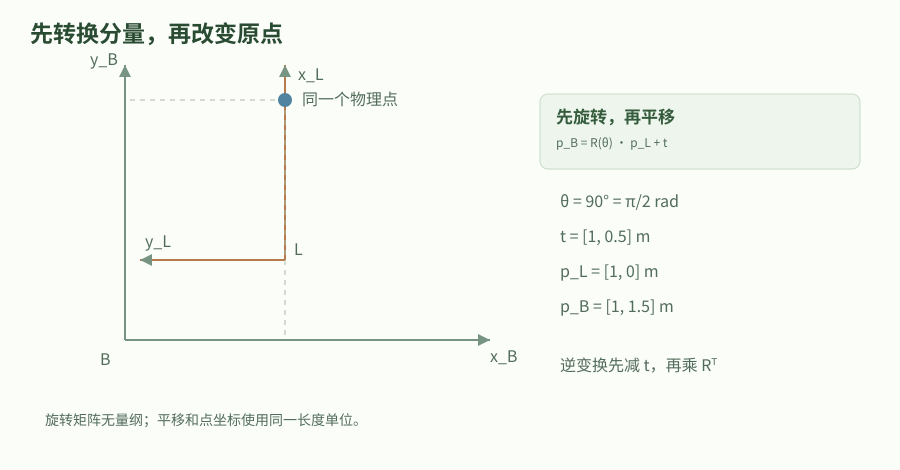

例中先将传感器坐标旋转90°，再加安装平移。图上两组坐标描述同一个点；改变表达坐标不改变物理点。

### 旋转矩阵保持长度却不允许任意相加

刚体旋转需要保持内积和右手性，因此旋转矩阵满足列向量互相正交、长度为一，且行列式为正一。转置就是逆矩阵。行列式为负一的正交矩阵还包含镜像，不能作为普通机器人姿态。连续相乘会受到浮点舍入影响，实际系统需要检查误差并通过合理方式重新投影或归一化，而不是把任意三乘三数组当作旋转。

一般不能用矩阵元素的算术平均表示平均姿态。例如单位旋转与绕 z 轴半周旋转的平均，会把平面轴压成零。旋转群的约束解释了为什么姿态不能像位置一样任意加减。对于指定单位轴，可以用 Rodrigues 公式构造旋转；输入轴必须先归一化，角度使用弧度。零角度给单位矩阵，接近半周时旋转仍然有效，只是从旋转恢复轴角可能有分支问题。

#### 旋转约束与轴角构造

$$
R^TR=I,\quad \det R=1,\qquad R=I+\sin\theta K+(1-\cos\theta)K^2
$$

K是单位轴u的叉乘矩阵，满足Kv=u×v。把矩阵指数的幂级数按K的幂归并可得到右式。实验用u=[0,0,1]和theta=pi/2构造R，逐项验证R^TR=I及x轴被映到y轴。

- `R`：三维旋转矩阵；单位／维度：无量纲

- `u`：单位旋转轴；单位／维度：无量纲

- `K`：单位轴的叉乘矩阵；单位／维度：无量纲

- `\theta`：绕该轴的右手旋转角；单位／维度：rad

### 齐次矩阵为何能统一复合与求逆

在三维点后面补一得到齐次坐标，就能把旋转和平移装进同一个四乘四矩阵。最后一行固定为 [0,0,0,1]，它的作用是让矩阵乘法同时完成旋转后平移。方向向量应补零，因为方向不随原点平移变化；将速度向量错误地补一，会给速度加入位置偏移。齐次表示没有把米和无量纲混为一谈，矩阵各块仍保留各自物理角色。

推导逆变换时从 p_A=R p_B+t 出发，先减去t，再左乘R的转置，得到 p_B=R^T p_A-R^Tt。因此逆变换平移不是简单的负t，还必须旋转到新的表达坐标系。程序中最实用的检查是“出去再回来”：任取一个点，经正变换后再经逆变换，误差应只剩浮点量级；这种检查比只测试单位旋转更能发现平移方向错误。

#### 位姿与逆变换

$$
T_{AB}=\begin{bmatrix}R_{AB}&t_{AB}\\0&1\end{bmatrix},\qquad T_{AB}^{-1}=\begin{bmatrix}R_{AB}^T&-R_{AB}^Tt_{AB}\\0&1\end{bmatrix}
$$

左上块为3×3旋转，右上块为3×1平移。直接相乘即可验算T乘逆矩阵为单位矩阵。二维实验用同一原理验证点[2,0]m在往返后恢复。

- `T_{AB}`：B到A的齐次变换；单位／维度：旋转块无量纲，平移块m

- `I`：相应维数的单位矩阵；单位／维度：无量纲

### 串联变换时让中间坐标系消去

若先把 C 中的点变到 B，再从 B 变到 A，代入两次坐标关系得到旋转 R_AB R_BC，平移 R_AB t_BC+t_AB。中间的 B 下标相邻，便于检查链条连接。只有表达在同一坐标系的向量才能相加，所以不能直接把 t_AB 与 t_BC 相加。坐标树中的每条边都要满足同一语义，不能某条边按主动旋转、另一条边按被动换坐标。

相同两个旋转或位移交换次序通常得到不同结果，这是空间运动的性质而非库函数异常。tf2 的查询方向、发布变换的父子帧和实际传感器外参必须一起核对；父帧名与子帧名只是元数据，写反后不会自动帮你求逆。动态坐标还必须使用同一时间上的变换，不能把一个当前点配上明显过期的底盘姿态。空间约定正确与时间约定正确是两项独立条件。

#### 位姿链的复合

$$
R_{AC}=R_{AB}R_{BC},\qquad t_{AC}=R_{AB}t_{BC}+t_{AB}
$$

将p_B=R_BCp_C+t_BC代入p_A=R_ABp_B+t_AB，并分别整理p_C的系数与常量项得到两式。实验比较“分两次变换”和“合并后一次变换”，并检查结果一致。

- `R_{AC}`：C到A的合成旋转；单位／维度：无量纲

- `t_{AC}`：C原点在A中的位置；单位／维度：m

- `t_{BC}`：C原点在B中的位置；单位／维度：m

### 四元数的存储次序、归一化与相对姿态

ROS 几何消息采用 x、y、z、w 次序，本章所有函数的输入输出也保持这一顺序。其他教材或库可能把标量w放在前面，因此不能只看“四个浮点数”就直接传递。本地官方四元数教程的相对旋转示例中存在输入索引与返回次序容易混淆的写法；这里的原创乘法函数把次序写进注释，并用乘以共轭得到恒等旋转的断言检查。

四元数必须为单位长度才表示纯旋转；零四元数无法归一化，不能用它表示未知姿态后的默认有效旋转。单位四元数的逆是向量部分取负、标量部分不变；把四个分量全取负得到同一姿态，并非一般意义的逆。比较姿态不能直接比较四个分量是否相等，插值前也应考虑q与负q的符号等价。姿态的小误差宜在三维切空间表达，不能把四个分量当作互相独立的四个角度。

### 表示与API对照：矩阵乘法和四元数乘法

同一个旋转作用到向量，可以直接用旋转矩阵左乘，也可以把向量嵌成标量部分为零的四元数，再按q乘向量乘q逆计算。前者输出普通三维向量，后者先输出四元数且理论标量部分为零；调用方应明确取出向量部分。实验在九十度旋转上对照这两条计算路径，而非只检查四元数长度，因此能更直接发现乘法或分量次序错误。

本章quaternion_product只是代数乘法，输入输出都写死为xyzw，不会把非单位输入自动当作合法姿态。如果一个库的构造函数参数是wxyz，而消息读写接口是xyzw，就应在适配层明确逐项赋值，并为恒等姿态、单轴四分之一周和乘以逆的结果留测试。不要依赖一串未说明次序的列表在多个库之间自由传递，尤其不要根据变量名q猜测内部排列。

比较两条姿态轨迹时，可以先把四元数符号对齐，或者使用相对旋转的几何量；直接比较四个分量的欧氏差，会把q跳到负q误判为很大的姿态变化。对齐符号不能消除真实角度跨越分支的问题，长时间积分仍需检查归一化和角速度表达系。姿态误差的局部三维向量必须同时说明它乘在原姿态左侧还是右侧，不能在协方差传播中随意更换。

二维教学里的rotate2和apply2刻意分成两个接口：前者处理方向或位移的分量变化，后者处理相对不同原点的点坐标。实际tf2也区分点、向量、姿态等消息语义。一个方便的调试顺序是先验证原点变到哪里，再验证三个单位轴，最后验证任意点与往返关系；这样可以分别定位平移、旋转和复合方向的问题，而不只看模型整体外观是否大致正确。

### 用两种表示互证，再进入机器人坐标系统

下面实验同时保留二维旋转、三维 Rodrigues 矩阵和单位四元数。它们不是三个不同的物理世界，而是同一个刚体旋转的不同表示；一个方便手算，一个方便线性代数，一个方便存储和复合。检查时比较变换后的点或相对旋转，而不是强求数据结构相同。代码明确采用左乘列向量，角度统一弧度，位置统一米，避免语言接口掩盖数学约定。

把这些数学结果接入 tf2 时，还需要处理缓存、时间戳、父子帧关系和查询异常；本章实验不包含这些运行机制。建议先用静态外参验证长度保持和往返一致，再验证两条不同坐标路径的复合一致性。若观察到模型整体镜像，先查轴方向与右手性；若模型跟随运动但有时间偏移，先查时间链路。不要一开始就用大量平移补偿去掩盖错误旋转。

#### math_rigid.py

代码类型：complete

```python

#!/usr/bin/env python3
"""输入：米和弧度表示的位姿；输出：变换、逆变换与四元数一致性检查。"""

def run():
    import math

    def rotate2(angle_rad, point_m):
        # 列向量约定：R_AB 将 B 系分量转换为 A 系分量。
        c, s = math.cos(angle_rad), math.sin(angle_rad)
        x, y = point_m
        return [c * x - s * y, s * x + c * y]

    def apply2(angle_rad, translation_m, point_m):
        return [a + b for a, b in zip(rotate2(angle_rad, point_m), translation_m)]

    def quaternion_product(left, right):
        # 所有参数与返回值都严格采用 ROS 消息的 (x,y,z,w) 次序。
        # 乘法不交换；先应用 right，再应用 left 对应 left*right。
        x, y, z, w = left
        a, b, c, d = right
        return [w*a + x*d + y*c - z*b, w*b - x*c + y*d + z*a,
                w*c + x*b - y*a + z*d, w*d - x*a - y*b - z*c]

    # 平面实验：B 原点在 A 中为 (1,2)m，B 相对 A 绕 z 正转 90 度。
    angle = math.pi / 2.0
    translation = [1.0, 2.0]
    point_b = [2.0, 0.0]
    point_a = apply2(angle, translation, point_b)
    assert all(math.isclose(a, b, abs_tol=1e-12) for a, b in zip(point_a, [1.0, 4.0]))
    inverse_translation = rotate2(-angle, [-x for x in translation])
    recovered = apply2(-angle, inverse_translation, point_a)
    assert max(abs(a-b) for a, b in zip(recovered, point_b)) < 1e-12
    # 串联 A<-B<-C：不能直接把不同坐标系中的平移向量相加。
    t_bc = [0.5, 0.0]
    t_ac = apply2(angle, translation, t_bc)
    direct = apply2(angle + 0.2, t_ac, [0.3, -0.1])
    chained = apply2(angle, translation, apply2(0.2, t_bc, [0.3, -0.1]))
    assert max(abs(a-b) for a, b in zip(direct, chained)) < 1e-12

    # Rodrigues：本例单位旋转轴是 z，K=[u]_x；验证正交性与指定点的旋转。
    unit_axis = [0.0, 0.0, 1.0]
    k = [[0.0, -unit_axis[2], unit_axis[1]],
         [unit_axis[2], 0.0, -unit_axis[0]], [-unit_axis[1], unit_axis[0], 0.0]]
    k2 = [[sum(k[i][n] * k[n][j] for n in range(3)) for j in range(3)] for i in range(3)]
    rotation = [[float(i == j) + math.sin(angle)*k[i][j] + (1-math.cos(angle))*k2[i][j]
                 for j in range(3)] for i in range(3)]
    for i in range(3):
        for j in range(3):
            assert abs(sum(rotation[n][i]*rotation[n][j] for n in range(3)) - float(i == j)) < 1e-12
    assert abs(rotation[0][0]) < 1e-12 and math.isclose(rotation[1][0], 1.0, abs_tol=1e-12)

    # 单位四元数与其共轭相乘得到恒等旋转；零四元数不允许归一化。
    q = [0.0, 0.0, math.sin(angle/2.0), math.cos(angle/2.0)]
    assert math.isclose(sum(x*x for x in q), 1.0, abs_tol=1e-12)
    inverse_q = [-q[0], -q[1], -q[2], q[3]]
    identity_q = quaternion_product(q, inverse_q)
    assert max(abs(a-b) for a, b in zip(identity_q, [0, 0, 0, 1])) < 1e-12
    # q 与 -q 的二次旋转表达式一致；符号不同不代表姿态突变。
    yaw_cos_q = 1.0 - 2.0 * q[2]**2
    yaw_cos_minus_q = 1.0 - 2.0 * (-q[2])**2
    assert yaw_cos_q == yaw_cos_minus_q
    # 用纯向量四元数再次计算旋转，与 Rodrigues 的第一列独立对照。
    rotated_vector = quaternion_product(quaternion_product(q, [1.0, 0.0, 0.0, 0.0]), inverse_q)[:3]
    negative_q = [-value for value in q]
    negative_inverse = [-value for value in inverse_q]
    rotated_negative = quaternion_product(
        quaternion_product(negative_q, [1.0, 0.0, 0.0, 0.0]), negative_inverse)[:3]
    assert max(abs(rotated_vector[i]-rotation[i][0]) for i in range(3)) < 1e-12
    assert max(abs(a-b) for a, b in zip(rotated_vector, rotated_negative)) < 1e-12
    result = {'point_in_A_m': point_a, 'recovered_in_B_m': recovered, 'quaternion_xyzw': q}
    print('刚体变换实验通过：', result)
    return result

if __name__ == '__main__':
    run()


```

这是原创完整文件，只使用 Python 标准库。复制到同名文件后可直接运行；输入、输出、单位、执行顺序和边界检查都写在中文注释中。实验检查当前理想模型的数学性质，不代表 ROS 节点、仿真或实机已经验证。

### tf2 API：目标坐标、源坐标、时刻与四元数

| 问题 | 接口概念 | 单位／约定 | 常见错误 |
| --- | --- | --- | --- |
| 查询变换 | lookupTransform / lookup_transform(target, source, time, ...) | 把 source 坐标表达的量变为 target 坐标表达；平移通常为 m | 目标与源顺序写反会取到逆变换。用一个已知点代入验证方向。 |
| 查询时刻 | 给定消息时间戳，或接口约定的 latest | 时间戳包含秒与纳秒；零时刻具有特殊含义时以 API 为准 | “最新”不是“恰好与传感器消息同一时刻”。动态变换要检查外推与时间同步。 |
| 变换消息 | PointStamped / PoseStamped / Vector3Stamped 等 | 点包含平移；方向向量只旋转；速度还需解释参考点和表达坐标 | 不能把所有三元素数组都当同一种几何量；相同维度不代表同一变换规则。 |
| ROS 四元数 | geometry_msgs/Quaternion 的字段 x, y, z, w | 无量纲；通常要求单位四元数，旋转角用 rad | 某些数学库采用 w,x,y,z，不能不检查顺序直接拷贝。也不能把欧拉角直接塞进四元数字段。 |
| 异常处理 | Lookup / Connectivity / Extrapolation 等异常 | timeout按具体API和构造时钟计算，不能自动当墙钟上界 | 异常后应跳过本次计算或进入降级流程，不能沿用未经标记的旧变换当当前观测。 |

TF 是时间相关的坐标关系。发布一个同名 frame 既不能修复真实标定，也不能替代外参、里程计和全局定位各自的责任。

固定Jazzy C++ Buffer::canTransform用构造clock_->now()推进期限；冻结ROS clock可能使等待不自然超时。Python同步can_transform用默认SYSTEM_TIME并sleep，不能当monotonic机制，也不能自行调度被阻塞执行器的TF回调。

业务单调截止需要非阻塞查询/有界队列等可继续推进的路径；外层deadline放在内部阻塞调用返回之后不能约束内部等待。

### 贯穿案例：相机点如何回到底盘坐标

用二维截面模拟一个绕z轴九十度的传感器外参，平移为[1,2]m。

1. 将传感器中的点[2,0]m旋转为[0,2]m，再平移得[1,4]m。

2. 按逆平移-R^Tt和逆旋转计算回程，恢复[2,0]m。

3. 增加B←C变换，比较逐级换坐标与合并矩阵结果。

4. 用z轴四元数和Rodrigues旋转验证同一九十度旋转的几何效果。

验收：往返与复合误差小于1e-12；四元数按xyzw保存并保持单位长度。

### 深入练习 1

为什么T的逆平移一般不等于-t？

参考答案：-t仍在原来的A系表达，逆映射的输出在B系，必须再乘R的转置得到-R^Tt。

### 深入练习 2

q=[0,0,sin(pi/4),cos(pi/4)]与-q表示何种关系？

参考答案：它们表示同一个绕z轴九十度旋转；q的逆则只对前三个分量取负。

### 深入练习 3

位置与方向向量的齐次末尾分量为什么分别是1和0？

参考答案：位置需要包含原点平移，补1；方向只受旋转影响，补0使平移块不参与。

### 基础验证流程

#### 先固定模型与单位

按本章符号表手算案例，明确观测、状态、控制量的坐标系和单位；先记录理论值，再运行代码，避免只看“通过”字样。

#### 运行完整数值实验

将本章完整 Python 文件保存到空目录。Python 3 无需安装第三方包；若使用随站源码包，也可运行统一的 math_labs.py 并选择本章。

```bash

# 输入是文件中的固定教学数据；不会连接 ROS 图或控制硬件。
python3 math_rigid.py
# 随站合并实验集可只运行这一章；参数是章节 ID。
python3 math_labs.py --chapter math-rigid

```

#### 解释通过与失败的含义

将打印数值与手算结果逐项对照。再按练习改变一个参数，区分数学前提被破坏、浮点误差和实现错误。不要删除失败断言来制造通过。

### 预期结果

- 二维点[2,0]m经变换得到[1,4]m，再经逆变换返回。

- 矩阵正交性、坐标链一致性和四元数共轭恒等式通过断言。

### 常见问题

- 把旋转角的度数直接传给要求弧度的三角函数。

- 混用xyzw和wxyz，或把四元数全取负误当作求逆。

- 不同帧的平移直接相加，或动态变换时间戳不一致。

### 练习

为本章实验写一份输入输出契约：列出状态次序、单位、前提、一个正常案例、一个必须拒绝或明确标记退化的案例。

#### 参考答案

契约应明确本章模型的量纲与坐标约定，正常案例需给出可复算的数值；退化案例应对应正文列出的边界，并解释失败原因。实验只验证这个有限模型，不把结果外推到任意噪声、任意机器人或实机安全。

### 验证范围

原创数学推导；读取本地参考教程以核对主题范围，并与本章列出的一手资料交叉核对。标准库完整实验已在本轮运行并通过断言；ROS 构建、仿真、硬件未运行。

### 依据

- [Modern Robotics：齐次变换矩阵](https://modernrobotics.northwestern.edu/nu-gm-book-resource/3-3-1-homogeneous-transformation-matrices/)

- [ROS 2 Jazzy：四元数基础教程源码](https://github.com/ros2/ros2_documentation/blob/929e37c4c6d0746e75d10f1fd76f024743ff75ea/source/Tutorials/Intermediate/Tf2/Quaternion-Fundamentals.rst)

## 7. 概率与不确定性：从条件概率到传感器融合

通过二元定位事件和两台位置传感器，解释先验、似然、后验、方差、相关性与高斯融合，明确哪些结论依赖独立与分布假设。

### 学习目标

- 手算一次带基础发生率的贝叶斯更新

- 区分标准差、方差、相关与独立

- 推导两个独立高斯测量的精度加权融合并理解失效条件

### 先修

理解均值、平方和与分数运算；已了解线性观测及协方差

### 概念

概率是对不确定事件的模型，需要说明条件与样本空间。

高斯只是常用模型，噪声不因为被写进协方差矩阵就自动变成高斯。

融合要求避免重复计算共享的信息，低方差不能单独证明估计准确。

### 先确定事件，再讨论“检测有多准”

设机器人可能位于一个特定区域，进入区域的先验概率为0.2。传感器在区域内报告阳性的概率为0.9，在区域外误报阳性的概率为0.1。这三个数描述不同条件，不能把0.9直接当成“阳性后在区域内的概率”。先验反映测量前的知识，似然描述在假定状态下产生观测的可能性，后验把二者结合后重新评价状态。

把所有情况分成“在区域内且阳性”和“在区域外且阳性”，对应概率分别为0.18和0.08。已知阳性后，样本空间只剩这两类，所以区域内概率变为0.18除以0.26，约0.6923。若区域非常罕见，即使传感器命中率高，误报也可能占多数。这个例子说明，机器人感知模块只给检测置信度时，下游还需要知道它究竟是哪一种条件概率。

#### 二元事件的贝叶斯更新

$$
P(H\mid Z)=\frac{P(Z\mid H)P(H)}{P(Z\mid H)P(H)+P(Z\mid \neg H)P(\neg H)}
$$

分子是H与Z同时发生的概率，分母由H和非H两类阳性事件相加得到。分母必须大于零，否则该模型认为Z不可能发生，不能继续条件化。代入0.9、0.2、0.1得到9/13。

- `H`：机器人在指定区域内的事件；单位／维度：概率无量纲

- `Z`：传感器报告阳性的事件；单位／维度：概率无量纲

- `P(H)`：观测前的先验概率；单位／维度：无量纲

### 随机量的均值、方差和物理单位

位置误差不是一串可以随意平均的数，它对应在某个坐标系和某段工况下的随机变量。均值表示中心，方差衡量偏离中心的平方平均；标准差是方差的平方根，因此位置标准差单位是米，位置方差单位是平方米。把均方误差与方差混用还会忽略偏置：一个总是偏移一米的传感器可能波动很小，却不准确。

若只有有限组实验数据，先说明是否把它们当成总体，还是用来估计未知分布。代码中的样本方差采用n减一作分母，在独立同分布且二阶矩存在时是常见的无偏估计方式；它不是“每次一定更接近真值”的保证。采样需尽量覆盖实际转速、地面和温度等条件。静止时估计的方差直接搬到剧烈颠簸工况，可能使滤波器过度自信，而这个错误不会由矩阵尺寸检查发现。

#### 波动与偏置的分解

$$
\mu=E[X],\qquad \sigma^2=E[(X-\mu)^2],\qquad E[(X-a)^2]=\sigma^2+(\mu-a)^2
$$

将X-a写成(X-mu)+(mu-a)，平方后取期望；交叉项因E[X-mu]=0而消失。若估计的标准差很小但均值远离真实参考a，均方误差仍然很大。该式只要求二阶矩存在。

- `X`：测量或状态随机变量；单位／维度：本例m

- `\mu`：均值；单位／维度：本例m

- `\sigma^2`：方差；单位／维度：本例m^2

- `a`：用于评价误差的确定参考；单位／维度：本例m

### 零相关、独立与重复信息

协方差为零只表示两个变量的线性共变动为零，一般不能推出独立。取X等概率为负一、零、一，令Y=X的平方：X与Y的协方差为零，但知道X后就完全知道Y，两者明显依赖。只有添加联合高斯等特定条件，零互协方差才能推出独立；仅仅各自看起来像高斯也不能替代联合分布条件。

在机器人中，轮速和轮式里程计的位置往往来自同一编码器积分，两个定位结果还可能共享同一地图或同一先验。如果把它们当独立测量反复融合，估计协方差会缩小，却没有获得对应数量的新信息。正确做法可能是选取互补变量、保留相关项，或在统一估计问题中只引入一次原始因子。消息来自不同话题并不意味着统计上独立。

#### 互协方差的含义

$$
\operatorname{Cov}(X,Y)=E[(X-E[X])(Y-E[Y])]
$$

协方差只测量二阶线性相关。实验枚举X=-1,0,1与Y=X^2，得到协方差0；同时Y仍由X确定，构成“不相关不等于独立”的可复算反例。

- `X,Y`：同一概率模型下的随机量；单位／维度：分别按物理量定义

- `\operatorname{Cov}(X,Y)`：互协方差；单位／维度：X单位乘Y单位

### 高斯似然与精度加权融合的推导

现在假设同一个静止位置由两台无偏、独立传感器测量，观测分别为2.0米、2.6米，噪声标准差为0.2米、0.4米。假设状态使用平坦先验，两个高斯似然相乘；取负对数后，得到两个按方差倒数加权的残差平方。把平方项展开，再收集位置的二次项和一次项，配方就能读出后验均值与方差。

两个精度分别是25和6.25每平方米，总精度31.25；后验方差是0.032平方米，均值是(25乘2.0加6.25乘2.6)除以31.25，得到2.12米。较小方差的传感器权重更高，但并非完全忽略另一台。如果存在已知高斯先验，还要再加入一次先验精度与信息项；若两传感器相关，则不能继续简单把两个精度直接相加。

#### 独立高斯位置观测的融合

$$
\sigma_*^2=\left(\sum_i\sigma_i^{-2}\right)^{-1},\qquad \mu_*=\sigma_*^2\sum_i\sigma_i^{-2}z_i
$$

适用于对同一标量状态的无偏独立高斯观测与平坦先验。展开sum((x-z_i)^2/sigma_i^2)并完成平方即可得到。这里sigma_i^{-2}表示1/sigma_i^2，不能误写成标准差倒数。

- `z_i`：第i台传感器的测量；单位／维度：m

- `\sigma_i^2`：该传感器噪声方差；单位／维度：m^2

- `\mu_*`：后验均值；单位／维度：m

- `\sigma_*^2`：后验方差；单位／维度：m^2

### 分布假设失效时怎样解释结果

激光遮挡、多路径、视觉误匹配和轮胎打滑可能产生偏置、重尾或多峰分布。这时单个均值和协方差仍可作为有限摘要，但不一定完整描述信念；两个相距很远的候选位置的均值甚至可能落在障碍中。高斯融合公式输出一个数，并不能证明传感器异常已经消失。应在原始观测层记录失败类型，分析残差、工作条件和独立参考误差。

鲁棒损失、混合分布、粒子方法和故障诊断各有适用范围，不能只根据“非高斯”三个字就选择一个万能替代算法。首先问噪声是否有系统偏差，观测是否相关，模型与坐标是否正确；这些错误常常比更换滤波器影响更大。若采用统计门限，还要区分模型条件成立下的误拒概率与真实系统风险，不能把有限概率保证改写为绝对不会误判。

### 同一融合任务的三种接口与误差检查

对于本章独立标量高斯测量，可以直接累加精度和精度乘测量的信息量；也可以构造加权最小二乘目标；还可以把一个高斯先验逐条更新。这三种计算路径在同一独立性假设、相同数据只使用一次且精度正常时给出同样结果。若每条测量已经包含了同一先验，再逐条更新，就重复加入先验信息；代码形式相似不能弥补模型语义不同。

当只有两个传感器时，读者可以手算加权平均的两个归一化权重分别为0.8和0.2，因此2.0与2.6的折中为2.12。融合方差比两个独立测量各自方差都小，原因是新的独立信息增加了精度，不是平均操作本身有神奇去噪能力。若两份数据是同一传感器输出的拷贝，物理信息没有增加；对相同数值用同一公式会得到过小方差，说明输入契约已被违反。

概率接口还要区分返回的是概率、对数概率、密度还是未归一化权重。连续变量某一个精确点的概率通常为零，但该点的密度可以非零甚至大于一；不能把密度数值当作百分比裁到零和一之间。多个小似然相乘可能下溢，使用对数域时应在归一化时统一减去适当基准并保持求和规则；本章二元实验数值较大，没有把未实现的大规模数值技巧标为已验证。

评价融合效果应把精度与校准分开。除了看均值偏差，还可以按预测标准差把实际参考误差归一化，观察在不同工况下是否持续过大或过小；这要求参考数据质量已知且样本具有代表性。没有真值时可以检查残差与一致性线索，但不能据此断言所有状态误差都正确。上述分析把公式、观测来源和评价准则连在一起，避免把单个协方差字段当成完整可信度证明。

### 理论值、枚举与随机采样三种验证路径

本章程序分三层检查。第一层直接算二元后验和两个高斯测量的闭式解；第二层枚举有限分布验证不相关但不独立的反例；第三层用固定随机种子生成样本，比较样本均值和方差与设定参数。这三种路径验证不同问题：代数实现、逻辑命题和采样行为不应混作同一类证据。随机实验固定种子是为了可复现，不是为了人为挑选好看的结果。

对接 ROS 消息时，还需把统计量放到正确坐标系与时间范围。传感器给出的协方差可能只是测量噪声，也可能已经包含上游估计器的先验信息；直接按独立原始测量处理会重复利用历史。先明确发布者输出的变量定义和来源，再决定如何融合。下面的标准库实验有意只使用静止位置标量，便于把每一步手算与输出对齐，而不掩盖在复杂话题图中。

#### math_probability.py

代码类型：complete

```python

#!/usr/bin/env python3
"""输入：已知概率及独立测量方差；输出：后验概率、融合值与相关性反例。"""

def run():
    import math
    import random

    def binary_posterior(prior, hit_rate, false_alarm):
        # 三个输入都是 [0,1] 内的无量纲概率；分母为零表示事件不可能发生。
        if not all(0.0 <= p <= 1.0 for p in (prior, hit_rate, false_alarm)):
            raise ValueError('概率必须在 [0,1] 内')
        evidence = prior * hit_rate + (1.0-prior) * false_alarm
        if evidence <= 0.0:
            raise ValueError('观测事件概率为零，不能条件化')
        return prior * hit_rate / evidence

    posterior = binary_posterior(0.2, 0.9, 0.1)
    assert math.isclose(posterior, 9.0/13.0, abs_tol=1e-12)
    try:
        binary_posterior(0.5, 0.0, 0.0)
    except ValueError:
        pass
    else:
        raise AssertionError('零证据事件本应被拒绝')

    # 两个传感器独立观测同一静止位置：米、平方米；采用平坦先验。
    measurements_m = [2.0, 2.6]
    variances_m2 = [0.04, 0.16]
    precisions = [1.0/value for value in variances_m2]
    posterior_variance = 1.0 / sum(precisions)
    posterior_mean = posterior_variance * sum(z*w for z, w in zip(measurements_m, precisions))
    assert math.isclose(posterior_mean, 2.12, abs_tol=1e-12)
    assert math.isclose(posterior_variance, 0.032, abs_tol=1e-12)

    # 有限样本计算证明：零协方差不蕴含独立。Y=X^2 完全由 X 决定。
    x_values = [-1.0, 0.0, 1.0]
    y_values = [x*x for x in x_values]
    mean_x, mean_y = sum(x_values)/3.0, sum(y_values)/3.0
    covariance = sum((x-mean_x)*(y-mean_y) for x, y in zip(x_values, y_values))/3.0
    assert math.isclose(covariance, 0.0, abs_tol=1e-12)
    assert y_values[1] == 0.0 and y_values[0] == 1.0

    # 固定随机种子，使采样实验可复现；容差是该固定样本的验收界限。
    # 不能把一次采样通过解释成分布、独立性或传感器质量的证明。
    generator = random.Random(20261107)
    samples = [generator.gauss(2.0, 0.2) for _ in range(30000)]
    sample_mean = sum(samples)/len(samples)
    sample_variance = sum((v-sample_mean)**2 for v in samples)/(len(samples)-1)
    assert abs(sample_mean-2.0) < 0.01
    assert abs(sample_variance-0.04) < 0.002
    result = {'posterior_inside': posterior, 'fused_position_m': posterior_mean,
              'fused_variance_m2': posterior_variance, 'sample_mean_m': sample_mean,
              'sample_variance_m2': sample_variance}
    print('概率与测量实验通过：', result)
    return result

if __name__ == '__main__':
    run()


```

这是原创完整文件，只使用 Python 标准库。复制到同名文件后可直接运行；输入、输出、单位、执行顺序和边界检查都写在中文注释中。实验检查当前理想模型的数学性质，不代表 ROS 节点、仿真或实机已经验证。

### 贯穿案例：一次阳性检测与两台定位传感器

先判断区域事件，再独立估计静止位置；两者是不同行为，不共享一套未经说明的“置信度”。

1. 将区域阳性拆成0.18和0.08两种联合事件，算出后验9/13。

2. 把0.2m、0.4m标准差平方，得到0.04、0.16m²。

3. 按精度完成平方，得到融合位置2.12m与方差0.032m²。

4. 枚举X和X²验证零协方差不代表独立，再查看固定种子采样统计。

验收：四类断言均通过；程序明确拒绝零证据事件，不把一次采样误差视为真分布证明。

### 深入练习 1

若先验区域概率从0.2变为0.01，保持同样命中率与误报率，阳性后的概率是多少？

参考答案：0.009/(0.009+0.099)=1/12，约0.08333；必须考虑基础发生率。

### 深入练习 2

把同一份标准差0.2m的测量当成两台独立传感器，会得到什么错误？

参考答案：会把方差从0.04缩成0.02m²，虚构出新信息；相同原始测量不具有独立噪声。

### 深入练习 3

不假设高斯时，线性协方差传播是否仍成立？

参考答案：对确定线性映射且二阶矩存在，仍成立；高斯的额外作用是用均值和协方差完整参数化分布。

### 基础验证流程

#### 先固定模型与单位

按本章符号表手算案例，明确观测、状态、控制量的坐标系和单位；先记录理论值，再运行代码，避免只看“通过”字样。

#### 运行完整数值实验

将本章完整 Python 文件保存到空目录。Python 3 无需安装第三方包；若使用随站源码包，也可运行统一的 math_labs.py 并选择本章。

```bash

# 输入是文件中的固定教学数据；不会连接 ROS 图或控制硬件。
python3 math_probability.py
# 随站合并实验集可只运行这一章；参数是章节 ID。
python3 math_labs.py --chapter math-probability

```

#### 解释通过与失败的含义

将打印数值与手算结果逐项对照。再按练习改变一个参数，区分数学前提被破坏、浮点误差和实现错误。不要删除失败断言来制造通过。

### 预期结果

- 二元后验为9/13，静止位置融合结果为2.12m、0.032m²。

- 有限枚举给出零协方差的依赖反例；固定种子样本统计在声明容差内。

### 常见问题

- 把命中率解释成观测后的状态概率。

- 用不同话题名代替统计独立性判断。

- 把低方差当成低偏置或整体准确的证明。

### 练习

为本章实验写一份输入输出契约：列出状态次序、单位、前提、一个正常案例、一个必须拒绝或明确标记退化的案例。

#### 参考答案

契约应明确本章模型的量纲与坐标约定，正常案例需给出可复算的数值；退化案例应对应正文列出的边界，并解释失败原因。实验只验证这个有限模型，不把结果外推到任意噪声、任意机器人或实机安全。

### 验证范围

原创数学推导；读取本地参考教程以核对主题范围，并与本章列出的一手资料交叉核对。标准库完整实验已在本轮运行并通过断言；ROS 构建、仿真、硬件未运行。

### 依据

- [MIT 6.041SC：条件概率与Bayes公式](https://ocw.mit.edu/courses/6-041sc-probabilistic-systems-analysis-and-applied-probability-fall-2013/pages/unit-i/lecture-2/)

- [robot_localization：Jazzy 状态估计与传感器配置说明](https://github.com/cra-ros-pkg/robot_localization/tree/fea7fc3dcad81c533121e4aa2fb1087a0565d8cc)

## 8. 状态估计：预测、Kalman更新与一致性边界

从位置—速度模型手推一次预测与测量更新，用Joseph协方差形式、可观性和新息诊断把抽象公式连到ROS传感器融合。

### 学习目标

- 按位置与速度单位构造离散状态转移和过程协方差

- 手算新息、增益与后验状态并验证协方差

- 区分精确线性高斯KF、线性最小均方估计与非线性近似

### 先修

已理解协方差、相关性与高斯测量融合；能进行二阶矩阵乘法

### 概念

预测将旧估计推进到测量时间，更新只使用当前新增的观测信息。

滤波器的最优性依赖模型、噪声、初始条件和评价准则。

可观性和一致性诊断不能被“轨迹看起来平滑”替代。

### 状态模型、时间步长与噪声假设

用状态 [位置,速度] 表示沿直线行驶的机器人，单位分别为米和米每秒。匀速模型在一秒后把位置加上速度乘时间，速度保持不变。模型没有声称真实机器人永远匀速，而是把未建模加速度放到过程噪声。状态转移矩阵的右上角必须是采样间隔，不能把写死的一秒直接用于不规则时间戳，否则速度与位置更新会出现系统误差。

本章选择每个采样区间内加速度扰动恒定、区间间独立且零均值，标准差为0.1米每二次方秒。于是同一加速度同时影响位置和速度，过程协方差出现非零交叉项。这个离散常加速度随机模型与连续时间白加速度模型的谱密度不同；二者对时间间隔的幂次也不同。给Q矩阵赋值前必须先说明扰动来源与单位，不能只凭“越大越灵敏”来调。

#### 离散常加速度扰动模型

$$
F=\begin{bmatrix}1&\Delta t\\0&1\end{bmatrix},\quad G=\begin{bmatrix}\Delta t^2/2\\\Delta t\end{bmatrix},\quad Q=G\sigma_a^2G^T
$$

在一个采样区间内由位置增量v*dt+0.5*a*dt²、速度增量a*dt推得G。加速度扰动只有一个标量，因此Q是G与自身转置的外积乘加速度方差，通常含位置—速度相关项。

- `F`：匀速状态转移矩阵；单位／维度：各元素依状态量纲确定

- `G`：加速度对状态的影响；单位／维度：位置行s²，速度行s

- `\Delta t`：采样间隔；单位／维度：s

- `\sigma_a^2`：区间常加速度扰动方差；单位／维度：m²/s⁴

- `Q`：离散过程噪声协方差；单位／维度：位置块m²、速度块m²/s²

### 先预测均值，再传播不确定性

预测均值只是在没有新观测时根据模型推进已有信息；预测协方差还要考虑旧误差如何经模型传播，以及本区间新增过程噪声。推导从误差 e减等于F乘旧误差加过程噪声开始，展开外积并取期望。如果旧误差与过程噪声不相关，交叉项才消失，得到熟悉的两项之和。若噪声与过去状态相关，必须保留额外项，不能直接套用。

初始状态取[0m,1m/s]、协方差对角为0.04和0.01，间隔一秒。先验位置变为1m，先验速度仍为1m/s；传播后旧协方差为[[0.05,0.01],[0.01,0.01]]，再加Q=[[0.0025,0.005],[0.005,0.01]]，得到[[0.0525,0.015],[0.015,0.02]]。交叉项意味着位置观测会间接修正速度，不能把两个维度当成互不联系的标量滤波器。

#### 均值与协方差预测

$$
\hat x_k^-=F\hat x_{k-1}^+,\qquad P_k^-=FP_{k-1}^+F^T+Q
$$

假设过程噪声零均值，并与前一时刻估计误差不相关；有已知控制输入时还应在均值中加入相应输入项。高斯条件不是这两个矩传播公式成立的必要条件，但决定分布是否仍能由这两个矩完整表示。

- `\hat x^-`：当前测量到来前的预测状态；单位／维度：位置m、速度m/s

- `\hat x^+`：上一时刻测量后的估计；单位／维度：位置m、速度m/s

- `P^-,P^+`：预测和更新后的误差协方差；单位／维度：按状态分量单位相乘

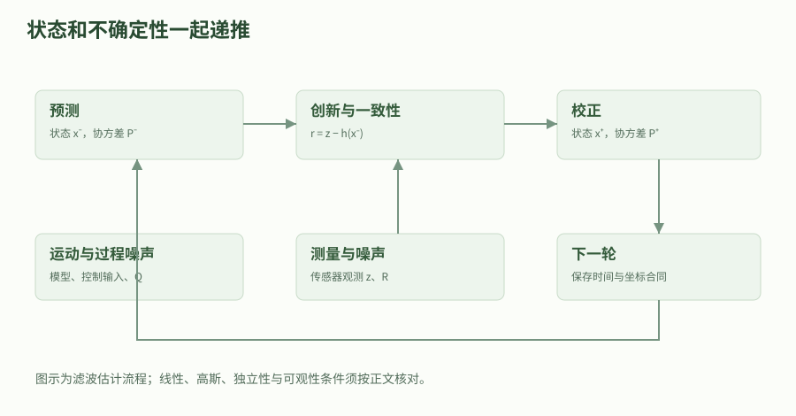

预测与校正既要更新状态，也要处理不确定性、时间戳和观测坐标。图不意味着所有SLAM算法都采用EKF，也不保证所有状态都可观。

### 新息告诉测量提供了什么新信息

位置传感器测到1.2m，观测矩阵H=[1,0]，测量方差R=0.04平方米。新息是测量减预测，因此为0.2m；新息方差是预测位置方差加测量噪声方差，为0.0925平方米。Kalman增益由预测误差与新息的相关性除以新息方差构成，得到位置增益约0.567568，速度增益约0.162162每秒。不同增益分量的单位不必相同。

把增益乘新息加到预测上，位置变为1.1135135m，速度变为1.0324324m/s。位置观测间接调整速度的原因是P中的位置—速度相关项，而不是传感器真的测出了速度。推导可以从最小化更新误差协方差的迹开始，或从联合高斯完成平方开始；前一种得到线性估计中的最小均方性质，后一种在完整线性高斯条件下给出精确条件分布。

#### 测量更新与Kalman增益

$$
\nu=z-H\hat x^-,\quad S=HP^-H^T+R,\quad K=P^-H^TS^{-1},\quad \hat x^+=\hat x^-+K\nu
$$

要求S可逆；本例S是严格正的标量，直接除法即可。多维实现通常通过分解求解线性方程，避免显式构造逆矩阵。测量噪声还需与预测误差不相关，否则公式需要改变。

- `z`：当前位置观测；单位／维度：m

- `H`：状态到观测的映射；单位／维度：本例[1,0]

- `\nu`：新息，即测量减预测；单位／维度：m

- `S,R`：新息和测量噪声方差；单位／维度：m²

- `K`：新息到状态修正的增益；单位／维度：位置分量无量纲、速度分量s^-1

### 协方差的Joseph形式与数值检查

将更新误差写成(I-KH)乘预测误差减K乘测量噪声，再取外积期望，得到Joseph形式。理论上的最优增益下，它与简化式(I-KH)P等价；但实际浮点计算中，两个半正定项相加通常比从较大矩阵里相减更便于维护合法协方差。它仍然不是对任意错误Q、R或不正确模型的万能修复，输入矩阵本身必须有明确含义。

实验逐项比较Joseph式与简化式，检查对称性以及二阶矩阵的正定条件。工程中还应避免把小的负特征值直接当成物理“负方差”，应分析舍入、更新次序、错误相关性或数据损坏。不能用对角线取绝对值掩盖问题，因为这样修改了概率模型。运行日志应包括实际时间间隔、观测来源、门限决定和协方差诊断，使失败可以复现。

#### Joseph协方差更新

$$
P^+=(I-KH)P^-(I-KH)^T+KRK^T
$$

根据更新误差的两项相加推导，在预测误差与测量噪声不相关时交叉项为零。实验验证与简化公式在双精度下差异小于1e-12，并验证得到的二维协方差对称正定。

- `I`：状态维数的单位矩阵；单位／维度：无量纲

- `P^+`：测量后的误差协方差；单位／维度：各状态单位两两相乘

- `K,R,H`：与测量更新相同的增益、噪声和观测模型；单位／维度：见前节

### 可观性、门限与“最优”的精确范围

连续两次只测位置时，可观性矩阵两行为[1,0]与[1,dt]，dt非零即可在无噪理想模型中区分位置和速度；若一直只测速度，则绝对位置偏移不能被观测消除。滤波输出的平滑程度不能替代这个信息分析。还可以把新息除以其预测标准差做归一化：本例NIS为新息平方除以S，约0.4324；把观测改成100m会显著超过门限9。

一维新息在正确线性高斯模型下可用相应卡方分布解释门限；门限9对应约三倍标准差，不是绝对异常判决。精确高斯后验需要初始状态与噪声满足相应联合高斯、独立或不相关假设，只有“模型线性”并不足够。放弃高斯但保留正确二阶矩和不相关条件时，可讨论最优线性均方估计；不能进一步声称对所有非线性估计器也最优。

### 同功能对照：协方差形式、信息形式与顺序更新

位置分量的一次后验还可以独立地通过精度融合计算：预测位置方差是0.0525平方米，测量方差是0.04平方米，两项精度相加后得到后验位置方差，再用精度加权均值得到同一个1.1135135米。完整程序把这个结果与二维Kalman更新的位置分量比较，形成另一条验算路径。速度修正仍依赖联合协方差，不能只凭这个标量等式替代完整状态估计。

协方差形式直接维护均值和误差协方差，信息形式维护精度矩阵及其乘均值的信息向量。独立测量更新在信息形式中具有相加结构，但预测通常不是简单相加；不能把某一种形式在更新时方便的性质误传到整个递推。平方根实现则维护协方差或信息矩阵的因子，以改善有限精度计算中的数值性质。这些是相同模型的不同代数实现，不是额外提供了传感器信息。

如果两个同时刻测量的噪声彼此独立，并且每次使用的是更新后的状态和协方差，逐条更新与把观测堆叠后一次更新在理想线性运算中等价。若噪声相关，简单顺序融合会丢掉相关块；若是非线性模型，还要说明是否在两次更新间重新线性化，这会使计算路径不同。跨语言比较要固定测量次序、线性化点、门限和舍入精度，不能只对齐最终话题名。

实现接口应区分predict与correct分别推进到哪个时间。重复对同一个时间区间预测，或把延迟观测当成当前观测直接更新，会产生与矩阵公式无关的时间错误。恢复历史状态再重放、采用适当延迟处理或拒绝过旧数据，都需要明确策略。本章固定一秒间隔与单次观测，故只验证这一时间契约；后续接入真实传感器时应把时间戳异常作为独立验收项。

### EKF、误差状态与ROS融合的接口边界

非线性模型用EKF时，要在当前估计附近线性化过程和观测，雅可比把小误差近似映射到新误差；大偏差、错误对应或强非线性会让这种局部近似失效。姿态若存成单位四元数，误差仍宜在三维旋转切空间定义，并明确左扰动还是右扰动；把四元数四个分量当成独立角度做协方差，会破坏单位长度与几何含义。不同误差状态、迭代或不变滤波方法也有各自模型条件。

接入robot_localization时，应核对变量次序、传感器frame_id、时间戳、测量协方差和重复信息来源。配置项表示融合哪些状态，不是说数组里未选中元素可以任意错误；坐标变换和数据有效性仍要先完成。本章完整实验只做一轮位置—速度滤波，帮助你独立复算核心公式。它没有实现完整robot_localization节点，也没有验证IMU偏置、非完整约束或车辆打滑。

#### math_estimation.py

代码类型：complete

```python

#!/usr/bin/env python3
"""输入：位置/速度先验与一次位置观测；输出：Kalman 更新、协方差和新息门限。"""

def run():
    import math

    def transpose(a):
        return [list(row) for row in zip(*a)]

    def multiply(a, b):
        # 只用于本例的小矩阵；尺寸必须满足 A 的列数等于 B 的行数。
        assert len(a[0]) == len(b)
        return [[sum(x*y for x, y in zip(row, column)) for column in zip(*b)] for row in a]

    def add(a, b):
        return [[x+y for x, y in zip(ra, rb)] for ra, rb in zip(a, b)]

    # x=[位置(m),速度(m/s)]；dt 单位 s；一次采样内未知加速度恒定。
    dt = 1.0
    state = [0.0, 1.0]
    covariance = [[0.04, 0.0], [0.0, 0.01]]
    transition = [[1.0, dt], [0.0, 1.0]]
    sigma_acceleration = 0.1  # m/s^2；这不是连续白噪声的谱密度。
    input_column = [0.5*dt*dt, dt]
    process_covariance = [[sigma_acceleration**2*a*b for b in input_column] for a in input_column]
    predicted_state = [state[0]+dt*state[1], state[1]]
    predicted_covariance = add(multiply(multiply(transition, covariance), transpose(transition)),
                               process_covariance)
    assert math.isclose(predicted_covariance[0][0], 0.0525, abs_tol=1e-12)

    # H=[1,0] 只测位置；R 必须是方差 m^2，不能误填标准差 0.2m。
    measured_position, measurement_variance = 1.2, 0.04
    innovation = measured_position-predicted_state[0]
    innovation_variance = predicted_covariance[0][0]+measurement_variance
    assert innovation_variance > 0.0
    gain = [predicted_covariance[i][0]/innovation_variance for i in range(2)]
    corrected_state = [x+k*innovation for x, k in zip(predicted_state, gain)]

    # Joseph 形式：P+=(I-KH)P-(I-KH)^T+KRK^T，较直接减法更便于保留正定性。
    identity_minus_kh = [[1.0-gain[0], 0.0], [-gain[1], 1.0]]
    corrected_covariance = add(
        multiply(multiply(identity_minus_kh, predicted_covariance), transpose(identity_minus_kh)),
        [[measurement_variance*a*b for b in gain] for a in gain])
    simplified = multiply(identity_minus_kh, predicted_covariance)
    assert max(abs(a-b) for ra, rb in zip(corrected_covariance, simplified) for a, b in zip(ra, rb)) < 1e-12
    assert abs(corrected_covariance[0][1]-corrected_covariance[1][0]) < 1e-12
    assert corrected_covariance[0][0]*corrected_covariance[1][1]-corrected_covariance[0][1]**2 > 0.0
    assert math.isclose(corrected_state[0], 1.1135135135135135, abs_tol=1e-12)
    # 同一个位置后验也能通过“先验精度+测量精度”计算，独立核对位置分量。
    scalar_variance = 1.0/(1.0/predicted_covariance[0][0]+1.0/measurement_variance)
    scalar_mean = scalar_variance*(predicted_state[0]/predicted_covariance[0][0]
                                   + measured_position/measurement_variance)
    assert math.isclose(corrected_state[0], scalar_mean, abs_tol=1e-12)

    # 无量纲 NIS：一维正确线性高斯模型下，门限 9 对应约三倍标准差。
    nis = innovation**2/innovation_variance
    outlier_nis = (100.0-predicted_state[0])**2/innovation_variance
    assert nis < 9.0 and outlier_nis > 9.0
    # 两次位置测量的可观性矩阵 [[1,0],[1,dt]] 在 dt!=0 时满秩。
    assert dt != 0.0
    result = {'predicted_state': predicted_state, 'gain': gain, 'corrected_state': corrected_state,
              'corrected_covariance': corrected_covariance, 'NIS': nis}
    print('状态估计实验通过：', result)
    return result

if __name__ == '__main__':
    run()


```

这是原创完整文件，只使用 Python 标准库。复制到同名文件后可直接运行；输入、输出、单位、执行顺序和边界检查都写在中文注释中。实验检查当前理想模型的数学性质，不代表 ROS 节点、仿真或实机已经验证。

### 贯穿案例：一秒预测后融合一次位置测量

初始[0m,1m/s]，初始P=diag(0.04,0.01)，区间加速度标准差0.1m/s²，位置测量1.2m、方差0.04m²。

1. 由常加速度区间模型构造F、G和Q，得到预测P的第一项0.0525m²。

2. 计算新息0.2m、新息方差0.0925m²。

3. 用增益[0.567568,0.162162]更新状态。

4. 比较两种协方差写法，并检查正常新息和100m异常观测的NIS。

验收：更新状态约[1.113514m,1.032432m/s]；协方差对称正定，模型内门限测试通过。

### 深入练习 1

如果测量方差无限增大，更新会怎样？

参考答案：在预测协方差有限且其他条件正常时，增益趋于零，估计接近预测；不是把预测方差也变成零。

### 深入练习 2

本章为何位置测量能更新速度？

参考答案：预测P中位置与速度互协方差为0.015，测量残差通过它影响速度增益。

### 深入练习 3

“线性系统会自动使状态与观测联合高斯”是否正确？

参考答案：不正确；还需初始状态与过程、测量噪声具有合适的联合高斯结构。线性变换只保持已有的高斯性，不会凭空创造高斯分布。

### 基础验证流程

#### 先固定模型与单位

按本章符号表手算案例，明确观测、状态、控制量的坐标系和单位；先记录理论值，再运行代码，避免只看“通过”字样。

#### 运行完整数值实验

将本章完整 Python 文件保存到空目录。Python 3 无需安装第三方包；若使用随站源码包，也可运行统一的 math_labs.py 并选择本章。

```bash

# 输入是文件中的固定教学数据；不会连接 ROS 图或控制硬件。
python3 math_estimation.py
# 随站合并实验集可只运行这一章；参数是章节 ID。
python3 math_labs.py --chapter math-estimation

```

#### 解释通过与失败的含义

将打印数值与手算结果逐项对照。再按练习改变一个参数，区分数学前提被破坏、浮点误差和实现错误。不要删除失败断言来制造通过。

### 预期结果

- 预测、增益、更新状态可逐项手算复现。

- Joseph与简化协方差一致，正常及大残差门限案例符合本模型预期。

### 常见问题

- 把连续白加速度谱密度与区间常加速度方差混为一谈。

- 仅凭轨迹平滑就称滤波器准确或一致。

- 重复融合共享先验，或把局部非线性近似当精确高斯后验。

### 练习

为本章实验写一份输入输出契约：列出状态次序、单位、前提、一个正常案例、一个必须拒绝或明确标记退化的案例。

#### 参考答案

契约应明确本章模型的量纲与坐标约定，正常案例需给出可复算的数值；退化案例应对应正文列出的边界，并解释失败原因。实验只验证这个有限模型，不把结果外推到任意噪声、任意机器人或实机安全。

### 验证范围

原创数学推导；读取本地参考教程以核对主题范围，并与本章列出的一手资料交叉核对。标准库完整实验已在本轮运行并通过断言；ROS 构建、仿真、硬件未运行。

### 依据

- [Stanford EE363：The Kalman Filter](https://ee363.stanford.edu/archive/lectures/kf.pdf)

- [robot_localization：Jazzy 状态估计与传感器配置说明](https://github.com/cra-ros-pkg/robot_localization/tree/fea7fc3dcad81c533121e4aa2fb1087a0565d8cc)

## 9. 优化基础：从残差到可诊断的迭代求解

把标定、定位与规划中的误差写成目标函数，推导Gauss–Newton、阻尼步、约束投影和Huber损失，并用失败反例限定算法能力。

### 学习目标

- 构造量纲一致的残差与目标函数

- 从局部线性化推导Gauss–Newton和阻尼步

- 理解边界最优点、异常值与终止条件的不同含义

### 先修

掌握最小二乘与基本微分；能解释雅可比的输入输出维数

### 概念

优化求解器只会优化实际写出的模型，不会自动补上单位、碰撞或执行器约束。

非线性迭代通常依赖初值，目标下降不等于找到全局最优。

同一任务可用不同算法实现，但比较必须统一目标、约束和终止标准。

### 先定义残差和尺度，再讨论算法

假设测量给出某个状态函数的预测关系，残差取预测减测量。所有残差都为零意味着模型与观测完全一致，但含噪数据通常做不到，因而用标量目标评价折中。位置误差单位是米、角度误差单位是弧度，直接把两者平方相加就隐含了一种任意尺度选择。若有可信噪声协方差，可以通过白化把它们变成可比较的无量纲残差。

本章以无量纲残差r(x)=x平方减四为贯穿例子。它在正二和负二都有零点，因此目标不是一个只有唯一谷底的凸二次函数。选择x大于零的工作范围相当于加入物理分支条件，不能由求解器自行猜测。真实机器人标定也应先解释状态范围、参数约束和观测模型，再把数组传入库；否则一个数值上收敛的解可能违反真实几何或机械限制。

#### 非线性最小二乘的梯度

$$
F(x)=\frac12 r(x)^Tr(x),\qquad \nabla F(x)=J(x)^Tr(x)
$$

J是残差对状态的雅可比；按链式法则对每个残差平方求导后相加即可得到。对r=x²-4，J=2x，梯度为2x(x²-4)。实验在x=1.3处用中心差分独立核对解析梯度。

- `x`：待优化状态；单位／维度：本例无量纲

- `r`：经过适当尺度处理的残差向量；单位／维度：本例无量纲

- `J`：残差对状态的雅可比；单位／维度：依变量单位而定

- `F`：平方残差总代价；单位／维度：本例无量纲

### 从Taylor展开得到Gauss–Newton

在当前状态附近把残差写成r加J乘增量，忽略增量二阶以上项，再对近似残差平方和求最小值，就回到线性最小二乘。正规方程的左边是J的转置乘J，右边是负J转置乘r。这个步骤近似的是残差函数，不是把整个非线性问题一次性变成全局凸问题；下一轮仍要在新的状态重新计算残差和雅可比。

对本例x=1，残差为负三，雅可比为二，Gauss–Newton增量是四分之六，即1.5，候选状态跳到2.5。继续迭代会在这个初值下接近正根，但如果从x=0开始，雅可比就是零，不能通过该观测的一阶信息决定方向。实际系统应检查秩、步长、残差与初值，而不是把“矩阵求解成功”当成正确估计的充分条件。

#### Gauss–Newton局部子问题

$$
r(x+\delta)\approx r(x)+J\delta,\qquad J^TJ\delta=-J^Tr
$$

固定当前x后，右侧是增量delta的线性最小二乘。需要足够的局部线性近似质量；J满列秩时该子问题解唯一。实验的解析梯度检查与非线性迭代共同验证这组代数关系。

- `\delta`：本轮状态增量；单位／维度：与x相同

- `J^TJ`：局部正规矩阵；单位／维度：按状态和残差尺度确定

### 阻尼能改善局部求解，却不能制造全局保证

给正规矩阵加正的对角阻尼，会惩罚过大的增量并缓解局部秩不足。阻尼较小时接近Gauss–Newton，较大时更接近沿负梯度的小步。不同变量尺度差异大时，直接用同一个阻尼乘单位矩阵还会产生不均匀影响，因此工程实现需要变量归一化或更合理的对角尺度。阻尼不是可以任意忽略单位的纯经验常数。

本章实现先计算候选步，再比较真实目标是否下降；接受后减小阻尼，拒绝后增大阻尼。它只是展示核心机制的简化版本，没有冒充完整的生产级LM信赖域算法。特别地，在x=0时梯度为零，即使阻尼严格为正，求出的增量仍为零，而目标值明显不是全局最小。这一反例直接说明，“加了阻尼”不能推出从任何初值必然找到正确分支。

#### 带对角阻尼的局部步

$$
(J^TJ+\lambda I)\delta=-J^Tr,\qquad \lambda>0
$$

对局部平方残差目标再加lambda/2乘增量模平方，求导得到此式。lambda为正使该局部矩阵在欧氏同尺度状态下正定，但不消除原始目标的多峰、错误模型或坏驻点。

- `\lambda`：增量惩罚的阻尼参数；单位／维度：与J^TJ对角相容

- `I`：状态维数的单位矩阵；单位／维度：无量纲

### 约束最优点不要求原目标梯度为零

考虑最小化二分之一乘(x减三)的平方，但限制x在负一到一之间。没有约束时最优是三，有约束时只能选一；此时原目标的导数等于负二，并不为零。因为继续向正方向移动虽然会降目标，却违反上边界。判断约束最优必须把可行方向或约束乘子一起考虑，不能沿用无约束“梯度小才算解”的单一标准。

投影梯度先走一步负梯度，再把候选值投回可行区间。本例区间是闭凸集，投影就是钳位；若可行集是复杂非凸碰撞区域，简单逐维钳位通常不再等价。实验从零开始，以步长二分之一迭代得到一，并用上边界乘子二抵消原目标导数。这个简单案例帮助读者区分约束处理与最终给控制命令做限幅：后者并不会自动重新求解原优化问题。

### 异常值、Huber损失与鲁棒性的范围

测量为2.0、2.1、1.9、20.0米时，普通平方损失的最优均值是6.5米，异常观测的巨大残差占据了主要影响。Huber损失对小残差保持平方增长，对大残差改成线性增长，因此大残差的梯度贡献被限制。阈值需要与残差尺度相容，不能把图像像素阈值原封不动用在米或弧度残差上。先白化再定阈值是一种常见组织方式。

本例把测量按一米参考尺度无量纲化，取阈值一。在解附近前三个残差都处于二次区，大异常残差在外侧贡献固定负一，因此驻点满足三倍x减六再减一等于零，得到七除以三。它比普通均值更接近正常观测簇，但并没有完全消除异常值影响，也不保证在多数观测错误或模型偏置时仍正确。鲁棒核与异常检测、数据关联和传感器故障诊断需要共同设计。

#### 本章采用的Huber损失

$$
\rho_\delta(r)=\begin{cases}\frac12r^2,&|r|\leq\delta\\\delta(|r|-\frac12\delta),&|r|>\delta\end{cases}
$$

两段在阈值处函数值与一阶导数相接；外侧导数为delta乘残差符号。实验直接累加截断后的导数做一维下降，得到7/3。此定义比某些资料的Huber表达式整体小一半，不影响同一目标的最优点，但会改变梯度步长尺度。

- `r`：经过尺度处理的残差；单位／维度：本例无量纲

- `\delta`：二次区与线性区的分界；单位／维度：与r相同

- `\rho`：单个残差损失；单位／维度：r单位的平方

### 实现对照：残差符号、导数来源与停止理由

残差也可以定义为测量减预测。若把r和J同时取负，平方目标、梯度J转置乘r及Gauss–Newton增量都不变；如果只改残差符号而忘记改雅可比，就会得到反向更新。这个等价关系适合作为跨实现检查：两份程序即使选择不同残差约定，只要导数与状态更新一致，仍应优化同一个问题。比较前先写清每个接口输出的符号含义。

导数可以解析推导、自动微分或有限差分取得。解析式便于理解且可能高效，但容易手工出错；自动微分沿计算图使用链式法则，不会自动修正错误模型、不可微分分支或不合理参数化；有限差分实现简单，却对扰动尺度和浮点相消敏感。完整程序用有限差分核对解析梯度，二者只共享目标函数，能帮助发现导数表达式错误，而不需要把大系统求解结果作为唯一参考。

停止可能因为残差很小、梯度很小、增量很小、到达边界、达到迭代上限或数值失败。它们含义不同：坏驻点可以梯度小，强阻尼可以让增量小，不可达目标也可能使求解器在上限处停止。本章把真目标下降和目标根检查分开，并保留非最优驻点反例；工程结果对象也应保留停止原因，不能把所有“函数返回了”都渲染成同一个成功标签。

在机器人执行链中，还要区分优化变量是否可行与执行命令是否可行。轨迹优化输出的速度可能受到连续约束，而采样后的离散控制器又有独立限幅和延迟；只对最后命令裁剪会改变规划的运动关系。适当的接口应返回目标状态、对应时间、可行性信息和失败策略，让执行层判断是否继续、降速或重新规划。数学小例子应先把这些契约解释清楚，再扩展到真实求解器。

### 同一功能的实现比较与可复现验收

本章同时演示有限差分与解析梯度、普通与阻尼最小二乘、投影与乘子解释、平方与Huber代价。比较这些方法时必须固定相同的残差、坐标、变量尺度和终止条件；若一个方法额外使用先验或更宽松误差阈值，运行时间就不能直接对比。C++或Python库提供的求解结果对象还应检查状态码、可行性、最终残差和实际迭代次数，不能只读取最后一个状态数组。

完整实验记录每次接受后的真实目标值，并断言它严格下降；同时保留x为零的非最优驻点反例。把这一习惯带到标定、SLAM和规划中，可以区分“局部步算对了”与“原问题解得合适”。后续扩展应逐项加入噪声、约束和复杂残差，每次保留一个能够手工复算的小实例；不要在第一次引入巨大稀疏系统时才发现残差符号与雅可比方向相反。

#### math_optimization.py

代码类型：complete

```python

#!/usr/bin/env python3
"""输入：固定非线性残差与异常测量；输出：阻尼迭代、约束解和鲁棒估计。"""

def run():
    import math

    def residual(x):
        return x*x-4.0  # 教学无量纲残差，正根为 2，负根为 -2。

    def objective(x):
        return 0.5*residual(x)**2

    # 用中心差分独立核对解析梯度；h 是无量纲状态扰动。
    point, h = 1.3, 1e-6
    numerical_gradient = (objective(point+h)-objective(point-h))/(2*h)
    analytical_gradient = 2*point*residual(point)
    assert abs(numerical_gradient-analytical_gradient) < 1e-6

    # 一维 LM 风格演示：先提候选步，再用真实目标值决定接受与否。
    # 实际求解器通常使用更完整的信赖域增益比和尺度处理。
    x, damping = 1.0, 0.1
    accepted_costs = [objective(x)]
    for _ in range(60):
        r, jacobian = residual(x), 2*x
        if abs(r) < 1e-10:
            break
        delta = -jacobian*r/(jacobian*jacobian+damping)
        candidate = min(5.0, max(0.1, x+delta))  # 显式选择正根分支的状态范围。
        if objective(candidate) < objective(x):
            x = candidate
            damping = max(1e-12, damping/3.0)
            accepted_costs.append(objective(x))
        else:
            damping *= 10.0
    assert abs(x-2.0) < 1e-8
    assert all(a > b for a, b in zip(accepted_costs, accepted_costs[1:]))
    # x=0 的梯度为零，增加阻尼并不能自动摆脱这个非最优驻点。
    assert 2*0.0*residual(0.0) == 0.0 and objective(0.0) > objective(2.0)

    # 投影梯度：最小化 0.5*(x-3)^2，约束 [-1,1]；最优点位于上边界。
    constrained = 0.0
    for _ in range(30):
        constrained = min(1.0, max(-1.0, constrained-0.5*(constrained-3.0)))
    assert constrained == 1.0
    multiplier = 3.0-constrained
    assert math.isclose((constrained-3.0)+multiplier, 0.0, abs_tol=1e-12)

    # Huber 损失：delta=1m；这里已把测量按 1m 参考尺度无量纲化。
    measurements = [2.0, 2.1, 1.9, 20.0]
    ordinary_mean = sum(measurements)/len(measurements)
    robust = 2.0
    for _ in range(150):
        gradient = sum(max(-1.0, min(1.0, robust-z)) for z in measurements)
        robust -= 0.2*gradient
    assert math.isclose(robust, 7.0/3.0, abs_tol=1e-8)
    assert ordinary_mean == 6.5 and abs(robust-2.0) < abs(ordinary_mean-2.0)
    result = {'nonlinear_positive_root': x, 'accepted_costs': accepted_costs,
              'constrained_solution': constrained, 'L2_mean': ordinary_mean, 'Huber_estimate': robust}
    print('优化实验通过：', result)
    return result

if __name__ == '__main__':
    run()


```

这是原创完整文件，只使用 Python 标准库。复制到同名文件后可直接运行；输入、输出、单位、执行顺序和边界检查都写在中文注释中。实验检查当前理想模型的数学性质，不代表 ROS 节点、仿真或实机已经验证。

### 贯穿案例：求平方观测的正根并处理异常测量

先求r=x²-4的正根，再用约束和鲁棒估计检验“同一优化接口”背后的不同数学问题。

1. 在x=1.3用中心差分核对梯度2x(x²-4)。

2. 从x=1按阻尼子问题求候选步，仅接受真实目标下降的候选。

3. 验证x=0虽梯度为零但并非最优，不能用停止条件冒充全局结论。

4. 分别求区间约束问题和四个位置测量的Huber估计。

验收：正根约2；区间约束解为1、对应上边界乘子2；L2均值6.5，Huber估计7/3。

### 深入练习 1

为什么给J^TJ加正阻尼后，仍不能保证从x=0求到x²=4的根？

参考答案：x=0时J=0，右端-J^Tr也为0，阻尼方程只给出零增量；原目标的坏驻点仍存在。

### 深入练习 2

本章约束问题在x=1处梯度为-2，为什么仍是最优？

参考答案：沿负梯度向正方向走会违反上边界；上边界乘子2满足站立条件和互补关系。

### 深入练习 3

Huber阈值变大到让所有残差处于二次区，会发生什么？

参考答案：该区间内目标退化为普通平方损失，异常值的影响重新不受截断限制；最优值会趋向普通均值。

### 基础验证流程

#### 先固定模型与单位

按本章符号表手算案例，明确观测、状态、控制量的坐标系和单位；先记录理论值，再运行代码，避免只看“通过”字样。

#### 运行完整数值实验

将本章完整 Python 文件保存到空目录。Python 3 无需安装第三方包；若使用随站源码包，也可运行统一的 math_labs.py 并选择本章。

```bash

# 输入是文件中的固定教学数据；不会连接 ROS 图或控制硬件。
python3 math_optimization.py
# 随站合并实验集可只运行这一章；参数是章节 ID。
python3 math_labs.py --chapter math-optimization

```

#### 解释通过与失败的含义

将打印数值与手算结果逐项对照。再按练习改变一个参数，区分数学前提被破坏、浮点误差和实现错误。不要删除失败断言来制造通过。

### 预期结果

- 有限差分与解析梯度一致，接受序列的真实代价下降。

- 保留坏驻点反例，并得到可复算的约束与Huber解。

### 常见问题

- 把局部线性化的子问题正定误称为原问题全局凸。

- 省略残差尺度与约束可行性，只比较最后状态和耗时。

- 用真实目标没有下降的候选继续迭代，却不记录拒绝原因。

### 练习

为本章实验写一份输入输出契约：列出状态次序、单位、前提、一个正常案例、一个必须拒绝或明确标记退化的案例。

#### 参考答案

契约应明确本章模型的量纲与坐标约定，正常案例需给出可复算的数值；退化案例应对应正文列出的边界，并解释失败原因。实验只验证这个有限模型，不把结果外推到任意噪声、任意机器人或实机安全。

### 验证范围

原创数学推导；读取本地参考教程以核对主题范围，并与本章列出的一手资料交叉核对。标准库完整实验已在本轮运行并通过断言；ROS 构建、仿真、硬件未运行。

### 依据

- [Boyd、Vandenberghe：Convex Optimization](https://web.stanford.edu/~boyd/cvxbook/bv_cvxbook.pdf)

## 10. 运动学：正解、逆解、雅可比与虚功

用两自由度平面机械臂把关节角、末端位置、速度、奇异性与力矩联系起来，推导与实现互相校验。

### 学习目标

- 从几何关系推导两连杆正运动学和两支逆解

- 用解析与有限差分两种实现验证雅可比

- 解释奇异构型以及力—力矩映射的功率一致性

### 先修

掌握三角函数、坐标变换与链式法则；已理解矩阵的秩与转置

### 概念

运动学描述几何和速度关系，不会自动计算惯性或控制稳定性。

逆运动学可能无解、多解，或在边界处数值敏感。

同一雅可比必须明确末端变量、表达坐标系与关节次序。

### 先选模型与关节变量，避免把示意图当通用机械臂

考虑两根刚性杆在同一平面运动，两个转动关节的轴都沿正z方向，关节角以弧度计。第一杆长度0.6米，第二杆0.4米；第二个关节角是第二杆相对第一杆的转角，不是它相对基坐标系的绝对朝向。因此第二杆在基坐标系的方向是两个角之和。这条几何约定决定后面所有正解、雅可比和逆解的符号。

第一杆末端的向量是长度乘第一角的正弦、余弦，第二杆的向量要用合角，再相加得到末端位置。该公式只描述末端位置两维，没有描述工具朝向、关节弹性、齿隙和碰撞。真实URDF中的origin、axis和关节顺序可能完全不同，必须先把模型对应到实际坐标约定，不能看到“两个关节”就照抄平面公式。

#### 平面两连杆正运动学

$$
x=l_1\cos q_1+l_2\cos(q_1+q_2),\qquad y=l_1\sin q_1+l_2\sin(q_1+q_2)
$$

把两个杆向量都表达在基坐标系再相加。代入l1=0.6、l2=0.4、q1=pi/6、q2=-pi/3，得末端约[0.8660254,0.1]米。

- `l_1,l_2`：两根杆的长度；单位／维度：m

- `q_1,q_2`：第一关节角与第二相对关节角；单位／维度：rad

- `x,y`：末端在基坐标系中的位置；单位／维度：m


例中先将传感器坐标旋转90°，再加安装平移。图上两组坐标描述同一个点；改变表达坐标不改变物理点。

### 速度雅可比是对正解逐项求导

对正运动学按两个角分别求偏导，得到两乘二的平移雅可比。第一列表示只让第一关节以单位角速度转动时的末端速度，第二列表示只让第二关节转动的贡献；实际末端速度是按两个关节速度的线性组合。这里雅可比描述的是基坐标系中的位置导数，不是完整六维空间twist的雅可比，不能与另一种定义直接混用。

实验选关节速度[0.2,-0.1]弧度每秒，得到末端速度约[-0.04,0.138564]米每秒。独立实现中心差分：分别对一个关节加减百万分之一弧度，正解位置的差除以两倍扰动。把它与解析雅可比比较，可以发现合角求导、关节排列和符号错误。扰动太大会有截断误差，太小又放大浮点相消，差分步长需要结合量级选择。

#### 关节速度到末端速度

$$
\dot p=J(q)\dot q,\qquad J=\begin{bmatrix}-l_1\sin q_1-l_2\sin(q_1+q_2)&-l_2\sin(q_1+q_2)\\l_1\cos q_1+l_2\cos(q_1+q_2)&l_2\cos(q_1+q_2)\end{bmatrix}
$$

对x、y分别按q1、q2求导，并用链式法则乘关节速度。解析与中心差分是同一导数的不同实现；前者高效，后者适合小例子独立验算，但不应把有限差分误差当成真实机器人建模误差。

- `p`：末端二维位置；单位／维度：m

- `J`：本章平移雅可比；单位／维度：m/rad

- `\dot q`：关节速度；单位／维度：rad/s

- `\dot p`：末端线速度；单位／维度：m/s

### 奇异性是局部运动能力的损失

将雅可比行列式展开，交叉项抵消，得到两杆长度之积乘第二关节角的正弦。当第二关节为零或半周时，两列方向线性相关，末端瞬时速度不能覆盖整个平面。机械臂拉直时不能在一阶近似下沿杆长方向伸得更远，这与实际几何一致。奇异性不表示机器人消失或程序必然崩溃，而是某些任务方向变得不可实现或非常敏感。

在接近奇异点时直接求雅可比逆，会把小的末端速度请求放大成很大的关节速度。伪逆可以定义某种最小范数解，阻尼最小二乘可以限制增量，但两者都需要明确任务误差、关节限位与允许速度，且可能引入跟踪偏差。若机械臂根本达不到目标，增加迭代次数不会改变可达域；应向上层报告退化或无解，而非只继续发布越来越大的速度。

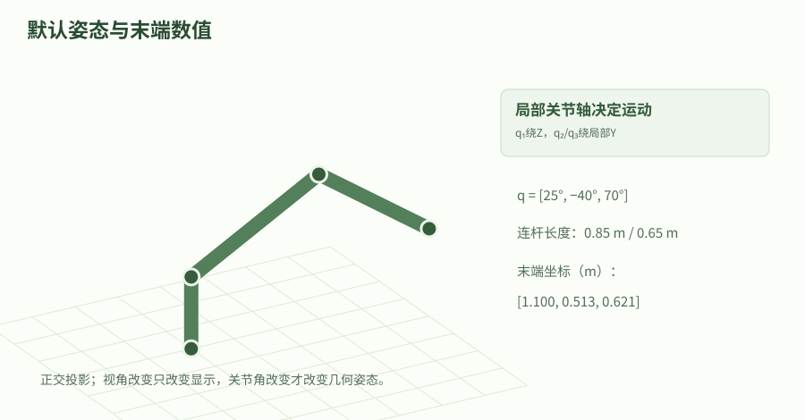

这是交互模型默认姿态的静态几何图，仅验证运动学关系，不包含质量、碰撞、接触、驱动或ROS连接。交互版可在正文中调整视角和关节。

### 逆解先检查可达域，再选择分支

由末端到原点的距离平方展开，可以消去第一关节角，得到第二角余弦。目标距离必须位于两杆长度之差与长度之和之间，本例为0.2到1.0米。余弦不在负一到一时，目标不可达；只允许对浮点舍入造成的微小越界钳位，不能把任意远目标都强行变成边界解。对于等长杆在原点的特例，还会出现第一角不唯一，需要单独讨论。

第二角可以取反余弦的正支或负支，对应两种肘部形态；再用目标方向角减去第二杆引起的偏角得到第一角。使用atan2保留象限信息，不能直接用y除x后取普通反正切。两支都通过正运动学回代检查位置，再结合关节限位、碰撞和连续性选择可执行解。数值逆运动学能处理更复杂模型，但同样需要初值、收敛判据与可行性检查。

#### 两连杆逆运动学

$$
\cos q_2=\frac{x^2+y^2-l_1^2-l_2^2}{2l_1l_2},\qquad q_1=\operatorname{atan2}(y,x)-\operatorname{atan2}(l_2\sin q_2,l_1+l_2\cos q_2)
$$

先由余弦定理确定q2的正负分支，再从末端方向中减去杆系内部偏角得到q1。实验对同一目标验证两支回代，并显式拒绝距离2米的目标。

- `q_1,q_2`：求得的两个关节角；单位／维度：rad

- `x,y`：目标点在基坐标系中的坐标；单位／维度：m

- `l_1,l_2`：正的杆长；单位／维度：m

### 为什么力矩映射使用雅可比转置

设f是机器人为平衡外界反作用而向工具输出的末端力，在同一基坐标系表达；外界对机器人的力为-f。忽略动态加速与其他负载时，工具输出功率等于相应关节输入功率。将末端位移等于雅可比乘关节位移代入，并要求对任意微小关节位移都成立，就得到关节力矩等于雅可比转置乘f。转置来自功的对偶配对，不是为了把数组形状凑成能相乘。

本例末端力为[2,3]牛顿，代码计算两个关节力矩，并比较关节侧与末端侧的功率，两者都约为0.335692瓦。若力与雅可比使用不同坐标系，等式就不再代表同一个物理功。更一般的六维力旋量还需要与同一约定的twist配对；角速度和线速度的排列在不同库中可能不同，必须同时核对。该静力映射不包含重力补偿和惯性加速力矩。

#### 虚功与瞬时功率一致性

$$
\tau=J^Tf,\qquad \tau^T\dot q=f^T\dot p
$$

由delta p=J delta q以及tau^T delta q=f^T delta p，比较任意delta q的系数得到第一式；换成速度即得第二式。实验以同一J、同一表达系的力和速度验证功率相等。

- `\tau`：关节广义力；本章为转动关节力矩；单位／维度：N·m

- `f`：基坐标系中的末端平面力；单位／维度：N

- `J`：前节定义的平移雅可比；单位／维度：m/rad

### 同功能对照：解析正逆解与数值模型接口

本章forward接收两个弧度角，返回基坐标系下的二维米制位置；jacobian接收同一关节顺序，返回位置对两个角的导数；inverse还需要一个肘部支路符号，并可能抛出不可达异常。把三个接口的契约写在一起，比只列出公式更容易发现组合错误。逆解返回的角即使满足目标位置，也没有包含关节限位和碰撞可行性的证明，调用方仍需继续检查。

解析逆解利用两杆几何结构，计算步骤短并能明确枚举两支。数值逆解通常从当前关节角出发，反复用雅可比或梯度减少目标误差，适合更多自由度和复杂约束，但可能停在坏初值附近。若比较两者，应固定末端任务只含位置还是还含姿态、误差范数、关节上下界和成功阈值；不同任务维数会让看似相同的“到达目标”包含不同要求。

微分运动学中的关节角速度输入与静力映射中的末端力输入是对偶接口：一个把关节运动传到末端，另一个把期望工具输出负载传回关节。这里工具对环境施加f，环境对工具反作用为负f；若改成给定外界对机器人的力，则静态补偿力矩要相应变号，并叠加重力等其他负载。明确力的施加对象，才能把虚功等式与动力学方程放到同一符号体系。

真实模型更换工具点时，位置雅可比会随参考点改变；即使表达坐标轴不变，也不能继续使用旧点的平移导数。六维速度与力的坐标变换还需要同时处理参考点转移造成的力矩项，不能只把三个力分量旋转后认为整个wrench已完成转换。学习时先用本章两个关节、一个明确末端点的模型手算，再逐项扩展参考点、坐标系与任务变量，能保留可解释的排错路径。

### 从教学函数到机器人模型API

正解、逆解和雅可比三个接口应共享关节次序、基坐标系、工具点和长度单位。ROS的关节状态可按名字到达，并不保证数组顺序天然等于运动学模型顺序；使用前应按关节名映射。模型库还可能提供空间雅可比、体坐标雅可比、几何雅可比或解析雅可比，名字接近但输入输出定义不同。比较同功能实现时，先把末端参考点和表达坐标系统一。

下面完整程序覆盖正解、解析导数、差分导数、两支逆解、不可达点拒绝、奇异性和虚功检查。它没有实现碰撞检测、关节限位规划或动力学，不能把目标点可达理解为整段路径可执行。进入MoveIt等系统时，把这类小模型作为独立回归样例，再逐项检查模型、规划与控制接口，有助于明确错误发生在几何层还是执行层。

#### math_kinematics.py

代码类型：complete

```python

#!/usr/bin/env python3
"""输入：两连杆长度(m)、角度(rad)、角速度(rad/s)；输出：位置、雅可比和力矩。"""

def run():
    import math
    length_1, length_2 = 0.6, 0.4  # 两个刚性杆的长度，单位 m。

    def forward(q):
        a, b = q
        return [length_1*math.cos(a)+length_2*math.cos(a+b),
                length_1*math.sin(a)+length_2*math.sin(a+b)]

    def jacobian(q):
        a, b = q
        return [[-length_1*math.sin(a)-length_2*math.sin(a+b), -length_2*math.sin(a+b)],
                [length_1*math.cos(a)+length_2*math.cos(a+b), length_2*math.cos(a+b)]]

    def inverse(point, elbow_sign):
        # elbow_sign 为 +1 或 -1，显式选择肘部两种支路；越界目标必须拒绝。
        px, py = point
        cosine = (px*px+py*py-length_1**2-length_2**2)/(2*length_1*length_2)
        if cosine < -1.0-1e-12 or cosine > 1.0+1e-12:
            raise ValueError('目标不在两连杆可达环带内')
        # 仅钳位浮点舍入误差，不能把真实越界目标投射成可达目标。
        q2 = elbow_sign*math.acos(min(1.0, max(-1.0, cosine)))
        q1 = math.atan2(py, px)-math.atan2(length_2*math.sin(q2), length_1+length_2*math.cos(q2))
        return [q1, q2]

    q = [math.pi/6.0, -math.pi/3.0]
    position = forward(q)
    j = jacobian(q)
    step = 1e-6  # 雅可比差分的角度扰动，单位 rad。
    for joint in range(2):
        plus, minus = q.copy(), q.copy()
        plus[joint] += step
        minus[joint] -= step
        numerical = [(a-b)/(2*step) for a, b in zip(forward(plus), forward(minus))]
        assert max(abs(numerical[i]-j[i][joint]) for i in range(2)) < 1e-8
    recovered = inverse(position, -1)
    assert max(abs(a-b) for a, b in zip(recovered, q)) < 1e-12
    for branch in (-1, 1):
        p = forward(inverse(position, branch))
        assert max(abs(a-b) for a, b in zip(p, position)) < 1e-12
    try:
        inverse([2.0, 0.0], 1)
    except ValueError:
        pass
    else:
        raise AssertionError('不可达点本应被拒绝')

    # J 的单位 m/rad；qdot 单位 rad/s，因此末端速度单位 m/s。
    rates = [0.2, -0.1]
    velocity = [sum(a*b for a, b in zip(row, rates)) for row in j]
    force = [2.0, 3.0]  # 在同一个基坐标系表达的末端力，单位 N。
    torque = [sum(j[i][k]*force[i] for i in range(2)) for k in range(2)]
    # 虚功/功率一致性：tau^T*qdot 与 F^T*pdot 均为 W。
    power_joint = sum(a*b for a, b in zip(torque, rates))
    power_tip = sum(a*b for a, b in zip(force, velocity))
    assert math.isclose(power_joint, power_tip, abs_tol=1e-12)
    determinant = j[0][0]*j[1][1]-j[0][1]*j[1][0]
    assert math.isclose(determinant, length_1*length_2*math.sin(q[1]), abs_tol=1e-12)
    straight = jacobian([0.3, 0.0])
    assert abs(straight[0][0]*straight[1][1]-straight[0][1]*straight[1][0]) < 1e-12
    result = {'tip_position_m': position, 'tip_velocity_m_s': velocity,
              'joint_torque_Nm': torque, 'power_W': power_tip}
    print('运动学实验通过：', result)
    return result

if __name__ == '__main__':
    run()


```

这是原创完整文件，只使用 Python 标准库。复制到同名文件后可直接运行；输入、输出、单位、执行顺序和边界检查都写在中文注释中。实验检查当前理想模型的数学性质，不代表 ROS 节点、仿真或实机已经验证。

### tf2 API：目标坐标、源坐标、时刻与四元数

| 问题 | 接口概念 | 单位／约定 | 常见错误 |
| --- | --- | --- | --- |
| 查询变换 | lookupTransform / lookup_transform(target, source, time, ...) | 把 source 坐标表达的量变为 target 坐标表达；平移通常为 m | 目标与源顺序写反会取到逆变换。用一个已知点代入验证方向。 |
| 查询时刻 | 给定消息时间戳，或接口约定的 latest | 时间戳包含秒与纳秒；零时刻具有特殊含义时以 API 为准 | “最新”不是“恰好与传感器消息同一时刻”。动态变换要检查外推与时间同步。 |
| 变换消息 | PointStamped / PoseStamped / Vector3Stamped 等 | 点包含平移；方向向量只旋转；速度还需解释参考点和表达坐标 | 不能把所有三元素数组都当同一种几何量；相同维度不代表同一变换规则。 |
| ROS 四元数 | geometry_msgs/Quaternion 的字段 x, y, z, w | 无量纲；通常要求单位四元数，旋转角用 rad | 某些数学库采用 w,x,y,z，不能不检查顺序直接拷贝。也不能把欧拉角直接塞进四元数字段。 |
| 异常处理 | Lookup / Connectivity / Extrapolation 等异常 | timeout按具体API和构造时钟计算，不能自动当墙钟上界 | 异常后应跳过本次计算或进入降级流程，不能沿用未经标记的旧变换当当前观测。 |

TF 是时间相关的坐标关系。发布一个同名 frame 既不能修复真实标定，也不能替代外参、里程计和全局定位各自的责任。

固定Jazzy C++ Buffer::canTransform用构造clock_->now()推进期限；冻结ROS clock可能使等待不自然超时。Python同步can_transform用默认SYSTEM_TIME并sleep，不能当monotonic机制，也不能自行调度被阻塞执行器的TF回调。

业务单调截止需要非阻塞查询/有界队列等可继续推进的路径；外层deadline放在内部阻塞调用返回之后不能约束内部等待。

### 贯穿案例：同一两连杆模型的五种一致性检查

杆长0.6m与0.4m，关节角[pi/6,-pi/3]，关节速度[0.2,-0.1]rad/s。

1. 用几何正解得到[0.8660254,0.1]m。

2. 解析求J，用中心差分检查两列，再映射关节速度。

3. 分别求两支逆解并回代到同一目标位置。

4. 将末端力[2,3]N映射到关节力矩，比较两侧功率。

5. 用拉直构型验证雅可比行列式为零，并拒绝2米外的目标。

验收：解析与差分雅可比误差小于1e-8；末端速度约[-0.04,0.138564]m/s，功率一致。

### 深入练习 1

q2=0时为什么任务雅可比奇异，但不代表每个关节都不能运动？

参考答案：关节仍能转动，但两列末端速度方向相关，末端局部平移能力只有一个独立方向。

### 深入练习 2

两个逆解回代位置相同，是否就可以随意切换？

参考答案：不可以；需考虑关节限位、碰撞、速度和路径连续性，突然换支可能要求不连续关节运动。

### 深入练习 3

雅可比J用基坐标系表达，而力用工具坐标系表达，能否直接用J转置乘力？

参考答案：不能；必须先将力转换到与雅可比对应的表达系和参考点，再使用一致的功率配对。

### 基础验证流程

#### 先固定模型与单位

按本章符号表手算案例，明确观测、状态、控制量的坐标系和单位；先记录理论值，再运行代码，避免只看“通过”字样。

#### 运行完整数值实验

将本章完整 Python 文件保存到空目录。Python 3 无需安装第三方包；若使用随站源码包，也可运行统一的 math_labs.py 并选择本章。

```bash

# 输入是文件中的固定教学数据；不会连接 ROS 图或控制硬件。
python3 math_kinematics.py
# 随站合并实验集可只运行这一章；参数是章节 ID。
python3 math_labs.py --chapter math-kinematics

```

#### 解释通过与失败的含义

将打印数值与手算结果逐项对照。再按练习改变一个参数，区分数学前提被破坏、浮点误差和实现错误。不要删除失败断言来制造通过。

### 预期结果

- 正解与两支逆解回代一致，解析导数通过中心差分检查。

- 功率一致性、奇异构型与不可达点拒绝均通过断言。

### 常见问题

- 把第二关节相对角误当成第二杆的绝对角。

- 忽略任务雅可比定义、工具参考点或关节名字映射。

- 对真实不可达目标进行大幅钳位，再宣称逆解成功。

### 练习

为本章实验写一份输入输出契约：列出状态次序、单位、前提、一个正常案例、一个必须拒绝或明确标记退化的案例。

#### 参考答案

契约应明确本章模型的量纲与坐标约定，正常案例需给出可复算的数值；退化案例应对应正文列出的边界，并解释失败原因。实验只验证这个有限模型，不把结果外推到任意噪声、任意机器人或实机安全。

### 验证范围

原创数学推导；读取本地参考教程以核对主题范围，并与本章列出的一手资料交叉核对。标准库完整实验已在本轮运行并通过断言；ROS 构建、仿真、硬件未运行。

### 依据

- [Modern Robotics：空间雅可比](https://modernrobotics.northwestern.edu/nu-gm-book-resource/5-1-1-space-jacobian/)

- [Modern Robotics：开链静力学与虚功](https://modernrobotics.northwestern.edu/nu-gm-book-resource/5-2-statics-of-open-chains/)

- [ROS 2 Jazzy：PoseWithCovariance 消息定义](https://github.com/ros2/common_interfaces/blob/a941f14bb318d8d904505ed935ccbb97f24a70a4/geometry_msgs/msg/PoseWithCovariance.msg)

## 11. 动力学：由能量推导力矩与数值积分

从理想单摆的动能与势能推导运动方程，区分质心惯量与转轴惯量，比较保守和耗散实验并说明多关节推广条件。

### 学习目标

- 独立推导单摆的Euler–Lagrange方程并核对单位

- 用能量守恒和耗散关系验算动力学实现

- 区分动力学质量矩阵、运动学奇异性与数值积分误差

### 先修

掌握运动学、基础微分与功的定义；知道速度、加速度、力和力矩的单位

### 概念

运动学给出几何关系，动力学还需要质量、惯量、力和约束。

动力学方程要与角度零点、重力方向和力矩正方向一起使用。

数值积分只是近似连续模型，稳定或保能的数学性质必须说明适用条件。

### 先固定单摆的物理模型与能量零点

本章使用无质量刚杆、杆端质点和无间隙转轴，摆长0.5米、质点质量2千克，重力加速度9.81米每二次方秒。角度从竖直向下方向按正向转动计量，因此零角度是最低点。这个定义决定重力恢复力矩的符号：正小角度时，重力应使角度减小。若改成从竖直向上计角，不能只换图而保留原方程的符号。

质点速度大小为摆长乘角速度，转轴惯量是质量乘摆长平方。选最低点势能为零，抬高后势能为质量乘重力乘高度差。能量的绝对零点可以改变，但力矩来自势能对角度的导数，因此一致的常量平移不影响运动。下面实验把每个参数的单位写进注释，不把质点单摆当成有分布质量的真实机械臂模型。

#### 单摆的惯量与机械能

$$
I=ml^2,\qquad T=\frac12 I\dot\theta^2,\qquad V=mgl(1-\cos\theta)
$$

速度平方为l²乘角速度平方，代入质点动能得到T；高度比最低点增加l(1-cos theta)，得到V。总能量E=T+V。适用于杆无质量、质点集中在杆端的理想模型。

- `m`：杆端质点质量；单位／维度：kg

- `l`：转轴到质点距离；单位／维度：m

- `I`：相对转轴的转动惯量；单位／维度：kg·m²

- `\theta`：相对竖直向下的角度；单位／维度：rad

- `T,V`：动能、势能；单位／维度：J

- `g`：重力加速度大小；单位／维度：m/s²

### 逐项代入Euler–Lagrange方程

令拉格朗日函数为动能减势能。先对角速度求偏导得到I乘角速度，再对时间求导得到I乘角加速度；对角度求偏导则得到负mgl乘正弦。将两项按Euler–Lagrange的“时间导数减坐标导数”相减，恢复力矩以正项出现在方程左侧。非保守的执行器力矩和黏性阻尼放到右侧，阻尼应反对当前角速度。

由此可直接求给定状态和输入下的角加速度，或者反过来求希望保持某姿态所需的静态力矩。角度0.3弧度、角速度零时，需要约2.89905牛米的保持力矩；若电机上限低于它，控制器不能凭参数调整就实现该静态平衡。摩擦、减速器效率、接触和电流限幅会继续改变真实系统，应在更完整模型中显式考虑，不能藏进一个随意的惯量值。

#### 单摆运动方程

$$
\frac{d}{dt}\frac{\partial L}{\partial\dot\theta}-\frac{\partial L}{\partial\theta}=\tau-b\dot\theta,\qquad I\ddot\theta+mgl\sin\theta=\tau-b\dot\theta
$$

L=T-V。对两个偏导逐项计算，得到I乘角加速度加重力项。令角速度、角加速度均为零，就得到静态保持力矩tau=mgl sin theta。

- `L`：拉格朗日函数；单位／维度：J

- `\tau`：执行器沿正角方向的力矩；单位／维度：N·m

- `b`：线性黏性阻尼系数；单位／维度：N·m·s/rad

- `\ddot\theta`：角加速度；单位／维度：rad/s²

### 惯量位置、坐标轴与物理可实现性

惯量必须说明相对哪个点、哪个坐标系。点质量在自身质心的转动惯量为零，但相对远处转轴的惯量不为零；有质量杆或刚体还要通过平行轴关系加入质心平移贡献。把CAD导出的质心惯量直接填到另一原点，往往使仿真加速或稳定性明显异常。质量单位千克、长度单位米，惯量就应是千克平方米，毫米单位导出的数值需要相应平方换算。

完整惯量张量是对称矩阵，合理物理质量分布还需满足相应主惯量非负及三角关系，不能只把三个对角数随意设成小正数。URDF的惯量与惯性坐标原点应共同核对，视觉模型的外形正确不表示惯性参数正确。对本章质点模型我们只用一个指定转轴的标量I，避免让三维惯量与平面运动约束的不同含义被同一个数组掩盖。

### 能量导数提供独立的实现检查

把总能量对时间求导，得到I乘角速度乘角加速度，加mgl乘正弦乘角速度。再代入运动方程，重力项正好抵消，留下角速度乘执行器力矩减阻尼耗散。当没有输入与阻尼时，总能量应保持常数；有正阻尼且无输入时，能量应不增加。这个检验与直接检查角加速度公式走了不同的代数路径，能抓住常见的重力或阻尼符号错误。

完整实验先运行无阻尼十秒，再运行有阻尼十秒，并分别记录能量漂移与单步能量变化。数值积分不能严格复现所有连续性质，所以验收设置了明确误差容差和步长；这里的四阶Runge–Kutta不是严格保能积分器。若长期仿真能量漂移，应缩小时间步、检查模型并比较更合适积分方法，不能把积分误差解释成真实电机输入或摩擦。

#### 功率输入与耗散

$$
E=T+V,\qquad \dot E=\dot\theta(\tau-b\dot\theta)
$$

由链式法则求E导数，再使用运动方程消去角加速度。当tau=0且b>0时，能量导数为-b乘角速度平方，非正；这不是说每一步任意数值积分都自动单调。

- `E`：机械总能量；单位／维度：J

- `\dot E`：机械能变化率；单位／维度：W

- `\dot\theta\tau`：执行器瞬时机械功率；单位／维度：W

### 多关节推广：质量矩阵与约束的边界

多关节系统的动能可以写成关节速度的二次型，质量矩阵把各部件平移和转动能量汇总到同一广义坐标。位置相关的交叉项会带来科氏与离心项，势能梯度给出重力项。若广义坐标独立、活动部件具有合理的正质量和惯量、非零关节速度产生正动能，质量矩阵才具有相应正定性；包含冗余坐标或无质量自由度的模型不能直接套用这一结论。

运动学任务雅可比奇异不等于关节空间质量矩阵必然奇异。实验用两个杆端质点的平面两连杆质量矩阵，在拉直、弯曲和折叠构型检查正定性；即使末端任务雅可比失秩，关节运动仍有正动能。若加入接触约束，必须联合处理约束力与加速度一致性，不能仅把外力加到任意关节；本章只介绍标准结构，不实现完整接触动力学求解器。

#### 独立广义坐标下的常见动力学结构

$$
M(q)\ddot q+C(q,\dot q)\dot q+g(q)=\tau+J(q)^Tf_{ext}
$$

由各刚体动能与势能构造拉格朗日方程，可整理为惯性、速度相关项、重力项与外力广义映射。C的具体矩阵表示不唯一，而C乘关节速度对应确定的速度相关广义力；本章只对单摆特例与两连杆质量矩阵性质作数值验证。

- `q`：独立广义坐标；单位／维度：转动rad、移动m

- `M`：关节空间质量矩阵；单位／维度：随广义坐标类型而定

- `C\dot q`：速度相关广义力；单位／维度：对应关节力或力矩

- `g(q)`：势能对广义坐标的梯度；单位／维度：对应关节力或力矩

- `f_{ext}`：指定参考点、表达系的外力；单位／维度：力与力矩的组合

### 同功能对照：微分方程、能量检查与积分器

本章derivative接收角度、角速度及阻尼、力矩，返回角速度与角加速度；rk4调用它四次近似前进一个固定时间步；energy只读取状态计算机械能。三个函数承担不同职责，能量函数不应调用同一份角加速度公式才能给出答案，否则独立检查的价值会降低。将模型、积分与验收分开，也有利于把手算方程与其他语言实现逐项比较。

显式Euler先用当前导数前进一步，计算量小却可能在振荡系统中积累明显能量误差；四阶Runge–Kutta在光滑模型上有更高局部精度，但仍不是严格的长期保能方法。辛积分器针对特定Hamilton结构改善长期几何性质，也需要满足相应模型和步进条件。不能只根据方法名称就宣称任意接触、阻尼或刚性系统都稳定，本章只执行规定步长的两种能量情形。

把同一单摆模型改写为逆动力学时，给定期望角加速度、当前角度和角速度，计算惯性项、重力项和阻尼项之和即可；如果电机只能接收位置目标，还必须经过下游驱动器才能实现力矩，接口不再等价。负载增加、传动比变化和摩擦会改变参数，不能仅让命令数值相同就认为测试了同一种物理对象。实测电流也不一定直接等于关节输出力矩。

每个构型都应检查质量矩阵与能量定义的一致性。实验中的两杆端质点有正质量，任意非零关节速度都带来正动能，因此所测构型的二阶质量矩阵满足正定判据。若建模时删去部件质量却仍保留对应自由度，或者重复引入约束坐标，这一性质可能失效。遇到分解失败应先检查模型自由度与物理参数，再考虑求解器容差，而不是无条件把矩阵对角线调大。

### 正动力学、逆动力学与控制接口的区别

给定状态和力矩求加速度叫正动力学，给定期望状态变化求所需力矩叫逆动力学。两者共享物理模型，却有不同输入输出与数值处理；工程实现通常用递推或分解，避免显式求巨大质量矩阵的逆。运动学正解即使正确，也不能代替这些动力学计算；只有关节位置目标的控制接口往往在下游隐藏了驱动器闭环，不等于上层直接控制力矩。

下面实验按“定义能量、定义导数、积分、验收”执行，所有状态都保持角度与角速度次序。它没有连接ros2_control，也没有真实电机、接触、传输延迟或温升模型。学习时应先用此类可手算系统核对单位与符号，再进入仿真器和硬件接口；发现能量或保持力矩明显不合理时，优先核查物理参数及坐标约定，而不是直接增大反馈增益。

#### math_dynamics.py

代码类型：complete

```python

#!/usr/bin/env python3
"""输入：理想单摆参数与初始状态；输出：能量守恒、耗散、力矩平衡和质量矩阵检查。"""

def run():
    import math
    mass, length, gravity = 2.0, 0.5, 9.81  # kg、m、m/s^2；杆无质量，质点在杆端。
    inertia = mass*length*length  # 转轴惯量 kg*m^2，不是质心处惯量。
    dt = 0.005  # 固定积分步长 s；本实验不含接触碰撞或执行器延迟。

    def derivative(state, viscous, torque):
        angle, rate = state
        # angle 自竖直向下方向计量(rad)，rate 单位 rad/s。
        acceleration = (torque-viscous*rate-mass*gravity*length*math.sin(angle))/inertia
        return [rate, acceleration]

    def rk4(state, viscous, torque):
        # 四阶 Runge-Kutta 是数值近似，不是严格的保能积分器。
        k1 = derivative(state, viscous, torque)
        k2 = derivative([x+dt*k/2 for x, k in zip(state, k1)], viscous, torque)
        k3 = derivative([x+dt*k/2 for x, k in zip(state, k2)], viscous, torque)
        k4 = derivative([x+dt*k for x, k in zip(state, k3)], viscous, torque)
        return [x+dt*(a+2*b+2*c+d)/6 for x, a, b, c, d in zip(state, k1, k2, k3, k4)]

    def energy(state):
        angle, rate = state
        return 0.5*inertia*rate*rate+mass*gravity*length*(1-math.cos(angle))  # J

    initial = [0.7, 0.0]
    conservative = initial.copy()
    initial_energy = energy(initial)
    for _ in range(2000):
        conservative = rk4(conservative, 0.0, 0.0)
    drift = abs(energy(conservative)-initial_energy)
    assert drift < 1e-6

    dissipative, previous_energy = initial.copy(), initial_energy
    for _ in range(2000):
        dissipative = rk4(dissipative, 0.2, 0.0)  # b 单位 N*m*s/rad。
        next_energy = energy(dissipative)
        assert next_energy <= previous_energy+1e-10
        previous_energy = next_energy
    assert energy(dissipative) < initial_energy

    # 静态平衡需要 tau=m*g*l*sin(theta)；并非所有姿态都能由限幅电机保持。
    held_angle = 0.3
    holding_torque = mass*gravity*length*math.sin(held_angle)
    assert abs(derivative([held_angle, 0.0], 0.2, holding_torque)[1]) < 1e-12
    # 能量导数 dE/dt=omega*(tau-b*omega)，用状态导数验证同一等式。
    state, b, tau = [0.3, 0.1], 0.2, 0.5
    speed, acceleration = derivative(state, b, tau)
    chain_rule = inertia*state[1]*acceleration+mass*gravity*length*math.sin(state[0])*speed
    assert math.isclose(chain_rule, state[1]*(tau-b*state[1]), abs_tol=1e-12)

    # 两个杆端质点的平面 2R 质量矩阵，验证动力学正定性与运动学奇异的区别。
    l1, l2, m1, m2 = 0.6, 0.4, 1.0, 0.5
    for q2 in (0.0, 0.4, math.pi):
        a = m1*l1*l1+m2*(l1*l1+l2*l2+2*l1*l2*math.cos(q2))
        b12 = m2*(l2*l2+l1*l2*math.cos(q2))
        d = m2*l2*l2
        assert a > 0.0 and a*d-b12*b12 > 0.0
    result = {'initial_energy_J': initial_energy, 'conservative_drift_J': drift,
              'dissipative_final_energy_J': energy(dissipative), 'holding_torque_Nm': holding_torque}
    print('动力学实验通过：', result)
    return result

if __name__ == '__main__':
    run()


```

这是原创完整文件，只使用 Python 标准库。复制到同名文件后可直接运行；输入、输出、单位、执行顺序和边界检查都写在中文注释中。实验检查当前理想模型的数学性质，不代表 ROS 节点、仿真或实机已经验证。

### 贯穿案例：同一单摆的静态与动态两种验收

2kg质点、0.5m摆长、初始角0.7rad，先无阻尼再加入0.2N·m·s/rad阻尼。

1. 由速度几何推导I=0.5kg·m²，并构造T和V。

2. 按Euler–Lagrange逐项推导角加速度，核对重力恢复符号。

3. 用步长0.005s积分十秒，检查无阻尼能量漂移。

4. 加入阻尼，检查机械能不增加，并单独验证0.3rad静态保持力矩。

验收：保守能量漂移在1e-6J内；有阻尼能量衰减，静态力矩约2.89905N·m。

### 深入练习 1

为什么本章点质量的质心惯量为零，而转轴惯量为ml²？

参考答案：惯量依参考点而变；质点自身没有分布半径，但相对远处转轴具有距离l，平方距离乘质量产生ml²。

### 深入练习 2

无输入、有正阻尼时，连续总能量导数是什么？

参考答案：-b乘角速度平方，非正；任意离散积分器仍可能产生数值误差，需要单独验算。

### 深入练习 3

两连杆拉直时末端雅可比失秩，关节质量矩阵一定奇异吗？

参考答案：不一定；合理有质量的独立关节运动仍具有正动能，任务方向能力退化和惯性矩阵退化是不同问题。

### 基础验证流程

#### 先固定模型与单位

按本章符号表手算案例，明确观测、状态、控制量的坐标系和单位；先记录理论值，再运行代码，避免只看“通过”字样。

#### 运行完整数值实验

将本章完整 Python 文件保存到空目录。Python 3 无需安装第三方包；若使用随站源码包，也可运行统一的 math_labs.py 并选择本章。

```bash

# 输入是文件中的固定教学数据；不会连接 ROS 图或控制硬件。
python3 math_dynamics.py
# 随站合并实验集可只运行这一章；参数是章节 ID。
python3 math_labs.py --chapter math-dynamics

```

#### 解释通过与失败的含义

将打印数值与手算结果逐项对照。再按练习改变一个参数，区分数学前提被破坏、浮点误差和实现错误。不要删除失败断言来制造通过。

### 预期结果

- 静态保持力矩可直接代回方程，能量导数恒等式一致。

- 规定步长下保守与耗散数值验收通过，质量矩阵在所测构型正定。

### 常见问题

- 混淆角度零点、重力方向和力矩正方向。

- 把质心惯量直接当成转轴惯量，或忽略毫米到米的平方换算。

- 用一次离散能量检查通过声称任意步长与真实硬件都稳定。

### 练习

为本章实验写一份输入输出契约：列出状态次序、单位、前提、一个正常案例、一个必须拒绝或明确标记退化的案例。

#### 参考答案

契约应明确本章模型的量纲与坐标约定，正常案例需给出可复算的数值；退化案例应对应正文列出的边界，并解释失败原因。实验只验证这个有限模型，不把结果外推到任意噪声、任意机器人或实机安全。

### 验证范围

原创数学推导；读取本地参考教程以核对主题范围，并与本章列出的一手资料交叉核对。标准库完整实验已在本轮运行并通过断言；ROS 构建、仿真、硬件未运行。

### 依据

- [Modern Robotics：拉格朗日动力学](https://modernrobotics.northwestern.edu/nu-gm-book-resource/chapter-8-1-lagrangian-formulation-of-dynamics-part-1-of-2/)

- [ROS 2 Jazzy：URDF物理与惯性属性教程源码](https://github.com/ros2/ros2_documentation/blob/929e37c4c6d0746e75d10f1fd76f024743ff75ea/source/Tutorials/Intermediate/URDF/Adding-Physical-and-Collision-Properties-to-a-URDF-Model.rst)

## 12. 反馈控制：误差动力学、采样与执行器限制

从位置积分器与力控质点推导P和PD闭环，解释连续稳定为何不等于离散实现稳定，并用限幅、能量与反例连接控制器实现。

### 学习目标

- 从对象模型推导闭环误差方程及增益单位

- 手算采样积分器稳定区间并验证失稳反例

- 用PD能量函数检查收敛，同时识别限幅、延迟和模型误差的边界

### 先修

掌握状态、速度、加速度与动力学；理解基本微分方程和能量

### 概念

控制器输出的物理量由对象接口决定，位置、速度、力矩目标不能混用增益。

闭环性质属于对象、控制律、采样和限制的整体，不属于一个孤立参数。

数值实验验证声明的理想模型，不自动推出实机稳定或安全。

### 控制开始于对象接口与误差符号

设目标位置固定为零，误差定义为实际位置减目标。先选择一个理想对象：控制输入就是位置变化率，也就是速度。若控制律取负增益乘误差，机器人偏向正方向时收到负速度，误差才会减小。若另一套代码把误差定义成目标减实际，控制符号要同时改变；仅复制一个正数增益而忽略误差定义，可能把负反馈变成正反馈。

此时比例增益的单位是每秒，因为米乘每秒必须得到米每秒。若输入改成力，比例增益就变成牛顿每米；改成关节力矩，还要按角度单位重新解释。ROS控制消息的字段名和数组形状不能替代这个物理契约。使用控制器前应明确它接收位置、速度、加速度、电流还是力矩目标，以及底层驱动器是否还有自己的闭环。

#### 理想速度接口的P闭环

$$
e=x-x_d,\quad u=-ke,\quad \dot e=-ke,\quad e(t)=e(0)e^{-kt}
$$

假设x点等于u、目标xd固定、没有延迟或限幅。代入控制律得到一阶微分方程，分离变量积分可得指数解。k>0时该连续理想模型误差收敛；目标在运动时还需考虑目标速度或前馈。

- `e,x,x_d`：位置误差、实际位置、目标位置；单位／维度：m

- `u`：理想对象接收的速度；单位／维度：m/s

- `k`：比例增益；单位／维度：s^-1

- `t`：时间；单位／维度：s

### 同一控制律在采样实现中有新的条件

如果每隔固定周期读取一次位置，计算速度，并在下一次采样前保持这个速度，理想积分器的误差每步变成原来的1减增益乘周期倍。离散稳定要求该倍数的绝对值小于一，因此增益与周期的乘积必须在零到二之间。连续时间只要求增益为正，在离散实现中还远远不够；周期抖动、计算延迟和命令超时会进一步影响实际系统。

取增益2每秒、周期0.1秒，每步误差乘0.8，逐步衰减；取增益3每秒、周期1秒，每步误差乘负二，误差符号来回翻转且幅值增长。这个例子没有用复杂机器人模型，却能直接发现“提高增益总能更快”的错误直觉。调参时应同时记录采样周期与延迟，而不是只保存一组脱离执行频率的PID数值。

#### 采样积分器的离散稳定区间

$$
e_{j+1}=(1-k\Delta t)e_j,\qquad |1-k\Delta t|<1\iff 0<k\Delta t<2
$$

该递推来自零阶保持速度命令下的理想积分器精确一步积分，不是对任意对象都成立的通用PID条件。若0<k*dt≤1则误差不换号；若1<k*dt<2则交替衰减。

- `j`：采样序号；单位／维度：无量纲

- `\Delta t`：固定控制周期；单位／维度：s

- `k\Delta t`：增益与周期之积；单位／维度：无量纲

### 力控制对象与PD的二阶误差模型

真实机械系统通常不能直接改变位置变化率，而是通过力或力矩产生加速度。对一个质量为m、物理黏性阻尼为c的质点，输入力要先减阻力，再除以质量才能得到加速度。使用比例位置误差反馈和速度阻尼反馈时，误差方程变为二阶形式；比例项提供类似弹簧的恢复作用，微分项与物理阻尼共同消耗运动能量。

在质量正、比例增益正且总阻尼正的连续线性模型下，误差趋向零。自然频率由刚度与质量比决定，阻尼比决定响应是否振荡。实验取质量2kg、物理阻尼0.4N·s/m、比例增益4N/m、微分增益3.6N·s/m，总阻尼4，对应阻尼比约0.7071。这里直接使用模型中的速度，若从有噪位置做差分估计速度，还需要独立处理噪声放大和滤波延迟。

#### 力接口PD闭环与阻尼比

$$
m\ddot e+(c+k_d)\dot e+k_pe=0,\qquad \omega_n=\sqrt{k_p/m},\qquad \zeta=\frac{c+k_d}{2\sqrt{mk_p}}
$$

对象为m*xddot=u-c*xdot，目标固定，控制为u=-kp*e-kd*edot。将控制代入对象并整理即可得到；wn和zeta来自与标准二阶特征多项式比较系数。连续结论不包含执行器饱和与采样延迟。

- `m`：质点质量；单位／维度：kg

- `c,k_d`：物理与反馈阻尼；单位／维度：N·s/m

- `k_p`：比例恢复增益；单位／维度：N/m

- `\omega_n`：自然角频率；单位／维度：rad/s

- `\zeta`：阻尼比；单位／维度：无量纲

### 能量函数解释“为什么会收敛”

对上述PD模型，选动能加虚拟弹簧势能作为Lyapunov候选。质量与比例增益都为正时，该函数对非零误差状态严格为正；沿闭环轨迹求导后，恢复项抵消，剩下负的总阻尼乘速度平方。它说明能量不会增加，但仅凭导数非正还应进一步检查能量不变集合：本系统若速度一直为零而位置误差不为零，就会产生非零加速度，无法永久停在那里。

在这个连续线性无输入模型中，最大不变集合只剩原点，因此误差收敛。实验用固定步长四阶积分近似轨迹，并检查能量单调及最终状态；这是实现验收，不是对所有控制程序的数学证明。若控制输入有饱和、碰撞切换或延迟，必须重新分析相应系统。一个漂亮的Lyapunov公式不能绕过它依赖的模型假设。

#### PD误差系统的能量函数

$$
V(e,\dot e)=\frac12 k_pe^2+\frac12m\dot e^2,\qquad \dot V=-(c+k_d)\dot e^2\leq0
$$

用链式法则求导，再代入上一节误差方程，弹簧恢复功率与质量加速度项相消。m>0、kp>0保证V正定，总阻尼>0保证非正导数；渐近结论还需对不变集合作说明。

- `V`：误差系统的候选能量；单位／维度：J

- `\dot V`：候选能量变化率；单位／维度：W

- `e,\dot e`：位置与速度误差；单位／维度：m、m/s

### 限幅、积分抗饱和与目标变化

执行器有限速、限流和力矩上限，大误差时计算出的控制量可能无法执行。速度接口例中加0.3m/s限幅后，初期误差每0.1秒最多减少0.03m，实际收敛速度受到物理上限约束；把比例增益加大并不会让电机无限加速。对于常值外部扰动力，纯PD还可能留下静态偏差，因为恢复力必须用非零误差来抵消扰动。

积分项可以在一定条件下消除常值扰动造成的偏差，但饱和期间积分器若继续累积，会导致解除饱和后长时间超调。条件积分或回算抗饱和需要依据实际已执行输入设计，不能只给积分状态随意夹一个很大的数。本章只解释该机制，不把未实现的完整PID、抗饱和或轨迹跟踪算法标为已验证；完整工程还应明确目标更新、超时停车与状态重置顺序。

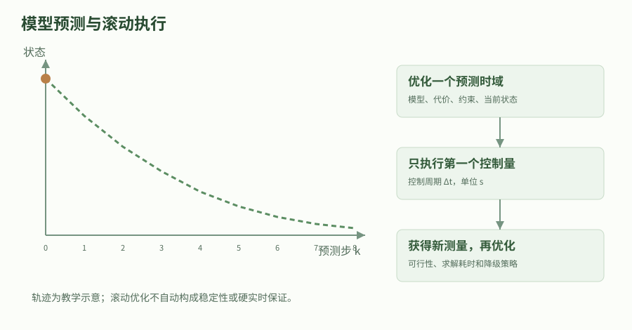

示意轨迹没有替代具体模型或求解器结果。实际系统需检查约束可行性、终端条件、采样周期、求解上界和失败后的控制策略。

### 同功能对照：状态反馈、采样回调与验收信号

本章discrete_integrator把测量、控制与理想对象更新写在一个循环中，便于看出每个采样周期的先后顺序；PD实验则把连续对象导数与数值积分分开。真实ROS回调可能在不同执行器线程中接收状态、更新目标和发送命令，因此需要明确每次控制使用的是哪一版状态与目标。一个线程安全的程序也可能由于时间戳或采样顺序错误而实现了另一套控制律。

同样的比例控制可以在速度接口中直接输出速度，也可以在力接口中构成恢复力。前者的一步误差递推只有一个状态，后者还必须携带速度和质量；两份代码即使都有一个名为gain的变量，其物理意义与稳定边界也不同。用同一套输入输出表比较C++回调、Python原型与标准库模型时，应先对齐对象单位、延迟、限幅和目标保持方式，再比较响应曲线。

误差大小、控制量大小、饱和持续时间和状态时间戳应作为相互配合的验收信号。只看最终位置接近目标，可能掩盖中途超限、长时间反复振荡或输出了过时命令；只看命令没有超限，又不能证明目标可达。稳定反例中的1024米只是理想递推的数学结果，不应真的发送给机器人；本章所有实验只在内存中计算，正是为了在连接硬件前识别这类条件错误。

如果下游拒绝命令或进入故障状态，上层积分器是否冻结、目标是否保留、恢复后是否重置，都属于控制器契约的一部分。把这些行为与控制公式一起说明，读者才能理解同功能的不同实现为何在故障恢复时表现不同。本章尚未实现完整生命周期控制器，因此只给出需要继续验证的边界；已经通过的范围仍是固定周期理想积分器和无延迟连续PD数值模型。

### 把推导变成有界、可检查的控制代码

下面文件用两种对象强调同一功能的实现差别：位置积分器直接离散递推，力控质点则积分位置与速度两个状态。前者能精确写出离散稳定乘子，后者用连续PD模型的能量关系做数值检查；二者的增益不能互相复制。若改写成C++控制周期回调，应保持相同输入输出与单位，并使用真实采样间隔，同时避免在控制线程中进行不受控阻塞操作。

实验包含一个必须出现的失稳反例：负二倍离散乘子在十步后把一米误差放大到1024米。保留这个反例是为了证明验收能识别坏条件，而不是只展示成功。接入ros2_control前，还要核对硬件接口、指令限幅、观测延迟、控制器生命周期和异常处理；本章不连接硬件。理想模型、软件测试、仿真与实机试验应该分别记录，不能互相替代。

#### math_control.py

代码类型：complete

```python

#!/usr/bin/env python3
"""输入：固定离散控制模型和 PD 模型；输出：稳定/失稳反例、限幅响应与能量检查。"""

def run():
    import math

    def discrete_integrator(initial_error_m, gain_per_s, period_s, steps, limit_m_s=None):
        if gain_per_s <= 0.0 or period_s <= 0.0:
            raise ValueError('增益和采样周期必须为正')
        error = initial_error_m
        history = [error]
        for _ in range(steps):
            velocity = -gain_per_s*error  # P 控制输出的单位为 m/s。
            if limit_m_s is not None:
                velocity = max(-limit_m_s, min(limit_m_s, velocity))
            error += period_s*velocity  # 本例被控对象是理想位置积分器。
            history.append(error)
        return history

    # 离散闭环乘子为 1-k*dt；连续时间 k>0 并不足以保证离散实现稳定。
    stable = discrete_integrator(1.0, 2.0, 0.1, 100)
    unstable = discrete_integrator(1.0, 3.0, 1.0, 10)
    assert abs(stable[-1]) < 1e-8
    assert abs(unstable[-1]) == 1024.0
    saturated = discrete_integrator(2.0, 2.0, 0.1, 200, limit_m_s=0.3)
    assert abs(saturated[-1]) < 1e-8
    assert max(abs(b-a) for a, b in zip(saturated, saturated[1:])) <= 0.030000000001

    # 力控质点：m*xddot=u-c*xdot；u=-kp*x-kd*xdot，目标位置固定为 0m。
    mass, physical_damping = 2.0, 0.4  # kg、N*s/m。
    kp, kd = 4.0, 3.6  # N/m、N*s/m；闭环总阻尼为 4.0 N*s/m。
    dt = 0.005
    state = [1.0, 0.0]  # [位置误差(m), 速度(m/s)]。

    def derivative(value):
        error, speed = value
        return [speed, (-kp*error-(physical_damping+kd)*speed)/mass]

    def lyapunov(value):
        error, speed = value
        return 0.5*kp*error*error+0.5*mass*speed*speed  # J。

    previous_energy = lyapunov(state)
    for _ in range(3000):
        # RK4 仅用于近似连续对象，不能据此证明真实机器人闭环稳定。
        k1 = derivative(state)
        k2 = derivative([x+dt*k/2 for x, k in zip(state, k1)])
        k3 = derivative([x+dt*k/2 for x, k in zip(state, k2)])
        k4 = derivative([x+dt*k for x, k in zip(state, k3)])
        state = [x+dt*(a+2*b+2*c+d)/6 for x, a, b, c, d in zip(state, k1, k2, k3, k4)]
        current_energy = lyapunov(state)
        assert current_energy <= previous_energy+1e-10
        previous_energy = current_energy
    assert abs(state[0]) < 1e-5 and abs(state[1]) < 1e-5
    damping_ratio = (physical_damping+kd)/(2*math.sqrt(mass*kp))
    assert math.isclose(damping_ratio, 1/math.sqrt(2), abs_tol=1e-12)
    result = {'stable_error_m': stable[-1], 'unstable_error_m': unstable[-1],
              'saturated_error_m': saturated[-1], 'PD_final_state': state,
              'PD_damping_ratio': damping_ratio}
    print('反馈控制实验通过：', result)
    return result

if __name__ == '__main__':
    run()


```

这是原创完整文件，只使用 Python 标准库。复制到同名文件后可直接运行；输入、输出、单位、执行顺序和边界检查都写在中文注释中。实验检查当前理想模型的数学性质，不代表 ROS 节点、仿真或实机已经验证。

### 贯穿案例：改变采样周期为什么会把P控制变成发散

先对理想速度接口比较两组增益与周期，再对质量2kg的力接口测试连续PD近似。

1. 由x点=u和u=-ke推导连续指数衰减。

2. 用k=2/s、dt=0.1s得到稳定乘子0.8。

3. 改成k=3/s、dt=1s得到乘子-2，十步后误差幅值1024m。

4. 加入速度上限检查每步位移，再用力控PD的能量函数验证另一对象模型。

验收：稳定与失稳案例均按理论出现；PD能量在规定数值容差内不增加，误差与速度趋近零。

### 深入练习 1

理想采样积分器中k*dt=2时，误差是渐近稳定吗？

参考答案：不是；乘子为-1，误差符号交替但幅值不衰减，位于严格稳定区间边界。

### 深入练习 2

速度接口的P增益能直接用于力接口吗？

参考答案：不能；前者单位s^-1，后者为N/m，且对象阶次与闭环动态不同。

### 深入练习 3

为什么V点非正后仍要检查不变集合？

参考答案：非正只能说明候选能量不增加，可能存在非零状态始终停在能量不变集合；本章PD模型需进一步用误差方程排除这些状态。

### 基础验证流程

#### 先固定模型与单位

按本章符号表手算案例，明确观测、状态、控制量的坐标系和单位；先记录理论值，再运行代码，避免只看“通过”字样。

#### 运行完整数值实验

将本章完整 Python 文件保存到空目录。Python 3 无需安装第三方包；若使用随站源码包，也可运行统一的 math_labs.py 并选择本章。

```bash

# 输入是文件中的固定教学数据；不会连接 ROS 图或控制硬件。
python3 math_control.py
# 随站合并实验集可只运行这一章；参数是章节 ID。
python3 math_labs.py --chapter math-control

```

#### 解释通过与失败的含义

将打印数值与手算结果逐项对照。再按练习改变一个参数，区分数学前提被破坏、浮点误差和实现错误。不要删除失败断言来制造通过。

### 预期结果

- 离散稳定案例衰减，失稳案例按-2倍增长，限幅位移满足上限。

- 连续PD模型的规定数值实验中能量与最终误差符合推导。

### 常见问题

- 把连续时间的正增益条件直接当成任意采样周期下的稳定保证。

- 混用误差符号或输入单位，导致反馈方向与物理接口不一致。

- 把本章未实现的抗饱和、延迟与真实硬件情形宣称已经验证。

### 练习

为本章实验写一份输入输出契约：列出状态次序、单位、前提、一个正常案例、一个必须拒绝或明确标记退化的案例。

#### 参考答案

契约应明确本章模型的量纲与坐标约定，正常案例需给出可复算的数值；退化案例应对应正文列出的边界，并解释失败原因。实验只验证这个有限模型，不把结果外推到任意噪声、任意机器人或实机安全。

### 验证范围

原创数学推导；读取本地参考教程以核对主题范围，并与本章列出的一手资料交叉核对。标准库完整实验已在本轮运行并通过断言；ROS 构建、仿真、硬件未运行。

### 依据

- [Modern Robotics：二阶误差动力学](https://modernrobotics.northwestern.edu/nu-gm-book-resource/11-2-2-2-second-order-error-dynamics/)

- [Stanford EE363：Basic Lyapunov Theory](https://ee363.stanford.edu/archive/lectures/lyap.pdf)

## 13. C++ / Python 发布订阅与回调写法

发布者决定消息何时产生；订阅回调由执行器在消息到来时调度。timer 也需要执行器调度，构造了 timer 并不等于程序会自动运行。

### 学习目标

- 写出周期发布与事件订阅节点

- 在 lambda、成员函数和 Python 方法间建立映射

### 先修

已安装 ROS 2 Jazzy；每个新终端先 source /opt/ros/jazzy/setup.bash。

### 概念

发布者决定消息何时产生；订阅回调由执行器在消息到来时调度。timer 也需要执行器调度，构造了 timer 并不等于程序会自动运行。

C++ 模板类型 std_msgs::msg::String 对应 Python 的 std_msgs.msg.String。接口语义相同，内存管理与回调绑定方式不同。

### 1. 先确定消息契约和节点生命周期

本章实现两个角色：发布者每半秒在 telemetry 上发送一个带序号的字符串，订阅者收到后输出日志。四个完整节点分别使用 C++ 和 Python，所以可以交叉组合验证。这里使用 std_msgs/String 是为了把注意力放在通信机制；实际传感器数据应使用有明确单位、时间和结构的专用接口。

发布订阅不需要把接收者地址写进发布者代码。端点通过名称、类型、发现条件和 QoS 建立联系。发布者可以在没有订阅者时工作，订阅者也可以先启动再等待发布者。这个低耦合特性使记录器和可视化工具能随时加入，但它不提供业务处理完成确认。

一个最小节点仍然具有完整生命周期：初始化 ROS，创建节点及通信对象，spin 处理事件，退出时销毁资源。timer 回调也是执行器调度的事件，不是创建 timer 后自动生成一个永不阻塞的独立线程。把这些阶段分清，有助于解释为什么“代码创建了发布者，却没有周期输出”。

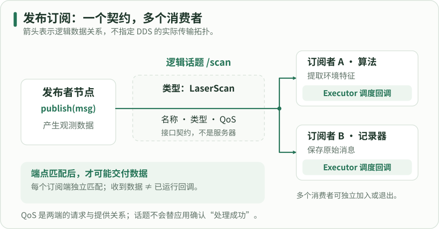

沿绿色箭头从发布者读到两个独立订阅端。虚线区是逻辑话题的名称、类型与 QoS 契约，不是消息中央服务器；每一对端点独立匹配。订阅端收到数据后仍由 Executor 调度回调，图不规定底层 DDS 的传输拓扑。

### 2. 建立两个独立的示例包

本章的路径位于 ~/ros2_learning_ws/src，包名为 learning_topic_cpp 与 learning_topic_py。两者都依赖 std_msgs，但分别使用 rclcpp 和 rclpy。创建包后将下面完整文件保存到指定路径；示例不会自动出现在网站已有 atlas 下载包中。

C++ 的两个源码文件分别编译为 talker 与 listener。Python 的两个模块分别暴露同名入口。用户看到的入口名相同不意味着源码组织相同，关键是安装配置把入口映射正确。包清单、构建文件和代码共同构成可运行示例，单独复制一个类无法替代全部工程文件。

为避免实验日志混淆，四个节点使用不同节点名；它们仍共享相对话题 telemetry。默认命名空间下解析为 /telemetry。每次先运行一个发布者和一个订阅者，确认基本行为后再增加更多端点，这样可以清楚解释每条日志来自哪个节点。

#### 创建包骨架

代码类型：commands

```bash

# 【中文教学注释】 创建包骨架
# 本例作用：若包已存在，检查已有文件后再继续；保留 Python 骨架中的 __init__.py 和 resource/learning_topic_py。
# 输入输出：输入为定时触发或收到的 String 消息；输出为带序号的消息及接收日志，序号无量纲。
# 执行顺序与边界：初始化→创建并持有节点/端点→spin 分发回调→清理；历史深度 10 不是 10 Hz，定时周期以秒或毫秒单独指定。
# 在当前shell加载/opt/ros/jazzy/setup.bash；它影响本终端的包索引/库路径，另一个终端必须单独加载。
source /opt/ros/jazzy/setup.bash
# 创建本段所需目录；相对路径以当前工作目录为基准，-p只容忍目录已存在，不验证其已有内容是否适合覆盖。
mkdir -p ~/ros2_learning_ws/src
# 切换到紧随其后的路径，后续相对文件操作由此解析；目录不存在应停止并修正，不继续在错误目录操作。
cd ~/ros2_learning_ws/src
# 在当前目录创建包骨架；--build-type决定ament构建类型，--dependencies只登记依赖，仍需写源码与安装规则。
ros2 pkg create --build-type ament_cmake --license Apache-2.0 learning_topic_cpp --dependencies rclcpp std_msgs
ros2 pkg create --build-type ament_python --license Apache-2.0 learning_topic_py --dependencies rclpy std_msgs

```

若包已存在，检查已有文件后再继续；保留 Python 骨架中的 __init__.py 和 resource/learning_topic_py。

输入输出：输入为定时触发或收到的 String 消息；输出为带序号的消息及接收日志，序号无量纲。
执行顺序与边界：初始化→创建并持有节点/端点→spin 分发回调→清理；历史深度 10 不是 10 Hz，定时周期以秒或毫秒单独指定。

### 3. C++ 发布者：模板类型、成员对象和定时器

create_publisher 的模板参数指定消息类型，字符串 telemetry 指定话题名称，整数 10 指定 KeepLast 历史深度。这里没有任何参数表示十赫兹；发送周期由 create_wall_timer 的 500ms 决定。wall timer 适合本章简单实验，涉及仿真时间时需进一步区分时钟语义。

publisher_ 与 timer_ 保存为成员，是为了使它们在节点运行期间始终存在。定时器 lambda 捕获 this 来读取计数器和发布者，因此节点对象必须保持有效。main 通过 shared_ptr 持有节点并交给 spin，直到退出后才结束其生命周期。

回调内部创建一个消息，填写 data，再 publish；日志只是辅助观察。序号在发布端递增，使订阅端能察觉间断和多来源交错。下面代码是完整文件，没有省略 main，但仍需配套包清单和 CMake 才能由 ros2 run 启动。

#### src/learning_topic_cpp/src/talker.cpp

代码类型：complete

```cpp

// 【中文教学注释】 src/learning_topic_cpp/src/talker.cpp
// 本例作用：完整 C++ 文件。序号在一个默认单线程执行器的定时回调内更新。
// 输入输出：输入为定时触发或收到的 String 消息；输出为带序号的消息及接收日志，序号无量纲。
// 执行顺序与边界：初始化→创建并持有节点/端点→spin 分发回调→清理；历史深度 10 不是 10 Hz，定时周期以秒或毫秒单独指定。
#include <chrono>
#include <cstdint>
#include <memory>
#include <string>
#include "rclcpp/rclcpp.hpp"
#include "std_msgs/msg/string.hpp"
using namespace std::chrono_literals;

class LearningTalker : public rclcpp::Node
{
public:
  LearningTalker() : Node("learning_talker_cpp")
  {
    // 创建指定模板消息类型和话题的发布端；整数10是KeepLast历史条数，不是频率。发布者必须作为成员或其他长寿命对象保留。
    publisher_ = create_publisher<std_msgs::msg::String>("telemetry", 10);
    // 创建墙钟/稳态周期定时器，chrono时长明确单位；回调由执行器调度，不随/clock仿真时钟暂停而自然暂停。
    timer_ = create_wall_timer(500ms, [this]() {
      std_msgs::msg::String message;
      message.data = "cpp sample=" + std::to_string(sequence_++);
      // 提交当前消息给发布端；日志/返回不提供订阅者业务处理确认，端到端行为还取决于QoS、网络和对端执行器。
      publisher_->publish(message);
      // 记录当前状态/错误供实验核对；printf格式必须匹配传入类型，日志不等于对端已收到数据。
      RCLCPP_INFO(get_logger(), "%s", message.data.c_str());
    });
  }
private:
  std::uint64_t sequence_{0};
  // 持久共享句柄维持ROS对象/目标的寿命；智能指针只管理生存期，不自动解决多线程数据竞争。
  rclcpp::Publisher<std_msgs::msg::String>::SharedPtr publisher_;
  rclcpp::TimerBase::SharedPtr timer_;
};

int main(int argc, char ** argv)
{
  // 初始化进程 ROS 上下文、解析 ROS 参数；必须先于 Node 和通信对象创建。
  rclcpp::init(argc, argv);
  // 持有节点并进入默认单线程执行器，回调在这里得到执行；返回后才能按退出顺序关闭上下文。
  rclcpp::spin(std::make_shared<LearningTalker>());
  // 关闭当前上下文，让执行器退出；确保异步回调不再访问已销毁对象，不能替代业务层故障处理。
  rclcpp::shutdown();
  return 0;
}

```

完整 C++ 文件。序号在一个默认单线程执行器的定时回调内更新。

输入输出：输入为定时触发或收到的 String 消息；输出为带序号的消息及接收日志，序号无量纲。
执行顺序与边界：初始化→创建并持有节点/端点→spin 分发回调→清理；历史深度 10 不是 10 Hz，定时周期以秒或毫秒单独指定。

### 4. C++ 订阅者：lambda 与成员函数如何对应

订阅者没有主动轮询话题，而是注册消息到达后的回调。create_subscription 同样指定消息类型、名称和 QoS。ConstSharedPtr 表示回调持有只读消息的共享引用，本例只读取 data，不修改收到的消息。回调被执行的时间取决于执行器调度，不应假定与发布瞬间完全相同。

短逻辑可以直接写在 lambda 中；逻辑较长时可写成具名成员方法，再用 std::bind 或一个简单 lambda 转发。写法改变的是代码组织，不改变话题协议。下面完整文件使用成员方法配合 lambda 转发，既能看清回调签名，也避免初学时被绑定占位符分散注意。

订阅对象同样必须保持存活。只在构造函数局部变量里创建 subscription 然后不保留，可能在构造函数结束时失去所需对象。订阅回调应尽量短；大计算和阻塞 I/O 会影响同一执行器中的其他回调，这属于后续并发设计问题。

对象所有权要按客户端库区分。C++的Publisher/Subscription通常要由应用持有SharedPtr，回调组内的弱引用不能替代强所有权。Jazzy rclpy的Node同时在内部列表保留发布者和订阅者；只丢掉调用者的局部Python变量，不等于该端点立即销毁。保存self.subscription仍便于显式管理、读取属性和调用destroy_subscription，但不是Python端点存活的唯一条件。销毁端点、销毁Node和丢掉一个变量名是三个不同操作。

#### src/learning_topic_cpp/src/listener.cpp

代码类型：complete

```cpp

// 【中文教学注释】 src/learning_topic_cpp/src/listener.cpp
// 本例作用：完整订阅者文件。对应 std::bind 写法需要 functional 头文件，但不是通信机制的另一种实现。
// 输入输出：输入为定时触发或收到的 String 消息；输出为带序号的消息及接收日志，序号无量纲。
// 执行顺序与边界：初始化→创建并持有节点/端点→spin 分发回调→清理；历史深度 10 不是 10 Hz，定时周期以秒或毫秒单独指定。
#include <memory>
#include "rclcpp/rclcpp.hpp"
#include "std_msgs/msg/string.hpp"

class LearningListener : public rclcpp::Node
{
public:
  LearningListener() : Node("learning_listener_cpp")
  {
    // 将消息类型、话题、QoS和回调绑定，保存订阅句柄；回调运行线程由执行器/回调组决定，不由lambda写法决定。
    subscription_ = create_subscription<std_msgs::msg::String>(
      "telemetry", 10,
      // 持久共享句柄维持ROS对象/目标的寿命；智能指针只管理生存期，不自动解决多线程数据竞争。
      [this](std_msgs::msg::String::ConstSharedPtr message) {
        on_message(message);
      });
  }
private:
  void on_message(std_msgs::msg::String::ConstSharedPtr message)
  {
    // 记录当前状态/错误供实验核对；printf格式必须匹配传入类型，日志不等于对端已收到数据。
    RCLCPP_INFO(get_logger(), "received: %s", message->data.c_str());
  }
  rclcpp::Subscription<std_msgs::msg::String>::SharedPtr subscription_;
};

int main(int argc, char ** argv)
{
  // 初始化进程 ROS 上下文、解析 ROS 参数；必须先于 Node 和通信对象创建。
  rclcpp::init(argc, argv);
  // 持有节点并进入默认单线程执行器，回调在这里得到执行；返回后才能按退出顺序关闭上下文。
  rclcpp::spin(std::make_shared<LearningListener>());
  // 关闭当前上下文，让执行器退出；确保异步回调不再访问已销毁对象，不能替代业务层故障处理。
  rclcpp::shutdown();
  return 0;
}

```

完整订阅者文件。对应 std::bind 写法需要 functional 头文件，但不是通信机制的另一种实现。

输入输出：输入为定时触发或收到的 String 消息；输出为带序号的消息及接收日志，序号无量纲。
执行顺序与边界：初始化→创建并持有节点/端点→spin 分发回调→清理；历史深度 10 不是 10 Hz，定时周期以秒或毫秒单独指定。

#### src/learning_topic_cpp/CMakeLists.txt

代码类型：complete

```cmake

# 【中文教学注释】 src/learning_topic_cpp/CMakeLists.txt
# 本例作用：完整构建文件，分别生成并安装两个可执行入口。
# 输入输出：输入是本包源码、已安装依赖及目标配置；输出为构建目标、安装文件和ament导出元数据。
# 执行顺序与边界：先find_package再建立/连接目标并install，最后ament_package；VERSION是工具/语言版本而非物理单位，源码存在不等于已安装入口。
# 声明配置所需最低CMake版本；它不是C++语言标准，也不会自动安装构建工具。
cmake_minimum_required(VERSION 3.8)
# 工程名应与package.xml包名一致，PROJECT_NAME供安装和接口生成目标引用。
project(learning_topic_cpp)
set(CMAKE_CXX_STANDARD 17)
set(CMAKE_CXX_STANDARD_REQUIRED ON)
# 在已source的安装前缀查找此依赖并加载导出配置；REQUIRED使缺失时配置失败，不自动从网络获取依赖。
find_package(ament_cmake REQUIRED)
find_package(rclcpp REQUIRED)
find_package(std_msgs REQUIRED)
foreach(target talker listener)
  # 把本行源码编成命名可执行目标；还需声明依赖和install规则，才能通过ros2 run找到。
  add_executable(${target} src/${target}.cpp)
  # 为指定目标连接ROS依赖及其包含目录；与package.xml的声明互补，不能只写其中一处。
  ament_target_dependencies(${target} rclcpp std_msgs)
endforeach()
# 安装已构建目标到ROS约定位置；普通节点运行入口通常放lib/${PROJECT_NAME}，库与组件的安装规则分别核对。
install(TARGETS talker listener DESTINATION lib/${PROJECT_NAME})
# 完成ament包元数据导出，应在目标、依赖和安装规则之后调用。
ament_package()

```

完整构建文件，分别生成并安装两个可执行入口。

输入输出：输入是本包源码、已安装依赖及目标配置；输出为构建目标、安装文件和ament导出元数据。
执行顺序与边界：先find_package再建立/连接目标并install，最后ament_package；VERSION是工具/语言版本而非物理单位，源码存在不等于已安装入口。

#### src/learning_topic_cpp/package.xml

代码类型：complete

```xml

<?xml version="1.0"?>
<!-- 【中文教学注释】 src/learning_topic_cpp/package.xml -->
<!-- 本例作用：完整包清单，与构建脚本里的依赖一致。 -->
<!-- 输入输出：输入为包名、版本、许可和依赖元数据；输出是ament/rosdep/发布工具可读取的包清单。 -->
<!-- 执行顺序与边界：包名须与构建/安装配置一致，buildtool、depend、exec_depend作用不同；元数据本身不执行安装，版本字段不是物理量。 -->
<!-- ROS包清单说明依赖和构建类型；包名、安装目录和实际源码工程需一致，不会自行编译/安装。 -->
<package format="3">
  <name>learning_topic_cpp</name>
  <version>0.0.1</version>
  <description>C++ publisher and subscriber lesson</description>
  <maintainer email="learner@example.com">Learner</maintainer>
  <license>Apache-2.0</license>
  <!-- 构建工具依赖，用于选择ament构建流程；不同于运行时消息/客户端库依赖。 -->
  <buildtool_depend>ament_cmake</buildtool_depend>
  <!-- 同时声明本包对该ROS依赖的构建/运行需要；CMake目标仍须显式连接对应依赖。 -->
  <depend>rclcpp</depend>
  <depend>std_msgs</depend>
  <export><build_type>ament_cmake</build_type></export>
</package>

```

完整包清单，与构建脚本里的依赖一致。

输入输出：输入为包名、版本、许可和依赖元数据；输出是ament/rosdep/发布工具可读取的包清单。
执行顺序与边界：包名须与构建/安装配置一致，buildtool、depend、exec_depend作用不同；元数据本身不执行安装，版本字段不是物理量。

### 5. Python 用相同接口表达相同行为

Python 将模板消息类型改为普通函数参数 String，成员对象通过 self 保存。create_timer 接收以秒为单位的浮点周期，所以 0.5 对应 C++ 的 500ms。回调方法无需手工传入 self，访问 self.on_tick 得到的绑定方法已经包含对象引用。

发布者每次创建新的 String 对象，并把计数器组合成文本。订阅者收到生成的消息类实例，通过 message.data 读取字段。你不能直接 publish 一个普通 Python 字符串；发布者声明的类型是 String 消息类，需要把文本填入它的 data 字段。

Python 版本保留与 C++ 一致的初始化、spin 和清理流程。两种语言代码都采用单线程的简单执行方式，足以展示通信；如果稍后添加耗时操作，应重新评估回调调度，不能因使用 Python 就忽略节点生命周期。

#### src/learning_topic_py/learning_topic_py/talker.py

代码类型：complete

```python

# 【中文教学注释】 src/learning_topic_py/learning_topic_py/talker.py
# 本例作用：完整 Python 发布者模块。
# 输入输出：输入为定时触发或收到的 String 消息；输出为带序号的消息及接收日志，序号无量纲。
# 执行顺序与边界：初始化→创建并持有节点/端点→spin 分发回调→清理；历史深度 10 不是 10 Hz，定时周期以秒或毫秒单独指定。
import rclpy
from rclpy.node import Node
from std_msgs.msg import String


class LearningTalker(Node):
    def __init__(self):
        # 构造 Node 基类并确定节点名；后续相对话题/服务名由命名空间解析，重命名需与参数文件选择器对应。
        super().__init__('learning_talker_py')
        # 创建指定消息类型和话题的发布端并持久保存；整数 QoS 是 KeepLast 历史深度，不是 Hz，真正发送由 publish 调用决定。
        self.publisher = self.create_publisher(String, 'telemetry', 10)
        self.sequence = 0
        # 定时周期单位为秒，回调由执行器调度而非自动新建独占线程；使用节点时钟，仿真时间暂停可能影响触发。
        self.timer = self.create_timer(0.5, self.on_tick)

    def on_tick(self):
        message = String()
        message.data = f'py sample={self.sequence}'
        self.sequence += 1
        # 提交已填好的消息给 ROS 发布端；这不是业务处理完成确认，端到端接收仍取决于发现、类型、QoS 和执行器。
        self.publisher.publish(message)
        # 输出可观测日志用于核对状态；日志成功写出不等于对端收到消息或任务执行成功。
        self.get_logger().info(message.data)


# 程序入口按本章顺序组织资源；本例仅在 __main__ 下运行，import 时不应启动节点或连接硬件。
def main(args=None):
    # 初始化当前进程的 ROS 上下文并解析传入 ROS 参数；在创建节点/端点之前调用。
    rclpy.init(args=args)
    node = LearningTalker()
    try:
        # 进入执行器事件循环，定时器、订阅、服务和 Future 回调在这里才被推进；通常阻塞到中断或上下文关闭。
        rclpy.spin(node)
    except KeyboardInterrupt:
        pass
    finally:
        # 显式释放节点所属端点与定时器；应在相关执行器不再访问节点后执行。
        node.destroy_node()
        # 检查 ROS 上下文仍有效，避免退出流程重复 shutdown；它不表示节点业务健康。
        if rclpy.ok():
            # 关闭本进程 ROS 上下文；先停止执行器、销毁端点/节点，再在上下文仍有效时调用。
            rclpy.shutdown()


if __name__ == '__main__':
    main()

```

完整 Python 发布者模块。

输入输出：输入为定时触发或收到的 String 消息；输出为带序号的消息及接收日志，序号无量纲。
执行顺序与边界：初始化→创建并持有节点/端点→spin 分发回调→清理；历史深度 10 不是 10 Hz，定时周期以秒或毫秒单独指定。

#### src/learning_topic_py/learning_topic_py/listener.py

代码类型：complete

```python

# 【中文教学注释】 src/learning_topic_py/learning_topic_py/listener.py
# 本例作用：完整 Python 订阅者模块；其协议与 C++ 版本相同。
# 输入输出：输入为定时触发或收到的 String 消息；输出为带序号的消息及接收日志，序号无量纲。
# 执行顺序与边界：初始化→创建并持有节点/端点→spin 分发回调→清理；历史深度 10 不是 10 Hz，定时周期以秒或毫秒单独指定。
import rclpy
from rclpy.node import Node
from std_msgs.msg import String


class LearningListener(Node):
    def __init__(self):
        # 构造 Node 基类并确定节点名；后续相对话题/服务名由命名空间解析，重命名需与参数文件选择器对应。
        super().__init__('learning_listener_py')
        # 绑定消息类型、话题、回调和 QoS，并持有订阅对象；/开头的名称是绝对话题，回调由执行器调度。
        self.subscription = self.create_subscription(
            String, 'telemetry', self.on_message, 10)

    def on_message(self, message):
        # 输出可观测日志用于核对状态；日志成功写出不等于对端收到消息或任务执行成功。
        self.get_logger().info(f'received: {message.data}')


# 程序入口按本章顺序组织资源；本例仅在 __main__ 下运行，import 时不应启动节点或连接硬件。
def main(args=None):
    # 初始化当前进程的 ROS 上下文并解析传入 ROS 参数；在创建节点/端点之前调用。
    rclpy.init(args=args)
    node = LearningListener()
    try:
        # 进入执行器事件循环，定时器、订阅、服务和 Future 回调在这里才被推进；通常阻塞到中断或上下文关闭。
        rclpy.spin(node)
    except KeyboardInterrupt:
        pass
    finally:
        # 显式释放节点所属端点与定时器；应在相关执行器不再访问节点后执行。
        node.destroy_node()
        # 检查 ROS 上下文仍有效，避免退出流程重复 shutdown；它不表示节点业务健康。
        if rclpy.ok():
            # 关闭本进程 ROS 上下文；先停止执行器、销毁端点/节点，再在上下文仍有效时调用。
            rclpy.shutdown()


if __name__ == '__main__':
    main()

```

完整 Python 订阅者模块；其协议与 C++ 版本相同。

输入输出：输入为定时触发或收到的 String 消息；输出为带序号的消息及接收日志，序号无量纲。
执行顺序与边界：初始化→创建并持有节点/端点→spin 分发回调→清理；历史深度 10 不是 10 Hz，定时周期以秒或毫秒单独指定。

### 6. 完成 Python 入口安装并构建

setup.py 中的两个 console_scripts 将 talker 和 listener 分别映射到两个模块的 main。文件路径、模块路径和入口字符串必须彼此一致：源码文件叫 talker.py，模块部分才是 learning_topic_py.talker。省略包名或把冒号写成点，都可能导致安装后入口无法正确导入。

构建前确认两个包同时声明了 std_msgs；仅在 Python 文件里 import 不能替代依赖声明。学习时机器可能碰巧已经安装依赖，但清单不完整会让别人在干净环境中失败。rosdep 的意义正是从声明恢复所需依赖，而不是依赖作者电脑的偶然状态。

--symlink-install 有助于 Python 源码编辑后快速验证，不过更改 setup.py 的入口仍应重建。完成构建后在每个运行终端加载 install/setup.bash。不要在源码目录里执行一个同名旧脚本后，以为 ros2 run 的安装入口也已经更新。

#### src/learning_topic_py/setup.py

代码类型：complete

```python

# 【中文教学注释】 src/learning_topic_py/setup.py
# 本例作用：完整安装文件。
# 输入输出：输入为包名、Python模块、资源文件及入口映射；输出为可安装Python包和console_scripts可执行入口。
# 执行顺序与边界：resource索引/package.xml需安装到正确share目录；入口名=模块:function，setup.cfg将脚本装入lib/包名；此配置没有物理单位或ROS回调循环。
from setuptools import setup

package_name = 'learning_topic_py'
# setuptools读取包元数据、安装资源和入口；name应匹配package.xml，源码模块存在仍须console_scripts和setup.cfg才能由ros2 run找到。
setup(
    name=package_name,
    version='0.0.1',
    packages=[package_name],
    # 安装ament资源索引、package.xml及需要的share文件；缺失索引时包可能已被pip装入却无法被ROS工具发现。
    data_files=[
        ('share/ament_index/resource_index/packages', ['resource/' + package_name]),
        ('share/' + package_name, ['package.xml']),
    ],
    install_requires=['setuptools'],
    zip_safe=True,
    maintainer='Learner',
    maintainer_email='learner@example.com',
    description='Python publisher and subscriber lesson',
    license='Apache-2.0',
    # 把可执行入口名映射到Python模块:function；ros2 run查找的是安装入口，不是任意.py文件名。
    entry_points={'console_scripts': [
        'talker = learning_topic_py.talker:main',
        'listener = learning_topic_py.listener:main',
    ]},
)

```

完整安装文件。

输入输出：输入为包名、Python模块、资源文件及入口映射；输出为可安装Python包和console_scripts可执行入口。
执行顺序与边界：resource索引/package.xml需安装到正确share目录；入口名=模块:function，setup.cfg将脚本装入lib/包名；此配置没有物理单位或ROS回调循环。

#### src/learning_topic_py/setup.cfg

代码类型：complete

```ini

# 【中文教学注释】 src/learning_topic_py/setup.cfg
# 本例作用：完整入口安装位置配置。
# 输入输出：输入为setuptools安装配置；输出是开发/普通安装时的脚本目标目录，供ROS按包名发现入口。
# 执行顺序与边界：script_dir/install_scripts均与console_scripts配套；$base是安装基路径，目录配置没有物理单位，不负责创建ROS节点。
# 此段名对应setuptools开发安装或普通安装设置；保持与包内入口安装约定一致。
[develop]
# 把console_scripts入口安装到lib/包名供ros2 run发现；$base由setuptools展开，不是要手工填入的用户HOME。
script_dir=$base/lib/learning_topic_py
[install]
install_scripts=$base/lib/learning_topic_py

```

完整入口安装位置配置。

输入输出：输入为setuptools安装配置；输出是开发/普通安装时的脚本目标目录，供ROS按包名发现入口。
执行顺序与边界：script_dir/install_scripts均与console_scripts配套；$base是安装基路径，目录配置没有物理单位，不负责创建ROS节点。

#### src/learning_topic_py/package.xml

代码类型：complete

```xml

<?xml version="1.0"?>
<!-- 【中文教学注释】 src/learning_topic_py/package.xml -->
<!-- 本例作用：完整清单。 -->
<!-- 输入输出：输入为包名、版本、许可和依赖元数据；输出是ament/rosdep/发布工具可读取的包清单。 -->
<!-- 执行顺序与边界：包名须与构建/安装配置一致，buildtool、depend、exec_depend作用不同；元数据本身不执行安装，版本字段不是物理量。 -->
<!-- ROS包清单说明依赖和构建类型；包名、安装目录和实际源码工程需一致，不会自行编译/安装。 -->
<package format="3">
  <name>learning_topic_py</name>
  <version>0.0.1</version>
  <description>Python publisher and subscriber lesson</description>
  <maintainer email="learner@example.com">Learner</maintainer>
  <license>Apache-2.0</license>
  <!-- 构建工具依赖，用于选择ament构建流程；不同于运行时消息/客户端库依赖。 -->
  <buildtool_depend>ament_python</buildtool_depend>
  <!-- 声明安装后运行所需依赖，确保发布二进制包时能够解析；不会在打开XML时自动安装。 -->
  <exec_depend>rclpy</exec_depend>
  <exec_depend>std_msgs</exec_depend>
  <export><build_type>ament_python</build_type></export>
</package>

```

完整清单。

输入输出：输入为包名、版本、许可和依赖元数据；输出是ament/rosdep/发布工具可读取的包清单。
执行顺序与边界：包名须与构建/安装配置一致，buildtool、depend、exec_depend作用不同；元数据本身不执行安装，版本字段不是物理量。

#### 构建两个包

代码类型：commands

```bash

# 【中文教学注释】 构建两个包
# 本例作用：需要先完成所有源码与安装文件；依赖安装可能联网。
# 输入输出：输入为定时触发或收到的 String 消息；输出为带序号的消息及接收日志，序号无量纲。
# 执行顺序与边界：初始化→创建并持有节点/端点→spin 分发回调→清理；历史深度 10 不是 10 Hz，定时周期以秒或毫秒单独指定。
# 切换到紧随其后的路径，后续相对文件操作由此解析；目录不存在应停止并修正，不继续在错误目录操作。
cd ~/ros2_learning_ws
# 按package.xml解析目标发行版依赖；--ignore-src跳过src已提供包，源码已下载不等于系统依赖已离线备齐。
rosdep install --from-paths src --ignore-src --rosdistro jazzy -y
# 从工作空间根按依赖拓扑构建；--packages-select只选指定包，--packages-up-to连同所需上游包，构建后必须source安装环境。
colcon build --symlink-install --packages-select learning_topic_cpp learning_topic_py
# 在当前shell加载install/setup.bash；它影响本终端的包索引/库路径，另一个终端必须单独加载。
source install/setup.bash

```

需要先完成所有源码与安装文件；依赖安装可能联网。

输入输出：输入为定时触发或收到的 String 消息；输出为带序号的消息及接收日志，序号无量纲。
执行顺序与边界：初始化→创建并持有节点/端点→spin 分发回调→清理；历史深度 10 不是 10 Hz，定时周期以秒或毫秒单独指定。

### 7. 交叉运行，理解输出与失败模式

先运行 C++ talker 与 Python listener，预期订阅端显示 received: cpp sample=0 及后续序号。计数从哪一个数字开始取决于订阅建立的时机；不要求一定从零收到。停止两个进程后再运行 Python talker 与 C++ listener，文本前缀应变为 py。两组实验说明共享接口而非共享源语言才是互通条件。

如果一个订阅者同时面对两个发布者，输出会交错出现 cpp 与 py 的序列。此时不应把两个独立计数器误认为一个计数器倒退。实际系统通常还需要消息来源标识、时间戳和明确的发布者职责，避免控制通道出现互相争抢的命令来源。

若没有消息，按顺序检查节点是否运行、topic info 的类型与端点、话题重映射和 QoS、回调是否被耗时操作阻塞。只提高队列深度不一定解决问题；若消费者长期比生产者慢，堆积会增加延迟。本章先保证可解释的最小链路，再进入 QoS 和执行器章节。

#### 组合 A：C++ 发布，Python 接收

代码类型：commands

```bash

# 【中文教学注释】 组合 A：C++ 发布，Python 接收
# 本例作用：大约两次每秒是由 0.5 秒定时周期产生；测得频率还会受运行环境影响。
# 输入输出：输入为定时触发或收到的 String 消息；输出为带序号的消息及接收日志，序号无量纲。
# 执行顺序与边界：初始化→创建并持有节点/端点→spin 分发回调→清理；历史深度 10 不是 10 Hz，定时周期以秒或毫秒单独指定。
# 两个终端都先 source Jazzy 和学习工作空间
# 终端 A
# 从已安装包learning_topic_cpp启动talker；此进程通常持续运行，另用新终端执行观察命令，Ctrl+C结束。
ros2 run learning_topic_cpp talker
# 终端 B
# 从已安装包learning_topic_py启动listener；此进程通常持续运行，另用新终端执行观察命令，Ctrl+C结束。
ros2 run learning_topic_py listener
# 观察终端
# 查询实际消息类型与发布/订阅端点；--verbose显示QoS等证据，先查类型再选择发送消息结构。
ros2 topic info /telemetry --verbose
# 用观察者的到达间隔估算接收频率Hz；它不是发布端硬实时周期或网络全部负载的证明。
ros2 topic hz /telemetry

```

大约两次每秒是由 0.5 秒定时周期产生；测得频率还会受运行环境影响。

输入输出：输入为定时触发或收到的 String 消息；输出为带序号的消息及接收日志，序号无量纲。
执行顺序与边界：初始化→创建并持有节点/端点→spin 分发回调→清理；历史深度 10 不是 10 Hz，定时周期以秒或毫秒单独指定。

#### 组合 B：先停止组合 A，再交换语言

代码类型：commands

```bash

# 【中文教学注释】 组合 B：先停止组合 A，再交换语言
# 本例作用：本章两种语言包已在本机 Jazzy 下构建通过；发布订阅的运行组合仍应按本节命令在你的环境验收。
# 输入输出：输入为定时触发或收到的 String 消息；输出为带序号的消息及接收日志，序号无量纲。
# 执行顺序与边界：初始化→创建并持有节点/端点→spin 分发回调→清理；历史深度 10 不是 10 Hz，定时周期以秒或毫秒单独指定。
# 终端 A
# 从已安装包learning_topic_py启动talker；此进程通常持续运行，另用新终端执行观察命令，Ctrl+C结束。
ros2 run learning_topic_py talker
# 终端 B
# 从已安装包learning_topic_cpp启动listener；此进程通常持续运行，另用新终端执行观察命令，Ctrl+C结束。
ros2 run learning_topic_cpp listener

```

本章两种语言包已在本机 Jazzy 下构建通过；发布订阅的运行组合仍应按本节命令在你的环境验收。

输入输出：输入为定时触发或收到的 String 消息；输出为带序号的消息及接收日志，序号无量纲。
执行顺序与边界：初始化→创建并持有节点/端点→spin 分发回调→清理；历史深度 10 不是 10 Hz，定时周期以秒或毫秒单独指定。

### 节点、上下文与资源生命周期

| 责任 | C++ / rclcpp | Python / rclpy | 执行细节与边界 |
| --- | --- | --- | --- |
| 初始化上下文 | `rclcpp::init(argc, argv)` | `rclpy.init(args=args)` | 在创建节点前调用；ROS 参数和普通业务参数应分清。不要在每次回调里重复初始化。 |
| 创建节点 | `std::make_shared<MyNode>()`，类继承 `rclcpp::Node` | `node = MyNode()`，类继承 `rclpy.node.Node` | 节点名和命名空间共同确定完全限定名称；Python 节点同样需要保留有效对象引用。 |
| 调度回调 | `rclcpp::spin(node)` | `rclpy.spin(node)` | spin 通常阻塞当前线程并处理就绪回调，不是一次性启动后立即返回；构造 timer 不等于自动运行回调。 |
| 停止和释放 | 退出执行器后释放节点/实体，再结束上下文 | `node.destroy_node()`；上下文仍有效时调用 `rclpy.shutdown()` | 教学示例在 finally 或作用域退出时清理；多节点共享上下文时，由拥有者统一管理，不能由任意业务回调提前关闭整个进程。 |

C++ 智能指针管理对象寿命，Python 垃圾回收时机与显式资源释放是不同概念。两个语言版本应比较可观察行为、名称与消息类型，而不是逐行对应。

### 话题 API：类型、队列、回调和所有权

| 操作 | C++ | Python | 输入、输出与关键约束 |
| --- | --- | --- | --- |
| 创建发布者 | `create_publisher<MessageT>(topic, qos)` | `create_publisher(MessageT, topic, qos)` | 输入为消息类型、话题名称和 QoS；输出为发布者实体。整数 10 通常表示 KEEP_LAST 深度 10 条，不是 10 Hz。 |
| 创建订阅者 | `create_subscription<MessageT>(topic, qos, callback)` | `create_subscription(MessageT, topic, callback, qos)` | 两种语言的 callback 与 qos 参数顺序不同。回调接收反序列化后的消息；类型、名称和 QoS 都需匹配。 |
| 发送消息 | `publisher->publish(message)` 或相应智能指针重载 | `publisher.publish(message)` | 调用发送不表示接收端已执行算法或执行器；业务完成确认应通过专门接口设计。 |
| 保留实体 | C++成员SharedPtr或其他明确的强所有者 | Python Node内部也保留端点；成员便于访问和显式管理 | 两者都要求Node/端点有效，但Python丢调用者局部变量不等于立即销毁；不要把C++强所有权规则机械套用。 |
| 解释数据单位 | 由 `.msg` 字段及业务合同约定 | 由 `.msg` 字段及业务合同约定 | String 本身没有物理单位；Twist 的线速度通常为 m/s、角速度为 rad/s。名称类似不构成单位或坐标系相同的证明。 |

QoS 历史深度不等于应用层的全部积压量，回调处理速度、DDS 实现和传输也会影响延迟。ConstSharedPtr、UniquePtr 等回调形式有所有权差别，不能假定都零复制。

### 定时器：周期相同，时钟选择未必相同

| 问题 | C++ 写法 | Python 写法 | 解释 |
| --- | --- | --- | --- |
| 周期的单位 | `create_wall_timer(500ms, callback)` | `create_timer(0.5, callback)` | 500 毫秒等于 0.5 秒；理想频率 f=1/T=2 Hz，真实调度间隔受负载影响。 |
| 默认时钟 | `create_wall_timer` 使用 `RCL_STEADY_TIME` 稳态时钟 | `create_timer` 未传 clock 时使用节点时钟 | 该稳态时钟不随 ROS 仿真时间暂停，也不同于可因系统校时跳变的日期时钟。Python 默认节点时钟在 use_sim_time 启用后受 /clock 驱动。 |
| ROS 时间计时 | 显式使用节点 clock 的 `rclcpp::create_timer` 等 API | `create_timer(..., clock=node.get_clock())` | 读取参数 use_sim_time 和 /clock 状态，并确认模拟时间前进；不要把“传入一个时钟”当作时钟已正确接入。 |
| 调度与阻塞 | 回调由执行器调度 | 回调由执行器调度 | 长时间计算或等待会推迟后续回调。周期不是硬实时截止时间，也不自动创建每个 timer 的独立线程。 |

普通未启用仿真时间的入门实验可获得相近行为；需要暂停、加速、回放或确定性比较时，必须先对齐时钟语义。

### QoS API：声明、发现和实际匹配分别核对

| 阶段 | C++ / rclcpp | Python / rclpy | 需要核对的细节 |
| --- | --- | --- | --- |
| 声明历史 | rclcpp::QoS(rclcpp::KeepLast(1)) | QoSProfile(history=KEEP_LAST, depth=1) | 1是条数；不是Hz、延迟上限或整个系统总缓存。 |
| 显式策略 | reliable/best_effort、transient_local/durability_volatile | ReliabilityPolicy、DurabilityPolicy | 本章端点创建时应用；单纯修改外部profile变量不证明既有端点已重配置。 |
| 发现端点 | get_publishers_info_by_topic / get_subscriptions_info_by_topic | 同名Node方法返回TopicEndpointInfo | 图可发现不代表已匹配；RMW可能不提供history/depth，UNKNOWN/depth0不是实际无缓存。 |
| 静态兼容 | rclcpp::qos_check_compatible | qos_check_compatible返回兼容等级和reason | SYSTEM_DEFAULT/UNKNOWN可能返回WARNING：无法确定。结合端点匹配和实际样本，不能直接强转通过。 |
| 实际匹配 | Publisher::get_subscription_count 等 | publisher.get_subscription_count、subscription.get_publisher_count | 数量不等于回调处理完成；需再核对序号、来源、时间与业务结果。 |
| 晚加入 | 提供和请求TRANSIENT_LOCAL，writer存活 | 可靠瞬态本地profile、有限KeepLast | 实验预发41/42，晚加入只收42；writer退出后的缓存不当数据库。 |
| 观察工具 | ros2 topic echo是额外订阅者 | 与应用订阅者分开登记 | 固定Jazzy自动适配路径与显式QoS覆盖不同，echo收到不证明应用请求相同。 |

本机7个端点场景已运行；跨机、性能、所有deadline/liveliness事件与实际设备未验证。

Jazzy sensor_data关键字段为KEEP_LAST/depth5/BEST_EFFORT/VOLATILE；预设不保证端到端新鲜度。

### 同一接口下互换发布者实现

你先用 Python 快速实现数据源，后来希望替换为 C++，但不改下游接收者。

1. 固定接口为 /telemetry 与 std_msgs/msg/String，并记录定时周期和 QoS。

2. 运行 Python 发布者配 C++ 订阅者，记录正常输出。

3. 仅停掉发布者，改运行 C++ 发布者，保持订阅者不变。

4. 观察发现过程和新序列，确认下游不需要知道发布者源码语言。

验收：节点实现可被替换，但协议、名称、QoS 和数据语义仍必须保持兼容。

### 深入练习 1

将 create_publisher 的 10 改成 100，会把发送频率改成多少？

参考答案：不会直接改变发送频率。该数值是 KeepLast 历史深度；频率仍由定时器的 0.5 秒周期决定。

### 深入练习 2

Python 发布者能否执行 self.publisher.publish("hello")？

参考答案：不能把普通 str 当作 std_msgs.msg.String 消息。应创建 String 对象并设置 data，然后 publish 该对象。

### 深入练习 3

为什么构造函数中创建订阅后要保存 self.subscription 或 subscription_？

参考答案：C++需保留Subscription::SharedPtr等强所有权，短生命周期局部变量结束可能销毁端点。Jazzy Python的Node内部也保留订阅，Node有效且未显式destroy_subscription时，丢调用者局部变量并不立即销毁端点；self.subscription便于后续访问与明确管理。不要把C++所有权理由原样套到Python，也不要把del一个变量当作取消订阅的通用API。

### 深入练习 4

两个发布者各从零计数，订阅输出出现 0、0、1、1，是否一定是重传重复？

参考答案：不是。它可能来自两个独立发布者。应先检查端点数量和消息来源，再分析传输层重复或应用逻辑。

### 相同发布行为：rclcpp 与 rclpy

同一 std_msgs/String 话题如何用两种语言发布？

#### C++ / rclcpp

核心片段；需完整节点类、头文件、main、依赖及安装目标

输入输出：输入为定时触发或收到的 String 消息；输出为带序号的消息及接收日志，序号无量纲。
执行顺序与边界：初始化→创建并持有节点/端点→spin 分发回调→清理；历史深度 10 不是 10 Hz，定时周期以秒或毫秒单独指定。
队列10是历史深度（条），不是10Hz。C++ create_wall_timer按墙钟/稳态时长，rclpy create_timer默认用节点时钟；use_sim_time启用后两者计时行为不必等价，均需要执行器调度。

```cpp

// 【中文教学注释】 C++ / rclcpp
// 本例作用：核心片段；需完整节点类、头文件、main、依赖及安装目标
// 输入输出：输入为定时触发或收到的 String 消息；输出为带序号的消息及接收日志，序号无量纲。
// 执行顺序与边界：初始化→创建并持有节点/端点→spin 分发回调→清理；历史深度 10 不是 10 Hz，定时周期以秒或毫秒单独指定。
// Node 派生类的方法内；publisher_ 为持久成员
// 创建指定模板消息类型和话题的发布端；整数10是KeepLast历史条数，不是频率。发布者必须作为成员或其他长寿命对象保留。
publisher_ = create_publisher<std_msgs::msg::String>("telemetry", 10);
std_msgs::msg::String message;
message.data = "robot ready";
// 提交当前消息给发布端；日志/返回不提供订阅者业务处理确认，端到端行为还取决于QoS、网络和对端执行器。
publisher_->publish(message);

```

#### Python / rclpy

核心片段；需导入 String、完整节点、main 和 console_scripts

输入输出：输入为定时触发或收到的 String 消息；输出为带序号的消息及接收日志，序号无量纲。
执行顺序与边界：初始化→创建并持有节点/端点→spin 分发回调→清理；历史深度 10 不是 10 Hz，定时周期以秒或毫秒单独指定。
队列10是历史深度（条），不是10Hz。C++ create_wall_timer按墙钟/稳态时长，rclpy create_timer默认用节点时钟；use_sim_time启用后两者计时行为不必等价，均需要执行器调度。

```python

# 【中文教学注释】 Python / rclpy
# 本例作用：核心片段；需导入 String、完整节点、main 和 console_scripts
# 输入输出：输入为定时触发或收到的 String 消息；输出为带序号的消息及接收日志，序号无量纲。
# 执行顺序与边界：初始化→创建并持有节点/端点→spin 分发回调→清理；历史深度 10 不是 10 Hz，定时周期以秒或毫秒单独指定。
# Node 派生类的方法内；self.publisher 持久保存对象
# 创建指定消息类型和话题的发布端并持久保存；整数 QoS 是 KeepLast 历史深度，不是 Hz，真正发送由 publish 调用决定。
self.publisher = self.create_publisher(String, "telemetry", 10)
message = String()
message.data = "robot ready"
# 提交已填好的消息给 ROS 发布端；这不是业务处理完成确认，端到端接收仍取决于发现、类型、QoS 和执行器。
self.publisher.publish(message)

```

两端接口类型和解析后的话题名必须相同。

10 表示 KeepLast 队列深度，不是 10 Hz。周期发布需另建 timer。

不把语言选择直接等同于实时性保证。

队列10是历史深度（条），不是10Hz。C++ create_wall_timer按墙钟/稳态时长，rclpy create_timer默认用节点时钟；use_sim_time启用后两者计时行为不必等价，均需要执行器调度。

### 回调的不同写法：lambda、绑定成员方法、Python 方法

改变回调写法时，通信逻辑是否改变？

#### C++ lambda

类方法内核心片段；subscription_ 需为成员

输入输出：输入为定时触发或收到的 String 消息；输出为带序号的消息及接收日志，序号无量纲。
执行顺序与边界：初始化→创建并持有节点/端点→spin 分发回调→清理；历史深度 10 不是 10 Hz，定时周期以秒或毫秒单独指定。
lambda捕获this和绑定成员方法都不延长节点寿命，也不自动提供线程安全；Python绑定方法持有self的引用，但仍须显式销毁ROS资源。

```cpp

// 【中文教学注释】 C++ lambda
// 本例作用：类方法内核心片段；subscription_ 需为成员
// 输入输出：输入为定时触发或收到的 String 消息；输出为带序号的消息及接收日志，序号无量纲。
// 执行顺序与边界：初始化→创建并持有节点/端点→spin 分发回调→清理；历史深度 10 不是 10 Hz，定时周期以秒或毫秒单独指定。
// 将消息类型、话题、QoS和回调绑定，保存订阅句柄；回调运行线程由执行器/回调组决定，不由lambda写法决定。
subscription_ = create_subscription<std_msgs::msg::String>(
  "telemetry", 10,
  // 持久共享句柄维持ROS对象/目标的寿命；智能指针只管理生存期，不自动解决多线程数据竞争。
  [this](std_msgs::msg::String::ConstSharedPtr message) {
    // 记录当前状态/错误供实验核对；printf格式必须匹配传入类型，日志不等于对端已收到数据。
    RCLCPP_INFO(get_logger(), "%s", message->data.c_str());
  });

```

#### C++ 成员函数

核心片段；需定义 TelemetryNode::on_message 并包含 functional

输入输出：输入为定时触发或收到的 String 消息；输出为带序号的消息及接收日志，序号无量纲。
执行顺序与边界：初始化→创建并持有节点/端点→spin 分发回调→清理；历史深度 10 不是 10 Hz，定时周期以秒或毫秒单独指定。
lambda捕获this和绑定成员方法都不延长节点寿命，也不自动提供线程安全；Python绑定方法持有self的引用，但仍须显式销毁ROS资源。

```cpp

// 【中文教学注释】 C++ 成员函数
// 本例作用：核心片段；需定义 TelemetryNode::on_message 并包含 functional
// 输入输出：输入为定时触发或收到的 String 消息；输出为带序号的消息及接收日志，序号无量纲。
// 执行顺序与边界：初始化→创建并持有节点/端点→spin 分发回调→清理；历史深度 10 不是 10 Hz，定时周期以秒或毫秒单独指定。
// 将消息类型、话题、QoS和回调绑定，保存订阅句柄；回调运行线程由执行器/回调组决定，不由lambda写法决定。
subscription_ = create_subscription<std_msgs::msg::String>(
  "telemetry", 10,
  // 将this与成员回调绑定，_1映射到收到的消息；this捕获不延长节点寿命，需保证回调不会在析构后运行。
  std::bind(&TelemetryNode::on_message, this, std::placeholders::_1));
// on_message 的签名：
// void on_message(std_msgs::msg::String::ConstSharedPtr message);

```

#### Python 绑定方法

片段；构造函数语句与类方法需放在对应位置

输入输出：输入为定时触发或收到的 String 消息；输出为带序号的消息及接收日志，序号无量纲。
执行顺序与边界：初始化→创建并持有节点/端点→spin 分发回调→清理；历史深度 10 不是 10 Hz，定时周期以秒或毫秒单独指定。
lambda捕获this和绑定成员方法都不延长节点寿命，也不自动提供线程安全；Python绑定方法持有self的引用，但仍须显式销毁ROS资源。

```python

# 【中文教学注释】 Python 绑定方法
# 本例作用：片段；构造函数语句与类方法需放在对应位置
# 输入输出：输入为定时触发或收到的 String 消息；输出为带序号的消息及接收日志，序号无量纲。
# 执行顺序与边界：初始化→创建并持有节点/端点→spin 分发回调→清理；历史深度 10 不是 10 Hz，定时周期以秒或毫秒单独指定。
# 绑定消息类型、话题、回调和 QoS，并持有订阅对象；/开头的名称是绝对话题，回调由执行器调度。
self.subscription = self.create_subscription(
    String, "telemetry", self.on_message, 10)

def on_message(self, message):
    # 输出可观测日志用于核对状态；日志成功写出不等于对端收到消息或任务执行成功。
    self.get_logger().info(message.data)

```

三种写法都由 executor 调度；不改变 QoS 或数据类型。

C++ 捕获 this 时必须保证对象在回调期间存活。

lambda捕获this和绑定成员方法都不延长节点寿命，也不自动提供线程安全；Python绑定方法持有self的引用，但仍须显式销毁ROS资源。

### 基础验证流程

先运行官方跨语言 demo，确认环境无误。

阅读 examples 中 member_function 与 lambda 的不同实现。

创建自己的包，声明依赖、添加安装入口并构建。

将话题重映射到同一名称，交换 C++ 和 Python 的发布订阅角色。

#### 互换两端语言

```bash

# 【中文教学注释】 互换两端语言
# 本例作用：互换两端语言
# 输入输出：输入为定时触发或收到的 String 消息；输出为带序号的消息及接收日志，序号无量纲。
# 执行顺序与边界：初始化→创建并持有节点/端点→spin 分发回调→清理；历史深度 10 不是 10 Hz，定时周期以秒或毫秒单独指定。
# 终端 A
# 从已安装包demo_nodes_py启动talker；此进程通常持续运行，另用新终端执行观察命令，Ctrl+C结束。
ros2 run demo_nodes_py talker
# 终端 B
# 从已安装包demo_nodes_cpp启动listener；此进程通常持续运行，另用新终端执行观察命令，Ctrl+C结束。
ros2 run demo_nodes_cpp listener

```

#### 统一接口后检查

```bash

# 【中文教学注释】 统一接口后检查
# 本例作用：统一接口后检查
# 输入输出：输入为定时触发或收到的 String 消息；输出为带序号的消息及接收日志，序号无量纲。
# 执行顺序与边界：初始化→创建并持有节点/端点→spin 分发回调→清理；历史深度 10 不是 10 Hz，定时周期以秒或毫秒单独指定。
# 读取指定话题的实际接口类型；同名话题类型冲突不能靠强制发送另一类型修复。
ros2 topic type /chatter
# 用观察者的到达间隔估算接收频率Hz；它不是发布端硬实时周期或网络全部负载的证明。
ros2 topic hz /chatter
# 查询实际消息类型与发布/订阅端点；--verbose显示QoS等证据，先查类型再选择发送消息结构。
ros2 topic info /chatter --verbose

```

### 预期结果

- 不同语言节点在同名同类型话题上通信。

- 将周期从 1 秒改为 0.1 秒后，观察频率相应改变。

### 常见问题

- 把 publisher、subscription 或 timer 只存于临时局部变量，未维持对象生命周期。

- C++ lambda 捕获对象生命周期短于回调；Python 未设置 console_scripts。

- 把 QoS depth=10 误当成发布频率 10 Hz。

### 练习

给消息加递增序号；停掉订阅者后继续发布，再解释恢复后收到的序号。

#### 参考答案

每次发布前增加序号。默认 volatile 订阅恢复后通常从重新匹配后的新消息继续，不能期待补收离线期间的全部消息；具体缓存与可靠重传也受 QoS、资源和端点生命周期影响。若确需离线数据，应记录到 bag 或应用持久存储，不把 reliable 当成无限历史。

### 验证范围

2026-11-07已在本机Jazzy重建atlas通信2包与基础10包，C++→Python和Python→C++话题互通通过。此记录不涵盖所有正文变体、跨机网络或硬件；QoS故障/历史实验另按本章关联实验记录。

### 依据

- [C++ 发布者与订阅者](https://docs.ros.org/en/jazzy/Tutorials/Beginner-Client-Libraries/Writing-A-Simple-Cpp-Publisher-And-Subscriber.html)

- [Python 发布者与订阅者](https://docs.ros.org/en/jazzy/Tutorials/Beginner-Client-Libraries/Writing-A-Simple-Py-Publisher-And-Subscriber.html)

- [ros2/examples · jazzy](https://github.com/ros2/examples/tree/jazzy)

- [rclcpp · jazzy](https://github.com/ros2/rclcpp/tree/jazzy)

- [rclpy · jazzy](https://github.com/ros2/rclpy/tree/jazzy)

## 14. 自定义消息、服务与动作接口包

.msg 定义消息；.srv 以一处分隔线区分请求和响应；.action 以两处分隔线区分目标、结果和反馈。

### 学习目标

- 建立跨语言共用的接口层

- 分清数据结构与通信模式

### 先修

已安装 ROS 2 Jazzy；每个新终端先 source /opt/ros/jazzy/setup.bash。

### 概念

.msg 定义消息；.srv 以一处分隔线区分请求和响应；.action 以两处分隔线区分目标、结果和反馈。

Jazzy 官方生成接口路径使用 ament_cmake 和 rosidl_generate_interfaces；即使使用者全部是 Python，接口包仍可独立为 CMake 包。

### 1. 接口首先是双方共享的语义契约

自定义接口不是把几个变量写进文件就结束。发布者和消费者必须同意字段代表什么、单位是什么、时间戳对应采样还是发送、无效数据如何表示。以左右轮反馈为例，两端都使用浮点数仍可能一个采用转每分钟、另一个采用弧度每秒；这种错误不会被类型检查发现，却会直接影响里程计。

先搜索系统已有标准接口。几何速度、图像、激光和关节状态通常有成熟类型，复用它们能与工具和生态组件直接连接。只有标准接口无法准确表达业务，或者需要独立定义任务协议时，再创建自定义消息。不要为了少写几个字段，把所有数据塞进一个 String 再让每个节点自行解析。

本章建立 learning_interfaces 包，包含 Telemetry.msg、Scale.srv 和 Count.action。它们分别展示数据流、短请求响应和长期任务的结构。接口包自身不创建运行节点；编译完成后只是生成各语言可导入的类型，由其他包使用这些类型建立通信端点。

### 2. 三种定义文件的组成与字段规则

.msg 的每一行描述一个字段类型和字段名；.srv 用一条三个短横线的分隔线区分请求和响应；.action 用两条分隔线区分目标、结果和反馈。分隔线属于定义语法，不是可有可无的视觉装饰。修改区域位置会改变生成的类型和协议含义。

字段名使用清晰的小写与下划线。内置整数类型有固定范围，float64 是双精度浮点；数组需要说明每个元素代表什么，并考虑无界数组造成的内存增长。可以引用其他包的消息类型，例如 std_msgs/Header，但相应依赖必须写入包清单与生成配置。

Telemetry 中的轮速明确以 rad/s 表示，header.stamp 约定为采样时间，valid 表示本次双轮数据是否有效。若左右轮可能分别失效，实际设计应使用两个有效标记或更详细状态。Count 的目标是总步数，反馈是当前进度，结果是最终完成步数；同一种 uint32 在不同区域承担不同职责。

#### src/learning_interfaces/msg/Telemetry.msg

代码类型：complete

```text

# 【中文教学注释】 src/learning_interfaces/msg/Telemetry.msg
# 本例作用：完整消息定义。单位与正方向属于接口约定，不能仅依赖 float64 类型推断。
# 输入输出：输入为 msg/srv/action 定义及生成配置；输出为两种语言可使用的类型和 wheel_feedback 测量。
# 执行顺序与边界：接口必须先生成并加载再导入；轮速单位 rad/s，Header 指定采样时刻与坐标系，gain 无量纲，valid 不能被缺省数值替代。
# Sample time and the frame convention for this measurement.
# 采样时间以sec/nanosec表示，frame_id声明本测量坐标约定；接收方不能只看速度数值而忽略时间与坐标。
std_msgs/Header header
# Positive velocity means forward rolling; unit: rad/s.
# 轮关节角速度rad/s；正方向按本接口约定，不是底盘线速度m/s。
float64 left_velocity_rad_s
float64 right_velocity_rad_s
# 显式标注测量是否有效；false时接收方不能把默认0速度当作可信停车反馈。
bool valid

```

完整消息定义。单位与正方向属于接口约定，不能仅依赖 float64 类型推断。

输入输出：输入为 msg/srv/action 定义及生成配置；输出为两种语言可使用的类型和 wheel_feedback 测量。
执行顺序与边界：接口必须先生成并加载再导入；轮速单位 rad/s，Header 指定采样时刻与坐标系，gain 无量纲，valid 不能被缺省数值替代。

#### src/learning_interfaces/srv/Scale.srv

代码类型：complete

```text

# 【中文教学注释】 src/learning_interfaces/srv/Scale.srv
# 本例作用：完整服务定义，请求包含输入与系数，响应包含计算结果。
# 输入输出：输入为 msg/srv/action 定义及生成配置；输出为两种语言可使用的类型和 wheel_feedback 测量。
# 执行顺序与边界：接口必须先生成并加载再导入；轮速单位 rad/s，Header 指定采样时刻与坐标系，gain 无量纲，valid 不能被缺省数值替代。
# 待缩放输入；物理单位由业务约定，scaled与value应保持相同单位。
float64 value
# 无量纲缩放系数；接口类型自身不约束有限性或范围，业务层需验证NaN/Inf等输入。
float64 gain
# 分隔请求与响应。
---
# 响应scaled=value×gain；需明确错误、溢出或非有限输入的业务策略。
float64 scaled

```

完整服务定义，请求包含输入与系数，响应包含计算结果。

输入输出：输入为 msg/srv/action 定义及生成配置；输出为两种语言可使用的类型和 wheel_feedback 测量。
执行顺序与边界：接口必须先生成并加载再导入；轮速单位 rad/s，Header 指定采样时刻与坐标系，gain 无量纲，valid 不能被缺省数值替代。

#### src/learning_interfaces/action/Count.action

代码类型：complete

```text

# 【中文教学注释】 src/learning_interfaces/action/Count.action
# 本例作用：完整动作定义，后面的动作章节使用该接口实现可取消计数任务。
# 输入输出：输入为 msg/srv/action 定义及生成配置；输出为两种语言可使用的类型和 wheel_feedback 测量。
# 执行顺序与边界：接口必须先生成并加载再导入；轮速单位 rad/s，Header 指定采样时刻与坐标系，gain 无量纲，valid 不能被缺省数值替代。
# 目标计数，无量纲uint32；本章服务端额外限制1..20，字段类型本身不表达该业务范围。
uint32 target
# 分隔目标/结果/反馈三个部分，顺序是Action接口协议的一部分。
---
# 最终结果中的已完成步数，无量纲；取消或失败时可能小于目标。
uint32 completed
---
# 中间反馈计数，无量纲；反馈不是最终状态，客户端还需检查结果终态。
uint32 current

```

完整动作定义，后面的动作章节使用该接口实现可取消计数任务。

输入输出：输入为 msg/srv/action 定义及生成配置；输出为两种语言可使用的类型和 wheel_feedback 测量。
执行顺序与边界：接口必须先生成并加载再导入；轮速单位 rad/s，Header 指定采样时刻与坐标系，gain 无量纲，valid 不能被缺省数值替代。

### 3. 为什么 Python 项目也使用 CMake 接口包

接口生成不等同于普通 Python 模块安装。rosidl 根据定义文件生成 C/C++ 类型支持、Python 消息类及通信所需元信息。Jazzy 的这条标准生成路线由 ament_cmake 组织，所以纯 Python 应用也可以依赖一个单独的 CMake 接口包；这不意味着应用逻辑必须改写成 C++。

把接口与节点分包还有架构上的好处。客户端和服务端都可以依赖轻量接口包，而不用互相依赖对方实现。若接口定义藏在某个大型驱动包里，另一个只想读取消息的项目也可能被迫引入不相关的设备依赖。清晰分包能降低构建耦合，并方便多个语言消费者共享。

创建包后建立 msg、srv、action 三个子目录，再保存上一节文件。学习目录中的包名必须保持唯一；如果已经创建过 learning_interfaces，应合并新增文件并检查定义，不能再次创建同名包或无意覆盖已经使用的接口。

#### 创建接口包与目录

代码类型：commands

```bash

# 【中文教学注释】 创建接口包与目录
# 本例作用：只创建目录与骨架；下一步仍需保存三个定义文件和两个完整构建文件。
# 输入输出：输入为 msg/srv/action 定义及生成配置；输出为两种语言可使用的类型和 wheel_feedback 测量。
# 执行顺序与边界：接口必须先生成并加载再导入；轮速单位 rad/s，Header 指定采样时刻与坐标系，gain 无量纲，valid 不能被缺省数值替代。
# 在当前shell加载/opt/ros/jazzy/setup.bash；它影响本终端的包索引/库路径，另一个终端必须单独加载。
source /opt/ros/jazzy/setup.bash
# 创建本段所需目录；相对路径以当前工作目录为基准，-p只容忍目录已存在，不验证其已有内容是否适合覆盖。
mkdir -p ~/ros2_learning_ws/src
# 切换到紧随其后的路径，后续相对文件操作由此解析；目录不存在应停止并修正，不继续在错误目录操作。
cd ~/ros2_learning_ws/src
# 在当前目录创建包骨架；--build-type决定ament构建类型，--dependencies只登记依赖，仍需写源码与安装规则。
ros2 pkg create --build-type ament_cmake --license Apache-2.0 learning_interfaces
mkdir -p learning_interfaces/msg learning_interfaces/srv learning_interfaces/action

```

只创建目录与骨架；下一步仍需保存三个定义文件和两个完整构建文件。

输入输出：输入为 msg/srv/action 定义及生成配置；输出为两种语言可使用的类型和 wheel_feedback 测量。
执行顺序与边界：接口必须先生成并加载再导入；轮速单位 rad/s，Header 指定采样时刻与坐标系，gain 无量纲，valid 不能被缺省数值替代。

### 4. 生成依赖与运行依赖要配套声明

rosidl_default_generators 在构建阶段把定义转成代码；rosidl_default_runtime 表示运行时需要的生成类型支持。member_of_group 将包归入接口包组，供构建与发布工具识别。std_msgs 是 Header 所在包；action_msgs 支持动作通信所需的通用消息。

rosidl_generate_interfaces 的文件列表是显式清单。目录里新增文件不会自动证明它已经参与生成，必须将相对路径列入该调用。DEPENDENCIES 写出引用的外部接口包，使生成器能解析字段和类型支持依赖。CMake 末尾的 ament_export_dependencies 让下游包获得运行依赖信息。

错误信息应按生成流程阅读。若提示找不到定义文件，检查路径与大小写；若提示未知类型，检查字段引用和依赖；若 Python 导入失败但构建成功，先检查终端是否加载了最新 install 环境。不要把所有失败都归因于 Python 包安装。

#### src/learning_interfaces/CMakeLists.txt

代码类型：complete

```cmake

# 【中文教学注释】 src/learning_interfaces/CMakeLists.txt
# 本例作用：完整构建文件，明确生成三个接口。
# 输入输出：输入是本包源码、已安装依赖及目标配置；输出为构建目标、安装文件和ament导出元数据。
# 执行顺序与边界：先find_package再建立/连接目标并install，最后ament_package；VERSION是工具/语言版本而非物理单位，源码存在不等于已安装入口。
# 声明配置所需最低CMake版本；它不是C++语言标准，也不会自动安装构建工具。
cmake_minimum_required(VERSION 3.8)
# 工程名应与package.xml包名一致，PROJECT_NAME供安装和接口生成目标引用。
project(learning_interfaces)
# 在已source的安装前缀查找此依赖并加载导出配置；REQUIRED使缺失时配置失败，不自动从网络获取依赖。
find_package(ament_cmake REQUIRED)
find_package(rosidl_default_generators REQUIRED)
find_package(std_msgs REQUIRED)
find_package(action_msgs REQUIRED)
# 从本包msg/srv/action生成各语言接口；DEPENDENCIES必须列出引用的外部接口包。
rosidl_generate_interfaces(${PROJECT_NAME}
  "msg/Telemetry.msg"
  "srv/Scale.srv"
  "action/Count.action"
  DEPENDENCIES std_msgs action_msgs
)
# 把运行期/构建使用者需要的依赖导出，接口包通常需要rosidl_default_runtime。
ament_export_dependencies(rosidl_default_runtime)
# 完成ament包元数据导出，应在目标、依赖和安装规则之后调用。
ament_package()

```

完整构建文件，明确生成三个接口。

输入输出：输入是本包源码、已安装依赖及目标配置；输出为构建目标、安装文件和ament导出元数据。
执行顺序与边界：先find_package再建立/连接目标并install，最后ament_package；VERSION是工具/语言版本而非物理单位，源码存在不等于已安装入口。

#### src/learning_interfaces/package.xml

代码类型：complete

```xml

<?xml version="1.0"?>
<!-- 【中文教学注释】 src/learning_interfaces/package.xml -->
<!-- 本例作用：完整接口包清单，构建类型仍是 ament_cmake。 -->
<!-- 输入输出：输入为包名、版本、许可和依赖元数据；输出是ament/rosdep/发布工具可读取的包清单。 -->
<!-- 执行顺序与边界：包名须与构建/安装配置一致，buildtool、depend、exec_depend作用不同；元数据本身不执行安装，版本字段不是物理量。 -->
<!-- ROS包清单说明依赖和构建类型；包名、安装目录和实际源码工程需一致，不会自行编译/安装。 -->
<package format="3">
  <name>learning_interfaces</name>
  <version>0.0.1</version>
  <description>Shared interfaces for learning examples</description>
  <maintainer email="learner@example.com">Learner</maintainer>
  <license>Apache-2.0</license>
  <!-- 构建工具依赖，用于选择ament构建流程；不同于运行时消息/客户端库依赖。 -->
  <buildtool_depend>ament_cmake</buildtool_depend>
  <buildtool_depend>rosidl_default_generators</buildtool_depend>
  <!-- 同时声明本包对该ROS依赖的构建/运行需要；CMake目标仍须显式连接对应依赖。 -->
  <depend>std_msgs</depend>
  <depend>action_msgs</depend>
  <!-- 声明安装后运行所需依赖，确保发布二进制包时能够解析；不会在打开XML时自动安装。 -->
  <exec_depend>rosidl_default_runtime</exec_depend>
  <!-- 接口包声明所属rosidl_interface_packages组，配合接口生成与导出配置。 -->
  <member_of_group>rosidl_interface_packages</member_of_group>
  <export><build_type>ament_cmake</build_type></export>
</package>

```

完整接口包清单，构建类型仍是 ament_cmake。

输入输出：输入为包名、版本、许可和依赖元数据；输出是ament/rosdep/发布工具可读取的包清单。
执行顺序与边界：包名须与构建/安装配置一致，buildtool、depend、exec_depend作用不同；元数据本身不执行安装，版本字段不是物理量。

### 5. 构建以后观察生成类型，而不是猜名字

从工作空间根目录先解决依赖，再只构建接口包。构建成功后 source install/setup.bash，将生成类型加入运行环境。ros2 interface show 可以显示定义，Python 的导入测试可以进一步证明当前解释器找到了生成模块。只在源码目录看见 .msg 文件还不能说明类型可被运行程序使用。

C++ 头文件名会按生成规则转为小写下划线风格，例如 Telemetry.msg 对应 learning_interfaces/msg/telemetry.hpp，类型则是 learning_interfaces::msg::Telemetry。Python 使用 from learning_interfaces.msg import Telemetry。服务和动作分别位于 srv 与 action 命名空间，不能全部从 msg 导入。

接口包构建后，消费者还需要把 learning_interfaces 写入自己的依赖。C++ 要 find_package 并关联目标依赖；Python 包需运行依赖，并在启动终端加载包含接口的 overlay。生成代码属于构建产物，不应手工修改它来“修复字段”，应修改原始定义再重新生成。

#### 构建与查询

代码类型：commands

```bash

# 【中文教学注释】 构建与查询
# 本例作用：预期能显示三个区域明确的接口定义；Python 输出字段的默认值。
# 输入输出：输入为 msg/srv/action 定义及生成配置；输出为两种语言可使用的类型和 wheel_feedback 测量。
# 执行顺序与边界：接口必须先生成并加载再导入；轮速单位 rad/s，Header 指定采样时刻与坐标系，gain 无量纲，valid 不能被缺省数值替代。
# 切换到紧随其后的路径，后续相对文件操作由此解析；目录不存在应停止并修正，不继续在错误目录操作。
cd ~/ros2_learning_ws
# 按package.xml解析目标发行版依赖；--ignore-src跳过src已提供包，源码已下载不等于系统依赖已离线备齐。
rosdep install --from-paths src --ignore-src --rosdistro jazzy -y
# 从工作空间根按依赖拓扑构建；--packages-select只选指定包，--packages-up-to连同所需上游包，构建后必须source安装环境。
colcon build --packages-select learning_interfaces
# 在当前shell加载install/setup.bash；它影响本终端的包索引/库路径，另一个终端必须单独加载。
source install/setup.bash
# 展开消息/服务/Action字段定义；字段类型不自动表达坐标系、单位和语义约定。
ros2 interface show learning_interfaces/msg/Telemetry
ros2 interface show learning_interfaces/srv/Scale
ros2 interface show learning_interfaces/action/Count
# 用当前Python解释器运行指定本地脚本；脚本参数/输出路径按本段约定，ROS脚本还需source与包依赖，标准库实验不连接硬件。
python3 -c 'from learning_interfaces.msg import Telemetry; print(Telemetry())'

```

预期能显示三个区域明确的接口定义；Python 输出字段的默认值。

输入输出：输入为 msg/srv/action 定义及生成配置；输出为两种语言可使用的类型和 wheel_feedback 测量。
执行顺序与边界：接口必须先生成并加载再导入；轮速单位 rad/s，Header 指定采样时刻与坐标系，gain 无量纲，valid 不能被缺省数值替代。

#### C++ 类型使用位置

代码类型：snippet

```cpp

// 【中文教学注释】 C++ 类型使用位置
// 本例作用：局部片段，展示生成头文件与类型写法；它不是可独立编译的完整节点，实际 publisher 应持久保存。
// 输入输出：输入为 msg/srv/action 定义及生成配置；输出为两种语言可使用的类型和 wheel_feedback 测量。
// 执行顺序与边界：接口必须先生成并加载再导入；轮速单位 rad/s，Header 指定采样时刻与坐标系，gain 无量纲，valid 不能被缺省数值替代。
#include "learning_interfaces/msg/telemetry.hpp"
// 在已创建的 rclcpp::Node 方法中：
// 创建指定模板消息类型和话题的发布端；整数10是KeepLast历史条数，不是频率。发布者必须作为成员或其他长寿命对象保留。
auto publisher = create_publisher<learning_interfaces::msg::Telemetry>(
    "wheel_feedback", 10);

```

局部片段，展示生成头文件与类型写法；它不是可独立编译的完整节点，实际 publisher 应持久保存。

输入输出：输入为 msg/srv/action 定义及生成配置；输出为两种语言可使用的类型和 wheel_feedback 测量。
执行顺序与边界：接口必须先生成并加载再导入；轮速单位 rad/s，Header 指定采样时刻与坐标系，gain 无量纲，valid 不能被缺省数值替代。

### 6. 用一个完整 Python 文件验证自定义消息

为了让接口实验不被另一套安装入口分散注意，本节将发布节点保存为独立 Python 文件，直接用 python3 运行。它仍是 ROS 节点，只是没有注册 ros2 run 入口。前提是系统安装了 rclpy，并且当前终端已加载刚构建的 learning_interfaces。

节点每秒填写一次采样时间、坐标系、左右轮速和有效状态，再发布 wheel_feedback。数值是固定的教学模拟数据，并不是来自编码器。时间戳使用节点时钟，便于后续接入仿真时间；frame_id 的具体含义应与机器人接口约定一致，不能因为字段存在就随意填一个看起来合理的名字。

另一个终端用 echo 查询自定义类型。若字段可正常显示，就证明定义、生成、导入与通信链已闭合。接着可以修改 valid 或一个轮速观察输出，但修改字段结构本身必须重建接口和相关消费者，不是热修改普通配置。

#### 创建独立脚本目录

代码类型：commands

```bash

# 【中文教学注释】 创建独立脚本目录
# 本例作用：将下一份完整源码保存到该目录；本节不创建额外 Python 包。
# 输入输出：输入为 msg/srv/action 定义及生成配置；输出为两种语言可使用的类型和 wheel_feedback 测量。
# 执行顺序与边界：接口必须先生成并加载再导入；轮速单位 rad/s，Header 指定采样时刻与坐标系，gain 无量纲，valid 不能被缺省数值替代。
# 创建本段所需目录；相对路径以当前工作目录为基准，-p只容忍目录已存在，不验证其已有内容是否适合覆盖。
mkdir -p ~/ros2_learning_ws/lessons/interfaces

```

将下一份完整源码保存到该目录；本节不创建额外 Python 包。

输入输出：输入为 msg/srv/action 定义及生成配置；输出为两种语言可使用的类型和 wheel_feedback 测量。
执行顺序与边界：接口必须先生成并加载再导入；轮速单位 rad/s，Header 指定采样时刻与坐标系，gain 无量纲，valid 不能被缺省数值替代。

#### lessons/interfaces/send_feedback.py

代码类型：complete

```python

# 【中文教学注释】 lessons/interfaces/send_feedback.py
# 本例作用：完整文件，模拟左右轮反馈；没有读取真实硬件。
# 输入输出：输入为 msg/srv/action 定义及生成配置；输出为两种语言可使用的类型和 wheel_feedback 测量。
# 执行顺序与边界：接口必须先生成并加载再导入；轮速单位 rad/s，Header 指定采样时刻与坐标系，gain 无量纲，valid 不能被缺省数值替代。
import rclpy
from rclpy.node import Node
from learning_interfaces.msg import Telemetry


class FeedbackSource(Node):
    def __init__(self):
        # 构造 Node 基类并确定节点名；后续相对话题/服务名由命名空间解析，重命名需与参数文件选择器对应。
        super().__init__('learning_feedback_source')
        # 创建指定消息类型和话题的发布端并持久保存；整数 QoS 是 KeepLast 历史深度，不是 Hz，真正发送由 publish 调用决定。
        self.publisher = self.create_publisher(Telemetry, 'wheel_feedback', 10)
        # 定时周期单位为秒，回调由执行器调度而非自动新建独占线程；使用节点时钟，仿真时间暂停可能影响触发。
        self.timer = self.create_timer(1.0, self.publish_sample)

    def publish_sample(self):
        message = Telemetry()
        # 取得节点当前 ROS 时刻并转换为 sec/nanosec 消息；use_sim_time 时来自 /clock，采样时刻应尽量靠近数据生成。
        message.header.stamp = self.get_clock().now().to_msg()
        # 坐标系名称是离散标识；它必须与数值实际表达的坐标系相符，改字符串不会完成坐标变换。
        message.header.frame_id = 'base_link'
        # 轮关节角速度单位 rad/s；正方向按本接口定义，不能直接当作底盘线速度 m/s。
        message.left_velocity_rad_s = 0.7
        message.right_velocity_rad_s = 0.5
        message.valid = True
        # 提交已填好的消息给 ROS 发布端；这不是业务处理完成确认，端到端接收仍取决于发现、类型、QoS 和执行器。
        self.publisher.publish(message)


# 程序入口按本章顺序组织资源；本例仅在 __main__ 下运行，import 时不应启动节点或连接硬件。
def main():
    # 初始化当前进程的 ROS 上下文并解析传入 ROS 参数；在创建节点/端点之前调用。
    rclpy.init()
    node = FeedbackSource()
    try:
        # 进入执行器事件循环，定时器、订阅、服务和 Future 回调在这里才被推进；通常阻塞到中断或上下文关闭。
        rclpy.spin(node)
    except KeyboardInterrupt:
        pass
    finally:
        # 显式释放节点所属端点与定时器；应在相关执行器不再访问节点后执行。
        node.destroy_node()
        # 检查 ROS 上下文仍有效，避免退出流程重复 shutdown；它不表示节点业务健康。
        if rclpy.ok():
            # 关闭本进程 ROS 上下文；先停止执行器、销毁端点/节点，再在上下文仍有效时调用。
            rclpy.shutdown()


if __name__ == '__main__':
    main()

```

完整文件，模拟左右轮反馈；没有读取真实硬件。

输入输出：输入为 msg/srv/action 定义及生成配置；输出为两种语言可使用的类型和 wheel_feedback 测量。
执行顺序与边界：接口必须先生成并加载再导入；轮速单位 rad/s，Header 指定采样时刻与坐标系，gain 无量纲，valid 不能被缺省数值替代。

#### 两个终端验证

代码类型：commands

```bash

# 【中文教学注释】 两个终端验证
# 本例作用：消息应包含 header、左右轮速和 valid；这些预期结果仍需由实际运行确认。
# 输入输出：输入为 msg/srv/action 定义及生成配置；输出为两种语言可使用的类型和 wheel_feedback 测量。
# 执行顺序与边界：接口必须先生成并加载再导入；轮速单位 rad/s，Header 指定采样时刻与坐标系，gain 无量纲，valid 不能被缺省数值替代。
# 终端 A
# 在当前shell加载/opt/ros/jazzy/setup.bash；它影响本终端的包索引/库路径，另一个终端必须单独加载。
source /opt/ros/jazzy/setup.bash
# 在当前shell加载~/ros2_learning_ws/install/setup.bash；它影响本终端的包索引/库路径，另一个终端必须单独加载。
source ~/ros2_learning_ws/install/setup.bash
# 用当前Python解释器运行指定本地脚本；脚本参数/输出路径按本段约定，ROS脚本还需source与包依赖，标准库实验不连接硬件。
python3 ~/ros2_learning_ws/lessons/interfaces/send_feedback.py
# 终端 B 同样加载两个环境后
# 临时创建订阅者观察消息；--once收到一条后退出，持续模式用Ctrl+C结束，其QoS也须匹配。
ros2 topic echo /wheel_feedback

```

消息应包含 header、左右轮速和 valid；这些预期结果仍需由实际运行确认。

输入输出：输入为 msg/srv/action 定义及生成配置；输出为两种语言可使用的类型和 wheel_feedback 测量。
执行顺序与边界：接口必须先生成并加载再导入；轮速单位 rad/s，Header 指定采样时刻与坐标系，gain 无量纲，valid 不能被缺省数值替代。

### 7. 接口演进和跨机器一致性

修改接口字段会影响生成代码与通信类型信息。即使包名和话题名保持不变，两台机器使用不同版本的定义也不能被视为兼容。接口变更应作为系统级变更管理，重建所有消费者并记录版本，尤其是同时涉及上位机、下位机和离线分析脚本时。

对外发布接口时，尽量保持字段含义稳定。将单位从转每分钟改成弧度每秒却不改说明，比显式增加一个新字段更难发现。可以使用清楚的字段名、版本说明和迁移测试帮助团队识别变化；不要把接口注释当成无关紧要的装饰。

无效数据的设计也影响算法。若编码器断线时仍发布零速度，消费者可能把故障误认为机器人静止；明确 valid 或状态码能保留这种区别。类型设计的目的不是让消息尽可能短，而是让上下游在正常和异常情况下都能正确解释数据。

### 话题 API：类型、队列、回调和所有权

| 操作 | C++ | Python | 输入、输出与关键约束 |
| --- | --- | --- | --- |
| 创建发布者 | `create_publisher<MessageT>(topic, qos)` | `create_publisher(MessageT, topic, qos)` | 输入为消息类型、话题名称和 QoS；输出为发布者实体。整数 10 通常表示 KEEP_LAST 深度 10 条，不是 10 Hz。 |
| 创建订阅者 | `create_subscription<MessageT>(topic, qos, callback)` | `create_subscription(MessageT, topic, callback, qos)` | 两种语言的 callback 与 qos 参数顺序不同。回调接收反序列化后的消息；类型、名称和 QoS 都需匹配。 |
| 发送消息 | `publisher->publish(message)` 或相应智能指针重载 | `publisher.publish(message)` | 调用发送不表示接收端已执行算法或执行器；业务完成确认应通过专门接口设计。 |
| 保留实体 | C++成员SharedPtr或其他明确的强所有者 | Python Node内部也保留端点；成员便于访问和显式管理 | 两者都要求Node/端点有效，但Python丢调用者局部变量不等于立即销毁；不要把C++强所有权规则机械套用。 |
| 解释数据单位 | 由 `.msg` 字段及业务合同约定 | 由 `.msg` 字段及业务合同约定 | String 本身没有物理单位；Twist 的线速度通常为 m/s、角速度为 rad/s。名称类似不构成单位或坐标系相同的证明。 |

QoS 历史深度不等于应用层的全部积压量，回调处理速度、DDS 实现和传输也会影响延迟。ConstSharedPtr、UniquePtr 等回调形式有所有权差别，不能假定都零复制。

### 为左右轮反馈建立跨语言接口

C++ 驱动将来负责采样，Python 记录器负责保存，你希望先用模拟数据验证协议。

1. 明确轮速单位、正方向、采样时间和无效状态。

2. 创建并构建 learning_interfaces，确认三种语言可见名称。

3. 运行完整 Python 模拟发布脚本，通过 CLI 查看字段。

4. 在未来 C++ 驱动中复用同一 Telemetry 类型，保持下游接口不变。

验收：接口与硬件实现分离，记录器可以先完成开发，后续替换数据源无需更换协议。

### 深入练习 1

纯 Python 应用为什么仍可依赖 ament_cmake 接口包？

参考答案：接口包负责 rosidl 多语言代码生成，不负责决定应用语言。生成后的 Python 消息类可以被 ament_python 包或独立 Python 节点导入。

### 深入练习 2

向 msg 目录增加 NewState.msg 后，为什么 interface show 可能仍找不到？

参考答案：需要在 rosidl_generate_interfaces 中列出该文件，重新构建接口包，并在查询终端加载更新后的 install 环境。

### 深入练习 3

断线时轮速填零和 valid=false 有什么区别？

参考答案：零是一个可能有效的物理测量，表示静止；valid=false 表示本次测量不能信任。混淆两者会让状态估计和故障判断失去信息。

### 深入练习 4

两台机器使用同名接口包但字段版本不同，只重映射话题能解决吗？

参考答案：不能。应统一接口定义和生成版本，重建消费者。名称重映射不能转换不同消息结构。

### 基础验证流程

优先检查标准接口是否已经能表达数据。

独立创建 learning_interfaces 并添加 msg/srv/action 文件。

声明生成、运行时和成员组依赖，再在 CMake 中列出全部接口文件。

先构建接口包、加载 install，再构建使用接口的节点包。

#### 创建接口包

```bash

# 【中文教学注释】 创建接口包
# 本例作用：创建接口包
# 输入输出：输入为 msg/srv/action 定义及生成配置；输出为两种语言可使用的类型和 wheel_feedback 测量。
# 执行顺序与边界：接口必须先生成并加载再导入；轮速单位 rad/s，Header 指定采样时刻与坐标系，gain 无量纲，valid 不能被缺省数值替代。
# 切换到紧随其后的路径，后续相对文件操作由此解析；目录不存在应停止并修正，不继续在错误目录操作。
cd ~/ros2_learning_ws/src
# 在当前目录创建包骨架；--build-type决定ament构建类型，--dependencies只登记依赖，仍需写源码与安装规则。
ros2 pkg create --build-type ament_cmake --license Apache-2.0 learning_interfaces

```

#### 理解标准结构

```bash

# 【中文教学注释】 理解标准结构
# 本例作用：理解标准结构
# 输入输出：输入为 msg/srv/action 定义及生成配置；输出为两种语言可使用的类型和 wheel_feedback 测量。
# 执行顺序与边界：接口必须先生成并加载再导入；轮速单位 rad/s，Header 指定采样时刻与坐标系，gain 无量纲，valid 不能被缺省数值替代。
# 展开消息/服务/Action字段定义；字段类型不自动表达坐标系、单位和语义约定。
ros2 interface show std_msgs/msg/Header
ros2 interface show geometry_msgs/msg/TwistStamped
ros2 interface show example_interfaces/srv/AddTwoInts

```

#### 完成定义和构建配置后

```bash

# 【中文教学注释】 完成定义和构建配置后
# 本例作用：完成定义和构建配置后
# 输入输出：输入为 msg/srv/action 定义及生成配置；输出为两种语言可使用的类型和 wheel_feedback 测量。
# 执行顺序与边界：接口必须先生成并加载再导入；轮速单位 rad/s，Header 指定采样时刻与坐标系，gain 无量纲，valid 不能被缺省数值替代。
# 切换到紧随其后的路径，后续相对文件操作由此解析；目录不存在应停止并修正，不继续在错误目录操作。
cd ~/ros2_learning_ws
# 从工作空间根按依赖拓扑构建；--packages-select只选指定包，--packages-up-to连同所需上游包，构建后必须source安装环境。
colcon build --packages-select learning_interfaces
# 在当前shell加载install/setup.bash；它影响本终端的包索引/库路径，另一个终端必须单独加载。
source install/setup.bash

```

### 预期结果

- 生成的接口可同时被 C++ include 和 Python import。

- ros2 interface show 能显示自己定义的类型。

### 常见问题

- 只新建 .msg 文件，却忘记 rosidl_generate_interfaces。

- 没有说明数值单位、坐标系、时间戳或数组长度约束。

- 用不同定义却同名的接口在两台机器间通信。

### 练习

设计 WheelFeedback.msg，明确时间戳、左右轮角速度单位和有效性字段。

#### 参考答案

可用 std_msgs/Header header、float64 left_velocity_rad_s、float64 right_velocity_rad_s、bool valid。header.stamp 表示采样时间；约定左右轮从机器人前进方向看，正值对应向前滚动；若数据可能独立失效应分别提供有效性而非单一 bool。只有确需引用坐标系时才为 frame_id 定义明确语义。

### 验证范围

依据官方 Jazzy 文档与示例核对；本研究未运行 ROS 节点

### 依据

- [自定义 msg 和 srv](https://docs.ros.org/en/jazzy/Tutorials/Beginner-Client-Libraries/Custom-ROS2-Interfaces.html)

- [创建 action 接口](https://docs.ros.org/en/jazzy/Tutorials/Intermediate/Creating-an-Action.html)

- [ament_cmake 用户指南](https://docs.ros.org/en/jazzy/How-To-Guides/Ament-CMake-Documentation.html)

## 15. 服务调用、Future 与超时

服务适合查询、重置等短操作。长任务若需要进度与取消，应选择动作。

### 学习目标

- 实现短请求响应功能

- 用异步调用保持节点可继续处理事件

### 先修

已安装 ROS 2 Jazzy；每个新终端先 source /opt/ros/jazzy/setup.bash。

### 概念

服务适合查询、重置等短操作。长任务若需要进度与取消，应选择动作。

rclcpp 的服务客户端以 async_send_request 返回 future；rclpy 推荐 call_async。返回 future 只表示请求已提交，不表示响应已得到。

### 1. 将一次请求与一次响应关联起来

话题适合数据流，服务适合调用者需要得到明确回应的短操作。本章用两个整数相加展示协议：客户端提交 a 和 b，服务端返回 sum。服务名设为 sum，类型为 example_interfaces/srv/AddTwoInts；类型定义由系统示例接口包提供，不需要为这个实验重新创建接口。

服务端注册回调后等待请求，客户端先等待服务被发现，再发送请求。发现等待与响应等待是两个不同阶段：前者说明是否存在可联系的服务端，后者说明某次请求是否得到回应。日志应把两者区分，否则“服务没响应”会掩盖名称错误和业务阻塞这两类完全不同的原因。

本章只使用小整数进行计算，以集中解释调用流程。接口的 int64 范围有限，真实业务若允许任意输入，需要定义越界处理。AddTwoInts 没有成功标记或错误字段，说明接口能力本身也会限制业务如何报告失败；不能把一个简化教学接口当作所有生产场景的通用协议。

### 2. C++ 服务端的回调参数与生存期

create_service 的模板参数指定服务类型，回调接收请求和响应对象。请求字段已经由通信层解码，服务端将计算值写入响应，回调结束后框架发送回应。本例不需要自己创建网络连接、序列号或套接字，但仍需保证服务对象在节点运行期间存在。

把服务保存为成员 service_，main 持有节点并进入 spin。回调中的计算非常短，适合放在默认执行器里。若把数秒甚至数分钟的操作塞进这里，其他回调可能被拖住，客户端也难以获得进度；需要取消和反馈的长期任务应使用动作协议。

同一个实验一次只启动一个名为 sum 的服务端。多个同名服务端并不能自然构成你想要的负载均衡，也会使“究竟哪个实现回应了请求”变得难以判断。跨语言对照时先停止一个版本再启动另一个版本，保持其他条件相同。

#### 创建 C++ 服务示例包

代码类型：commands

```bash

# 【中文教学注释】 创建 C++ 服务示例包
# 本例作用：保存下面三个完整文件，包名与目录保持一致。
# 输入输出：输入为 AddTwoInts 请求中的两个小整数；输出为 sum 响应和成功/失败退出码，无物理单位。
# 执行顺序与边界：先发现服务再发请求；Future 返回不等于响应已完成，等待超时不会撤销服务端已经发生的业务副作用。
# 切换到紧随其后的路径，后续相对文件操作由此解析；目录不存在应停止并修正，不继续在错误目录操作。
cd ~/ros2_learning_ws/src
# 在当前目录创建包骨架；--build-type决定ament构建类型，--dependencies只登记依赖，仍需写源码与安装规则。
ros2 pkg create --build-type ament_cmake --license Apache-2.0 learning_service_cpp --dependencies rclcpp example_interfaces

```

保存下面三个完整文件，包名与目录保持一致。

输入输出：输入为 AddTwoInts 请求中的两个小整数；输出为 sum 响应和成功/失败退出码，无物理单位。
执行顺序与边界：先发现服务再发请求；Future 返回不等于响应已完成，等待超时不会撤销服务端已经发生的业务副作用。

#### src/learning_service_cpp/src/server.cpp

代码类型：complete

```cpp

// 【中文教学注释】 src/learning_service_cpp/src/server.cpp
// 本例作用：完整服务端；实验输入限制为本章给出的小整数，未加入生产级数值越界协议。
// 输入输出：输入为 AddTwoInts 请求中的两个小整数；输出为 sum 响应和成功/失败退出码，无物理单位。
// 执行顺序与边界：先发现服务再发请求；Future 返回不等于响应已完成，等待超时不会撤销服务端已经发生的业务副作用。
#include <memory>
#include "rclcpp/rclcpp.hpp"
#include "example_interfaces/srv/add_two_ints.hpp"
using Add = example_interfaces::srv::AddTwoInts;

class SumServer : public rclcpp::Node
{
public:
  SumServer() : Node("learning_sum_cpp")
  {
    // 创建AddTwoInts服务并持有服务句柄；回调填入本次Response，在响应返回前应完成短计算而不长期阻塞执行器。
    service_ = create_service<Add>("sum",
      // 持久共享句柄维持ROS对象/目标的寿命；智能指针只管理生存期，不自动解决多线程数据竞争。
      [this](std::shared_ptr<Add::Request> request,
             std::shared_ptr<Add::Response> response) {
        // 对本例小整数相加并写入Response；AddTwoInts字段为有符号64位数，生产输入还需独立处理溢出。
        response->sum = request->a + request->b;
        // 记录当前状态/错误供实验核对；printf格式必须匹配传入类型，日志不等于对端已收到数据。
        RCLCPP_INFO(get_logger(), "request handled");
      });
  }
private:
  rclcpp::Service<Add>::SharedPtr service_;
};

int main(int argc, char ** argv)
{
  // 初始化进程 ROS 上下文、解析 ROS 参数；必须先于 Node 和通信对象创建。
  rclcpp::init(argc, argv);
  // 持有节点并进入默认单线程执行器，回调在这里得到执行；返回后才能按退出顺序关闭上下文。
  rclcpp::spin(std::make_shared<SumServer>());
  // 关闭当前上下文，让执行器退出；确保异步回调不再访问已销毁对象，不能替代业务层故障处理。
  rclcpp::shutdown();
  return 0;
}

```

完整服务端；实验输入限制为本章给出的小整数，未加入生产级数值越界协议。

输入输出：输入为 AddTwoInts 请求中的两个小整数；输出为 sum 响应和成功/失败退出码，无物理单位。
执行顺序与边界：先发现服务再发请求；Future 返回不等于响应已完成，等待超时不会撤销服务端已经发生的业务副作用。

### 3. C++ 客户端：异步发送，主函数有界等待

客户端先创建与服务端同类型、同名的 client，再用 wait_for_service 等待发现。async_send_request 返回 future，表示“将来可能得到响应”；它不保证此刻结果已经到达。客户端的执行器仍需运行，才能处理返回的数据并完成 future。

本例是一次性命令行客户端，因此在 main 中调用 spin_until_future_complete，并设置两秒上限。这是在顶层驱动执行器等待，而不是在一个已运行的节点回调里嵌套 spin。两者外观看起来都像等待结果，但并发条件完全不同；将本段代码直接搬进定时回调可能导致死锁或执行器使用错误。

等待超时后客户端返回非零退出码，供脚本判断失败。超时不会自动撤销服务端已经执行的操作；这里只做无副作用的加法，重试较容易。若服务用于扣款、写入设备或修改状态，应增加幂等请求标识或状态查询，而不能假设“没有收到响应就是没有执行”。

#### src/learning_service_cpp/src/client.cpp

代码类型：complete

```cpp

// 【中文教学注释】 src/learning_service_cpp/src/client.cpp
// 本例作用：完整一次性客户端。它在 main 中等待，不能原封不动嵌入正在被 spin 的回调。
// 输入输出：输入为 AddTwoInts 请求中的两个小整数；输出为 sum 响应和成功/失败退出码，无物理单位。
// 执行顺序与边界：先发现服务再发请求；Future 返回不等于响应已完成，等待超时不会撤销服务端已经发生的业务副作用。
#include <chrono>
#include <memory>
#include <string>
#include "rclcpp/rclcpp.hpp"
#include "example_interfaces/srv/add_two_ints.hpp"
using namespace std::chrono_literals;
using Add = example_interfaces::srv::AddTwoInts;

int main(int argc, char ** argv)
{
  // 初始化进程 ROS 上下文、解析 ROS 参数；必须先于 Node 和通信对象创建。
  rclcpp::init(argc, argv);
  auto node = std::make_shared<rclcpp::Node>("learning_sum_client_cpp");
  // 建立请求接口类型与服务名的客户端；创建成功不等于服务端已发现，仍需wait_for_service。
  auto client = node->create_client<Add>("sum");
  int exit_code = 1;
  // 等待服务发现，chrono时长限定本地等待期限；返回false走失败分支，不把发现成功当作响应成功。
  if (!client->wait_for_service(2s)) {
    // 记录当前状态/错误供实验核对；printf格式必须匹配传入类型，日志不等于对端已收到数据。
    RCLCPP_ERROR(node->get_logger(), "sum service was not discovered");
  } else {
    auto request = std::make_shared<Add::Request>();
    request->a = 4;
    request->b = 8;
    // 异步发送请求并返回Future或注册完成回调；执行器必须继续推进，超时仅影响本地等待，不撤销远端副作用。
    auto future = client->async_send_request(request);
    // 分发回调直到Future完成、给定chrono期限到达或中断；只适用于此处一次性main流程，不能嵌套spin已被执行器持有的同一节点。
    auto status = rclcpp::spin_until_future_complete(node, future, 2s);
    if (status == rclcpp::FutureReturnCode::SUCCESS) {
      // 只在Future已完成时读取响应；get可能抛出异常，不能把其视为无错误、无阻塞的任意时刻查询。
      auto text = std::to_string(future.get()->sum);
      RCLCPP_INFO(node->get_logger(), "sum=%s", text.c_str());
      exit_code = 0;
    } else {
      RCLCPP_ERROR(node->get_logger(), "sum response timed out or was interrupted");
    }
  }
  // 关闭当前上下文，让执行器退出；确保异步回调不再访问已销毁对象，不能替代业务层故障处理。
  rclcpp::shutdown();
  return exit_code;
}

```

完整一次性客户端。它在 main 中等待，不能原封不动嵌入正在被 spin 的回调。

输入输出：输入为 AddTwoInts 请求中的两个小整数；输出为 sum 响应和成功/失败退出码，无物理单位。
执行顺序与边界：先发现服务再发请求；Future 返回不等于响应已完成，等待超时不会撤销服务端已经发生的业务副作用。

#### src/learning_service_cpp/CMakeLists.txt

代码类型：complete

```cmake

# 【中文教学注释】 src/learning_service_cpp/CMakeLists.txt
# 本例作用：完整构建文件。
# 输入输出：输入是本包源码、已安装依赖及目标配置；输出为构建目标、安装文件和ament导出元数据。
# 执行顺序与边界：先find_package再建立/连接目标并install，最后ament_package；VERSION是工具/语言版本而非物理单位，源码存在不等于已安装入口。
# 声明配置所需最低CMake版本；它不是C++语言标准，也不会自动安装构建工具。
cmake_minimum_required(VERSION 3.8)
# 工程名应与package.xml包名一致，PROJECT_NAME供安装和接口生成目标引用。
project(learning_service_cpp)
set(CMAKE_CXX_STANDARD 17)
set(CMAKE_CXX_STANDARD_REQUIRED ON)
# 在已source的安装前缀查找此依赖并加载导出配置；REQUIRED使缺失时配置失败，不自动从网络获取依赖。
find_package(ament_cmake REQUIRED)
find_package(rclcpp REQUIRED)
find_package(example_interfaces REQUIRED)
foreach(target server client)
  # 把本行源码编成命名可执行目标；还需声明依赖和install规则，才能通过ros2 run找到。
  add_executable(${target} src/${target}.cpp)
  # 为指定目标连接ROS依赖及其包含目录；与package.xml的声明互补，不能只写其中一处。
  ament_target_dependencies(${target} rclcpp example_interfaces)
endforeach()
# 安装已构建目标到ROS约定位置；普通节点运行入口通常放lib/${PROJECT_NAME}，库与组件的安装规则分别核对。
install(TARGETS server client DESTINATION lib/${PROJECT_NAME})
# 完成ament包元数据导出，应在目标、依赖和安装规则之后调用。
ament_package()

```

完整构建文件。

输入输出：输入是本包源码、已安装依赖及目标配置；输出为构建目标、安装文件和ament导出元数据。
执行顺序与边界：先find_package再建立/连接目标并install，最后ament_package；VERSION是工具/语言版本而非物理单位，源码存在不等于已安装入口。

#### src/learning_service_cpp/package.xml

代码类型：complete

```xml

<?xml version="1.0"?>
<!-- 【中文教学注释】 src/learning_service_cpp/package.xml -->
<!-- 本例作用：完整依赖清单；服务接口来自 example_interfaces。 -->
<!-- 输入输出：输入为包名、版本、许可和依赖元数据；输出是ament/rosdep/发布工具可读取的包清单。 -->
<!-- 执行顺序与边界：包名须与构建/安装配置一致，buildtool、depend、exec_depend作用不同；元数据本身不执行安装，版本字段不是物理量。 -->
<!-- ROS包清单说明依赖和构建类型；包名、安装目录和实际源码工程需一致，不会自行编译/安装。 -->
<package format="3">
  <name>learning_service_cpp</name>
  <version>0.0.1</version>
  <description>C++ service lesson</description>
  <maintainer email="learner@example.com">Learner</maintainer>
  <license>Apache-2.0</license>
  <!-- 构建工具依赖，用于选择ament构建流程；不同于运行时消息/客户端库依赖。 -->
  <buildtool_depend>ament_cmake</buildtool_depend>
  <!-- 同时声明本包对该ROS依赖的构建/运行需要；CMake目标仍须显式连接对应依赖。 -->
  <depend>rclcpp</depend>
  <depend>example_interfaces</depend>
  <export><build_type>ament_cmake</build_type></export>
</package>

```

完整依赖清单；服务接口来自 example_interfaces。

输入输出：输入为包名、版本、许可和依赖元数据；输出是ament/rosdep/发布工具可读取的包清单。
执行顺序与边界：包名须与构建/安装配置一致，buildtool、depend、exec_depend作用不同；元数据本身不执行安装，版本字段不是物理量。

### 4. Python 服务端和客户端的对应关系

Python 用 AddTwoInts 类作为 create_service 的参数，回调接收 request 和 response，并返回填好的 response。C++ 则通过共享指针写入响应；这属于客户端库的调用形式差异，传输的请求响应协议相同。服务名都为 sum 时，可用 Python 服务端回应 C++ 客户端，反过来也一样。

为减少重复安装配置，本节给出两个独立 Python 文件，保存在 lessons/services，通过 python3 启动。它们不是 ros2 run 的已安装入口；若希望打包，可采用工作空间章节的 ament_python 和 console_scripts 方式。本章已经提供完整源码，所以不需要跳转其他站点获得缺失的执行逻辑。

Python 客户端同样使用 call_async，并在顶层运行 spin_until_future_complete 处理响应。完成后检查 future 是否就绪，再读取结果；异常与超时应有可见日志。finally 负责清理节点，即使请求失败也应释放资源，避免一次性工具以不明确状态退出。

#### 准备 Python 脚本目录

代码类型：commands

```bash

# 【中文教学注释】 准备 Python 脚本目录
# 本例作用：两个完整文件保存到此目录；系统需安装 rclpy 与 example_interfaces。
# 输入输出：输入为 AddTwoInts 请求中的两个小整数；输出为 sum 响应和成功/失败退出码，无物理单位。
# 执行顺序与边界：先发现服务再发请求；Future 返回不等于响应已完成，等待超时不会撤销服务端已经发生的业务副作用。
# 创建本段所需目录；相对路径以当前工作目录为基准，-p只容忍目录已存在，不验证其已有内容是否适合覆盖。
mkdir -p ~/ros2_learning_ws/lessons/services

```

两个完整文件保存到此目录；系统需安装 rclpy 与 example_interfaces。

输入输出：输入为 AddTwoInts 请求中的两个小整数；输出为 sum 响应和成功/失败退出码，无物理单位。
执行顺序与边界：先发现服务再发请求；Future 返回不等于响应已完成，等待超时不会撤销服务端已经发生的业务副作用。

#### lessons/services/server.py

代码类型：complete

```python

# 【中文教学注释】 lessons/services/server.py
# 本例作用：完整 Python 服务端，与 C++ 版本共用相同服务名和接口。
# 输入输出：输入为 AddTwoInts 请求中的两个小整数；输出为 sum 响应和成功/失败退出码，无物理单位。
# 执行顺序与边界：先发现服务再发请求；Future 返回不等于响应已完成，等待超时不会撤销服务端已经发生的业务副作用。
import rclpy
from rclpy.node import Node
from example_interfaces.srv import AddTwoInts


class SumServer(Node):
    def __init__(self):
        # 构造 Node 基类并确定节点名；后续相对话题/服务名由命名空间解析，重命名需与参数文件选择器对应。
        super().__init__('learning_sum_py')
        # 创建服务端并保存句柄；收到请求后执行回调，需返回填好的 Response，服务发现与请求执行是不同阶段。
        self.service = self.create_service(AddTwoInts, 'sum', self.on_request)

    def on_request(self, request, response):
        response.sum = request.a + request.b
        # 输出可观测日志用于核对状态；日志成功写出不等于对端收到消息或任务执行成功。
        self.get_logger().info('request handled')
        return response


# 程序入口按本章顺序组织资源；本例仅在 __main__ 下运行，import 时不应启动节点或连接硬件。
def main():
    # 初始化当前进程的 ROS 上下文并解析传入 ROS 参数；在创建节点/端点之前调用。
    rclpy.init()
    node = SumServer()
    try:
        # 进入执行器事件循环，定时器、订阅、服务和 Future 回调在这里才被推进；通常阻塞到中断或上下文关闭。
        rclpy.spin(node)
    except KeyboardInterrupt:
        pass
    finally:
        # 显式释放节点所属端点与定时器；应在相关执行器不再访问节点后执行。
        node.destroy_node()
        # 检查 ROS 上下文仍有效，避免退出流程重复 shutdown；它不表示节点业务健康。
        if rclpy.ok():
            # 关闭本进程 ROS 上下文；先停止执行器、销毁端点/节点，再在上下文仍有效时调用。
            rclpy.shutdown()


if __name__ == '__main__':
    main()

```

完整 Python 服务端，与 C++ 版本共用相同服务名和接口。

输入输出：输入为 AddTwoInts 请求中的两个小整数；输出为 sum 响应和成功/失败退出码，无物理单位。
执行顺序与边界：先发现服务再发请求；Future 返回不等于响应已完成，等待超时不会撤销服务端已经发生的业务副作用。

#### lessons/services/client.py

代码类型：complete

```python

# 【中文教学注释】 lessons/services/client.py
# 本例作用：完整一次性客户端；失败返回 1，成功返回 0，便于脚本验收。
# 输入输出：输入为 AddTwoInts 请求中的两个小整数；输出为 sum 响应和成功/失败退出码，无物理单位。
# 执行顺序与边界：先发现服务再发请求；Future 返回不等于响应已完成，等待超时不会撤销服务端已经发生的业务副作用。
import sys
import rclpy
from rclpy.node import Node
from example_interfaces.srv import AddTwoInts


# 程序入口按本章顺序组织资源；本例仅在 __main__ 下运行，import 时不应启动节点或连接硬件。
def main():
    # 初始化当前进程的 ROS 上下文并解析传入 ROS 参数；在创建节点/端点之前调用。
    rclpy.init()
    # 创建并持有节点对象；本进程退出前应显式 destroy_node，创建节点本身不会自动处理回调。
    node = Node('learning_sum_client_py')
    # 创建服务客户端，接口类型和服务名须与服务端一致；此调用不保证服务已经发现。
    client = node.create_client(AddTwoInts, 'sum')
    exit_code = 1
    try:
        # 只等待服务发现，timeout_sec 单位为秒；返回 False 应走失败分支，发现成功不保证随后请求一定成功。
        if not client.wait_for_service(timeout_sec=2.0):
            # 输出可观测日志用于核对状态；日志成功写出不等于对端收到消息或任务执行成功。
            node.get_logger().error('sum service was not discovered')
        else:
            request = AddTwoInts.Request()
            request.a, request.b = 4, 8
            # 提交请求并立即返回 Future；仍需执行器处理响应，保存 Future 才能关联完成、异常与超时。
            future = client.call_async(request)
            # 在一次性 main 流程中分发回调直到 Future 完成或 timeout_sec 秒到期；不能原样嵌套到已 spin 的同一节点回调中。
            rclpy.spin_until_future_complete(node, future, timeout_sec=2.0)
            # 先检查 Future 是否已经结束；完成仍可能包含异常，需要与 result()/exception() 的错误处理配合。
            if future.done():
                # 提取已经完成的异步结果；可能抛出传输/服务异常，不能把未完成 Future 的结果当作有效 Response。
                response = future.result()
                node.get_logger().info(f'sum={response.sum}')
                exit_code = 0
            else:
                node.get_logger().error('sum response timed out')
    except Exception as error:
        node.get_logger().error(f'request failed: {error}')
    finally:
        # 显式释放节点所属端点与定时器；应在相关执行器不再访问节点后执行。
        node.destroy_node()
        # 检查 ROS 上下文仍有效，避免退出流程重复 shutdown；它不表示节点业务健康。
        if rclpy.ok():
            # 关闭本进程 ROS 上下文；先停止执行器、销毁端点/节点，再在上下文仍有效时调用。
            rclpy.shutdown()
    return exit_code


if __name__ == '__main__':
    sys.exit(main())

```

完整一次性客户端；失败返回 1，成功返回 0，便于脚本验收。

输入输出：输入为 AddTwoInts 请求中的两个小整数；输出为 sum 响应和成功/失败退出码，无物理单位。
执行顺序与边界：先发现服务再发请求；Future 返回不等于响应已完成，等待超时不会撤销服务端已经发生的业务副作用。

### 5. 构建、交叉调用与终端结果解释

先构建 C++ 包并加载环境，再启动一个服务端。用 service list -t 确认 /sum 和 AddTwoInts 的对应关系，用 CLI 发出一组已知输入。得到 sum=12 只验证这次请求的计算结果；服务发现、接口类型和客户端退出码仍是另外的验收信息。

接着运行 Python 客户端调用 C++ 服务端。停止 C++ 服务端后启动 Python 服务端，再运行 C++ 客户端。如果两种组合都能输出十二，说明服务接口的跨语言兼容链工作正常。测试时不要让两个同名服务端同时运行，否则结果来源不明确。

最后执行一次故障路径：不启动任何服务端，只运行客户端。它应在设定的发现等待上限之后输出明确错误并以非零码结束，而不是无期限等待。这是本章比“能算出十二”更重要的工程练习，因为实际系统必须能区分正常结果与依赖不可用。

#### 构建 C++ 包

代码类型：commands

```bash

# 【中文教学注释】 构建 C++ 包
# 本例作用：所有运行终端都需加载 Jazzy；使用自建 C++ 包的终端还需加载 overlay。
# 输入输出：输入为 AddTwoInts 请求中的两个小整数；输出为 sum 响应和成功/失败退出码，无物理单位。
# 执行顺序与边界：先发现服务再发请求；Future 返回不等于响应已完成，等待超时不会撤销服务端已经发生的业务副作用。
# 切换到紧随其后的路径，后续相对文件操作由此解析；目录不存在应停止并修正，不继续在错误目录操作。
cd ~/ros2_learning_ws
# 按package.xml解析目标发行版依赖；--ignore-src跳过src已提供包，源码已下载不等于系统依赖已离线备齐。
rosdep install --from-paths src --ignore-src --rosdistro jazzy -y
# 从工作空间根按依赖拓扑构建；--packages-select只选指定包，--packages-up-to连同所需上游包，构建后必须source安装环境。
colcon build --packages-select learning_service_cpp
# 在当前shell加载install/setup.bash；它影响本终端的包索引/库路径，另一个终端必须单独加载。
source install/setup.bash

```

所有运行终端都需加载 Jazzy；使用自建 C++ 包的终端还需加载 overlay。

输入输出：输入为 AddTwoInts 请求中的两个小整数；输出为 sum 响应和成功/失败退出码，无物理单位。
执行顺序与边界：先发现服务再发请求；Future 返回不等于响应已完成，等待超时不会撤销服务端已经发生的业务副作用。

#### 组合 A：C++ 服务端，Python 客户端

代码类型：commands

```bash

# 【中文教学注释】 组合 A：C++ 服务端，Python 客户端
# 本例作用：客户端和 CLI 都应得到 12。
# 输入输出：输入为 AddTwoInts 请求中的两个小整数；输出为 sum 响应和成功/失败退出码，无物理单位。
# 执行顺序与边界：先发现服务再发请求；Future 返回不等于响应已完成，等待超时不会撤销服务端已经发生的业务副作用。
# 终端 A
# 从已安装包learning_service_cpp启动server；此进程通常持续运行，另用新终端执行观察命令，Ctrl+C结束。
ros2 run learning_service_cpp server
# 终端 B
# 用当前Python解释器运行指定本地脚本；脚本参数/输出路径按本段约定，ROS脚本还需source与包依赖，标准库实验不连接硬件。
python3 ~/ros2_learning_ws/lessons/services/client.py
# 观察或额外测试终端
# 检查可见服务及其类型；发现服务不代表请求必然在期限内完成。
ros2 service list -t
# 发送一次类型匹配的请求并等待响应；无响应要区分未发现、回调阻塞和业务失败，重试可能重复远端副作用。
ros2 service call /sum example_interfaces/srv/AddTwoInts "{a: 4, b: 8}"

```

客户端和 CLI 都应得到 12。

输入输出：输入为 AddTwoInts 请求中的两个小整数；输出为 sum 响应和成功/失败退出码，无物理单位。
执行顺序与边界：先发现服务再发请求；Future 返回不等于响应已完成，等待超时不会撤销服务端已经发生的业务副作用。

#### 组合 B：停止旧服务端后交换语言

代码类型：commands

```bash

# 【中文教学注释】 组合 B：停止旧服务端后交换语言
# 本例作用：已在仅本机发现的独立域中实测 C++/Python 双向调用，结果均为 sum=12；其他网络与故障条件仍需按环境测试。
# 输入输出：输入为 AddTwoInts 请求中的两个小整数；输出为 sum 响应和成功/失败退出码，无物理单位。
# 执行顺序与边界：先发现服务再发请求；Future 返回不等于响应已完成，等待超时不会撤销服务端已经发生的业务副作用。
# 终端 A
# 用当前Python解释器运行指定本地脚本；脚本参数/输出路径按本段约定，ROS脚本还需source与包依赖，标准库实验不连接硬件。
python3 ~/ros2_learning_ws/lessons/services/server.py
# 终端 B
# 从已安装包learning_service_cpp启动client；此进程通常持续运行，另用新终端执行观察命令，Ctrl+C结束。
ros2 run learning_service_cpp client

```

已在仅本机发现的独立域中实测 C++/Python 双向调用，结果均为 sum=12；其他网络与故障条件仍需按环境测试。

输入输出：输入为 AddTwoInts 请求中的两个小整数；输出为 sum 响应和成功/失败退出码，无物理单位。
执行顺序与边界：先发现服务再发请求；Future 返回不等于响应已完成，等待超时不会撤销服务端已经发生的业务副作用。

### 6. 将一次性客户端放进长期节点时要改变等待方式

长期节点通常已有执行器在运行，服务请求可能由定时器或订阅回调触发。此时推荐发出异步请求后立即返回，再通过完成回调处理结果，而不是在原回调里等待。这样执行器才有机会处理服务响应和其他事件。异步 API 与程序是否阻塞是两件事：调用 call_async 后再忙等，仍然会阻塞当前线程。

默认回调组是互斥的。若当前回调占着该组同步等待，而完成 future 所需的回调也属于同一组，就会形成互相等待。单纯换成多线程执行器不一定解决，因为同组互斥规则仍然存在。应先设计事件流程，再配置回调组和共享数据保护。

生产客户端还应管理未完成请求数量、超时和迟到结果。若定时器每次都提交新请求而服务端很慢，未完成 future 可能不断积累。可限制同一时刻只存在一个请求，超时后标记它失效，并避免迟到响应覆盖更新状态。

#### Python 长期节点中的异步模式

代码类型：snippet

```python

# 【中文教学注释】 Python 长期节点中的异步模式
# 本例作用：局部模式片段，不是完整文件；必须另外设计异常、超时、并发请求限制及 on_response。
# 输入输出：输入为 AddTwoInts 请求中的两个小整数；输出为 sum 响应和成功/失败退出码，无物理单位。
# 执行顺序与边界：先发现服务再发请求；Future 返回不等于响应已完成，等待超时不会撤销服务端已经发生的业务副作用。
# 已在 Node 中创建 self.client，并定义 self.on_response。
request = AddTwoInts.Request()
request.a, request.b = 4, 8
# 提交请求并立即返回 Future；仍需执行器处理响应，保存 Future 才能关联完成、异常与超时。
self.pending = self.client.call_async(request)
# 注册 Future 完成回调；这不保证开启新线程，完成回调应检查异常且尽快返回。
self.pending.add_done_callback(self.on_response)
# 当前回调在这里返回，完成回调之后再读取结果。

```

局部模式片段，不是完整文件；必须另外设计异常、超时、并发请求限制及 on_response。

输入输出：输入为 AddTwoInts 请求中的两个小整数；输出为 sum 响应和成功/失败退出码，无物理单位。
执行顺序与边界：先发现服务再发请求；Future 返回不等于响应已完成，等待超时不会撤销服务端已经发生的业务副作用。

### 7. 选择服务还是动作，以及错误信息如何设计

如果操作只需要一个短回应，服务通常足够；如果用户要看到进度、取消操作或区分多个目标，动作更合适。用服务执行长期设备校准并不是语法错误，但调用者可能只能等待最终响应，无法标准化地观察中间状态。接口选择应来自用户和系统需要的交互语义。

自定义业务服务可以在响应中加入 success 和 message，或者用明确的状态枚举，帮助客户端区分通信成功与业务失败。收到响应说明网络交互完成，不代表请求一定被业务接受。输入校验失败、资源忙碌和设备故障都应有可区分的结果，避免全部打印到服务端日志后让客户端猜测。

接口设计还需要考虑重试。只读查询通常容易重试，带副作用的操作需要识别重复请求。对无法保证幂等的动作，客户端超时后可以先查询状态，再决定是否再次执行，而不是无限循环地发送相同命令。

### 迟到应答：本地超时后服务可能已经执行

service_deadline_lab.py为每例创建唯一服务名，父探针与spawn服务端在同一主机的不同进程。服务只做4+8，有限sleep模拟工作；IPC单独报告开始、完成次数和应答调度返回，它不是ROS服务自带的反馈或取消。每例只发一次业务请求，不自动重发掩盖未知状态。

默认四例为未发现、正常响应、超时后保留登记、超时后移除pending。慢服务在首次等待结束之后仍完成sum=12；保留登记并继续spin可收到迟到结果，移除登记后即使保留Future对象，它仍未完成。删除本地跟踪、销毁客户端或一次等待结束都不是撤销远端工作。

扩展模式运行工作区的C++/Python一次性客户端：服务延迟3秒而应答窗口2秒，两者以1退出后服务仍各完成一次加法；缺服务也都以1退出，阶段日志才区分原因。实验程序exit0只说明预期故障断言通过，不表示每个请求业务成功。真实副作用操作需要请求ID、幂等或外部确认，普通服务不提供通用任务取消。

表中观察时刻指probe首次等待返回或原客户端进程退出。之后继续观察服务端完成与发送应答路径返回，不声称客户端收到了被解除登记的响应。monotonic只在同机进程比较，软期限依赖调度，父进程和外层timeout另作保护。

#### 客户端结束等待后，服务是否仍执行

| 场景 | 已发现 | 客户端退出码 | 服务完成相对观察时刻 | 执行次数 | 保留Future |
| --- | --- | --- | --- | --- | --- |
| 未发现服务 | 否 | probe | 未发请求 | 0 | 见场景 |
| 正常应答 | 是 | probe | 早0.000秒 | 1 | 见场景 |
| 超时后保留pending | 是 | probe | 晚0.680秒 | 1 | 完成 |
| 超时后移除pending | 是 | probe | 晚0.689秒 | 1 | 仍未完成 |
| C++迟到应答 | 是 | 1 | 晚0.896秒 | 1 | 见场景 |
| C++缺服务 | 否 | 1 | 未发请求 | 0 | 见场景 |
| Python迟到应答 | 是 | 1 | 晚0.876秒 | 1 | 见场景 |
| Python缺服务 | 否 | 1 | 未发请求 | 0 | 见场景 |

probe为实验内状态；观察时刻指probe首次等待返回、或原客户端退出。两进程同机monotonic可比，IPC仅观察服务端，不是ROS服务取消。

#### runtime_labs/service_deadline_lab.py

代码类型：complete

```python

#!/usr/bin/env python3
"""真实加法服务的发现、超时、迟到应答及本地pending清理实验。

输入：4/8为无量纲整数；所有期限/模拟工作延迟为单调秒，默认独立域221。
输出：每例的发现结果、客户端等待结果、服务端执行事件与清理；失败返回非零。
顺序：父进程探针 → spawn独立服务进程 → 发现/请求/超时 → 继续观察 → 清理。
服务端用有界sleep模拟慢工作，并通过独立IPC报告执行，不向任何设备发命令。
IPC只是观察证据，不是ROS服务自带的反馈/取消通道。两进程的monotonic只在同主机比较。
--help仅用标准库；实际实验需要source ROS2 Jazzy和example_interfaces。
"""
from __future__ import annotations

import argparse
import hashlib
import importlib.metadata
import json
import multiprocessing
import os
from pathlib import Path
import queue
import subprocess
import sys
import time
import traceback
import uuid

ROOT = Path(__file__).resolve().parents[2]


def check(condition, message):
    # 不依赖assert：python -O不能把失败悄悄变成“验证通过”。
    if not condition:
        raise AssertionError(message)


def server_worker(name, delay_s, stop, events):
    """每例仅一个无副作用加法服务；工作后增加的计数只存在于这个测试进程。"""
    import rclpy
    from rclpy.context import Context
    from rclpy.executors import SingleThreadedExecutor
    from rclpy.node import Node
    from example_interfaces.srv import AddTwoInts
    context = Context()
    node = executor = None
    completed = []
    emitted = 0
    try:
        rclpy.init(args=[], context=context)
        node = Node('delayed_sum_server', context=context)
        executor = SingleThreadedExecutor(context=context)
        executor.add_node(node)

        def respond(request, response):
            events.put(dict(event='server_started', at_s=time.monotonic(), a=request.a, b=request.b))
            time.sleep(delay_s)  # 受控模拟I/O延迟，不能代表计算性能或硬件事务。
            response.sum = request.a + request.b
            completed.append(dict(event='server_completed', at_s=time.monotonic(),
                                  sum=response.sum, executed_count=len(completed)+1))
            events.put(completed[-1])
            return response

        service = node.create_service(AddTwoInts, name, respond)
        events.put(dict(event='server_ready', at_s=time.monotonic(), service=name, delay_s=delay_s))
        # 不在服务回调里查看stop来伪造取消：停止父端等待不等于服务端工作被撤销。
        deadline = time.monotonic()+15.0
        while context.ok() and not stop.is_set() and time.monotonic() < deadline:
            executor.spin_once(timeout_sec=0.03)
            if len(completed) > emitted:
                # 该次spin返回，服务回调及执行器发送应答路径已结束且未抛异常。
                # 仍不代表客户端已接收或应用已消费应答。
                events.put(dict(event='service_dispatch_returned', at_s=time.monotonic()))
                emitted = len(completed)
        node.destroy_service(service)
    except BaseException:
        events.put(dict(event='server_error', detail=traceback.format_exc()))
        raise
    finally:
        if executor is not None:
            if node is not None:
                executor.remove_node(node)
            executor.shutdown(timeout_sec=0.0)
        if node is not None:
            node.destroy_node()
        if context.ok():
            rclpy.shutdown(context=context)


def run_case(case, original_command=None):
    """单例使用唯一服务名，期限由父进程monotonic推进，不调用嵌套spin辅助函数。"""
    import rclpy
    from rclpy.context import Context
    from rclpy.executors import SingleThreadedExecutor
    from rclpy.node import Node
    from example_interfaces.srv import AddTwoInts
    started = time.monotonic()
    namespace = '/service_deadline_' + uuid.uuid4().hex[:10]
    name = namespace+'/sum'
    absent = case.endswith('absent')
    original = original_command is not None
    delay_s = 3.0 if original else (0.8 if case.startswith('late') else 0.0)
    spawn = multiprocessing.get_context('spawn')
    events, stop = spawn.Queue(), spawn.Event()
    process = None
    context = Context()
    node = executor = None
    record = dict(case=case, service=name, passed=False, events=[], serverDelay_s=delay_s)

    def drain():
        # 我们控制的worker每例最多数个事件；限制单次读取避免无界生产者拖住监督。
        for _ in range(32):
            try:
                event = events.get_nowait()
            except queue.Empty:
                return
            record['events'].append(event)
            check(event['event'] != 'server_error', event)

    def pump(predicate, timeout_s):
        deadline = time.monotonic()+timeout_s
        while not predicate():
            drain()
            if time.monotonic() >= deadline:
                return False
            executor.spin_once(timeout_sec=min(0.02, max(0.0, deadline-time.monotonic())))
        drain()
        return True

    try:
        rclpy.init(args=[], context=context)
        node = Node('deadline_probe', context=context)
        executor = SingleThreadedExecutor(context=context)
        executor.add_node(node)
        client = node.create_client(AddTwoInts, name)
        if not absent:
            process = spawn.Process(target=server_worker, args=(name, delay_s, stop, events))
            process.start()
            check(pump(lambda: any(e['event']=='server_ready' for e in record['events']), 5.0), '服务进程未准备')
        discovery_at = time.monotonic()
        ready = pump(client.service_is_ready, 0.4 if absent else 3.0)
        record.update(discovered=ready, discoveryElapsed_s=time.monotonic()-discovery_at)
        check(ready != absent, '服务发现与场景不符')
        if original:
            # 运行保留的教学客户端：它们内部发现/应答各2秒，0/1退出码不区分两种失败。
            command = original_command+['--ros-args', '-r', '__ns:='+namespace]
            client_started = time.monotonic()
            cp = subprocess.run(command, capture_output=True, text=True, timeout=8.0)
            record.update(clientExitCode=cp.returncode, clientLog=cp.stdout+cp.stderr,
                          clientFinishedAt_s=time.monotonic(), clientCommand=command,
                          clientElapsed_s=time.monotonic()-client_started, requestSent=not absent,
                          outcome='client_discovery_failed' if absent else 'client_timeout_server_later_completed')
            check(cp.returncode == 1, record['clientLog'])
            check(('was not discovered' if absent else 'response timed out') in record['clientLog'], record['clientLog'])
        elif absent:
            record.update(outcome='discovery_timeout', requestSent=False)
        else:
            request = AddTwoInts.Request()
            request.a, request.b = 4, 8
            sent_at = time.monotonic()
            future = client.call_async(request)
            wait_s = 1.0 if case=='success' else 0.25
            on_time = pump(future.done, wait_s)
            record.update(requestSent=True, sentAt_s=sent_at, responseDeadline_s=wait_s,
                          clientFinishedAt_s=time.monotonic(), responseInWindow=on_time)
            check(on_time == (case=='success'), '应答窗口与受控延迟不符')
            if case=='success':
                check(future.result().sum == 12, '加法响应错误')
                record.update(outcome='success', sum=future.result().sum)
            elif case=='late-kept':
                # 超时只是停止当前等待；保留登记后，继续spin仍能收到迟到应答。
                check(pump(future.done, 3.0), '保留登记后未收到迟到应答')
                check(future.result().sum == 12, '迟到响应数值错误')
                record.update(outcome='timed_out_then_late_response', sum=future.result().sum,
                              lateResponseAt_s=time.monotonic(), futureDone=True)
            else:
                # 清掉本地pending而不取消服务端；继续持有Future用于明确观察。
                client.remove_pending_request(future)
                record['pendingRemovedAt_s'] = time.monotonic()
        if not absent:
            check(pump(lambda: any(e['event']=='service_dispatch_returned' for e in record['events']), 5.0), '未观察到服务端执行完毕')
            completed = [e for e in record['events'] if e['event']=='server_completed']
            check(len(completed)==1 and completed[0]['sum']==12 and completed[0]['executed_count']==1,
                  '一次请求应只在本例服务端完成一次加法')
            if case!='success':
                check(completed[0]['at_s'] > record['clientFinishedAt_s'], '服务端应在客户端结束等待之后完成')
            if case=='late-detached':
                # 给应答路径额外观察窗口；不把这种有限观察扩大成任意网络行为证明。
                observe_end = time.monotonic()+0.25
                pump(lambda: time.monotonic() >= observe_end, 0.4)
                check(not future.done(), '移除pending后不应把迟到应答赋回本Future')
                record.update(outcome='timed_out_pending_removed_server_completed', futureDone=False)
        record['passed'] = True
    finally:
        stop.set()
        if process is not None:
            process.join(timeout=3.0)
            forced = process.is_alive()
            if forced:
                process.terminate()
                process.join(timeout=2.0)
            record['serverCleanup'] = dict(alive=process.is_alive(), exitCode=process.exitcode, forced=forced)
            check(not forced and not process.is_alive() and process.exitcode==0, '测试服务进程未正常清理')
        events.close()
        if executor is not None:
            if node is not None:
                executor.remove_node(node)
            executor.shutdown(timeout_sec=0.0)
        if node is not None:
            node.destroy_node()
        if context.ok():
            rclpy.shutdown(context=context)
        record['totalElapsed_s'] = time.monotonic()-started
    return record


def main():
    parser = argparse.ArgumentParser(description=__doc__)
    parser.add_argument('--domain', type=int, default=221)
    parser.add_argument('--foundation-prefix', type=Path, help='可选：增加现有基础C++/Python客户端的迟到/缺服务四项检查')
    parser.add_argument('--foundation-source', type=Path, default=ROOT/'foundation-examples')
    parser.add_argument('--output', type=Path, default=ROOT/'validation-evidence/service-deadline-current-validation.json')
    args = parser.parse_args()
    if not 0 <= args.domain <= 232:
        parser.error('教学域须在0..232；默认221需与其他练习隔离')
    os.environ.update(ROS_DOMAIN_ID=str(args.domain), ROS_AUTOMATIC_DISCOVERY_RANGE='LOCALHOST',
                      RMW_IMPLEMENTATION='rmw_fastrtps_cpp')
    os.environ.pop('ROS_LOCALHOST_ONLY', None)
    os.environ.pop('ROS_STATIC_PEERS', None)
    cases = [(case, None) for case in ('discovery-absent', 'success', 'late-kept', 'late-detached')]
    if args.foundation_prefix:
        cpp = args.foundation_prefix/'lib/learning_service_cpp/client'
        py = args.foundation_source/'lessons/services/client.py'
        if not cpp.is_file() or not py.is_file():
            parser.error('基础客户端未保存/构建；检查foundation-prefix/source，不跳过断言')
        for language, command in [('cpp', [str(cpp.resolve())]), ('python', [sys.executable, str(py.resolve())])]:
            cases.extend([(language+'-late', command), (language+'-absent', command)])
    report = dict(checkedAt=time.strftime('%Y-%m-%d'), passed=False,
                  sourceSha256=hashlib.sha256(Path(__file__).read_bytes()).hexdigest(),
                  domain=args.domain, discovery='LOCALHOST', rmw='rmw_fastrtps_cpp', results=[],
                  limits=['只发送无量纲整数加法与独立IPC观察；无机器人、仿真或设备命令。',
                          '超时清理本地pending不撤销服务端工作；服务本身不提供通用取消。',
                          'monotonic只在同主机两个进程之间比较，软期限不能抢占任意原生阻塞。',
                          '实验退出0表示预期故障断言通过，不表示每个请求业务成功。'])
    if args.foundation_prefix:
        report['foundationInputs'] = [dict(file=str(file.resolve()), sha256=hashlib.sha256(file.read_bytes()).hexdigest())
                                      for file in (cpp, py)]
    try:
        for case, command in cases:
            report['results'].append(run_case(case, command))
        report['rclpyVersion'] = importlib.metadata.version('rclpy')
        report['passed'] = True
    except BaseException:
        report['error'] = traceback.format_exc()
    args.output.parent.mkdir(parents=True, exist_ok=True)
    if args.output.is_file():
        previous = json.loads(args.output.read_text())
        report['previousAttempts'] = [*previous.pop('previousAttempts', []), previous]
    args.output.write_text(json.dumps(report, ensure_ascii=False, indent=2)+'\n')
    print(json.dumps(dict(passed=report['passed'], report=str(args.output),
                         cases=[dict(case=r['case'], passed=r['passed'], outcome=r.get('outcome'),
                                     clientExitCode=r.get('clientExitCode')) for r in report['results']]), ensure_ascii=False))
    if not report['passed']:
        print(report['error'], file=sys.stderr)
    return 0 if report['passed'] else 1


if __name__ == '__main__':
    sys.exit(main())


```

默认4真实协议场景，可选原客户端扩展4项。整数无量纲、期限/延迟秒；域221/LOCALHOST，只清理自己服务进程。

#### 复现迟到响应与pending清理

代码类型：commands

```bash

source /opt/ros/jazzy/setup.bash
# 默认4场景只依赖Jazzy/example_interfaces。
timeout --signal=INT --kill-after=5s 65s /usr/bin/python3 examples/runtime_labs/service_deadline_lab.py --output /tmp/service-deadline-report.json
# 已构建基础工程时按实际路径增加原客户端4项；独立解压可另传--foundation-source。
# /usr/bin/python3 examples/runtime_labs/service_deadline_lab.py --foundation-prefix /path/to/foundation/install --output /tmp/service-original-clients.json

```

扩展路径不存在会失败而不跳过。两个原客户端0/1码不独立区分缺服务与应答超时，必须结合阶段日志。

### 服务 API：发现、请求、Future 与超时

| 阶段 | C++ | Python | 调用顺序与失败条件 |
| --- | --- | --- | --- |
| 创建服务 | `create_service<ServiceT>(name, callback)` | `create_service(ServiceT, name, callback)` | C++ 示例常通过响应指针写字段；Python 回调接收 request/response 并返回 response。回调签名需与所选重载一致。 |
| 等待服务可用 | `client->wait_for_service(timeout)` | `client.wait_for_service(timeout_sec=...)` | 只证明此刻发现了服务，不保证随后请求一定成功；应处理退出信号和等待超时。时间单位须在代码中写明。 |
| 异步发送 | `client->async_send_request(request)` | `future = client.call_async(request)` | 返回待完成结果或与请求关联的 Future，不是服务响应本身。需要执行器处理接收事件。 |
| 等待与取值 | 合适上下文使用 `spin_until_future_complete`，检查返回码后 `get()` | 外层主程序使用 `spin_until_future_complete`，再检查 done/exception/result | 不能把等待超时当作值为0；Future 可能未完成或包含异常。网络请求已发出后，客户端超时也不等于服务端工作已撤销。 |
| 超时后清理登记 | 保留 FutureAndRequestId；不再等待时调用 `client->remove_pending_request(future)`，或使用适合的 prune API | 按 rclpy Client 的公开接口管理未完成请求，不机械套用 C++ 重载 | 长期客户端反复超时而不清理，会使待处理请求持续积累。清理本地登记不会撤销服务端工作，重试仍要考虑业务幂等性。 |
| 回调内继续服务调用 | 异步 continuation 或独立回调组/执行器设计 | Future 的完成回调或状态机 | 默认互斥回调组中同步等待同组回调可能死锁；简单把执行器改多线程也不保证解决。 |

AddTwoInts 是无物理单位的整型算术例子。真实服务要规定幂等性、重试策略和请求有效期限；普通 ROS 服务不提供通用的任务取消语义。

### 服务可用与不可用都能得到明确结论

你要写一个自动化脚本，调用服务计算结果，失败时停止后续步骤。

1. 先启动 C++ 服务端，运行 Python 客户端，确认输出十二且退出码为零。

2. 停止服务端，再运行同一客户端，确认发现等待后返回非零码。

3. 改用 Python 服务端重复成功路径，验证语言可替换。

4. 把服务名故意写错一次，观察失败发生在发现阶段，而不是响应计算阶段。

验收：正常请求得到sum=12且退出0；失败退出非零。本章两个客户端的发现失败和应答超时都可能退出1，需根据阶段日志分因。服务端可能已执行而客户端尚未得到应答，不能从exit=1推断远端没有执行。

### 深入练习 1

async_send_request 返回后能否立刻认为计算完成？

参考答案：不能。它返回的是未来结果的句柄；执行器还需要处理响应。应等待 future 就绪或通过完成回调读取结果。

### 深入练习 2

为何 main 中使用 spin_until_future_complete 与回调内使用它不是同一条件？

参考答案：main 中尚未由另一个执行器驱动该节点，可以有界运行执行器等待；回调内往往已经处于执行器和互斥组中，嵌套等待可能阻塞完成响应所需的回调。

### 深入练习 3

客户端两秒超时后，能否断定服务端没有执行？

参考答案：不能。请求可能已经执行，响应只是延迟或丢失。带副作用的操作需要幂等设计、请求 ID 或状态查询。

### 深入练习 4

返回 success=false 的响应，与服务不可达有什么区别？

参考答案：前者表示通信成功且业务明确拒绝或失败；后者连业务响应都没有得到。客户端应分别处理，不要把两者统一叫作网络错误。

### 深入练习 5

超时后移除pending，能重发有副作用操作并假设旧请求未执行吗？

参考答案：不能。本例清理本地登记后服务仍完成加法。需业务请求ID、幂等/确认机制，不能由超时推断远端未执行。

### 深入练习 6

为何同为exit=1还要阶段日志和服务端证据？

参考答案：原客户端缺服务和应答超时都返回1。前者未发请求，后者实测仍后续执行；实验程序exit0又只表示预期断言成立，必须读具体场景结果。

### 服务：C++ Future 与 Python Future

发送请求后如何继续处理其他事件？

#### C++ 异步客户端

核心片段；client_ 已 create_client 且服务可用；节点持续 spin

输入输出：输入为 AddTwoInts 请求中的两个小整数；输出为 sum 响应和成功/失败退出码，无物理单位。
执行顺序与边界：先发现服务再发请求；Future 返回不等于响应已完成，等待超时不会撤销服务端已经发生的业务副作用。
两者Future都是异步完成对象，执行器须持续运行；响应回调需要处理异常、超时和请求并发上限，超时不会自动撤销远端副作用。

```cpp

// 【中文教学注释】 C++ 异步客户端
// 本例作用：核心片段；client_ 已 create_client 且服务可用；节点持续 spin
// 输入输出：输入为 AddTwoInts 请求中的两个小整数；输出为 sum 响应和成功/失败退出码，无物理单位。
// 执行顺序与边界：先发现服务再发请求；Future 返回不等于响应已完成，等待超时不会撤销服务端已经发生的业务副作用。
auto request = std::make_shared<example_interfaces::srv::AddTwoInts::Request>();
request->a = 4;
request->b = 8;
// 异步发送请求并返回Future或注册完成回调；执行器必须继续推进，超时仅影响本地等待，不撤销远端副作用。
client_->async_send_request(request,
  [this](rclcpp::Client<example_interfaces::srv::AddTwoInts>::SharedFuture result) {
    // 只在Future已完成时读取响应；get可能抛出异常，不能把其视为无错误、无阻塞的任意时刻查询。
    RCLCPP_INFO(get_logger(), "sum=%ld", result.get()->sum);
  });

```

#### Python 异步客户端

核心片段；client 已创建，需导入接口并持续 spin

输入输出：输入为 AddTwoInts 请求中的两个小整数；输出为 sum 响应和成功/失败退出码，无物理单位。
执行顺序与边界：先发现服务再发请求；Future 返回不等于响应已完成，等待超时不会撤销服务端已经发生的业务副作用。
两者Future都是异步完成对象，执行器须持续运行；响应回调需要处理异常、超时和请求并发上限，超时不会自动撤销远端副作用。

```python

# 【中文教学注释】 Python 异步客户端
# 本例作用：核心片段；client 已创建，需导入接口并持续 spin
# 输入输出：输入为 AddTwoInts 请求中的两个小整数；输出为 sum 响应和成功/失败退出码，无物理单位。
# 执行顺序与边界：先发现服务再发请求；Future 返回不等于响应已完成，等待超时不会撤销服务端已经发生的业务副作用。
request = AddTwoInts.Request()
request.a, request.b = 4, 8
# 提交请求并立即返回 Future；仍需执行器处理响应，保存 Future 才能关联完成、异常与超时。
future = self.client.call_async(request)
# 注册 Future 完成回调；这不保证开启新线程，完成回调应检查异常且尽快返回。
future.add_done_callback(self.on_response)

# 另定义类方法，并为异常/超时添加处理
# 这是响应完成回调；结果读取仍需异常处理，不在此回调再次同步spin等待同一执行器。
def on_response(self, future):
    # 提取已经完成的异步结果；可能抛出传输/服务异常，不能把未完成 Future 的结果当作有效 Response。
    self.get_logger().info(f"sum={future.result().sum}")

```

需要服务发现等待、超时和异常处理；此对照仅展示请求与结果 API。

Python 的同步 call() 不是 C++ 的直接对应物；官方建议优先 call_async。

两者Future都是异步完成对象，执行器须持续运行；响应回调需要处理异常、超时和请求并发上限，超时不会自动撤销远端副作用。

### 基础验证流程

启动加法服务，先用 CLI 验证服务名和接口。

分别阅读 C++ 与 Python 官方客户端。

在节点回调里使用完成回调处理结果，并设计超时及失败日志。

停掉服务端，确认客户端能报告不可用而非永久卡住。

#### 终端 A：服务端

```bash

# 【中文教学注释】 终端 A：服务端
# 本例作用：终端 A：服务端
# 输入输出：输入为 AddTwoInts 请求中的两个小整数；输出为 sum 响应和成功/失败退出码，无物理单位。
# 执行顺序与边界：先发现服务再发请求；Future 返回不等于响应已完成，等待超时不会撤销服务端已经发生的业务副作用。
# 从已安装包demo_nodes_cpp启动add_two_ints_server；此进程通常持续运行，另用新终端执行观察命令，Ctrl+C结束。
ros2 run demo_nodes_cpp add_two_ints_server

```

#### 终端 B：检查和调用

```bash

# 【中文教学注释】 终端 B：检查和调用
# 本例作用：终端 B：检查和调用
# 输入输出：输入为 AddTwoInts 请求中的两个小整数；输出为 sum 响应和成功/失败退出码，无物理单位。
# 执行顺序与边界：先发现服务再发请求；Future 返回不等于响应已完成，等待超时不会撤销服务端已经发生的业务副作用。
# 检查可见服务及其类型；发现服务不代表请求必然在期限内完成。
ros2 service list -t
# 核对指定服务请求/响应接口类型，后续call的YAML字段必须与其一致。
ros2 service type /add_two_ints
# 发送一次类型匹配的请求并等待响应；无响应要区分未发现、回调阻塞和业务失败，重试可能重复远端副作用。
ros2 service call /add_two_ints example_interfaces/srv/AddTwoInts "{a: 4, b: 8}"

```

### 预期结果

- 响应 sum 为 12。

- 服务不存在时能分清等待发现和等待响应两个阶段。

### 常见问题

- 在默认互斥回调组的回调中同步等待本组负责完成的 future，造成死锁。

- 把 spin_until_future_complete 随意放进已由同一执行器 spin 的回调。

### 练习

给客户端添加有限等待和失败重试上限，并记录每次请求耗时。

#### 参考答案

等待服务发现应有总超时；请求提交后记录 steady-clock 起点并用异步完成回调处理结果；超时后标记请求已过期，忽略迟到结果，并按有限次数和退避重试。超时并不保证服务端没有执行，所以会改变状态的操作应考虑幂等性或请求 ID。

### 验证范围

2026-11-07双向正常记录继续有效；域221默认四例加原C++/Python迟到/缺服务四例共8项通过。服务端超时后仍各完成一次加法，子进程自然清理；未实现跨机重试幂等或生产副作用取消。

### 依据

- [C++ 服务与客户端](https://docs.ros.org/en/jazzy/Tutorials/Beginner-Client-Libraries/Writing-A-Simple-Cpp-Service-And-Client.html)

- [Python 服务与客户端](https://docs.ros.org/en/jazzy/Tutorials/Beginner-Client-Libraries/Writing-A-Simple-Py-Service-And-Client.html)

- [同步与异步服务调用](https://docs.ros.org/en/jazzy/How-To-Guides/Sync-Vs-Async.html)

- [回调组及死锁规避](https://docs.ros.org/en/jazzy/How-To-Guides/Using-callback-groups.html)

## 16. 动作：目标、反馈、结果与取消

动作客户端先请求目标，服务器可接受或拒绝；接受后会持续反馈并最终产生成功、取消或失败结果。

### 学习目标

- 实现可观察、可终止的长任务协议

- 理解目标接受与目标成功是两个不同阶段

### 先修

已安装 ROS 2 Jazzy；每个新终端先 source /opt/ros/jazzy/setup.bash。

### 概念

动作客户端先请求目标，服务器可接受或拒绝；接受后会持续反馈并最终产生成功、取消或失败结果。

C++ rclcpp_action 和 Python rclpy.action 的语法不同，但目标状态机和接口定义一致。取消请求还需要服务端检查并落实。

### 1. 动作把长期任务表达成可观察的状态机

一个导航目标可能需要几十秒才完成。调用者通常希望知道目标是否被接受、当前进度、能否取消，以及最终为何成功或失败。普通话题不自带这些任务语义，短服务又只有最后一个响应。Action 将这些需求统一为目标、反馈和结果，并为每个目标维护独立状态与身份。

客户端发送目标以后，首先得到目标是否被接受的回应。接受不代表任务已经完成；之后可以收到多次反馈，最终才获得结果。取消同样是一个过程：客户端提交取消请求，服务端决定是否接受，然后执行代码在合适位置停止并设置 canceled。收到取消请求被接受的回应，也不能直接替代等待最终取消结果。

本章任务是每半秒完成一个计数步骤，总数由 target 指定。只允许一个活动目标，范围为一到二十。它足够简单，却能完整展示成功、拒绝、反馈和取消四条路径；后续可把每一步替换成巡检航点或设备操作，而保留相同任务协议。

### 2. 创建本章独立接口包，避免隐藏前置文件

为了允许直接从本章动手，使用独立 learning_count_interfaces 包，仅包含 Count.action。目标区域是 uint32 target，结果区域是 uint32 completed，反馈区域是 uint32 current。字段顺序由两条分隔线确定，目标和反馈虽然都是整数，含义却不能互换。

接口包使用 ament_cmake 与 rosidl_default_generators 生成代码，运行阶段依赖 rosidl_default_runtime。动作还会使用 action_msgs 提供的通用状态与协议消息。这个包没有业务节点，C++ 服务端和 Python 客户端都依赖它；只要二者加载同一份生成类型，就能跨语言交互。

请按路径保存三份完整文件，再构建。若以前已经完成自定义接口章节，那里的 Count 可以用作理解参照，但本章使用了不同包名，避免直接覆盖旧接口或让示例依赖未展示的文件。包名改变后，所有导入、头文件和 CLI 类型字符串都必须同步改变。

#### 创建接口与服务端包

代码类型：commands

```bash

# 【中文教学注释】 创建接口与服务端包
# 本例作用：保存本章完整文件后再构建。
# 输入输出：输入为 Count 目标 target 或取消请求；输出为 current 反馈、completed 结果及终态，计数无量纲。
# 执行顺序与边界：服务端接受 1..20 且同一时刻只运行一个目标；每步约 0.5 秒。取消请求被接受与任务已取消是两个事件，共享 busy 状态按线程模型保护。
# 在当前shell加载/opt/ros/jazzy/setup.bash；它影响本终端的包索引/库路径，另一个终端必须单独加载。
source /opt/ros/jazzy/setup.bash
# 创建本段所需目录；相对路径以当前工作目录为基准，-p只容忍目录已存在，不验证其已有内容是否适合覆盖。
mkdir -p ~/ros2_learning_ws/src
# 切换到紧随其后的路径，后续相对文件操作由此解析；目录不存在应停止并修正，不继续在错误目录操作。
cd ~/ros2_learning_ws/src
# 在当前目录创建包骨架；--build-type决定ament构建类型，--dependencies只登记依赖，仍需写源码与安装规则。
ros2 pkg create --build-type ament_cmake --license Apache-2.0 learning_count_interfaces
mkdir -p learning_count_interfaces/action
ros2 pkg create --build-type ament_cmake --license Apache-2.0 learning_action_cpp --dependencies rclcpp rclcpp_action learning_count_interfaces
mkdir -p ~/ros2_learning_ws/lessons/actions

```

保存本章完整文件后再构建。

输入输出：输入为 Count 目标 target 或取消请求；输出为 current 反馈、completed 结果及终态，计数无量纲。
执行顺序与边界：服务端接受 1..20 且同一时刻只运行一个目标；每步约 0.5 秒。取消请求被接受与任务已取消是两个事件，共享 busy 状态按线程模型保护。

#### src/learning_count_interfaces/action/Count.action

代码类型：complete

```text

# 【中文教学注释】 src/learning_count_interfaces/action/Count.action
# 本例作用：完整动作接口，分别定义目标、结果和反馈。
# 输入输出：输入为 Count 目标 target 或取消请求；输出为 current 反馈、completed 结果及终态，计数无量纲。
# 执行顺序与边界：服务端接受 1..20 且同一时刻只运行一个目标；每步约 0.5 秒。取消请求被接受与任务已取消是两个事件，共享 busy 状态按线程模型保护。
# 目标计数，无量纲uint32；本章服务端额外限制1..20，字段类型本身不表达该业务范围。
uint32 target
# 分隔目标/结果/反馈三个部分，顺序是Action接口协议的一部分。
---
# 最终结果中的已完成步数，无量纲；取消或失败时可能小于目标。
uint32 completed
---
# 中间反馈计数，无量纲；反馈不是最终状态，客户端还需检查结果终态。
uint32 current

```

完整动作接口，分别定义目标、结果和反馈。

输入输出：输入为 Count 目标 target 或取消请求；输出为 current 反馈、completed 结果及终态，计数无量纲。
执行顺序与边界：服务端接受 1..20 且同一时刻只运行一个目标；每步约 0.5 秒。取消请求被接受与任务已取消是两个事件，共享 busy 状态按线程模型保护。

#### src/learning_count_interfaces/CMakeLists.txt

代码类型：complete

```cmake

# 【中文教学注释】 src/learning_count_interfaces/CMakeLists.txt
# 本例作用：完整生成配置。
# 输入输出：输入是本包源码、已安装依赖及目标配置；输出为构建目标、安装文件和ament导出元数据。
# 执行顺序与边界：先find_package再建立/连接目标并install，最后ament_package；VERSION是工具/语言版本而非物理单位，源码存在不等于已安装入口。
# 声明配置所需最低CMake版本；它不是C++语言标准，也不会自动安装构建工具。
cmake_minimum_required(VERSION 3.8)
# 工程名应与package.xml包名一致，PROJECT_NAME供安装和接口生成目标引用。
project(learning_count_interfaces)
# 在已source的安装前缀查找此依赖并加载导出配置；REQUIRED使缺失时配置失败，不自动从网络获取依赖。
find_package(ament_cmake REQUIRED)
find_package(rosidl_default_generators REQUIRED)
find_package(action_msgs REQUIRED)
# 从本包msg/srv/action生成各语言接口；DEPENDENCIES必须列出引用的外部接口包。
rosidl_generate_interfaces(${PROJECT_NAME}
  "action/Count.action"
  DEPENDENCIES action_msgs
)
# 把运行期/构建使用者需要的依赖导出，接口包通常需要rosidl_default_runtime。
ament_export_dependencies(rosidl_default_runtime)
# 完成ament包元数据导出，应在目标、依赖和安装规则之后调用。
ament_package()

```

完整生成配置。

输入输出：输入是本包源码、已安装依赖及目标配置；输出为构建目标、安装文件和ament导出元数据。
执行顺序与边界：先find_package再建立/连接目标并install，最后ament_package；VERSION是工具/语言版本而非物理单位，源码存在不等于已安装入口。

#### src/learning_count_interfaces/package.xml

代码类型：complete

```xml

<?xml version="1.0"?>
<!-- 【中文教学注释】 src/learning_count_interfaces/package.xml -->
<!-- 本例作用：完整清单，接口包可被两种语言共用。 -->
<!-- 输入输出：输入为包名、版本、许可和依赖元数据；输出是ament/rosdep/发布工具可读取的包清单。 -->
<!-- 执行顺序与边界：包名须与构建/安装配置一致，buildtool、depend、exec_depend作用不同；元数据本身不执行安装，版本字段不是物理量。 -->
<!-- ROS包清单说明依赖和构建类型；包名、安装目录和实际源码工程需一致，不会自行编译/安装。 -->
<package format="3">
  <name>learning_count_interfaces</name>
  <version>0.0.1</version>
  <description>Count action interface</description>
  <maintainer email="learner@example.com">Learner</maintainer>
  <license>Apache-2.0</license>
  <!-- 构建工具依赖，用于选择ament构建流程；不同于运行时消息/客户端库依赖。 -->
  <buildtool_depend>ament_cmake</buildtool_depend>
  <buildtool_depend>rosidl_default_generators</buildtool_depend>
  <!-- 同时声明本包对该ROS依赖的构建/运行需要；CMake目标仍须显式连接对应依赖。 -->
  <depend>action_msgs</depend>
  <!-- 声明安装后运行所需依赖，确保发布二进制包时能够解析；不会在打开XML时自动安装。 -->
  <exec_depend>rosidl_default_runtime</exec_depend>
  <!-- 接口包声明所属rosidl_interface_packages组，配合接口生成与导出配置。 -->
  <member_of_group>rosidl_interface_packages</member_of_group>
  <export><build_type>ament_cmake</build_type></export>
</package>

```

完整清单，接口包可被两种语言共用。

输入输出：输入为包名、版本、许可和依赖元数据；输出是ament/rosdep/发布工具可读取的包清单。
执行顺序与边界：包名须与构建/安装配置一致，buildtool、depend、exec_depend作用不同；元数据本身不执行安装，版本字段不是物理量。

### 3. C++ 服务端：用短定时回调推进任务

create_server 注册三个关键回调：收到目标时决定接受或拒绝，收到取消请求时决定是否允许取消，目标接受后保存 GoalHandle。这里把实际工作放进每半秒执行的定时回调，避免在目标接受回调里长时间阻塞。默认单线程执行器下，这些回调按次运行，便于理解状态变化。

busy_ 在接受目标时置位，使第二个目标被拒绝；active_ 保存当前目标句柄；completed_ 记录已完成步骤。每次 tick 首先检查取消状态，再执行一个步骤并发布反馈，到达目标后调用 succeed。取消时调用 canceled，结果中的 completed 保留已经完成的工作，而不是一律清零。

此写法不创建后台工作线程，所以每个步骤必须很短。若真实步骤要等待设备数秒，应改成异步设备接口或专门工作线程，并补充线程同步和关闭处理。动作协议不会自动把耗时操作变成非阻塞；是否能及时处理取消，仍由执行结构决定。

#### src/learning_action_cpp/src/server.cpp

代码类型：complete

```cpp

// 【中文教学注释】 src/learning_action_cpp/src/server.cpp
// 本例作用：完整 C++ 服务端。共享状态由默认单线程执行器串行访问，不能不加分析就换成并发回调。
// 输入输出：输入为 Count 目标 target 或取消请求；输出为 current 反馈、completed 结果及终态，计数无量纲。
// 执行顺序与边界：服务端接受 1..20 且同一时刻只运行一个目标；每步约 0.5 秒。取消请求被接受与任务已取消是两个事件，共享 busy 状态按线程模型保护。
#include <chrono>
#include <cstdint>
#include <memory>
#include "rclcpp/rclcpp.hpp"
#include "rclcpp_action/rclcpp_action.hpp"
#include "learning_count_interfaces/action/count.hpp"
using namespace std::chrono_literals;
using Count = learning_count_interfaces::action::Count;
using GoalHandle = rclcpp_action::ServerGoalHandle<Count>;

class CountServer : public rclcpp::Node
{
public:
  CountServer() : Node("learning_count_cpp")
  {
    // 创建动作服务端并分别注册目标接纳、取消、已接受目标处理；三个阶段构成状态机而非一次同步服务。
    server_ = rclcpp_action::create_server<Count>(this, "count",
      // 持久共享句柄维持ROS对象/目标的寿命；智能指针只管理生存期，不自动解决多线程数据竞争。
      [this](const rclcpp_action::GoalUUID &, std::shared_ptr<const Count::Goal> goal) {
        if (busy_ || goal->target == 0 || goal->target > 20) {
          // 拒绝忙碌或target超出1..20的目标；拒绝后不能继续把该目标当作已接受任务执行。
          return rclcpp_action::GoalResponse::REJECT;
        }
        // 更新本例单任务占用标记；当前默认单线程串行访问，换多线程/可重入组后需额外同步。
        busy_ = true;
        // 确认目标被接受并可进入执行；本例先置busy防止另一个目标同时占用单任务状态。
        return rclcpp_action::GoalResponse::ACCEPT_AND_EXECUTE;
      },
      [](const std::shared_ptr<GoalHandle>) {
        // 同意进入取消流程；最终还必须由任务循环检查is_canceling并设置canceled终态。
        return rclcpp_action::CancelResponse::ACCEPT;
      },
      [this](const std::shared_ptr<GoalHandle> handle) {
        active_ = handle;
        completed_ = 0;
      });
    // 创建墙钟/稳态周期定时器，chrono时长明确单位；回调由执行器调度，不随/clock仿真时钟暂停而自然暂停。
    timer_ = create_wall_timer(500ms, [this]() { tick(); });
  }
private:
  void tick()
  {
    if (!active_) {return;}
    // 在短执行步之间检查取消；需要继续spin以接收取消请求，不能靠接受请求自动打断长阻塞调用。
    if (active_->is_canceling()) {
      auto result = std::make_shared<Count::Result>();
      result->completed = completed_;
      // 把目标置为CANCELED并附上已完成步数；随后释放活动目标，不能再将其succeed。
      active_->canceled(result);
      // 释放本节点持有的活动目标引用；必须先写入终态，reset本身不会替代动作协议的成功/取消通知。
      active_.reset();
      busy_ = false;
      return;
    }
    ++completed_;
    auto feedback = std::make_shared<Count::Feedback>();
    feedback->current = completed_;
    // 发布无量纲进度current，不结束任务；对象仅描述本步反馈，不表示任务最终成功。
    active_->publish_feedback(feedback);
    if (completed_ >= active_->get_goal()->target) {
      auto result = std::make_shared<Count::Result>();
      result->completed = completed_;
      // 只有计数达到目标才进入SUCCEEDED并返回Result；此后释放目标句柄并恢复接纳状态。
      active_->succeed(result);
      active_.reset();
      busy_ = false;
    }
  }
  bool busy_{false};
  std::uint32_t completed_{0};
  std::shared_ptr<GoalHandle> active_;
  rclcpp_action::Server<Count>::SharedPtr server_;
  rclcpp::TimerBase::SharedPtr timer_;
};

int main(int argc, char ** argv)
{
  // 初始化进程 ROS 上下文、解析 ROS 参数；必须先于 Node 和通信对象创建。
  rclcpp::init(argc, argv);
  // 持有节点并进入默认单线程执行器，回调在这里得到执行；返回后才能按退出顺序关闭上下文。
  rclcpp::spin(std::make_shared<CountServer>());
  // 关闭当前上下文，让执行器退出；确保异步回调不再访问已销毁对象，不能替代业务层故障处理。
  rclcpp::shutdown();
  return 0;
}

```

完整 C++ 服务端。共享状态由默认单线程执行器串行访问，不能不加分析就换成并发回调。

输入输出：输入为 Count 目标 target 或取消请求；输出为 current 反馈、completed 结果及终态，计数无量纲。
执行顺序与边界：服务端接受 1..20 且同一时刻只运行一个目标；每步约 0.5 秒。取消请求被接受与任务已取消是两个事件，共享 busy 状态按线程模型保护。

#### src/learning_action_cpp/CMakeLists.txt

代码类型：complete

```cmake

# 【中文教学注释】 src/learning_action_cpp/CMakeLists.txt
# 本例作用：完整构建文件。
# 输入输出：输入是本包源码、已安装依赖及目标配置；输出为构建目标、安装文件和ament导出元数据。
# 执行顺序与边界：先find_package再建立/连接目标并install，最后ament_package；VERSION是工具/语言版本而非物理单位，源码存在不等于已安装入口。
# 声明配置所需最低CMake版本；它不是C++语言标准，也不会自动安装构建工具。
cmake_minimum_required(VERSION 3.8)
# 工程名应与package.xml包名一致，PROJECT_NAME供安装和接口生成目标引用。
project(learning_action_cpp)
set(CMAKE_CXX_STANDARD 17)
set(CMAKE_CXX_STANDARD_REQUIRED ON)
# 在已source的安装前缀查找此依赖并加载导出配置；REQUIRED使缺失时配置失败，不自动从网络获取依赖。
find_package(ament_cmake REQUIRED)
find_package(rclcpp REQUIRED)
find_package(rclcpp_action REQUIRED)
find_package(learning_count_interfaces REQUIRED)
# 把本行源码编成命名可执行目标；还需声明依赖和install规则，才能通过ros2 run找到。
add_executable(server src/server.cpp)
# 为指定目标连接ROS依赖及其包含目录；与package.xml的声明互补，不能只写其中一处。
ament_target_dependencies(server rclcpp rclcpp_action learning_count_interfaces)
# 安装已构建目标到ROS约定位置；普通节点运行入口通常放lib/${PROJECT_NAME}，库与组件的安装规则分别核对。
install(TARGETS server DESTINATION lib/${PROJECT_NAME})
# 完成ament包元数据导出，应在目标、依赖和安装规则之后调用。
ament_package()

```

完整构建文件。

输入输出：输入是本包源码、已安装依赖及目标配置；输出为构建目标、安装文件和ament导出元数据。
执行顺序与边界：先find_package再建立/连接目标并install，最后ament_package；VERSION是工具/语言版本而非物理单位，源码存在不等于已安装入口。

#### src/learning_action_cpp/package.xml

代码类型：complete

```xml

<?xml version="1.0"?>
<!-- 【中文教学注释】 src/learning_action_cpp/package.xml -->
<!-- 本例作用：完整依赖声明。 -->
<!-- 输入输出：输入为包名、版本、许可和依赖元数据；输出是ament/rosdep/发布工具可读取的包清单。 -->
<!-- 执行顺序与边界：包名须与构建/安装配置一致，buildtool、depend、exec_depend作用不同；元数据本身不执行安装，版本字段不是物理量。 -->
<!-- ROS包清单说明依赖和构建类型；包名、安装目录和实际源码工程需一致，不会自行编译/安装。 -->
<package format="3">
  <name>learning_action_cpp</name>
  <version>0.0.1</version>
  <description>C++ count action server</description>
  <maintainer email="learner@example.com">Learner</maintainer>
  <license>Apache-2.0</license>
  <!-- 构建工具依赖，用于选择ament构建流程；不同于运行时消息/客户端库依赖。 -->
  <buildtool_depend>ament_cmake</buildtool_depend>
  <!-- 同时声明本包对该ROS依赖的构建/运行需要；CMake目标仍须显式连接对应依赖。 -->
  <depend>rclcpp</depend>
  <depend>rclcpp_action</depend>
  <depend>learning_count_interfaces</depend>
  <export><build_type>ament_cmake</build_type></export>
</package>

```

完整依赖声明。

输入输出：输入为包名、版本、许可和依赖元数据；输出是ament/rosdep/发布工具可读取的包清单。
执行顺序与边界：包名须与构建/安装配置一致，buildtool、depend、exec_depend作用不同；元数据本身不执行安装，版本字段不是物理量。

### 4. Python 服务端：执行回调与取消回调并存

Python ActionServer 使用 execute_callback 执行目标，goal_callback 和 cancel_callback 分别决定接受策略。本例执行回调在每个步骤之间 sleep 半秒，因此使用两个工作线程和 ReentrantCallbackGroup，让取消请求能在任务等待期间被处理。锁只保护 busy 状态的检查与更新，不把整个任务循环锁住。

这与 C++ 定时推进的内部结构不同，但外部协议相同：一次只接受一个有效目标，定期发 current，成功返回 completed，取消后保留进度。对照重点是任务语义，而不是把每一个 API 调用强行做成逐行翻译。若采用单线程加阻塞 execute 回调，取消可能无法及时得到处理。

finally 清除 busy，避免异常后永久拒绝新目标。执行代码还必须在取消被请求时调用 canceled，而不是只从函数返回；正常结束则先 succeed 再返回结果。完整示例的异常关闭行为仍需在具体部署中测试，本章不声称它已连接硬件或完成生产级任务恢复。

#### lessons/actions/server.py

代码类型：complete

```python

# 【中文教学注释】 lessons/actions/server.py
# 本例作用：完整 Python 服务端，通过 python3 运行。sleep 只用于模拟任务耗时；真实设备步骤应有自身的超时与失败处理。
# 输入输出：输入为 Count 目标 target 或取消请求；输出为 current 反馈、completed 结果及终态，计数无量纲。
# 执行顺序与边界：服务端接受 1..20 且同一时刻只运行一个目标；每步约 0.5 秒。取消请求被接受与任务已取消是两个事件，共享 busy 状态按线程模型保护。
import threading
import time
import rclpy
from rclpy.node import Node
from rclpy.action import ActionServer, GoalResponse, CancelResponse
from rclpy.callback_groups import ReentrantCallbackGroup
from rclpy.executors import MultiThreadedExecutor
from learning_count_interfaces.action import Count


class CountServer(Node):
    def __init__(self):
        # 构造 Node 基类并确定节点名；后续相对话题/服务名由命名空间解析，重命名需与参数文件选择器对应。
        super().__init__('learning_count_py')
        # 为目标接纳与任务完成共享的状态建立互斥锁；锁内只做短操作，不在持锁时长时间执行任务。
        self.lock = threading.Lock()
        self.busy = False
        # 允许该组回调重入/并发；它不自动保护 busy 等共享变量，必须另用锁或状态机。
        self.group = ReentrantCallbackGroup()
        # 建立动作服务端，分别接线目标接纳、执行和取消回调；这些阶段不能混作一次普通服务调用。
        self.server = ActionServer(
            self, Count, 'count', self.execute,
            goal_callback=self.on_goal,
            cancel_callback=self.on_cancel,
            callback_group=self.group)

    def on_goal(self, goal):
        # 原子检查并更新忙闲标志，防止并发目标同时被接受；离开 with 后自动释放锁。
        with self.lock:
            if self.busy or not 1 <= goal.target <= 20:
                return GoalResponse.REJECT
            self.busy = True
        return GoalResponse.ACCEPT

    def on_cancel(self, goal_handle):
        return CancelResponse.ACCEPT

    def execute(self, goal_handle):
        result = Count.Result()
        try:
            for current in range(1, goal_handle.request.target + 1):
                # 检查 ROS 上下文仍有效，避免退出流程重复 shutdown；它不表示节点业务健康。
                if not rclpy.ok():
                    return result
                # 按秒阻塞当前工作线程；本例只模拟耗时，不保证实时周期，动作服务器需要其他可运行线程处理取消。
                time.sleep(0.5)
                # 检查任务取消标志，并在任务自身的可中断边界主动退出；仅接收请求不会自动终止耗时业务。
                if goal_handle.is_cancel_requested:
                    # 将目标置为已取消终态；执行回调还须返回当前 Result，不能随后再调用 succeed。
                    goal_handle.canceled()
                    return result
                result.completed = current
                feedback = Count.Feedback()
                feedback.current = current
                # 发布中间进度而不结束目标；current 是无量纲计数，反馈不等于最终结果。
                goal_handle.publish_feedback(feedback)
            # 只在业务达到成功条件后设置 SUCCEEDED；Python 动作回调仍须返回 Result 对象。
            goal_handle.succeed()
            return result
        finally:
            with self.lock:
                self.busy = False


# 程序入口按本章顺序组织资源；本例仅在 __main__ 下运行，import 时不应启动节点或连接硬件。
def main():
    # 初始化当前进程的 ROS 上下文并解析传入 ROS 参数；在创建节点/端点之前调用。
    rclpy.init()
    node = CountServer()
    # 创建给定 num_threads 的执行器工作线程；并发还受回调组、共享状态锁以及 Python GIL 影响。
    executor = MultiThreadedExecutor(num_threads=2)
    executor.add_node(node)
    try:
        # 进入执行器事件循环，定时器、订阅、服务和 Future 回调在这里才被推进；通常阻塞到中断或上下文关闭。
        executor.spin()
    except KeyboardInterrupt:
        pass
    finally:
        # 先停止执行器并等待其工作回调结束，再销毁节点；避免回调继续访问已释放对象。
        executor.shutdown()
        # 显式释放节点所属端点与定时器；应在相关执行器不再访问节点后执行。
        node.destroy_node()
        if rclpy.ok():
            # 关闭本进程 ROS 上下文；先停止执行器、销毁端点/节点，再在上下文仍有效时调用。
            rclpy.shutdown()


if __name__ == '__main__':
    main()

```

完整 Python 服务端，通过 python3 运行。sleep 只用于模拟任务耗时；真实设备步骤应有自身的超时与失败处理。

输入输出：输入为 Count 目标 target 或取消请求；输出为 current 反馈、completed 结果及终态，计数无量纲。
执行顺序与边界：服务端接受 1..20 且同一时刻只运行一个目标；每步约 0.5 秒。取消请求被接受与任务已取消是两个事件，共享 busy 状态按线程模型保护。

### 5. 完整客户端：分别等待接受、取消确认和最终结果

客户端先等待动作服务端可发现，再调用 send_goal_async。这个 future 的结果是 GoalHandle，不是最终 Count.Result。检查 accepted 以后，才通过 get_result_async 请求任务结果；反馈经独立回调到达。把这几个阶段命名清楚，比仅用一个变量 result 存放所有 future 更容易避免逻辑错误。

下面客户端默认请求五步任务；加 --cancel 时请求十步，并在两秒后发出取消请求。取消定时器在第一次触发后立即停用，避免重复请求。日志中的 cancel accepted 只说明服务端允许取消，程序仍继续等待最终状态 CANCELED 和完成步数。

动作结果还带有通用状态码，用于区分 SUCCEEDED、CANCELED 和 ABORTED。业务 result 则表达任务自身的数据。本例分别打印二者；未来导航任务也应同时检查状态与业务结果，而不是只看目标是否曾经被接受。

#### lessons/actions/client.py

代码类型：complete

```python

# 【中文教学注释】 lessons/actions/client.py
# 本例作用：完整客户端可连接本章 C++ 或 Python 服务端；超时后的任务回收策略在真实项目中仍需进一步设计。
# 输入输出：输入为 Count 目标 target 或取消请求；输出为 current 反馈、completed 结果及终态，计数无量纲。
# 执行顺序与边界：服务端接受 1..20 且同一时刻只运行一个目标；每步约 0.5 秒。取消请求被接受与任务已取消是两个事件，共享 busy 状态按线程模型保护。
import argparse
import sys
import rclpy
from rclpy.node import Node
from rclpy.action import ActionClient
from action_msgs.msg import GoalStatus
from learning_count_interfaces.action import Count


# 程序入口按本章顺序组织资源；本例仅在 __main__ 下运行，import 时不应启动节点或连接硬件。
def main():
    parser = argparse.ArgumentParser()
    parser.add_argument('--cancel', action='store_true')
    options, ros_args = parser.parse_known_args()
    # 初始化当前进程的 ROS 上下文并解析传入 ROS 参数；在创建节点/端点之前调用。
    rclpy.init(args=ros_args)
    # 创建并持有节点对象；本进程退出前应显式 destroy_node，创建节点本身不会自动处理回调。
    node = Node('learning_count_client')
    # 建立 Count 动作客户端，名称和 Action 类型须匹配服务端；对象保留至取消/结果处理结束。
    client = ActionClient(node, Count, 'count')
    cancel_timer = None
    try:
        # 等待动作服务端发现，timeout_sec 以秒计；True 只说明发现条件满足，不代表目标已被接受。
        if not client.wait_for_server(timeout_sec=2.0):
            # 输出可观测日志用于核对状态；日志成功写出不等于对端收到消息或任务执行成功。
            node.get_logger().error('count action server was not discovered')
            return 1
        goal = Count.Goal()
        goal.target = 10 if options.cancel else 5

        def on_feedback(message):
            node.get_logger().info(f'current={message.feedback.current}')

        # 异步发送目标并接入反馈回调；此 Future 返回目标接纳句柄，最终任务结果要另用 get_result_async。
        accepted_future = client.send_goal_async(goal, feedback_callback=on_feedback)
        # 在一次性 main 流程中分发回调直到 Future 完成或 timeout_sec 秒到期；不能原样嵌套到已 spin 的同一节点回调中。
        rclpy.spin_until_future_complete(node, accepted_future, timeout_sec=2.0)
        # 先检查 Future 是否已经结束；完成仍可能包含异常，需要与 result()/exception() 的错误处理配合。
        if not accepted_future.done():
            node.get_logger().error('goal response timed out')
            return 1
        # 提取已经完成的异步结果；可能抛出传输/服务异常，不能把未完成 Future 的结果当作有效 Response。
        handle = accepted_future.result()
        if not handle.accepted:
            node.get_logger().error('goal rejected')
            return 1
        # 在目标已接受后申请结果 Future；结果包装中同时包含终态 status 和业务 result。
        result_future = handle.get_result_async()

        def on_cancel_response(future):
            response = future.result()
            node.get_logger().info(f'cancel accepted={bool(response.goals_canceling)}')

        def request_cancel():
            # 取消当前定时器/Future的本地后续触发；取消本地对象不必然撤销已经发给远端的业务。
            cancel_timer.cancel()
            # 异步请求取消；取消响应只说明是否进入取消流程，仍要等待最终 CANCELED/其他终态。
            future = handle.cancel_goal_async()
            # 注册 Future 完成回调；这不保证开启新线程，完成回调应检查异常且尽快返回。
            future.add_done_callback(on_cancel_response)

        if options.cancel:
            # 定时周期单位为秒，回调由执行器调度而非自动新建独占线程；使用节点时钟，仿真时间暂停可能影响触发。
            cancel_timer = node.create_timer(2.0, request_cancel)
        rclpy.spin_until_future_complete(node, result_future, timeout_sec=15.0)
        if not result_future.done():
            node.get_logger().error('result timed out')
            return 1
        wrapped = result_future.result()
        labels = {
            GoalStatus.STATUS_SUCCEEDED: 'SUCCEEDED',
            GoalStatus.STATUS_CANCELED: 'CANCELED',
            GoalStatus.STATUS_ABORTED: 'ABORTED',
        }
        status = labels.get(wrapped.status, str(wrapped.status))
        node.get_logger().info(f'status={status}, completed={wrapped.result.completed}')
        expected = GoalStatus.STATUS_CANCELED if options.cancel else GoalStatus.STATUS_SUCCEEDED
        return 0 if wrapped.status == expected else 1
    except Exception as error:
        node.get_logger().error(f'action failed: {error}')
        return 1
    finally:
        if cancel_timer is not None:
            cancel_timer.cancel()
        client.destroy()
        # 显式释放节点所属端点与定时器；应在相关执行器不再访问节点后执行。
        node.destroy_node()
        # 检查 ROS 上下文仍有效，避免退出流程重复 shutdown；它不表示节点业务健康。
        if rclpy.ok():
            # 关闭本进程 ROS 上下文；先停止执行器、销毁端点/节点，再在上下文仍有效时调用。
            rclpy.shutdown()


if __name__ == '__main__':
    sys.exit(main())

```

完整客户端可连接本章 C++ 或 Python 服务端；超时后的任务回收策略在真实项目中仍需进一步设计。

输入输出：输入为 Count 目标 target 或取消请求；输出为 current 反馈、completed 结果及终态，计数无量纲。
执行顺序与边界：服务端接受 1..20 且同一时刻只运行一个目标；每步约 0.5 秒。取消请求被接受与任务已取消是两个事件，共享 busy 状态按线程模型保护。

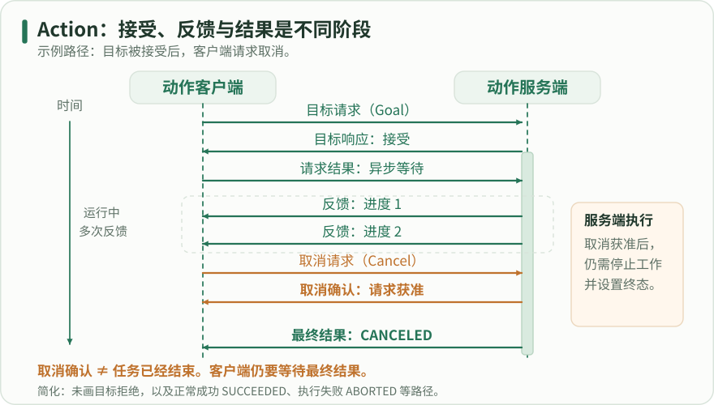

时间向下：客户端先发目标并得到接受响应，再异步请求最终结果；运行中可收到多次反馈。橙色表示取消请求及获准响应，获准后仍需等待服务端停止并返回 CANCELED 结果。本例省略目标拒绝和 SUCCEEDED、ABORTED 等其它终态。

### 6. 依次验证成功、拒绝和取消

构建时 --packages-up-to learning_action_cpp 会包含工作空间内的接口依赖，确保类型先生成再编译服务端。运行 Python 文件的终端也必须加载 install 环境，否则导入 learning_count_interfaces 会失败，即使它没有使用 ros2 run。

第一次只运行 C++ 服务端，用 CLI 发送五步目标并显示反馈；应先看到目标接受，再看到递增进度和成功结果。随后发送 target=0，服务端应拒绝，不进入执行。最后运行带 --cancel 的完整客户端，预期获得 CANCELED，完成步数小于十，但不要求固定为某一个数字，因为计时和调度存在边界差异。

停止 C++ 服务端，换成 Python 服务端重复同样测试。一次只替换一个实现，可以清楚识别协议一致性；若同时运行两个同名动作服务端，测试结果来源会不明确。本章接口与 C++ 包已在本机 Jazzy 构建通过，两种服务端均在仅本机发现的独立域中完成成功与取消测试；你的实际部署环境仍应保留自己的验收记录。

#### 构建并加载

代码类型：commands

```bash

# 【中文教学注释】 构建并加载
# 本例作用：生成接口和 C++ 服务端；所有运行终端先加载 Jazzy 与 overlay。
# 输入输出：输入为 Count 目标 target 或取消请求；输出为 current 反馈、completed 结果及终态，计数无量纲。
# 执行顺序与边界：服务端接受 1..20 且同一时刻只运行一个目标；每步约 0.5 秒。取消请求被接受与任务已取消是两个事件，共享 busy 状态按线程模型保护。
# 切换到紧随其后的路径，后续相对文件操作由此解析；目录不存在应停止并修正，不继续在错误目录操作。
cd ~/ros2_learning_ws
# 按package.xml解析目标发行版依赖；--ignore-src跳过src已提供包，源码已下载不等于系统依赖已离线备齐。
rosdep install --from-paths src --ignore-src --rosdistro jazzy -y
# 从工作空间根按依赖拓扑构建；--packages-select只选指定包，--packages-up-to连同所需上游包，构建后必须source安装环境。
colcon build --packages-up-to learning_action_cpp
# 在当前shell加载install/setup.bash；它影响本终端的包索引/库路径，另一个终端必须单独加载。
source install/setup.bash
# 展开消息/服务/Action字段定义；字段类型不自动表达坐标系、单位和语义约定。
ros2 interface show learning_count_interfaces/action/Count

```

生成接口和 C++ 服务端；所有运行终端先加载 Jazzy 与 overlay。

输入输出：输入为 Count 目标 target 或取消请求；输出为 current 反馈、completed 结果及终态，计数无量纲。
执行顺序与边界：服务端接受 1..20 且同一时刻只运行一个目标；每步约 0.5 秒。取消请求被接受与任务已取消是两个事件，共享 busy 状态按线程模型保护。

#### 终端 A 与测试终端

代码类型：commands

```bash

# 【中文教学注释】 终端 A 与测试终端
# 本例作用：最后一条明确执行取消测试；Ctrl+C 关闭 CLI 不应被当作标准化的取消测试。
# 输入输出：输入为 Count 目标 target 或取消请求；输出为 current 反馈、completed 结果及终态，计数无量纲。
# 执行顺序与边界：服务端接受 1..20 且同一时刻只运行一个目标；每步约 0.5 秒。取消请求被接受与任务已取消是两个事件，共享 busy 状态按线程模型保护。
# 终端 A
# 从已安装包learning_action_cpp启动server；此进程通常持续运行，另用新终端执行观察命令，Ctrl+C结束。
ros2 run learning_action_cpp server
# 终端 B，逐个测试，等待上一目标结束
# 发送动作目标，--feedback额外显示中间反馈；收到接纳响应后仍需等待最终结果/取消终态。
ros2 action send_goal /count learning_count_interfaces/action/Count "{target: 5}" --feedback
ros2 action send_goal /count learning_count_interfaces/action/Count "{target: 0}" --feedback
# 用当前Python解释器运行指定本地脚本；脚本参数/输出路径按本段约定，ROS脚本还需source与包依赖，标准库实验不连接硬件。
python3 ~/ros2_learning_ws/lessons/actions/client.py --cancel

```

最后一条明确执行取消测试；Ctrl+C 关闭 CLI 不应被当作标准化的取消测试。

输入输出：输入为 Count 目标 target 或取消请求；输出为 current 反馈、completed 结果及终态，计数无量纲。
执行顺序与边界：服务端接受 1..20 且同一时刻只运行一个目标；每步约 0.5 秒。取消请求被接受与任务已取消是两个事件，共享 busy 状态按线程模型保护。

#### 替换服务端后测试相同客户端

代码类型：commands

```bash

# 【中文教学注释】 替换服务端后测试相同客户端
# 本例作用：成功和取消是两种预期路径，客户端根据命令选项检查对应终态。
# 输入输出：输入为 Count 目标 target 或取消请求；输出为 current 反馈、completed 结果及终态，计数无量纲。
# 执行顺序与边界：服务端接受 1..20 且同一时刻只运行一个目标；每步约 0.5 秒。取消请求被接受与任务已取消是两个事件，共享 busy 状态按线程模型保护。
# 停止旧 C++ 服务端后，在终端 A
# 用当前Python解释器运行指定本地脚本；脚本参数/输出路径按本段约定，ROS脚本还需source与包依赖，标准库实验不连接硬件。
python3 ~/ros2_learning_ws/lessons/actions/server.py
# 终端 B
python3 ~/ros2_learning_ws/lessons/actions/client.py
python3 ~/ros2_learning_ws/lessons/actions/client.py --cancel

```

成功和取消是两种预期路径，客户端根据命令选项检查对应终态。

输入输出：输入为 Count 目标 target 或取消请求；输出为 current 反馈、completed 结果及终态，计数无量纲。
执行顺序与边界：服务端接受 1..20 且同一时刻只运行一个目标；每步约 0.5 秒。取消请求被接受与任务已取消是两个事件，共享 busy 状态按线程模型保护。

### 7. 动作接口之外仍需应用负责的部分

动作提供目标协议，但不会替你决定抢占策略。本例新目标到来时直接拒绝；其他应用可能先取消旧目标、排队等待或同时执行多个目标。每一种策略都应明确说明，并保证目标之间的资源不会互相覆盖。不能仅因为 ActionServer 支持多个目标句柄，就推断你的设备可以并行执行多个任务。

取消应检查在能保持状态一致的位置。对于不可立即中断的设备动作，可以先确认取消请求，然后在安全的步骤边界退出；但需要向用户说明延迟，并保持反馈或诊断可见。取消不是简单杀死线程，更不等于终止客户端进程。

故障路径同样需要结果。真实任务若遇到设备错误，应设置 abort 并在自定义结果中包含可解释原因；如果客户端断开，服务端是否继续执行也要有策略。最终验收应覆盖成功、非法目标、忙碌拒绝、取消和故障，而不止观察一次正常反馈。

真实 NavigateToPose 台架中，按当前目标 UUID 取消后收到取消应答和上层终态，随后还能测到平滑指令与车辆继续移动。取消响应说明协议状态推进，停稳需另等世界位姿或实际反馈。机器人任务章节给出三个时刻与额外位移的原始对照。

### 忙碌拒绝、受控失败与恢复要形成协议闭环

新增action_labs沿用learning_count_interfaces的Count：target、current和completed均为无量纲计数。先对原有C++/Python服务端分别验证长目标期间第二个合法目标被拒绝，再分别走首目标取消与自然结束，最后重新发送合法目标成功，确认接纳状态恢复。每个目标用UUID区分，不能把上一个目标的反馈或取消应答当成本次结果。

拒绝只发生在接纳阶段，accepted=false的目标没有开始执行，也没有自己的completed结果。GoalStatus没有REJECTED枚举；对未知UUID查得UNKNOWN及默认字段也不能解释为completed=0的业务失败。ABORTED是已接纳目标的失败终态，可以只有0步或部分业务进度；本例在第6步故障另按实际结果记录。验收分别保存接纳Future、反馈、取消应答和最终status/completed；一次Future完成不能替代其余阶段。

取消应答列出目标UUID，也不强制最终一定是CANCELED。固定状态机允许CANCELING继续到SUCCEEDED、ABORTED或CANCELED，临近完成时可能发生竞态。本轮受控取消例留出剩余工作以验收CANCELED，通用客户端仍以最终status为准，不能把这种场景约束推广为协议保证。

原有基础Count服务端保持原样。独立扩展包增加显式abort_after故障参数，默认关闭；达到受控计数后调用abort并释放busy，后续较短目标成功。两种语言都保留相同接口，故障仅影响合成内存计数，不操作设备。

Count.Result只有completed字段，不包含原因字符串。通用ABORTED状态与完成数量来自ROS结果，具体注入原因来自服务端独立日志，二者不能混成接口字段。拒绝/取消/失败都不能证明真实电机停车；这个例子也没有验证客户端消失后任意任务的恢复策略。

#### Count协议的拒绝、终态与恢复

| 实现/主场景 | 首目标 status / completed | busy/非法拒绝 | 后续恢复 status / completed |
| --- | --- | --- | --- |
| cpp original / busy_cancel_recovery | CANCELED / 1 | target=3；accepted=false（无Result） | SUCCEEDED / 2 |
| cpp original / busy_complete_recovery | SUCCEEDED / 4 | target=3；accepted=false（无Result） | SUCCEEDED / 2 |
| cpp original / invalid_bounds | 无执行Result | target=0/21；accepted=false（无Result） | 本例未安排恢复目标 |
| cpp extended / fault_disabled | SUCCEEDED / 8 | 本例未安排拒绝 | 本例未安排恢复目标 |
| cpp extended / abort_and_recovery | ABORTED / 6 | target=3；accepted=false（无Result） | SUCCEEDED / 2 |
| py original / busy_cancel_recovery | CANCELED / 1 | target=3；accepted=false（无Result） | SUCCEEDED / 2 |
| py original / busy_complete_recovery | SUCCEEDED / 4 | target=3；accepted=false（无Result） | SUCCEEDED / 2 |
| py original / invalid_bounds | 无执行Result | target=0/21；accepted=false（无Result） | 本例未安排恢复目标 |
| py extended / fault_disabled | SUCCEEDED / 8 | 本例未安排拒绝 | 本例未安排恢复目标 |
| py extended / abort_and_recovery | ABORTED / 6 | target=3；accepted=false（无Result） | SUCCEEDED / 2 |

实际隔离Count协议结果；completed无量纲，拒绝不是执行终态；不表示硬件停车。

### Count扩展工程与有界验收的完整文件

以下代码与下载工程同源。先按action_labs/README构建独立扩展包并加载基础接口和新安装前缀，再运行验收；原有基础10包没有被覆盖。报告保存每例输入、UUID、状态、源码与二进制指纹和退出清理。

内部等待使用单调软期限；无法抢占任意原生阻塞，父进程/外层保护另设。脚本只回收自己创建的进程，不结束其他ROS节点；两种服务端依次启动，避免同名来源不明。

#### action_labs/learning_count_fault_lab/CMakeLists.txt

代码类型：complete

```cmake

# 本包独立构建；输入是本目录源码及已安装的 learning_count_interfaces。
# 输出为一个 C++ 可执行文件和一个 Python 脚本入口，不修改或重复生成 Count 接口。
cmake_minimum_required(VERSION 3.8)
project(learning_count_fault_lab)
set(CMAKE_CXX_STANDARD 17)
set(CMAKE_CXX_STANDARD_REQUIRED ON)
find_package(ament_cmake REQUIRED)
find_package(rclcpp REQUIRED)
find_package(rclcpp_action REQUIRED)
find_package(learning_count_interfaces REQUIRED)
add_executable(count_fault_cpp src/count_fault_server.cpp)
ament_target_dependencies(count_fault_cpp rclcpp rclcpp_action learning_count_interfaces)
install(TARGETS count_fault_cpp DESTINATION lib/${PROJECT_NAME})
# Python 是完整单文件，install(PROGRAMS) 设置安装入口执行权限；这里不伪装成 C++ 目标。
install(PROGRAMS scripts/count_fault_server.py
  DESTINATION lib/${PROJECT_NAME} RENAME count_fault_py)
ament_package()


```

本文件与报告绑定的原创工程同源；输入、单位、默认参数、执行顺序及关闭边界见中文注释。请按配套README构建并加载环境。

#### action_labs/learning_count_fault_lab/package.xml

代码类型：complete

```xml

<?xml version="1.0"?>
<!-- 新增原创教学扩展包。接口沿用已安装的 learning_count_interfaces，不改Result字段。 -->
<package format="3">
  <name>learning_count_fault_lab</name>
  <version>0.0.1</version>
  <description>Controlled Count action failure injection for isolated software tests</description>
  <maintainer email="learner@example.com">ROS 2 Learning Hub</maintainer>
  <license>Apache-2.0</license>
  <buildtool_depend>ament_cmake</buildtool_depend>
  <depend>rclcpp</depend>
  <depend>rclcpp_action</depend>
  <depend>learning_count_interfaces</depend>
  <exec_depend>rclpy</exec_depend>
  <export><build_type>ament_cmake</build_type></export>
</package>


```

本文件与报告绑定的原创工程同源；输入、单位、默认参数、执行顺序及关闭边界见中文注释。请按配套README构建并加载环境。

#### action_labs/learning_count_fault_lab/scripts/count_fault_server.py

代码类型：complete

```python

#!/usr/bin/env python3
"""Jazzy Count纯计数故障服务端，默认不故障，不连接硬件。

输入：Count.target无量纲整数1..20；启动参数abort_after为0..20步，0关闭故障；
step_seconds为[0.02,2]内有限秒数，默认0.15秒。N步反馈后触发ABORTED(completed=N)，
故障优先于恰好同一步的成功；target<N仍成功。Result依然只有completed，原因写独立UUID日志。
例如：count_fault_py --ros-args -p abort_after:=6 -p step_seconds:=0.15。
--help仅导入标准库；ROS参数与namespace remap原样交给rclpy。
"""
import argparse
import json
import math
import threading
import time


def main(argv=None):
    parser = argparse.ArgumentParser(description=__doc__)
    _args, ros_args = parser.parse_known_args(argv)  # --help在ROS导入之前退出。
    import rclpy
    from learning_count_interfaces.action import Count
    from rclpy.action import ActionServer, CancelResponse, GoalResponse
    from rclpy.callback_groups import ReentrantCallbackGroup
    from rclpy.executors import ExternalShutdownException, MultiThreadedExecutor
    from rclpy.node import Node

    class CountFaultServer(Node):
        def __init__(self):
            super().__init__('count_fault_py', start_parameter_services=False)
            self.abort_after = self.declare_parameter('abort_after', 0).value
            self.step_seconds = self.declare_parameter('step_seconds', 0.15).value
            if type(self.abort_after) is not int or not 0 <= self.abort_after <= 20:
                raise ValueError('abort_after必须是0..20的整数步数，0关闭故障')
            if (type(self.step_seconds) is not float or not math.isfinite(self.step_seconds)
                    or not 0.02 <= self.step_seconds <= 2.0):
                raise ValueError('step_seconds必须是[0.02,2]内有限DOUBLE秒数')
            self.lock = threading.Lock()
            self.log_lock = threading.Lock()
            self.busy = False
            self.group = ReentrantCallbackGroup()
            self.server = ActionServer(self, Count, 'count', self.execute,
                                       goal_callback=self.on_goal, cancel_callback=self.on_cancel,
                                       handle_accepted_callback=self.on_accepted,
                                       callback_group=self.group)
            self.emit('ready', None, 0, 0, 'configuration_loaded')

        def emit(self, event, goal_uuid, target, completed, reason):
            # 两个工作线程共用stdout；独立日志锁防止两条JSON交错，不与busy锁构成反向持锁。
            with self.log_lock:
                print('COUNT_LAB_EVENT ' + json.dumps(dict(
                    event=event, goal_uuid=goal_uuid, target=int(target),
                    completed=None if completed is None else int(completed),
                    reason=reason, abort_after=self.abort_after, step_seconds=self.step_seconds),
                    ensure_ascii=False, allow_nan=False), flush=True)

        @staticmethod
        def uuid(handle):
            return bytes(handle.goal_id.uuid).hex()

        def on_goal(self, goal):
            with self.lock:
                if not 1 <= goal.target <= 20:
                    # Python公开goal_callback只收到Goal，不提供请求UUID；不能编造UUID。
                    self.emit('goal_rejected', None, goal.target, 0, 'invalid_target_range')
                    return GoalResponse.REJECT
                if self.busy:
                    self.emit('goal_rejected', None, goal.target, 0, 'busy')
                    return GoalResponse.REJECT
                self.busy = True
            return GoalResponse.ACCEPT

        def on_accepted(self, handle):
            # 接受后公开handle才提供UUID；把执行交回ActionServer的执行任务。
            self.emit('goal_accepted', self.uuid(handle), handle.request.target, 0, 'accepted')
            handle.execute()

        def on_cancel(self, handle):
            # 该接纳回调不持有执行回调的可靠进度快照，不能以0冒充当前completed。
            # null表示此日志事件未提供进度；真正completed来自反馈及最终Result。
            self.emit('cancel_accepted', self.uuid(handle), handle.request.target, None,
                      'cancel_request_accepted_not_terminal')
            return CancelResponse.ACCEPT

        def execute(self, handle):
            result = Count.Result()
            goal_uuid, target = self.uuid(handle), handle.request.target
            try:
                for current in range(1, target + 1):
                    # 仅模拟软件耗时，秒为单调经过时间；不是设备控制周期或硬实时承诺。
                    time.sleep(self.step_seconds)
                    if not self.context.ok():
                        self.emit('shutdown_without_protocol_guarantee', goal_uuid, target,
                                  result.completed, 'context_shutdown')
                        return result
                    if handle.is_cancel_requested:
                        handle.canceled()
                        self.emit('CANCELED', goal_uuid, target, result.completed,
                                  'cancel_observed_at_step_boundary')
                        return result
                    result.completed = current
                    feedback = Count.Feedback()
                    feedback.current = current
                    handle.publish_feedback(feedback)
                    self.emit('feedback', goal_uuid, target, current, 'step_completed')
                    if self.abort_after > 0 and current >= self.abort_after:
                        # 常规Python执行模式：设置通用终态，再返回原Count.Result，不重复填新结果字段。
                        handle.abort()
                        self.emit('ABORTED', goal_uuid, target, result.completed,
                                  'configured_abort_after_step')
                        return result
                handle.succeed()
                self.emit('SUCCEEDED', goal_uuid, target, result.completed, 'target_reached')
                return result
            finally:
                # 所有返回路径都释放占用。锁只保护短更新，不跨sleep或网络等待。
                with self.lock:
                    self.busy = False
                self.emit('busy_released', goal_uuid, target, result.completed,
                          'slot_released_after_execution_exit')

    rclpy.init(args=ros_args)
    node = executor = None
    try:
        node = CountFaultServer()
        executor = MultiThreadedExecutor(num_threads=2)
        executor.add_node(node)
        try:
            executor.spin()
        except (KeyboardInterrupt, ExternalShutdownException):
            pass
    finally:
        if executor is not None:
            executor.shutdown(timeout_sec=3.0)
        if node is not None:
            node.server.destroy()
            node.destroy_node()
        if rclpy.ok():
            rclpy.shutdown()


if __name__ == '__main__':
    main()


```

本文件与报告绑定的原创工程同源；输入、单位、默认参数、执行顺序及关闭边界见中文注释。请按配套README构建并加载环境。

#### action_labs/learning_count_fault_lab/src/count_fault_server.cpp

代码类型：complete

```cpp

// 原创 Count 故障注入服务端，仅用于无物理副作用的隔离实验。
// 输入：target为无量纲整数1..20；abort_after为计数步数，0默认关闭；step_seconds单位秒。
// 输出：反馈current、结果completed和通用Action终态；原因只写COUNT_LAB_EVENT日志，不扩展Result。
// 执行顺序：单线程接纳→定时推进/检查取消→反馈→可选abort→正常success→释放busy。
#include <chrono>
#include <cmath>
#include <cstdint>
#include <iomanip>
#include <memory>
#include <sstream>
#include <stdexcept>
#include <string>
#include "rclcpp/rclcpp.hpp"
#include "rclcpp_action/rclcpp_action.hpp"
#include "learning_count_interfaces/action/count.hpp"

using Count = learning_count_interfaces::action::Count;
using GoalHandle = rclcpp_action::ServerGoalHandle<Count>;

std::string uuid_hex(const rclcpp_action::GoalUUID & id)
{
  std::ostringstream out;
  out << std::hex << std::setfill('0');
  for (auto byte : id) {out << std::setw(2) << static_cast<unsigned int>(byte);}
  return out.str();
}

class CountFaultServer : public rclcpp::Node
{
public:
  CountFaultServer()
  : Node("count_fault_cpp", rclcpp::NodeOptions().start_parameter_services(false))
  {
    // 参数只在启动时读取。0表示永不注入故障；禁止含糊的负数、过大步数或非有限周期。
    const auto configured = declare_parameter<std::int64_t>("abort_after", 0);
    step_seconds_ = declare_parameter<double>("step_seconds", 0.15);
    if (configured < 0 || configured > 20 || !std::isfinite(step_seconds_) ||
      step_seconds_ < 0.02 || step_seconds_ > 2.0)
    {
      throw std::invalid_argument("abort_after must be 0..20; step_seconds finite in [0.02,2]");
    }
    abort_after_ = static_cast<std::uint32_t>(configured);
    server_ = rclcpp_action::create_server<Count>(this, "count",
      [this](const rclcpp_action::GoalUUID & uuid, std::shared_ptr<const Count::Goal> goal) {
        if (goal->target < 1 || goal->target > 20) {
          emit("goal_rejected", uuid_hex(uuid), goal->target, 0, "invalid_target_range");
          return rclcpp_action::GoalResponse::REJECT;
        }
        if (busy_) {
          emit("goal_rejected", uuid_hex(uuid), goal->target, 0, "busy");
          return rclcpp_action::GoalResponse::REJECT;
        }
        busy_ = true;
        emit("goal_accepted", uuid_hex(uuid), goal->target, 0, "accepted");
        return rclcpp_action::GoalResponse::ACCEPT_AND_EXECUTE;
      },
      [this](const std::shared_ptr<GoalHandle> handle) {
        emit("cancel_accepted", uuid_hex(handle->get_goal_id()), handle->get_goal()->target,
          completed_, "cancel_request_accepted_not_terminal");
        return rclcpp_action::CancelResponse::ACCEPT;
      },
      [this](const std::shared_ptr<GoalHandle> handle) {
        active_ = handle;
        completed_ = 0;
      });
    const auto period = std::chrono::duration_cast<std::chrono::nanoseconds>(
      std::chrono::duration<double>(step_seconds_));
    timer_ = create_wall_timer(period, [this]() {tick();});
    emit("ready", "", 0, 0, "configuration_loaded");
  }

private:
  void emit(const std::string & event, const std::string & uuid, std::uint32_t target,
    std::uint32_t completed, const std::string & reason)
  {
    // 所有字符串为本例固定常量或十六进制UUID，没有任意输入字符串的JSON转义问题。
    std::ostringstream out;
    out << "{\"event\":\"" << event << "\",\"goal_uuid\":\"" << uuid <<
      "\",\"target\":" << target << ",\"completed\":" << completed <<
      ",\"reason\":\"" << reason << "\",\"abort_after\":" << abort_after_ <<
      ",\"step_seconds\":" << step_seconds_ << "}";
    RCLCPP_INFO(get_logger(), "COUNT_LAB_EVENT %s", out.str().c_str());
  }

  void finish(const std::string & state, const std::string & reason)
  {
    auto result = std::make_shared<Count::Result>();
    result->completed = completed_;
    const auto uuid = uuid_hex(active_->get_goal_id());
    const auto target = active_->get_goal()->target;
    if (state == "ABORTED") {active_->abort(result);}
    else if (state == "CANCELED") {active_->canceled(result);}
    else {active_->succeed(result);}
    emit(state, uuid, target, completed_, reason);
    active_.reset();
    busy_ = false;
    emit("busy_released", uuid, target, completed_, "slot_released_after_terminal");
  }

  void tick()
  {
    if (!active_) {return;}
    // 取消是任务在步边界观察到的状态。接受取消本身不等于已经CANCELED或硬件停车。
    if (active_->is_canceling()) {finish("CANCELED", "cancel_observed_at_step_boundary"); return;}
    ++completed_;
    auto feedback = std::make_shared<Count::Feedback>();
    feedback->current = completed_;
    active_->publish_feedback(feedback);
    emit("feedback", uuid_hex(active_->get_goal_id()), active_->get_goal()->target,
      completed_, "step_completed");
    // 第N步完成、发布反馈后再注入故障；target==N时故障优先于正常成功。
    // target<N会先成功，便于用后续短目标验证busy释放；默认N=0不会abort。
    if (abort_after_ > 0 && completed_ >= abort_after_) {
      finish("ABORTED", "configured_abort_after_step");
    } else if (completed_ >= active_->get_goal()->target) {
      finish("SUCCEEDED", "target_reached");
    }
  }

  // 当前main使用单线程执行器，回调串行访问这些字段；换成可重入并发需重新设计同步。
  bool busy_{false};
  std::uint32_t completed_{0}, abort_after_{0};
  double step_seconds_{0.15};
  std::shared_ptr<GoalHandle> active_;
  rclcpp_action::Server<Count>::SharedPtr server_;
  rclcpp::TimerBase::SharedPtr timer_;
};

int main(int argc, char ** argv)
{
  rclcpp::init(argc, argv);
  int code = 0;
  try {rclcpp::spin(std::make_shared<CountFaultServer>());}
  catch (const std::exception & error) {
    RCLCPP_ERROR(rclcpp::get_logger("count_fault_cpp"), "startup/runtime failure: %s", error.what());
    code = 2;
  }
  if (rclcpp::ok()) {rclcpp::shutdown();}
  return code;
}


```

本文件与报告绑定的原创工程同源；输入、单位、默认参数、执行顺序及关闭边界见中文注释。请按配套README构建并加载环境。

#### action_labs/verify_count_actions.py

代码类型：complete

```python

#!/usr/bin/env python3
"""原Count两语言服务端及独立故障扩展的隔离验收，不启动机器人或仿真。

输入：已source的Jazzy/基础安装、--foundation-prefix、独立--build-root；计数均无量纲。
输出：每例目标UUID、反馈、状态、completed、取消响应、服务端原始日志和SHA验证报告。
所有等待以monotonic秒计。父进程限制worker总时长，worker限制每次发现/应答/结果；
只清理自己创建的PID/进程组，不终止ROS daemon或其他节点。拒绝目标不请求GetResult。
--help只用标准库；--build只构建新learning_count_fault_lab，不构建/改动原基础10包。
"""
from __future__ import annotations

import argparse
from contextlib import contextmanager
from datetime import datetime, timezone
import hashlib
import json
import math
import os
from pathlib import Path
import platform
import shlex
import signal
import subprocess
import sys
import tempfile
import time
import traceback
import uuid

HERE = Path(__file__).resolve().parent
ROOT = HERE.parents[1]
MARKER = 'COUNT_WORKER_RESULT='
CASES = {
    f'{language}_{kind}_{scenario}': (language, kind, scenario)
    for language in ('cpp', 'py')
    for kind, scenarios in (
        ('original', ('busy_cancel_recovery', 'busy_complete_recovery', 'invalid_bounds')),
        ('extended', ('fault_disabled', 'abort_and_recovery')))
    for scenario in scenarios
}


def require(condition, description):
    """显式断言不受python -O影响，失败必须保留上下文，不能静默跳过或重发目标。"""
    if not condition:
        raise AssertionError(description)


def seconds(text):
    value = float(text)
    if not math.isfinite(value) or not 0.0 < value <= 600.0:
        raise argparse.ArgumentTypeError('期限必须是(0,600]内有限秒数')
    return value


def file_sha(path):
    return hashlib.sha256(Path(path).read_bytes()).hexdigest()


def environment(domain_id):
    env = dict(os.environ)
    env.update(ROS_DOMAIN_ID=str(domain_id), ROS_AUTOMATIC_DISCOVERY_RANGE='LOCALHOST',
               RMW_IMPLEMENTATION='rmw_fastrtps_cpp', PYTHONUNBUFFERED='1',
               PYTHONDONTWRITEBYTECODE='1', RCUTILS_COLORIZED_OUTPUT='0',
               RCUTILS_LOGGING_BUFFERED_STREAM='0')
    env.pop('ROS_STATIC_PEERS', None)
    env.pop('ROS_LOCALHOST_ONLY', None)
    return env


def server_events(text):
    events = []
    for line in text.splitlines():
        if 'COUNT_LAB_EVENT ' in line:
            try:
                events.append(json.loads(line.split('COUNT_LAB_EVENT ', 1)[1]))
            except ValueError as error:
                events.append(dict(event='unparsed_log', raw=line, parseError=str(error)))
    return events


def stop_own_group(process):
    """停止本程序start_new_session创建的组；处理清理期间再次Ctrl+C，保留原始输出。"""
    signals_sent = []
    for sig, wait_s in ((signal.SIGINT, 5.0), (signal.SIGTERM, 2.0), (signal.SIGKILL, 2.0)):
        signals_sent.append(sig.name)
        try:
            os.killpg(process.pid, sig)
        except ProcessLookupError:
            pass
        try:
            # worker收到组INT后要先等待server自己的首次INT清理，不能被父级2秒窗口抢先TERM。
            output, _ = process.communicate(timeout=wait_s)
            return output, signals_sent
        except (subprocess.TimeoutExpired, KeyboardInterrupt):
            # 每次等待仍有上限；第二次Ctrl+C不会跳过剩余的强制清理阶段。
            continue
    output, _ = process.communicate(timeout=1.0)
    return output, signals_sent


class Children:
    """server继承worker的进程组；父进程仍能在worker挂起时清理整组自建子进程。"""
    def __init__(self, directory, env):
        self.directory, self.env, self.items = Path(directory), env, []

    def start(self, command):
        path = self.directory / 'server.log'
        stream = path.open('w')
        process = subprocess.Popen(command, stdout=stream, stderr=stream, env=self.env)
        item = dict(command=command, path=path, stream=stream, process=process)
        self.items.append(item)
        return item

    @staticmethod
    def text(item):
        item['stream'].flush()
        return item['path'].read_text(errors='replace')

    def close(self, group_sigint_already_sent=False):
        records = []
        for item in reversed(self.items):
            process, signals = item['process'], []
            initial_wait_s = 0.0
            if group_sigint_already_sent and process.poll() is None:
                # 父driver的killpg已同时给worker和server发送INT。此时马上再send_signal(INT)
                # 会把一次Ctrl+C变成双INT，打断Python server正在进行的executor.shutdown/join。
                initial_wait_s = 2.0
                try:
                    process.wait(timeout=initial_wait_s)
                except subprocess.TimeoutExpired:
                    pass
            sequence = ((signal.SIGTERM, signal.SIGKILL) if group_sigint_already_sent else
                        (signal.SIGINT, signal.SIGTERM, signal.SIGKILL))
            for sig in sequence:
                if process.poll() is not None:
                    break
                try:
                    process.send_signal(sig)
                except ProcessLookupError:
                    pass
                signals.append(sig.name)
                try:
                    process.wait(timeout=2.0)
                except subprocess.TimeoutExpired:
                    pass
            log = self.text(item)
            records.append(dict(command=item['command'], pid=process.pid,
                                exitCode=process.poll(), signalsSent=signals,
                                priorGroupSigint=group_sigint_already_sent,
                                initialWaitForAlreadySignaledServer_s=initial_wait_s,
                                reaped=process.poll() is not None, log=log,
                                logSha256=hashlib.sha256(log.encode()).hexdigest(),
                                events=server_events(log)))
            item['stream'].close()
        return list(reversed(records))


@contextmanager
def probe(namespace, domain_id):
    """仅worker加载ROS。单线程客户端只做短回调，不在回调里同步等待缺失的协议事件。"""
    from action_msgs.msg import GoalStatus, GoalStatusArray
    from learning_count_interfaces.action import Count
    from rclpy.action import ActionClient
    from rclpy.context import Context
    from rclpy.executors import SingleThreadedExecutor
    from rclpy.node import Node
    from rclpy.qos import qos_profile_action_status_default
    from unique_identifier_msgs.msg import UUID

    names = {GoalStatus.STATUS_UNKNOWN: 'UNKNOWN', GoalStatus.STATUS_ACCEPTED: 'ACCEPTED',
             GoalStatus.STATUS_EXECUTING: 'EXECUTING', GoalStatus.STATUS_CANCELING: 'CANCELING',
             GoalStatus.STATUS_SUCCEEDED: 'SUCCEEDED', GoalStatus.STATUS_CANCELED: 'CANCELED',
             GoalStatus.STATUS_ABORTED: 'ABORTED'}
    require(set(Count.Result.get_fields_and_field_types()) == {'completed'}, 'Count.Result只应包含completed')
    context = Context()
    context.init(args=[], domain_id=domain_id, initialize_logging=False)
    node = executor = client = None

    class Probe:
        def __init__(self):
            self.start = time.monotonic()
            self.goals, self.handles, self.results = {}, {}, {}
            self.cleanup = {}

        def now(self):
            return round(time.monotonic() - self.start, 6)

        def feedback(self, message):
            key = bytes(message.goal_id.uuid).hex()
            if key in self.goals:
                self.goals[key]['feedback'].append(dict(current=int(message.feedback.current), at_s=self.now()))

        def status(self, message):
            for item in message.status_list:
                key = bytes(item.goal_info.goal_id.uuid).hex()
                if key in self.goals:
                    events = self.goals[key]['statusEvents']
                    if not events or events[-1]['code'] != item.status:
                        events.append(dict(code=int(item.status), name=names[item.status], at_s=self.now()))

        def wait(self, predicate, limit_s, description):
            deadline = time.monotonic() + limit_s
            while context.ok():
                if predicate():
                    return
                remaining = deadline - time.monotonic()
                require(remaining > 0.0, f'{description} 超过{limit_s}个单调秒')
                executor.spin_once(timeout_sec=min(0.02, remaining))
            raise RuntimeError(description + '期间Context关闭')

        def drain(self, duration_s=0.08):
            deadline = time.monotonic() + duration_s
            while context.ok() and time.monotonic() < deadline:
                executor.spin_once(timeout_sec=min(0.02, max(0.0, deadline - time.monotonic())))

        def send(self, target, label):
            # 在发送前保存非零UUID。每次只提交一次；不能用重试掩盖busy释放失败。
            goal_uuid = UUID(uuid=list(uuid.uuid4().bytes))
            key = bytes(goal_uuid.uuid).hex()
            record = dict(uuid=key, label=label, target=target, submittedAt_s=self.now(),
                          accepted=None, feedback=[], statusEvents=[], resultRequested=False,
                          result=None, terminalStatus=None, cancelResponse=None)
            self.goals[key] = record
            future = client.send_goal_async(Count.Goal(target=target), self.feedback, goal_uuid=goal_uuid)
            self.wait(future.done, 4.0, '目标应答')
            handle = future.result()
            require(handle is not None, '目标应答缺handle')
            record.update(accepted=bool(handle.accepted), responseAt_s=self.now())
            if handle.accepted:
                self.handles[key] = handle
                self.results[key] = handle.get_result_async()
                record['resultRequested'] = True
            return record

        def rejected(self, record):
            require(record['accepted'] is False, f'应拒绝目标：{record}')
            self.drain()
            require(not record['resultRequested'] and record['result'] is None, '拒绝不能伪造执行Result')
            require(not record['feedback'] and not record['statusEvents'], '拒绝目标不应出现执行反馈/GoalStatus')
            # ROS2没有REJECTED GoalStatus枚举；这里只记录SendGoal accepted=false。

        def first_feedback(self, record):
            self.wait(lambda: len(record['feedback']) >= 1, 4.0, '首条反馈')
            require(not self.results[record['uuid']].done(), '发送busy目标前首目标必须仍在执行')

        def cancel(self, record):
            future = self.handles[record['uuid']].cancel_goal_async()
            self.wait(future.done, 3.0, '取消应答')
            response = future.result()
            ids = [bytes(g.goal_id.uuid).hex() for g in response.goals_canceling]
            record['cancelResponse'] = dict(returnCode=int(response.return_code), goalsCanceling=ids,
                                            at_s=self.now())
            require(response.return_code == 0 and record['uuid'] in ids, '取消应答须明确包含本UUID')
            # 取消受理仍不是CANCELED。这个实验保留足够计数余量，再独立检查最终结果。

        def terminal(self, record, expected, completed=None):
            future = self.results[record['uuid']]
            self.wait(future.done, 12.0, '执行结果')
            response = future.result()
            require(response is not None, '结果Future没有响应')
            status = names[response.status]
            record.update(terminalStatus=status, terminalCode=int(response.status),
                          result=dict(completed=int(response.result.completed)), resultAt_s=self.now())
            require(status == expected, f'期望{expected}，实际{status}')
            if completed is not None:
                require(record['result']['completed'] == completed, f'completed应为{completed}')
            self.wait(lambda: any(e['name'] == status for e in record['statusEvents']), 2.0, '同UUID终态状态话题')
            self.drain()  # 让已排队反馈完成，再检查递增与最后一步。
            values = [e['current'] for e in record['feedback']]
            require(values == list(range(1, record['result']['completed'] + 1)), f'反馈与completed不符：{record}')

    obj = Probe()
    try:
        node = Node('count_action_probe', namespace=namespace, context=context,
                    enable_rosout=False, start_parameter_services=False)
        executor = SingleThreadedExecutor(context=context)
        executor.add_node(node)
        client = ActionClient(node, Count, 'count')
        node.create_subscription(GoalStatusArray, 'count/_action/status', obj.status,
                                 qos_profile_action_status_default)
        obj.wait(client.server_is_ready, 8.0, 'Action服务发现')
        yield obj
    finally:
        if client is not None:
            client.destroy()
        if executor is not None:
            if node is not None:
                executor.remove_node(node)
            executor.shutdown(timeout_sec=0.0)
        if node is not None:
            node.destroy_node()
        if context.ok():
            context.shutdown()
        obj.cleanup = dict(clientDestroyed=client is not None, nodeDestroyed=node is not None,
                           contextShutdown=not context.ok())


def worker(args):
    language, kind, scenario = CASES[args.worker]
    namespace = f'/count_lab_{os.getpid()}_{args.worker}'
    env = environment(args.domain_id)
    os.environ.update(env)  # 在任何ROS导入前固定本worker的发现环境。
    report = dict(id=args.worker, language=language, implementation=kind, scenario=scenario,
                  namespace=namespace, passed=False, goals=[], serverProcesses=[], error=None)
    probe_obj = None
    interrupted_in_worker = False
    with tempfile.TemporaryDirectory(prefix='count-action-') as directory:
        env['ROS_LOG_DIR'] = str(Path(directory) / 'ros-log')
        children = Children(directory, env)
        if kind == 'original':
            command = ([str(args.foundation_prefix / 'lib/learning_action_cpp/server')] if language == 'cpp'
                       else [sys.executable, str(ROOT / 'foundation-examples/lessons/actions/server.py')])
        else:
            name = 'count_fault_cpp' if language == 'cpp' else 'count_fault_py'
            command = [str(args.fault_prefix / 'lib/learning_count_fault_lab' / name)]
        command += ['--ros-args', '-r', f'__ns:={namespace}']
        if scenario == 'abort_and_recovery':
            command += ['-p', 'abort_after:=6', '-p', 'step_seconds:=0.2']
        server = children.start(command)
        try:
            with probe(namespace, args.domain_id) as p:
                probe_obj = p
                if scenario == 'invalid_bounds':
                    for target in (0, 21):
                        p.rejected(p.send(target, f'invalid_{target}'))
                elif scenario == 'fault_disabled':
                    first = p.send(8, 'default_fault_disabled')
                    require(first['accepted'], '默认无故障目标应接受')
                    p.terminal(first, 'SUCCEEDED', 8)
                    report['primaryUuid'] = first['uuid']
                else:
                    first_target = 12 if scenario == 'busy_cancel_recovery' else (4 if kind == 'original' else 10)
                    first = p.send(first_target, 'first_long')
                    require(first['accepted'], '首目标应接受')
                    p.first_feedback(first)
                    second = p.send(3, 'second_legal_while_busy')
                    p.rejected(second)
                    report['busySubmissionCondition'] = '首目标已有反馈、结果Future未完成；第二目标target=3合法'
                    if scenario == 'busy_cancel_recovery':
                        p.cancel(first)
                        p.terminal(first, 'CANCELED')
                        require(1 <= first['result']['completed'] < 12, '中途取消应只完成部分计数')
                    elif scenario == 'busy_complete_recovery':
                        p.terminal(first, 'SUCCEEDED', 4)
                    else:
                        p.terminal(first, 'ABORTED', 6)
                    recovery = p.send(2, 'recovery_once')
                    require(recovery['accepted'], '首目标终态后新合法目标应接受；不自动重试')
                    p.terminal(recovery, 'SUCCEEDED', 2)
                    report.update(primaryUuid=first['uuid'], busyRejectedUuid=second['uuid'],
                                  recoveryUuid=recovery['uuid'])

                # 只从服务端日志独立验证故障原因；绝不向只有completed的Result编造reason字段。
                events = server_events(children.text(server))
                if kind == 'extended':
                    if scenario == 'fault_disabled':
                        require(any(e['event'] == 'ready' and e['abort_after'] == 0 for e in events), '默认abort_after须为0')
                    else:
                        first_id = report['primaryUuid']
                        proof = [e for e in events if e['event'] == 'ABORTED' and e['goal_uuid'] == first_id]
                        require(len(proof) == 1 and proof[0]['completed'] == 6 and
                                proof[0]['reason'] == 'configured_abort_after_step', '缺少独立ABORTED原因日志')
                        require(any(e['event'] == 'goal_rejected' and e['target'] == 3 and e['reason'] == 'busy'
                                    for e in events), '缺少扩展服务端busy日志')
                        report['abortReasonLog'] = proof[0]
                        report['rejectionLogCorrelation'] = (
                            'C++公开goal回调含UUID，可精确关联' if language == 'cpp' else
                            'Python公开goal回调不含UUID；隔离命名空间内唯一target=3拒绝按顺序关联，日志UUID为null')
                else:
                    report['reasonBoundary'] = '原服务端没有结构化原因日志；busy由合法目标和已执行首目标的受控条件推断，Result无reason字段。'
                report['passed'] = True
        except (Exception, KeyboardInterrupt) as error:
            interrupted_in_worker = isinstance(error, KeyboardInterrupt)
            report.update(error=repr(error), traceback=traceback.format_exc())
        finally:
            if probe_obj is not None:
                report['goals'] = list(probe_obj.goals.values())
                report['probeCleanup'] = probe_obj.cleanup
            report['serverProcesses'] = children.close(group_sigint_already_sent=interrupted_in_worker)
            if not all(s['reaped'] for s in report['serverProcesses']):
                report.update(passed=False, error='未能清理本worker创建的服务端')
    print(MARKER + json.dumps(report, ensure_ascii=False, allow_nan=False), flush=True)
    return 0 if report['passed'] else 1


def sources():
    paths = sorted(p for p in HERE.rglob('*') if p.is_file() and p.suffix in ('.py', '.cpp', '.xml', '.txt', '.md'))
    paths += [ROOT / 'foundation-examples/lessons/actions/server.py',
              ROOT / 'foundation-examples/src/learning_action_cpp/src/server.cpp',
              ROOT / 'foundation-examples/src/learning_count_interfaces/action/Count.action']
    return [dict(path=p.relative_to(ROOT).as_posix(), sha256=file_sha(p)) for p in paths]


def teaching_table(cases):
    rows = []
    for case in cases:
        goals = {g['uuid']: g for g in case['goals']}
        first = goals.get(case.get('primaryUuid'))
        recovery = goals.get(case.get('recoveryUuid'))
        first_text = (f"{first['terminalStatus']} / {first['result']['completed']}" if first and first['result'] else '无执行Result')
        rejected = [str(g['target']) for g in goals.values() if g['accepted'] is False]
        rejection = ('target=' + '/'.join(rejected) + '；accepted=false（无Result）') if rejected else '本例未安排拒绝'
        restored = (f"{recovery['terminalStatus']} / {recovery['result']['completed']}" if recovery else '本例未安排恢复目标')
        rows.append([f"{case['language']} {case['implementation']} / {case['scenario']}",
                     first_text, rejection, restored])
    return dict(caption='实际隔离Count协议结果；completed无量纲，拒绝不是执行终态；不表示硬件停车。',
                columns=['实现/主场景', '首目标 status / completed', 'busy/非法拒绝', '后续恢复 status / completed'], rows=rows)


def main(argv=None):
    parser = argparse.ArgumentParser(description=__doc__)
    parser.add_argument('--foundation-prefix', type=Path,
                        default=Path(os.environ.get('FOUNDATION_INSTALL_PREFIX', ROOT / 'foundation-examples/install')))
    parser.add_argument('--build-root', type=Path, default=Path('/tmp/ros2-hub-count-action-lab'))
    parser.add_argument('--fault-prefix', type=Path, default=None)
    parser.add_argument('--build', action='store_true', help='只colcon构建新增包；要求已source基础接口安装')
    parser.add_argument('--domain-id', type=int, default=227)
    parser.add_argument('--case', action='append', choices=tuple(CASES), default=[])
    parser.add_argument('--case-timeout', type=seconds, default=25.0, help='每worker父进程保护秒数，默认25')
    parser.add_argument('--total-timeout', type=seconds, default=180.0, help='全部worker总保护秒数，默认180')
    parser.add_argument('--output', type=Path, default=Path('/tmp/count-action-rerun.json'),
                        help='报告另存路径，默认/tmp/count-action-rerun.json，不覆盖教材绑定证据')
    parser.add_argument('--worker', choices=tuple(CASES), help=argparse.SUPPRESS)
    args = parser.parse_args(argv)  # --help无需ROS、已构建接口或本机临时目录。
    if not 0 <= args.domain_id <= 232:
        parser.error('domain-id必须在0..232，选择无其他应用的独立域')
    args.foundation_prefix = args.foundation_prefix.resolve()
    args.build_root = args.build_root.resolve()
    args.fault_prefix = (args.fault_prefix or args.build_root / 'install').resolve()
    if args.worker:
        return worker(args)

    before = sources()
    report = dict(validatedAt=datetime.now(timezone.utc).isoformat(), passed=False,
                  sourceHashes=before, cases=[], build=None, teachingTables=[],
                  environment=dict(domainId=args.domain_id, discoveryRange='LOCALHOST', rmw='rmw_fastrtps_cpp'),
                  parentProtection=dict(caseTimeout_s=args.case_timeout, totalTimeout_s=args.total_timeout),
                  originalFoundationRebuilt=False, originalSourcesUnchanged=None)
    current_process = None
    try:
        if args.build:
            command = ['colcon', '--log-base', str(args.build_root / 'log'), 'build',
                       '--base-paths', str(HERE / 'learning_count_fault_lab'),
                       '--build-base', str(args.build_root / 'build'), '--install-base', str(args.fault_prefix),
                       '--merge-install', '--symlink-install', '--packages-select', 'learning_count_fault_lab']
            build = subprocess.run(command, cwd=ROOT, capture_output=True, text=True, timeout=100.0)
            report['build'] = dict(command=command, cwd=str(ROOT), exitCode=build.returncode,
                                   stdout=build.stdout, stderr=build.stderr)
            require(build.returncode == 0, '新增包构建失败：' + build.stdout + build.stderr)
        artifacts = [args.foundation_prefix / 'lib/learning_action_cpp/server',
                     ROOT / 'foundation-examples/lessons/actions/server.py',
                     args.fault_prefix / 'lib/learning_count_fault_lab/count_fault_cpp',
                     args.fault_prefix / 'lib/learning_count_fault_lab/count_fault_py', Path(sys.executable)]
        report['artifacts'] = [dict(path=str(p), sha256=file_sha(p), bytes=p.stat().st_size,
                                    kind='Python source/installed script' if p.suffix == '.py' or p.name == 'count_fault_py' else 'executable')
                               for p in artifacts]
        report['execution'] = dict(command=[sys.executable, *sys.argv], pythonVersion=platform.python_version(),
                                    foundationPrefix=str(args.foundation_prefix), faultPrefix=str(args.fault_prefix))
        versions = subprocess.run(['dpkg-query', '-W', 'ros-jazzy-rclpy', 'ros-jazzy-rclcpp',
                                   'ros-jazzy-rclcpp-action', 'ros-jazzy-action-msgs'], capture_output=True, text=True)
        report['packageVersions'] = dict(line.split('\t', 1) for line in versions.stdout.splitlines() if '\t' in line)
        started = time.monotonic()
        for name in args.case or CASES:
            remaining = args.total_timeout - (time.monotonic() - started)
            require(remaining > 0, '总保护期限到达')
            command = [sys.executable, str(Path(__file__).resolve()), '--worker', name,
                       '--foundation-prefix', str(args.foundation_prefix), '--fault-prefix', str(args.fault_prefix),
                       '--domain-id', str(args.domain_id)]
            process = subprocess.Popen(command, stdout=subprocess.PIPE, stderr=subprocess.STDOUT,
                                       text=True, env=environment(args.domain_id), start_new_session=True)
            current_process = process
            signals_sent = []
            protection_reason = None
            try:
                output, _ = process.communicate(timeout=min(args.case_timeout, remaining))
            except (subprocess.TimeoutExpired, KeyboardInterrupt) as error:
                protection_reason = ('parent_keyboard_interrupt' if isinstance(error, KeyboardInterrupt)
                                     else 'parent_worker_timeout')
                output, signals_sent = stop_own_group(process)
            matches = [line[len(MARKER):] for line in output.splitlines() if line.startswith(MARKER)]
            case = json.loads(matches[-1]) if matches else dict(id=name, passed=False, goals=[], error='worker没有完整结果')
            case['worker'] = dict(command=command, pid=process.pid, exitCode=process.returncode,
                                  parentSignals=signals_sent, reaped=process.poll() is not None,
                                  protectionReason=protection_reason,
                                  extraOutput='\n'.join(line for line in output.splitlines() if not line.startswith(MARKER)))
            if signals_sent:
                case.update(passed=False, error=f'{protection_reason}；不能作为业务终态')
            report['cases'].append(case)
            require(not signals_sent, f'{name}触发父进程保护({protection_reason})：{case}')
            print(f"{name}: {'通过' if case['passed'] and process.returncode == 0 else '失败'}", flush=True)
            require(case['passed'] and process.returncode == 0, f'{name}失败：{case.get("error")}')
            current_process = None
        report['passed'] = True
    except (Exception, KeyboardInterrupt) as error:
        report.update(error=repr(error), traceback=traceback.format_exc())
    finally:
        # 覆盖communicate以外的意外退出窗口；不能因父进程Ctrl+C留下独立会话的worker。
        if current_process is not None and current_process.poll() is None:
            output, signals_sent = stop_own_group(current_process)
            report['emergencyWorkerCleanup'] = dict(pid=current_process.pid,
                                                    signalsSent=signals_sent,
                                                    exitCode=current_process.poll(), output=output)
        report['originalSourcesUnchanged'] = all(file_sha(ROOT / item['path']) == item['sha256'] for item in before)
        report['teachingTables'] = [teaching_table(report['cases'])]
        report['summary'] = dict(mainCases=len(report['cases']), passedCases=sum(c['passed'] for c in report['cases']),
                                goals=sum(len(c['goals']) for c in report['cases']),
                                serverProcessesReaped=all(s['reaped'] for c in report['cases'] for s in c.get('serverProcesses', [])),
                                workersReaped=all(c['worker']['reaped'] for c in report['cases']))
        report['limits'] = [
            '所有Count目标、故障和恢复均为纯计数协议实验，没有机器人、仿真或物理停车验证。',
            'SendGoal拒绝只有accepted=false，没有REJECTED GoalStatus或执行Result。',
            '取消受理、最终状态和物理停止不同；中途取消场景保留足够目标余量，未泛化为取消竞态总会CANCELED。',
            'Result只有completed；扩展故障原因独立保存在UUID服务端日志，不是新增Result字段。',
            '源码与临时二进制SHA分别记录；原基础包复用已有安装，没有在本轮重编。',
            '本轮取消业务终态实测只针对原C++/Python服务端；扩展取消路径未加入十组主场景，不能当已验证。']
        report['teachingValidation'] = (
            f"本轮实际构建独立故障扩展包，执行{len(report['cases'])}组隔离Count协议场景。"
            '原C++/Python服务端保持原样；记录UUID、反馈、状态、completed、取消响应和清理。'
            '扩展故障默认关闭，显式abort_after=6时按独立服务端日志核对原因。'
            '只验证软件Action协议，不涉及仿真、硬件或物理停车；是否通过以各case及passed字段为准。')
        command = [sys.executable, 'examples/action_labs/verify_count_actions.py', '--build',
                   '--foundation-prefix', str(args.foundation_prefix), '--build-root', str(args.build_root),
                   '--fault-prefix', str(args.fault_prefix), '--domain-id', str(args.domain_id),
                   '--case-timeout', str(args.case_timeout), '--total-timeout', str(args.total_timeout),
                   '--output', '/tmp/count-action-rerun.json']
        for selected in args.case:
            command += ['--case', selected]
        report['teachingCommand'] = (
            '# 从ros2-learning-hub目录执行；基础接口及原C++server须已按基础章构建。\n'
            'source /opt/ros/jazzy/setup.bash\nsource ' + shlex.quote(str(args.foundation_prefix / 'setup.bash')) +
            '\n' + shlex.join(command))
        report['teachingCommandNote'] = (
            'build-root/fault-prefix为本例专属/tmp产物，foundation-prefix为已存在的基础安装；换机需先重建基础依赖并替换路径。'
            '内部发现/目标/取消/结果使用monotonic软期限，父进程另有限制；清理只针对自建PID/进程组。'
            '拒绝没有执行Result，取消受理不保证所有竞态最终CANCELED。')
        if args.output.exists():
            try:
                previous = json.loads(args.output.read_text())
                report['priorAttempts'] = previous.get('priorAttempts', []) + [
                    dict(validatedAt=previous.get('validatedAt'), passed=previous.get('passed'),
                         summary=previous.get('summary'), error=previous.get('error'),
                         cases=previous.get('cases'), sourceHashes=previous.get('sourceHashes'),
                         build=previous.get('build'), lifecycleValidation=previous.get('lifecycleValidation'),
                         lifecycleReviewNote=(
                             '旧生命周期检查只证明进程消失；原始记录保留。若父组INT与worker追加INT同时出现，'
                             '会打断server首次shutdown/join，不能当成正常单次INT关闭证据。'
                             if previous.get('lifecycleValidation') else None))]
            except (ValueError, OSError):
                report['priorAttempts'] = [{'note': '原输出不能解析；未将其作为通过证据'}]
        args.output.parent.mkdir(parents=True, exist_ok=True)
        args.output.write_text(json.dumps(report, ensure_ascii=False, indent=2, allow_nan=False) + '\n')
        print('报告：' + str(args.output), flush=True)
    return 0 if report['passed'] else 1


if __name__ == '__main__':
    sys.exit(main())


```

本文件与报告绑定的原创工程同源；输入、单位、默认参数、执行顺序及关闭边界见中文注释。请按配套README构建并加载环境。

#### action_labs/verify_interrupt_cleanup.py

代码类型：complete

```python

#!/usr/bin/env python3
"""Count验收父进程真实SIGINT清理检查；不把进程终止当成Action取消或硬件停车。

输入：已有十组协议报告、基础/扩展安装前缀。仅本程序创建driver→worker→server。
执行：等待扩展Python服务端实际发布第一步反馈，再只向driver发SIGINT，核对其清理子组。
输出：把独立lifecycleValidation加入指定报告；主场景表仍为十组，不新增取消业务覆盖声明。
本检查依赖Linux /proc，help只用标准库；没有导入ROS。所有等待为monotonic秒。
"""
import argparse
from datetime import datetime, timezone
import hashlib
import json
import os
from pathlib import Path
import signal
import subprocess
import sys
import tempfile
import time
import traceback

HERE = Path(__file__).resolve().parent
ROOT = HERE.parents[1]
CASE = 'py_extended_abort_and_recovery'


def require(condition, description):
    if not condition:
        raise AssertionError(description)


def exists(pid):
    # 保留僵尸也算未完成回收；检查要求/proc项真正消失，不只看状态不是running。
    return pid is not None and Path(f'/proc/{pid}').exists()


def children(pid):
    try:
        return [int(x) for x in Path(f'/proc/{pid}/task/{pid}/children').read_text().split()]
    except FileNotFoundError:
        return []


def commandline(pid):
    try:
        return Path(f'/proc/{pid}/cmdline').read_bytes().split(b'\0')
    except FileNotFoundError:
        return []


def parse_events(text):
    events = []
    for line in text.splitlines():
        if 'COUNT_LAB_EVENT ' in line:
            try:
                events.append(json.loads(line.split('COUNT_LAB_EVENT ', 1)[1]))
            except ValueError:
                pass  # 仍在写入的末行稍后重读；原始快照会保存在结果中。
    return events


def main(argv=None):
    parser = argparse.ArgumentParser(description=__doc__)
    parser.add_argument('--foundation-prefix', type=Path, required=True)
    parser.add_argument('--fault-prefix', type=Path, default=Path('/tmp/ros2-hub-count-action-lab/install'))
    parser.add_argument('--report', type=Path, default=Path('/tmp/count-action-rerun.json'),
                        help='已有通过的十组协议报告；读者应使用/tmp副本')
    parser.add_argument('--domain-id', type=int, default=227)
    args = parser.parse_args(argv)
    report = json.loads(args.report.read_text())
    require(report['passed'] and report['summary']['mainCases'] == 10, '先完成十组协议实验')
    for source in report['sourceHashes']:
        actual = hashlib.sha256((ROOT / source['path']).read_bytes()).hexdigest()
        require(actual == source['sha256'], '源码变化后必须先重跑主实验：' + source['path'])

    check = dict(id='parent_sigint_reaps_owned_worker_and_server', passed=False,
                 validatedAt=datetime.now(timezone.utc).isoformat(),
                 method='Linux/proc直接父子关系及server日志首步反馈；只向driver PID发送SIGINT',
                 driverPid=None, workerPid=None, serverPid=None, emergencySignals=[])
    driver = None
    with tempfile.TemporaryDirectory(prefix='count-interrupt-') as directory:
        temporary_report = Path(directory) / 'interrupted-driver-report.json'
        command = [sys.executable, str(HERE / 'verify_count_actions.py'),
                   '--foundation-prefix', str(args.foundation_prefix.resolve()),
                   '--fault-prefix', str(args.fault_prefix.resolve()), '--domain-id', str(args.domain_id),
                   '--case', CASE, '--case-timeout', '25', '--output', str(temporary_report)]
        check['driverCommand'] = command
        try:
            # driver有自己的组；它再创建独立会话worker。该结构复现真实Ctrl+C保护缺口。
            driver = subprocess.Popen(command, stdout=subprocess.PIPE, stderr=subprocess.STDOUT,
                                      text=True, start_new_session=True)
            check['driverPid'] = driver.pid
            deadline = time.monotonic() + 10.0
            snapshot = None
            while time.monotonic() < deadline:
                require(driver.poll() is None, 'driver在触发中断前已退出')
                for candidate in children(driver.pid):
                    if b'--worker' in commandline(candidate) and CASE.encode() in commandline(candidate):
                        check['workerPid'] = candidate
                worker_pid = check['workerPid']
                if worker_pid is not None:
                    for candidate in children(worker_pid):
                        if any(b'count_fault_py' in token for token in commandline(candidate)):
                            check['serverPid'] = candidate
                if check['serverPid'] is not None:
                    try:
                        log_path = Path(os.readlink(f"/proc/{check['serverPid']}/fd/1"))
                        snapshot = log_path.read_text(errors='replace')
                    except (FileNotFoundError, PermissionError):
                        snapshot = None
                    if snapshot:
                        events = parse_events(snapshot)
                        feedback = [e for e in events if e['event'] == 'feedback']
                        terminal = [e for e in events if e['event'] in ('ABORTED', 'CANCELED', 'SUCCEEDED')]
                        if feedback and not terminal:
                            check['firstFeedbackBeforeInterrupt'] = feedback[0]
                            check['serverLogBeforeInterrupt'] = snapshot
                            break
                time.sleep(0.02)
            else:
                raise AssertionError('十秒内未观察到真实执行中的首步反馈')
            require(all(exists(check[key]) for key in ('driverPid', 'workerPid', 'serverPid')),
                    '触发前driver/worker/server应同时存在')
            sent_at = time.monotonic()
            driver.send_signal(signal.SIGINT)  # 只向父driver发，不能由测试控制器代替它清理worker。
            output, _ = driver.communicate(timeout=14.0)
            check.update(driverExitCode=driver.returncode, driverOutput=output,
                         shutdownElapsed_s=round(time.monotonic() - sent_at, 6))
            require(driver.returncode != 0, '有意中断不能报告协议验收成功')
            interrupted = json.loads(temporary_report.read_text())
            check['interruptedDriverReport'] = interrupted
            require(not interrupted['passed'] and len(interrupted['cases']) == 1, '应保存未完成场景而非伪造成功')
            case = interrupted['cases'][0]
            require(case['worker']['protectionReason'] == 'parent_keyboard_interrupt', '未进入实际父SIGINT保护分支')
            require(case['worker']['parentSignals'] and case['worker']['reaped'], '缺少自建worker组清理证据')
            require(case['probeCleanup']['contextShutdown'], 'worker专属Context未关闭')
            require(all(s['reaped'] for s in case['serverProcesses']), 'worker未回收其server')
            require(len(case['serverProcesses']) == 1, '本场景应只有一个自建server')
            server = case['serverProcesses'][0]
            require(server['priorGroupSigint'], 'worker应识别server已收到同组SIGINT')
            require(not server['signalsSent'], '普通单次父INT不应被worker重复发送或立即升级')
            require(server['exitCode'] == 0, 'server首次SIGINT清理应正常退出')
            require('KeyboardInterrupt' not in server['log'] and 'Traceback' not in server['log'],
                    '不应有第二次INT打断shutdown/join的异常栈')
            check['singleSigintShutdown'] = dict(
                parentGroupSignals=case['worker']['parentSignals'],
                workerAdditionalSignals=server['signalsSent'],
                initialServerGrace_s=server['initialWaitForAlreadySignaledServer_s'],
                serverExitCode=server['exitCode'], serverShutdownTraceback=False)
            deadline = time.monotonic() + 3.0
            while time.monotonic() < deadline and any(exists(check[k]) for k in ('driverPid', 'workerPid', 'serverPid')):
                time.sleep(0.02)
            absence = {key: not exists(check[key]) for key in ('driverPid', 'workerPid', 'serverPid')}
            check['procEntriesAbsentAfterParentCleanup'] = absence
            require(all(absence.values()), '父保护返回后仍存在自建进程或僵尸')
            check['passed'] = True
        except (Exception, KeyboardInterrupt) as error:
            check.update(error=repr(error), traceback=traceback.format_exc())
        finally:
            # 仅失败时应急清理已记录的自建组。用到此退路不能冒充driver保护通过。
            for key in ('workerPid', 'driverPid'):
                pid = check[key]
                if exists(pid) or (key == 'workerPid' and exists(check['serverPid'])):
                    for sig in (signal.SIGINT, signal.SIGTERM, signal.SIGKILL):
                        try:
                            os.killpg(pid, sig)
                            check['emergencySignals'].append(dict(groupLeaderPid=pid, signal=sig.name))
                        except ProcessLookupError:
                            break
                        time.sleep(0.2)
                        if not exists(pid):
                            break
            if driver is not None and driver.poll() is None:
                driver.wait(timeout=3.0)
            if check['emergencySignals']:
                check['passed'] = False
    check['limits'] = [
        '这是进程生命周期/SIGINT清理验证，十组协议表仍保持原结果。',
        '中断时未证明目标获得任何业务终态，不把服务端退出当取消完成或硬件停车。',
        '扩展服务端取消路径没有作为业务成功/取消主场景实测；中途取消主场景只覆盖原两语言。']
    report['lifecycleValidation'] = check
    report['passed'] = report['passed'] and check['passed']
    args.report.write_text(json.dumps(report, ensure_ascii=False, indent=2, allow_nan=False) + '\n')
    print(json.dumps(dict(id=check['id'], passed=check['passed'],
                          workerPid=check['workerPid'], serverPid=check['serverPid'],
                          procEntriesAbsent=check.get('procEntriesAbsentAfterParentCleanup'),
                          emergencySignals=check['emergencySignals']), ensure_ascii=False))
    return 0 if check['passed'] else 1


if __name__ == '__main__':
    sys.exit(main())


```

本文件与报告绑定的原创工程同源；输入、单位、默认参数、执行顺序及关闭边界见中文注释。请按配套README构建并加载环境。

#### 按本轮报告复现

代码类型：commands

```bash

# 从ros2-learning-hub目录执行；基础接口及原C++server须已按基础章构建。
source /opt/ros/jazzy/setup.bash
source /tmp/ros2-hub-validation/foundation/install/setup.bash
/usr/bin/python3 examples/action_labs/verify_count_actions.py --build --foundation-prefix /tmp/ros2-hub-validation/foundation/install --build-root /tmp/ros2-hub-count-action-lab --fault-prefix /tmp/ros2-hub-count-action-lab/install --domain-id 227 --case-timeout 25.0 --total-timeout 180.0 --output /tmp/count-action-rerun.json

```

build-root/fault-prefix为本例专属/tmp产物，foundation-prefix为已存在的基础安装；换机需先重建基础依赖并替换路径。内部发现/目标/取消/结果使用monotonic软期限，父进程另有限制；清理只针对自建PID/进程组。拒绝没有执行Result，取消受理不保证所有竞态最终CANCELED。

### Action API：目标接受、反馈、取消与终态

| 阶段 | C++ / rclcpp_action | Python / rclpy.action | 必须检查的状态 |
| --- | --- | --- | --- |
| 客户端实体 | `rclcpp_action::create_client<ActionT>` | `ActionClient(node, ActionT, name)` | 先确认 action 类型与名称，等待服务端出现；目标、反馈和结果是不同类型结构。 |
| 发送目标 | `async_send_goal(goal, options)` | `send_goal_async(goal, feedback_callback=...)` | 发送完成得到 goal handle，必须判断目标是否被接受；接受不表示目标已完成。 |
| 最终结果 | 结果回调或 `async_get_result(goal_handle)` | `goal_handle.get_result_async()` | 同时检查 SUCCEEDED、ABORTED、CANCELED 等状态与 result 字段，不仅检查 Future 是否完成。 |
| 请求取消 | `async_cancel_goal(goal_handle)` | `goal_handle.cancel_goal_async()` | 取消应答只表示请求处理情况；继续等待最终结果，并核查执行端停止或进入安全状态。 |
| 反馈 | 通过发送选项设置 feedback_callback | 通过 send_goal_async 的 feedback_callback | 反馈可能多次出现，频率不构成控制周期保证；进度、位置、速度等字段单位按 action 合同解释。 |
| 拒绝目标 | GoalResponse::REJECT | GoalResponse.REJECT | accepted=false表示未接纳；不存在本次目标的已执行Result，不能把拒绝包装成ABORTED。 |
| 服务端终态 | succeed/canceled/abort(result) | succeed/canceled/abort后返回Result | 终态status与Count.completed分别验收；Count没有原因字段，本轮故障原因由服务端独立日志记录。 |

服务端需要在可取消点检查取消请求并正确进入终态。客户端停止等待、进程退出或取消请求被接受，都不能单独证明机器人已经停止。

第3轮Count实验覆盖忙碌拒绝、结束后恢复及显式故障ABORTED；只用Python探针检查两种服务端，不代表已验证C++客户端或硬件停车。

### 同一客户端对照两种动作服务端

你希望证明服务端的内部调度方式可以变化，而任务协议保持一致。

1. 构建独立 Count 接口和 C++ 服务端。

2. 使用完整 Python 客户端验证五步成功和十步中途取消。

3. 停止 C++ 服务端，启动 Python 服务端，重复相同输入。

4. 比较终态与完成步数，允许反馈时间存在调度差异。

验收：客户端只依赖目标、反馈、结果和取消协议，不依赖服务端采用定时推进还是工作线程执行。

### 深入练习 1

目标 accepted=true 是否代表任务成功？

参考答案：不是。它只表示服务端接受了目标；还需等待最终结果，并检查通用状态是否 SUCCEEDED。

### 深入练习 2

客户端收到取消请求被接受的回应后，为什么还要等待结果？

参考答案：取消接受是协议过程的一步，任务可能需要到下一个执行边界才真正停止。最终 CANCELED 状态和结果才说明任务已经结束。

### 深入练习 3

Python 示例为什么使用 ReentrantCallbackGroup 和两个执行线程？

参考答案：执行回调中的 sleep 会占用一个线程；另一个线程需要处理取消等回调。回调组还必须允许并发，单纯增加线程数而保持同组互斥不一定有效。

### 深入练习 4

若把 C++ 示例切换成并发执行器，busy_ 是否仍可不加保护？

参考答案：不能直接假定。原示例依赖单线程串行访问；若回调可能并发，应增加适当的互斥或原子状态，并重新分析目标接受和任务结束的竞争。

### 深入练习 5

第二个目标accepted=false后，应该等待它的ABORTED结果吗？

参考答案：不应该。该目标没有被接纳或执行，不存在它的执行Result。应记录拒绝，并继续按第一个目标的UUID处理其反馈、取消与终态。

### 深入练习 6

为何只测试busy拒绝还不能证明状态恢复正确？

参考答案：首目标结束后busy可能没有释放。应分别覆盖取消和自然终态，再发送新的合法目标并确认成功，才能证明这些路径允许继续服务。

### 深入练习 7

Count的ABORTED结果能直接解释具体故障原因吗？

参考答案：通用status只能给出失败终态，completed是进度；本接口没有原因字段。注入原因要从独立日志核对，真实接口可另设计错误码和说明，不能把日志冒称Result字段。

### 深入练习 8

故障参数默认关闭后，如何证明没有改坏正常合同？

参考答案：对扩展示例显式检查默认配置的成功路径，再启用受控故障检查ABORTED，并用后续短目标验证busy释放；原基础服务端也继续单独验收。

### 深入练习 9

取消应答列出目标UUID后，最后为何仍可能SUCCEEDED？

参考答案：临近完成存在竞态，固定状态机也允许CANCELING转到SUCCEEDED或ABORTED。应以最终status为准；受控实验留出剩余工作得到CANCELED，不构成通用协议保证。

### 深入练习 10

取消接纳和最终CANCELED都到了，是否足以证明硬件已停？

参考答案：只能证明该软件动作按协议进入取消终态。本例没有硬件；真实系统仍需执行端状态、驱动反馈或独立安全机制证明物理结果。

### 动作：两种语言的同一状态机

Goal、Feedback 和 Result 在 C++/Python 中怎样对应？

#### C++ / rclcpp_action

API 对照清单；不是可执行源码

输入输出：输入为 Count 目标 target 或取消请求；输出为 current 反馈、completed 结果及终态，计数无量纲。
执行顺序与边界：服务端接受 1..20 且同一时刻只运行一个目标；每步约 0.5 秒。取消请求被接受与任务已取消是两个事件，共享 busy 状态按线程模型保护。
API顺序：创建端点→接纳目标→执行并发反馈→成功/取消/失败终态→获取结果。目标响应Future和最终结果Future分别处理；取消还需服务端主动协作。此表是API索引，不可直接作为源文件执行。
目标接纳、反馈、取消响应、最终结果是不同阶段；最终CANCELED由服务端协作设置，不能把cancel请求已发送当成任务已停。

```text

创建服务端：rclcpp_action::create_server<ActionT>(...)
处理目标：handle_goal → ACCEPT_AND_EXECUTE / REJECT
反馈：goal_handle->publish_feedback(feedback)
成功：goal_handle->succeed(result)
取消：goal_handle->is_canceling() → canceled(result)
客户端：async_send_goal → async_get_result

```

#### Python / rclpy.action

API 对照清单；不是可执行源码

输入输出：输入为 Count 目标 target 或取消请求；输出为 current 反馈、completed 结果及终态，计数无量纲。
执行顺序与边界：服务端接受 1..20 且同一时刻只运行一个目标；每步约 0.5 秒。取消请求被接受与任务已取消是两个事件，共享 busy 状态按线程模型保护。
目标接纳、反馈、取消响应、最终结果是不同阶段；最终CANCELED由服务端协作设置，不能把cancel请求已发送当成任务已停。

```text

# 【中文教学注释】 Python / rclpy.action
# 本例作用：API 对照清单；不是可执行源码
# 输入输出：输入为 Count 目标 target 或取消请求；输出为 current 反馈、completed 结果及终态，计数无量纲。
# 执行顺序与边界：服务端接受 1..20 且同一时刻只运行一个目标；每步约 0.5 秒。取消请求被接受与任务已取消是两个事件，共享 busy 状态按线程模型保护。
创建服务端：ActionServer(node, ActionT, name, execute_callback, ...)
处理目标：goal_callback → GoalResponse.ACCEPT / REJECT
反馈：goal_handle.publish_feedback(feedback)
成功：goal_handle.succeed(); return result
取消：goal_handle.is_cancel_requested → canceled(); return result
客户端：send_goal_async → get_result_async

```

两端可共用同一 .action。

接受目标、完成执行和收到结果是不同阶段。

取消回调、可取消执行循环和 executor 配置需要配套设计。

目标接纳、反馈、取消响应、最终结果是不同阶段；最终CANCELED由服务端协作设置，不能把cancel请求已发送当成任务已停。

### 基础验证流程

先构建本章learning_count_interfaces与C++服务端，在每个运行终端加载同一安装环境；完整文件和命令见正文。

分别运行一个C++或Python Count服务端，先验证目标范围、成功和取消；每次只保留一个同名服务端。

用第3轮验收脚本观察忙碌拒绝、首目标结束与后续合法目标恢复；通过UUID区分目标，拒绝目标没有自己的执行结果。

再运行显式开启故障注入的扩展示例，核对ABORTED与completed，并检查后续短目标成功；普通基础服务端没有被偷偷加上故障。

#### 补充：官方Fibonacci演示依赖（未运行）

```bash

# 本段安装官方Fibonacci演示，字段为order/sequence；本章Count主体另按下方完整工程复现。
# 输入软件包名，输出安装的节点及接口；首次安装需要软件源，不属于离线阅读。
sudo apt install ros-jazzy-action-tutorials-py

```

#### 补充终端A：官方Fibonacci服务端（未运行）

```bash

# 每个终端先加载Jazzy环境；此服务端持续运行，Ctrl+C结束。
# Goal使用order，Feedback/Result使用sequence；不要把Count的target/completed字段代入。
source /opt/ros/jazzy/setup.bash
ros2 run action_tutorials_py fibonacci_action_server

```

#### 补充终端B：检查官方Fibonacci类型并发目标（未运行）

```bash

# 已启动补充演示后，先查动作类型，再读接口字段；这些补充命令未计入Count实测。
source /opt/ros/jazzy/setup.bash
ros2 action list -t
ros2 action info /fibonacci
ros2 interface show action_tutorials_interfaces/action/Fibonacci
# order=5无量纲；先看接纳响应，再看sequence反馈与最终status/result。
ros2 action send_goal /fibonacci action_tutorials_interfaces/action/Fibonacci "{order: 5}" --feedback

```

### 预期结果

- 能分清目标接纳、current反馈与最终status/completed，并按UUID对应同一目标。

- 忙碌目标拒绝后，首目标取消或自然完成仍可接收新的合法目标。

- 显式故障得到ABORTED与实际完成步数，后续短目标成功；物理停止另需执行端证据。

### 常见问题

- 执行回调阻塞所有其他回调，导致取消请求不能及时处理。

- 服务端忘记设定 succeed/abort/canceled 终态或返回结果。

- 直接把教程 action 类型名替换成其他包而没同步构建接口。

- 官方Fibonacci补充命令使用order/sequence，本章Count使用target/current/completed；字段与类型应成对核对。

### 练习

把演示改成带总步数和当前步数的巡检任务，分别测试成功、拒绝与取消路径。

#### 参考答案

Goal 包含目标点列表或总步数；Feedback 提供已完成步数；Result 提供完成状态和说明。拒绝空任务或越界输入；执行过程中定期发布反馈并检查取消；成功调用 succeed，取消调用 canceled，故障调用 abort，最终返回对应 Result。并发配置要确保取消请求能被处理。

### 验证范围

本轮实际构建独立故障扩展包，执行10组隔离Count协议场景。原C++/Python服务端保持原样；记录UUID、反馈、状态、completed、取消响应和清理。扩展故障默认关闭，显式abort_after=6时按独立服务端日志核对原因。只验证软件Action协议，不涉及仿真、硬件或物理停车；是否通过以各case及passed字段为准。

### 依据

- [创建 action 接口](https://docs.ros.org/en/jazzy/Tutorials/Intermediate/Creating-an-Action.html)

- [C++ 动作服务端与客户端](https://docs.ros.org/en/jazzy/Tutorials/Intermediate/Writing-an-Action-Server-Client/Cpp.html)

- [Python 动作服务端与客户端](https://docs.ros.org/en/jazzy/Tutorials/Intermediate/Writing-an-Action-Server-Client/Py.html)

- [动作 Python 示例可执行入口](https://raw.githubusercontent.com/ros2/demos/jazzy/action_tutorials/action_tutorials_py/setup.py)

- [Action目标的底层状态转换](https://raw.githubusercontent.com/ros2/rcl/18d96c9c2b98e616324ae9a2c7701dd0b0886ff0/rcl_action/src/rcl_action/goal_state_machine.c)

- [动作状态与按 UUID 取消](https://github.com/ros2/rcl_interfaces/blob/7aa3caf43377ea6ad615bc1040832e2c7566bfbe/action_msgs/msg/GoalStatus.msg)

- [NavigateToPose、子动作与事件消息字段](https://github.com/ros-navigation/navigation2/blob/94d1c2a345dda6ff637e6a72c9101d927ee99f19/nav2_msgs/action/NavigateToPose.action)

## 17. 参数、YAML 与动态配置

参数属于具体节点，具有名称和类型；它们不是 ROS 1 的全局参数服务器。

### 学习目标

- 把可调配置从代码中抽离

- 理解启动覆盖与运行时变更的区别

### 先修

已安装 ROS 2 Jazzy；每个新终端先 source /opt/ros/jazzy/setup.bash。

### 概念

参数属于具体节点，具有名称和类型；它们不是 ROS 1 的全局参数服务器。

declare_parameter 提供默认值和类型边界。参数文件以节点名和 ros__parameters 组织；启动参数可覆盖代码默认值。

参数被接受后，应用仍需将新值真正用于算法；仅修改参数存储不会自动重建定时器或控制器内部状态。

### 1. 参数描述配置，而不是实时数据流

参数属于某个具体节点，用于设置行为，例如增益、阈值、设备路径和是否启用某功能。它不是 ROS 1 式的全局参数服务器，也不适合用来代替高频图像、轮速和遥控消息。每个节点可以有同名参数，查询时必须说明目标节点，才能确定你在读哪一份配置。

一个参数具有名称、类型和值。Python 的 1 与 1.0 看起来都表示一，但在 ROS 参数类型里分别对应整数与双精度浮点；声明为 double 的参数不能被随意改成字符串。参数还可有描述、范围和只读约束，这些信息让配置工具和用户能理解有效取值，而不仅是猜测。

启动覆盖与运行时修改是两个阶段。节点可以用代码提供默认值，由命令行或 YAML 在启动时覆盖；运行后再通过参数服务提出变更。参数服务接受新值，只意味着配置存储更新，算法是否真正采用新值还取决于实现，尤其是缓存参数或已经创建定时器的节点。

### 2. 一个可观察的配置节点：gain 与 enabled

本章节点名为 learning_config，声明 gain 为零到二范围内的有限 double，默认一；enabled 是布尔值，默认 true。每秒计算一次固定输入 0.2 乘以 gain，并发布到 configured_value。enabled 为 false 时发布零。这个数值只是教学数据，没有连接任何执行器。

定时回调每次都读取当前参数，因此成功设置 gain 后，下一次输出就会改变。这样能同时验证参数服务的结果和业务行为，避免只看到 param get 更新却不知道内部算法是否仍用旧值。由于输入固定，gain=1.5 时预期输出为 0.3，便于检查。

自定义校验分两处：声明完成后检查启动覆盖值，运行时用 on-set 回调检查变更请求。校验回调只决定接受或拒绝，不应在其中执行有副作用的硬件操作，因为同一次变更可能还会被其他校验者拒绝。将“检查合法性”和“应用配置”分开，是参数实现的关键。

#### 创建 C++ 包和脚本目录

代码类型：commands

```bash

# 【中文教学注释】 创建 C++ 包和脚本目录
# 本例作用：本章两种实现使用同一节点名，因此一次只运行一个版本。
# 输入输出：输入为启动覆盖值或动态参数请求；输出为 gain/enabled 的验证结果和 configured_value。
# 执行顺序与边界：gain 为有限无量纲 double，范围 [0,2]；先验证启动值，再注册动态验证器。回调通过后才应提交配置，参数回调不能阻塞执行器。
# 切换到紧随其后的路径，后续相对文件操作由此解析；目录不存在应停止并修正，不继续在错误目录操作。
cd ~/ros2_learning_ws/src
# 在当前目录创建包骨架；--build-type决定ament构建类型，--dependencies只登记依赖，仍需写源码与安装规则。
ros2 pkg create --build-type ament_cmake --license Apache-2.0 learning_params_cpp --dependencies rclcpp rcl_interfaces std_msgs
# 创建本段所需目录；相对路径以当前工作目录为基准，-p只容忍目录已存在，不验证其已有内容是否适合覆盖。
mkdir -p ~/ros2_learning_ws/lessons/parameters

```

本章两种实现使用同一节点名，因此一次只运行一个版本。

输入输出：输入为启动覆盖值或动态参数请求；输出为 gain/enabled 的验证结果和 configured_value。
执行顺序与边界：gain 为有限无量纲 double，范围 [0,2]；先验证启动值，再注册动态验证器。回调通过后才应提交配置，参数回调不能阻塞执行器。

### 3. C++ 完整实现与回调句柄

C++ 用 declare_parameter<double> 明确类型，用 get_parameter(...).as_double() 读取当前值。add_on_set_parameters_callback 返回的句柄保存在成员里，使校验持续生效。回调返回 SetParametersResult，其中 successful 表示是否接受，reason 给用户说明拒绝原因。

本例检查 gain 必须是有限 double 且位于零到二之间。只有检查通过才让框架保存新值；定时回调随后读取新配置。启动时参数覆盖可能在注册校验回调之前发生，所以构造函数也检查初始值，避免运行时约束严格而启动 YAML 却能绕过范围限制。

默认单线程执行器使参数服务和定时回调串行处理，适合本例。如果未来把参数缓存到多个工作线程，仍需定义配置快照与同步方式；参数 API 不会自动让任意应用成员变成线程安全。

#### src/learning_params_cpp/src/config_node.cpp

代码类型：complete

```cpp

// 【中文教学注释】 src/learning_params_cpp/src/config_node.cpp
// 本例作用：完整 C++ 节点，启动与动态更新均检查范围。
// 输入输出：输入为启动覆盖值或动态参数请求；输出为 gain/enabled 的验证结果和 configured_value。
// 执行顺序与边界：gain 为有限无量纲 double，范围 [0,2]；先验证启动值，再注册动态验证器。回调通过后才应提交配置，参数回调不能阻塞执行器。
#include <chrono>
#include <cmath>
#include <memory>
#include <stdexcept>
#include <vector>
#include "rclcpp/rclcpp.hpp"
#include "rcl_interfaces/msg/set_parameters_result.hpp"
#include "std_msgs/msg/float64.hpp"
using namespace std::chrono_literals;

class ConfigNode : public rclcpp::Node
{
public:
  ConfigNode() : Node("learning_config")
  {
    // 声明参数类型与默认值，并取得启动覆盖值；gain是无量纲double，仍须检查有限性与[0,2]范围。
    const double initial_gain = declare_parameter<double>("gain", 1.0);
    declare_parameter<bool>("enabled", true);
    if (!valid_gain(initial_gain)) {
      throw std::invalid_argument("gain must be finite and within [0, 2]");
    }
    // 保存动态参数验证回调句柄；句柄销毁会移除注册。验证器只返回是否接受，不做不可回滚的业务修改。
    callback_ = add_on_set_parameters_callback(
      [](const std::vector<rclcpp::Parameter> & parameters) {
        rcl_interfaces::msg::SetParametersResult result;
        result.successful = true;
        for (const auto & parameter : parameters) {
          if (parameter.get_name() == "gain" &&
              (parameter.get_type() != rclcpp::ParameterType::PARAMETER_DOUBLE ||
               !valid_gain(parameter.as_double()))) {
            result.successful = false;
            result.reason = "gain must be a finite double within [0, 2]";
            break;
          }
        }
        return result;
      });
    // 创建指定模板消息类型和话题的发布端；整数10是KeepLast历史条数，不是频率。发布者必须作为成员或其他长寿命对象保留。
    publisher_ = create_publisher<std_msgs::msg::Float64>("configured_value", 10);
    // 创建墙钟/稳态周期定时器，chrono时长明确单位；回调由执行器调度，不随/clock仿真时钟暂停而自然暂停。
    timer_ = create_wall_timer(1s, [this]() {
      std_msgs::msg::Float64 message;
      // 读取已提交参数并按声明类型取值；enabled选择是否输出，gain决定教学值的无量纲比例。
      message.data = get_parameter("enabled").as_bool()
        ? 0.2 * get_parameter("gain").as_double() : 0.0;
      // 提交当前消息给发布端；日志/返回不提供订阅者业务处理确认，端到端行为还取决于QoS、网络和对端执行器。
      publisher_->publish(message);
      // 记录当前状态/错误供实验核对；printf格式必须匹配传入类型，日志不等于对端已收到数据。
      RCLCPP_INFO(get_logger(), "value=%.3f", message.data);
    });
  }
private:
  static bool valid_gain(double value)
  {
    // 拒绝NaN和正负无穷，再检查闭区间[0,2]；只比较大小不足以构成完整的数值输入验证。
    return std::isfinite(value) && value >= 0.0 && value <= 2.0;
  }
  // 持久共享句柄维持ROS对象/目标的寿命；智能指针只管理生存期，不自动解决多线程数据竞争。
  rclcpp::node_interfaces::OnSetParametersCallbackHandle::SharedPtr callback_;
  rclcpp::Publisher<std_msgs::msg::Float64>::SharedPtr publisher_;
  rclcpp::TimerBase::SharedPtr timer_;
};

int main(int argc, char ** argv)
{
  // 初始化进程 ROS 上下文、解析 ROS 参数；必须先于 Node 和通信对象创建。
  rclcpp::init(argc, argv);
  int exit_code = 0;
  try {
    // 持有节点并进入默认单线程执行器，回调在这里得到执行；返回后才能按退出顺序关闭上下文。
    rclcpp::spin(std::make_shared<ConfigNode>());
  } catch (const std::exception & error) {
    RCLCPP_ERROR(rclcpp::get_logger("config_startup"), "%s", error.what());
    exit_code = 1;
  }
  // 关闭当前上下文，让执行器退出；确保异步回调不再访问已销毁对象，不能替代业务层故障处理。
  rclcpp::shutdown();
  return exit_code;
}

```

完整 C++ 节点，启动与动态更新均检查范围。

输入输出：输入为启动覆盖值或动态参数请求；输出为 gain/enabled 的验证结果和 configured_value。
执行顺序与边界：gain 为有限无量纲 double，范围 [0,2]；先验证启动值，再注册动态验证器。回调通过后才应提交配置，参数回调不能阻塞执行器。

#### src/learning_params_cpp/CMakeLists.txt

代码类型：complete

```cmake

# 【中文教学注释】 src/learning_params_cpp/CMakeLists.txt
# 本例作用：完整构建文件。
# 输入输出：输入是本包源码、已安装依赖及目标配置；输出为构建目标、安装文件和ament导出元数据。
# 执行顺序与边界：先find_package再建立/连接目标并install，最后ament_package；VERSION是工具/语言版本而非物理单位，源码存在不等于已安装入口。
# 声明配置所需最低CMake版本；它不是C++语言标准，也不会自动安装构建工具。
cmake_minimum_required(VERSION 3.8)
# 工程名应与package.xml包名一致，PROJECT_NAME供安装和接口生成目标引用。
project(learning_params_cpp)
set(CMAKE_CXX_STANDARD 17)
set(CMAKE_CXX_STANDARD_REQUIRED ON)
# 在已source的安装前缀查找此依赖并加载导出配置；REQUIRED使缺失时配置失败，不自动从网络获取依赖。
find_package(ament_cmake REQUIRED)
find_package(rclcpp REQUIRED)
find_package(rcl_interfaces REQUIRED)
find_package(std_msgs REQUIRED)
# 把本行源码编成命名可执行目标；还需声明依赖和install规则，才能通过ros2 run找到。
add_executable(config_node src/config_node.cpp)
# 为指定目标连接ROS依赖及其包含目录；与package.xml的声明互补，不能只写其中一处。
ament_target_dependencies(config_node rclcpp rcl_interfaces std_msgs)
# 安装已构建目标到ROS约定位置；普通节点运行入口通常放lib/${PROJECT_NAME}，库与组件的安装规则分别核对。
install(TARGETS config_node DESTINATION lib/${PROJECT_NAME})
# 完成ament包元数据导出，应在目标、依赖和安装规则之后调用。
ament_package()

```

完整构建文件。

输入输出：输入是本包源码、已安装依赖及目标配置；输出为构建目标、安装文件和ament导出元数据。
执行顺序与边界：先find_package再建立/连接目标并install，最后ament_package；VERSION是工具/语言版本而非物理单位，源码存在不等于已安装入口。

#### src/learning_params_cpp/package.xml

代码类型：complete

```xml

<?xml version="1.0"?>
<!-- 【中文教学注释】 src/learning_params_cpp/package.xml -->
<!-- 本例作用：完整依赖清单。 -->
<!-- 输入输出：输入为包名、版本、许可和依赖元数据；输出是ament/rosdep/发布工具可读取的包清单。 -->
<!-- 执行顺序与边界：包名须与构建/安装配置一致，buildtool、depend、exec_depend作用不同；元数据本身不执行安装，版本字段不是物理量。 -->
<!-- ROS包清单说明依赖和构建类型；包名、安装目录和实际源码工程需一致，不会自行编译/安装。 -->
<package format="3">
  <name>learning_params_cpp</name>
  <version>0.0.1</version>
  <description>Validated parameter lesson</description>
  <maintainer email="learner@example.com">Learner</maintainer>
  <license>Apache-2.0</license>
  <!-- 构建工具依赖，用于选择ament构建流程；不同于运行时消息/客户端库依赖。 -->
  <buildtool_depend>ament_cmake</buildtool_depend>
  <!-- 同时声明本包对该ROS依赖的构建/运行需要；CMake目标仍须显式连接对应依赖。 -->
  <depend>rclcpp</depend>
  <depend>rcl_interfaces</depend>
  <depend>std_msgs</depend>
  <export><build_type>ament_cmake</build_type></export>
</package>

```

完整依赖清单。

输入输出：输入为包名、版本、许可和依赖元数据；输出是ament/rosdep/发布工具可读取的包清单。
执行顺序与边界：包名须与构建/安装配置一致，buildtool、depend、exec_depend作用不同；元数据本身不执行安装，版本字段不是物理量。

### 4. Python 对应实现与类型校验

Python 的 declare_parameter 返回 Parameter，默认值 1.0 使 gain 的类型明确为 double。运行时校验通过 Parameter.Type.DOUBLE 检查类型，再检查数值是否有限及范围。特别处理 NaN 和无穷大很有必要，因为仅用大于或小于比较可能不能表达完整的数值约束。

Python 回调返回同样的 SetParametersResult 消息。这里没有在校验函数里直接改 self.gain，而是让框架保存参数，定时器读取正式状态。这样被拒绝的请求不会提前改变算法成员。对于需要一次更新多个相关字段的项目，可以将参数合成不可变配置快照，再在接受后切换。

本节使用独立 Python 文件启动，避免再次重复打包细节。它与 C++ 版本的外部节点名、参数名和发布类型完全相同，便于执行相同 CLI 测试。切换实现前停止旧节点，否则同名节点会使参数服务查询来源不清楚。

#### lessons/parameters/config_node.py

代码类型：complete

```python

# 【中文教学注释】 lessons/parameters/config_node.py
# 本例作用：完整 Python 文件，参数行为与 C++ 示例对应。
# 输入输出：输入为启动覆盖值或动态参数请求；输出为 gain/enabled 的验证结果和 configured_value。
# 执行顺序与边界：gain 为有限无量纲 double，范围 [0,2]；先验证启动值，再注册动态验证器。回调通过后才应提交配置，参数回调不能阻塞执行器。
import math
import sys
import rclpy
from rclpy.node import Node
from rclpy.parameter import Parameter
from rcl_interfaces.msg import SetParametersResult
from std_msgs.msg import Float64


class ConfigNode(Node):
    def __init__(self):
        # 构造 Node 基类并确定节点名；后续相对话题/服务名由命名空间解析，重命名需与参数文件选择器对应。
        super().__init__('learning_config')
        # 声明参数的名称、类型/默认值，并接收启动覆盖值；默认值不等于最终生效值，启动值仍需检查范围。
        initial = self.declare_parameter('gain', 1.0)
        initial_gain = initial.value
        self.declare_parameter('enabled', True)
        if initial.type_ != Parameter.Type.DOUBLE or not self.valid_gain(initial_gain):
            raise ValueError('gain must be finite and within [0, 2]')
        # 注册参数提交前验证器；只判断本次请求是否合法，不在这里产生不可回滚的业务副作用。
        self.add_on_set_parameters_callback(self.validate)
        # 创建指定消息类型和话题的发布端并持久保存；整数 QoS 是 KeepLast 历史深度，不是 Hz，真正发送由 publish 调用决定。
        self.publisher = self.create_publisher(Float64, 'configured_value', 10)
        # 定时周期单位为秒，回调由执行器调度而非自动新建独占线程；使用节点时钟，仿真时间暂停可能影响触发。
        self.timer = self.create_timer(1.0, self.tick)

    @staticmethod
    def valid_gain(value):
        return math.isfinite(value) and 0.0 <= value <= 2.0

    # 先校验类型、字段集合与数值边界，再返回计划/参数验证结果；通过校验不表示环境或动作执行一定成功。
    def validate(self, parameters):
        for parameter in parameters:
            if parameter.name == 'gain':
                if parameter.type_ != Parameter.Type.DOUBLE or not self.valid_gain(parameter.value):
                    # 返回本次参数验证是否接受以及原因；successful=False 会拒绝相应更新，而非悄悄限幅改值。
                    return SetParametersResult(
                        successful=False,
                        reason='gain must be a finite double within [0, 2]')
        return SetParametersResult(successful=True)

    def tick(self):
        message = Float64()
        # 读取当前已提交参数；value 的 Python 类型必须与声明一致，动态更新后的值在后续业务回调生效。
        enabled = self.get_parameter('enabled').value
        message.data = 0.2 * self.get_parameter('gain').value if enabled else 0.0
        # 提交已填好的消息给 ROS 发布端；这不是业务处理完成确认，端到端接收仍取决于发现、类型、QoS 和执行器。
        self.publisher.publish(message)
        # 输出可观测日志用于核对状态；日志成功写出不等于对端收到消息或任务执行成功。
        self.get_logger().info(f'value={message.data:.3f}')


# 程序入口按本章顺序组织资源；本例仅在 __main__ 下运行，import 时不应启动节点或连接硬件。
def main():
    # 初始化当前进程的 ROS 上下文并解析传入 ROS 参数；在创建节点/端点之前调用。
    rclpy.init()
    node = None
    exit_code = 0
    try:
        node = ConfigNode()
        # 进入执行器事件循环，定时器、订阅、服务和 Future 回调在这里才被推进；通常阻塞到中断或上下文关闭。
        rclpy.spin(node)
    except KeyboardInterrupt:
        pass
    except Exception as error:
        print(f'configuration failed: {error}', file=sys.stderr)
        exit_code = 1
    finally:
        if node is not None:
            # 显式释放节点所属端点与定时器；应在相关执行器不再访问节点后执行。
            node.destroy_node()
        # 检查 ROS 上下文仍有效，避免退出流程重复 shutdown；它不表示节点业务健康。
        if rclpy.ok():
            # 关闭本进程 ROS 上下文；先停止执行器、销毁端点/节点，再在上下文仍有效时调用。
            rclpy.shutdown()
    return exit_code


if __name__ == '__main__':
    sys.exit(main())

```

完整 Python 文件，参数行为与 C++ 示例对应。

输入输出：输入为启动覆盖值或动态参数请求；输出为 gain/enabled 的验证结果和 configured_value。
执行顺序与边界：gain 为有限无量纲 double，范围 [0,2]；先验证启动值，再注册动态验证器。回调通过后才应提交配置，参数回调不能阻塞执行器。

### 5. CLI 与 YAML 都能配置同一节点

命令行覆盖写在 --ros-args 后，例如 -p gain:=1.5。参数 YAML 则以节点名为第一层，ros__parameters 下列出参数。使用 /learning_config 明确匹配完整节点名；如果启动时改了节点名或命名空间，文件中的键也要相应变化，否则程序可能正常启动却一直使用默认值。

YAML 里的数值类型同样重要。gain: 1.0 与 gain: 1 的解析类型不同；enabled 应写 true 或 false，而不是把所有值都加引号变成字符串。保存参数时用可读文件管理配置，比把许多 -p 选项散落在 shell 历史里更方便复现。

启动后用 param get 确认最终值，用 topic echo 确认业务输出。再尝试 gain=3.0，应该收到拒绝原因并保留旧值。参数接口的验收应同时包含合法修改、非法修改和启动覆盖，不能只测试默认启动一次。

#### lessons/parameters/config.yaml

代码类型：complete

```yaml

# 【中文教学注释】 lessons/parameters/config.yaml
# 本例作用：完整参数文件，不是 launch YAML；它没有 launch 动作。
# 输入输出：输入为启动覆盖值或动态参数请求；输出为 gain/enabled 的验证结果和 configured_value。
# 执行顺序与边界：gain 为有限无量纲 double，范围 [0,2]；先验证启动值，再注册动态验证器。回调通过后才应提交配置，参数回调不能阻塞执行器。
/learning_config:
  # ROS参数文件的固定层级名；其父节点名/通配选择器必须匹配实际启动名称。
  ros__parameters:
    # 无量纲增益，必须是有限浮点数并处于[0,2]；1.0与整数1在参数类型层面不同。
    gain: 1.5
    # 布尔开关，决定是否输出教学值；禁用时输出0不等于真实硬件制动。
    enabled: true

```

完整参数文件，不是 launch YAML；它没有 launch 动作。

输入输出：输入为启动覆盖值或动态参数请求；输出为 gain/enabled 的验证结果和 configured_value。
执行顺序与边界：gain 为有限无量纲 double，范围 [0,2]；先验证启动值，再注册动态验证器。回调通过后才应提交配置，参数回调不能阻塞执行器。

#### 构建和带参数启动

代码类型：commands

```bash

# 【中文教学注释】 构建和带参数启动
# 本例作用：预期每秒输出约 0.300。Python 文件可使用同样的 --ros-args --params-file 参数。
# 输入输出：输入为启动覆盖值或动态参数请求；输出为 gain/enabled 的验证结果和 configured_value。
# 执行顺序与边界：gain 为有限无量纲 double，范围 [0,2]；先验证启动值，再注册动态验证器。回调通过后才应提交配置，参数回调不能阻塞执行器。
# 切换到紧随其后的路径，后续相对文件操作由此解析；目录不存在应停止并修正，不继续在错误目录操作。
cd ~/ros2_learning_ws
# 按package.xml解析目标发行版依赖；--ignore-src跳过src已提供包，源码已下载不等于系统依赖已离线备齐。
rosdep install --from-paths src --ignore-src --rosdistro jazzy -y
# 从工作空间根按依赖拓扑构建；--packages-select只选指定包，--packages-up-to连同所需上游包，构建后必须source安装环境。
colcon build --packages-select learning_params_cpp
# 在当前shell加载install/setup.bash；它影响本终端的包索引/库路径，另一个终端必须单独加载。
source install/setup.bash
# 从已安装包learning_params_cpp启动config_node；此进程通常持续运行，另用新终端执行观察命令，Ctrl+C结束。
ros2 run learning_params_cpp config_node --ros-args --params-file ~/ros2_learning_ws/lessons/parameters/config.yaml

```

预期每秒输出约 0.300。Python 文件可使用同样的 --ros-args --params-file 参数。

输入输出：输入为启动覆盖值或动态参数请求；输出为 gain/enabled 的验证结果和 configured_value。
执行顺序与边界：gain 为有限无量纲 double，范围 [0,2]；先验证启动值，再注册动态验证器。回调通过后才应提交配置，参数回调不能阻塞执行器。

#### 另一个已加载环境的终端验证

代码类型：commands

```bash

# 【中文教学注释】 另一个已加载环境的终端验证
# 本例作用：1.2 被接受，3.0 被拒绝；enabled=false 后业务输出应为零。
# 输入输出：输入为启动覆盖值或动态参数请求；输出为 gain/enabled 的验证结果和 configured_value。
# 执行顺序与边界：gain 为有限无量纲 double，范围 [0,2]；先验证启动值，再注册动态验证器。回调通过后才应提交配置，参数回调不能阻塞执行器。
# 读取当前已提交参数的类型和值；与源文件默认值或launch中预期值分别核对。
ros2 param get /learning_config gain
# 发起动态参数更新，值必须满足声明类型和验证器范围；检查返回是否成功，不能只看CLI命令已发出。
ros2 param set /learning_config gain 1.2
ros2 param set /learning_config gain 3.0
ros2 param get /learning_config gain
ros2 param set /learning_config enabled false
# 临时创建订阅者观察消息；--once收到一条后退出，持续模式用Ctrl+C结束，其QoS也须匹配。
ros2 topic echo /configured_value

```

1.2 被接受，3.0 被拒绝；enabled=false 后业务输出应为零。

输入输出：输入为启动覆盖值或动态参数请求；输出为 gain/enabled 的验证结果和 configured_value。
执行顺序与边界：gain 为有限无量纲 double，范围 [0,2]；先验证启动值，再注册动态验证器。回调通过后才应提交配置，参数回调不能阻塞执行器。

### 6. 参数一致性、原子更新与动态生效

多个参数可能共同组成约束，例如最小速度必须小于最大速度。逐项设置时，中间状态可能暂时违反约束；set_parameters_atomically 表达一组参数要么整体接受，要么整体拒绝。验证函数应针对候选的新配置整体检查，不能只分别检查每个字段范围。

即使参数原子地存入节点，应用层若把它们逐个复制到不同线程，也可能看见不一致快照。需要并发读取时，考虑构建一份完整的新配置对象，在受控位置一次替换。参数协议负责存储和通知，应用仍负责算法内部的一致性。

改变频率参数不会自动改变已经创建的定时器。若节点启动时按频率创建 timer，动态更新后需要取消并重建或重新配置相关资源。本章故意让 tick 每次读取 gain，避免隐藏这一步；以后设计相机分辨率、硬件模式或控制周期时，必须明确哪些参数支持运行时生效，哪些只能重新配置或重启。

### 7. 排查“参数改了但行为没变”

先确认操作的是正确节点，包括命名空间和是否存在同名实例；接着读取参数服务的返回结果，不能只看命令被执行。若返回成功，再 get 最终值；如果值已经改变但输出不变，问题通常位于算法缓存、未重建资源或另一个实际工作节点。

启动参数未生效时，检查 YAML 节点匹配、缩进、参数类型和实际传入路径。可以先用单个 CLI -p 覆盖做最小实验，排除文件解析与匹配问题，再恢复完整文件。对于复杂 launch，最终参数经过多层组合时应记录来源和优先级，不要只看其中一个默认值。

最后保留配置快照。param dump 能帮助记录运行时值，但它不能保存设备固件、外部文件内容或所有隐含默认行为。可重复实验还应同时记录代码版本、地图和标定文件、发行版及启动命令。

#### 保存当前参数快照

代码类型：commands

```bash

# 【中文教学注释】 保存当前参数快照
# 本例作用：这是运行时参数输出，不应被误认为完整系统备份；修改文件路径前确认不会覆盖需要保留的记录。
# 输入输出：输入为启动覆盖值或动态参数请求；输出为 gain/enabled 的验证结果和 configured_value。
# 执行顺序与边界：gain 为有限无量纲 double，范围 [0,2]；先验证启动值，再注册动态验证器。回调通过后才应提交配置，参数回调不能阻塞执行器。
# 导出当前生效参数作为实验快照；保存文件并不自动保证下一次节点名匹配或版本兼容。
ros2 param dump /learning_config > ~/ros2_learning_ws/lessons/parameters/runtime.yaml

```

这是运行时参数输出，不应被误认为完整系统备份；修改文件路径前确认不会覆盖需要保留的记录。

输入输出：输入为启动覆盖值或动态参数请求；输出为 gain/enabled 的验证结果和 configured_value。
执行顺序与边界：gain 为有限无量纲 double，范围 [0,2]；先验证启动值，再注册动态验证器。回调通过后才应提交配置，参数回调不能阻塞执行器。

### pre、on、post：存储提交不等于所有副作用事务

parameter_transaction_lab.py设置合成lower_m、upper_m和派生span_m=upper_m-lower_m，均为有限DOUBLE米，要求-100<=lower<upper<=100。pre复制本次请求，与当前完整配置合并后补派生值；on只校验候选；post在存储提交后更新不可变内存快照，不操作硬件或文件。

从[0,1,1]米同时改lower=2、upper=3，原子提交得到[2,3,1]米；逐项先因lower与旧upper冲突被拒，再让upper成功，最终是[0,3,3]。只更新upper必须保留当前lower，未出现字段不能悄悄恢复默认值。注册校验器不自动使逐项API成为事务。

错误on先把缓存写成[2,3,1]，随后另一验证器拒绝：存储仍旧，缓存已经污染。纯校验版本被拒时两者才都保旧。后续拒绝不能替你撤销已发生的成员写入；原子参数表与应用副作用不是同一事务。

Python post合同返回None。故意返回SetParametersResult(false)的反例并未撤销已提交值；受控post异常传播给直接调用者后，存储也已更新，旧缓存却未更新，应用状态显式apply_failed。不能从设置抛异常推断存储仍旧，更不能把参数原子性当资源重配置或硬件动作事务。

Python pre返回修改后的List，C++ pre以void(vector&)就地修改；Python注册返回None、Node持有callable，C++需保留SharedPtr句柄。多个pre组合也有固定版本差异，本例每节点只有一个pre。C++签名/顺序/句柄只核源码，不冒称已运行C++三阶段实验。

11组还覆盖类型/非有限值/范围拒绝、回调持有与移除、空pre和遗漏return。19节点均销毁，Context关闭。未启动参数服务和执行器，但Node仍初始化RMW并创建parameter_events，不能称为完全无DDS实体；发现OFF，只调用本节点公开API，不向其他节点设置参数。

#### 参数存储与应用快照分别检查

| 场景 | 设置结果 | 存储[lower,upper,span](m) | 快照[lower,upper,span](m) | 应用状态 |
| --- | --- | --- | --- | --- |
| 合法整批 | 接受 | [2.0, 3.0, 1.0] | [2.0, 3.0, 1.0] | ready |
| 交叉约束拒绝 | 拒绝 | [0.0, 1.0, 1.0] | [0.0, 1.0, 1.0] | ready |
| 只改upper，合并旧lower | 接受 | [2.0, 4.0, 2.0] | [2.0, 4.0, 2.0] | ready |
| 逐项：第一项拒绝、第二项成功 | 部分成功 | [0.0, 3.0, 3.0] | [0.0, 3.0, 3.0] | ready |
| 原子：完整合法批次 | 接受 | [2.0, 3.0, 1.0] | [2.0, 3.0, 1.0] | ready |
| 错误on副作用后被拒绝 | 拒绝 | [0.0, 1.0, 1.0] | [2.0, 3.0, 1.0] | ready |
| 纯校验被拒绝 | 拒绝 | [0.0, 1.0, 1.0] | [0.0, 1.0, 1.0] | ready |
| 错误post返回拒绝 | 仍已提交 | [0.25, 0.75, 0.5] | [0.25, 0.75, 0.5] | ready |
| post受控异常 | 抛异常但已提交 | [0.25, 0.75, 0.5] | [0.0, 1.0, 1.0] | apply_failed |

11组Python同进程API、19节点清理。三参数为有限DOUBLE米；C++签名/句柄仅核源码，未运行C++三阶段实验。

#### runtime_labs/parameter_transaction_lab.py

代码类型：complete

```python

#!/usr/bin/env python3
"""Jazzy 参数 pre/on/post、完整候选配置与逐项/原子提交的进程内实验。

数据：lower_m、upper_m 是合成位置允许区间的下/上限，单位米；要求 -100≤lower<upper≤100。
span_m 是 pre 推导的 upper-lower，单位米。所有参数为有限 DOUBLE，不控制硬件或文件资源。
顺序：pre 返回改写后的列表；on 只校验合并候选；参数存储提交后 post 更新不可变内存快照。
包含故意错误的 on 副作用、post 返回拒绝值和 post 抛异常，均仅污染本例内存以展示边界。
运行：source /opt/ros/jazzy/setup.bash 后 python3 examples/runtime_labs/parameter_transaction_lab.py。
--help 不导入 ROS；--json 输出完整结果。禁止 -O/PYTHONOPTIMIZE 绕过断言。

所有设置直接调用同进程 Node API，不启动执行器或参数服务，不发送参数服务请求。
真实 rclpy Node 仍会创建 RMW 资源及默认 /parameter_events 发布器；不能称为零 DDS 端点。
本例将本进程发现范围设为 OFF，默认独立域223；关闭 rosout 与参数服务，不连接机器人。
"""

import argparse
from contextlib import contextmanager
from dataclasses import asdict, dataclass
import gc
import json
import math
import os
import sys
import weakref


@dataclass(frozen=True)
class Limits:
    """业务使用的完整不可变内存快照；三个字段均以米计，不代表硬件状态。"""
    lower_m: float
    upper_m: float
    span_m: float


def run_lab(domain_id=223):
    # 只影响当前实验进程，不改系统配置。关闭自动发现以避免接触同机其他 ROS 应用。
    # RMW 初始化可能仍打开本地传输资源；它不是“完全没有网络实现”的承诺。
    os.environ['ROS_AUTOMATIC_DISCOVERY_RANGE'] = 'OFF'
    os.environ.pop('ROS_STATIC_PEERS', None)
    os.environ.pop('ROS_LOCALHOST_ONLY', None)
    from rcl_interfaces.msg import SetParametersResult
    from rclpy.context import Context
    from rclpy.node import Node
    from rclpy.parameter import Parameter
    from rclpy.utilities import get_rmw_implementation_identifier

    fields = ('lower_m', 'upper_m', 'span_m')
    initial = dict(lower_m=0.0, upper_m=1.0, span_m=1.0)
    results, created, destroyed = [], [], []

    def safe_value(value):
        # JSON 不输出非标准 NaN/Infinity；非法输入仍按字符串明确记录，参数不会被接纳。
        if isinstance(value, float) and not math.isfinite(value):
            return repr(value)
        if isinstance(value, dict):
            return {k: safe_value(v) for k, v in value.items()}
        if isinstance(value, (list, tuple)):
            return [safe_value(v) for v in value]
        return value

    def describe(parameters):
        return [dict(name=p.name, type=p.type_.name, value=safe_value(p.value)) for p in parameters]

    def params(lower=None, upper=None):
        """构造本例输入；None 表示本次不更新该字段，不能用0代替“未提供”。"""
        out = []
        if lower is not None:
            out.append(Parameter('lower_m', value=lower))
        if upper is not None:
            out.append(Parameter('upper_m', value=upper))
        return out

    def outcome(result):
        return dict(successful=result.successful, reason=result.reason)

    class ControlledPostFailure(RuntimeError):
        """只在反例中触发的已提交后应用失败，不表示自动撤销参数存储。"""

    class LabNode(Node):
        def __init__(self, context, name, mode='correct'):
            super().__init__(name, context=context,
                             namespace=f'/parameter_transaction_{os.getpid()}',
                             enable_rosout=False, start_parameter_services=False,
                             use_global_arguments=False)
            # 先声明 DOUBLE 默认值，后注册实验回调，避免把声明时的 on/post 混入设置阶段。
            self.declare_parameters('', [(name, value) for name, value in initial.items()])
            self.events = []
            self.snapshot = Limits(**initial)
            self.application_state = 'ready'
            self.pre_ref = self.pre
            self.validate_ref = self.validate
            self.post_ref = self.post_commit
            self.registration_returns = []
            self.registration_returns.append(self.add_pre_set_parameters_callback(self.pre_ref))
            if mode in ('bad_on', 'good_veto'):
                # Jazzy 新注册的 on 回调先运行。先注册“最后拒绝者”，再注册前面的校验者。
                self.registration_returns.append(self.add_on_set_parameters_callback(self.late_reject))
                callback = self.bad_on if mode == 'bad_on' else self.validate_ref
                self.registration_returns.append(self.add_on_set_parameters_callback(callback))
            else:
                self.registration_returns.append(self.add_on_set_parameters_callback(self.validate_ref))
            if mode == 'post_false':
                self.post_ref = self.post_false
            elif mode == 'post_raises':
                self.post_ref = self.post_raises
            self.registration_returns.append(self.add_post_set_parameters_callback(self.post_ref))
            # Python 注册函数返回 None；Node 自己保留 callable，不能照搬 C++ SharedPtr 句柄。
            assert all(value is None for value in self.registration_returns)

        def store(self):
            """只用公开 get_parameter 读取完整当前配置；不把旧缓存冒充真实参数存储。"""
            return {name: self.get_parameter(name).value for name in fields}

        def candidate(self, parameters):
            # 合并是关键：本次可能只有 upper_m，未提交的 lower_m 必须保留当前值。
            proposed = self.store()
            for item in parameters:
                if item.name in proposed:
                    proposed[item.name] = item.value
            return proposed

        def trace(self, stage, **details):
            # 跟踪日志只是教学观测，不能作为参数提交确认，不修改业务快照或外部资源。
            self.events.append(safe_value(dict(stage=stage, **details)))

        def pre(self, parameters):
            # Python pre 必须返回 List[Parameter]。本例只有一个 pre；返回新列表，不修改原请求。
            forwarded = list(parameters)
            proposed = self.candidate(parameters)
            touches_bounds = any(p.name in ('lower_m', 'upper_m') for p in parameters)
            lower, upper = proposed['lower_m'], proposed['upper_m']
            finite_double = all(type(v) is float and math.isfinite(v) for v in (lower, upper))
            if touches_bounds and finite_double and all(abs(v) <= 100.0 for v in (lower, upper)):
                # span_m 是派生参数：涉及上下限时统一重算；不能凭旧span校验新上下限。
                # 此处不决定接纳，lower>=upper 的负宽度仍会交由 on 拒绝。
                forwarded = [p for p in forwarded if p.name != 'span_m']
                forwarded.append(Parameter('span_m', value=upper - lower))
            self.trace('pre', received=describe(parameters), forwarded=describe(forwarded),
                       store_before=self.store())
            return forwarded

        def validate(self, parameters, stage='on_validate'):
            proposed = self.candidate(parameters)
            self.trace(stage, candidate=proposed, store_before=self.store(),
                       snapshot_before=asdict(self.snapshot))
            # 类型通常先被静态 DOUBLE 描述符拒绝；这里仍为完整候选写出明确业务合同。
            if not all(type(v) is float and math.isfinite(v) for v in proposed.values()):
                return SetParametersResult(successful=False, reason='all fields require finite DOUBLE metres')
            lower, upper, span = (proposed[name] for name in fields)
            if not (-100.0 <= lower < upper <= 100.0):
                return SetParametersResult(successful=False, reason='require -100 <= lower_m < upper_m <= 100')
            if not math.isclose(span, upper - lower, rel_tol=0.0, abs_tol=1.0e-12):
                return SetParametersResult(successful=False, reason='span_m must equal upper_m-lower_m')
            # 不在 on 中重建对象、切换业务缓存或递归 set/declare；后面的校验者仍可能拒绝。
            return SetParametersResult(successful=True)

        def late_reject(self, parameters):
            self.trace('on_late_reject', request=describe(parameters), store_before=self.store())
            return SetParametersResult(successful=False, reason='deliberate second-validator veto')

        def bad_on(self, parameters):
            accepted = self.validate(parameters, stage='on_bad_validate')
            if accepted.successful:
                # 故意错误的反例：另一个校验者尚未运行，业务缓存却已提前改变。
                self.snapshot = Limits(**self.candidate(parameters))
                self.trace('on_bad_cache_write', polluted_snapshot=asdict(self.snapshot))
            return accepted

        def post_commit(self, _parameters):
            # 到达 post 时参数存储已经提交。重新读取完整存储，再一次替换不可变快照。
            # 这只演示单线程内存应用动作，不提供跨线程锁、硬件事务或失败回滚。
            before = asdict(self.snapshot)
            committed = self.store()
            self.snapshot = Limits(**committed)
            self.application_state = 'ready'
            self.trace('post_commit', committed_store=committed,
                       snapshot_before=before, snapshot_after=asdict(self.snapshot))

        def post_false(self, parameters):
            self.post_commit(parameters)
            self.trace('post_attempted_veto', detail='错误返回值；公开post合同应返回None')
            # 故意违反返回约定的反例：Jazzy 忽略 post 返回值，它不是第二个 on 校验者。
            return SetParametersResult(successful=False, reason='post cannot veto committed parameters')

        def post_raises(self, _parameters):
            self.application_state = 'apply_failed'
            self.trace('post_failure', committed_store=self.store(),
                       unchanged_snapshot=asdict(self.snapshot))
            # 仅模拟内存应用失败；调用者会收到异常，但存储不因此自动回滚。
            raise ControlledPostFailure('deliberate failure after parameter-store commit')

    context = Context()
    # 禁用自动文件日志初始化，避免教学实验写用户目录；真实 Context 仍初始化 RMW。
    context.init(args=[], initialize_logging=False, domain_id=domain_id)
    rmw = get_rmw_implementation_identifier()

    @contextmanager
    def fresh(mode='correct'):
        name = f'parameter_case_{len(created) + 1}'
        node = LabNode(context, name, mode)
        created.append(node.get_fully_qualified_name())
        try:
            yield node
        finally:
            full_name = node.get_fully_qualified_name()
            node.destroy_node()
            destroyed.append(full_name)

    def state(node):
        return dict(store=node.store(), snapshot=asdict(node.snapshot),
                    application_state=node.application_state)

    def phases(node):
        return [event['stage'] for event in node.events]

    try:
        with fresh() as node:
            original_request = params(2.0, 3.0)
            result = node.set_parameters_atomically(original_request)
            expected = dict(lower_m=2.0, upper_m=3.0, span_m=1.0)
            assert result.successful and node.store() == expected == asdict(node.snapshot)
            assert phases(node) == ['pre', 'on_validate', 'post_commit']
            assert len(original_request) == 2  # pre 返回新列表，原始请求没有被追加 span。
            assert node.events[1]['store_before'] == initial
            assert node.events[2]['committed_store'] == expected
            results.append(dict(id='legal_atomic_pre_on_post', passed=True,
                                expected=expected, actual=state(node), result=outcome(result), events=list(node.events)))

        with fresh() as node:
            result = node.set_parameters_atomically(params(2.0, 1.0))
            assert not result.successful and node.store() == initial == asdict(node.snapshot)
            assert phases(node) == ['pre', 'on_validate']
            results.append(dict(id='invalid_cross_constraint_atomic_keeps_old', passed=True,
                                expected=initial, actual=state(node), result=outcome(result), events=list(node.events)))

        with fresh() as node:
            assert node.set_parameters_atomically(params(2.0, 3.0)).successful
            node.events.clear()
            result = node.set_parameters_atomically(params(upper=4.0))
            expected = dict(lower_m=2.0, upper_m=4.0, span_m=2.0)
            assert result.successful and node.store() == expected == asdict(node.snapshot)
            assert [p['name'] for p in node.events[0]['received']] == ['upper_m']
            results.append(dict(id='partial_update_merges_old_fields', passed=True,
                                expected=expected, actual=state(node), result=outcome(result), events=list(node.events)))

        invalid_results = []
        for case, value in [('integer', 1), ('boolean', True), ('string', '0.5'),
                            ('nan', float('nan')), ('positive_inf', float('inf')),
                            ('negative_inf', float('-inf')), ('finite_outside_range', 101.0)]:
            with fresh() as node:
                request = [Parameter('lower_m', value=value)]
                result = node.set_parameters_atomically(request)
                assert not result.successful and node.store() == initial == asdict(node.snapshot)
                assert 'post_commit' not in phases(node)
                invalid_results.append(dict(case=case, input=describe(request), result=outcome(result),
                                            expected_unchanged=initial, actual=state(node), events=list(node.events)))
        results.append(dict(id='type_nonfinite_and_range_rejections', passed=True, cases=invalid_results))

        comparison = {}
        for api in ('set_parameters', 'set_parameters_atomically'):
            with fresh() as node:
                returned = getattr(node, api)(params(2.0, 3.0))
                if api == 'set_parameters':
                    assert [r.successful for r in returned] == [False, True]
                    expected = dict(lower_m=0.0, upper_m=3.0, span_m=3.0)
                    returned_results = [outcome(r) for r in returned]
                else:
                    assert returned.successful
                    expected = dict(lower_m=2.0, upper_m=3.0, span_m=1.0)
                    returned_results = outcome(returned)
                assert node.store() == expected == asdict(node.snapshot)
                comparison[api] = dict(expected=expected, actual=state(node), result=returned_results,
                                       events=list(node.events))
        results.append(dict(id='sequential_partial_success_vs_atomic_batch', passed=True, comparison=comparison))

        veto_comparison = {}
        for mode in ('bad_on', 'good_veto'):
            with fresh(mode) as node:
                result = node.set_parameters_atomically(params(2.0, 3.0))
                expected_snapshot = dict(lower_m=2.0, upper_m=3.0, span_m=1.0) if mode == 'bad_on' else initial
                assert not result.successful and node.store() == initial
                assert asdict(node.snapshot) == expected_snapshot
                assert phases(node)[-1] == 'on_late_reject' and 'post_commit' not in phases(node)
                veto_comparison[mode] = dict(expected_store=initial, expected_snapshot=expected_snapshot,
                                             actual=state(node), result=outcome(result), events=list(node.events))
        results.append(dict(id='validator_side_effect_pollution_vs_pure_check', passed=True, comparison=veto_comparison))

        with fresh('post_false') as node:
            result = node.set_parameters_atomically(params(0.25, 0.75))
            expected = dict(lower_m=0.25, upper_m=0.75, span_m=0.5)
            assert result.successful and node.store() == expected == asdict(node.snapshot)
            assert phases(node)[-1] == 'post_attempted_veto'
            results.append(dict(id='post_return_false_cannot_veto', passed=True,
                                expected=expected, actual=state(node), result=outcome(result), events=list(node.events)))

        with fresh('post_raises') as node:
            try:
                node.set_parameters_atomically(params(0.25, 0.75))
            except ControlledPostFailure as error:
                message = str(error)
            else:
                raise AssertionError('受控post异常应传播给直接调用者')
            expected = dict(lower_m=0.25, upper_m=0.75, span_m=0.5)
            assert node.store() == expected and asdict(node.snapshot) == initial
            assert node.application_state == 'apply_failed'
            results.append(dict(id='post_exception_does_not_rollback_store', passed=True,
                                expected_store=expected, expected_snapshot=initial, actual=state(node),
                                raised='ControlledPostFailure', message=message, events=list(node.events)))

        with fresh() as node:
            observer_log = []

            class Observer:
                def __call__(self, _parameters):
                    observer_log.append('called')

            observer = Observer()
            observer_ref = weakref.ref(observer)
            registration = node.add_post_set_parameters_callback(observer)
            assert registration is None
            del observer
            gc.collect()
            assert observer_ref() is not None  # Node 保持强引用；不是C++弱句柄模型。
            assert node.set_parameters_atomically(params(0.25, 0.75)).successful
            assert observer_log == ['called']
            node.remove_post_set_parameters_callback(observer_ref())
            gc.collect()
            assert observer_ref() is None
            results.append(dict(id='python_callback_ownership_and_removal', passed=True,
                                expected=dict(registration=None, retained_until_remove=True, calls=1, released=True),
                                actual=dict(registration=registration, calls=len(observer_log), released=observer_ref() is None)))

        with fresh() as node:
            node.remove_pre_set_parameters_callback(node.pre_ref)

            def empty_pre(parameters):
                node.trace('pre_empty', received=describe(parameters))
                return []

            node.add_pre_set_parameters_callback(empty_pre)
            result = node.set_parameters_atomically(params(0.25, 0.75))
            assert not result.successful and node.store() == initial == asdict(node.snapshot)
            assert phases(node) == ['pre_empty']
            results.append(dict(id='empty_pre_list_rejected_before_on', passed=True,
                                expected=initial, actual=state(node), result=outcome(result), events=list(node.events)))

        with fresh() as node:
            node.remove_pre_set_parameters_callback(node.pre_ref)

            def wrong_void_pre(parameters):
                node.trace('pre_missing_return', received=describe(parameters))
                # 故意遗漏 return：不能把 C++ void(vector&) 风格直接照搬成 Python pre。

            node.add_pre_set_parameters_callback(wrong_void_pre)
            try:
                node.set_parameters_atomically(params(0.25, 0.75))
            except TypeError as error:
                message = str(error)
            else:
                raise AssertionError('Python pre不返回列表应失败')
            assert node.store() == initial == asdict(node.snapshot)
            assert phases(node) == ['pre_missing_return']
            results.append(dict(id='python_pre_requires_list_return', passed=True,
                                expected=initial, actual=state(node), raised='TypeError', message=message,
                                events=list(node.events)))
    finally:
        # 每个fresh节点在其finally中销毁；最后关闭专属Context，不触碰其他进程/上下文。
        if context.ok():
            context.shutdown()

    assert len(results) == 11 and all(item['passed'] for item in results)
    assert created == destroyed and not context.ok()
    return dict(
        lab='parameter_transaction_lab', passed=True, cases=len(results), results=results,
        units=dict(lower_m='m', upper_m='m', span_m='m', derived_relation='span_m=upper_m-lower_m'),
        comparison_absolute_tolerance_m=1.0e-12,
        runtime=dict(domain_id=domain_id, discovery_range='OFF', rmw=rmw,
                     parameter_services_started=False, rosout_enabled=False, executor_started=False,
                     parameter_calls='同进程公开Node API；没有DDS参数请求/应答',
                     framework_entities='真实Node仍初始化RMW并创建默认parameter_events发布器'),
        cleanup=dict(nodes_created=len(created), nodes_destroyed=len(destroyed),
                     all_node_names=created, destroyed_node_names=destroyed, context_shutdown=not context.ok()),
        cpp_python_contract=dict(
            python_pre='Callable[[List[Parameter]], List[Parameter]]；返回修改后的列表',
            cpp_pre='std::function<void(std::vector<rclcpp::Parameter>&)>；就地修改可变vector，返回void',
            on='两种语言均返回SetParametersResult；全部on通过才提交参数存储',
            post='Python返回None，C++返回void；存储提交后运行，不是撤销接口',
            python_registration='返回None；Node强引用callable；用同一个callable的remove_*注销',
            cpp_registration='返回SharedPtr回调句柄，必须保留；实现保存weak_ptr，句柄释放后失效',
            validation_boundary='Python行为已运行；C++签名/顺序/句柄仅核对固定Jazzy源码，未编译运行C++'),
        limits=['只演示单线程、本节点参数存储及内存快照，不提供跨节点/跨线程事务。',
                '参数原子设置不保证post成功，不涵盖硬件资源重配置、文件或网络副作用。',
                'pre/on/post中的业务副作用均无法靠参数拒绝或post异常自动撤销。'])


def main(argv=None):
    parser = argparse.ArgumentParser(description=__doc__)
    parser.add_argument('--json', action='store_true', help='将完整结果作为一个JSON对象写到stdout')
    parser.add_argument('--domain-id', type=int, default=223, help='专属实验ROS域，0~232，默认223')
    args = parser.parse_args(argv)  # --help此时退出，尚未导入ROS。
    if not 0 <= args.domain_id <= 232:
        parser.error('domain-id必须在0~232内，选择没有其他应用使用的实验域')
    if not __debug__:
        print('本实验必须启用assert，不能使用-O/PYTHONOPTIMIZE。', file=sys.stderr)
        return 2
    try:
        result = run_lab(args.domain_id)
    except ImportError as error:
        print('缺少Jazzy依赖：请安装rclpy/rcl_interfaces并source /opt/ros/jazzy/setup.bash。' + str(error), file=sys.stderr)
        return 2
    except AssertionError as error:
        print('参数阶段断言失败：' + str(error), file=sys.stderr)
        return 1
    if args.json:
        print(json.dumps(result, ensure_ascii=False, indent=2, allow_nan=False))
    else:
        for item in result['results']:
            print('通过 ' + item['id'] + ': ' + json.dumps(item, ensure_ascii=False, allow_nan=False))
        print(f"{result['cases']}组通过；{result['cleanup']['nodes_destroyed']}个节点已销毁，Context已关闭。仅验证软件内存参数行为。")
    return 0


if __name__ == '__main__':
    sys.exit(main())


```

11组Python阶段/反例；DOUBLE米、容差1e-12m，错误on/post仅操作合成内存缓存。C++仅源码核对，数据存储与应用状态分开验收。

#### 复现参数提交和副作用

代码类型：commands

```bash

source /opt/ros/jazzy/setup.bash
# 不启动参数服务；输出另存/tmp。
/usr/bin/python3 examples/runtime_labs/parameter_transaction_lab.py --json > /tmp/parameter-transaction-result.json

```

默认域223、发现OFF；--help不加载ROS，-O拒绝。不要将同节点内存行为推广为跨线程/硬件事务。

### 参数 API：声明、类型、批量校验与副作用

| 操作 | C++ | Python | 细节 |
| --- | --- | --- | --- |
| 声明参数 | `declare_parameter<double>(name, default)` | `declare_parameter(name, default)` | 默认值决定常见声明类型。是否接受未声明参数、自动声明覆盖等由节点选项控制，不可混为统一默认。 |
| 读取参数 | `get_parameter(name).as_double()` 等 | `get_parameter(name).value` 或 typed value | 参数不存在、类型不符和未初始化需分别处理；读取频率为 Hz 时要检查大于0、有限且在允许范围。 |
| 设置前校验 | `add_on_set_parameters_callback` 并保留 handle | `add_on_set_parameters_callback` | 回调得到的实际批次由设置 API 决定。将传入新值与当前配置合并成候选再校验，避免验证阶段执行不可回滚硬件副作用。 |
| 逐项设置 | `set_parameters(...)` | `set_parameters(...)` | 逐个参数执行设置与回调，可能出现部分成功；调用一次函数不等于整个列表原子提交。 |
| 原子设置 | `set_parameters_atomically(...)` | `set_parameters_atomically(...)` | 需要上下限等跨参数不变量时使用：整批验证，全成或全败。服务层也要区分 SetParameters 与 SetParametersAtomically。 |
| 重建依赖对象 | 校验通过后的适当提交阶段更新 timer 等对象 | 相应参数后置回调或受控配置流程 | 参数服务写入成功不一定会自动重建定时器。更新频率、对象寿命和线程同步需要单独实现。 |

范围描述符有助于描述接口，但复杂跨参数约束仍要显式校验。不同节点之间不自动共享参数；一个节点的批量原子设置也不是跨机器人分布式事务。

### 参数pre/on/post：两种语言的签名与提交边界

| 阶段 | C++ / rclcpp | Python / rclpy | 验证与副作用边界 |
| --- | --- | --- | --- |
| pre | void(std::vector<Parameter>&)，就地修改 | List[Parameter] → List[Parameter]，返回修改列表 | 合并当前完整配置并生成候选/派生值；尚未提交，不做不可回滚操作。 |
| on | const vector& → SetParametersResult | List[Parameter] → SetParametersResult | 只校验；后续验证者仍可拒绝。参数拒绝不撤销已发生的缓存写入。 |
| post | void(const vector&) | List[Parameter] → None | 存储提交之后运行，不是否决接口；Python反例中错误返回/异常均不回滚存储。 |
| 注册与寿命 | 保留SharedPtr回调句柄 | Node持有callable；注册返回None | Python使用同一callable注销，不能照搬C++句柄写法。 |
| 应用状态 | 自行同步及失败恢复 | 区分参数存储、缓存、apply_failed | 原子参数批次不是跨节点/线程或硬件资源事务。 |

Python11组主案例已实测；C++签名/顺序/句柄只核对固定Jazzy源码，未运行C++三阶段示例。

本例每节点只有一个pre。固定Jazzy多pre组合路径跨语言有差异；阶段名相同不代表组合语义完全等价。

### 组件配置：NodeOptions、加载参数与管理节点

| 入口或选项 | 作用对象 | 调用/检查顺序 | 重要边界 |
| --- | --- | --- | --- |
| NodeOptions构造并转交Node | 当前被创建的节点 | 构造参数→Node基类→declare_parameter→读取有效值 | 同一个类的独立入口和组件入口都应转交选项；构造中不spin或无限等待。 |
| LoadNode.parameters | 本次加载的组件 | 发送有类型Parameter→构建parameter_overrides→组件声明读取 | 给管理节点传-p gain不等于给每个组件传gain；名称/命名空间与参数服务按返回值检查。 |
| LoadNode.extra_arguments | 标准manager支持的装载开关 | 核对固定版本create_node_options实现 | 本轮实现映射use_intra_process_comms和forward_global_arguments；任意NodeOptions setter不自动成为可用extra键。 |
| forward_global_arguments | 组件是否采用进程全局ROS参数 | 默认false，明确选择后才转发 | 全局节点重命名/参数可能影响组件；实验默认不启用，不把管理节点参数等同加载请求。 |
| 未声明参数与自动声明 | 组件自身参数策略 | 显式declare gain并验证有限DOUBLE；未知项另查 | NodeOptions默认自动声明关闭；声明前的override、已声明参数、运行时set是不同阶段。 |
| 管理节点参数服务 | ComponentManager自身 | 先确认参数服务实际存在，再用远程API | 本机官方默认关闭管理参数服务；专用observable_manager显式开启，不能冒充官方可执行默认接口。 |

本轮ConfigComponent与管理节点/容器对照按报告实测；接口只证明列出的有限输入。自动声明选项本身不替代业务校验。

上游教程文字与固定实现存在版本描述差异；执行器默认与参数入口按固定源码、安装版本及实际结果说明。

### 证明参数变更确实进入算法

操作者把 gain 从一改成一点五，希望输出从零点二变成零点三。

1. 用默认值启动一个实现，观察输出约 0.200。

2. 设置 gain=1.5，读取参数并观察下一次输出约 0.300。

3. 尝试 gain=3.0，确认被拒绝且输出保持不变。

4. 设置 enabled=false，确认输出归零；再用 YAML 重启验证启动覆盖。

验收：配置接口、范围校验和业务生效三个环节都获得可观察证据。

### 深入练习 1

gain 声明为 double，为什么 YAML 中写 gain: 1 可能被拒绝？

参考答案：YAML 将 1 解析为整数，而 1.0 才是浮点。ROS 参数具有类型，不能假定它会自动按业务意图转换。

### 深入练习 2

为什么参数校验回调不应该立即写入硬件？

参考答案：校验阶段的变更仍可能被其他检查拒绝。提前执行副作用会造成参数存储未更新而设备状态已改变，破坏一致性。

### 深入练习 3

param get 显示频率已经变化，定时器却仍按旧周期运行，原因是什么？

参考答案：定时器是按旧参数创建的资源，参数存储改变不会自动重建它。实现需要明确更新定时器或规定该参数只能在重新配置时生效。

### 深入练习 4

min_limit 和 max_limit 有联合约束时，怎样避免逐个修改产生非法中间状态？

参考答案：使用原子参数更新，基于旧配置和全部候选新值构造完整配置后校验；应用层也应以一致快照更新。

### 深入练习 5

on提前改缓存，另一个验证器拒绝，原子参数设置能恢复缓存吗？

参考答案：不能自动撤销应用副作用。on应纯校验；在已提交的post或受控提交流程应用配置，同时定义失败状态。

### 深入练习 6

post返回拒绝或抛异常能可靠撤销存储吗？

参考答案：post不是否决接口，Python合同返回None。本机反例中错误返回未撤销，异常后存储也已改变而缓存未更新。必须分别检查存储、应用状态和恢复流程。

### 深入练习 7

为何两种语言不能照搬同一个pre签名与注册句柄写法？

参考答案：Python pre返回List、注册返回None，Node持有callable；C++ pre修改vector并返回void，注册SharedPtr句柄要保留。C++这里只核源码，多pre组合语义也须按版本核对。

### 相同参数：命令行、参数 YAML、Python launch

运行配置放在哪一层更合适？

#### CLI

可直接运行，需图形环境及 turtlesim

输入输出：输入为启动覆盖值或动态参数请求；输出为 gain/enabled 的验证结果和 configured_value。
执行顺序与边界：gain 为有限无量纲 double，范围 [0,2]；先验证启动值，再注册动态验证器。回调通过后才应提交配置，参数回调不能阻塞执行器。
CLI值推断、YAML原生类型、launch显式值需与声明类型一致；参数选择器匹配实际节点名，后续覆盖顺序和动态校验也需要核对。

```bash

# 【中文教学注释】 CLI
# 本例作用：可直接运行，需图形环境及 turtlesim
# 输入输出：输入为启动覆盖值或动态参数请求；输出为 gain/enabled 的验证结果和 configured_value。
# 执行顺序与边界：gain 为有限无量纲 double，范围 [0,2]；先验证启动值，再注册动态验证器。回调通过后才应提交配置，参数回调不能阻塞执行器。
# 从已安装包turtlesim启动turtlesim_node；此进程通常持续运行，另用新终端执行观察命令，Ctrl+C结束。
ros2 run turtlesim turtlesim_node --ros-args -r __node:=sim -p background_r:=160

```

#### 参数文件

保存为 colors.yaml 后使用 --params-file colors.yaml；节点名设为 sim

输入输出：输入为启动覆盖值或动态参数请求；输出为 gain/enabled 的验证结果和 configured_value。
执行顺序与边界：gain 为有限无量纲 double，范围 [0,2]；先验证启动值，再注册动态验证器。回调通过后才应提交配置，参数回调不能阻塞执行器。
CLI值推断、YAML原生类型、launch显式值需与声明类型一致；参数选择器匹配实际节点名，后续覆盖顺序和动态校验也需要核对。

```yaml

# 【中文教学注释】 参数文件
# 本例作用：保存为 colors.yaml 后使用 --params-file colors.yaml；节点名设为 sim
# 输入输出：输入为启动覆盖值或动态参数请求；输出为 gain/enabled 的验证结果和 configured_value。
# 执行顺序与边界：gain 为有限无量纲 double，范围 [0,2]；先验证启动值，再注册动态验证器。回调通过后才应提交配置，参数回调不能阻塞执行器。
sim:
  # ROS参数文件的固定层级名；其父节点名/通配选择器必须匹配实际启动名称。
  ros__parameters:
    # turtlesim颜色分量是0..255整数、无量纲；本参数不控制机器人速度。
    background_r: 160
    # 绿色通道0..255、无量纲；参数选择器应匹配重命名后的sim节点。
    background_g: 80
    # 蓝色通道0..255、无量纲；颜色与实际控制接口分别验证。
    background_b: 40

```

#### Python launch 中的参数

LaunchDescription 中的单个动作片段；需 Node 导入

输入输出：输入为启动覆盖值或动态参数请求；输出为 gain/enabled 的验证结果和 configured_value。
执行顺序与边界：gain 为有限无量纲 double，范围 [0,2]；先验证启动值，再注册动态验证器。回调通过后才应提交配置，参数回调不能阻塞执行器。
CLI值推断、YAML原生类型、launch显式值需与声明类型一致；参数选择器匹配实际节点名，后续覆盖顺序和动态校验也需要核对。

```python

# 【中文教学注释】 Python launch 中的参数
# 本例作用：LaunchDescription 中的单个动作片段；需 Node 导入
# 输入输出：输入为启动覆盖值或动态参数请求；输出为 gain/enabled 的验证结果和 configured_value。
# 执行顺序与边界：gain 为有限无量纲 double，范围 [0,2]；先验证启动值，再注册动态验证器。回调通过后才应提交配置，参数回调不能阻塞执行器。
Node(
    package="turtlesim", executable="turtlesim_node", name="sim",
    parameters=[{"background_r": 160, "background_g": 80, "background_b": 40}],
)

```

参数文件 YAML 和 launch YAML 是两种格式。

节点名、命名空间、参数类型都影响配置是否生效。

CLI值推断、YAML原生类型、launch显式值需与声明类型一致；参数选择器匹配实际节点名，后续覆盖顺序和动态校验也需要核对。

### 基础验证流程

用 turtlesim 的背景色参数练习 list/get/set。

dump 参数并检查 YAML 中的节点名。

启动自己的节点时传入 --params-file。

给动态参数建立范围校验；把相互约束的参数作为一个配置整体处理。

#### turtlesim 正在运行时

```bash

# 【中文教学注释】 turtlesim 正在运行时
# 本例作用：turtlesim 正在运行时
# 输入输出：输入为启动覆盖值或动态参数请求；输出为 gain/enabled 的验证结果和 configured_value。
# 执行顺序与边界：gain 为有限无量纲 double，范围 [0,2]；先验证启动值，再注册动态验证器。回调通过后才应提交配置，参数回调不能阻塞执行器。
# 列出指定节点已声明的参数；节点名需与实际命名空间和重命名后的名称对应。
ros2 param list /turtlesim
# 读取当前已提交参数的类型和值；与源文件默认值或launch中预期值分别核对。
ros2 param get /turtlesim background_r
# 发起动态参数更新，值必须满足声明类型和验证器范围；检查返回是否成功，不能只看CLI命令已发出。
ros2 param set /turtlesim background_r 160
# 导出当前生效参数作为实验快照；保存文件并不自动保证下一次节点名匹配或版本兼容。
ros2 param dump /turtlesim

```

#### 命令行覆盖示例

```bash

# 【中文教学注释】 命令行覆盖示例
# 本例作用：命令行覆盖示例
# 输入输出：输入为启动覆盖值或动态参数请求；输出为 gain/enabled 的验证结果和 configured_value。
# 执行顺序与边界：gain 为有限无量纲 double，范围 [0,2]；先验证启动值，再注册动态验证器。回调通过后才应提交配置，参数回调不能阻塞执行器。
# 从已安装包turtlesim启动turtlesim_node；此进程通常持续运行，另用新终端执行观察命令，Ctrl+C结束。
ros2 run turtlesim turtlesim_node --ros-args -r __node:=configured_sim -p background_r:=160

```

### 预期结果

- 参数查询能看到新值。

- 同一可执行程序可通过不同参数创建不同实例。

### 常见问题

- YAML 的节点名称与最终重映射后的名字不匹配。

- 整数 1 和浮点数 1.0 被当成完全相同参数类型。

- 把 launch argument 当作已经声明到节点的 ROS 参数。

### 练习

为自己的节点设计频率参数，并拒绝 0 和负值；测试参数变化是否真正改变发布周期。

#### 参考答案

声明 double 类型频率，并在参数回调中校验有限且大于 0。验证失败返回 unsuccessful，保持旧配置；成功后在适当的更新路径重新设置定时器周期。用 ros2 param set 进行合法/非法值测试，再用 ros2 topic hz 和时间戳证实行为变化；只检查 param get 不够。

### 验证范围

2026-11-07原gain/启动检查继续有效；新增Python11组pre/on/post及副作用实测通过，19节点清理。同进程API、发现OFF、无参数服务/执行器；仍有RMW和parameter_events。C++三阶段、跨节点/线程和硬件事务未验证。

### 依据

- [C++ 参数节点](https://docs.ros.org/en/jazzy/Tutorials/Beginner-Client-Libraries/Using-Parameters-In-A-Class-CPP.html)

- [Python 参数节点](https://docs.ros.org/en/jazzy/Tutorials/Beginner-Client-Libraries/Using-Parameters-In-A-Class-Python.html)

- [Python / XML / YAML launch 对照](https://docs.ros.org/en/jazzy/How-To-Guides/Launch-file-different-formats.html)

## 18. Python / XML / YAML 启动系统

launch 文件描述启动动作；节点源码实现运行逻辑。Python launch 可以启动 C++ 节点，XML/YAML 也可以启动 Python 节点。

### 学习目标

- 用一个入口启动可配置的节点集合

- 把三种 launch 写法映射到相同语义

### 先修

已安装 ROS 2 Jazzy；每个新终端先 source /opt/ros/jazzy/setup.bash。

### 概念

launch 文件描述启动动作；节点源码实现运行逻辑。Python launch 可以启动 C++ 节点，XML/YAML 也可以启动 Python 节点。

Python 用 LaunchDescription 与 Node 对象；XML/YAML 由前端解析到动作。复杂动态计算可用 Python，但普通参数、重映射、命名空间三种格式均可表达。

### 1. 启动文件负责组织系统，不代替节点业务逻辑

当一个系统需要多个节点时，手工打开终端并重复输入参数容易产生遗漏。launch 将这些启动动作、名称、命名空间、参数和重映射写成可保存的系统入口。节点仍然负责处理消息和运行算法，启动文件不应该变成另一个难以测试的业务处理程序。

Python launch 可以启动 C++ 节点，XML 和 YAML 也可以启动 Python 节点；文件格式与节点源码语言没有绑定关系。三种格式最终都描述启动动作。Python 能使用语言本身组织更复杂的逻辑，但简单系统用声明式格式可能更容易评审，选择应取决于团队需求而非认为某一种格式天然更高级。

本章用官方 demo_nodes_cpp talker 与 demo_nodes_py listener 组成同一系统：二者放在可配置命名空间中，把 chatter 重映射为 telemetry。三种完整文件应产生相同节点名与话题路径，从而让你通过运行结果理解等价关系，而不只是比较外观。

### 2. 创建只安装配置的 bringup 包

启动文件应随包安装到 share 目录，才能通过 ros2 launch 包名 文件名 找到。源码目录里有文件，不意味着已经被安装。一个 bringup 包可以没有 C++ 或 Python业务源码，只负责组织 launch 和 config；它仍需 package.xml 描述运行时需要哪些节点包和启动库。

本章创建 learning_bringup，下面有 launch 和 config 两个目录。CMake 将这两个目录安装到 share/learning_bringup；包清单声明三种 launch 前端、演示节点和 turtlesim。这样即使在干净环境中安装依赖，工具也知道这些配置需要哪些软件。

如果只用绝对文件路径执行 ros2 launch，也可以做临时实验，但包安装方式更适合分享和部署，因为它不依赖开发者个人目录。保存完整文件后再构建；修改安装规则或新增配置文件时应重新构建，以确保安装布局包含新内容。

#### 创建配置包与目录

代码类型：commands

```bash

# 【中文教学注释】 创建配置包与目录
# 本例作用：此包只组织启动配置，不生成节点二进制。
# 输入输出：输入为 launch 参数、包内文件路径和 YAML 配置；输出为具有指定命名空间、重映射和参数的节点进程。
# 执行顺序与边界：launch 描述在启动阶段解释，动作书写顺序不等于应用已就绪；相对话题继承命名空间，参数文件顶层节点名必须匹配实际节点。
# 切换到紧随其后的路径，后续相对文件操作由此解析；目录不存在应停止并修正，不继续在错误目录操作。
cd ~/ros2_learning_ws/src
# 在当前目录创建包骨架；--build-type决定ament构建类型，--dependencies只登记依赖，仍需写源码与安装规则。
ros2 pkg create --build-type ament_cmake --license Apache-2.0 learning_bringup
# 创建本段所需目录；相对路径以当前工作目录为基准，-p只容忍目录已存在，不验证其已有内容是否适合覆盖。
mkdir -p learning_bringup/launch learning_bringup/config

```

此包只组织启动配置，不生成节点二进制。

输入输出：输入为 launch 参数、包内文件路径和 YAML 配置；输出为具有指定命名空间、重映射和参数的节点进程。
执行顺序与边界：launch 描述在启动阶段解释，动作书写顺序不等于应用已就绪；相对话题继承命名空间，参数文件顶层节点名必须匹配实际节点。

#### src/learning_bringup/CMakeLists.txt

代码类型：complete

```cmake

# 【中文教学注释】 src/learning_bringup/CMakeLists.txt
# 本例作用：完整安装文件，将 launch 和 config 目录一起安装。
# 输入输出：输入是本包源码、已安装依赖及目标配置；输出为构建目标、安装文件和ament导出元数据。
# 执行顺序与边界：先find_package再建立/连接目标并install，最后ament_package；VERSION是工具/语言版本而非物理单位，源码存在不等于已安装入口。
# 声明配置所需最低CMake版本；它不是C++语言标准，也不会自动安装构建工具。
cmake_minimum_required(VERSION 3.8)
# 工程名应与package.xml包名一致，PROJECT_NAME供安装和接口生成目标引用。
project(learning_bringup)
# 在已source的安装前缀查找此依赖并加载导出配置；REQUIRED使缺失时配置失败，不自动从网络获取依赖。
find_package(ament_cmake REQUIRED)
# 将launch/config等运行所需目录复制到包share目录；未安装时源码中存在文件也可能无法按包名启动。
install(DIRECTORY launch config DESTINATION share/${PROJECT_NAME})
# 完成ament包元数据导出，应在目标、依赖和安装规则之后调用。
ament_package()

```

完整安装文件，将 launch 和 config 目录一起安装。

输入输出：输入是本包源码、已安装依赖及目标配置；输出为构建目标、安装文件和ament导出元数据。
执行顺序与边界：先find_package再建立/连接目标并install，最后ament_package；VERSION是工具/语言版本而非物理单位，源码存在不等于已安装入口。

#### src/learning_bringup/package.xml

代码类型：complete

```xml

<?xml version="1.0"?>
<!-- 【中文教学注释】 src/learning_bringup/package.xml -->
<!-- 本例作用：完整依赖清单，三种格式的解析前端也明确列出。 -->
<!-- 输入输出：输入为包名、版本、许可和依赖元数据；输出是ament/rosdep/发布工具可读取的包清单。 -->
<!-- 执行顺序与边界：包名须与构建/安装配置一致，buildtool、depend、exec_depend作用不同；元数据本身不执行安装，版本字段不是物理量。 -->
<!-- ROS包清单说明依赖和构建类型；包名、安装目录和实际源码工程需一致，不会自行编译/安装。 -->
<package format="3">
  <name>learning_bringup</name>
  <version>0.0.1</version>
  <description>Equivalent ROS 2 launch formats</description>
  <maintainer email="learner@example.com">Learner</maintainer>
  <license>Apache-2.0</license>
  <!-- 构建工具依赖，用于选择ament构建流程；不同于运行时消息/客户端库依赖。 -->
  <buildtool_depend>ament_cmake</buildtool_depend>
  <!-- 声明安装后运行所需依赖，确保发布二进制包时能够解析；不会在打开XML时自动安装。 -->
  <exec_depend>launch</exec_depend>
  <exec_depend>launch_ros</exec_depend>
  <exec_depend>launch_xml</exec_depend>
  <exec_depend>launch_yaml</exec_depend>
  <exec_depend>demo_nodes_cpp</exec_depend>
  <exec_depend>demo_nodes_py</exec_depend>
  <exec_depend>turtlesim</exec_depend>
  <export><build_type>ament_cmake</build_type></export>
</package>

```

完整依赖清单，三种格式的解析前端也明确列出。

输入输出：输入为包名、版本、许可和依赖元数据；输出是ament/rosdep/发布工具可读取的包清单。
执行顺序与边界：包名须与构建/安装配置一致，buildtool、depend、exec_depend作用不同；元数据本身不执行安装，版本字段不是物理量。

### 3. Python：LaunchDescription、Node 与延迟求值

Python 文件提供 generate_launch_description 函数，返回 LaunchDescription，其中包含按配置执行的动作。Node 的 package 指定包，executable 指定安装入口，name 改变 ROS 节点名，namespace 影响相对接口名称，remappings 则指定旧名称到新名称的映射。output=screen 让进程输出出现在启动终端。

DeclareLaunchArgument 声明可由命令行传入的启动参数，LaunchConfiguration 表示运行启动描述时再解析的值。它不是已经求出的普通字符串，因此不能随意对它执行普通 Python 字符串比较来决定条件。需要条件控制时应使用 launch 的条件与替换机制，或在明确的上下文中求值。

两个 Node 都使用相同 robot_ns 和相同重映射，因此发布和订阅解析到同一条 /robot1/telemetry。修改命名空间参数会同时移动两端，不需要修改任何节点源码。name 分别是 source 与 sink，避免继承默认节点名后难以区分系统实例。

#### src/learning_bringup/launch/telemetry.launch.py

代码类型：complete

```python

# 【中文教学注释】 src/learning_bringup/launch/telemetry.launch.py
# 本例作用：完整 Python launch 文件。启动参数只是启动系统的输入，不会自动成为节点的 ROS 参数。
# 输入输出：输入为 launch 参数、包内文件路径和 YAML 配置；输出为具有指定命名空间、重映射和参数的节点进程。
# 执行顺序与边界：launch 描述在启动阶段解释，动作书写顺序不等于应用已就绪；相对话题继承命名空间，参数文件顶层节点名必须匹配实际节点。
from launch import LaunchDescription
from launch.actions import DeclareLaunchArgument
from launch.substitutions import LaunchConfiguration
from launch_ros.actions import Node


# launch 系统调用此工厂获取动作描述；函数本身不是节点的执行回调，参数替换可延后求值。
def generate_launch_description():
    # 建立延后求值的 launch 参数替换对象；它不是普通 Python 字符串，执行启动动作时才解析。
    robot_ns = LaunchConfiguration('robot_ns')
    # 返回 launch 动作集合，由启动系统执行；列表顺序不能作为节点发现/生命周期就绪屏障。
    return LaunchDescription([
        # 声明启动参数和默认值；外部 name:=value 可覆盖，参数名需与 LaunchConfiguration 相同。
        DeclareLaunchArgument('robot_ns', default_value='robot1'),
        # 这是launch的Node启动动作：package/executable定位已安装入口，name/namespace决定ROS名称，parameters与remappings在启动阶段配置；不等于rclpy运行期Node对象。
        Node(
            package='demo_nodes_cpp', executable='talker',
            name='source', namespace=robot_ns, output='screen',
            # 在启动时改名连接端点；元组是(原名,新名)，相对名称受namespace影响，不改变类型/单位。
            remappings=[('chatter', 'telemetry')]),
        Node(
            package='demo_nodes_py', executable='listener',
            name='sink', namespace=robot_ns, output='screen',
            remappings=[('chatter', 'telemetry')]),
    ])

```

完整 Python launch 文件。启动参数只是启动系统的输入，不会自动成为节点的 ROS 参数。

输入输出：输入为 launch 参数、包内文件路径和 YAML 配置；输出为具有指定命名空间、重映射和参数的节点进程。
执行顺序与边界：launch 描述在启动阶段解释，动作书写顺序不等于应用已就绪；相对话题继承命名空间，参数文件顶层节点名必须匹配实际节点。

### 4. XML 与 YAML：同一配置的两种声明式表达

XML 中 arg 对应启动参数声明，node 对应 ROS 节点动作，remap 对应名称映射。ROS 2 的节点入口属性是 exec，不应直接照搬 ROS 1 的 type。$(var robot_ns) 是启动时替换表达式，对应 Python 的 LaunchConfiguration。

YAML 的最外层是 launch，下面是动作列表；每个 node 包含 pkg、exec、namespace 等字段，remap 是映射列表。它与参数 YAML 的结构完全不同：参数文件以节点名和 ros__parameters 组织。看到扩展名都是 yaml，不能据此判断文件可被同一个工具解析。

三份文件在本例语义等价，但不代表所有高级 Python 能力都能逐字翻译成 XML 或 YAML。复杂动态生成和自定义动作可能需要 Python。先把公共概念对应清楚，再按需要使用扩展能力，能减少把特定语法误当成 ROS 原理的情况。

#### src/learning_bringup/launch/telemetry.launch.xml

代码类型：complete

```xml

<!-- 【中文教学注释】 src/learning_bringup/launch/telemetry.launch.xml -->
<!-- 本例作用：完整 XML launch，节点配置与 Python 版本对应。 -->
<!-- 输入输出：输入为 launch 参数、包内文件路径和 YAML 配置；输出为具有指定命名空间、重映射和参数的节点进程。 -->
<!-- 执行顺序与边界：launch 描述在启动阶段解释，动作书写顺序不等于应用已就绪；相对话题继承命名空间，参数文件顶层节点名必须匹配实际节点。 -->
<launch>
  <!-- 声明launch参数及默认值；使用时通过$(var ...)引用，外部可按参数名覆盖。 -->
  <arg name="robot_ns" default="robot1"/>
  <!-- 声明待启动节点的包、可执行入口和名称；属性可分多行，启动动作顺序不是应用就绪屏障。 -->
  <node pkg="demo_nodes_cpp" exec="talker" name="source"
        namespace="$(var robot_ns)" output="screen">
    <!-- 重映射ROS名称，不改变消息类型、物理单位或坐标系。 -->
    <remap from="chatter" to="telemetry"/>
  </node>
  <node pkg="demo_nodes_py" exec="listener" name="sink"
        namespace="$(var robot_ns)" output="screen">
    <remap from="chatter" to="telemetry"/>
  </node>
</launch>

```

完整 XML launch，节点配置与 Python 版本对应。

输入输出：输入为 launch 参数、包内文件路径和 YAML 配置；输出为具有指定命名空间、重映射和参数的节点进程。
执行顺序与边界：launch 描述在启动阶段解释，动作书写顺序不等于应用已就绪；相对话题继承命名空间，参数文件顶层节点名必须匹配实际节点。

#### src/learning_bringup/launch/telemetry.launch.yaml

代码类型：complete

```yaml

# 【中文教学注释】 src/learning_bringup/launch/telemetry.launch.yaml
# 本例作用：完整 launch YAML。缩进表达层级，列表前的短横线不可随意省略。
# 输入输出：输入为 launch 参数、包内文件路径和 YAML 配置；输出为具有指定命名空间、重映射和参数的节点进程。
# 执行顺序与边界：launch 描述在启动阶段解释，动作书写顺序不等于应用已就绪；相对话题继承命名空间，参数文件顶层节点名必须匹配实际节点。
launch:
  - arg:
      name: robot_ns
      default: robot1
  # 创建节点启动动作；pkg/exec/name等为前端语法，不是任意ROS参数。
  - node:
      pkg: demo_nodes_cpp
      exec: talker
      name: source
      # 相对节点/话题名称在此命名空间下解析；绝对话题名不会因此自动加前缀。
      namespace: "$(var robot_ns)"
      output: screen
      # 启动前重映射名称；只改变连接名称，不转换消息类型、单位或坐标系。
      remap:
        - from: chatter
          to: telemetry
  - node:
      pkg: demo_nodes_py
      exec: listener
      name: sink
      namespace: "$(var robot_ns)"
      output: screen
      remap:
        - from: chatter
          to: telemetry

```

完整 launch YAML。缩进表达层级，列表前的短横线不可随意省略。

输入输出：输入为 launch 参数、包内文件路径和 YAML 配置；输出为具有指定命名空间、重映射和参数的节点进程。
执行顺序与边界：launch 描述在启动阶段解释，动作书写顺序不等于应用已就绪；相对话题继承命名空间，参数文件顶层节点名必须匹配实际节点。

### 5. 启动参数如何变成节点参数

启动参数与 ROS 参数属于不同层。robot_ns 只是 launch 的输入；只有显式放进 Node 的 namespace 才影响节点命名空间。同样，声明一个 red 启动参数并不会自动给 turtlesim 设置 background_r，必须在 parameters 配置里进行映射。

下面完整示例先读取 config/sim.yaml，再用启动参数覆盖 background_r。FindPackageShare 在已安装包索引中查找目录，PathJoinSubstitution 组合路径，不把用户主目录写死在代码里。ParameterValue 将延迟得到的 red 明确转换为整数，避免字符串解析和参数类型不一致。

文件中的 /config_sim 要与最终节点名对应。若再加命名空间，必须调整匹配规则或配置组织。参数列表的后续值可覆盖前面同名参数，适合保留一份基础配置，再针对当前运行覆盖少量字段；团队应明确这种优先级，避免多个文件相互覆盖却无人知道最终值。

#### src/learning_bringup/config/sim.yaml

代码类型：complete

```yaml

# 【中文教学注释】 src/learning_bringup/config/sim.yaml
# 本例作用：完整参数 YAML，注意它没有 launch 顶层。
# 输入输出：输入为 launch 参数、包内文件路径和 YAML 配置；输出为具有指定命名空间、重映射和参数的节点进程。
# 执行顺序与边界：launch 描述在启动阶段解释，动作书写顺序不等于应用已就绪；相对话题继承命名空间，参数文件顶层节点名必须匹配实际节点。
/config_sim:
  # ROS参数文件的固定层级名；其父节点名/通配选择器必须匹配实际启动名称。
  ros__parameters:
    # turtlesim颜色分量是0..255整数、无量纲；本参数不控制机器人速度。
    background_r: 100
    # 绿色通道0..255、无量纲；参数选择器应匹配重命名后的sim节点。
    background_g: 80
    # 蓝色通道0..255、无量纲；颜色与实际控制接口分别验证。
    background_b: 40

```

完整参数 YAML，注意它没有 launch 顶层。

输入输出：输入为 launch 参数、包内文件路径和 YAML 配置；输出为具有指定命名空间、重映射和参数的节点进程。
执行顺序与边界：launch 描述在启动阶段解释，动作书写顺序不等于应用已就绪；相对话题继承命名空间，参数文件顶层节点名必须匹配实际节点。

#### src/learning_bringup/launch/with_parameters.launch.py

代码类型：complete

```python

# 【中文教学注释】 src/learning_bringup/launch/with_parameters.launch.py
# 本例作用：完整文件，包含参数文件定位、启动参数声明和显式类型转换；运行需要图形环境。
# 输入输出：输入为 launch 参数、包内文件路径和 YAML 配置；输出为具有指定命名空间、重映射和参数的节点进程。
# 执行顺序与边界：launch 描述在启动阶段解释，动作书写顺序不等于应用已就绪；相对话题继承命名空间，参数文件顶层节点名必须匹配实际节点。
from launch import LaunchDescription
from launch.actions import DeclareLaunchArgument
from launch.substitutions import LaunchConfiguration, PathJoinSubstitution
from launch_ros.actions import Node
from launch_ros.parameter_descriptions import ParameterValue
from launch_ros.substitutions import FindPackageShare


# launch 系统调用此工厂获取动作描述；函数本身不是节点的执行回调，参数替换可延后求值。
def generate_launch_description():
    config_file = PathJoinSubstitution([
        FindPackageShare('learning_bringup'), 'config', 'sim.yaml'])
    # 建立延后求值的 launch 参数替换对象；它不是普通 Python 字符串，执行启动动作时才解析。
    red = ParameterValue(LaunchConfiguration('red'), value_type=int)
    # 返回 launch 动作集合，由启动系统执行；列表顺序不能作为节点发现/生命周期就绪屏障。
    return LaunchDescription([
        # 声明启动参数和默认值；外部 name:=value 可覆盖，参数名需与 LaunchConfiguration 相同。
        DeclareLaunchArgument('red', default_value='160'),
        # 这是launch的Node启动动作：package/executable定位已安装入口，name/namespace决定ROS名称，parameters与remappings在启动阶段配置；不等于rclpy运行期Node对象。
        Node(
            package='turtlesim', executable='turtlesim_node',
            name='config_sim', output='screen',
            parameters=[config_file, {'background_r': red}]),
    ])

```

完整文件，包含参数文件定位、启动参数声明和显式类型转换；运行需要图形环境。

输入输出：输入为 launch 参数、包内文件路径和 YAML 配置；输出为具有指定命名空间、重映射和参数的节点进程。
执行顺序与边界：launch 描述在启动阶段解释，动作书写顺序不等于应用已就绪；相对话题继承命名空间，参数文件顶层节点名必须匹配实际节点。

### 6. 构建后以实际图验证三种格式等价

安装依赖并构建 learning_bringup 后，在新终端加载 Jazzy 和 overlay。先运行 Python 版本，确认 source、sink 节点都位于 robot1 下，且订阅日志持续出现。观察终端使用 topic info 检查 /robot1/telemetry 的发布与订阅端点。

停止本次 launch，再分别运行 XML 与 YAML 版本。不要同时启动三份相同配置，否则会产生重复节点名和多个发布者，破坏对照条件。比较的重点是节点全名、话题类型、重映射和数据流，而不是要求进程 ID 或日志时间戳相同。

最后传入 robot_ns:=robot2，确认完整接口移动到 /robot2。若想同时运行两套实例，分别使用 robot1 和 robot2 即可。只要节点内部使用相对接口名，启动配置就能复用软件；写死的绝对名称则可能逃出命名空间，需要单独检查。

#### 构建启动包

代码类型：commands

```bash

# 【中文教学注释】 构建启动包
# 本例作用：最后一条持续运行，其他检查放到新终端。
# 输入输出：输入为 launch 参数、包内文件路径和 YAML 配置；输出为具有指定命名空间、重映射和参数的节点进程。
# 执行顺序与边界：launch 描述在启动阶段解释，动作书写顺序不等于应用已就绪；相对话题继承命名空间，参数文件顶层节点名必须匹配实际节点。
# 切换到紧随其后的路径，后续相对文件操作由此解析；目录不存在应停止并修正，不继续在错误目录操作。
cd ~/ros2_learning_ws
# 按package.xml解析目标发行版依赖；--ignore-src跳过src已提供包，源码已下载不等于系统依赖已离线备齐。
rosdep install --from-paths src --ignore-src --rosdistro jazzy -y
# 从工作空间根按依赖拓扑构建；--packages-select只选指定包，--packages-up-to连同所需上游包，构建后必须source安装环境。
colcon build --symlink-install --packages-select learning_bringup
# 在当前shell加载install/setup.bash；它影响本终端的包索引/库路径，另一个终端必须单独加载。
source install/setup.bash
# 解析指定launch描述并启动其动作；key:=value为启动参数覆盖。节点发现、TF、控制器和生命周期就绪仍需另行检查。
ros2 launch learning_bringup telemetry.launch.py robot_ns:=robot1

```

最后一条持续运行，其他检查放到新终端。

输入输出：输入为 launch 参数、包内文件路径和 YAML 配置；输出为具有指定命名空间、重映射和参数的节点进程。
执行顺序与边界：launch 描述在启动阶段解释，动作书写顺序不等于应用已就绪；相对话题继承命名空间，参数文件顶层节点名必须匹配实际节点。

#### 逐个替换格式或命名空间

代码类型：commands

```bash

# 【中文教学注释】 逐个替换格式或命名空间
# 本例作用：这是三个独立实验，不是要求一口气顺序执行。
# 输入输出：输入为 launch 参数、包内文件路径和 YAML 配置；输出为具有指定命名空间、重映射和参数的节点进程。
# 执行顺序与边界：launch 描述在启动阶段解释，动作书写顺序不等于应用已就绪；相对话题继承命名空间，参数文件顶层节点名必须匹配实际节点。
# 停止上一组后分别运行
# 解析指定launch描述并启动其动作；key:=value为启动参数覆盖。节点发现、TF、控制器和生命周期就绪仍需另行检查。
ros2 launch learning_bringup telemetry.launch.xml robot_ns:=robot1
ros2 launch learning_bringup telemetry.launch.yaml robot_ns:=robot1
ros2 launch learning_bringup telemetry.launch.py robot_ns:=robot2

```

这是三个独立实验，不是要求一口气顺序执行。

输入输出：输入为 launch 参数、包内文件路径和 YAML 配置；输出为具有指定命名空间、重映射和参数的节点进程。
执行顺序与边界：launch 描述在启动阶段解释，动作书写顺序不等于应用已就绪；相对话题继承命名空间，参数文件顶层节点名必须匹配实际节点。

#### 观察终端

代码类型：commands

```bash

# 【中文教学注释】 观察终端
# 本例作用：运行 robot2 实验时相应改为 /robot2/telemetry。
# 输入输出：输入为 launch 参数、包内文件路径和 YAML 配置；输出为具有指定命名空间、重映射和参数的节点进程。
# 执行顺序与边界：launch 描述在启动阶段解释，动作书写顺序不等于应用已就绪；相对话题继承命名空间，参数文件顶层节点名必须匹配实际节点。
# 列出本发现域中可见节点；节点存在不证明其回调、生命周期或业务状态正常。
ros2 node list
# 查询实际消息类型与发布/订阅端点；--verbose显示QoS等证据，先查类型再选择发送消息结构。
ros2 topic info /robot1/telemetry --verbose
# 临时创建订阅者观察消息；--once收到一条后退出，持续模式用Ctrl+C结束，其QoS也须匹配。
ros2 topic echo /robot1/telemetry

```

运行 robot2 实验时相应改为 /robot2/telemetry。

输入输出：输入为 launch 参数、包内文件路径和 YAML 配置；输出为具有指定命名空间、重映射和参数的节点进程。
执行顺序与边界：launch 描述在启动阶段解释，动作书写顺序不等于应用已就绪；相对话题继承命名空间，参数文件顶层节点名必须匹配实际节点。

### 7. 大型系统的 include、分组和就绪条件

大型机器人通常把模型、传感器、控制和导航分成子启动文件，再由顶层入口组合。IncludeLaunchDescription 复用子系统，GroupAction 可以为一组动作设置作用域，PushROSNamespace 为其增加共同命名空间。划分应沿着可独立配置和验证的子系统，而不是按文件长度机械切分。

启动顺序与业务就绪不是一回事。某进程已经创建，不代表设备初始化完成；延迟几秒的 TimerAction 也只是时间延后，不是可靠的就绪检测。对于需要严格依赖的系统，应使用生命周期状态、服务可用、明确事件或健康检查来决定后续步骤。

进程退出事件可以触发其他启动动作，但也要区分正常退出与失败退出。复位一个相机驱动时是否需要同时重启感知和导航，应由系统策略决定。launch 提供组织工具，不能替代你对故障传播和恢复边界的设计。

### 8. 常见报错的定位顺序

提示 launch 文件找不到时，先用 ros2 pkg prefix 确认实际包位置，再检查 share/learning_bringup/launch 是否安装了文件。提示 Unknown substitution 或解析错误时，检查所用前端、格式、缩进与 ROS 1/ROS 2 语法差异。启动 Python 文件报 ImportError，则检查 launch 相关依赖和系统 Python 环境。

节点启动了却互相不通信，应检查最终解析名称和重映射是否两端都应用。参数没有生效，则读取目标节点的最终参数，而不是只看 launch 源码里的字面值。with_parameters 示例可用 red:=200 启动，再查询 /config_sim 的 background_r，验证覆盖链。

将复杂问题缩减到本章两个演示节点的配置，能帮助区分启动系统错误与业务节点错误。保留一份已验证的最小启动文件，逐项增加参数和子系统，比同时修改所有文件更容易看清是哪一步改变了行为。

#### 检查参数覆盖链

代码类型：commands

```bash

# 【中文教学注释】 检查参数覆盖链
# 本例作用：预期 red 来自命令行覆盖值 200，green 来自参数文件的 80；实际结果仍需本机验证。
# 输入输出：输入为 launch 参数、包内文件路径和 YAML 配置；输出为具有指定命名空间、重映射和参数的节点进程。
# 执行顺序与边界：launch 描述在启动阶段解释，动作书写顺序不等于应用已就绪；相对话题继承命名空间，参数文件顶层节点名必须匹配实际节点。
# 终端 A
# 解析指定launch描述并启动其动作；key:=value为启动参数覆盖。节点发现、TF、控制器和生命周期就绪仍需另行检查。
ros2 launch learning_bringup with_parameters.launch.py red:=200
# 终端 B
# 读取当前已提交参数的类型和值；与源文件默认值或launch中预期值分别核对。
ros2 param get /config_sim background_r
ros2 param get /config_sim background_g

```

预期 red 来自命令行覆盖值 200，green 来自参数文件的 80；实际结果仍需本机验证。

输入输出：输入为 launch 参数、包内文件路径和 YAML 配置；输出为具有指定命名空间、重映射和参数的节点进程。
执行顺序与边界：launch 描述在启动阶段解释，动作书写顺序不等于应用已就绪；相对话题继承命名空间，参数文件顶层节点名必须匹配实际节点。

### 同一启动合同：Python、XML 与 YAML launch

| 能力 | Python | XML / YAML | 选择和边界 |
| --- | --- | --- | --- |
| 启动节点 | `launch_ros.actions.Node(...)` | 前端 node 标签/映射 | 同一目标需对齐 package、executable、name、namespace、parameters 和 remappings。语法相似不保证参数类型一致。 |
| 运行时参数 | DeclareLaunchArgument + LaunchConfiguration | arg + var substitution | LaunchConfiguration 是运行时替换对象，不能在生成描述时直接当作普通 bool 或路径字符串使用。 |
| 参数类型 | 必要时使用 ParameterValue(..., value_type=...) | 由前端和参数表示规则解析 | 'false' 字符串与布尔 false、整数与浮点数不同。用 ros2 param get 验证真实类型与值。 |
| 条件和组合 | 条件、IncludeLaunchDescription、事件动作 | 前端支持的条件、include 与 substitution | Python 适合复杂组合逻辑；声明式格式更直观。不能断言 XML/YAML 都不支持条件，也不能把任意 Python 逻辑直接逐字翻译。 |
| 打包安装 | 通过 install/data_files 安装到包 share/launch | 同样安装到包的 share/launch | ros2 launch 读取安装后的包资源；只在源码目录里有文件，不代表安装结果可找到它。 |

依赖、启动顺序、节点就绪与生命周期激活需要显式设计；launch 描述中的书写先后不能独自保证服务已经可用。

### 为两个独立机器人复用同一套通信入口

你希望同一台开发机同时运行两套演示系统，接口互不混淆。

1. 构建 learning_bringup 并运行 robot_ns:=robot1。

2. 在另一终端运行相同 launch 文件但传入 robot_ns:=robot2。

3. 查询两套 source/sink 节点和 telemetry 话题。

4. 停止其中一组，确认另一组仍继续工作，再检查绝对名称是否意外跨组共享。

验收：同一源码通过配置形成两个命名空间实例；配置复用并不等于安全隔离。

### 深入练习 1

Python launch 是否只能启动 Python 节点？

参考答案：不是。launch 文件语言与业务节点语言独立，Node 根据 package 和 executable 启动已安装程序。

### 深入练习 2

声明 red 启动参数后，turtlesim 的 background_r 为什么不会自动改变？

参考答案：启动参数只存在于 launch 上下文，必须显式通过 Node(parameters=...) 映射成对应 ROS 参数，并处理正确类型。

### 深入练习 3

为什么同样是 YAML，参数文件不能直接当本章 launch YAML 使用？

参考答案：两者有不同模式。参数文件按节点名和 ros__parameters 组织；launch YAML 包含 launch 动作列表。扩展名相同不代表语法语义相同。

### 深入练习 4

TimerAction 延迟五秒启动导航，是否证明传感器已就绪？

参考答案：不能。延迟只说明时间经过，无法证明初始化成功。应依据生命周期状态、服务可用或明确健康检查决定后续启动。

### 等价系统：Python / XML / YAML launch

启动同一命名空间下的 talker 并重映射话题，三种写法如何对应？

#### Python

完整最小 launch 文件；保存为 telemetry.launch.py 后 ros2 launch ./telemetry.launch.py

输入输出：输入为 launch 参数、包内文件路径和 YAML 配置；输出为具有指定命名空间、重映射和参数的节点进程。
执行顺序与边界：launch 描述在启动阶段解释，动作书写顺序不等于应用已就绪；相对话题继承命名空间，参数文件顶层节点名必须匹配实际节点。
三种写法建立相同节点/名称映射的意图；Python可编程性和前端替换能力并非完全等价，动作顺序不表示应用已就绪。

```python

# 【中文教学注释】 Python
# 本例作用：完整最小 launch 文件；保存为 telemetry.launch.py 后 ros2 launch ./telemetry.launch.py
# 输入输出：输入为 launch 参数、包内文件路径和 YAML 配置；输出为具有指定命名空间、重映射和参数的节点进程。
# 执行顺序与边界：launch 描述在启动阶段解释，动作书写顺序不等于应用已就绪；相对话题继承命名空间，参数文件顶层节点名必须匹配实际节点。
from launch import LaunchDescription
from launch_ros.actions import Node

# launch 系统调用此工厂获取动作描述；函数本身不是节点的执行回调，参数替换可延后求值。
def generate_launch_description():
    # 返回 launch 动作集合，由启动系统执行；列表顺序不能作为节点发现/生命周期就绪屏障。
    return LaunchDescription([
        # 这是launch的Node启动动作：package/executable定位已安装入口，name/namespace决定ROS名称，parameters与remappings在启动阶段配置；不等于rclpy运行期Node对象。
        Node(package="demo_nodes_cpp", executable="talker",
             namespace="robot1", name="talker", output="screen",
             # 在启动时改名连接端点；元组是(原名,新名)，相对名称受namespace影响，不改变类型/单位。
             remappings=[("chatter", "telemetry")])
    ])

```

#### XML

完整最小 launch 文件；保存为 telemetry.launch.xml

输入输出：输入为 launch 参数、包内文件路径和 YAML 配置；输出为具有指定命名空间、重映射和参数的节点进程。
执行顺序与边界：launch 描述在启动阶段解释，动作书写顺序不等于应用已就绪；相对话题继承命名空间，参数文件顶层节点名必须匹配实际节点。
三种写法建立相同节点/名称映射的意图；Python可编程性和前端替换能力并非完全等价，动作顺序不表示应用已就绪。

```xml

<!-- 【中文教学注释】 XML -->
<!-- 本例作用：完整最小 launch 文件；保存为 telemetry.launch.xml -->
<!-- 输入输出：输入为 launch 参数、包内文件路径和 YAML 配置；输出为具有指定命名空间、重映射和参数的节点进程。 -->
<!-- 执行顺序与边界：launch 描述在启动阶段解释，动作书写顺序不等于应用已就绪；相对话题继承命名空间，参数文件顶层节点名必须匹配实际节点。 -->
<launch>
  <!-- 声明待启动节点的包、可执行入口和名称；属性可分多行，启动动作顺序不是应用就绪屏障。 -->
  <node pkg="demo_nodes_cpp" exec="talker"
        namespace="robot1" name="talker" output="screen">
    <!-- 重映射ROS名称，不改变消息类型、物理单位或坐标系。 -->
    <remap from="chatter" to="telemetry"/>
  </node>
</launch>

```

#### YAML

完整最小 launch 文件；保存为 telemetry.launch.yaml

输入输出：输入为 launch 参数、包内文件路径和 YAML 配置；输出为具有指定命名空间、重映射和参数的节点进程。
执行顺序与边界：launch 描述在启动阶段解释，动作书写顺序不等于应用已就绪；相对话题继承命名空间，参数文件顶层节点名必须匹配实际节点。
三种写法建立相同节点/名称映射的意图；Python可编程性和前端替换能力并非完全等价，动作顺序不表示应用已就绪。

```yaml

# 【中文教学注释】 YAML
# 本例作用：完整最小 launch 文件；保存为 telemetry.launch.yaml
# 输入输出：输入为 launch 参数、包内文件路径和 YAML 配置；输出为具有指定命名空间、重映射和参数的节点进程。
# 执行顺序与边界：launch 描述在启动阶段解释，动作书写顺序不等于应用已就绪；相对话题继承命名空间，参数文件顶层节点名必须匹配实际节点。
launch:
  # 创建节点启动动作；pkg/exec/name等为前端语法，不是任意ROS参数。
  - node:
      pkg: demo_nodes_cpp
      exec: talker
      # 相对节点/话题名称在此命名空间下解析；绝对话题名不会因此自动加前缀。
      namespace: robot1
      name: talker
      output: screen
      # 启动前重映射名称；只改变连接名称，不转换消息类型、单位或坐标系。
      remap:
        - from: chatter
          to: telemetry

```

三者都发布 /robot1/telemetry；每次只运行一种避免重复节点名。

Python launch 并不要求所启动的节点也是 Python。

本组可直接启动，但本研究未实际运行 ROS；依赖 demo_nodes_cpp 和对应 launch 前端。

三种写法建立相同节点/名称映射的意图；Python可编程性和前端替换能力并非完全等价，动作顺序不表示应用已就绪。

### 基础验证流程

先制作仅启动一个 talker 的最小文件。

添加 namespace 与 chatter→telemetry 的 remap。

用 Python、XML、YAML 分别表达同一配置并逐个运行。

最后加入 launch argument、参数文件和 include，确认参数传递链。

#### 保存对应完整示例后，逐个测试

```bash

# 【中文教学注释】 保存对应完整示例后，逐个测试
# 本例作用：保存对应完整示例后，逐个测试
# 输入输出：输入为 launch 参数、包内文件路径和 YAML 配置；输出为具有指定命名空间、重映射和参数的节点进程。
# 执行顺序与边界：launch 描述在启动阶段解释，动作书写顺序不等于应用已就绪；相对话题继承命名空间，参数文件顶层节点名必须匹配实际节点。
# 解析指定launch描述并启动其动作；key:=value为启动参数覆盖。节点发现、TF、控制器和生命周期就绪仍需另行检查。
ros2 launch ./telemetry.launch.py
# 停止后测试另一个格式
ros2 launch ./telemetry.launch.xml
# 停止后测试另一个格式
ros2 launch ./telemetry.launch.yaml

```

#### 另一个终端验证三者语义

```bash

# 【中文教学注释】 另一个终端验证三者语义
# 本例作用：另一个终端验证三者语义
# 输入输出：输入为 launch 参数、包内文件路径和 YAML 配置；输出为具有指定命名空间、重映射和参数的节点进程。
# 执行顺序与边界：launch 描述在启动阶段解释，动作书写顺序不等于应用已就绪；相对话题继承命名空间，参数文件顶层节点名必须匹配实际节点。
# 列出本发现域中可见节点；节点存在不证明其回调、生命周期或业务状态正常。
ros2 node list
# 列出可见话题；-t附带类型，不能从名字推断消息结构或物理单位。
ros2 topic list -t
# 临时创建订阅者观察消息；--once收到一条后退出，持续模式用Ctrl+C结束，其QoS也须匹配。
ros2 topic echo /robot1/telemetry

```

### 预期结果

- 三种文件均启动 /robot1/talker，并发布 /robot1/telemetry。

- 文件格式改变不影响节点语言和接口。

### 常见问题

- 混淆参数 YAML 与 launch YAML；前者有 ros__parameters，后者有 launch 动作。

- 把 ROS 1 XML 的 type 属性直接用到 ROS 2 Node 配置；ROS 2 前端使用 exec。

- launch.py 文件存在 src 中但没有安装到包 share 目录。

### 练习

将 robot1 改成启动参数，运行两个命名空间，确认它们不会共用同名相对话题。

#### 参考答案

在 Python 中用 DeclareLaunchArgument 与 LaunchConfiguration，把 namespace 传给 Node；XML/YAML 用 arg 和对应 var substitution。分别以 robot1 和 robot2 启动，预期出现 /robot1/telemetry 与 /robot2/telemetry。不要把输入参数写成固定字符串 namespace="robot_ns"。

### 验证范围

依据官方 Jazzy 文档与示例核对；本研究未运行 ROS 节点

### 依据

- [Python / XML / YAML launch 对照](https://docs.ros.org/en/jazzy/How-To-Guides/Launch-file-different-formats.html)

- [官方 YAML launch 源文件](https://raw.githubusercontent.com/ros2/ros2_documentation/jazzy/source/How-To-Guides/launch/different_formats_launch.yaml)

- [官方 Python launch 源文件](https://raw.githubusercontent.com/ros2/ros2_documentation/jazzy/source/How-To-Guides/launch/different_formats_launch.py)

- [创建 CMake 或 Python 包](https://docs.ros.org/en/jazzy/Tutorials/Beginner-Client-Libraries/Creating-Your-First-ROS2-Package.html)

## 19. QoS：能发现不等于能通信

QoS 是发布端与订阅端的契约。可靠订阅者要求 reliable，best_effort 发布者无法满足；reliable 发布者可以向 best_effort 订阅者提供数据。

### 学习目标

- 根据传感器和状态数据选择 QoS

- 诊断 requested/offered 不兼容

### 先修

已安装 ROS 2 Jazzy；每个新终端先 source /opt/ros/jazzy/setup.bash。

### 概念

QoS 是发布端与订阅端的契约。可靠订阅者要求 reliable，best_effort 发布者无法满足；reliable 发布者可以向 best_effort 订阅者提供数据。

transient_local 用于保留历史样本给晚加入者，但双方 durability 及历史深度仍需正确配置；它不等于永久数据库。

depth 控制 KeepLast 缓存，不控制频率。提高可靠性也不能保证任意网络下的实时截止时间。

### 从业务要求推导通信契约

设想相机每秒产生三十帧图像，而识别器只来得及处理十帧。保存全部图像适合离线分析，在线避障却更需要最新图像。QoS 的选择必须先回答：允许丢哪些数据、最旧可以接受多久、晚启动是否需要历史、失联如何发现。它配置的是通信行为，不能替应用决定过期指令是否仍然有效。

排查时把链路分成发现、端点匹配、传输、回调处理四层。节点出现在图中只能证明发现发生过；发布者和订阅者的名称与类型相同也不保证策略兼容。即使底层已经接收，执行器忙于其他回调仍会推迟处理。把这四层混在一起，会出现不断调大队列却无法改善延迟的情况。

### 逐项判断请求与提供是否相容

可靠性可以理解为订阅者提出最低要求：可靠发布者能够连接可靠或尽力订阅者；尽力发布者只能满足尽力订阅者。持久性也有方向：瞬态本地发布者可以匹配瞬态本地或易失订阅者；易失发布者不能满足要求历史数据的瞬态本地订阅者。两项都兼容才可能通信，不能只检查其中一项。

截止间隔比较的是持续时间。发布端承诺的最大间隔应小于或等于订阅端允许的最大间隔；发布端二十毫秒、订阅端五十毫秒可兼容，反向则不满足要求。默认的无限持续时间不能当作一个具体的短间隔。活性策略及租约也参与兼容判断，手动话题活性比自动活性要求更严格；history 和 depth 不要求两端数字完全相同。

- 可靠发布 → 可靠订阅：兼容；可靠发布 → 尽力订阅：兼容。

- 尽力发布 → 可靠订阅：不兼容；尽力发布 → 尽力订阅：兼容。

- 瞬态本地发布 → 易失订阅：能匹配，但不能据此要求晚加入历史；历史重放应明确配置双方瞬态本地。


沿绿色箭头从发布者读到两个独立订阅端。虚线区是逻辑话题的名称、类型与 QoS 契约，不是消息中央服务器；每一对端点独立匹配。订阅端收到数据后仍由 Executor 调度回调，图不规定底层 DDS 的传输拓扑。

### 缓存、过期与业务确认解决不同问题

KeepLast 的深度表示保留的样本数，不是发布频率。假设单条图像约三兆字节、深度十，仅样本有效载荷就约三十兆字节；复制、分配和中间件缓冲还会增加内存。KeepAll 也受资源限制，不能视为无限存储。如果每个回调耗时八十毫秒，单线程最多约每秒处理十二点五条，调整深度不能让它处理完每秒四十条的持续输入。

可靠传输会重试，但不保证应用在指定时刻处理数据，也不保证设备已经执行动作。控制指令应携带可校验的时间或序号，并设计超时停止；需要确认结果的操作应有响应或反馈。Lifespan 让过期样本失效，Deadline 反映预期消息间隔并可触发事件，它们都不会自动提高发布频率或替控制器执行保护逻辑。

### 用最小实验分离不匹配与处理迟缓

本实验只需 Jazzy 的命令行工具和 std_msgs。每个终端先加载同一环境、使用相同域，确保没有同名旧发布者。终端甲持续发布尽力消息，终端乙先提出可靠要求，再终止并改成尽力要求。终端丙保留端点详情，作为判断原因的证据；不要用“画面没有更新”代替对策略的检查。

首次组合应无法传递样本，并可能出现不兼容提示；改为尽力后应持续收到内容。若仍无数据，首先检查类型、域、名称重映射及多个发布端，再检查订阅进程是否真的在执行回调。命令中的可靠性只覆盖对应策略，其余策略保留工具默认值，因此正式工程仍应保存完整配置。

#### 三个终端的匹配实验

代码类型：commands

```bash

# 【中文教学注释】 三个终端的匹配实验
# 本例作用：终端甲每半秒生成一个样本；终端乙只改变请求的可靠性，以控制变量；终端丙查看每个发布和订阅端点，避免把另一节点的配置误认为当前实验配置。注释所标终端应分别打开，不能把阻塞命令当作顺序脚本一次执行。
# 输入输出：输入为发布/订阅 QoS 策略和消息；输出为端点匹配结果或晚加入者收到的缓存状态。
# 执行顺序与边界：depth 是历史条数；reliable/best_effort 与 transient_local/volatile 有请求-提供兼容约束。发布一次后仍须保留端点，缓存并不等于磁盘永久保存。
# 所有终端先执行
# 在当前shell加载/opt/ros/jazzy/setup.bash；它影响本终端的包索引/库路径，另一个终端必须单独加载。
source /opt/ros/jazzy/setup.bash
# 设置ROS_DOMAIN_ID。Domain ID是无量纲发现域编号；相关端点需一致，它不是认证或网络加密。
export ROS_DOMAIN_ID=42
# 终端甲
# 按指定接口序列化消息并发布；--once只发一条，--rate单位Hz。Twist线速度m/s、角速度rad/s，不能把不同类型强行互发。
ros2 topic pub /qos_probe std_msgs/msg/String '{data: sample}' --rate 2 --qos-reliability best_effort
# 终端乙：先执行第一条，Ctrl+C 后执行第二条
# 临时创建订阅者观察消息；--once收到一条后退出，持续模式用Ctrl+C结束，其QoS也须匹配。
ros2 topic echo /qos_probe std_msgs/msg/String --qos-reliability reliable
ros2 topic echo /qos_probe std_msgs/msg/String --qos-reliability best_effort
# 终端丙
# 查询实际消息类型与发布/订阅端点；--verbose显示QoS等证据，先查类型再选择发送消息结构。
ros2 topic info /qos_probe --verbose

```

终端甲每半秒生成一个样本；终端乙只改变请求的可靠性，以控制变量；终端丙查看每个发布和订阅端点，避免把另一节点的配置误认为当前实验配置。注释所标终端应分别打开，不能把阻塞命令当作顺序脚本一次执行。

输入输出：输入为发布/订阅 QoS 策略和消息；输出为端点匹配结果或晚加入者收到的缓存状态。
执行顺序与边界：depth 是历史条数；reliable/best_effort 与 transient_local/volatile 有请求-提供兼容约束。发布一次后仍须保留端点，缓存并不等于磁盘永久保存。

### 晚加入实验与瞬态本地的存活边界

下面是独立 Python 文件，保存为 durable_once.py 后运行。它只发布一次并继续存活；几秒后再启动订阅者，就能把历史交付与周期性重发区分开。发布者退出后由它维护的瞬态本地缓存也随之失去，不应把此策略当作跨重启数据库。保存地图文件与发布地图消息是两个独立责任。

示例在节点构造中创建深度一的可靠瞬态本地发布者，发布后进入 spin 保持上下文和通信实体存活。生产程序还应根据配置检查资源限制和版本行为；多个历史状态是否有意义取决于业务，而不是深度越大越好。先启动易失订阅者再发送，与晚启动易失订阅者是两个不同实验条件。

MapServer 的实际对照把两个订阅者都放在激活之后。请求瞬态本地的订阅收到旧地图，易失订阅虽匹配但起初为空。成功重载同一 YAML 后它收到新发布，证明历史可用性与当前匹配可以分别验证。

SLAM Toolbox 固定版的 map 与 map_metadata 使用深度一的可靠、瞬态本地发布端。有效地图仍由已激活的发布端与扫描处理产生。重启后通过文件恢复地图是独立过程，可用新的进程、实际格值和原点检查。

#### durable_once.py 完整脚本

代码类型：complete

```python

# 【中文教学注释】 durable_once.py 完整脚本
# 本例作用：QoSProfile 固定三项关键策略；publisher 变量在 spin 期间保持引用。String 是消息而非裸字符串。脚本没有定时器，因此晚加入收到的 configured 来自历史缓存。
# 输入输出：输入为发布/订阅 QoS 策略和消息；输出为端点匹配结果或晚加入者收到的缓存状态。
# 执行顺序与边界：depth 是历史条数；reliable/best_effort 与 transient_local/volatile 有请求-提供兼容约束。发布一次后仍须保留端点，缓存并不等于磁盘永久保存。
import rclpy
from rclpy.node import Node
from rclpy.qos import QoSProfile, ReliabilityPolicy, DurabilityPolicy
from std_msgs.msg import String

# 程序入口按本章顺序组织资源；本例仅在 __main__ 下运行，import 时不应启动节点或连接硬件。
def main():
    # 初始化当前进程的 ROS 上下文并解析传入 ROS 参数；在创建节点/端点之前调用。
    rclpy.init()
    # 创建并持有节点对象；本进程退出前应显式 destroy_node，创建节点本身不会自动处理回调。
    node = Node('durable_once')
    # 构造 QoS：depth 是样本条数；可靠性和持久性须与对端兼容，缓存深度不决定发布频率。
    qos = QoSProfile(depth=1, reliability=ReliabilityPolicy.RELIABLE,
                     # 保留发布者存活期间的历史样本供相容晚加入订阅者接收；仍受深度/资源约束，不是永久存储。
                     durability=DurabilityPolicy.TRANSIENT_LOCAL)
    # 创建指定消息类型和话题的发布端并持久保存；整数 QoS 是 KeepLast 历史深度，不是 Hz，真正发送由 publish 调用决定。
    publisher = node.create_publisher(String, '/last_state', qos)
    # 提交已填好的消息给 ROS 发布端；这不是业务处理完成确认，端到端接收仍取决于发现、类型、QoS 和执行器。
    publisher.publish(String(data='configured'))
    try:
        # 进入执行器事件循环，定时器、订阅、服务和 Future 回调在这里才被推进；通常阻塞到中断或上下文关闭。
        rclpy.spin(node)
    except KeyboardInterrupt:
        pass
    finally:
        # 显式释放节点所属端点与定时器；应在相关执行器不再访问节点后执行。
        node.destroy_node()
        # 检查 ROS 上下文仍有效，避免退出流程重复 shutdown；它不表示节点业务健康。
        if rclpy.ok():
            # 关闭本进程 ROS 上下文；先停止执行器、销毁端点/节点，再在上下文仍有效时调用。
            rclpy.shutdown()

if __name__ == '__main__':
    main()

```

QoSProfile 固定三项关键策略；publisher 变量在 spin 期间保持引用。String 是消息而非裸字符串。脚本没有定时器，因此晚加入收到的 configured 来自历史缓存。

输入输出：输入为发布/订阅 QoS 策略和消息；输出为端点匹配结果或晚加入者收到的缓存状态。
执行顺序与边界：depth 是历史条数；reliable/best_effort 与 transient_local/volatile 有请求-提供兼容约束。发布一次后仍须保留端点，缓存并不等于磁盘永久保存。

#### 另一终端晚加入

代码类型：commands

```bash

# 【中文教学注释】 另一终端晚加入
# 本例作用：明确消息类型可避免依赖类型自动发现；--once 收到一个样本即退出。应在发布者仍运行时执行。
# 输入输出：输入为发布/订阅 QoS 策略和消息；输出为端点匹配结果或晚加入者收到的缓存状态。
# 执行顺序与边界：depth 是历史条数；reliable/best_effort 与 transient_local/volatile 有请求-提供兼容约束。发布一次后仍须保留端点，缓存并不等于磁盘永久保存。
# 临时创建订阅者观察消息；--once收到一条后退出，持续模式用Ctrl+C结束，其QoS也须匹配。
ros2 topic echo /last_state std_msgs/msg/String --qos-durability transient_local --qos-reliability reliable --once

```

明确消息类型可避免依赖类型自动发现；--once 收到一个样本即退出。应在发布者仍运行时执行。

输入输出：输入为发布/订阅 QoS 策略和消息；输出为端点匹配结果或晚加入者收到的缓存状态。
执行顺序与边界：depth 是历史条数；reliable/best_effort 与 transient_local/volatile 有请求-提供兼容约束。发布一次后仍须保留端点，缓存并不等于磁盘永久保存。

### 把选择写成可以复查的配置说明

对传感器流，可从尽力、易失、小深度开始，再以可接受丢帧率和数据年龄检验；对最新配置，可选可靠、瞬态本地、深度一；对带副作用的服务，通常使用可靠且易失，避免重启后把陈旧请求当作新事务。以上是有条件的起点，最终取舍应写出负载和容许故障，而非只记录一个预设名称。

验收记录至少保留两端声明策略、发现字段、实际匹配数、发送/接收序号和观察窗口。重连、晚加入、慢消费者分别测试。下面新增的真实rclpy端点实验已在本机独立域验证7个场景；原有手工CLI与durable_once脚本没有因此自动获得同等运行证据，跨机网络和真实设备仍须另测。

### 用七个真实端点场景把规则变成证据

新增qos_contract_lab.py是完整可运行文件，只创建两个本机教学Node，使用std_msgs/Int32无量纲标记，不向机器人发送命令。每个场景使用唯一话题，避免旧节点和观察工具混入。程序同时保存代码声明的QoS、图发现元数据、匹配端点数、发送值与接收值；单进程经RMW通信，不能把它当跨进程或跨机网络验收。

先比较reliability-mismatch与reliability-fixed：前者发布端BEST_EFFORT、订阅端RELIABLE，两个端点均被发现而匹配数为零；后者重建为BEST_EFFORT订阅，其他关键策略相同，便可收到递增样本。它不是修改既有QoSProfile对象后自动重配置DDS端点。实际工程需按客户端库支持方式重新创建端点并核对生效。reliable-to-best-effort则验证反方向允许匹配。

durability-mismatch单独让VOLATILE发布端面对TRANSIENT_LOCAL请求。不要仅因暂时无数据就下结论：实验先确认双方发现、静态兼容检查为ERROR，再在0.6秒窗口持续发送约33Hz样本，最后核对匹配为零和无收样。有限窗口仍不是任意时间或任意RMW的全局证明；不兼容警告和事件支持也不是唯一判据。

三个晚加入场景先在订阅创建前依次发送41、42。transient-history使用可靠、瞬态本地、KeepLast深度1，writer继续存活而且不补发旧值，晚加入仅收到42。volatile-late不应收到41/42，但随后新标记99应可交付；writer-recreated销毁旧writer再创建新writer，用99证明新链路正常，同时核对旧缓存没有被继承。先证明新链路可用，负向历史结论才有解释力。

- 本机已完成7个场景；不兼容两组各发送20条、收到0条，匹配0；修复与反向可靠性两组均收到20条。

- 瞬态历史场景只发送[41,42]，晚加入收到[42]；易失晚加入与writer重建仅收到后续99。发送条数取决于调度，代码只对有依据的性质断言。

- 运行前需source Jazzy；本例固定FastDDS、ROS_DOMAIN_ID默认213、发现范围LOCALHOST。测试域并非访问控制。

#### runtime_labs/qos_contract_lab.py

代码类型：complete

```python

#!/usr/bin/env python3
"""用真实 rclpy 端点验证 QoS 合同；不会连接机器人。

输入：--case 选择场景，--domain 选择独立ROS域，--timeout为每个等待阶段的单调秒。
输出：JSON包含声明/发现元数据、匹配数、发送值和收到值；断言失败返回非零。
单位：Int32样本仅为无量纲标记41/42/99/序号；depth是条数，所有期限单位为秒。
执行顺序：固定本机发现与RMW → 建立独立Context → 每例建立两个节点 → 断言 → 销毁。
范围：单进程两个节点经RMW通信，未启用进程内优化；不证明跨进程/跨机网络质量。
"""
from __future__ import annotations

import argparse
import hashlib
import importlib.metadata
import json
import math
import os
from pathlib import Path
import time
import uuid


CASES = (
    'reliability-mismatch', 'reliability-fixed', 'reliable-to-best-effort',
    'durability-mismatch', 'transient-history', 'volatile-late', 'writer-recreated',
)


def arguments():
    parser = argparse.ArgumentParser(description=__doc__)
    parser.add_argument('--case', choices=('all', *CASES), default='all')
    parser.add_argument('--domain', type=int, default=213)
    parser.add_argument('--timeout', type=float, default=5.0)
    parser.add_argument('--output', type=Path, help='可选JSON报告路径；不会覆盖任何ROS配置')
    args = parser.parse_args()
    if not 0 <= args.domain <= 232:
        parser.error('教学域编号必须在0..232；请选没有其他练习的域')
    if not math.isfinite(args.timeout) or not 0.5 <= args.timeout <= 30.0:
        parser.error('每阶段期限必须是[0.5,30]内的有限秒数')
    return args


def main():
    if not __debug__:
        raise RuntimeError('本实验用assert检查证据，不能使用-O关闭断言')
    args = arguments()
    # 只改变本进程环境；不停止daemon，不访问或修改用户持久配置。
    os.environ['ROS_DOMAIN_ID'] = str(args.domain)
    os.environ['ROS_AUTOMATIC_DISCOVERY_RANGE'] = 'LOCALHOST'
    os.environ.pop('ROS_LOCALHOST_ONLY', None)  # 避免旧变量覆盖Jazzy的发现范围配置。
    os.environ['RMW_IMPLEMENTATION'] = 'rmw_fastrtps_cpp'
    os.environ.pop('ROS_STATIC_PEERS', None)
    # 延迟导入：没有ROS的电脑仍能查看--help；实际实验需要source Jazzy。
    import rclpy
    from rclpy.context import Context
    from rclpy.executors import SingleThreadedExecutor
    from rclpy.node import Node
    from rclpy.qos import (
        DurabilityPolicy, HistoryPolicy, LivelinessPolicy, QoSProfile,
        QoSCompatibility, ReliabilityPolicy, qos_check_compatible,
    )
    from std_msgs.msg import Int32

    def profile(reliable=True, durable=False):
        # 明确关键策略；整型QoS=1仅设置历史深度，不会自动变成尽力或持久化。
        return QoSProfile(
            history=HistoryPolicy.KEEP_LAST, depth=1,
            reliability=ReliabilityPolicy.RELIABLE if reliable else ReliabilityPolicy.BEST_EFFORT,
            durability=DurabilityPolicy.TRANSIENT_LOCAL if durable else DurabilityPolicy.VOLATILE,
            liveliness=LivelinessPolicy.AUTOMATIC,
        )

    def describe(qos):
        return dict(reliability=qos.reliability.name, durability=qos.durability.name,
                    history=qos.history.name, depth=qos.depth)

    context = Context()
    rclpy.init(args=[], context=context)
    records = []
    try:
        for case in CASES if args.case == 'all' else (args.case,):
            started = time.monotonic()
            token = uuid.uuid4().hex[:10]
            topic = '/qos_contract_' + token  # 每例唯一名称，隔离旧节点和CLI观察者。
            writer = Node('qos_writer_' + token, context=context)
            reader = Node('qos_reader_' + token, context=context)
            executor = SingleThreadedExecutor(context=context)
            executor.add_node(writer)
            executor.add_node(reader)
            sent, received = [], []
            offered = profile(reliable=case not in ('reliability-mismatch', 'reliability-fixed'),
                              durable=case in ('transient-history', 'writer-recreated'))
            requested = profile(reliable=case not in ('reliability-fixed', 'reliable-to-best-effort'),
                                durable=case in ('durability-mismatch', 'transient-history', 'writer-recreated'))
            publisher = writer.create_publisher(Int32, topic, offered)
            compatibility, reason = qos_check_compatible(offered, requested)

            def spin_until(predicate, label):
                # 期限用monotonic；spin只处理短回调，不在回调中递归spin或睡眠。
                deadline = time.monotonic() + args.timeout
                while not predicate():
                    remaining = deadline - time.monotonic()
                    if remaining <= 0:
                        raise AssertionError(f'{case}: {label}在{args.timeout}s内未成立')
                    executor.spin_once(timeout_sec=min(0.03, remaining))

            def observe_for(seconds, publish=None):
                # 负向断言限定观察窗口，不能把“暂时没收到”说成任意时间永远不会收到。
                deadline = time.monotonic() + seconds
                next_publish = time.monotonic()
                while time.monotonic() < deadline:
                    now = time.monotonic()
                    if publish is not None and now >= next_publish:
                        publish()
                        # 约33Hz的有限测试负载；不能因spin立即处理回调便无界快速发布。
                        next_publish = now + 0.03
                    wait = min(0.03, max(0.0, deadline-time.monotonic()))
                    if publish is not None:
                        wait = min(wait, max(0.0, next_publish-time.monotonic()))
                    executor.spin_once(timeout_sec=wait)

            def send(value):
                message = Int32()
                message.data = value
                publisher.publish(message)
                sent.append(value)

            try:
                late = case in ('transient-history', 'volatile-late', 'writer-recreated')
                if late:
                    assert publisher.get_subscription_count() == 0
                    send(41)
                    send(42)  # depth=1应仅留42；两个旧值均不在订阅创建之后补发。
                if case == 'writer-recreated':
                    # 销毁拥有缓存的旧writer，再创建空缓存的新writer；节点名相同不延续缓存。
                    assert writer.destroy_publisher(publisher)
                    publisher = writer.create_publisher(Int32, topic, offered)
                subscription = reader.create_subscription(
                    Int32, topic, lambda msg: received.append(msg.data), requested)
                spin_until(lambda: len(reader.get_publishers_info_by_topic(topic)) == 1
                           and len(writer.get_subscriptions_info_by_topic(topic)) == 1,
                           '两个端点在ROS图中均被发现')
                actual_offered = reader.get_publishers_info_by_topic(topic)[0].qos_profile
                actual_requested = writer.get_subscriptions_info_by_topic(topic)[0].qos_profile
                # 图查询可返回history=UNKNOWN/depth=0，表示这部分元数据不可用。
                # 不把它当“真实深度为0”；reliability/durability必须与显式合同一致。
                for discovered, declared in ((actual_offered, offered), (actual_requested, requested)):
                    assert discovered.reliability == declared.reliability
                    assert discovered.durability == declared.durability
                mismatch = case in ('reliability-mismatch', 'durability-mismatch')
                if mismatch:
                    assert compatibility == QoSCompatibility.ERROR, reason
                    # 有发现证据、明确策略冲突、持续发送和零匹配，共同解释无数据。
                    observe_for(0.6, lambda: send(len(sent)))
                    assert sent and not received
                    assert publisher.get_subscription_count() == 0
                    assert subscription.get_publisher_count() == 0
                else:
                    assert compatibility != QoSCompatibility.ERROR, reason
                    spin_until(lambda: publisher.get_subscription_count() == 1
                               and subscription.get_publisher_count() == 1, '端点成功匹配')
                    if case == 'transient-history':
                        # 等待旧样本时不再publish；排除靠周期重发而非历史交付的伪证明。
                        spin_until(lambda: 42 in received, '晚加入获得历史值42')
                        assert sent == [41, 42] and received == [42]
                    elif case in ('volatile-late', 'writer-recreated'):
                        # 标记99证明新链路正常；旧值42未到才具有可解释的历史边界意义。
                        observe_for(0.6, lambda: send(99))
                        assert 99 in received and 41 not in received and 42 not in received
                    else:
                        # 只需递增且去重后至少三条；不把有限本机成功率当可靠性的全局证明。
                        observe_for(0.6, lambda: send(len(sent)))
                        assert len(set(received)) >= 3
                        assert received == sorted(received)
                records.append(dict(case=case, passed=True, elapsed_s=round(time.monotonic()-started, 6),
                                    topic=topic, declaredOffered=describe(offered), declaredRequested=describe(requested),
                                    discoveredOffered=describe(actual_offered), discoveredRequested=describe(actual_requested),
                                    compatibility=compatibility.name, compatibilityReason=reason,
                                    discoveredPublishers=1, discoveredSubscriptions=1,
                                    matchedSubscriptions=publisher.get_subscription_count(),
                                    matchedPublishers=subscription.get_publisher_count(), sent=sent, received=received))
            finally:
                # 先让执行器不再调度两个节点，再释放端点；只清理本例创建的对象。
                executor.remove_node(reader)
                executor.remove_node(writer)
                executor.shutdown(timeout_sec=0.0)
                reader.destroy_node()
                writer.destroy_node()
    finally:
        if context.ok():
            rclpy.shutdown(context=context)
    report = dict(checkedAt=time.strftime('%Y-%m-%d'), passed=True, sourceFile=Path(__file__).name,
                  sourceSha256=hashlib.sha256(Path(__file__).read_bytes()).hexdigest(),
                  rclpyVersion=importlib.metadata.version('rclpy'),
                  domain=args.domain, rmw='rmw_fastrtps_cpp', discovery='LOCALHOST',
                  processCount=1, nodeCountPerCase=2, results=records,
                  limits=['单进程本机ROS端点实验，未验证跨进程/跨机网络、性能或硬实时。',
                          '未运行机器人、传感器或执行器；负向观察窗口为0.6秒。',
                          '发现元数据可能缺少history/depth；本例用预发布41/42的实际交付检验有限历史行为。',
                          '不兼容事件回调支持随RMW而异，本例不把日志或事件是否出现作为唯一断言。'])
    if args.output:
        args.output.parent.mkdir(parents=True, exist_ok=True)
        args.output.write_text(json.dumps(report, ensure_ascii=False, indent=2)+'\n')
    print(json.dumps(report, ensure_ascii=False, indent=2))


if __name__ == '__main__':
    main()


```

输入为场景、独立域和每阶段单调秒期限；输出完整JSON证据。Int32仅作无量纲标记，depth为条数。各应用轮询使用单调软期限；不抢占回调或原生RMW阻塞，程序退出清理自己创建的节点/执行器；没有传感器、机器人或仿真。

#### 运行全部或单个QoS场景

代码类型：commands

```bash

# 从ros2-learning-hub目录运行；首次准备ROS依赖需要软件源。
source /opt/ros/jazzy/setup.bash
# 每阶段默认最多5个单调秒，场景内部观察窗口为0.6秒。
/usr/bin/python3 examples/runtime_labs/qos_contract_lab.py --case all
# 可单独复算历史边界，输出JSON到自己选择的新文件。
/usr/bin/python3 examples/runtime_labs/qos_contract_lab.py --case transient-history --output /tmp/qos-history.json

```

失败返回非零，不使用“没看到日志”代替断言；代码中assert用于检查，运行时不要加-O。

### 发现信息、静态兼容检查与工具自身的端点

ROS图返回的字段不一定是完整的运行配置。本机FastDDS端点信息准确返回RELIABILITY/DURABILITY，却把history显示为UNKNOWN、depth显示为0；RMW公开契约明确允许无法可靠发现的QoS字段返回UNKNOWN。这不证明实际KeepLast深度被改成0，也不能从UNKNOWN反推历史容量。本实验保留声明与发现两个表，并用41→42的真实交付行为核对这个限定算例。

qos_check_compatible检查两个profile，返回兼容级别和reason。SYSTEM_DEFAULT或UNKNOWN可能使结果为WARNING，表示无法确定；它不是已经证明能匹配，也不是已经证明不能匹配。程序对明确冲突要求ERROR，对其他组合还要等真实匹配数并验证样本。网络、实体存活和执行器是否调度不由静态profile检查证明。

ros2 topic echo自身也创建订阅者，会改变图中的端点数量。固定Jazzy实现中，未显式提供QoS选项时可依据发现的发布者适配可靠性和持久性；显式选项则按预设加覆盖构造。echo能收到不代表你的应用请求相同策略，更不能拿echo新增的端点当应用订阅者。对照实验应显式记录四个关键选项，并检查应用自己的端点名称与策略。

#### 把观察订阅者的策略写清楚

代码类型：commands

```bash

# /qos_lab是手工实验话题，必须与发布者一致；echo也是额外订阅端点。
ros2 topic echo /qos_lab std_msgs/msg/String --qos-reliability best_effort --qos-durability volatile --qos-history keep_last --qos-depth 1
# 在另一终端查看应用与工具端点，不能只看话题是否存在。
ros2 topic info /qos_lab --verbose

```

此命令对应原手工实验；新增自动实验话题带随机后缀，不能把/qos_lab直接套过去。完整应用配置和发现信息分别保留。

### 租约、默认持续时间与传感器预设的具体值

Deadline与liveliness lease duration都按请求与提供比较持续时间：发布端承诺的最大间隔应小于或等于订阅者允许的间隔。对有限数x、y，可列成六类：Default→Default兼容，Default→x不兼容，x→Default兼容，x→x兼容，x→更大的y兼容，x→更小的y不兼容。Default是未指定持续时间，通常由中间件解释为无限，不应把打印出的默认零字段直接当零秒强保证。该矩阵解释兼容合同，不声称本例已动态注入所有deadline/liveliness事件。

Liveliness种类同样有方向：AUTOMATIC→AUTOMATIC兼容，AUTOMATIC→MANUAL_BY_TOPIC不兼容，MANUAL_BY_TOPIC可满足两种请求。实际活性丢失、消息间隔异常和应用处理过慢是不同症状；事件产生后仍须由业务监督决定如何降级，不能以QoS设置替代停车链。

固定Jazzy一手预设中，sensor_data的关键字段为KEEP_LAST、深度5、BEST_EFFORT、VOLATILE；普通发布订阅默认关键字段为KEEP_LAST、深度10、RELIABLE、VOLATILE。deadline/lifespan/lease使用默认持续时间，liveliness为SYSTEM_DEFAULT。它们是当前已核对预设，不是所有发行版和RMW永远不变的保证；深度5也不表示5Hz、5毫秒或端到端仅排队5帧。

- 持续时间矩阵（提供→请求）：Default→Default兼容；Default→有限x不兼容；有限x→Default兼容。

- 持续时间矩阵（提供→请求）：x→x兼容；x→更大y兼容；x→更小y不兼容。单位是秒，比较offered≤requested。

- 活性种类（提供→请求）：Automatic→Automatic兼容；Automatic→ManualByTopic不兼容；ManualByTopic可满足两种请求。

### 队列深度之外，还要测到处理结束的数据年龄

slow_consumer_lab.py把发布者与消费者放在两个独立进程，避免慢回调连带压低发送timer频率，制造看似没有积压的伪负载。String中的合成JSON包含source_id、递增seq和monotonic_ns采样时刻；接收者记录进入回调与处理结束时刻。两端在同一主机共享单调时基，不能跨主机直接比较，也不能与ROS时间混减。

发布端用STEADY timer请求40Hz，同时保留实际生成/publish返回时刻。正常处理、80ms慢处理的depth1/depth10、depth10加双时刻门控四组分别运行，QoS明确为BEST_EFFORT/KeepLast。序号缺口只证明有限窗口没有进入该回调，不能单凭缺口断定具体哪一层丢弃。

入口年龄包含生成后传输、排队和调度；结束年龄再包含本次处理。表中更深队列保留较多样本，却不等于结果更新鲜。统计包含1.2秒排空尾部，不当纯稳态性能倍数，更不推出所有业务都该使用小队列：完整记录和在线新鲜度可能有不同目标。

门控拒绝非法、非有限/未来时刻，入口要求年龄加80ms预算不超过120ms，处理结束再复核。它只决定接受合成结果，不证明设备停车。自然负载的结束后拒绝未触发，不能把零次触发称为该运行分支已覆盖；年龄和有限性另有23项标准库边界断言。

#### 慢消费者的实际数据年龄

| 场景 | 发送数 | 进入回调 | 接受结果 | 处理前/后拒绝 | 结束年龄p95(ms) | 接受过期数 |
| --- | --- | --- | --- | --- | --- | --- |
| 正常处理，depth=1 | 119 | 119 | 119 | 0/0 | 0.188 | 0 |
| 80ms处理，depth=1 | 119 | 38 | 38 | 0/0 | 103.206 | 0 |
| 80ms处理，depth=10 | 119 | 47 | 47 | 0/0 | 699.159 | 46 |
| 80ms，depth=10，双时刻门控 | 119 | 119 | 38 | 81/0 | 118.772 | 0 |

本机FastDDS、BEST_EFFORT、请求40Hz、发送3秒+排空1.2秒；p95包含尾部，不当跨RMW性能比。门限120ms，接受仅为合成结果决定。

#### runtime_labs/slow_consumer_lab.py

代码类型：complete

```python

#!/usr/bin/env python3
"""用两个独立进程测量慢消费者，而不是让慢回调同时阻塞发布者。

执行：source /opt/ros/jazzy/setup.bash
      timeout --signal=INT --kill-after=8s 90s /usr/bin/python3 slow_consumer_lab.py

输入：本机合成 String(JSON)，字段为来源、无量纲序号、monotonic_ns采样时刻。
输出：四组真实发送/回调事件、纳秒时间、毫秒统计、精确断言及子进程清理证据JSON。
场景：正常处理；80ms处理且订阅深度1；80ms且深度10；深度10加120ms新鲜度门控。
发布端始终在另一个进程中，以稳态timer请求40Hz；报告保留实际节奏，不假定恰好40Hz。
两端都在同一主机。monotonic_ns的起点不能在不同主机间直接比较；也不能与ROS时间混减。
门控只决定是否接受合成结果：开始前预留80ms预算，处理后再核对年龄；不证明硬件停车。
所有ROS导入都在worker函数内；--help和--self-test只使用标准库。
本进程仅监督自己创建的PID；单调软期限之外，外层timeout另防护原生调用卡住。
"""

from __future__ import annotations

import argparse
import datetime
import hashlib
import importlib.metadata
import json
import math
import os
from pathlib import Path
import platform
import statistics
import subprocess
import sys
import tempfile
import time
import traceback
import uuid
import xml.etree.ElementTree as ET


CASES = ("normal", "slow-depth-1", "slow-depth-10", "slow-gated")
NS_PER_S = 1_000_000_000
NS_PER_MS = 1_000_000
MAX_TIME_NS = (1 << 63) - 1
SLOW_NS = 80 * NS_PER_MS
DRAIN_S = 1.2  # 深度10的80ms工作共约0.8s；多留余量，不以此承诺调度硬上限。
MAX_EVENTS = 2000  # 参数限制最多产生640个样本；上限另防消息/循环逻辑错误。


def require(condition, description):
    """显式断言不会因python -O被关闭；失败时保留报告而不放宽结论。"""
    if not condition:
        raise AssertionError(description)


def age_decision(sample_ns, current_ns, limit_ns):
    """返回年龄判定；纳秒必须是有界整数，bool、浮点NaN/Inf和未来戳均拒绝。

    允许时间0表示同一单调时基起点；过期采用age > limit，所以恰好上界仍有效。
    此函数只判断时间合同，不保证执行器仍在调度检查，更不执行设备安全动作。
    """
    integer = lambda value: type(value) is int and 0 <= value <= MAX_TIME_NS
    if not integer(limit_ns) or limit_ns == 0:
        return {"valid": False, "reason": "invalid_limit", "age_ns": None}
    if not integer(sample_ns) or not integer(current_ns):
        return {"valid": False, "reason": "invalid_time", "age_ns": None}
    if sample_ns > current_ns:
        return {"valid": False, "reason": "future_stamp", "age_ns": None}
    age = current_ns - sample_ns
    return {"valid": True, "reason": "fresh" if age <= limit_ns else "expired",
            "age_ns": age, "within_limit": age <= limit_ns}


def finite_in_range(value, low, high):
    """配置用有限实数；不把bool或NaN当成有效频率/期限。边界两端均包含。"""
    if type(value) not in (int, float):
        return False
    try:
        return math.isfinite(value) and low <= value <= high
    except OverflowError:
        return False  # 巨大Python整数不能转换成有限float，也不接受为教学参数。


def boundary_checks():
    """标准库边界实验：实际运行并保存每一项输入类别、期望与结果。"""
    rows = []
    vectors = [
        ("zero_age", 100, 100, 10, True, "fresh"),
        ("exact_limit", 100, 110, 10, True, "fresh"),
        ("one_ns_expired", 100, 111, 10, True, "expired"),
        ("future_stamp", 111, 110, 10, False, "future_stamp"),
        ("negative_stamp", -1, 110, 10, False, "invalid_time"),
        ("negative_now", 100, -1, 10, False, "invalid_time"),
        ("nan_stamp", float("nan"), 110, 10, False, "invalid_time"),
        ("infinite_now", 100, float("inf"), 10, False, "invalid_time"),
        ("none_stamp", None, 110, 10, False, "invalid_time"),
        ("bool_stamp", True, 110, 10, False, "invalid_time"),
        ("float_nan_limit", 100, 110, float("nan"), False, "invalid_limit"),
        ("negative_limit", 100, 110, -1, False, "invalid_limit"),
        ("zero_limit", 100, 110, 0, False, "invalid_limit"),
        ("too_large_now", 100, MAX_TIME_NS + 1, 10, False, "invalid_time"),
        ("largest_integer", MAX_TIME_NS, MAX_TIME_NS, 10, True, "fresh"),
    ]
    for name, sampled, current, limit, valid, reason in vectors:
        observed = age_decision(sampled, current, limit)
        passed = observed["valid"] == valid and observed["reason"] == reason
        rows.append({"case": name, "inputRepr": [repr(sampled), repr(current), repr(limit)],
                     "expectedValid": valid, "expectedReason": reason,
                     "observed": observed, "passed": passed})
        require(passed, "年龄边界失败：" + name)
    for name, value, expected in [
        ("finite_lower", 25.0, True), ("finite_upper", 80.0, True),
        ("rate_nan", float("nan"), False), ("rate_inf", float("inf"), False),
        ("rate_negative", -1.0, False), ("rate_bool", True, False),
        ("rate_too_large", 81.0, False),
        ("rate_huge_integer", 10 ** 1000, False),
    ]:
        observed = finite_in_range(value, 25.0, 80.0)
        require(observed == expected, "有限参数边界失败：" + name)
        rows.append({"case": name, "inputRepr": repr(value), "expected": expected,
                     "observed": observed, "passed": True})
    return rows


def arguments():
    """先解析--help；没有ROS环境也能了解依赖、单位和实验范围。"""
    parser = argparse.ArgumentParser(description=__doc__,
                                     formatter_class=argparse.RawDescriptionHelpFormatter)
    parser.add_argument("--case", choices=("all", *CASES), default="all")
    parser.add_argument("--domain-id", type=int, default=216, help="独立本机ROS域，默认216")
    parser.add_argument("--duration-s", type=float, default=3.0, help="每组实际发布窗口，2..8秒")
    parser.add_argument("--rate-hz", type=float, default=40.0, help="发布timer请求频率，25..80Hz")
    parser.add_argument("--discovery-timeout-s", type=float, default=5.0,
                        help="每个worker发现/匹配的单调软期限，1..15秒")
    parser.add_argument("--max-age-ms", type=float, default=120.0,
                        help="门控结果年龄上限，须大于80且不大于200毫秒")
    parser.add_argument("--report", type=Path,
                        default=Path(__file__).resolve().parents[2]
                        / "validation-evidence/slow-consumer-current-validation.json")
    parser.add_argument("--self-test", action="store_true", help="只运行标准库边界断言")
    # 内部worker入口仍由同一文件提供；父进程传入唯一临时目录，不使用shell拼接命令。
    parser.add_argument("--worker", choices=("producer", "consumer"), help=argparse.SUPPRESS)
    parser.add_argument("--control-dir", type=Path, help=argparse.SUPPRESS)
    parser.add_argument("--token", help=argparse.SUPPRESS)
    args = parser.parse_args()
    for key, low, high in [("duration_s", 2.0, 8.0), ("rate_hz", 25.0, 80.0),
                           ("discovery_timeout_s", 1.0, 15.0), ("max_age_ms", 80.0, 200.0)]:
        if not finite_in_range(getattr(args, key), low, high):
            parser.error(f"{key}须为[{low},{high}]内的有限数；单位见帮助")
    if args.max_age_ms <= 80.0:
        parser.error("max-age-ms必须大于固定80ms工作预算，留出正的新鲜度余量")
    if not 0 <= args.domain_id <= 232:
        parser.error("domain-id必须位于0..232")
    if args.worker and (args.case == "all" or args.control_dir is None or not args.token):
        parser.error("内部worker缺少单一场景/临时目录/来源标识")
    return args


def save_json(path, value):
    """同目录临时文件加原子替换，避免另一进程读到写到一半的控制JSON。"""
    temporary = path.with_suffix(path.suffix + ".tmp")
    temporary.write_text(json.dumps(value, ensure_ascii=False, indent=2,
                                    allow_nan=False) + "\n", encoding="utf-8")
    temporary.replace(path)


def package_versions():
    """只读取已安装包元数据，不联网、不安装或修改依赖。"""
    from ament_index_python.packages import get_package_share_directory
    versions = {"rclpy": importlib.metadata.version("rclpy")}
    for name in ("rmw_fastrtps_cpp", "rmw", "std_msgs"):
        package = Path(get_package_share_directory(name)) / "package.xml"
        versions[name] = ET.parse(package).getroot().findtext("version")
    return versions


def worker(args):
    """一个worker只有一个角色；慢sleep不可能阻塞另一个进程的发布timer。"""
    role = args.worker
    control = args.control_dir
    outcome = {"role": role, "case": args.case, "pid": os.getpid(), "ppid": os.getppid(),
               "started_ns": time.monotonic_ns(), "status": "failed", "events": [],
               "cleanup": {}, "assertions": []}
    context = node = executor = timer = None
    exit_code = 1
    try:
        # 延迟导入，父进程监督循环不依赖ROS执行器或/clock。
        import rclpy
        from rclpy.clock import Clock
        from rclpy.clock_type import ClockType
        from rclpy.context import Context
        from rclpy.executors import SingleThreadedExecutor
        from rclpy.node import Node
        from rclpy.qos import (DurabilityPolicy, HistoryPolicy, LivelinessPolicy,
                               QoSProfile, ReliabilityPolicy)
        from std_msgs.msg import String

        outcome["versions"] = package_versions()
        context = Context()
        rclpy.init(args=[], context=context)
        suffix = args.token + "_" + args.case.replace("-", "_")
        node = Node(role + "_" + suffix, context=context)
        executor = SingleThreadedExecutor(context=context)
        executor.add_node(node)
        topic = "/slow_consumer_" + suffix + "/samples"
        depth = 1 if args.case == "slow-depth-1" else 10
        delay_ns = 0 if args.case == "normal" else SLOW_NS
        gated = args.case == "slow-gated"
        limit_ns = round(args.max_age_ms * NS_PER_MS)
        # 明确使用传感器式尽力/易失历史，不用Reliable重传来混淆消费吞吐观察。
        qos = QoSProfile(history=HistoryPolicy.KEEP_LAST,
                         depth=10 if role == "producer" else depth,
                         reliability=ReliabilityPolicy.BEST_EFFORT,
                         durability=DurabilityPolicy.VOLATILE,
                         liveliness=LivelinessPolicy.AUTOMATIC)
        outcome["topic"] = topic
        outcome["declaredQoS"] = {"history": "KEEP_LAST", "depth": qos.depth,
                                  "reliability": "BEST_EFFORT", "durability": "VOLATILE",
                                  "liveliness": "AUTOMATIC"}
        outcome["processingDelayNs"] = delay_ns if role == "consumer" else 0
        outcome["ageLimitNs"] = limit_ns
        outcome["gateApplied"] = gated if role == "consumer" else False

        def spin_slice(deadline_ns):
            # spin_once的等待有界；执行中的回调或原生调用仍可越过此软期限。
            remaining = (deadline_ns - time.monotonic_ns()) / NS_PER_S
            if remaining > 0:
                executor.spin_once(timeout_sec=min(0.025, remaining))

        def wait_matched(entity, count_method):
            deadline_ns = time.monotonic_ns() + round(args.discovery_timeout_s * NS_PER_S)
            while count_method() < 1:
                require(time.monotonic_ns() < deadline_ns, "发现/兼容匹配超过软期限")
                spin_slice(deadline_ns)
            outcome["matchedCount"] = count_method()
            outcome["matched_ns"] = time.monotonic_ns()

        if role == "producer":
            publisher = node.create_publisher(String, topic, qos)
            wait_matched(publisher, publisher.get_subscription_count)
            begin_ns = time.monotonic_ns()
            deadline_ns = begin_ns + round(args.duration_s * NS_PER_S)
            outcome["publishWindowStartNs"] = begin_ns

            def publish_sample():
                sampled = time.monotonic_ns()
                if sampled >= deadline_ns:
                    return
                require(len(outcome["events"]) < MAX_EVENTS, "发布事件超出有界样本上限")
                seq = len(outcome["events"])
                payload = {"schema": 1, "source": args.token, "seq": seq,
                           "sample_ns": sampled}
                publisher.publish(String(data=json.dumps(payload, separators=(",", ":"))))
                # publish返回不代表对端完成处理。此后时刻用于检查发送调用自身耗时。
                outcome["events"].append({"seq": seq, "sample_ns": sampled,
                                          "publish_return_ns": time.monotonic_ns()})

            steady = Clock(clock_type=ClockType.STEADY_TIME)
            timer = node.create_timer(1.0 / args.rate_hz, publish_sample, clock=steady)
            while time.monotonic_ns() < deadline_ns:
                spin_slice(deadline_ns)
            timer.cancel()
            outcome["publishWindowEndNs"] = time.monotonic_ns()
            # 让读端知道产生已结束；writer继续存活，供读端排空已接收队列。
            save_json(control / "producer_done.json", {
                "finished_ns": outcome["publishWindowEndNs"],
                "sent": len(outcome["events"])})
            settle_deadline = time.monotonic_ns() + round((DRAIN_S + 2.0) * NS_PER_S)
            while not (control / "consumer_done.json").exists():
                require(time.monotonic_ns() < settle_deadline, "读端排空未在软期限内结束")
                spin_slice(settle_deadline)
        else:
            def receive(message):
                entered = time.monotonic_ns()
                require(len(outcome["events"]) < MAX_EVENTS, "接收事件超出有界样本上限")
                event = {"callback_enter_ns": entered, "work_started": False}
                try:
                    payload = json.loads(message.data)
                    require(isinstance(payload, dict) and payload.get("schema") == 1,
                            "合成消息schema无效")
                    require(payload.get("source") == args.token, "收到非本次来源的消息")
                    seq = payload.get("seq")
                    require(type(seq) is int and 0 <= seq < MAX_EVENTS, "序号无效")
                    event.update(seq=seq, sample_ns=payload.get("sample_ns"))
                    initial = age_decision(event["sample_ns"], entered, limit_ns)
                    event["age_enter_ns"] = initial["age_ns"]
                    if not initial["valid"]:
                        decision, reason = "rejected_invalid", initial["reason"]
                    elif gated and initial["age_ns"] + delay_ns > limit_ns:
                        # 预留已知的80ms模拟工作预算；跳过旧数据可尽快追上新数据。
                        # 预算不是调度保证，因此处理结束仍必须再次检查。
                        decision, reason = "rejected_before_work", "insufficient_age_budget"
                    else:
                        event["work_started"] = True
                        if delay_ns:
                            time.sleep(delay_ns / NS_PER_S)
                        decision, reason = "accepted", "processed_without_gate"
                    ended = time.monotonic_ns()
                    final = age_decision(event["sample_ns"], ended, limit_ns)
                    if event["work_started"] and gated:
                        if not final["valid"] or not final["within_limit"]:
                            decision, reason = "rejected_after_work", final["reason"]
                        else:
                            reason = "fresh_at_processing_end"
                    event.update(processing_end_ns=ended, age_end_ns=final["age_ns"],
                                 callback_duration_ns=ended - entered,
                                 decision=decision, reason=reason)
                except (ValueError, TypeError, AssertionError) as error:
                    # 非法JSON/字段不进入模拟工作；错误只作为合成数据拒绝，不能放行。
                    ended = time.monotonic_ns()
                    event.update(processing_end_ns=ended,
                                 callback_duration_ns=ended - entered,
                                 decision="rejected_invalid", reason=str(error))
                outcome["events"].append(event)

            subscription = node.create_subscription(String, topic, receive, qos)
            wait_matched(subscription, subscription.get_publisher_count)
            # 同机控制文件只负责结束实验，不负责传递被测样本；样本真实经RMW交付。
            outer_deadline = time.monotonic_ns() + round(
                (args.duration_s + DRAIN_S + args.discovery_timeout_s + 2.0) * NS_PER_S)
            drain_deadline = None
            while True:
                now = time.monotonic_ns()
                require(now < outer_deadline, "消费阶段超过单调总软期限")
                done_file = control / "producer_done.json"
                if drain_deadline is None and done_file.exists():
                    finished = json.loads(done_file.read_text())["finished_ns"]
                    drain_deadline = finished + round(DRAIN_S * NS_PER_S)
                if drain_deadline is not None and now >= drain_deadline:
                    break
                spin_slice(min(outer_deadline, drain_deadline or outer_deadline))
            outcome["drainFinishedNs"] = time.monotonic_ns()
        outcome["status"] = "passed"
        exit_code = 0
    except BaseException:
        outcome["error"] = traceback.format_exc(limit=12)[-8000:]
    finally:
        if role == "consumer":
            save_json(control / "consumer_done.json", {"finished_ns": time.monotonic_ns()})
        # 显式顺序：停止执行器 → 销毁node及其端点 → 关闭本worker的独立Context。
        for name, action in (
            ("executor", lambda: executor.shutdown(timeout_sec=0.5) if executor else None),
            ("node", lambda: node.destroy_node() if node else None),
            ("context", lambda: context.shutdown() if context and context.ok() else None),
        ):
            try:
                action()
                outcome["cleanup"][name] = "completed_or_not_created"
            except BaseException as error:
                outcome["cleanup"][name] = repr(error)
                outcome["status"] = "failed"
                exit_code = 1
        outcome["finished_ns"] = time.monotonic_ns()
        save_json(control / (role + ".json"), outcome)
    return exit_code


def distribution(values):
    """统计保留样本的实际分布；线性插值p95，不把一次结果变成性能保证。"""
    values = sorted(values)
    if not values:
        return {"count": 0}
    position = (len(values) - 1) * 0.95
    lower, upper = math.floor(position), math.ceil(position)
    return {"count": len(values), "min": values[0], "median": statistics.median(values),
            "mean": statistics.fmean(values), "p95": values[lower]
            + (values[upper] - values[lower]) * (position - lower), "max": values[-1]}


def inspect_case(case):
    """只断言明确合同和负载前提，不断言特定丢序号或固定快慢倍率。"""
    producer, consumer = case["workers"]["producer"], case["workers"]["consumer"]
    checks = case["assertions"]

    def verify(name, condition, observed):
        checks.append({"name": name, "passed": bool(condition), "observed": observed})

    sent, received = producer.get("events", []), consumer.get("events", [])
    verify("workers_completed", all(w.get("status") == "passed" for w in (producer, consumer)),
           {w["role"]: w.get("status") for w in (producer, consumer)})
    verify("separate_processes", producer["pid"] != consumer["pid"],
           [producer["pid"], consumer["pid"]])
    verify("worker_pids_owned_by_supervisor", all(
           worker.get("ppid") == case["supervisorPid"] and worker["pid"] == child["pid"]
           for child in case["processes"]
           for worker in [case["workers"][child["role"]]]), case["supervisorPid"])
    verify("both_endpoints_matched", all(w.get("matchedCount", 0) >= 1 for w in (producer, consumer)),
           {w["role"]: w.get("matchedCount", 0) for w in (producer, consumer)})
    verify("sufficient_real_samples", len(sent) >= 20 and len(received) >= 10,
           {"sent": len(sent), "received": len(received)})
    sent_by_seq = {e["seq"]: e["sample_ns"] for e in sent}
    verify("producer_sequence_contiguous", [e["seq"] for e in sent] == list(range(len(sent))), len(sent))
    verify("received_matches_real_send", all(e.get("seq") in sent_by_seq and
           e.get("sample_ns") == sent_by_seq[e["seq"]] for e in received), len(received))
    verify("valid_real_ages", all(e.get("decision") != "rejected_invalid" and
           type(e.get("age_enter_ns")) is int and e["age_enter_ns"] >= 0 and
           type(e.get("age_end_ns")) is int and e["age_end_ns"] >= 0 for e in received),
           sum(e.get("decision") == "rejected_invalid" for e in received))
    verify("timestamp_order", all(type(e.get("sample_ns")) is int and
           e["sample_ns"] <= e["callback_enter_ns"]
           <= e["processing_end_ns"] for e in received), len(received))
    intervals = [(b["sample_ns"] - a["sample_ns"]) / NS_PER_MS for a, b in zip(sent, sent[1:])]
    rate = (len(sent) - 1) * NS_PER_S / (sent[-1]["sample_ns"] - sent[0]["sample_ns"]) if len(sent) > 1 else 0.0
    # 这是实验的过载前提：实际源频率必须高于80ms单回调的约12.5Hz吞吐上界。
    verify("source_really_exceeds_slow_capacity", rate > NS_PER_S / SLOW_NS, rate)
    started = [e for e in received if e.get("work_started")]
    accepted = [e for e in received if e["decision"] == "accepted"]
    if case["name"] != "normal":
        verify("slow_work_at_least_80ms", bool(started) and all(
               e["callback_duration_ns"] >= SLOW_NS for e in started), len(started))
    if case["name"] == "slow-gated":
        limit = consumer["ageLimitNs"]
        verify("accepted_output_not_expired", bool(accepted) and all(
               e["age_end_ns"] <= limit for e in accepted),
               {"accepted": len(accepted), "limitNs": limit})
        verify("gate_actually_rejected_samples", any(
               e["decision"].startswith("rejected_") for e in received),
               sum(e["decision"].startswith("rejected_") for e in received))
    else:
        verify("ungated_does_not_discard_for_age", len(accepted) == len(received), len(accepted))
    if case["name"] == "slow-depth-10":
        verify("ungated_deep_history_produces_expired_outputs", any(
               e["age_end_ns"] > consumer["ageLimitNs"] for e in accepted),
               sum(e["age_end_ns"] > consumer["ageLimitNs"] for e in accepted))
    received_ids = [e.get("seq") for e in received]
    case["measurements"] = {
        "sent": len(sent), "callbacks": len(received), "workStarted": len(started),
        "acceptedSyntheticOutputs": len(accepted),
        "rejectedBeforeWork": sum(e["decision"] == "rejected_before_work" for e in received),
        "rejectedAfterWork": sum(e["decision"] == "rejected_after_work" for e in received),
        "sourceObservedHz": rate, "sourceIntervalMs": distribution(intervals),
        "ageAtCallbackMs": distribution([e["age_enter_ns"] / NS_PER_MS for e in received if e.get("age_enter_ns") is not None]),
        "ageAtProcessingEndMs": distribution([e["age_end_ns"] / NS_PER_MS for e in started if e.get("age_end_ns") is not None]),
        "acceptedAgeAtEndMs": distribution([e["age_end_ns"] / NS_PER_MS for e in accepted]),
        "acceptedBeyondAgeLimit": sum(e["age_end_ns"] > consumer.get("ageLimitNs", 0) for e in accepted),
        "sentButNoCallbackSeqs": [e["seq"] for e in sent if e["seq"] not in set(received_ids)],
        "receivedSeqs": received_ids,
    }
    case["passed"] = all(row["passed"] for row in checks) and all(
        child["reaped"] and child["exitCode"] == 0 for child in case["processes"])


def supervise_case(args, name, directory):
    """父进程不导入ROS；即使消费回调阻塞，也能独立监督两个PID。"""
    token = uuid.uuid4().hex[:12]
    result = {"name": name, "token": token, "supervisorPid": os.getpid(),
              "started_ns": time.monotonic_ns(),
              "workers": {}, "processes": [], "assertions": [], "passed": False}
    env = os.environ.copy()
    env.update(ROS_DOMAIN_ID=str(args.domain_id), ROS_AUTOMATIC_DISCOVERY_RANGE="LOCALHOST",
               RMW_IMPLEMENTATION="rmw_fastrtps_cpp", RMW_FASTRTPS_USE_QOS_FROM_XML="0")
    for key in ("ROS_LOCALHOST_ONLY", "ROS_STATIC_PEERS"):
        env.pop(key, None)
    children = []
    try:
        for role in ("consumer", "producer"):
            command = [sys.executable, str(Path(__file__).resolve()), "--worker", role,
                       "--case", name, "--domain-id", str(args.domain_id),
                       "--duration-s", str(args.duration_s), "--rate-hz", str(args.rate_hz),
                       "--discovery-timeout-s", str(args.discovery_timeout_s),
                       "--max-age-ms", str(args.max_age_ms), "--control-dir", str(directory),
                       "--token", token]
            log_path = directory / (role + ".log")
            handle = log_path.open("w", encoding="utf-8")
            process = subprocess.Popen(command, env=env, stdout=handle, stderr=subprocess.STDOUT,
                                       start_new_session=True)
            record = {"role": role, "pid": process.pid, "command": command, "signalsSent": []}
            result["processes"].append(record)
            children.append((process, handle, log_path, record))
        # 含ROS导入、发现、发布、排空和关闭余量；到期后只清理本函数创建的PID。
        budget_s = args.discovery_timeout_s + args.duration_s + DRAIN_S + 5.0
        deadline = time.monotonic() + budget_s
        while any(process.poll() is None for process, *_ in children):
            if time.monotonic() >= deadline:
                result["supervisorError"] = f"超过{budget_s}s父进程软期限"
                break
            time.sleep(0.02)
    except BaseException:
        result["supervisorError"] = traceback.format_exc(limit=8)[-4000:]
    finally:
        for process, handle, log_path, record in children:
            if process.poll() is None:
                process.terminate()
                record["signalsSent"].append("SIGTERM")
                try:
                    process.wait(timeout=1.0)
                except subprocess.TimeoutExpired:
                    process.kill()
                    record["signalsSent"].append("SIGKILL")
            try:
                process.wait(timeout=1.0)
            except subprocess.TimeoutExpired:
                record["cleanupError"] = "kill后仍未在1s内回收；不能声称已清理"
            handle.close()
            record.update(exitCode=process.poll(), reaped=process.poll() is not None)
            logs = log_path.read_text(errors="replace")
            record.update(log=logs[-8000:], logTruncated=len(logs) > 8000)
            worker_file = directory / (record["role"] + ".json")
            if worker_file.exists():
                result["workers"][record["role"]] = json.loads(worker_file.read_text())
            else:
                result["workers"][record["role"]] = {
                    "role": record["role"], "pid": record["pid"], "status": "missing_report", "events": []}
        result["finished_ns"] = time.monotonic_ns()
    inspect_case(result)
    print(json.dumps({"case": name, "passed": result["passed"],
                      "measurements": result["measurements"]}, ensure_ascii=False), flush=True)
    return result


def main():
    args = arguments()
    if args.self_test:
        print(json.dumps({"passed": True, "boundaryTests": boundary_checks()}, ensure_ascii=False))
        return 0
    if args.worker:
        return worker(args)
    report = {
        "schemaVersion": 1, "checkedAt": datetime.datetime.now().astimezone().isoformat(timespec="seconds"),
        "passed": False, "sourceFile": str(Path(__file__).resolve()),
        "sourceSha256": hashlib.sha256(Path(__file__).read_bytes()).hexdigest(),
        "invocation": [sys.executable, *sys.argv], "parentPid": os.getpid(),
        "executionContext": "实际运行；以本次进程/事件和退出状态判断，不由静态源码推断",
        "environment": {"ROS_DOMAIN_ID": str(args.domain_id), "ROS_AUTOMATIC_DISCOVERY_RANGE": "LOCALHOST",
                        "RMW_IMPLEMENTATION": "rmw_fastrtps_cpp", "RMW_FASTRTPS_USE_QOS_FROM_XML": "0"},
        "versions": {"python": sys.version, "platform": platform.platform()},
        "parameters": {"durationS": args.duration_s, "requestedRateHz": args.rate_hz,
                       "slowWorkMs": 80.0, "gateMaxAgeMs": args.max_age_ms,
                       "drainS": DRAIN_S, "discoveryTimeoutS": args.discovery_timeout_s,
                       "publisherDepth": 10, "eventLimitPerWorker": MAX_EVENTS},
        "timeContract": {"clock": "time.monotonic_ns；同一主机两进程共享单调时基",
                         "clockImplementation": time.get_clock_info("monotonic").implementation,
                         "nanosecondFields": ["sample_ns", "callback_enter_ns", "processing_end_ns", "age_enter_ns", "age_end_ns"],
                         "crossHostComparable": False,
                         "ageRule": "0<=sample<=now，整数纳秒；NaN/Inf/bool/负值/超范围拒绝；age<=limit包含上界",
                         "gateRule": "进入时age+80ms预算<=上限才开始；处理结束再次age<=上限才接受合成结果"},
        "boundaryTests": boundary_checks(), "cases": [],
        "limits": [
            "独立进程、同机LOCALHOST/FastDDS、String合成负载；未连接设备或仿真。",
            "采样时刻为发布回调生成合成消息的时刻；不是传感器曝光/硬件采样时刻。",
            "monotonic_ns不能直接跨主机比较，也不能与ROS /clock或日期时间相减。",
            "BEST_EFFORT/KEEP_LAST的丢序号和分布是本次观察，不承诺其他RMW的精确丢序列或固定性能比。",
            "数据年龄只说明该合成样本的新鲜度；门控返回拒绝或不接受结果不证明硬件停车。",
            "所有内部期限均为单调软期限，不能抢占原生调用或已执行回调；父进程及外层timeout另作保护。",
        ],
    }
    try:
        with tempfile.TemporaryDirectory(prefix="ros2-slow-consumer-") as temporary:
            for name in CASES if args.case == "all" else (args.case,):
                directory = Path(temporary) / name
                directory.mkdir()
                report["cases"].append(supervise_case(args, name, directory))
        report["passed"] = all(case["passed"] for case in report["cases"])
        report["summary"] = [{"case": case["name"], "passed": case["passed"],
                              **case["measurements"]} for case in report["cases"]]
        by_name = {case["name"]: case["measurements"] for case in report["cases"]}
        if all(name in by_name for name in CASES):
            report["comparison"] = {
                "observedSourceHz": {name: m["sourceObservedHz"] for name, m in by_name.items()},
                "callbackAgeMeanMs": {name: m["ageAtCallbackMs"].get("mean") for name, m in by_name.items()},
                "acceptedEndAgeP95Ms": {name: m["acceptedAgeAtEndMs"].get("p95") for name, m in by_name.items()},
                "acceptedExpiredCounts": {name: m["acceptedBeyondAgeLimit"] for name, m in by_name.items()},
                "interpretation": "并列比较本次实测分布；不要求固定丢序列或固定倍率。源实际频率独立验证，门控验收看合成结果在处理结束时是否仍未过期。",
            }
    except BaseException:
        report["error"] = traceback.format_exc(limit=12)[-8000:]
    finally:
        report["finishedAt"] = datetime.datetime.now().astimezone().isoformat(timespec="seconds")
        # 报告路径由命令行指定；原始事件已收进报告，临时目录仅保存本次自建子进程IPC。
        save_json(args.report, report)
        print(json.dumps({"passed": report["passed"], "report": str(args.report),
                          "sourceSha256": report["sourceSha256"]}, ensure_ascii=False), flush=True)
    return 0 if report["passed"] else 1


if __name__ == "__main__":
    sys.exit(main())


```

双进程受控负载；序号无量纲、时间戳整数纳秒、统计毫秒。域216/LOCALHOST，8个PID正常清理；不控制任何设备。

#### 复现慢消费者与双时刻门控

代码类型：commands

```bash

source /opt/ros/jazzy/setup.bash
# 4组发送+排空，报告另存/tmp；外层保护不由软件软期限替代。
timeout --signal=INT --kill-after=8s 90s /usr/bin/python3 examples/runtime_labs/slow_consumer_lab.py --report /tmp/slow-consumer-report.json
# 只用标准库复算年龄边界。
/usr/bin/python3 examples/runtime_labs/slow_consumer_lab.py --self-test

```

比较实际频率、序号和两种年龄，不要求下一次有相同丢序列/p95。

### 发现扫描话题后，分别核对匹配和接收

在真实 Gazebo 桥的扫描话题上同时放两个订阅者。图上有 1 个 BEST_EFFORT 发布者；BEST_EFFORT 订阅匹配并收到 6 条，RELIABLE 订阅匹配数为 0 且零接收。报告记录了同一时间窗下的端点和接收计数。

排查时分开记录话题名与类型、端点提供与请求 QoS、实际收到的采样数。把订阅策略对齐到模拟传感器只能解决传输匹配，Header、坐标系和数据质量仍要分别验证。

### 话题 API：类型、队列、回调和所有权

| 操作 | C++ | Python | 输入、输出与关键约束 |
| --- | --- | --- | --- |
| 创建发布者 | `create_publisher<MessageT>(topic, qos)` | `create_publisher(MessageT, topic, qos)` | 输入为消息类型、话题名称和 QoS；输出为发布者实体。整数 10 通常表示 KEEP_LAST 深度 10 条，不是 10 Hz。 |
| 创建订阅者 | `create_subscription<MessageT>(topic, qos, callback)` | `create_subscription(MessageT, topic, callback, qos)` | 两种语言的 callback 与 qos 参数顺序不同。回调接收反序列化后的消息；类型、名称和 QoS 都需匹配。 |
| 发送消息 | `publisher->publish(message)` 或相应智能指针重载 | `publisher.publish(message)` | 调用发送不表示接收端已执行算法或执行器；业务完成确认应通过专门接口设计。 |
| 保留实体 | C++成员SharedPtr或其他明确的强所有者 | Python Node内部也保留端点；成员便于访问和显式管理 | 两者都要求Node/端点有效，但Python丢调用者局部变量不等于立即销毁；不要把C++强所有权规则机械套用。 |
| 解释数据单位 | 由 `.msg` 字段及业务合同约定 | 由 `.msg` 字段及业务合同约定 | String 本身没有物理单位；Twist 的线速度通常为 m/s、角速度为 rad/s。名称类似不构成单位或坐标系相同的证明。 |

QoS 历史深度不等于应用层的全部积压量，回调处理速度、DDS 实现和传输也会影响延迟。ConstSharedPtr、UniquePtr 等回调形式有所有权差别，不能假定都零复制。

### QoS API：声明、发现和实际匹配分别核对

| 阶段 | C++ / rclcpp | Python / rclpy | 需要核对的细节 |
| --- | --- | --- | --- |
| 声明历史 | rclcpp::QoS(rclcpp::KeepLast(1)) | QoSProfile(history=KEEP_LAST, depth=1) | 1是条数；不是Hz、延迟上限或整个系统总缓存。 |
| 显式策略 | reliable/best_effort、transient_local/durability_volatile | ReliabilityPolicy、DurabilityPolicy | 本章端点创建时应用；单纯修改外部profile变量不证明既有端点已重配置。 |
| 发现端点 | get_publishers_info_by_topic / get_subscriptions_info_by_topic | 同名Node方法返回TopicEndpointInfo | 图可发现不代表已匹配；RMW可能不提供history/depth，UNKNOWN/depth0不是实际无缓存。 |
| 静态兼容 | rclcpp::qos_check_compatible | qos_check_compatible返回兼容等级和reason | SYSTEM_DEFAULT/UNKNOWN可能返回WARNING：无法确定。结合端点匹配和实际样本，不能直接强转通过。 |
| 实际匹配 | Publisher::get_subscription_count 等 | publisher.get_subscription_count、subscription.get_publisher_count | 数量不等于回调处理完成；需再核对序号、来源、时间与业务结果。 |
| 晚加入 | 提供和请求TRANSIENT_LOCAL，writer存活 | 可靠瞬态本地profile、有限KeepLast | 实验预发41/42，晚加入只收42；writer退出后的缓存不当数据库。 |
| 观察工具 | ros2 topic echo是额外订阅者 | 与应用订阅者分开登记 | 固定Jazzy自动适配路径与显式QoS覆盖不同，echo收到不证明应用请求相同。 |

本机7个端点场景已运行；跨机、性能、所有deadline/liveliness事件与实际设备未验证。

Jazzy sensor_data关键字段为KEEP_LAST/depth5/BEST_EFFORT/VOLATILE；预设不保证端到端新鲜度。

### 为地图和激光分别定义契约

机器人需要让晚打开的界面立即看到已有地图，同时只用近时刻激光做避障。

1. 地图采用可靠、瞬态本地、深度一，保持发布者存活；先发布再打开界面，核查它收到历史地图。

2. 激光采用匹配的尽力订阅及有限深度，记录扫描采样时间与处理时间；人为增加处理耗时，观察数据年龄。

3. 先调整处理能力或丢弃过旧样本，再评估队列；重启地图发布者，验证需要重新加载地图文件。

验收：两类数据分别满足“晚加入能获得状态”和“只使用足够新的观测”，不会用同一个大队列掩盖不同需求。

### 深入练习 1

尽力、瞬态本地发布者能否连接可靠、瞬态本地订阅者？

参考答案：不能。持久性相容，但可靠性请求高于提供能力。应按业务选择提高发布可靠性或降低订阅要求，并重新检查其他策略；只把双方深度改为相同无效。

### 深入练习 2

每秒五十条输入，每次回调五十毫秒，增加深度到一百能否长期不积压？

参考答案：单线程持续处理能力约每秒二十条，低于五十条输入，增加深度只能延后拥塞并增加潜在等待。应降低输入频率、减少回调工作、设计受控并发或明确丢弃策略，然后测量数据年龄和资源使用。

### 深入练习 3

可靠订阅收到速度指令，能否据此断言电机执行成功？

参考答案：不能。收到只是通信证据；还需要驱动反馈或业务确认，以及时间戳、超时和故障处理。可靠传输不等于执行器被调度，也不等于物理设备响应。

### 深入练习 4

topic info显示history UNKNOWN和depth 0，能否推断应用已没有缓存？

参考答案：不能。RMW发现元数据可能未提供history/depth，UNKNOWN不是实际配置。分别保存应用声明、发现字段和真实样本交付；本例以预发布41/42后晚加入只收42核对有限历史这一具体行为。

### 深入练习 5

瞬态本地晚加入只收到42，怎样排除是周期重发而非历史交付？

参考答案：先在无订阅时发送41、42，之后保持writer存活但不再publish，等读者创建并匹配；确认sent仍为[41,42]而received为[42]。若期间重发42，就失去区分历史与新发布的证据。

### 深入练习 6

为什么负向历史实验还要发送新标记99？

参考答案：仅未收到旧值可能源于发现失败、类型/QoS不匹配或执行器未运行。匹配后收到新标记99证明当前链路可交付，再观察41/42缺失，才能对限定窗口内的历史行为作解释。

### 深入练习 7

为什么不能用同一单线程同时驱动40Hz发布timer和80ms订阅回调来测积压？

参考答案：慢回调也会压低发送频率，掩盖原来40Hz输入对消费者的压力。应给生产端独立进程或经过验证的独立执行资源，记录实际发送时刻。

### 深入练习 8

入口年龄90ms、处理80ms，入口仅检查age<=120ms能保证结束时仍新鲜吗？

参考答案：不能，结束可能到170ms。入口可预留工作预算，结束后还需复核实际年龄；预算与调度可能变化，门控不等于硬实时或硬件停车。

### 深入练习 9

topic list 能看到 scan，但 RELIABLE 消费者一直空，先看什么？

参考答案：查实际提供端的可靠性和消费端请求值。若提供 BEST_EFFORT，可对照同窗 BEST_EFFORT 订阅的匹配和接收。

### 深入练习 10

为什么位姿图恢复前后都有服务回执，而地图主题的行为不同？

参考答案：服务发现、端点 QoS、地图是否已生成是三个检查。用相同的订阅策略，再看有效地图尺寸、内容与实际发布者。

### QoS：便捷配置与显式配置

如何在 C++ 和 Python 表达传感器数据订阅？

#### C++ SensorDataQoS

Node 方法内片段；需已有 callback 和持久 subscription_

输入输出：输入为发布/订阅 QoS 策略和消息；输出为端点匹配结果或晚加入者收到的缓存状态。
执行顺序与边界：depth 是历史条数；reliable/best_effort 与 transient_local/volatile 有请求-提供兼容约束。发布一次后仍须保留端点，缓存并不等于磁盘永久保存。
SensorDataQoS与Python预设强调相同策略意图，具体默认字段仍应按所用版本核对；BestEffort不能满足Reliable请求，深度不是频率。

```cpp

// 【中文教学注释】 C++ SensorDataQoS
// 本例作用：Node 方法内片段；需已有 callback 和持久 subscription_
// 输入输出：输入为发布/订阅 QoS 策略和消息；输出为端点匹配结果或晚加入者收到的缓存状态。
// 执行顺序与边界：depth 是历史条数；reliable/best_effort 与 transient_local/volatile 有请求-提供兼容约束。发布一次后仍须保留端点，缓存并不等于磁盘永久保存。
// 将消息类型、话题、QoS和回调绑定，保存订阅句柄；回调运行线程由执行器/回调组决定，不由lambda写法决定。
subscription_ = create_subscription<sensor_msgs::msg::LaserScan>(
    "scan", rclcpp::SensorDataQoS(), callback);

```

#### Python 预定义配置

Node 方法内片段；需导入 LaserScan 和定义 on_scan

输入输出：输入为发布/订阅 QoS 策略和消息；输出为端点匹配结果或晚加入者收到的缓存状态。
执行顺序与边界：depth 是历史条数；reliable/best_effort 与 transient_local/volatile 有请求-提供兼容约束。发布一次后仍须保留端点，缓存并不等于磁盘永久保存。
SensorDataQoS与Python预设强调相同策略意图，具体默认字段仍应按所用版本核对；BestEffort不能满足Reliable请求，深度不是频率。

```python

# 【中文教学注释】 Python 预定义配置
# 本例作用：Node 方法内片段；需导入 LaserScan 和定义 on_scan
# 输入输出：输入为发布/订阅 QoS 策略和消息；输出为端点匹配结果或晚加入者收到的缓存状态。
# 执行顺序与边界：depth 是历史条数；reliable/best_effort 与 transient_local/volatile 有请求-提供兼容约束。发布一次后仍须保留端点，缓存并不等于磁盘永久保存。
# 使用传感器 QoS 预设；关键是低积压和 best-effort 语义，双方仍需检查具体策略。
from rclpy.qos import qos_profile_sensor_data
# 绑定消息类型、话题、回调和 QoS，并持有订阅对象；/开头的名称是绝对话题，回调由执行器调度。
self.subscription = self.create_subscription(
    LaserScan, "scan", self.on_scan, qos_profile_sensor_data)

```

#### Python 显式指定

核心片段；展示主要传感器 QoS 策略，其他字段使用默认值

输入输出：输入为发布/订阅 QoS 策略和消息；输出为端点匹配结果或晚加入者收到的缓存状态。
执行顺序与边界：depth 是历史条数；reliable/best_effort 与 transient_local/volatile 有请求-提供兼容约束。发布一次后仍须保留端点，缓存并不等于磁盘永久保存。
SensorDataQoS与Python预设强调相同策略意图，具体默认字段仍应按所用版本核对；BestEffort不能满足Reliable请求，深度不是频率。

```python

# 【中文教学注释】 Python 显式指定
# 本例作用：核心片段；展示主要传感器 QoS 策略，其他字段使用默认值
# 输入输出：输入为发布/订阅 QoS 策略和消息；输出为端点匹配结果或晚加入者收到的缓存状态。
# 执行顺序与边界：depth 是历史条数；reliable/best_effort 与 transient_local/volatile 有请求-提供兼容约束。发布一次后仍须保留端点，缓存并不等于磁盘永久保存。
from rclpy.qos import QoSProfile, ReliabilityPolicy, DurabilityPolicy
# 构造 QoS：depth 是样本条数；可靠性和持久性须与对端兼容，缓存深度不决定发布频率。
qos = QoSProfile(depth=5,
    # 允许丢样而不要求可靠重传，常用于实时传感器；reliable 请求端不能依赖仅 best_effort 提供端满足其要求。
    reliability=ReliabilityPolicy.BEST_EFFORT,
    durability=DurabilityPolicy.VOLATILE)

```

不要只比较 depth；reliability 与 durability 会影响匹配。

显式设置片段只说明关键字段，预定义配置的完整值以当前 Jazzy API 为准。

SensorDataQoS与Python预设强调相同策略意图，具体默认字段仍应按所用版本核对；BestEffort不能满足Reliable请求，深度不是频率。

### 基础验证流程

用 topic info --verbose 读取两个端点 QoS。

让 best_effort 发布者对接 reliable 订阅者，观察不兼容。

把订阅者改为 best_effort，再观察消息到达。

针对地图、激光与控制状态分别写出 QoS 选择理由。

#### 终端 A：best-effort 发布

```bash

# 【中文教学注释】 终端 A：best-effort 发布
# 本例作用：终端 A：best-effort 发布
# 输入输出：输入为发布/订阅 QoS 策略和消息；输出为端点匹配结果或晚加入者收到的缓存状态。
# 执行顺序与边界：depth 是历史条数；reliable/best_effort 与 transient_local/volatile 有请求-提供兼容约束。发布一次后仍须保留端点，缓存并不等于磁盘永久保存。
# 按指定接口序列化消息并发布；--once只发一条，--rate单位Hz。Twist线速度m/s、角速度rad/s，不能把不同类型强行互发。
ros2 topic pub /qos_demo std_msgs/msg/String "{data: qos}" --rate 2 --qos-reliability best_effort

```

#### 终端 B：先观察不匹配，再中断并修改

```bash

# 【中文教学注释】 终端 B：先观察不匹配，再中断并修改
# 本例作用：终端 B：先观察不匹配，再中断并修改
# 输入输出：输入为发布/订阅 QoS 策略和消息；输出为端点匹配结果或晚加入者收到的缓存状态。
# 执行顺序与边界：depth 是历史条数；reliable/best_effort 与 transient_local/volatile 有请求-提供兼容约束。发布一次后仍须保留端点，缓存并不等于磁盘永久保存。
# 临时创建订阅者观察消息；--once收到一条后退出，持续模式用Ctrl+C结束，其QoS也须匹配。
ros2 topic echo /qos_demo --qos-reliability reliable
# Ctrl+C 后
ros2 topic echo /qos_demo --qos-reliability best_effort

```

#### 端点证据

```bash

# 【中文教学注释】 端点证据
# 本例作用：端点证据
# 输入输出：输入为发布/订阅 QoS 策略和消息；输出为端点匹配结果或晚加入者收到的缓存状态。
# 执行顺序与边界：depth 是历史条数；reliable/best_effort 与 transient_local/volatile 有请求-提供兼容约束。发布一次后仍须保留端点，缓存并不等于磁盘永久保存。
# 查询实际消息类型与发布/订阅端点；--verbose显示QoS等证据，先查类型再选择发送消息结构。
ros2 topic info /qos_demo --verbose

```

### 预期结果

- 不匹配组合不传输消息；匹配后收到数据。

- 能从端点输出而非猜测判断 reliability 和 durability。

### 常见问题

- 把 reliable 等同于应用处理“绝不丢数据”。

- 只改 RViz 订阅名称却忽略 QoS。

- 把 SensorDataQoS 的默认深度误记为所有语言的 depth=10。

### 练习

为 30 Hz 图像与一次性地图发布分别设计 QoS，并测试晚加入订阅者。

#### 参考答案

30 Hz 图像可先从 SensorDataQoS（best effort、volatile、有限历史）开始，接受个别帧丢失以控制延迟；地图晚加入者需要历史数据，通常选择 reliable 与 transient_local，并正确配置发布订阅两端。具体 depth 应由消息大小、频率和允许内存确定，再测试延迟与丢失。

### 验证范围

2026-11-07 QoS七端点及慢消费者四组已运行；后者同机独立双进程、域216、BEST_EFFORT/KeepLast。49运行/23边界断言通过，8 PID正常清理；自然负载未触发处理后拒绝，跨机/设备未验证。

### 依据

- [QoS 策略与兼容性](https://docs.ros.org/en/jazzy/Concepts/Intermediate/About-Quality-of-Service-Settings.html)

- [话题检查与调试](https://docs.ros.org/en/jazzy/Tutorials/Beginner-CLI-Tools/Understanding-ROS2-Topics/Understanding-ROS2-Topics.html)

- [ros2/examples · jazzy](https://github.com/ros2/examples/tree/jazzy)

- [RMW端点发现信息与不可用QoS字段的公开契约](https://github.com/ros2/rmw/blob/jazzy/rmw/include/rmw/get_topic_endpoint_info.h)

- [ros_gz_bridge 映射和 Header 覆盖](https://github.com/gazebosim/ros_gz/blob/3c15c8edeb747824066e86990f6a4ebfda913c50/ros_gz_bridge/README.md)

- [Python TimeSource 与传感器 QoS](https://github.com/ros2/rclpy/blob/521012e60ba21319ef29141f8f521a0e072fe652/rclpy/rclpy/time_source.py)

- [地图生命周期与保留发布](https://github.com/ros-navigation/navigation2/blob/94d1c2a345dda6ff637e6a72c9101d927ee99f19/nav2_map_server/src/map_server/map_server.cpp)

- [SLAM Toolbox 的输入过滤、地图发布和 TF 时戳](https://github.com/SteveMacenski/slam_toolbox/blob/f84dad92a6579aeff4fe0c2590bbc74d3348e5af/src/slam_toolbox_common.cpp)

## 20. C++ 机器人软件工程：所有权、并发与时延

把一段能运行的节点代码组织成有明确资源寿命、数据合同与故障处理的机器人程序；区分语言安全、线程安全和实时性。

### 学习目标

- 为节点与设备资源选择明确的所有权

- 解释回调组和执行器对并发的实际约束

- 建立可测量的延迟、新鲜度和容量预算

### 先修

workspace；pubsub；executors

### 概念

为节点与设备资源选择明确的所有权

解释回调组和执行器对并发的实际约束

建立可测量的延迟、新鲜度和容量预算

### 从消息流开始划分模块边界

机器人软件的输入不是一个没有背景的数值，而是带类型、坐标系、采样时间、单位与有效性标志的观测。输出也不只是控制量：必须说明它面向哪个设备、在哪个参考系生效、允许持续多久。把这些约束写在接口旁边，才能判断数据是否适合进入估计器或控制器。一个浮点变量从毫米误当成米，即使通过编译和内存检查，仍会产生错误动作。

先把算法写成不依赖 ROS 的普通 C++ 函数或类：输入为已经校验的状态和参数，输出为结果与状态码；再由 ROS 节点负责订阅、参数读取、时间戳和发布。这样同一算法可以由 Python 生成测试数据、由 C++ 节点在线调用，也可以在离线日志上重放。算法层不应自行寻找全局节点或偷偷调用设备驱动，否则同一个函数在测试与运行时会有不同副作用。

以速度限制器为例，合同应写明输入期望速度与测得速度均为米每秒，时间间隔为正秒数，输出为限制后的米每秒。遇到非有限值、负时间或过旧状态，返回拒绝原因并由上层进入已定义的停止流程。不要把异常输入默默改成零后记录成功，因为诊断系统需要区分正常零速度与传感器失效。

### RAII 与智能指针解决谁负责释放

RAII 将资源寿命绑定到对象寿命。文件、锁、线程和驱动句柄都需要明确的获取与释放顺序。独占所有权优先用值成员或 unique_ptr 表达；确实有多个独立拥有者时才使用 shared_ptr；只观察对象而不延长寿命时考虑引用或 weak_ptr。智能指针只管理寿命，不会让对象内部的数据自动具备互斥保护。

回调捕获 this 意味着它依赖外层对象仍然存在。销毁节点前，要先阻止新任务进入，取消定时器或动作，通知工作线程停止，再等待线程退出，最后释放它们可能访问的资源。构造函数中启动后台线程后立刻访问尚未完成初始化的成员，是资源泄漏之外的另一类寿命错误。shared_ptr 循环引用则可能使期望发生的析构永远不发生。

同一个订阅功能可选择只读共享消息或转移独占消息。前者便于多个消费者观察，后者有利于表达一次性交接；是否减少复制还取决于发布方式、进程内通信设置和中间件实现。不能因为出现 unique_ptr 就宣称整个传感器链路实现了端到端零拷贝。接口选择应由拥有关系与测量结果共同决定，而不是追逐某种指针写法。

### 回调组不是跨线程数据保护的替身

单线程执行器让所属回调依次执行，但如果回调内部等待一个必须由同一执行器处理的服务结果，仍可能形成互相等待。异步请求先返回，再由结果回调推进状态机，通常更容易观察取消和超时。多线程执行器提供并发执行机会，却不会保证每个回调准时运行，也不会主动识别用户数据之间的依赖。

互斥回调组限制同组回调不能同时执行；可重入组允许重叠，包括同一回调的多次调用。不同组之间可并行时，共享缓存仍需锁、原子变量或明确的数据交接机制。锁必须保护完整不变量，例如位置值和对应时间戳要作为同一份快照读取，不能各自加锁后拼成来自不同时刻的状态。

若采用单生产者单消费者缓冲，需要证明确实只有一个生产者和一个消费者，并说明满队列策略。感知显示可选择保留最新帧，地图存档可能必须保证顺序且显式报告丢失。无锁算法涉及内存可见性、对象回收和缓存行为，不应把一个原子下标示例直接推广成任意多线程容器。先用简单同步保证正确，再针对测得瓶颈优化。

#### velocity_cache.hpp

代码类型：snippet

```cpp

#pragma once
// C++17 工程片段：保存“速度 + 采样时刻”的一致快照，不依赖 ROS。
// 输入：速度 m/s、同一单调时钟下的时间 s；输出：是否接收、可选的新鲜快照。
#include <cmath>
#include <mutex>
#include <optional>
#include <stdexcept>

struct VelocitySample {
  double velocity_m_s;
  double stamp_s;
};

class VelocityCache {
public:
  explicit VelocityCache(double max_age_s) : max_age_s_(max_age_s) {
    if (!std::isfinite(max_age_s) || max_age_s < 0.0) {
      throw std::invalid_argument("最大年龄必须为有限非负秒数");
    }
  }
  bool put(double velocity_m_s, double stamp_s, double now_s) {
    // 先检查字段与时间方向；本类不负责校准两个时钟的偏移。
    if (!std::isfinite(velocity_m_s) || !std::isfinite(stamp_s) ||
        !std::isfinite(now_s) || stamp_s < 0.0 || stamp_s > now_s ||
        now_s-stamp_s > max_age_s_) {return false;}
    std::lock_guard<std::mutex> guard(mutex_);
    if (sample_ && stamp_s < sample_->stamp_s) {return false;}
    sample_ = VelocitySample{velocity_m_s, stamp_s};
    return true;
  }
  std::optional<VelocitySample> read(double now_s) const {
    std::lock_guard<std::mutex> guard(mutex_);
    if (!std::isfinite(now_s) || !sample_ || now_s < sample_->stamp_s ||
        now_s-sample_->stamp_s > max_age_s_) {return std::nullopt;}
    return sample_;  // 复制值快照后释放锁；调用者不持有指向内部可变对象的引用。
  }
private:
  const double max_age_s_;
  mutable std::mutex mutex_;
  std::optional<VelocitySample> sample_;
};
// 有锁实现提供字段一致性；不承诺无阻塞，也不构成硬实时截止期证明。


```

独立于 ROS 的 C++17 有锁快照实现；已在本轮用 g++ 编译并验证时间边界与并发字段一致性。它管理的是一份值快照，不承诺无锁或硬实时。

### 把延迟、新鲜度与缓存容量分别建模

名义五十赫兹只表示期望每二十毫秒产生一次更新。端到端延迟还包括测量曝光、传输、排队、计算和发布；回调平均用时较短，也可能因为偶尔长时间排队错过截止期。教学预算把四段延迟相加得到十六毫秒，距离二十毫秒截止期剩四毫秒。这个加法是已知上界模型的验算，不是操作系统给出的实时保证。

数据新鲜度以当前时刻减采样时刻定义。要求两者使用同一时间基准；负年龄可能来自时钟不同步或时间跳变，而不是更好的新鲜数据。实验在当前零点一二秒时，只接受年龄不超过三十毫秒的样本，因此零点一秒被接受，零点一三秒这样的未来时间戳被拒绝。仿真重置时要重置跨时刻缓存，避免旧时钟数据混入。

缓存容量由生产速率与最长无法消费时间共同决定，不能用不断增加队列长度解决负载过高。五十赫兹生产者在六十毫秒内可积累三份数据，再加一个保留槽得到四槽的示意下界；若真实暂停更长或生产有突发，这个值就不够。缓存更大还会保留更多过时数据，因此容量预算必须和丢弃策略、时间监控一起设计。

#### 端到端延迟预算

$$
L=L_{sense}+L_{queue}+L_{solve}+L_{publish}\le D
$$

把各阶段已知上界相加；教学数值为 4+7+3+2=16 ms，小于 D=20 ms。真实最坏情况必须另行测量或分析，不能用平均值替代。

- `L`：测量至命令发布的总延迟；单位／维度：s

- `L_{sense},L_{queue},L_{solve},L_{publish}`：各处理阶段延迟；单位／维度：s

- `D`：允许截止期；单位／维度：s

#### 确定性缓存容量示意

$$
N\ge\lceil f_s T_b\rceil+1
$$

以固定速率生产、消费暂停不超过 T_b 为前提。先算暂停期间的样本数，再为当前快照预留一槽；这不是任意调度条件下的容量证明。

- `N`：缓存槽数；单位／维度：个

- `f_s`：样本产生频率；单位／维度：Hz

- `T_b`：最大消费暂停时间；单位／维度：s

### 组织构建、测试与错误传播

包的公开头文件描述稳定接口，源文件隐藏实现，CMake 用目标表达依赖和编译选项。调用者需要的包含目录与库属于公开依赖，仅实现使用的库属于私有依赖。将库目标和节点可执行文件分开，可以直接测试算法库，减少每次验证都启动分布式图的成本。模板错误多并不意味着工程设计更先进，能说明边界和错误合同更有价值。

测试应覆盖有物理意义的性质，例如速度限制不越界、无效时间不产生有效命令、取消后的旧结果不改变当前任务。地址消毒器与线程消毒器可以发现不同类别的错误，通常需要独立构建运行；启用检测后的时间开销不能直接作为部署性能数据。日志也要记录目标标识、采样时间和失效原因，便于把一次异常与对应输入关联。

错误要在能够决定恢复策略的层次处理。底层库报告数据不满足前提，上层任务决定等待新观测、取消或进入停止状态。不要让后台线程异常直接穿过线程边界，也不要在析构中抛出清理异常。对于长期运行的 ROS 系统，资源释放成功、状态机回到可重启状态和数据队列清空，都应成为一次关闭流程的验收项。

### 用离线合同检查准备真实节点验证

下面的标准库程序把预算与样本年龄分开检查，故意构造一次超过截止期和一次未来时间戳。读者应先手算得到十六毫秒总预算与四毫秒余量，再修改排队时间观察断言的含义。该程序没有创建线程，也没有测量任何 CPU，因此通过只能证明这组预算计算与拒绝规则符合描述，不能证明 C++ 实现无数据竞争。

移到真实节点时，先记录输入采样时刻、回调开始、求解结束与发布时刻，再按任务标识统计分位数和最大值。保留持续时间、数据量和系统负载，说明是否启用了图形界面或调试构建。同一功能的同步、异步与后台工作线程实现，应使用相同输入和截止期比较，而不只比较代码行数。

最终验收需要逐层完成：算法单元检查通过，包能独立构建，节点订阅发布合同正确，关闭与重启不留悬空回调，然后在目标机器上验证截止期和故障路径。离线教学代码负责让前两类问题更容易复现；尚未进行的 ROS 或硬件检查必须保留为未运行状态，不能由一次 Python 断言替代。

#### applied_engineering_lab.py

代码类型：complete

```python

def engineering_lab():
    """检查延迟预算与测量新鲜度；这是模型验算，不是实际实时性测试。"""
    from math import ceil, isclose

    # 输入：所有时间以秒表示；周期 0.02 s 对应名义 50 Hz。
    deadline_s = 0.020
    stages_s = {"感知": 0.004, "排队": 0.007, "求解": 0.003, "发布": 0.002}
    total_s = sum(stages_s.values())
    assert isclose(total_s, 0.016)
    assert total_s < deadline_s
    # 边界：排队额外增加 0.009 s 后越过截止期，不能靠平均频率掩盖。
    assert total_s + 0.009 > deadline_s

    # 输入：同一时钟下的当前时刻、采样时刻与允许测量年龄，单位均为秒。
    now_s, max_age_s = 0.120, 0.030
    timestamps_s = [0.000, 0.020, 0.040, 0.100, 0.130]
    accepted = [t for t in timestamps_s if 0.0 <= now_s - t <= max_age_s]
    assert accepted == [0.100]  # 过旧数据和未来时间戳都拒绝。
    # 容量下界只针对“生产者暂停消费 0.06 s”的确定性模型，不保证调度实时性。
    capacity = ceil(50.0 * 0.060) + 1
    assert capacity == 4
    result = {"预算总延迟_ms": total_s * 1000, "余量_ms": (deadline_s-total_s)*1000,
              "接收时间戳_s": accepted, "建议最小缓存槽": capacity}
    print("工程预算", result)
    return result

if __name__ == "__main__":
    engineering_lab()


```

完整独立文件，仅用 Python 标准库；含输入单位、断言和模型边界。可另存后执行；工程中的合并入口为 examples/theory_labs/applied_labs.py。

### 节点、上下文与资源生命周期

| 责任 | C++ / rclcpp | Python / rclpy | 执行细节与边界 |
| --- | --- | --- | --- |
| 初始化上下文 | `rclcpp::init(argc, argv)` | `rclpy.init(args=args)` | 在创建节点前调用；ROS 参数和普通业务参数应分清。不要在每次回调里重复初始化。 |
| 创建节点 | `std::make_shared<MyNode>()`，类继承 `rclcpp::Node` | `node = MyNode()`，类继承 `rclpy.node.Node` | 节点名和命名空间共同确定完全限定名称；Python 节点同样需要保留有效对象引用。 |
| 调度回调 | `rclcpp::spin(node)` | `rclpy.spin(node)` | spin 通常阻塞当前线程并处理就绪回调，不是一次性启动后立即返回；构造 timer 不等于自动运行回调。 |
| 停止和释放 | 退出执行器后释放节点/实体，再结束上下文 | `node.destroy_node()`；上下文仍有效时调用 `rclpy.shutdown()` | 教学示例在 finally 或作用域退出时清理；多节点共享上下文时，由拥有者统一管理，不能由任意业务回调提前关闭整个进程。 |

C++ 智能指针管理对象寿命，Python 垃圾回收时机与显式资源释放是不同概念。两个语言版本应比较可观察行为、名称与消息类型，而不是逐行对应。

### 参数 API：声明、类型、批量校验与副作用

| 操作 | C++ | Python | 细节 |
| --- | --- | --- | --- |
| 声明参数 | `declare_parameter<double>(name, default)` | `declare_parameter(name, default)` | 默认值决定常见声明类型。是否接受未声明参数、自动声明覆盖等由节点选项控制，不可混为统一默认。 |
| 读取参数 | `get_parameter(name).as_double()` 等 | `get_parameter(name).value` 或 typed value | 参数不存在、类型不符和未初始化需分别处理；读取频率为 Hz 时要检查大于0、有限且在允许范围。 |
| 设置前校验 | `add_on_set_parameters_callback` 并保留 handle | `add_on_set_parameters_callback` | 回调得到的实际批次由设置 API 决定。将传入新值与当前配置合并成候选再校验，避免验证阶段执行不可回滚硬件副作用。 |
| 逐项设置 | `set_parameters(...)` | `set_parameters(...)` | 逐个参数执行设置与回调，可能出现部分成功；调用一次函数不等于整个列表原子提交。 |
| 原子设置 | `set_parameters_atomically(...)` | `set_parameters_atomically(...)` | 需要上下限等跨参数不变量时使用：整批验证，全成或全败。服务层也要区分 SetParameters 与 SetParametersAtomically。 |
| 重建依赖对象 | 校验通过后的适当提交阶段更新 timer 等对象 | 相应参数后置回调或受控配置流程 | 参数服务写入成功不一定会自动重建定时器。更新频率、对象寿命和线程同步需要单独实现。 |

范围描述符有助于描述接口，但复杂跨参数约束仍要显式校验。不同节点之间不自动共享参数；一个节点的批量原子设置也不是跨机器人分布式事务。

### 执行器、回调组与可重入性

| 机制 | 作用 | 不自动保证的事 | 实现检查 |
| --- | --- | --- | --- |
| SingleThreadedExecutor | 在一个执行线程上调度就绪回调 | 不会让阻塞服务调用自动取得响应 | 避免长回调、忙等和同线程同步依赖。 |
| MultiThreadedExecutor | 允许多个工作线程调度符合组约束的回调 | 不保证所有回调并行，也不保证 Python CPU 密集任务线性加速 | 核对回调组、共享数据、锁、GIL及计算库是否释放GIL。 |
| MutuallyExclusive 组 | 同组回调不同时执行 | 不同组或外部线程仍可能并发访问同一对象 | 将需要互斥的数据访问放在统一同步设计中。 |
| Reentrant 组 | 允许组内回调重叠，包括同一回调的多次调用 | 回调本身不会自动变为线程安全 | 检查消息缓存、控制状态、非线程安全库及对象销毁时机。 |
| 组件组合 | 把多个节点放在同一进程，选择执行器与进程内通信 | 不等于所有消息均零复制，也不等于隔离故障 | 记录回调所有权、进程内通信设置、容器线程模型与实际拷贝路径。 |

以延迟、吞吐和最大阻塞时间等实际指标比较实现；线程数量不是实时性证明。

固定Jazzy rclpy Future的应用done continuation可作为通用executor Task调度，不自动继承客户端实体的互斥回调组；共享状态仍需同步。

自建Context时Node和Executor显式使用同一Context；不要混用默认全局spin辅助执行器，也不要由多线程并发调用同一spin_once。

### 参数pre/on/post：两种语言的签名与提交边界

| 阶段 | C++ / rclcpp | Python / rclpy | 验证与副作用边界 |
| --- | --- | --- | --- |
| pre | void(std::vector<Parameter>&)，就地修改 | List[Parameter] → List[Parameter]，返回修改列表 | 合并当前完整配置并生成候选/派生值；尚未提交，不做不可回滚操作。 |
| on | const vector& → SetParametersResult | List[Parameter] → SetParametersResult | 只校验；后续验证者仍可拒绝。参数拒绝不撤销已发生的缓存写入。 |
| post | void(const vector&) | List[Parameter] → None | 存储提交之后运行，不是否决接口；Python反例中错误返回/异常均不回滚存储。 |
| 注册与寿命 | 保留SharedPtr回调句柄 | Node持有callable；注册返回None | Python使用同一callable注销，不能照搬C++句柄写法。 |
| 应用状态 | 自行同步及失败恢复 | 区分参数存储、缓存、apply_failed | 原子参数批次不是跨节点/线程或硬件资源事务。 |

Python11组主案例已实测；C++签名/顺序/句柄只核对固定Jazzy源码，未运行C++三阶段示例。

本例每节点只有一个pre。固定Jazzy多pre组合路径跨语言有差异；阶段名相同不代表组合语义完全等价。

### 让五十赫兹控制任务具备可检查的预算

一个节点平均输出频率正常，但偶尔使用积压的旧观测。

1. 给测量、排队、求解和发布分别分配 4、7、3、2 ms。

2. 计算总延迟 16 ms 与截止期 20 ms 的余量。

3. 对每帧单独检查采样年龄，拒绝未来或超过 30 ms 的输入。

4. 增加 9 ms 排队延迟观察截止期失守，选择减载或丢弃策略。

验收：区分处理速度和数据新鲜度；确认预算失守应显式报告。

### 深入练习 1

shared_ptr 能消除数据竞争吗？

参考答案：不能。它管理共享拥有关系和引用计数，对象字段的并发访问仍须同步。

### 深入练习 2

为什么队列无限增长会使控制变差？

参考答案：消费端使用越来越旧的测量，内存与延迟也失去上界；应给出容量、背压或丢弃策略。

### 深入练习 3

为什么不能用平均回调时间证明实时性？

参考答案：截止期取决于端到端排队、调度及执行尾部，平均值掩盖偶发长延迟。

### 基础验证流程

#### 运行本章离线实验

从 ros2-learning-hub 目录执行。它只计算本章的教学模型，不启动 ROS、仿真器或硬件；断言失败时停止并核对输入和单位。

```bash

# 输入固定在脚本中；--case 选择本章实验。
python3 examples/theory_labs/applied_labs.py --case engineering

```

### 预期结果

- 总预算 16 ms，余量 4 ms

- 只接收采样时刻 0.100 s

- 暂停消费的容量示例得到 4 槽

### 常见问题

- 将所有权误当成并发保护

- 在回调内等待同一执行器必须处理的任务

- 把平均频率当成截止期证明

### 练习

shared_ptr 能消除数据竞争吗？

#### 参考答案

不能。它管理共享拥有关系和引用计数，对象字段的并发访问仍须同步。

### 验证范围

已执行 Python 标准库离线数值实验及断言；官方文档与本地固定提交源码已核对。ROS 编译、节点互通、仿真与真实硬件本轮均未运行。 本章 velocity_cache.hpp 已以 g++ -std=c++17 -pthread 编译并通过时间与并发快照检查；未据此宣称 ROS 节点通过。

### 依据

- [C++ Core Guidelines：资源、寿命与并发](https://isocpp.github.io/CppCoreGuidelines/CppCoreGuidelines)

- [rclcpp · jazzy](https://github.com/ros2/rclcpp/tree/jazzy)

- [Robotics_Tutorial：工程、SLAM 与规控范围对照](https://github.com/Michael-Jetson/Robotics_Tutorial/tree/7cb9e3d423196062c59dd346aae16285d962fb7c)

## 21. 执行器、回调组与并发边界

执行器取出就绪事件并运行回调。多线程执行器提供线程资源，回调组决定哪些回调允许并发；只换执行器不保证并发。

### 学习目标

- 解释回调为何没有按预期并发

- 设计不会互相阻塞的服务、定时器和订阅

### 先修

已安装 ROS 2 Jazzy；每个新终端先 source /opt/ros/jazzy/setup.bash。

### 概念

执行器取出就绪事件并运行回调。多线程执行器提供线程资源，回调组决定哪些回调允许并发；只换执行器不保证并发。

默认回调组为 MutuallyExclusive。同一互斥组内的回调不能并行；Reentrant 允许重入，应用需要自己保护共享数据。

C++ 和 Python 都支持回调组，但 Python 的 CPU 密集型计算还受解释器执行模型和所用扩展影响。

### 等待集、就绪回调与执行资源

节点创建订阅、服务和定时器后，还需要执行器不断等待事件并调用处理函数。消息进入中间件并不等于订阅回调已经开始；等待线程调度、互斥回调组和共享资源都可能增加延迟。把回调执行拆成“事件就绪、获得执行许可、进入函数、完成工作”，才容易解释频率下降发生在哪里。

单线程执行器每次只能执行一个回调，因此一个耗时一秒的服务会占住这一秒的执行资源。多线程执行器提供多个工作线程，但允许并发的回调才有机会使用它们。调度还受操作系统影响，不能把就绪顺序理解为严格消息先进先出，也不能从线程数量推导确定的截止时间。


沿绿色箭头从发布者读到两个独立订阅端。虚线区是逻辑话题的名称、类型与 QoS 契约，不是消息中央服务器；每一对端点独立匹配。订阅端收到数据后仍由 Executor 调度回调，图不规定底层 DDS 的传输拓扑。

### 回调组表达哪些工作可以同时进行

互斥组保证同组回调不同时执行，可用于保护一组共享而不具备线程安全的状态。可重入组允许不同回调并行，也可能让同一个回调的两次调用重叠。不同互斥组之间允许并发，因此“订阅一个组、慢服务一个组”常比把所有东西塞进可重入组更容易推理。

未指定回调组的实体通常进入节点默认互斥组。即使用四线程执行器，如果所有实体都留在该组，这个节点仍会串行执行。创建组后保存为成员，确保其生命周期覆盖相应实体。Python 的线程还受解释器和扩展库执行方式影响：等待网络的任务可能获益，纯 Python 密集计算并不能简单获得与核数等比例的加速。

### 用等待关系识别服务死锁

假设定时器与客户端属于同一互斥组。定时器调用同步服务并等待结果，客户端处理响应所需的回调也要进入这个组；组却被仍在等待的定时器占用，于是形成循环等待。服务端即使早已返回响应，也无法解除客户端内部的阻塞。多加线程不能突破互斥组的许可，所以这个错误经常表现为“服务器有日志，客户端永远不返回”。

优先让定时器发出异步请求后立即返回，再在之后的回调或轮询中处理完成的 future。若确实需要同步等待，等待者与响应处理必须具备可并发的组配置和足够线程，同时不能持有完成路径需要的锁；还需要超时。不要在已由执行器管理的节点回调内递归调用 spin_until_future_complete 来碰运气，这会引入嵌套执行或节点归属问题。

### 完整异步客户端：同一个互斥组也能前进

先在另一个终端运行 demo_nodes_cpp 的 add_two_ints_server，再将以下脚本保存为 async_poll.py 并运行。程序使用一个短定时器维护“空闲或等待”状态：空闲时发请求，等待时只检查 future 是否完成，绝不在定时器里等待网络结果。单线程执行器就能在两次定时器之间处理响应。

这个例子故意不引入多线程，以证明解决死锁首先是解除等待依赖。一次仅保留一个未完成请求，避免服务变慢后积累大量 future。服务不可用时定时器直接返回；超过两秒就移除本地未完成请求记录并报警。移除记录不等于撤销服务端已经开始的操作，因此真实有副作用的请求还必须考虑重复执行与幂等。

超时检查有两层时钟：年龄用monotonic还不够，执行检查的timer也必须能继续触发。当前完整文件显式使用Clock(STEADY_TIME)，避免use_sim_time开启而/clock未到或暂停后连检查路径也停住。它仍依赖执行器获得调度，2秒加0.2秒轮询节奏只是软期限，不能承诺任意负载下硬截止。发现服务之前本节点持续轻量轮询；不要把已发请求期限误读为整个进程总期限。

#### async_poll.py 完整脚本

代码类型：complete

```python

# 【中文教学注释】 async_poll.py 完整脚本
# 本例作用：tick 的每条路径都快速返回，响应回调因此可以运行；done 只读完成状态，不阻塞。显式STEADY定时器负责检查节奏，monotonic计算请求年龄；执行器繁忙仍可能推迟检查，二秒是软期限。捕获结果异常是为了把服务失败与调度失败分开。
# 输入输出：输入为定时事件、异步服务 Future 和单调时钟；输出为轮询得到的响应或超时日志。
# 执行顺序与边界：0.2 秒回调只推进状态，不同步阻塞等待服务；2 秒请求超时用单调时钟，检查定时器使用STEADY时钟；移除待处理请求不取消远端业务，多线程仍受回调组与 Python GIL 约束。
import time
import rclpy
from rclpy.clock import Clock, ClockType
from rclpy.node import Node
from example_interfaces.srv import AddTwoInts

class AsyncPoll(Node):
    def __init__(self):
        # 构造 Node 基类并确定节点名；后续相对话题/服务名由命名空间解析，重命名需与参数文件选择器对应。
        super().__init__('async_poll')
        # 创建服务客户端，接口类型和服务名须与服务端一致；此调用不保证服务已经发现。
        self.client = self.create_client(AddTwoInts, 'add_two_ints')
        self.pending = None
        self.sent_at = 0.0
        # 显式持有稳态时钟：即使use_sim_time启用而/clock停止，轮询节奏仍推进。
        # 0.2单位为秒；执行器必须继续spin，长回调/CPU饥饿仍会延迟检查。
        self.steady_clock = Clock(clock_type=ClockType.STEADY_TIME)
        self.timer = self.create_timer(0.2, self.tick, clock=self.steady_clock)

    def tick(self):
        if self.pending is not None:
            # 先检查 Future 是否已经结束；完成仍可能包含异常，需要与 result()/exception() 的错误处理配合。
            if self.pending.done():
                try:
                    # 提取已经完成的异步结果；可能抛出传输/服务异常，不能把未完成 Future 的结果当作有效 Response。
                    result = self.pending.result()
                    if result is None:
                        raise RuntimeError('service returned no response')
                    # 输出可观测日志用于核对状态；日志成功写出不等于对端收到消息或任务执行成功。
                    self.get_logger().info(f'sum={result.sum}')
                except Exception as error:
                    self.get_logger().error(str(error))
                self.pending = None
            # 读取只用于测量经过时长的单调时钟，单位 s；不会随 ROS 仿真时间暂停或回拨。
            elif time.monotonic() - self.sent_at > 2.0:
                # 从客户端本地待响应表移除此 Future；只回收本地跟踪，不撤销服务端可能正在执行的工作。
                self.client.remove_pending_request(self.pending)
                self.get_logger().warning('response timeout')
                self.pending = None
            return
        # 非阻塞检查服务是否已发现；未就绪时让当前回调尽快返回，避免阻塞其他事件。
        if not self.client.service_is_ready():
            return
        request = AddTwoInts.Request()
        request.a = 7
        request.b = 5
        self.sent_at = time.monotonic()
        # 提交请求并立即返回 Future；仍需执行器处理响应，保存 Future 才能关联完成、异常与超时。
        self.pending = self.client.call_async(request)

# 程序入口按本章顺序组织资源；本例仅在 __main__ 下运行，import 时不应启动节点或连接硬件。
def main():
    # 初始化当前进程的 ROS 上下文并解析传入 ROS 参数；在创建节点/端点之前调用。
    rclpy.init()
    node = AsyncPoll()
    try:
        # 进入执行器事件循环，定时器、订阅、服务和 Future 回调在这里才被推进；通常阻塞到中断或上下文关闭。
        rclpy.spin(node)
    except KeyboardInterrupt:
        pass
    finally:
        # 显式释放节点所属端点与定时器；应在相关执行器不再访问节点后执行。
        node.destroy_node()
        # 检查 ROS 上下文仍有效，避免退出流程重复 shutdown；它不表示节点业务健康。
        if rclpy.ok():
            # 关闭本进程 ROS 上下文；先停止执行器、销毁端点/节点，再在上下文仍有效时调用。
            rclpy.shutdown()

if __name__ == '__main__':
    main()


```

完整异步轮询节点：STEADY定时器每0.2秒推进一次，monotonic测量已发请求年龄；使用单线程执行器，等待服务发现时不阻塞。2秒为请求软期限，不是进程总运行期限；长回调和调度仍可延迟检查。2026-11-07已验证ROS时钟为0或固定1秒时应答缺失均约2.2秒收尾，暂停时钟下正常响应为12。

#### 启动依赖与脚本

代码类型：commands

```bash

# 【中文教学注释】 启动依赖与脚本
# 本例作用：运行前需要 demo_nodes_cpp、rclpy 和 example_interfaces。正常可观察到 sum=12；停止服务端后客户端停止发新请求，服务恢复后重新开始。
# 输入输出：输入为定时事件、异步服务 Future 和单调时钟；输出为轮询得到的响应或超时日志。
# 执行顺序与边界：0.2 秒回调只推进状态，不同步阻塞等待服务；2 秒超时用单调时钟，移除待处理请求不取消远端业务，多线程仍受回调组与 Python GIL 约束。
# 两个终端均先 source /opt/ros/jazzy/setup.bash
# 终端甲
# 从已安装包demo_nodes_cpp启动add_two_ints_server；此进程通常持续运行，另用新终端执行观察命令，Ctrl+C结束。
ros2 run demo_nodes_cpp add_two_ints_server
# 终端乙，位于脚本所在目录
# 用当前Python解释器运行指定本地脚本；脚本参数/输出路径按本段约定，ROS脚本还需source与包依赖，标准库实验不连接硬件。
python3 async_poll.py

```

运行前需要 demo_nodes_cpp、rclpy 和 example_interfaces。正常可观察到 sum=12；停止服务端后客户端停止发新请求，服务恢复后重新开始。

输入输出：输入为定时事件、异步服务 Future 和单调时钟；输出为轮询得到的响应或超时日志。
执行顺序与边界：0.2 秒回调只推进状态，不同步阻塞等待服务；2 秒超时用单调时钟，移除待处理请求不取消远端业务，多线程仍受回调组与 Python GIL 约束。

### 需要并行时如何划分共享状态

并行设计先列出可变数据的读写者。例如订阅回调更新最新传感器快照，定时器读取快照生成输出，慢服务保存诊断文件。可把快照复制和交换放在短临界区，耗时文件操作放在锁外；或者用有界队列让专门工作线程处理。不要为了避免竞争而把整段磁盘写入锁住，否则其它线程仍会被拖住。

必须明确析构顺序：先停止新任务，再唤醒并结束工作线程，最后释放它们引用的数据和 ROS 实体。对成员的引用捕获并不会自动延长对象寿命。线程安全、回调组许可、执行器线程数是三个独立约束；解决了一个并不意味着另外两个自动成立。

### 用时间线给调度问题留下证据

记录回调名称、开始和结束的单调时刻、线程标识、输入序号，并将日志采样或缓冲，避免测量本身主导耗时。比较单线程、同组多线程、分组多线程三个配置，检查长服务期间定时器间隔是否变大。接收频率只是外部现象，进入和退出时间才能说明线程是在计算、等待锁还是没有被调度。

若所有线程都在等待同一锁，应修复锁依赖；若一个组持续被占用，应缩短回调或重新划组；若 CPU 已饱和，应减少工作或改变进程与计算部署。每次只改一项，保留负载和数据集。本章给出的是结构推演与教学代码，未把资料核对冒充目标机器的并发验证。

### Context、执行器与完成回调的实际边界

自建Context时，Node与Executor必须指向同一个Context。不要创建Node(context=ctx)后，随手调用依赖默认全局Context的rclpy.spin_once(node)来推进；应构造SingleThreadedExecutor(context=ctx)，add_node后由这个执行器显式spin_once。一个执行器的spin_once也不能由多个线程同时调用；需要多线程调度时使用其线程模型，而不是并发驱动同一个入口。

ROS客户端处理响应与用户给Future注册的完成continuation不是同一个层次。固定Jazzy rclpy实现把已绑定executor的Future.add_done_callback回调提交为通用Task；这类Task没有自动继承client实体的互斥回调组。不能因为客户端在互斥组，就断言用户continuation对共享成员也被该组串行保护。C++相应回调路径不同，不把某个客户端库的实现细节通用化。

一种容易验证的结构是continuation只把不可变结果放入有界、线程安全的队列，再由职责明确的timer消费；也可显式使用锁保护共享状态，但锁不能覆盖网络或磁盘等待。先停止新任务并让执行器不再访问节点，再销毁节点和Context。下面是局部初始化/收尾模式；真实等待循环还需按业务给出单调期限。

#### 局部模式：同一个Context管理Node与Executor

代码类型：snippet

```python

# 这是主程序中的局部模式；需先导入rclpy、Context、Node和SingleThreadedExecutor。
context = Context()
rclpy.init(args=None, context=context)
node = Node("owned_context_example", context=context)
executor = SingleThreadedExecutor(context=context)
executor.add_node(node)
# 后续只通过executor.spin_once(timeout_sec=...)推进，真实循环另设monotonic总期限。
# 收尾应位于finally；先停止调度，再释放Node，最后关闭仍有效的Context。
executor.remove_node(node)
executor.shutdown(timeout_sec=0.0)
node.destroy_node()
if context.ok():
    rclpy.shutdown(context=context)

```

Context、Node、Executor的归属一致；片段不创建传感器/设备，也不自行证明并发安全或业务期限。

### 先控制并发条件，再解释测到的时间线

executor_group_lab.py对照单线程不同互斥组、两线程同互斥组、两线程不同互斥组。慢回调用Event.wait保持运行，协调线程释放门闩；heartbeat已经就绪，比较它能否取得执行资源和组许可。等待释放GIL，不能解释成纯Python计算按核数加速。

两个负例确认timer已ready，慢回调释放后能执行，排除timer根本未触发的替代原因。三组最大并发1、1、2说明增加线程和划分组是独立条件，heartbeat次数则只是这次有限窗口的观察。原始记录保留成对span、起止单调时刻和线程ID，不由频率日志推断硬截止。

第四组使用真实AddTwoInts客户端Future。收到sum=12并进入用户done continuation后，先等响应handler释放client组，再启用与client同组的长timer。两者受控重叠，而timer占组时client实体仍不能执行：generic Task与ROS实体的组许可不是同一层，并非互斥组整体失效。

结论限记录版本Jazzy rclpy Client/Future，不推广到C++或所有Action回调。continuation可只向有界线程安全队列提交不可变结果，再由职责明确的回调消费。共享状态、线程数、组许可与数据锁分别设计，避免用一种机制替另外几种作保证。

#### 执行器与互斥组的实际对照

| 配置 | 工作线程 | 受控窗口(s) | 最大并发 | 慢回调内heartbeat |
| --- | --- | --- | --- | --- |
| 单线程、不同互斥组 | 1 | 0.350 | 1 | 0 |
| 双线程、同互斥组 | 2 | 0.350 | 1 | 0 |
| 双线程、不同互斥组 | 2 | 0.350 | 2 | 17 |

相同门闩窗口；负例确认timer已ready，释放后可运行。Event.wait释放GIL，演示调度许可，不能解释为纯Python计算加速。

#### 真实服务Future完成后的回调时间线

| 回调 | 相对开始(ms) | 相对结束(ms) | 本机native线程ID |
| --- | --- | --- | --- |
| server | 25.559 | 25.563 | 221918 |
| done | 25.830 | 375.984 | 221918 |
| same_client_group_timer | 46.068 | 376.021 | 221919 |

先收到sum=12，等响应handler释放client组，再启用同组timer；generic done与timer受控重叠。结论限记录版本rclpy，不推广为C++/Action所有回调。

#### runtime_labs/executor_group_lab.py

代码类型：complete

```python

#!/usr/bin/env python3
"""Jazzy执行器/回调组的受控时间线，以及真实client Future完成回调实验。

运行（--help不需要ROS导入）：
    source /opt/ros/jazzy/setup.bash
    timeout --signal=INT --kill-after=5s 100s /usr/bin/python3 executor_group_lab.py

输入：稳态timer、受控Event门闩、AddTwoInts请求4+8；无硬件或仿真。
输出：三组矩阵与一个Future场景的原始monotonic时间线、线程ID、并发数及JSON证据。
单位：所有周期/观察窗口/期限均为秒；heartbeat、并发数与整数和均无量纲。
矩阵：单线程+分组；两线程+同互斥组；两线程+分互斥组。
慢回调先设置started，再等待release；协调线程看到started后才启用heartbeat。
负例还检查heartbeat的timer已经ready，避免把“尚未开始”误当串行证据。
Event.wait模拟释放GIL的IO等待，不测量或宣称纯Python CPU计算加速。
Future场景使用真实Client.call_async；完成回调等待时，再触发与client同组的timer。
这只验证固定版本的generic Task路径，不把它泛化为所有语言/Action/未来版本。
每例在新进程组中运行，父进程有限等待并只清理自己的组；软期限不能抢占任意
长原生调用，所以示例回调有门闩上限，命令另用进程级timeout兜底。
"""

from __future__ import annotations

import argparse
from datetime import datetime
import hashlib
import importlib.metadata
import inspect
import json
import math
import os
from pathlib import Path
import platform
import signal
import subprocess
import sys
import tempfile
import threading
import time
import traceback
from types import SimpleNamespace
import xml.etree.ElementTree as ET
from zoneinfo import ZoneInfo


ROOT=Path(__file__).resolve().parents[2]
MARKER="EXECUTOR_GROUP_RESULT="
CASES=("single_thread_distinct_groups","two_threads_same_group",
       "two_threads_distinct_groups","client_future_continuation")


def require(condition,description):
    if not condition:
        raise AssertionError(description)


def arguments():
    """先解析纯标准库参数；有限性与相对预算在创建ROS资源前检查。"""
    parser=argparse.ArgumentParser(description=__doc__,formatter_class=argparse.RawDescriptionHelpFormatter)
    parser.add_argument("--case",choices=("all",*CASES),default="all")
    parser.add_argument("--domain-id",type=int,default=219)
    parser.add_argument("--period-s",type=float,default=0.02,help="稳态heartbeat周期，至少0.01秒")
    parser.add_argument("--observe-s",type=float,default=0.35,help="门闩未释放时的有限观察窗口")
    parser.add_argument("--start-timeout-s",type=float,default=3.0,help="开始/完成事件及发现等待期限")
    parser.add_argument("--callback-cap-s",type=float,default=5.0,help="回调Event.wait的最大秒数")
    parser.add_argument("--cleanup-timeout-s",type=float,default=3.0)
    parser.add_argument("--worker-timeout-s",type=float,default=20.0,help="父进程包住每例的总期限")
    parser.add_argument("--report",type=Path,default=ROOT/"validation-evidence/executor-group-current-validation.json")
    parser.add_argument("--worker",choices=CASES,help=argparse.SUPPRESS)
    options=parser.parse_args()
    values=[options.period_s,options.observe_s,options.start_timeout_s,
            options.callback_cap_s,options.cleanup_timeout_s,options.worker_timeout_s]
    if not all(math.isfinite(x) and x>0 for x in values):
        parser.error("所有时间参数必须是有限正秒数")
    if not 0<=options.domain_id<=232:
        parser.error("domain-id须位于0..232")
    if options.period_s<0.01 or options.observe_s<3*options.period_s:
        parser.error("周期至少10ms，观察窗口至少三个周期")
    if options.callback_cap_s<options.observe_s+1.0:
        parser.error("回调保护上限至少比观察窗口长1s")
    minimum=2*options.start_timeout_s+options.callback_cap_s+2*options.cleanup_timeout_s+1.0
    if options.worker_timeout_s<minimum:
        parser.error(f"worker期限至少{minimum}s，须覆盖事件/门闩及清理预算")
    return options


def environment(domain):
    """显式用Jazzy发现范围；不继承旧localhost开关或静态远端peer。"""
    env=dict(os.environ)
    env.pop("ROS_LOCALHOST_ONLY",None)
    env.pop("ROS_STATIC_PEERS",None)
    env.update(ROS_DOMAIN_ID=str(domain),ROS_AUTOMATIC_DISCOVERY_RANGE="LOCALHOST",
               RMW_IMPLEMENTATION="rmw_fastrtps_cpp",PYTHONUNBUFFERED="1",
               PYTHONDONTWRITEBYTECODE="1")
    return env


def ros_modules():
    """仅worker运行时才导入ROS；父进程负责外层保护与证据输出。"""
    import rclpy
    from rclpy.callback_groups import MutuallyExclusiveCallbackGroup
    from rclpy.clock import Clock
    from rclpy.clock_type import ClockType
    from rclpy.context import Context
    from rclpy.executors import Executor,MultiThreadedExecutor,SingleThreadedExecutor
    from rclpy.node import Node
    from rclpy.task import Future
    from example_interfaces.srv import AddTwoInts
    return SimpleNamespace(**locals())


class Timeline:
    """短锁只保护时间线/计数，不在持锁时等待门闩或执行模拟IO。"""
    def __init__(self):
        self.origin=time.monotonic()
        self.lock=threading.Lock()
        self.events=[]
        self.active={}
        self.maximum=0
        self.next_span=0

    def enter(self,callback,**fields):
        with self.lock:
            self.next_span+=1
            span=self.next_span
            self.active[span]=callback
            self.maximum=max(self.maximum,len(self.active))
            self.events.append({"event":"start","span":span,"callback":callback,
                "monotonicS":time.monotonic(),"elapsedS":time.monotonic()-self.origin,
                "threadId":threading.get_ident(),"nativeThreadId":threading.get_native_id(),
                "activeCallbacks":list(self.active.values()),**fields})
            return span

    def leave(self,span):
        with self.lock:
            callback=self.active.pop(span)
            self.events.append({"event":"end","span":span,"callback":callback,
                "monotonicS":time.monotonic(),"elapsedS":time.monotonic()-self.origin,
                "threadId":threading.get_ident(),"nativeThreadId":threading.get_native_id(),
                "activeCallbacks":list(self.active.values())})

    def has(self,callback):
        with self.lock:
            return callback in self.active.values()

    def snapshot(self):
        with self.lock:
            return {"events":list(self.events),"maxConcurrency":self.maximum,
                    "activeCallbacksAtEnd":list(self.active.values())}


class Resources:
    """同Context的Node与Executor；只有本类创建的spin线程和线程池被清理。"""
    def __init__(self,modules,options,threads,case):
        self.m=modules
        self.o=options
        self.threads=threads
        self.context=modules.Context()
        self.nodes=[]
        self.timers=[]
        self.release_events=[]
        self.spin_errors=[]
        self.baseline_threads={t.ident for t in threading.enumerate()}
        modules.rclpy.init(args=[],context=self.context)
        self.executor=(modules.SingleThreadedExecutor(context=self.context) if threads==1 else
                       modules.MultiThreadedExecutor(num_threads=threads,context=self.context))
        self.namespace=f"/executor_group_lab/p{os.getpid()}/{case}"
        self.thread=threading.Thread(target=self._spin,name="lab-executor-spin",daemon=False)

    def node(self,name):
        node=self.m.Node(name,namespace=self.namespace,context=self.context,enable_rosout=False)
        self.nodes.append(node)
        self.executor.add_node(node)
        return node

    def timer(self,node,period,callback,group):
        # STEADY时钟避免软件/clock缺失或暂停影响这里的调度对照。
        clock=self.m.Clock(clock_type=self.m.ClockType.STEADY_TIME)
        timer=node.create_timer(period,callback,callback_group=group,clock=clock,autostart=False)
        self.timers.append(timer)
        return timer

    def _spin(self):
        try:
            self.executor.spin()
        except BaseException:
            self.spin_errors.append(traceback.format_exc())

    def start(self):
        self.thread.start()

    def arm(self,timer):
        # 从协调线程启用原先取消的timer后显式唤醒等待集；不依赖刚好另有事件。
        timer.reset()
        self.executor.wake()

    def close(self):
        """先解除本例所有门闩，再停调度/回收线程，最后销毁节点及Context。"""
        cleanup={"errors":[],"spinThreadJoined":False,"executorShutdownReturned":False}
        for event in self.release_events:
            event.set()
        for timer in self.timers:
            try:
                timer.cancel()
            except BaseException:
                cleanup["errors"].append(traceback.format_exc())
        try:
            # MTE的线程池join可能超出软timeout；回调均有本例可释放的门闩，
            # 外层worker进程保护仍保留，不能把此参数当作原生调用抢占器。
            if self.threads==1:
                stopped=self.executor.shutdown(timeout_sec=self.o.cleanup_timeout_s)
            else:
                stopped=self.executor.shutdown(timeout_sec=self.o.cleanup_timeout_s,wait_for_threads=True)
            cleanup["executorShutdownReturned"]=bool(stopped)
            if self.thread.ident is not None:
                self.thread.join(timeout=self.o.cleanup_timeout_s)
            cleanup["spinThreadJoined"]=not self.thread.is_alive()
        except BaseException:
            cleanup["errors"].append(traceback.format_exc())
        # 不在仍运行的线程下销毁ROS实体；这种失败交由父进程外层保护处理。
        if cleanup["spinThreadJoined"] and cleanup["executorShutdownReturned"]:
            for node in self.nodes:
                self.executor.remove_node(node)
                node.destroy_node()
            if self.context.ok():
                self.m.rclpy.shutdown(context=self.context)
        cleanup["contextOkAfterCleanup"]=self.context.ok()
        cleanup["remainingNewPythonThreads"]=[{"name":t.name,"ident":t.ident}
            for t in threading.enumerate() if t.ident not in self.baseline_threads]
        cleanup["spinErrors"]=list(self.spin_errors)
        return cleanup


def matrix(modules,options,case,record):
    """受控观察：先证明慢回调正在执行，再使heartbeat ready，最后释放慢工作。"""
    threads=1 if case.startswith("single") else 2
    separate=case!="two_threads_same_group"
    resources=Resources(modules,options,threads,case)
    timeline=Timeline()
    record.update(threads=threads,groupLayout="distinct MutuallyExclusive" if separate else "same MutuallyExclusive",
                  namespace=resources.namespace,slowWork="Event.wait：释放GIL的模拟IO门闩，不是CPU基准")
    started=threading.Event()
    release=threading.Event()
    finished=threading.Event()
    heartbeat_any=threading.Event()
    heartbeat_inside=threading.Event()
    resources.release_events.append(release)
    counts={"heartbeat":0,"heartbeatWhileSlow":0}
    cap_expired=[]
    try:
        node=resources.node("matrix_probe")
        slow_group=modules.MutuallyExclusiveCallbackGroup()
        heartbeat_group=modules.MutuallyExclusiveCallbackGroup() if separate else slow_group

        def slow():
            slow_timer.cancel()  # 一次性慢回调，不让周期重入混入本实验。
            span=timeline.enter("slow")
            started.set()
            try:
                if not release.wait(timeout=options.callback_cap_s):
                    cap_expired.append(True)
            finally:
                timeline.leave(span)
                finished.set()

        def heartbeat():
            inside=timeline.has("slow")
            span=timeline.enter("heartbeat",slowWasActiveAtEntry=inside)
            try:
                # 计数只有heartbeat这个写入者；协调线程在事件后读取快照。
                counts["heartbeat"]+=1
                if inside:
                    counts["heartbeatWhileSlow"]+=1
                    heartbeat_inside.set()
                heartbeat_any.set()
            finally:
                timeline.leave(span)

        slow_timer=resources.timer(node,options.period_s,slow,slow_group)
        heartbeat_timer=resources.timer(node,options.period_s,heartbeat,heartbeat_group)
        resources.start()
        resources.arm(slow_timer)
        require(started.wait(options.start_timeout_s),"未观察到真实slow回调开始")
        begin=time.monotonic()
        resources.arm(heartbeat_timer)  # 明确在slow开始之后启用。
        observed=heartbeat_inside.wait(options.observe_s)
        # 正例也保持同样完整观察窗口，避免把更短的慢工作混入三配置对照。
        # Event.wait是协调门闩等待；接受判据仍是事件/并发关系，不是睡眠猜测。
        remaining=begin+options.observe_s-time.monotonic()
        if remaining>0:
            release.wait(timeout=remaining)
        end=time.monotonic()
        held=timeline.has("slow") and not finished.is_set()
        snapshot=dict(counts)
        ready=heartbeat_timer.is_ready()
        record["heldWindow"]={"startMonotonicS":begin,"endMonotonicS":end,
            "maximumObservationS":options.observe_s,"actualElapsedS":end-begin,
            "slowStillActive":held,"heartbeatObservedInside":observed,
            "heartbeatTimerReadyAtWindowEnd":ready,"countsAtWindowEnd":snapshot,
            "spinThreadAlive":resources.thread.is_alive()}
        require(held and resources.thread.is_alive(),"观察窗口结束前slow或执行器已经退出，负例不能归因")
        if threads==2 and separate:
            require(observed and snapshot["heartbeatWhileSlow"]>=1,"分组双线程未在受控窗口观察到重叠；保留原始负载证据")
        else:
            require(not observed and snapshot["heartbeat"]==0,"串行配置在slow门闩持有期间执行了heartbeat")
            require(ready,"负例的heartbeat尚未ready，不能证明被线程/组约束阻塞")
        release.set()
        require(finished.wait(options.start_timeout_s),"释放门闩后slow未结束")
        require(heartbeat_any.wait(options.start_timeout_s),"释放后heartbeat仍未实际执行")
        heartbeat_timer.cancel()
        require(not cap_expired,"慢回调由保护上限而非协调线程释放，实验无效")
        record["counts"]=dict(counts)
        record["assertions"]={"controlledSlowStart":True,"heldWindowValid":True,
            "expectedOverlap":threads==2 and separate,"observedOverlap":observed,
            "heartbeatEventuallyRan":True,"callbackCapExpired":False}
        record["passed"]=True
    except BaseException:
        record["error"]=traceback.format_exc()
    finally:
        record["cleanup"]=resources.close()
        record["timeline"]=timeline.snapshot()
        maximum=record["timeline"]["maxConcurrency"]
        expected_max=2 if threads==2 and separate else 1
        if maximum!=expected_max or record["timeline"]["activeCallbacksAtEnd"]:
            record["passed"]=False
            record["concurrencyAssertionError"]={"expectedMax":expected_max,"actualMax":maximum}


def client_continuation(modules,options,record):
    """真实client Future：done持有门闩期间，同client互斥组的timer能否进入。"""
    resources=Resources(modules,options,2,"client_future_continuation")
    timeline=Timeline()
    done_started=threading.Event()
    done_release=threading.Event()
    done_finished=threading.Event()
    holder_started=threading.Event()
    holder_release=threading.Event()
    holder_finished=threading.Event()
    resources.release_events.extend([done_release,holder_release])
    details={"responseSum":None,"holderWhileDone":False,"callbackCapExpired":False,
             "holderCapExpired":False}
    record.update(threads=2,namespace=resources.namespace,
                  futureKind="真实Client.call_async(AddTwoInts)，不是手动set_result的Future",
                  phaseTimes={})
    try:
        server_node=resources.node("sum_server")
        client_node=resources.node("client_and_timer")
        client_group=modules.MutuallyExclusiveCallbackGroup()

        def respond(request,response):
            span=timeline.enter("server")
            try:
                response.sum=request.a+request.b
                return response
            finally:
                timeline.leave(span)

        server=server_node.create_service(modules.AddTwoInts,"sum",respond)
        client=client_node.create_client(modules.AddTwoInts,"sum",callback_group=client_group)

        def holder():
            holder_timer.cancel()
            inside=timeline.has("done")
            span=timeline.enter("same_client_group_timer",doneWasActiveAtEntry=inside)
            try:
                details["holderWhileDone"]=inside
                # 当前timer确实占住client的同一个互斥组，generic done仍在另一线程等待。
                details["groupAllowsClientWhileTimerActive"]=client_group.can_execute(client)
                holder_started.set()
                # timer也维持一个受控长回调；两线程均只等协调线程解除门闩，
                # 期间不再依赖任何响应handler，不能把等待响应死锁混入结论。
                if not holder_release.wait(timeout=options.callback_cap_s):
                    details["holderCapExpired"]=True
            finally:
                timeline.leave(span)
                holder_finished.set()

        holder_timer=resources.timer(client_node,options.period_s,holder,client_group)
        require(client.callback_group is holder_timer.callback_group is client_group,"client/timer没有绑定同一个组")
        resources.start()
        require(client.wait_for_service(timeout_sec=options.start_timeout_s),"未发现本例服务")
        request=modules.AddTwoInts.Request(a=4,b=8)
        record["phaseTimes"]["requestSubmittedMonotonicS"]=time.monotonic()
        future=client.call_async(request)
        record["futureDoneAtRegistration"]=future.done()

        def done(completed_future):
            span=timeline.enter("done")
            try:
                require(completed_future.done() and completed_future.exception() is None,"完成回调收到异常/未完成Future")
                details["responseSum"]=completed_future.result().sum
                record["phaseTimes"]["doneStartedWithResultMonotonicS"]=time.monotonic()
                done_started.set()
                if not done_release.wait(timeout=options.callback_cap_s):
                    details["callbackCapExpired"]=True
            finally:
                timeline.leave(span)
                done_finished.set()

        future.add_done_callback(done)
        require(done_started.wait(options.start_timeout_s),"真实client Future未触发done回调")
        require(details["responseSum"]==12,"真实服务响应必须为12")
        # Future完成只证明响应值已经交付；handler可能还未执行finally释放组。
        # 明确等到组可接纳client，才启用同组timer；此时没有其他本例实体运行。
        free_deadline=time.monotonic()+options.start_timeout_s
        while not client_group.can_execute(client):
            remaining=free_deadline-time.monotonic()
            require(remaining>0,"响应值已交付但client组未在期限内释放")
            done_release.wait(timeout=min(0.01,remaining))
        record["phaseTimes"]["responseGroupFreeMonotonicS"]=time.monotonic()
        require(timeline.has("done"),"等待响应组释放期间done已经退出")
        begin=time.monotonic()
        record["phaseTimes"]["sameGroupTimerEnabledMonotonicS"]=begin
        resources.arm(holder_timer)  # 仅在done已经进入并持有门闩后启用。
        observed=holder_started.wait(options.observe_s)
        remaining=begin+options.observe_s-time.monotonic()
        if remaining>0:
            done_release.wait(timeout=remaining)
        end=time.monotonic()
        record["heldWindow"]={"startMonotonicS":begin,"endMonotonicS":end,
            "maximumObservationS":options.observe_s,"actualElapsedS":end-begin,
            "doneStillActive":timeline.has("done"),"sameGroupTimerObserved":observed}
        require(observed and details["holderWhileDone"] and timeline.has("done"),
                "未可靠观察到done与client同组timer重叠；不得宣称generic Task边界已实测")
        require(details["groupAllowsClientWhileTimerActive"] is False,"timer执行时应占住client互斥组")
        require(timeline.has("same_client_group_timer"),"同组timer应仍由协调门闩保持活跃")
        record["phaseTimes"]["bothActiveObservedMonotonicS"]=time.monotonic()
        done_release.set()
        holder_release.set()
        require(done_finished.wait(options.start_timeout_s),"释放后done未退出")
        require(holder_finished.wait(options.start_timeout_s),"同组timer未退出")
        require(not details["callbackCapExpired"] and not details["holderCapExpired"],
                "回调靠保护上限自动退出，不能用作受控重叠证据")
        record["assertions"]={"actualServiceSum12":True,"clientAndTimerSameGroup":True,
            "responseHandlerGroupReleasedBeforeTimerEnabled":True,
            "genericDoneOverlappedSameGroupTimer":True,"bothCallbacksHeldByControlledGates":True,
            "mutualExclusionStillAppliesToClientEntity":True}
        record["passed"]=True
    except BaseException:
        record["error"]=traceback.format_exc()
        record["partialConclusion"]="本例未通过时只保留源码解释与原始轨迹；不把generic Task场景算作已验证。"
    finally:
        record["details"]=details
        record["cleanup"]=resources.close()
        record["timeline"]=timeline.snapshot()
        if record["timeline"]["activeCallbacksAtEnd"] or record["timeline"]["maxConcurrency"]<2:
            record["passed"]=False


def provenance(modules):
    """记录实际运行Python库源码的精确范围，不混同下载快照与apt二进制版本。"""
    from ament_index_python.packages import get_package_share_directory
    result={"versions":{"python":sys.version,"pythonExecutable":sys.executable,
            "platform":platform.platform(),"rosDistro":os.environ.get("ROS_DISTRO"),
            "rclpy":importlib.metadata.version("rclpy"),"packages":{}},"runtimeSource":[]}
    for package in ("rclpy","rclcpp","rmw_fastrtps_cpp","example_interfaces"):
        file=Path(get_package_share_directory(package))/"package.xml"
        result["versions"]["packages"][package]=ET.parse(file).getroot().findtext("version")
    APIs=[(modules.Future._schedule_or_invoke_done_callbacks,"Future完成后有executor时排generic Task"),
          (modules.Future.add_done_callback,"已完成Future也可立即调用或排Task，依是否关联executor"),
          (modules.Executor.create_task,"generic Task不附带ROS source_entity回调组"),
          (modules.Executor._take_client,"真实响应先关联executor，再完成Future"),
          (modules.Executor._make_handler,"ROS实体handler另行执行组beginning/ending检查"),
          (modules.MutuallyExclusiveCallbackGroup,"互斥许可只覆盖归属于本组的实体执行")]
    for api,claim in APIs:
        file=Path(inspect.getsourcefile(api)).resolve()
        lines,start=inspect.getsourcelines(api)
        result["runtimeSource"].append({"api":api.__qualname__,"file":str(file),
            "sha256":hashlib.sha256(file.read_bytes()).hexdigest(),
            "lineStart":start,"lineEnd":start+len(lines)-1,"explanation":claim})
    manifest=ROOT/"references/manifest.json"
    if manifest.is_file():
        snapshots=json.loads(manifest.read_text())["snapshots"]
        snapshot=next(s for s in snapshots if s["sourceId"]=="ros2--rclpy" and s["ref"]=="jazzy")
        result["pinnedReference"]={"commit":snapshot["commit"],
            "root":str(ROOT/"references"/snapshot["localPath"]),
            "note":"下载快照是解释依据；本次行为以runtimeSource和实际版本为准。"}
    return result


def worker(options):
    """worker内部ROS日志写临时目录，结束清理后只输出一条结构化时间线。"""
    record={"case":options.worker,"passed":False,"pid":os.getpid(),
            "scriptSha256":hashlib.sha256(Path(__file__).read_bytes()).hexdigest()}
    started=time.monotonic()
    with tempfile.TemporaryDirectory(prefix="ros2-executor-group-") as directory:
        env=environment(options.domain_id)
        os.environ.pop("ROS_LOCALHOST_ONLY",None)
        os.environ.pop("ROS_STATIC_PEERS",None)
        os.environ.update(env)
        os.environ["ROS_LOG_DIR"]=directory
        try:
            modules=ros_modules()
            record["provenance"]=provenance(modules)
            if options.worker=="client_future_continuation":
                client_continuation(modules,options,record)
            else:
                matrix(modules,options,options.worker,record)
            cleanup=record["cleanup"]
            require(cleanup["spinThreadJoined"] and cleanup["executorShutdownReturned"],"执行器线程没有干净退出")
            require(not cleanup["contextOkAfterCleanup"] and not cleanup["remainingNewPythonThreads"],"上下文或新Python线程未清理")
            require(not cleanup["errors"] and not cleanup["spinErrors"],"清理或spin出现异常")
        except BaseException:
            record["passed"]=False
            record["workerError"]=traceback.format_exc()
    record["durationS"]=time.monotonic()-started
    print(MARKER+json.dumps(record,ensure_ascii=False,allow_nan=False),flush=True)
    return 0 if record["passed"] else 1


def child_arguments(options,case):
    command=["/usr/bin/python3",str(Path(__file__).resolve()),"--worker",case]
    for field in ("domain_id","period_s","observe_s","start_timeout_s",
                  "callback_cap_s","cleanup_timeout_s","worker_timeout_s"):
        command.extend(["--"+field.replace("_","-"),str(getattr(options,field))])
    return command


def run_child(options,case):
    """每个worker新建进程组；超时信号只发给这个组，不按进程名清理。"""
    command=child_arguments(options,case)
    started=time.monotonic()
    process=subprocess.Popen(command,stdout=subprocess.PIPE,stderr=subprocess.PIPE,
        text=True,env=environment(options.domain_id),start_new_session=True)
    outer_error=None
    interrupted=False
    try:
        stdout,stderr=process.communicate(timeout=options.worker_timeout_s)
    except (subprocess.TimeoutExpired,KeyboardInterrupt) as error:
        outer_error=repr(error)
        interrupted=isinstance(error,KeyboardInterrupt)
        try:
            os.killpg(process.pid,signal.SIGINT)
        except ProcessLookupError:
            pass
        try:
            stdout,stderr=process.communicate(timeout=3.0)
        except subprocess.TimeoutExpired:
            os.killpg(process.pid,signal.SIGKILL)
            stdout,stderr=process.communicate(timeout=3.0)
    lines=[line[len(MARKER):] for line in stdout.splitlines() if line.startswith(MARKER)]
    result=json.loads(lines[-1]) if lines else None
    record={"case":case,"command":command,"workerDeadlineS":options.worker_timeout_s,
        "exitCode":process.returncode,"stdout":stdout,"stderr":stderr,"result":result,
        "outerError":outer_error,"interrupted":interrupted,"durationS":time.monotonic()-started}
    record["passed"]=process.returncode==0 and outer_error is None and result is not None and result["passed"]
    return record


def main():
    options=arguments()
    if options.worker:
        return worker(options)
    cases=CASES if options.case=="all" else (options.case,)
    started=time.monotonic()
    records=[]
    for case in cases:
        record=run_child(options,case)
        records.append(record)
        print(f"{case}: {'PASS' if record['passed'] else 'FAIL'}",flush=True)
        if record["interrupted"]:
            break
    report={"schemaVersion":1,"checkedAt":datetime.now(ZoneInfo("Asia/Shanghai")).isoformat(timespec="seconds"),
        "passed":len(records)==len(cases) and all(r["passed"] for r in records),
        "script":str(Path(__file__).resolve()),"scriptSha256":hashlib.sha256(Path(__file__).read_bytes()).hexdigest(),
        "invocation":[sys.executable,str(Path(__file__).resolve()),*sys.argv[1:]],
        "parameters":{key:value for key,value in vars(options).items() if key not in ("report","worker")},
        "environment":{"ROS_DOMAIN_ID":str(options.domain_id),"ROS_AUTOMATIC_DISCOVERY_RANGE":"LOCALHOST",
                       "RMW_IMPLEMENTATION":"rmw_fastrtps_cpp","ROS_LOCALHOST_ONLY":"unset","ROS_STATIC_PEERS":"unset"},
        "casesRequested":list(cases),"results":records,"durationS":time.monotonic()-started,
        "scope":"真实Jazzy/rclpy调度；稳态timer与真实AddTwoInts服务。无设备、硬件或仿真。",
        "interpretation":["负例确认slow已开始、heartbeat已ready且门闩仍持有；零heartbeat由执行资源/组约束观察得到。",
                          "Event.wait是释放GIL的模拟IO等待；并发证据不表示纯Python CPU任务加速。",
                          "client Future场景仅在实际重叠断言通过时计为完成；不以源码推断替代运行证据。"],
        "limits":["只断言这些受控回调的并发关系，不保证精确频率、严格实时期限或任意负载调度。",
                  "时间线只统计本实验业务回调，不统计DDS后台线程或所有内部响应handler。",
                  "回调组不是保护任意线程/Task共享数据的通用锁，仍需显式状态同步。",
                  "Future结论属于记录的rclpy实现；不泛化为所有Action、C++ continuation或后续版本。",
                  "软期限不能抢占长原生调用；每例父进程期限与外部timeout分别保护退出。"]}
    if options.report.is_file():
        previous=json.loads(options.report.read_text())
        history=previous.pop("previousAttempts",[])
        report["previousAttempts"]=[*history,previous]
    options.report.parent.mkdir(parents=True,exist_ok=True)
    options.report.write_text(json.dumps(report,ensure_ascii=False,indent=2,allow_nan=False)+"\n")
    print(json.dumps({"passed":report["passed"],"report":str(options.report.resolve())},ensure_ascii=False))
    return 0 if report["passed"] else 1


if __name__=="__main__":
    sys.exit(main())


```

4场景真实rclpy实验，有限门闩窗口、父进程期限与线程清理。只模拟等待及无副作用加法，默认域219/LOCALHOST。

#### 复现执行器和真实Future对照

代码类型：commands

```bash

source /opt/ros/jazzy/setup.bash
timeout --signal=INT --kill-after=8s 90s /usr/bin/python3 examples/runtime_labs/executor_group_lab.py --report /tmp/executor-group-report.json

```

比较许可关系、时间线和清理，不以单次heartbeat次数声称严格实时频率。

### 定时器：周期相同，时钟选择未必相同

| 问题 | C++ 写法 | Python 写法 | 解释 |
| --- | --- | --- | --- |
| 周期的单位 | `create_wall_timer(500ms, callback)` | `create_timer(0.5, callback)` | 500 毫秒等于 0.5 秒；理想频率 f=1/T=2 Hz，真实调度间隔受负载影响。 |
| 默认时钟 | `create_wall_timer` 使用 `RCL_STEADY_TIME` 稳态时钟 | `create_timer` 未传 clock 时使用节点时钟 | 该稳态时钟不随 ROS 仿真时间暂停，也不同于可因系统校时跳变的日期时钟。Python 默认节点时钟在 use_sim_time 启用后受 /clock 驱动。 |
| ROS 时间计时 | 显式使用节点 clock 的 `rclcpp::create_timer` 等 API | `create_timer(..., clock=node.get_clock())` | 读取参数 use_sim_time 和 /clock 状态，并确认模拟时间前进；不要把“传入一个时钟”当作时钟已正确接入。 |
| 调度与阻塞 | 回调由执行器调度 | 回调由执行器调度 | 长时间计算或等待会推迟后续回调。周期不是硬实时截止时间，也不自动创建每个 timer 的独立线程。 |

普通未启用仿真时间的入门实验可获得相近行为；需要暂停、加速、回放或确定性比较时，必须先对齐时钟语义。

### 服务 API：发现、请求、Future 与超时

| 阶段 | C++ | Python | 调用顺序与失败条件 |
| --- | --- | --- | --- |
| 创建服务 | `create_service<ServiceT>(name, callback)` | `create_service(ServiceT, name, callback)` | C++ 示例常通过响应指针写字段；Python 回调接收 request/response 并返回 response。回调签名需与所选重载一致。 |
| 等待服务可用 | `client->wait_for_service(timeout)` | `client.wait_for_service(timeout_sec=...)` | 只证明此刻发现了服务，不保证随后请求一定成功；应处理退出信号和等待超时。时间单位须在代码中写明。 |
| 异步发送 | `client->async_send_request(request)` | `future = client.call_async(request)` | 返回待完成结果或与请求关联的 Future，不是服务响应本身。需要执行器处理接收事件。 |
| 等待与取值 | 合适上下文使用 `spin_until_future_complete`，检查返回码后 `get()` | 外层主程序使用 `spin_until_future_complete`，再检查 done/exception/result | 不能把等待超时当作值为0；Future 可能未完成或包含异常。网络请求已发出后，客户端超时也不等于服务端工作已撤销。 |
| 超时后清理登记 | 保留 FutureAndRequestId；不再等待时调用 `client->remove_pending_request(future)`，或使用适合的 prune API | 按 rclpy Client 的公开接口管理未完成请求，不机械套用 C++ 重载 | 长期客户端反复超时而不清理，会使待处理请求持续积累。清理本地登记不会撤销服务端工作，重试仍要考虑业务幂等性。 |
| 回调内继续服务调用 | 异步 continuation 或独立回调组/执行器设计 | Future 的完成回调或状态机 | 默认互斥回调组中同步等待同组回调可能死锁；简单把执行器改多线程也不保证解决。 |

AddTwoInts 是无物理单位的整型算术例子。真实服务要规定幂等性、重试策略和请求有效期限；普通 ROS 服务不提供通用的任务取消语义。

### 执行器、回调组与可重入性

| 机制 | 作用 | 不自动保证的事 | 实现检查 |
| --- | --- | --- | --- |
| SingleThreadedExecutor | 在一个执行线程上调度就绪回调 | 不会让阻塞服务调用自动取得响应 | 避免长回调、忙等和同线程同步依赖。 |
| MultiThreadedExecutor | 允许多个工作线程调度符合组约束的回调 | 不保证所有回调并行，也不保证 Python CPU 密集任务线性加速 | 核对回调组、共享数据、锁、GIL及计算库是否释放GIL。 |
| MutuallyExclusive 组 | 同组回调不同时执行 | 不同组或外部线程仍可能并发访问同一对象 | 将需要互斥的数据访问放在统一同步设计中。 |
| Reentrant 组 | 允许组内回调重叠，包括同一回调的多次调用 | 回调本身不会自动变为线程安全 | 检查消息缓存、控制状态、非线程安全库及对象销毁时机。 |
| 组件组合 | 把多个节点放在同一进程，选择执行器与进程内通信 | 不等于所有消息均零复制，也不等于隔离故障 | 记录回调所有权、进程内通信设置、容器线程模型与实际拷贝路径。 |

以延迟、吞吐和最大阻塞时间等实际指标比较实现；线程数量不是实时性证明。

固定Jazzy rclpy Future的应用done continuation可作为通用executor Task调度，不自动继承客户端实体的互斥回调组；共享状态仍需同步。

自建Context时Node和Executor显式使用同一Context；不要混用默认全局spin辅助执行器，也不要由多线程并发调用同一spin_once。

### 三种容器：执行器边界、进程边界与thread_num

| 模型 | 执行资源 | 可启动配置 | 需要单独验证的边界 |
| --- | --- | --- | --- |
| component_container | 共享SingleThreadedExecutor | 本次实际容器名与组件加载ID | 一个长回调会占用该执行线程，管理请求也可能被延迟。 |
| component_container_mt | 共享MultiThreadedExecutor | 本轮显式thread_num=2 | 线程数不是并发保证；仍受回调组、锁与负载影响。不是固定4线程。 |
| component_container_isolated默认 | 每组件独立SingleThreadedExecutor及线程 | 本轮默认模式；管理节点另由外层执行器推进 | 组件仍同PID/地址空间；隔开执行器不隔离内存破坏或进程崩溃。 |
| isolated的--use_multi_threaded_executor | 每组件改用MultiThreadedExecutor | 仅按固定源码核对该开关 | 本轮三容器时间线没有把此额外模式计为已运行。 |
| thread_num只读参数 | 管理节点声明，mt入口读取 | 在启动时覆盖；运行时拒绝另用可观察管理入口验收 | 官方管理参数服务默认关闭；read_only不代表启动override也被拒绝，更不是动态线程池重配。 |

本轮记录PID、线程和受控span；sleep/等待演示资源许可，不是实时频率、CPU独占或性能倍数证明。

卸载前取消组件自己的timer/工作并回收资源；请求已返回与任意设备处于安全状态不能画等号。

### 定时发布被慢服务拖住

一个节点每一百毫秒发布一次状态，同时服务请求需要一秒磁盘操作。

1. 先用单线程记录状态回调间隔，确认磁盘操作期间出现长间隙。

2. 换多线程但保持默认互斥组，预期仍不能同时执行两种回调。

3. 把慢服务放入独立互斥组，保持状态组短小，并在共享快照上使用短临界区；再次测量时间线。

验收：分组且存在空闲执行线程后，两种回调允许重叠；是否达到一百毫秒目标仍由实测抖动、负载与锁等待决定。

### 深入练习 1

客户端和定时器在同组，增加到八个线程为何仍可能死锁？

参考答案：定时器等待响应而占住互斥组，处理响应的回调无法获得同一组许可。线程空闲也无助于解除循环。应使发起回调返回，或者在正确的不同组配置与足够线程下设置有界等待，并检查锁依赖。

### 深入练习 2

把两个回调放进可重入组后，计数偶尔减少，如何判断？

参考答案：先检查两个回调是否读出同一旧值再各自写回，造成更新覆盖；也检查同一回调是否重入。用锁、原子操作或单一写入者保护更新，再验证吞吐和延迟。可重入只允许调度，不保证共享数据安全。

### 深入练习 3

异步客户端为什么仍要限制未完成请求数量？

参考答案：异步解决阻塞，不会限制请求增长。服务长期变慢时，无界 future 会消耗内存并让结果过时。应设置在途数量、超时和重试规则；本章一次一条最容易验证，且超时后不能假设服务端停止执行。

### 深入练习 4

年龄用monotonic，为何默认ROS timer仍可能让超时检查在仿真暂停时失效？

参考答案：年龄只是计算经过多久；检查函数是否运行取决于触发timer及执行器。ROS时间暂停可使默认timer不再触发，因此选择显式STEADY timer或有界外层循环。即使如此，长回调、锁等待和CPU饥饿仍可能推迟软件检查。

### 深入练习 5

两线程同互斥组没有heartbeat，怎么排除timer还未ready？

参考答案：在慢回调仍活跃的窗口末确认timer已ready，释放后确认heartbeat能执行，再结合起止事件与线程ID定位组许可，而非只看零计数。

### 深入练习 6

为何同client组timer能与该Future的用户done continuation重叠？

参考答案：固定rclpy路径把用户continuation排为generic Task，不自动继承client组。实验先确认响应handler释放组再启用timer；ROS实体仍互斥，不能推广成所有回调都不受组限制。

### 深入练习 7

出现并发2能否证明纯Python算法性能翻倍？

参考答案：不能。Event.wait演示等待重叠并释放GIL。CPU算法、扩展库、锁与负载需要另测，调度许可不等于确定性能收益。

### 回调的不同写法：lambda、绑定成员方法、Python 方法

改变回调写法时，通信逻辑是否改变？

#### C++ lambda

类方法内核心片段；subscription_ 需为成员

输入输出：输入为定时触发或收到的 String 消息；输出为带序号的消息及接收日志，序号无量纲。
执行顺序与边界：初始化→创建并持有节点/端点→spin 分发回调→清理；历史深度 10 不是 10 Hz，定时周期以秒或毫秒单独指定。
lambda捕获this和绑定成员方法都不延长节点寿命，也不自动提供线程安全；Python绑定方法持有self的引用，但仍须显式销毁ROS资源。

```cpp

// 【中文教学注释】 C++ lambda
// 本例作用：类方法内核心片段；subscription_ 需为成员
// 输入输出：输入为定时触发或收到的 String 消息；输出为带序号的消息及接收日志，序号无量纲。
// 执行顺序与边界：初始化→创建并持有节点/端点→spin 分发回调→清理；历史深度 10 不是 10 Hz，定时周期以秒或毫秒单独指定。
// 将消息类型、话题、QoS和回调绑定，保存订阅句柄；回调运行线程由执行器/回调组决定，不由lambda写法决定。
subscription_ = create_subscription<std_msgs::msg::String>(
  "telemetry", 10,
  // 持久共享句柄维持ROS对象/目标的寿命；智能指针只管理生存期，不自动解决多线程数据竞争。
  [this](std_msgs::msg::String::ConstSharedPtr message) {
    // 记录当前状态/错误供实验核对；printf格式必须匹配传入类型，日志不等于对端已收到数据。
    RCLCPP_INFO(get_logger(), "%s", message->data.c_str());
  });

```

#### C++ 成员函数

核心片段；需定义 TelemetryNode::on_message 并包含 functional

输入输出：输入为定时触发或收到的 String 消息；输出为带序号的消息及接收日志，序号无量纲。
执行顺序与边界：初始化→创建并持有节点/端点→spin 分发回调→清理；历史深度 10 不是 10 Hz，定时周期以秒或毫秒单独指定。
lambda捕获this和绑定成员方法都不延长节点寿命，也不自动提供线程安全；Python绑定方法持有self的引用，但仍须显式销毁ROS资源。

```cpp

// 【中文教学注释】 C++ 成员函数
// 本例作用：核心片段；需定义 TelemetryNode::on_message 并包含 functional
// 输入输出：输入为定时触发或收到的 String 消息；输出为带序号的消息及接收日志，序号无量纲。
// 执行顺序与边界：初始化→创建并持有节点/端点→spin 分发回调→清理；历史深度 10 不是 10 Hz，定时周期以秒或毫秒单独指定。
// 将消息类型、话题、QoS和回调绑定，保存订阅句柄；回调运行线程由执行器/回调组决定，不由lambda写法决定。
subscription_ = create_subscription<std_msgs::msg::String>(
  "telemetry", 10,
  // 将this与成员回调绑定，_1映射到收到的消息；this捕获不延长节点寿命，需保证回调不会在析构后运行。
  std::bind(&TelemetryNode::on_message, this, std::placeholders::_1));
// on_message 的签名：
// void on_message(std_msgs::msg::String::ConstSharedPtr message);

```

#### Python 绑定方法

片段；构造函数语句与类方法需放在对应位置

输入输出：输入为定时触发或收到的 String 消息；输出为带序号的消息及接收日志，序号无量纲。
执行顺序与边界：初始化→创建并持有节点/端点→spin 分发回调→清理；历史深度 10 不是 10 Hz，定时周期以秒或毫秒单独指定。
lambda捕获this和绑定成员方法都不延长节点寿命，也不自动提供线程安全；Python绑定方法持有self的引用，但仍须显式销毁ROS资源。

```python

# 【中文教学注释】 Python 绑定方法
# 本例作用：片段；构造函数语句与类方法需放在对应位置
# 输入输出：输入为定时触发或收到的 String 消息；输出为带序号的消息及接收日志，序号无量纲。
# 执行顺序与边界：初始化→创建并持有节点/端点→spin 分发回调→清理；历史深度 10 不是 10 Hz，定时周期以秒或毫秒单独指定。
# 绑定消息类型、话题、回调和 QoS，并持有订阅对象；/开头的名称是绝对话题，回调由执行器调度。
self.subscription = self.create_subscription(
    String, "telemetry", self.on_message, 10)

def on_message(self, message):
    # 输出可观测日志用于核对状态；日志成功写出不等于对端收到消息或任务执行成功。
    self.get_logger().info(message.data)

```

三种写法都由 executor 调度；不改变 QoS 或数据类型。

C++ 捕获 this 时必须保证对象在回调期间存活。

lambda捕获this和绑定成员方法都不延长节点寿命，也不自动提供线程安全；Python绑定方法持有self的引用，但仍须显式销毁ROS资源。

### 执行器：单线程与多线程的对应写法

有多个就绪回调时，谁决定能否并发？

#### C++ 单线程

main 中核心片段；node 已创建且 rclcpp 已初始化

输入输出：输入为定时事件、异步服务 Future 和单调时钟；输出为轮询得到的响应或超时日志。
执行顺序与边界：0.2 秒回调只推进状态，不同步阻塞等待服务；2 秒超时用单调时钟，移除待处理请求不取消远端业务，多线程仍受回调组与 Python GIL 约束。
线程数只是可用工作线程数；默认互斥回调组可能仍串行，Python GIL限制CPU密集回调并行，不能仅换执行器就解决死锁或数据竞争。

```cpp

// 【中文教学注释】 C++ 单线程
// 本例作用：main 中核心片段；node 已创建且 rclcpp 已初始化
// 输入输出：输入为定时事件、异步服务 Future 和单调时钟；输出为轮询得到的响应或超时日志。
// 执行顺序与边界：0.2 秒回调只推进状态，不同步阻塞等待服务；2 秒超时用单调时钟，移除待处理请求不取消远端业务，多线程仍受回调组与 Python GIL 约束。
// 单线程执行器一次执行一个回调；长时间阻塞会同时延迟本节点的其他事件。
rclcpp::executors::SingleThreadedExecutor executor;
// 将已创建且尚未被其他执行器持有的节点加入执行器；执行器随后才可调度它的回调。
executor.add_node(node);
// 进入事件循环，直到上下文关闭/取消；此调用阻塞，不会自动执行写在它后面的清理代码。
executor.spin();

```

#### C++ 多线程

main 中核心片段；需配套 callback groups

输入输出：输入为定时事件、异步服务 Future 和单调时钟；输出为轮询得到的响应或超时日志。
执行顺序与边界：0.2 秒回调只推进状态，不同步阻塞等待服务；2 秒超时用单调时钟，移除待处理请求不取消远端业务，多线程仍受回调组与 Python GIL 约束。
线程数只是可用工作线程数；默认互斥回调组可能仍串行，Python GIL限制CPU密集回调并行，不能仅换执行器就解决死锁或数据竞争。

```cpp

// 【中文教学注释】 C++ 多线程
// 本例作用：main 中核心片段；需配套 callback groups
// 输入输出：输入为定时事件、异步服务 Future 和单调时钟；输出为轮询得到的响应或超时日志。
// 执行顺序与边界：0.2 秒回调只推进状态，不同步阻塞等待服务；2 秒超时用单调时钟，移除待处理请求不取消远端业务，多线程仍受回调组与 Python GIL 约束。
// 多线程执行器提供工作线程；两个线程不保证默认互斥回调组并行，不能因此忽略共享对象生命周期和锁。
rclcpp::executors::MultiThreadedExecutor executor(
    rclcpp::ExecutorOptions(), 2);
// 将已创建且尚未被其他执行器持有的节点加入执行器；执行器随后才可调度它的回调。
executor.add_node(node);
// 进入事件循环，直到上下文关闭/取消；此调用阻塞，不会自动执行写在它后面的清理代码。
executor.spin();

```

#### Python 多线程

main 中核心片段；需初始化、回调组与清理代码

输入输出：输入为定时事件、异步服务 Future 和单调时钟；输出为轮询得到的响应或超时日志。
执行顺序与边界：0.2 秒回调只推进状态，不同步阻塞等待服务；2 秒超时用单调时钟，移除待处理请求不取消远端业务，多线程仍受回调组与 Python GIL 约束。
线程数只是可用工作线程数；默认互斥回调组可能仍串行，Python GIL限制CPU密集回调并行，不能仅换执行器就解决死锁或数据竞争。

```python

# 【中文教学注释】 Python 多线程
# 本例作用：main 中核心片段；需初始化、回调组与清理代码
# 输入输出：输入为定时事件、异步服务 Future 和单调时钟；输出为轮询得到的响应或超时日志。
# 执行顺序与边界：0.2 秒回调只推进状态，不同步阻塞等待服务；2 秒超时用单调时钟，移除待处理请求不取消远端业务，多线程仍受回调组与 Python GIL 约束。
from rclpy.executors import MultiThreadedExecutor
# 创建给定 num_threads 的执行器工作线程；并发还受回调组、共享状态锁以及 Python GIL 影响。
executor = MultiThreadedExecutor(num_threads=2)
executor.add_node(node)
# 进入执行器事件循环，定时器、订阅、服务和 Future 回调在这里才被推进；通常阻塞到中断或上下文关闭。
executor.spin()

```

默认互斥组中的回调不会因为使用多线程执行器自动并发。

Reentrant 并不替代线程安全设计。

线程数只是可用工作线程数；默认互斥回调组可能仍串行，Python GIL限制CPU密集回调并行，不能仅换执行器就解决死锁或数据竞争。

### 基础验证流程

先用单线程执行器观察长回调对定时器的影响。

为独立的订阅和服务建立不同回调组并保存引用。

换为 MultiThreadedExecutor，检查延迟是否改善。

用线程安全队列或锁保护共享状态，并为同步等待绘制依赖关系。

#### 观察现象而非仅看线程数

```bash

# 【中文教学注释】 观察现象而非仅看线程数
# 本例作用：观察现象而非仅看线程数
# 输入输出：输入为定时事件、异步服务 Future 和单调时钟；输出为轮询得到的响应或超时日志。
# 执行顺序与边界：0.2 秒回调只推进状态，不同步阻塞等待服务；2 秒超时用单调时钟，移除待处理请求不取消远端业务，多线程仍受回调组与 Python GIL 约束。
# 用观察者的到达间隔估算接收频率Hz；它不是发布端硬实时周期或网络全部负载的证明。
ros2 topic hz /chatter
# 查询实际消息类型与发布/订阅端点；--verbose显示QoS等证据，先查类型再选择发送消息结构。
ros2 topic info /chatter --verbose

```

#### 阅读对应官方最小源码

```bash

# 【中文教学注释】 阅读对应官方最小源码
# 本例作用：阅读对应官方最小源码
# 输入输出：输入为定时事件、异步服务 Future 和单调时钟；输出为轮询得到的响应或超时日志。
# 执行顺序与边界：0.2 秒回调只推进状态，不同步阻塞等待服务；2 秒超时用单调时钟，移除待处理请求不取消远端业务，多线程仍受回调组与 Python GIL 约束。
# 对照 ros2/examples 的 rclcpp/executors 与 rclpy/executors 目录；代码按 Jazzy 分支阅读。

```

### 预期结果

- 能够指出哪个回调组允许并发，哪个资源需要同步。

- 服务响应不会因同组回调阻塞而永久等待。

### 常见问题

- 在同一互斥组里进行同步服务等待。

- 忘记保存回调组对象引用。

- 把回调开始顺序当作严格 FIFO 或实时调度保证。

### 练习

给一个 100 ms 的定时器和 1 秒的服务处理添加时间日志，比较执行器与回调组的组合。

#### 参考答案

单线程下长服务回调会推迟定时器；多线程但同一默认互斥组也不能并发；多线程配不同互斥组或合适的 Reentrant 组后允许并发。记录回调进入/退出的 steady 时间与线程 ID，比较定时器抖动，并对共享状态加保护。

### 验证范围

2026-11-07异步暂停clock三场景和执行器/Future四场景已实测；最大并发1/1/2，真实client done与同client组timer在响应handler释放后受控重叠。未验证C++/Action continuation、CPU加速或硬实时。

### 依据

- [执行器概念](https://docs.ros.org/en/jazzy/Concepts/Intermediate/About-Executors.html)

- [回调组及死锁规避](https://docs.ros.org/en/jazzy/How-To-Guides/Using-callback-groups.html)

- [同步与异步服务调用](https://docs.ros.org/en/jazzy/How-To-Guides/Sync-Vs-Async.html)

## 22. 生命周期节点与启动顺序

生命周期节点有 unconfigured、inactive、active、finalized 等主要状态。configure/activate 等转换触发对应回调。

### 学习目标

- 把初始化、运行、停用和清理分开

- 按状态组织可控的驱动启动过程

### 先修

已安装 ROS 2 Jazzy；每个新终端先 source /opt/ros/jazzy/setup.bash。

### 概念

生命周期节点有 unconfigured、inactive、active、finalized 等主要状态。configure/activate 等转换触发对应回调。

驱动可在 configure 分配资源，在 activate 开始对外工作，在 deactivate 停止输出，再由 cleanup 释放资源。状态机提供协议，具体行为仍由节点实现。

### 把进程存在与业务就绪分开

一个驱动进程能够出现在节点列表里，不代表设备已经打开、标定已经加载或数据值得使用。生命周期把这些准备和运行阶段暴露为可查询的协议，使启动管理器能够先验证资源，再允许主功能输出。对于依赖相机、定位和控制器的系统，这比猜测启动需要几秒更可控。

主要状态包括未配置、未激活、激活和终结；转换过程还有配置中、激活中、停用中、清理中及错误处理等中间状态。外部管理者请求转换，节点执行相应回调并报告结果。状态机提供合法路径和接口，设备操作的具体顺序、失败后资源如何恢复，仍需要实现者明确设计。

### 状态转换应遵守资源的所有权

未配置状态应允许设置和检查配置；configure 成功后进入 inactive，此时资源准备好但主功能还没运行；activate 成功进入 active；deactivate 成功回到 inactive；cleanup 成功回到 unconfigured。finalized 是终结状态，不能再原地 configure，通常由进程管理器销毁并重新创建实例。

以串口传感器为例，配置阶段校验参数、打开串口并加载标定，激活阶段启动采样；停用阶段停止采样和输出，清理阶段关闭串口并释放缓冲。把耗时初始化集中在配置阶段，能让启动管理者区别“准备慢”与“运行异常”。资源申请成功后才更新成员状态，失败路径释放已取得的部分资源，避免重试时重复占用设备。

- 合法常见顺序：unconfigured → configure → inactive → activate → active。

- 可重配顺序：active → deactivate → inactive → cleanup → unconfigured，再重新配置。

- 一次状态转换返回成功后，仍应检查输入新鲜度、输出有效性和设备状态；状态标签不是传感器质量报告。

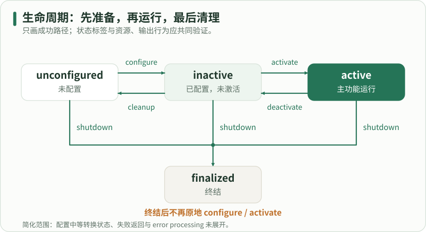

先沿正向箭头 configure、activate 进入 active；反向箭头 deactivate、cleanup 回到可重新配置的状态。unconfigured、inactive、active 都可经 shutdown 到 finalized，终结后没有返回箭头。只展示成功转换，省略中间状态、失败返回和错误处理；节点状态也不自动停止所有普通回调。

### 在官方演示中逐步观察状态与消息

本实验需要 lifecycle 演示包。终端甲运行 lifecycle_talker，终端乙持续观察 lifecycle_chatter，终端丙按顺序请求转换。每一步后都读取状态，并等几秒观察是否有新消息。不要同时运行自动切换状态的 lifecycle_service_client，否则它会与手工命令争用状态机，使观察结果难以解释。

这个演示最有价值的细节是：配置后已经创建普通定时器，inactive 时定时器仍可能执行，只是生命周期发布者不发送消息。因而日志显示“publisher inactive”并不说明停用失败。它说明生命周期发布者的输出门控与普通回调的调度是不同机制；需要停止耗时采样的驱动应主动取消定时器或阻止采样工作。

#### 三个终端的分步实验

代码类型：commands

```bash

# 【中文教学注释】 三个终端的分步实验
# 本例作用：configure 后应为 inactive，activate 后应为 active，deactivate 后为 inactive，cleanup 后为 unconfigured。echo 是持续运行的观察者；消息是否新增与 get 返回状态共同构成证据。示例激活回调本身有演示性等待，因此命令响应不一定立即完成。
# 输入输出：输入为 configure/activate 等状态转换请求；输出为生命周期状态和激活后发布的数据。
# 执行顺序与边界：状态应逐步核对；节点存在不代表已激活，转换成功不等于其他依赖已准备就绪，失败转移必须按当前状态处理。
# 如未安装演示包，在学习机执行一次
# 安装本段明确列出的系统/ROS依赖；-y自动接受软件包确认，发行版前缀须与目标环境一致。
sudo apt install ros-jazzy-lifecycle
# 所有终端均先执行
# 在当前shell加载/opt/ros/jazzy/setup.bash；它影响本终端的包索引/库路径，另一个终端必须单独加载。
source /opt/ros/jazzy/setup.bash
# 终端甲
# 从已安装包lifecycle启动lifecycle_talker；此进程通常持续运行，另用新终端执行观察命令，Ctrl+C结束。
ros2 run lifecycle lifecycle_talker
# 终端乙
# 临时创建订阅者观察消息；--once收到一条后退出，持续模式用Ctrl+C结束，其QoS也须匹配。
ros2 topic echo /lifecycle_chatter std_msgs/msg/String
# 终端丙：每次转换后观察终端甲乙，再执行下一步
# 读取节点当前生命周期状态；后续转换必须从合法前置状态执行。
ros2 lifecycle get /lc_talker
# 请求明确状态转换并检查结果；configure、activate等顺序不能跳过，active也不等于全系统就绪。
ros2 lifecycle set /lc_talker configure
ros2 lifecycle get /lc_talker
ros2 lifecycle set /lc_talker activate
ros2 lifecycle get /lc_talker
ros2 lifecycle set /lc_talker deactivate
ros2 lifecycle get /lc_talker
ros2 lifecycle set /lc_talker cleanup
ros2 lifecycle get /lc_talker

```

configure 后应为 inactive，activate 后应为 active，deactivate 后为 inactive，cleanup 后为 unconfigured。echo 是持续运行的观察者；消息是否新增与 get 返回状态共同构成证据。示例激活回调本身有演示性等待，因此命令响应不一定立即完成。

输入输出：输入为 configure/activate 等状态转换请求；输出为生命周期状态和激活后发布的数据。
执行顺序与边界：状态应逐步核对；节点存在不代表已激活，转换成功不等于其他依赖已准备就绪，失败转移必须按当前状态处理。

### 失败返回、异常与恢复不是同一条路径

配置回调返回 FAILURE 表示本次配置没有成功，正常回到未配置状态；返回 ERROR 或未捕获异常会进入错误处理流程。激活回调返回 FAILURE 则回到 inactive。程序应把预期的可恢复失败，例如端口暂不可用，与内部状态已经不可信的错误区分开，日志写明具体阶段、设备与恢复建议。

进入错误处理后要执行必要的停止和清理，根据实现的返回结果决定能否回到未配置状态；不能假设任何错误都会自动恢复。转换回调若无限等待，管理请求也可能一直挂起。应对设备等待设置有界超时，并定义超时后已申请资源的归属。外部管理器重试前先重新读取状态，而不是重复发送上一条命令。

### 按依赖关系组织一组节点

假设定位依赖里程计和激光，导航又依赖定位。启动管理者可先配置所有必要资源，再激活上游输入，确认其数据与 TF 可用，之后激活下游算法。这里的“确认”应该检查实际主题、频率、坐标关系与时间，而不只是节点名存在。静态地图已经加载但地图发布者尚未提供历史，也可能让下游等待。

停用时常需要先阻止下游产生新动作，再停止上游数据源，最后清理资源；具体顺序由系统依赖决定。对驱动的停止行为必须在驱动层实现，不能把切换 lifecycle 状态本身当作物理急停。普通订阅、服务、后台线程和非生命周期发布者不会仅因继承了 LifecycleNode 就全部自动受控。

### 用状态、行为与资源三类证据验收

状态证据来自 lifecycle get 和转换事件；行为证据来自新增消息、设备访问和业务反馈；资源证据来自线程结束、文件关闭和再次配置成功。三者需要一致。例如 inactive 后还出现新采样说明采样门控可能遗漏；cleanup 后再次 configure 报端口占用，说明释放路径不完整。只检查日志中出现“成功”容易漏掉这些问题。

测试至少覆盖完整往返、配置失败再重试、激活失败、运行中停用，以及终结后的管理行为。测试可先使用假设备，注入打开失败和读取超时，避免依赖真实硬件才能发现状态管理缺陷。状态图和具体行为应随实现一起更新。本章依据 Jazzy 演示源码解释状态与定时器行为，未执行真实设备操作。

### 假资源实测：回调返回不等于最终恢复状态

新增lifecycle_labs以真实LifecycleNode管理合成资源，不打开硬件。configure先申请候选资源，校验成功再提交；FAILURE释放本次候选并保留历史配置代数，重新配置可以成功。资源快照、回调事件和GetState分别读取，不能只凭一条成功日志判断资源已提交。

ERROR或受控标准异常进入错误处理。on_error返回SUCCESS可恢复unconfigured，但最初ChangeState仍可能报告false；恢复成功与原请求成功是不同结果。handler返回FAILURE、ERROR或本例受控异常时走finalized，具体路径以安装版本和实际GetTransitionGraph为准。

activate FAILURE后回到inactive，仍持有已配置资源；错误处理或shutdown则由本例显式撤销发布者与资源。状态机不负责释放你的任意外部资源，也不会自动回滚应用的副作用。本轮非法转换用label请求并查询可用label，没有把任意numeric id的行为算入已测范围。

#### 回调返回、服务响应、最终状态与资源

| 场景 | 原回调 | ChangeState.success | 落点 | on_error | 当时FakeHandle数 |
| --- | --- | --- | --- | --- | --- |
| normal_roundtrip：合法往返/重配 | SUCCESS roundtrip | True | finalized | not called | 0 |
| 未配置时activate | callback not invoked | False | unconfigured | not called | 0 |
| finalized后configure | callback not invoked | False | finalized | not called | 0 |
| configure_failure_retry | configure FAILURE | False | unconfigured | not called | 0 |
| activate_failure_retry | activate FAILURE | False | inactive | not called | 1 |
| configure_error_recover | configure ERROR | False | unconfigured | SUCCESS | 0 |
| configure_exception_recover | configure THROW_STD_RUNTIME_ERROR | False | unconfigured | SUCCESS | 0 |
| configure_error_handler_failure | configure ERROR | False | finalized | FAILURE | 0 |
| configure_error_handler_error | configure ERROR | False | finalized | ERROR | 0 |
| configure_and_handler_exception | configure THROW_STD_RUNTIME_ERROR | False | finalized | THROW_STD_RUNTIME_ERROR | 0 |
| activate_error_recover | activate ERROR | False | unconfigured | SUCCESS | 0 |
| deactivate_error_recover | deactivate ERROR | False | unconfigured | SUCCESS | 0 |

每行聚焦故障发生后的实际落点；恢复场景随后另做重配与shutdown。原ERROR经on_error SUCCESS恢复，也不使原转换响应变true。 资源列只计16字节FakeHandle，不统计诊断ROS实体；原回调异常没有返回枚举值，由框架捕获后按ERROR处理。

#### 普通timer和生命周期发布者分别验收

| 窗口 | ROS状态 | timer新增tick | managed尝试 | 普通新增消息 | managed新增消息 | FakeHandle数 |
| --- | --- | --- | --- | --- | --- | --- |
| unconfigured | unconfigured | 6 | 6 | 6 | 0 | 0 |
| inactive_after_configure | inactive | 6 | 6 | 6 | 0 | 1 |
| active | active | 6 | 6 | 6 | 6 | 1 |
| inactive_after_deactivate | inactive | 6 | 6 | 6 | 0 | 1 |
| unconfigured_after_cleanup | unconfigured | 6 | 6 | 6 | 0 | 0 |
| finalized_diagnostic_still_runs | finalized | 6 | 6 | 6 | 0 | 0 |

同一序号与接收经过时间共同限定窗口，过滤旧DDS消息；发布端先匹配订阅。窗口长度记录在输入和原始数据中，不是精确频率或实时保证；finalized诊断timer继续是本例明确选择。 LifecyclePublisher检查is_activated标志，本例on_error/on_shutdown显式撤销，不是单凭ROS状态自动门控。

### 普通回调、发布门控与进程生死分别观察

本例构造时创建50ms普通timer，持续递增无量纲序号并发布普通诊断；LifecyclePublisher按实际激活状态发送受管输出。inactive或unconfigured时普通计数继续，有限窗口内受管新消息为零；active窗口两种消息都能观察。请求周期和一次窗口计数不等于实时频率保证。

finalized终结的是本实例的生命周期转换。本例普通timer、快照服务和Context仍可存在，直到进程被关闭；同实例不能再次configure，需要管理者销毁并新建。不要把生命周期shutdown、ROS Context关闭、操作系统进程退出或设备停车当同一事件。

转换响应到达与DDS中旧样本排空也不同。脚本用序号和有限观察窗口记录新消息，并将资源清理、回调关闭及父进程中断作为各自范围，不把“未看到”扩为任意负载下永远没有。

### 生命周期完整工程与复现

完整CMake/package、节点和driver与实测指纹一致；按README构建独立包，不覆盖已有示例。

导航台架按依赖手动配置和激活七个生命周期节点，按相反顺序停用清理。活跃状态之后再核实际传感器、代价图和 TF。官方启动文件的生命周期管理器还涉及绑定与故障处理，这部分由固定源码说明，台架记录的是本次手动切换。

#### lifecycle_labs/runtime_lifecycle_lab/CMakeLists.txt

代码类型：complete

```cmake

# 输入：Jazzy客户端库及原创fake_resource_node.cpp；输出一个独立软件节点。
# 构建/安装根目录由colcon命令放到/tmp，不改已有14包或第三方参考。
cmake_minimum_required(VERSION 3.8)
project(runtime_lifecycle_lab)
find_package(ament_cmake REQUIRED)
find_package(rclcpp REQUIRED)
find_package(rclcpp_lifecycle REQUIRED)
find_package(rcl_interfaces REQUIRED)
find_package(lifecycle_msgs REQUIRED)
find_package(std_msgs REQUIRED)
find_package(std_srvs REQUIRED)
add_executable(fake_resource_node src/fake_resource_node.cpp)
target_compile_features(fake_resource_node PUBLIC cxx_std_17)
ament_target_dependencies(fake_resource_node rclcpp rclcpp_lifecycle rcl_interfaces lifecycle_msgs std_msgs std_srvs)
install(TARGETS fake_resource_node DESTINATION lib/${PROJECT_NAME})
ament_package()


```

完整原创文件与报告指纹同源，依赖及复现顺序见同目录README；输入、单位、保护期限和清理范围见中文注释。

#### lifecycle_labs/runtime_lifecycle_lab/package.xml

代码类型：complete

```xml

<?xml version="1.0"?>
<!-- 原创生命周期软件假资源包：只有内存资源和诊断计数，不接硬件。 -->
<package format="3">
  <name>runtime_lifecycle_lab</name>
  <version>0.1.0</version>
  <description>生命周期返回值、资源事务与消息门控的原创实验</description>
  <maintainer email="learner@example.com">ROS 2 Learning Hub</maintainer>
  <license>Apache-2.0</license>
  <buildtool_depend>ament_cmake</buildtool_depend>
  <depend>rclcpp</depend>
  <depend>rclcpp_lifecycle</depend>
  <depend>rcl_interfaces</depend>
  <depend>lifecycle_msgs</depend>
  <depend>std_msgs</depend>
  <depend>std_srvs</depend>
  <export><build_type>ament_cmake</build_type></export>
</package>


```

完整原创文件与报告指纹同源，依赖及复现顺序见同目录README；输入、单位、保护期限和清理范围见中文注释。

#### lifecycle_labs/runtime_lifecycle_lab/src/fake_resource_node.cpp

代码类型：complete

```cpp

// 原创LifecycleNode：输入为标准转换请求和故障注入参数；输出为资源快照、回调JSON
// 及两条UInt64诊断序号。序号/资源数/配置代数均无量纲，时间为steady-clock纳秒。
// 假资源只是16字节内存，不模拟真实相机/串口，也不把状态切换当设备停车。
// 单线程执行器串行处理timer、参数与转换服务；所有回调有限且不等待外部硬件。
#include <chrono>
#include <cstdint>
#include <functional>
#include <iostream>
#include <memory>
#include <sstream>
#include <stdexcept>
#include <string>
#include <unordered_map>
#include <vector>
#include <unistd.h>
#include "rclcpp/rclcpp.hpp"
#include "rclcpp/create_publisher.hpp"
#include "rclcpp_lifecycle/lifecycle_node.hpp"
#include "rcl_interfaces/msg/set_parameters_result.hpp"
#include "std_msgs/msg/u_int64.hpp"
#include "std_srvs/srv/trigger.hpp"

namespace lifecycle_lab {
using Return = rclcpp_lifecycle::node_interfaces::LifecycleNodeInterface::CallbackReturn;
using State = rclcpp_lifecycle::State;
using Counter = std_msgs::msg::UInt64;
using Trigger = std_srvs::srv::Trigger;

std::string quoted(const std::string & text) {
  std::ostringstream out; out << '"';
  for (unsigned char c : text) {
    if (c == '\\' || c == '"') {out << '\\' << static_cast<char>(c);}
    else if (c == '\n') {out << "\\n";}
    else {out << static_cast<char>(c);}
  }
  out << '"'; return out.str();
}

class FakeResourceNode : public rclcpp_lifecycle::LifecycleNode {
public:
  FakeResourceNode() : LifecycleNode("fake_resource") {
    // 每个stage最多注入一次；success不会消耗注入机会，允许先建立旧配置再测试失败。
    declare_parameter<std::string>("configure_fault", "success");
    declare_parameter<std::string>("activate_fault", "success");
    declare_parameter<std::string>("deactivate_fault", "success");
    declare_parameter<std::string>("error_result", "success");
    for (const auto & name : {"configure_fault", "activate_fault", "deactivate_fault", "error_result"}) {
      if (!valid_mode(name, get_parameter(name).as_string())) {throw std::invalid_argument("invalid fault mode");}
    }
    validator_ = add_on_set_parameters_callback([](const std::vector<rclcpp::Parameter> & values) {
      rcl_interfaces::msg::SetParametersResult result; result.successful = true;
      for (const auto & value : values) {
        if ((value.get_name() == "configure_fault" || value.get_name() == "activate_fault" ||
             value.get_name() == "deactivate_fault" || value.get_name() == "error_result") &&
            (value.get_type() != rclcpp::ParameterType::PARAMETER_STRING ||
             !valid_mode(value.get_name(), value.as_string()))) {
          result.successful = false; result.reason = "invalid STRING fault mode"; break;
        }
      }
      return result;  // 纯校验，不在这里修改资源或故障计数。
    });
    // 明确选择普通rclcpp::Publisher，而非LifecycleNode成员工厂返回的生命周期发布者。
    ordinary_ = rclcpp::create_publisher<Counter>(*this, "~/ordinary_ticks", rclcpp::QoS(10));
    managed_ = create_publisher<Counter>("~/managed_ticks", rclcpp::QoS(10));
    timer_ = create_wall_timer(std::chrono::milliseconds(50), [this]() {
      ++ticks_;
      Counter message; message.data = ticks_;
      ordinary_->publish(message);
      ++managed_attempts_;
      // 故意在所有状态调用publish：未激活时由LifecyclePublisher自己拒绝发送。
      // 普通timer仍运行，与假资源是否采样、生命周期消息是否发送分别计数。
      managed_->publish(message);
      if (resource_active_) {++resource_work_;}
    });
    snapshot_ = create_service<Trigger>("~/snapshot",
      [this](const std::shared_ptr<Trigger::Request>, std::shared_ptr<Trigger::Response> response) {
        response->success = true; response->message = snapshot_json(true);
      });
    emit("constructed", "constructor", "none");
  }

  ~FakeResourceNode() override {
    timer_->cancel();
    resource_active_ = false;
    managed_->on_deactivate();
    pending_.reset(); resource_.reset();
    emit("destroyed", "destructor", "none");
  }

private:
  struct FakeHandle {
    std::uint64_t id;
    std::vector<std::uint8_t> bytes = std::vector<std::uint8_t>(16);
    std::function<void(std::uint64_t)> on_release;
    FakeHandle(std::uint64_t value, std::function<void(std::uint64_t)> callback)
    : id(value), on_release(std::move(callback)) {}
    ~FakeHandle() noexcept {
      // 所有权由unique_ptr释放；计数先更新，诊断日志异常不从析构函数逃逸。
      try {on_release(id);} catch (...) {}
    }
  };

  static bool valid_mode(const std::string & name, const std::string & mode) {
    if (name == "error_result") {return mode == "success" || mode == "failure" || mode == "error" || mode == "throw";}
    return mode == "success" || mode == "failure_once" || mode == "error_once" || mode == "throw_once";
  }

  std::unique_ptr<FakeHandle> candidate() {
    const auto id = ++next_resource_id_;
    auto value = std::make_unique<FakeHandle>(id, [this](std::uint64_t released_id) {
      ++released_; --live_;
      emit("resource_released", "resource", "none", released_id);
    });
    ++allocated_; ++live_;
    emit("resource_acquired", "resource", "none", id);
    return value;
  }

  std::string take_fault(const std::string & stage) {
    const auto mode = get_parameter(stage + "_fault").as_string();
    if (mode == "success" || consumed_[stage]) {return "success";}
    consumed_[stage] = true;
    return mode;
  }

  Return finish(const std::string & callback, Return result) {
    const auto label = result == Return::SUCCESS ? "SUCCESS" : result == Return::FAILURE ? "FAILURE" : "ERROR";
    emit("callback_return", callback, label);
    return result;
  }

  Return fault_return(const std::string & callback, const std::string & mode) {
    if (mode == "throw_once") {
      emit("callback_throw", callback, "THROW_STD_RUNTIME_ERROR");
      throw std::runtime_error("intentional lifecycle software fault in " + callback);
    }
    return finish(callback, mode == "failure_once" ? Return::FAILURE : Return::ERROR);
  }

  Return on_configure(const State & previous) override {
    ++configure_calls_; emit("callback_enter", "configure", "none", 0, previous.id());
    auto temporary = candidate();
    const auto mode = take_fault("configure");
    if (mode == "failure_once") {
      // 事务失败：候选先释放，旧committed_version不动；不提交半成品。
      temporary.reset(); return finish("configure", Return::FAILURE);
    }
    if (mode != "success") {
      // ERROR/异常示范把部分资源显式交给on_error清理，便于实测其释放责任。
      pending_ = std::move(temporary); return fault_return("configure", mode);
    }
    resource_ = std::move(temporary);
    ++committed_version_;
    resource_active_ = false;
    return finish("configure", Return::SUCCESS);
  }

  Return on_activate(const State & previous) override {
    ++activate_calls_; emit("callback_enter", "activate", "none", 0, previous.id());
    if (!resource_) {return finish("activate", Return::ERROR);}
    const auto mode = take_fault("activate");
    if (mode != "success") {return fault_return("activate", mode);}
    // 覆写activate时调用基类，才会激活已注册的LifecyclePublisher。
    LifecycleNode::on_activate(previous);
    resource_active_ = true;
    return finish("activate", Return::SUCCESS);
  }

  Return on_deactivate(const State & previous) override {
    ++deactivate_calls_; emit("callback_enter", "deactivate", "none", 0, previous.id());
    const auto mode = take_fault("deactivate");
    if (mode != "success") {return fault_return("deactivate", mode);}
    LifecycleNode::on_deactivate(previous);
    resource_active_ = false;
    return finish("deactivate", Return::SUCCESS);
  }

  Return on_cleanup(const State & previous) override {
    ++cleanup_calls_; emit("callback_enter", "cleanup", "none", 0, previous.id());
    stop_and_release();
    return finish("cleanup", Return::SUCCESS);
  }

  Return on_shutdown(const State & previous) override {
    ++shutdown_calls_; emit("callback_enter", "shutdown", "none", 0, previous.id());
    stop_and_release();
    // 普通诊断timer按本实验合同继续运行，直到进程退出；finalized不等于销毁。
    return finish("shutdown", Return::SUCCESS);
  }

  Return on_error(const State & previous) override {
    ++error_calls_; emit("callback_enter", "error", "none", 0, previous.id());
    stop_and_release();
    const auto mode = get_parameter("error_result").as_string();
    if (mode == "throw") {
      emit("callback_throw", "error", "THROW_STD_RUNTIME_ERROR");
      throw std::runtime_error("intentional std::exception in on_error after cleanup");
    }
    return finish("error", mode == "success" ? Return::SUCCESS : mode == "failure" ? Return::FAILURE : Return::ERROR);
  }

  void stop_and_release() {
    // 生命周期状态不会代替资源释放；错误路径也显式撤销生命周期发布者激活状态。
    resource_active_ = false; managed_->on_deactivate();
    pending_.reset(); resource_.reset();
  }

  std::string snapshot_json(bool include_matches = false) const {
    std::ostringstream out;
    out << "{\"state_id\":" << static_cast<int>(get_current_state().id())
      << ",\"state_label\":" << quoted(get_current_state().label())
      << ",\"resource_live\":" << live_ << ",\"allocated\":" << allocated_ << ",\"released\":" << released_
      << ",\"resource_id\":" << (resource_ ? resource_->id : 0)
      << ",\"pending_id\":" << (pending_ ? pending_->id : 0)
      << ",\"committed_version\":" << committed_version_
      << ",\"resource_active\":" << (resource_active_ ? "true" : "false")
      << ",\"publisher_active\":" << (managed_->is_activated() ? "true" : "false")
      << ",\"timer_ticks\":" << ticks_ << ",\"managed_attempts\":" << managed_attempts_
      << ",\"resource_work\":" << resource_work_ << ",\"configure_calls\":" << configure_calls_
      << ",\"activate_calls\":" << activate_calls_ << ",\"deactivate_calls\":" << deactivate_calls_
      << ",\"cleanup_calls\":" << cleanup_calls_ << ",\"shutdown_calls\":" << shutdown_calls_
      << ",\"error_calls\":" << error_calls_;
    if (include_matches) {
      out << ",\"ordinary_subscribers\":" << ordinary_->get_subscription_count()
        << ",\"managed_subscribers\":" << managed_->get_subscription_count();
    }
    out << '}'; return out.str();
  }

  void emit(const std::string & kind, const std::string & callback, const std::string & result,
            std::uint64_t resource_id = 0, unsigned int previous_state = 0) const {
    const auto ns = std::chrono::duration_cast<std::chrono::nanoseconds>(
      std::chrono::steady_clock::now().time_since_epoch()).count();
    std::ostringstream out;
    out << "LIFECYCLE_LAB_EVENT {\"event\":" << quoted(kind) << ",\"callback\":" << quoted(callback)
      << ",\"callback_result\":" << quoted(result) << ",\"pid\":" << ::getpid()
      << ",\"monotonic_ns\":" << ns << ",\"resource_event_id\":" << resource_id
      << ",\"previous_state_id\":" << previous_state << ",\"snapshot\":" << snapshot_json() << '}';
    std::cout << out.str() << std::endl;
  }

  // 计数先声明、unique_ptr后声明，析构时资源回调仍可访问有效计数；析构函数另显式释放。
  std::uint64_t next_resource_id_{0}, allocated_{0}, released_{0}, live_{0}, committed_version_{0};
  std::uint64_t ticks_{0}, managed_attempts_{0}, resource_work_{0};
  std::uint64_t configure_calls_{0}, activate_calls_{0}, deactivate_calls_{0}, cleanup_calls_{0}, shutdown_calls_{0}, error_calls_{0};
  bool resource_active_{false};
  std::unordered_map<std::string, bool> consumed_;
  std::unique_ptr<FakeHandle> resource_, pending_;
  rclcpp::node_interfaces::OnSetParametersCallbackHandle::SharedPtr validator_;
  rclcpp::Publisher<Counter>::SharedPtr ordinary_;
  rclcpp_lifecycle::LifecyclePublisher<Counter>::SharedPtr managed_;
  rclcpp::TimerBase::SharedPtr timer_;
  rclcpp::Service<Trigger>::SharedPtr snapshot_;
};
}  // namespace lifecycle_lab

int main(int argc, char ** argv) {
  rclcpp::init(argc, argv);
  int code = 0;
  try {
    auto node = std::make_shared<lifecycle_lab::FakeResourceNode>();
    rclcpp::executors::SingleThreadedExecutor executor;
    executor.add_node(node->get_node_base_interface());
    executor.spin();
    executor.remove_node(node->get_node_base_interface());
  } catch (const std::exception & error) {
    std::cerr << "fake_resource_node failed: " << error.what() << std::endl; code = 1;
  }
  if (rclcpp::ok()) {rclcpp::shutdown();}
  return code;
}


```

完整原创文件与报告指纹同源，依赖及复现顺序见同目录README；输入、单位、保护期限和清理范围见中文注释。

#### lifecycle_labs/validate_lifecycle.py

代码类型：complete

```python

#!/usr/bin/env python3
"""真实rclcpp_lifecycle假资源验收；--help先用标准库，不需要ROS。

在教材根目录构建并source后：
  LIFECYCLE_LABS_INSTALL_PREFIX=/tmp/ros2-lifecycle-labs/install \
    timeout --signal=INT --kill-after=10s 180s /usr/bin/python3 \
    examples/lifecycle_labs/validate_lifecycle.py --report /tmp/lifecycle-local-result.json

输入：标准生命周期服务、有限STRING故障参数与软件假资源；无硬件/仿真。
输出：ChangeState响应、GetState、回调返回/异常、资源快照与两条话题的有限窗口。
普通计数与LifecyclePublisher使用同一序号，按窗口开始snapshot边界过滤旧DDS消息。
每例新worker进程组，父进程另设总期限；软服务期限不能抢占长原生调用。
清理只处理保存的自有PID/组；收到组SIGINT后先等孩子结束，不重复发送SIGINT。
默认报告在/tmp；维护者须显式指定教材绑定报告，避免读者覆盖已审核证据。
"""

from __future__ import annotations

import argparse
from datetime import datetime
import hashlib
import importlib.metadata
import json
import math
import os
from pathlib import Path
import platform
import signal
import subprocess
import sys
import tempfile
import time
import traceback
import xml.etree.ElementTree as ET
from zoneinfo import ZoneInfo

HERE=Path(__file__).resolve().parent
HUB=HERE.parents[1]
MARKER="LIFECYCLE_DRIVER_RESULT="
EVENT="LIFECYCLE_LAB_EVENT "
PLANS={
 "normal_roundtrip":{},
 "configure_failure_retry":{},
 "activate_failure_retry":{"activate_fault":"failure_once"},
 "configure_error_recover":{"configure_fault":"error_once","error_result":"success"},
 "configure_exception_recover":{"configure_fault":"throw_once","error_result":"success"},
 "configure_error_handler_failure":{"configure_fault":"error_once","error_result":"failure"},
 "configure_error_handler_error":{"configure_fault":"error_once","error_result":"error"},
 "configure_and_handler_exception":{"configure_fault":"throw_once","error_result":"throw"},
 "activate_error_recover":{"activate_fault":"error_once","error_result":"success"},
 "deactivate_error_recover":{"deactivate_fault":"error_once","error_result":"success"},
}


def require(condition,message):
    if not condition:raise AssertionError(message)


def arguments():
    parser=argparse.ArgumentParser(description=__doc__,formatter_class=argparse.RawDescriptionHelpFormatter)
    parser.add_argument("--install-prefix",type=Path,default=Path(os.environ.get("LIFECYCLE_LABS_INSTALL_PREFIX",HERE/"install")))
    parser.add_argument("--build-root",type=Path)
    parser.add_argument("--domain-id",type=int,default=229)
    parser.add_argument("--window-s",type=float,default=0.3,help="每个消息窗口经过秒数，至少3个50ms周期")
    parser.add_argument("--timeout-s",type=float,default=4.0,help="服务/发现软期限，秒")
    parser.add_argument("--worker-timeout-s",type=float,default=25.0)
    parser.add_argument("--case",choices=("all",*PLANS),default="all")
    parser.add_argument("--report",type=Path,default=Path('/tmp/lifecycle-local-result.json'))
    parser.add_argument("--worker",choices=PLANS,help=argparse.SUPPRESS)
    options=parser.parse_args()
    for value in (options.window_s,options.timeout_s,options.worker_timeout_s):
        if not math.isfinite(value) or value<=0:parser.error("所有时间必须为有限正秒数")
    if not 0<=options.domain_id<=232:parser.error("domain-id须位于0..232")
    if not 0.15<=options.window_s<=1.0:parser.error("window-s须在[0.15,1.0]内")
    if options.worker_timeout_s<max(4*options.timeout_s+3,8*options.window_s+5):
        parser.error("worker期限须覆盖发现/状态/观察与清理预算")
    options.install_prefix=options.install_prefix.resolve()
    return options


def environment(options):
    env=dict(os.environ);env.pop("ROS_LOCALHOST_ONLY",None);env.pop("ROS_STATIC_PEERS",None)
    env.update(ROS_DOMAIN_ID=str(options.domain_id),ROS_AUTOMATIC_DISCOVERY_RANGE="LOCALHOST",
               RMW_IMPLEMENTATION="rmw_fastrtps_cpp",PYTHONUNBUFFERED="1",PYTHONDONTWRITEBYTECODE="1")
    return env


class NativeProcess:
    def __init__(self,command,directory):
        self.command=command;self.path=Path(directory)/"native.log";self.stream=self.path.open("w")
        # 继承worker的进程组，父driver超时可以处理整个自有组。
        self.process=subprocess.Popen(command,stdout=self.stream,stderr=self.stream,env=dict(os.environ))

    def text(self):return self.path.read_text(errors="replace")

    def events(self):
        return [json.loads(line.split(EVENT,1)[1]) for line in self.text().splitlines() if EVENT in line]

    def close(self,group_already_signaled=False):
        sent=[];p=self.process
        if p.poll() is None and group_already_signaled:
            # 组SIGINT已覆盖C++孩子；先等其正常收尾，不能再盲发第二次SIGINT。
            try:p.wait(timeout=3)
            except subprocess.TimeoutExpired:pass
        if p.poll() is None and not group_already_signaled:
            try:p.send_signal(signal.SIGINT);sent.append("SIGINT")
            except ProcessLookupError:pass
            try:p.wait(timeout=3)
            except subprocess.TimeoutExpired:pass
        if p.poll() is None:
            try:p.kill();sent.append("SIGKILL")
            except ProcessLookupError:pass
            p.wait(timeout=3)
        result={"command":self.command,"pid":p.pid,"exitCode":p.returncode,
                "groupAlreadySignaled":group_already_signaled,"signalsSentByWorker":sent,
                "log":self.text(),"events":self.events()}
        self.stream.close();return result


class Probe:
    def __init__(self,options,node_name,namespace):
        import rclpy
        from rclpy.context import Context
        from rclpy.executors import SingleThreadedExecutor
        from rclpy.node import Node
        from rclpy.signals import SignalHandlerOptions
        from std_msgs.msg import UInt64
        from lifecycle_msgs.msg import TransitionEvent
        self.rclpy=rclpy;self.options=options;self.target=node_name
        self.context=Context()
        # 自建Context默认就不安装ROS信号处理器，显式NO写清所有权：Python
        # KeyboardInterrupt由worker捕获；C++孩子仍会收到同组SIGINT并自行收尾。
        rclpy.init(args=[],context=self.context,signal_handler_options=SignalHandlerOptions.NO)
        self.node=Node("lifecycle_probe",namespace=namespace,context=self.context,enable_rosout=False)
        self.executor=SingleThreadedExecutor(context=self.context);self.executor.add_node(self.node)
        self.clients={};self.ordinary=[];self.managed=[];self.transitions=[];self.subscriptions=[]
        for label,store in [("ordinary_ticks",self.ordinary),("managed_ticks",self.managed)]:
            self.subscriptions.append(self.node.create_subscription(UInt64,node_name+"/"+label,
                lambda msg,dest=store:dest.append({"sequence":msg.data,"receivedMonotonicS":time.monotonic()}),10))
        def transition(message):
            self.transitions.append({"transitionId":message.transition.id,"label":message.transition.label,
                "from":message.start_state.id,"to":message.goal_state.id,
                "receivedMonotonicS":time.monotonic()})
        self.subscriptions.append(self.node.create_subscription(TransitionEvent,node_name+"/transition_event",transition,100))

    def until(self,predicate,message,timeout=None):
        end=time.monotonic()+(self.options.timeout_s if timeout is None else timeout)
        while not predicate() and time.monotonic()<end:
            self.executor.spin_once(timeout_sec=min(0.02,max(0,end-time.monotonic())))
        require(predicate(),message)

    def call(self,kind,suffix,request):
        key=(kind,suffix)
        if key not in self.clients:self.clients[key]=self.node.create_client(kind,self.target+"/"+suffix)
        client=self.clients[key]
        require(client.wait_for_service(timeout_sec=self.options.timeout_s),"服务未发现："+suffix)
        future=client.call_async(request);self.until(future.done,"响应软期限到达："+suffix)
        require(future.exception() is None,"服务异常："+str(future.exception()))
        return future.result()

    def snapshot(self):
        from std_srvs.srv import Trigger
        result=self.call(Trigger,"snapshot",Trigger.Request());require(result.success,"snapshot失败")
        value=json.loads(result.message)
        require(value["allocated"]-value["released"]==value["resource_live"],"资源账本不平")
        return value

    def state(self):
        from lifecycle_msgs.srv import GetState
        value=self.call(GetState,"get_state",GetState.Request()).current_state
        return {"id":value.id,"label":value.label}

    def graph(self,suffix="get_transition_graph"):
        from lifecycle_msgs.srv import GetAvailableTransitions
        return [{"id":t.transition.id,"label":t.transition.label,"from":t.start_state.id,"to":t.goal_state.id}
            for t in self.call(GetAvailableTransitions,suffix,GetAvailableTransitions.Request()).available_transitions]

    def set_mode(self,name,value):
        from rcl_interfaces.srv import SetParameters
        from rclpy.parameter import Parameter
        response=self.call(SetParameters,"set_parameters",SetParameters.Request(
            parameters=[Parameter(name,value=value).to_parameter_msg()])).results[0]
        require(response.successful,"故障模式参数设置失败："+response.reason)

    def change(self,label,expected_state,expected_success,records):
        from lifecycle_msgs.srv import ChangeState
        from lifecycle_msgs.msg import Transition
        before_state=self.state();before=self.snapshot();available=self.graph("get_available_transitions")
        began=time.monotonic()
        # label优先于id；非法label在服务入口明确返回false，不碰旧实现的无效numeric分支。
        response=self.call(ChangeState,"change_state",ChangeState.Request(transition=Transition(label=label)))
        after_state=self.state();after=self.snapshot()
        result={"requestLabel":label,"requestId":0,"responseSuccess":response.success,
            "beforeState":before_state,"afterState":after_state,"before":before,"after":after,
            "availableBefore":available,"elapsedS":time.monotonic()-began}
        records.append(result)
        require(response.success==expected_success,f"{label}服务success不符：{result}")
        require(after_state["id"]==expected_state and after["state_id"]==expected_state,
                f"{label}最终状态不符：{result}")
        return result

    def window(self,label,managed_expected,records):
        # 两个DDS发布端均已发现/匹配，负例不能用“还没发现订阅”冒充门控。
        self.until(lambda:(lambda s:s["ordinary_subscribers"]>=1 and s["managed_subscribers"]>=1)(self.snapshot()),
                   "两条诊断发布端尚未匹配订阅")
        before=self.snapshot();boundary=before["timer_ticks"];began=time.monotonic();end=began+self.options.window_s
        while time.monotonic()<end:
            self.executor.spin_once(timeout_sec=min(0.02,max(0,end-time.monotonic())))
        ended=time.monotonic();elapsed=ended-began;after=self.snapshot()
        # 同时限定接收经过时间与源序号：窗口后的RPC推进可能又处理一些消息，
        # 它们保留在原始记录里，但不混入本窗口的消息计数。
        ordinary=[m for m in self.ordinary if m["sequence"]>boundary and began<=m["receivedMonotonicS"]<=ended]
        managed=[m for m in self.managed if m["sequence"]>boundary and began<=m["receivedMonotonicS"]<=ended]
        result={"label":label,"requestedWindowS":self.options.window_s,"actualElapsedS":elapsed,
            "startMonotonicS":began,"endMonotonicS":ended,
            "boundarySequence":boundary,"before":before,"after":after,
            "timerTickDelta":after["timer_ticks"]-before["timer_ticks"],
            "publishAttemptDelta":after["managed_attempts"]-before["managed_attempts"],
            "ordinaryNewMessages":ordinary,"managedNewMessages":managed,
            "ordinaryCount":len(ordinary),"managedCount":len(managed),"managedExpected":managed_expected}
        records.append(result)
        require(result["timerTickDelta"]>=1 and ordinary,"普通timer/普通话题在窗口内未推进")
        require(result["publishAttemptDelta"]>=1,"没有实际尝试生命周期publish，负例无效")
        require(after["publisher_active"]==managed_expected,"发布者激活标志与预期不符")
        require(bool(managed)==managed_expected,"生命周期新消息门控不符："+str(result))
        if not managed_expected:require(after["resource_work"]==before["resource_work"],"停用资源仍在做业务工作")
        return result

    def close(self):
        self.executor.remove_node(self.node);stopped=self.executor.shutdown(timeout_sec=1)
        self.node.destroy_node()
        if self.context.ok():self.rclpy.shutdown(context=self.context)
        return {"executorStopped":bool(stopped),"contextOkAfterCleanup":self.context.ok()}


def exercise(options,case,probe,native,record):
    changes=[];windows=[];record.update(changes=changes,windows=windows)
    probe.until(lambda:probe.state()["id"]==1,"节点初态不是unconfigured")
    graph=probe.graph();record["runtimeTransitionGraph"]=graph
    error_edges={item["id"]:item for item in graph if item["id"] in [60,61,62]}
    require({i:error_edges[i]["to"] for i in [60,61,62]}=={60:1,61:4,62:4},"运行SDK on_error图映射不符")
    require(all(e["from"]==15 for e in error_edges.values()),"on_error边起点应为errorprocessing")
    record["errorHandlerGraphEdges"]=list(error_edges.values())

    def change(label,state,success=True):return probe.change(label,state,success,changes)
    def window(label,active=False):return probe.window(label,active,windows)
    def released():
        s=probe.snapshot();require(s["resource_live"]==0 and s["resource_id"]==0 and s["pending_id"]==0,"资源未完全释放")
        require(not s["resource_active"] and not s["publisher_active"],"资源或发布者仍激活")
        return s
    def finish_from_inactive():
        change("cleanup",1);released();change("shutdown",4);released()
    def recovered_round():
        change("configure",2);change("activate",3);window("recovered_active",True)
        change("deactivate",2);finish_from_inactive()

    if case=="normal_roundtrip":
        initial=probe.snapshot();illegal=change("activate",1,False)
        require(illegal["after"]["activate_calls"]==initial["activate_calls"],"非法activate竟调用了回调")
        window("unconfigured")
        change("configure",2);configured=probe.snapshot()
        require(configured["resource_live"]==1 and configured["committed_version"]==1,"configure未提交完整资源")
        window("inactive_after_configure")
        change("activate",3);window("active",True)
        change("deactivate",2);window("inactive_after_deactivate")
        change("cleanup",1);released();window("unconfigured_after_cleanup")
        change("configure",2);require(probe.snapshot()["committed_version"]==2,"cleanup后未能重配")
        change("activate",3);change("deactivate",2);change("cleanup",1);released()
        change("shutdown",4);released();window("finalized_diagnostic_still_runs")
        last=change("configure",4,False)
        require(last["after"]["configure_calls"]==last["before"]["configure_calls"],"finalized竟再次configure")
        require(probe.graph("get_available_transitions")==[],"finalized仍广告转换")
        record["focus"]={"originalCallback":"SUCCESS roundtrip","responseSuccess":True,"stateAfter":4,
                         "resourceLiveAfter":0,"sameInstanceReconfigured":True,"finalizedConfigureRejected":True}
    elif case=="configure_failure_retry":
        change("configure",2);change("cleanup",1);old=probe.snapshot()
        require(old["committed_version"]==1 and old["resource_live"]==0,"没有建立旧配置快照")
        probe.set_mode("configure_fault","failure_once")
        failure=change("configure",1,False);after=failure["after"]
        require(after["committed_version"]==old["committed_version"] and after["resource_live"]==0,"FAILURE未保留旧配置/释放候选")
        require(after["allocated"]==old["allocated"]+1 and after["released"]==old["released"]+1,"部分资源未成对释放")
        require(after["error_calls"]==0,"预期FAILURE不应进入on_error")
        retry=change("configure",2)
        require(retry["after"]["committed_version"]==2,"FAILURE后同实例重试失败")
        window("retry_inactive");finish_from_inactive()
        record["focus"]={"originalCallback":"configure FAILURE","responseSuccess":False,"stateAfter":1,
            "errorHandler":"not called","resourceLiveAfter":0,"oldVersionPreserved":1,"retryVersion":2}
    elif case=="activate_failure_retry":
        change("configure",2);before=probe.snapshot();failure=change("activate",2,False)
        require(failure["after"]["resource_id"]==before["resource_id"] and failure["after"]["error_calls"]==0,"activate FAILURE不应换资源或调用on_error")
        window("activation_failure_inactive");change("activate",3);window("activation_retry_active",True)
        change("deactivate",2);finish_from_inactive()
        record["focus"]={"originalCallback":"activate FAILURE","responseSuccess":False,"stateAfter":2,
            "errorHandler":"not called","resourceLiveAfter":1,"resourcePreserved":True}
    else:
        plan=PLANS[case];stage=next(k.replace("_fault","") for k in plan if k.endswith("_fault"))
        if stage in ["activate","deactivate"]:change("configure",2)
        if stage=="deactivate":change("activate",3);window("active_before_deactivate_error",True)
        terminal=plan["error_result"]!="success"
        outcome=change(stage,4 if terminal else 1,False);after=released()
        require(after["error_calls"]==1,"ERROR处理不应缺失或递归重入on_error")
        event_list=native.events();entry=[e for e in event_list if e["event"]=="callback_enter" and e["callback"]=="error"]
        require(len(entry)==1 and entry[0]["snapshot"]["resource_live"]>=1,"on_error未真实接管部分/已提交资源")
        original="THROW_STD_RUNTIME_ERROR" if plan[stage+"_fault"]=="throw_once" else "ERROR"
        require(any(e["callback"]==stage and e["callback_result"]==original for e in event_list),"缺少原始回调ERROR/异常证据")
        handler="THROW_STD_RUNTIME_ERROR" if plan["error_result"]=="throw" else plan["error_result"].upper()
        require(any(e["callback"]=="error" and e["callback_result"]==handler for e in event_list),"缺少on_error返回/异常证据")
        window("post_error_finalized" if terminal else "post_error_unconfigured")
        record["focus"]={"originalCallback":stage+" "+original,"responseSuccess":outcome["responseSuccess"],
            "stateAfter":outcome["afterState"]["id"],"errorHandler":handler,"resourceLiveAfter":after["resource_live"],
            "onErrorCalls":1,"resourceBeforeHandler":entry[0]["snapshot"]}
        if terminal:
            denied=change("configure",4,False)
            require(denied["after"]["configure_calls"]==denied["before"]["configure_calls"],"错误finalized仍执行configure")
        else:recovered_round()
    record["finalSnapshot"]=probe.snapshot()
    require(record["finalSnapshot"]["resource_live"]==0,"场景结束时假资源未释放")
    record["ordinaryMessages"]=probe.ordinary;record["managedMessages"]=probe.managed
    record["transitionEvents"]=probe.transitions


def versions():
    from ament_index_python.packages import get_package_share_directory
    result={"python":sys.version,"pythonExecutable":sys.executable,"platform":platform.platform(),
            "rosDistro":os.environ.get("ROS_DISTRO"),"rclpy":importlib.metadata.version("rclpy"),"packages":{}}
    for name in ["runtime_lifecycle_lab","rclcpp_lifecycle","lifecycle_msgs","rcl_lifecycle","rclcpp","rmw_fastrtps_cpp"]:
        result["packages"][name]=ET.parse(Path(get_package_share_directory(name))/"package.xml").getroot().findtext("version")
    return result


def worker(options):
    record={"case":options.worker,"passed":False,"faultParameters":PLANS[options.worker]};began=time.monotonic()
    with tempfile.TemporaryDirectory(prefix="ros2-lifecycle-lab-") as directory:
        env=environment(options);os.environ.pop("ROS_LOCALHOST_ONLY",None);os.environ.pop("ROS_STATIC_PEERS",None)
        os.environ.update(env);os.environ["ROS_LOG_DIR"]=str(Path(directory)/"ros-logs")
        namespace=f"/lifecycle_lab/p{os.getpid()}/{options.worker}";fqn=namespace+"/fake_resource"
        probe=None;native=None;interrupted=False
        try:
            record["versions"]=versions();record["node"]=fqn
            probe=Probe(options,fqn,namespace)
            executable=options.install_prefix/"lib/runtime_lifecycle_lab/fake_resource_node"
            require(executable.is_file(),"请先构建安装原创包："+str(executable))
            command=[str(executable),"--ros-args","-r",f"__ns:={namespace}"]
            for key,value in PLANS[options.worker].items():command.extend(["-p",f"{key}:={value}"])
            native=NativeProcess(command,directory);exercise(options,options.worker,probe,native,record)
            record["passed"]=True
        except BaseException as exc:
            interrupted=isinstance(exc,KeyboardInterrupt)
            record["workerInterrupted"]=interrupted
            record["error"]=traceback.format_exc()
        finally:
            # KeyboardInterrupt并不要求context.ok变false；不能因此误补第二次SIGINT。
            signaled=interrupted or (probe is not None and not probe.context.ok())
            if native is not None:record["nativeProcess"]=native.close(group_already_signaled=signaled)
            if probe is not None:record["probeCleanup"]=probe.close()
            if native is not None and record["nativeProcess"]["exitCode"]!=0:record["passed"]=False
    record["durationS"]=time.monotonic()-began
    print(MARKER+json.dumps(record,ensure_ascii=False,allow_nan=False),flush=True)
    return 0 if record["passed"] else 1


def run_worker(options,case):
    command=["/usr/bin/python3",str(Path(__file__).resolve()),"--worker",case,
        "--install-prefix",str(options.install_prefix),"--domain-id",str(options.domain_id),
        "--window-s",str(options.window_s),"--timeout-s",str(options.timeout_s),"--worker-timeout-s",str(options.worker_timeout_s)]
    process=subprocess.Popen(command,stdout=subprocess.PIPE,stderr=subprocess.PIPE,text=True,
        env=environment(options),start_new_session=True);started=time.monotonic();error=None;interrupted=False;fatal=False
    try:stdout,stderr=process.communicate(timeout=options.worker_timeout_s)
    except BaseException as exc:
        error=repr(exc);interrupted=isinstance(exc,KeyboardInterrupt);fatal=not isinstance(exc,subprocess.TimeoutExpired)
        try:os.killpg(process.pid,signal.SIGINT)
        except ProcessLookupError:pass
        try:stdout,stderr=process.communicate(timeout=5)
        except subprocess.TimeoutExpired:
            try:os.killpg(process.pid,signal.SIGKILL)
            except ProcessLookupError:pass
            stdout,stderr=process.communicate(timeout=3)
    lines=[line[len(MARKER):] for line in stdout.splitlines() if line.startswith(MARKER)]
    result=json.loads(lines[-1]) if lines else None
    return {"case":case,"command":command,"exitCode":process.returncode,"outerError":error,
        "interrupted":interrupted,"fatalOuterError":fatal,"stdout":stdout,"stderr":stderr,"result":result,
        "workerDeadlineS":options.worker_timeout_s,"durationS":time.monotonic()-started,
        "passed":process.returncode==0 and error is None and result is not None and result["passed"]}


def tables(results):
    rows=[];gating=[]
    labels={1:"unconfigured",2:"inactive",3:"active",4:"finalized"}
    for item in results:
        if not item["passed"]:continue
        value=item["result"];focus=value["focus"]
        rows.append([item["case"],focus["originalCallback"],focus["responseSuccess"],
            labels[focus["stateAfter"]],focus.get("errorHandler","not called"),focus["resourceLiveAfter"]])
        if item["case"]=="normal_roundtrip":
            # 主路径的合法转换与两个非法请求分行，避免把整个场景混称success=true。
            rows[-1][0]="normal_roundtrip：合法往返/重配"
            for title,transition in [("未配置时activate",value["changes"][0]),
                                     ("finalized后configure",value["changes"][-1])]:
                rows.append([title,"callback not invoked",transition["responseSuccess"],
                    labels[transition["afterState"]["id"]],"not called",transition["after"]["resource_live"]])
            for window in value["windows"]:
                gating.append([window["label"],labels[window["after"]["state_id"]],window["timerTickDelta"],
                    window["publishAttemptDelta"],window["ordinaryCount"],window["managedCount"],window["after"]["resource_live"]])
    return [{"id":"transitions","title":"回调返回、服务响应、最终状态与资源","columns":["场景","原回调","ChangeState.success","落点","on_error","当时存活资源"],
             "rows":rows,"caption":"每行聚焦故障发生后的实际落点；恢复场景随后另做重配与shutdown。原ERROR经on_error SUCCESS恢复，也不使原转换响应变true。"},
            {"id":"gating","title":"普通timer和生命周期发布者分别验收","columns":["窗口","ROS状态","timer新增tick","managed尝试","普通新增消息","managed新增消息","存活资源"],
             "rows":gating,"caption":"同一序号与接收经过时间共同限定窗口，过滤旧DDS消息；发布端先匹配订阅。窗口长度记录在输入和原始数据中，不是精确频率或实时保证；finalized诊断timer继续是本例明确选择。"}]


def main():
    options=arguments()
    if options.worker:return worker(options)
    def stop_signal(signum,frame):raise KeyboardInterrupt(f"parent signal {signum}")
    signal.signal(signal.SIGTERM,stop_signal)
    started=time.monotonic();results=[]
    for case in (PLANS if options.case=="all" else [options.case]):
        result=run_worker(options,case);results.append(result)
        print(case+": "+("PASS" if result["passed"] else "FAIL"),flush=True)
        if not result["passed"] and result["result"]:print(result["result"].get("error",""),file=sys.stderr)
        if result["interrupted"] or result["fatalOuterError"]:break
    source_hashes=[{"path":str(p.relative_to(HUB)),"sha256":hashlib.sha256(p.read_bytes()).hexdigest()}
        for p in sorted(HERE.rglob("*")) if p.is_file() and (p.suffix in [".cpp",".py",".xml"] or p.name=="CMakeLists.txt")]
    report={"schemaVersion":1,"checkedAt":datetime.now(ZoneInfo("Asia/Shanghai")).isoformat(timespec="seconds"),
        "passed":all(r["passed"] for r in results),"interrupted":any(r["interrupted"] for r in results),
        "durationS":time.monotonic()-started,"sourceHashes":source_hashes,"results":results,
        "parameters":{key:str(value) if isinstance(value,Path) else value for key,value in vars(options).items() if key not in ["worker","report"]},
        "environment":{"ROS_DOMAIN_ID":str(options.domain_id),"ROS_AUTOMATIC_DISCOVERY_RANGE":"LOCALHOST","RMW_IMPLEMENTATION":"rmw_fastrtps_cpp","ROS_LOCALHOST_ONLY":"unset","ROS_STATIC_PEERS":"unset"},
        "teachingTables":tables(results),
        "teachingValidation":"真实原创rclcpp_lifecycle软件假资源实验；分别检查生命周期响应/状态、回调事件、资源账本、普通timer和LifecyclePublisher消息，未连接硬件或仿真。",
        "teachingCommand":"""# 在ros2-learning-hub目录执行；报告另存/tmp，不覆盖教材绑定证据。
source /opt/ros/jazzy/setup.bash
colcon --log-base /tmp/ros2-lifecycle-labs/log build --base-paths examples/lifecycle_labs/runtime_lifecycle_lab --build-base /tmp/ros2-lifecycle-labs/build --install-base /tmp/ros2-lifecycle-labs/install --merge-install --symlink-install
source /tmp/ros2-lifecycle-labs/install/setup.bash
LIFECYCLE_LABS_INSTALL_PREFIX=/tmp/ros2-lifecycle-labs/install timeout --signal=INT --kill-after=10s 180s /usr/bin/python3 examples/lifecycle_labs/validate_lifecycle.py --build-root /tmp/ros2-lifecycle-labs --report /tmp/lifecycle-local-result.json""",
        "teachingCommandNote":"源码路径相对教材根目录；构建和新报告放/tmp。服务期限依赖执行器推进，不能抢占长原生回调；worker与外层timeout另保护退出。普通诊断timer全状态持续是本例合同，不代表业务资源应继续运行。",
        "limits":["本例仅内存假资源和std::runtime_error注入，不证明设备打开/线程停止/物理停车。",
            "没有覆盖cleanup/deactivate/shutdown所有FAILURE/ERROR分支、任意非std异常、bad_alloc或进程崩溃恢复。",
            "窗口只证明所列匹配条件和序号范围中的新增消息；不保证精确频率或硬实时期限。",
            "资源释放由本例回调/析构显式实现，生命周期状态机不自动替应用回滚外部资源。",
            "shutdown到finalized后本例进程及普通诊断接口仍在；同实例不能重新configure，重建实例另属进程管理。"]}
    if options.build_root:
        logs=options.build_root/"log/latest_build/runtime_lifecycle_lab"
        report["buildEvidence"]={"root":str(options.build_root),"logs":{p.name:p.read_text(errors="replace") for p in logs.glob("*.log") if p.name in ["command.log","stdout_stderr.log","stderr.log"]}}
    if options.report.is_file():
        old=json.loads(options.report.read_text());history=old.pop("previousAttempts",[]);report["previousAttempts"]=[*history,old]
    options.report.parent.mkdir(parents=True,exist_ok=True)
    options.report.write_text(json.dumps(report,ensure_ascii=False,indent=2,allow_nan=False)+"\n")
    print(json.dumps({"passed":report["passed"],"report":str(options.report.resolve())},ensure_ascii=False))
    return 130 if report["interrupted"] else (0 if report["passed"] else 1)


if __name__=="__main__":sys.exit(main())


```

完整原创文件与报告指纹同源，依赖及复现顺序见同目录README；输入、单位、保护期限和清理范围见中文注释。

#### 按本轮已记录命令复现

代码类型：commands

```bash

# 在ros2-learning-hub目录执行；报告另存/tmp，不覆盖教材绑定证据。
source /opt/ros/jazzy/setup.bash
colcon --log-base /tmp/ros2-lifecycle-labs/log build --base-paths examples/lifecycle_labs/runtime_lifecycle_lab --build-base /tmp/ros2-lifecycle-labs/build --install-base /tmp/ros2-lifecycle-labs/install --merge-install --symlink-install
source /tmp/ros2-lifecycle-labs/install/setup.bash
LIFECYCLE_LABS_INSTALL_PREFIX=/tmp/ros2-lifecycle-labs/install timeout --signal=INT --kill-after=10s 180s /usr/bin/python3 examples/lifecycle_labs/validate_lifecycle.py --build-root /tmp/ros2-lifecycle-labs --report /tmp/lifecycle-local-result.json

```

源码路径相对教材根目录；构建和新报告放/tmp。服务期限依赖执行器推进，不能抢占长原生回调；worker与外层timeout另保护退出。普通诊断timer全状态持续是本例合同，不代表业务资源应继续运行。

### 生命周期：回调返回、请求应答、状态与资源

| 阶段 | 回调/协议 | 需要查询的证据 | 本轮范围 |
| --- | --- | --- | --- |
| configure | SUCCESS→inactive；FAILURE→unconfigured | GetState、候选资源释放与可再次配置 | 假资源完整往返和配置失败后重试；不打开设备。 |
| activate | SUCCESS→active；FAILURE→inactive | 发布者is_activated、资源快照与新消息 | 失败保留已配置资源，再激活成功。 |
| ERROR/受控异常 | 进入errorprocessing并调用on_error | 原始转换应答与最终恢复状态分别查 | on_error SUCCESS恢复unconfigured，原ChangeState仍可能false。 |
| on_error | SUCCESS→unconfigured；FAILURE/ERROR→finalized | GetTransitionGraph、回调事件和清理结果 | 标准异常转换路径按本机实现实测；不推广任意崩溃。 |
| LifecyclePublisher | is_activated控制发送 | 有限窗口内新序号、发布者状态 | 普通timer与普通诊断发布仍可运行，业务工作需显式门控。 |
| shutdown/finalized | 生命周期终结，不等于ROS Context已关闭 | 同实例可用转换、资源与普通接口 | 本例finalized后仍有普通诊断，直至进程退出。 |

成功返回、最终状态、消息与资源是不同证据；状态标签不会自动处理任意文件、线程或设备。

本轮没有穷尽cleanup/shutdown各失败返回、未知原生异常、跨节点管理器或硬件状态。

### 相机驱动可重试配置

相机第一次打开失败，第二次恢复，要求整个导航系统不能提前消费无效图像。

1. 驱动 configure 尝试打开相机，失败时释放部分资源并返回 FAILURE，状态保持 unconfigured；管理器记录原因。

2. 恢复设备后再次 configure，成功进入 inactive，校验标定与帧名称，然后 activate 并观察带正确时间戳的图像。

3. 只有图像和所需 TF 有效后才启动依赖算法；停用时先阻止下游动作，再停相机采样并 cleanup。

验收：恢复依赖于明确的状态与数据证据，重复配置不会遗留第二条采样线程或占用旧设备句柄。

### 深入练习 1

unconfigured 能否直接 activate？

参考答案：不能，必须先 configure 成功进入 inactive，再请求 activate。若命令被拒绝，应查询当前状态与可用转换，不要通过延长 sleep 绕开状态约束。

### 深入练习 2

inactive 时仍看到定时器日志，是否违反生命周期？

参考答案：不一定。普通定时器仍可能运行，生命周期发布者只限制消息发送。应根据节点合同判断是否需要取消定时器、停止后台线程或屏蔽处理；不能用状态名推断所有实现行为。

### 深入练习 3

cleanup 后重新配置失败，错误为设备已被占用，该查什么？

参考答案：检查停用是否停止并等待采样线程、清理是否关闭设备句柄，以及配置失败路径是否释放此前资源。先查实际占用进程和线程，再核对状态。仅重启管理器不会修复节点内部泄漏。

### 深入练习 4

on_error恢复到了unconfigured，原ChangeState=false是否矛盾？

参考答案：不矛盾。原转换失败与后续错误恢复分别记结果；查询最终状态、回调事件和资源，不能用一个success布尔替代全部证据。

### 深入练习 5

inactive普通tick继续增长能证明停用失败吗？

参考答案：不能。普通timer和诊断未必受生命周期自动控制，应按节点合同另行取消或门控；受管发布者与资源状态分别检查。

### 深入练习 6

configure失败后为什么还再次configure并核资源计数？

参考答案：状态回到unconfigured不证明候选资源已释放；重试、申请/释放次数与配置代数能发现旧占用或部分提交。

### 深入练习 7

finalized后进程仍在运行，能原地再次configure吗？

参考答案：不能把进程存在当作生命周期重新可用；本实例协议已终结。需要销毁重建，普通接口是否还活另按实现观察。

### 深入练习 8

LifecyclePublisher停发是否自动停止采样线程？

参考答案：不会。发布门控与普通回调/资源工作是不同机制；停止工作与等待线程退出必须由实现负责。

### 深入练习 9

0.3秒内没看到新消息能证明所有网络下永远停发吗？

参考答案：不能。结论限定输入、序号筛选、观察窗口和中间件；残留样本、调度和跨机条件需要另测。

### 基础验证流程

启动官方 lifecycle_talker。

先读取状态，再 configure 和 activate。

观察 inactive 与 active 时消息行为的差异。

设计设备初始化失败时的错误返回和重新尝试流程。

#### 终端 A：官方演示节点

```bash

# 【中文教学注释】 终端 A：官方演示节点
# 本例作用：终端 A：官方演示节点
# 输入输出：输入为 configure/activate 等状态转换请求；输出为生命周期状态和激活后发布的数据。
# 执行顺序与边界：状态应逐步核对；节点存在不代表已激活，转换成功不等于其他依赖已准备就绪，失败转移必须按当前状态处理。
# 从已安装包lifecycle启动lifecycle_talker；此进程通常持续运行，另用新终端执行观察命令，Ctrl+C结束。
ros2 run lifecycle lifecycle_talker

```

#### 终端 B：操作状态机

```bash

# 【中文教学注释】 终端 B：操作状态机
# 本例作用：终端 B：操作状态机
# 输入输出：输入为 configure/activate 等状态转换请求；输出为生命周期状态和激活后发布的数据。
# 执行顺序与边界：状态应逐步核对；节点存在不代表已激活，转换成功不等于其他依赖已准备就绪，失败转移必须按当前状态处理。
# 读取节点当前生命周期状态；后续转换必须从合法前置状态执行。
ros2 lifecycle get /lc_talker
# 请求明确状态转换并检查结果；configure、activate等顺序不能跳过，active也不等于全系统就绪。
ros2 lifecycle set /lc_talker configure
ros2 lifecycle set /lc_talker activate
ros2 lifecycle set /lc_talker deactivate
ros2 lifecycle set /lc_talker cleanup

```

### 预期结果

- 能按合法转换顺序进入 active 再返回 unconfigured。

- 理解“节点进程存在”与“节点已激活工作”不同。

### 常见问题

- 对 unconfigured 节点直接 activate。

- 把普通 publisher 当作会自动遵守所有生命周期状态。

- 在转换回调里无期限等待设备，拖住系统 bringup。

### 练习

为一个虚拟温度传感器定义每个状态下允许的操作，并添加初始化失败分支。

#### 参考答案

unconfigured 只接受配置；configure 建立传感器资源，失败返回失败状态并保留明确日志；inactive 资源就绪但停止主输出；activate 开始采样，deactivate 停止采样；cleanup 释放资源。再次 configure 前应确保旧资源已清理；错误处理不能留下后台线程继续输出。

### 验证范围

真实构建原创rclcpp_lifecycle C++包，10组主场景和21个有限消息窗口通过，17个FakeHandle全部释放；分别核对ChangeState响应、ROS状态、回调/异常、资源与普通/生命周期发布。父SIGINT附测也通过；仅软件假资源，无硬件或仿真。

### 依据

- [官方 Lifecycle 演示说明](https://github.com/ros2/demos/blob/jazzy/lifecycle/README.rst)

- [ros2/demos · jazzy](https://github.com/ros2/demos/tree/jazzy)

- [rcl默认生命周期错误处理状态机](https://github.com/ros2/rcl/blob/22c0b957140035c675f0a061daaab5fd6b2080e7/rcl_lifecycle/src/default_state_machine.c)

- [rclcpp生命周期转换应答与异常处理](https://github.com/ros2/rclcpp/blob/3aa906a2c7ad13d1623b31a55731993f56538e72/rclcpp_lifecycle/src/lifecycle_node_interface_impl.cpp)

- [LifecyclePublisher激活标志门控](https://github.com/ros2/rclcpp/blob/3aa906a2c7ad13d1623b31a55731993f56538e72/rclcpp_lifecycle/include/rclcpp_lifecycle/lifecycle_publisher.hpp)

- [导航启动文件、命名空间与生命周期](https://github.com/ros-navigation/navigation2/blob/94d1c2a345dda6ff637e6a72c9101d927ee99f19/nav2_bringup/launch/navigation_launch.py)

## 23. 组件化、独立进程与进程内通信

rclcpp_components 可把注册好的 C++ 节点共享库加载到容器中；独立进程更容易隔离崩溃，组合部署减少进程开销。

### 学习目标

- 用同一节点功能选择不同部署方式

- 理解组件化和零拷贝是不同问题

### 先修

已安装 ROS 2 Jazzy；每个新终端先 source /opt/ros/jazzy/setup.bash。

### 概念

rclcpp_components 可把注册好的 C++ 节点共享库加载到容器中；独立进程更容易隔离崩溃，组合部署减少进程开销。

C++ 组件构造函数接收 NodeOptions，并通过注册宏和 CMake 声明可加载插件。Python 多节点执行器不等同于此 C++ 动态组件机制。

同进程部署不自动保证零拷贝；还需考虑 intra-process 选项、消息所有权、订阅数量和 RMW 能力。

### 节点边界与进程边界可以独立选择

ROS 节点是接口和功能的组织单位，操作系统进程是内存及故障隔离单位。两个节点可以位于两个进程，也可以位于同一个进程；主题名称和消息合同不必因此改变。组合部署适合数据交换频繁、希望减少进程间开销的模块，独立进程则更容易单独重启并限制一次崩溃的影响范围。

组件化把 C++ 节点实现编译为共享库，由容器加载并把节点加入执行器。它改变部署方式，不自动改变算法、QoS 或回调组，也不承诺速度一定更快。若图像链路传输成本很小而算法计算占主要时间，组合后总体收益可能有限；应先量出真正的瓶颈。

### 一个可加载组件需要哪些组成部分

节点类必须能接收 NodeOptions，并把它传给基类构造函数，使容器提供的参数、名称、命名空间及进程内通信选项真正生效。注册宏让共享库暴露节点工厂，构建系统的注册命令把插件类型写入可发现的资源索引。这两部分缺一不可：库能编译不代表 ros2 component types 能看到它。

下面建立一个最小 ament_cmake 包，依赖由 ros2 pkg create 写入 package.xml。把节点源码与完整 CMakeLists.txt 保存到标注位置再构建；生成的独立可执行入口与动态组件使用同一个类。不要在组件构造函数里调用 spin，也不要让构造函数无限等待硬件，否则加载服务会被阻塞。

#### 创建包：在新工作空间根目录执行

代码类型：commands

```bash

# 【中文教学注释】 创建包：在新工作空间根目录执行
# 本例作用：该命令生成 package.xml 和目录骨架；下一段源码保存为 src/hub_component/src/talker.cpp，CMake 内容替换该包现有 CMakeLists.txt。这里的 src 路径均相对工作空间根目录。
# 输入输出：输入为已安装组件插件、容器和 NodeOptions；输出为已装入同一进程的节点与话题。
# 执行顺序与边界：C++ 组件由容器持有，无独立 main；注册插件、导出库、安装、加载缺一不可。进程内通信要求相应选项，组件故障仍可影响同一容器。
# 在当前shell加载/opt/ros/jazzy/setup.bash；它影响本终端的包索引/库路径，另一个终端必须单独加载。
source /opt/ros/jazzy/setup.bash
# 创建本段所需目录；相对路径以当前工作目录为基准，-p只容忍目录已存在，不验证其已有内容是否适合覆盖。
mkdir -p src
# 切换到紧随其后的路径，后续相对文件操作由此解析；目录不存在应停止并修正，不继续在错误目录操作。
cd src
# 在当前目录创建包骨架；--build-type决定ament构建类型，--dependencies只登记依赖，仍需写源码与安装规则。
ros2 pkg create hub_component --build-type ament_cmake --dependencies rclcpp rclcpp_components std_msgs

```

该命令生成 package.xml 和目录骨架；下一段源码保存为 src/hub_component/src/talker.cpp，CMake 内容替换该包现有 CMakeLists.txt。这里的 src 路径均相对工作空间根目录。

输入输出：输入为已安装组件插件、容器和 NodeOptions；输出为已装入同一进程的节点与话题。
执行顺序与边界：C++ 组件由容器持有，无独立 main；注册插件、导出库、安装、加载缺一不可。进程内通信要求相应选项，组件故障仍可影响同一容器。

#### src/hub_component/src/talker.cpp

代码类型：complete

```cpp

// 【中文教学注释】 src/hub_component/src/talker.cpp
// 本例作用：构造函数只建立通信实体并返回；成员引用保持发布者与定时器存活。unique_ptr 表达消息所有权转移，为支持的进程内路径提供优化条件；宏注册的全限定类名必须与 CMake 和加载命令一致。
// 输入输出：输入为已安装组件插件、容器和 NodeOptions；输出为已装入同一进程的节点与话题。
// 执行顺序与边界：C++ 组件由容器持有，无独立 main；注册插件、导出库、安装、加载缺一不可。进程内通信要求相应选项，组件故障仍可影响同一容器。
#include <chrono>
#include <memory>
#include "rclcpp/rclcpp.hpp"
#include "rclcpp_components/register_node_macro.hpp"
#include "std_msgs/msg/string.hpp"

namespace hub {
class Talker : public rclcpp::Node {
public:
  // 组件从容器接收NodeOptions，包括参数覆盖和进程内通信配置；不能将其当作已经启动的节点。
  explicit Talker(const rclcpp::NodeOptions & options)
  : Node("hub_talker", options) {
    // 创建指定模板消息类型和话题的发布端；整数10是KeepLast历史条数，不是频率。发布者必须作为成员或其他长寿命对象保留。
    publisher_ = create_publisher<std_msgs::msg::String>("chatter", 10);
    // 创建墙钟/稳态周期定时器，chrono时长明确单位；回调由执行器调度，不随/clock仿真时钟暂停而自然暂停。
    timer_ = create_wall_timer(std::chrono::seconds(1), [this]() {
      auto message = std::make_unique<std_msgs::msg::String>();
      message->data = "component ready";
      // 提交当前消息给发布端；日志/返回不提供订阅者业务处理确认，端到端行为还取决于QoS、网络和对端执行器。
      publisher_->publish(std::move(message));
    });
  }
private:
  // 持久共享句柄维持ROS对象/目标的寿命；智能指针只管理生存期，不自动解决多线程数据竞争。
  rclcpp::Publisher<std_msgs::msg::String>::SharedPtr publisher_;
  rclcpp::TimerBase::SharedPtr timer_;
};
}
// 导出可被class_loader发现的组件工厂；还需CMake注册/安装，组件NodeOptions构造与容器共同管理生命周期。
RCLCPP_COMPONENTS_REGISTER_NODE(hub::Talker)

```

构造函数只建立通信实体并返回；成员引用保持发布者与定时器存活。unique_ptr 表达消息所有权转移，为支持的进程内路径提供优化条件；宏注册的全限定类名必须与 CMake 和加载命令一致。

输入输出：输入为已安装组件插件、容器和 NodeOptions；输出为已装入同一进程的节点与话题。
执行顺序与边界：C++ 组件由容器持有，无独立 main；注册插件、导出库、安装、加载缺一不可。进程内通信要求相应选项，组件故障仍可影响同一容器。

#### src/hub_component/CMakeLists.txt

代码类型：complete

```text

# 【中文教学注释】 src/hub_component/CMakeLists.txt
# 本例作用：SHARED 创建可动态加载的库；注册命令同时生成资源索引和独立入口 hub_talker_node。安装规则把运行所需的库放入 install，避免只能在 build 目录偶然运行。代码块用 text 标注 CMake 文本。
# 输入输出：输入是本包源码、已安装依赖及目标配置；输出为构建目标、安装文件和ament导出元数据。
# 执行顺序与边界：先find_package再建立/连接目标并install，最后ament_package；VERSION是工具/语言版本而非物理单位，源码存在不等于已安装入口。
# 声明配置所需最低CMake版本；它不是C++语言标准，也不会自动安装构建工具。
cmake_minimum_required(VERSION 3.8)
# 工程名应与package.xml包名一致，PROJECT_NAME供安装和接口生成目标引用。
project(hub_component)
# 在已source的安装前缀查找此依赖并加载导出配置；REQUIRED使缺失时配置失败，不自动从网络获取依赖。
find_package(ament_cmake REQUIRED)
find_package(rclcpp REQUIRED)
find_package(rclcpp_components REQUIRED)
find_package(std_msgs REQUIRED)
# 构建组件共享库而非独立进程；SHARED目标须导出插件并被容器加载。
add_library(hub_talker SHARED src/talker.cpp)
# 为此目标明确C++语言特性要求；PUBLIC会传递给依赖该目标的使用者。
target_compile_features(hub_talker PUBLIC cxx_std_17)
# 为指定目标连接ROS依赖及其包含目录；与package.xml的声明互补，不能只写其中一处。
ament_target_dependencies(hub_talker rclcpp rclcpp_components std_msgs)
# 登记组件库、插件类和可选独立入口；类名须与C++注册宏一致，供运行时class_loader发现。
rclcpp_components_register_node(hub_talker
  PLUGIN "hub::Talker"
  EXECUTABLE hub_talker_node)
# 安装已构建目标到ROS约定位置；普通节点运行入口通常放lib/${PROJECT_NAME}，库与组件的安装规则分别核对。
install(TARGETS hub_talker
  ARCHIVE DESTINATION lib
  LIBRARY DESTINATION lib
  RUNTIME DESTINATION bin)
# 完成ament包元数据导出，应在目标、依赖和安装规则之后调用。
ament_package()

```

SHARED 创建可动态加载的库；注册命令同时生成资源索引和独立入口 hub_talker_node。安装规则把运行所需的库放入 install，避免只能在 build 目录偶然运行。代码块用 text 标注 CMake 文本。

输入输出：输入是本包源码、已安装依赖及目标配置；输出为构建目标、安装文件和ament导出元数据。
执行顺序与边界：先find_package再建立/连接目标并install，最后ament_package；VERSION是工具/语言版本而非物理单位，源码存在不等于已安装入口。

### 加载、查看与卸载应使用实际标识

在工作空间根目录构建后，每个新终端先加载 install/setup.bash。组件类型是 hub::Talker，包名是 hub_component，默认节点名是 hub_talker，容器管理节点名是 ComponentManager；它们承担不同角色，不应相互替换。加载返回的数字是容器内组件标识，卸载时应采用本次实际返回值。

卸载会销毁组件实例，之后该节点应从图中消失，其他组件仍可继续运行。若组件自行创建线程，应在析构时正确停止和回收它们，否则卸载可能阻塞或访问已释放内存。动态卸载不是处理任意崩溃的隔离机制，同一进程内错误仍可能导致整个容器退出。

#### 构建并加载组件

代码类型：commands

```bash

# 【中文教学注释】 构建并加载组件
# 本例作用：types 检查安装与注册，load 检查实际装载，list 给出容器与实例 ID，echo 检查业务输出。每层分别验证能够缩小“包存在但组件不能运行”的原因范围。
# 输入输出：输入为已安装组件插件、容器和 NodeOptions；输出为已装入同一进程的节点与话题。
# 执行顺序与边界：C++ 组件由容器持有，无独立 main；注册插件、导出库、安装、加载缺一不可。进程内通信要求相应选项，组件故障仍可影响同一容器。
# 工作空间根目录
# 从工作空间根按依赖拓扑构建；--packages-select只选指定包，--packages-up-to连同所需上游包，构建后必须source安装环境。
colcon build --packages-select hub_component
# 在当前shell加载install/setup.bash；它影响本终端的包索引/库路径，另一个终端必须单独加载。
source install/setup.bash
# 查询已注册组件插件类型；注册/安装正确后才能由容器装载。
ros2 component types
# 终端甲，已 source 同一 install/setup.bash
# 从已安装包rclcpp_components启动component_container；此进程通常持续运行，另用新终端执行观察命令，Ctrl+C结束。
ros2 run rclcpp_components component_container
# 终端乙，已 source 同一 install/setup.bash
# 把指定包/插件装入已有容器，返回运行时组件ID；同进程共享故障边界，类型名须与注册名相同。
ros2 component load /ComponentManager hub_component hub::Talker
# 列出容器中已加载组件与ID，用于验证实际进程组织，不推导所有回调已经并行。
ros2 component list
# 临时创建订阅者观察消息；--once收到一条后退出，持续模式用Ctrl+C结束，其QoS也须匹配。
ros2 topic echo /chatter std_msgs/msg/String
# echo 结束后，只有上面的 list 显示 ID 为 1 时才用此示例 ID
# 按先前返回的组件ID卸载并释放对象；先确认没有业务仍依赖该组件的持续输出。
ros2 component unload /ComponentManager 1

```

types 检查安装与注册，load 检查实际装载，list 给出容器与实例 ID，echo 检查业务输出。每层分别验证能够缩小“包存在但组件不能运行”的原因范围。

输入输出：输入为已安装组件插件、容器和 NodeOptions；输出为已装入同一进程的节点与话题。
执行顺序与边界：C++ 组件由容器持有，无独立 main；注册插件、导出库、安装、加载缺一不可。进程内通信要求相应选项，组件故障仍可影响同一容器。

### 选择执行器并显式开启进程内通信

默认 component_container 使用单线程执行器，多个节点的回调仍可能彼此阻塞。component_container_mt 提供多线程执行器，最终并发仍受各节点回调组约束。将独立节点迁入容器时，如果原来的 main 选择了多线程，现在也必须在容器层保留合适配置，不能只删掉 main 就认为运行语义完全相同。

下面的完整 launch 文件使用官方 composition 示例，在一个多线程容器中装入发布者和订阅者，显式开启进程内通信。extra_arguments 属于组件装载选项，和节点参数 parameters 不同。应在使用此文件前安装 composition 与 launch_ros，并保存为本地 pair.launch.py；可以直接 ros2 launch ./pair.launch.py 运行。

#### pair.launch.py 完整文件

代码类型：complete

```python

# 【中文教学注释】 pair.launch.py 完整文件
# 本例作用：两个描述创建两个节点实例但共享容器进程；相同的选项分别传给双方。此文件展示部署配置，不应与上一实验中尚在运行的同名话题发布者混用。
# 输入输出：输入为已安装组件插件、容器和 NodeOptions；输出为已装入同一进程的节点与话题。
# 执行顺序与边界：C++ 组件由容器持有，无独立 main；注册插件、导出库、安装、加载缺一不可。进程内通信要求相应选项，组件故障仍可影响同一容器。
from launch import LaunchDescription
from launch_ros.actions import ComposableNodeContainer
from launch_ros.descriptions import ComposableNode

# launch 系统调用此工厂获取动作描述；函数本身不是节点的执行回调，参数替换可延后求值。
def generate_launch_description():
    # 描述持有多个 C++ 组件的进程；容器可选多线程，但插件内部仍需正确回调组和共享状态设计。
    container = ComposableNodeContainer(
        name='pair_container', namespace='',
        package='rclcpp_components', executable='component_container_mt',
        output='screen',
        composable_node_descriptions=[
            # 用包名和已注册 plugin 类型创建组件描述；不是直接运行普通可执行文件。
            ComposableNode(package='composition', plugin='composition::Talker',
                           name='talker',
                           # 显式请求进程内通信；两个组件须在同一进程及相容接口下工作，选项不保证所有路径零复制。
                           extra_arguments=[{'use_intra_process_comms': True}]),
            ComposableNode(package='composition', plugin='composition::Listener',
                           name='listener',
                           extra_arguments=[{'use_intra_process_comms': True}]),
        ])
    # 返回 launch 动作集合，由启动系统执行；列表顺序不能作为节点发现/生命周期就绪屏障。
    return LaunchDescription([container])

```

两个描述创建两个节点实例但共享容器进程；相同的选项分别传给双方。此文件展示部署配置，不应与上一实验中尚在运行的同名话题发布者混用。

输入输出：输入为已安装组件插件、容器和 NodeOptions；输出为已装入同一进程的节点与话题。
执行顺序与边界：C++ 组件由容器持有，无独立 main；注册插件、导出库、安装、加载缺一不可。进程内通信要求相应选项，组件故障仍可影响同一容器。

### 为何同一进程不等于任何情况都零拷贝

进程内路径可以减少序列化和复制，但实际行为依赖消息所有权、订阅回调签名、订阅者数量和是否还存在进程外消费者。一个独占消息面对多个需要各自修改的数据处理者，不可能简单让所有人同时拥有唯一所有权。混合订阅时还可能需要为中间件保留另一条传输路径。

DDS 共享内存和借用消息属于另外的机制，还受所选中间件、消息类型及支持能力约束。打开 use_intra_process_comms 不能证明它们也打开了。实验中比较延迟、CPU、分配和复制证据，比把所有优化统称为零拷贝更有意义；即使优化确实减少复制，也不能由此推出硬实时保证。

### 按插件、调度与故障三个层次排错

找不到类型时检查包前缀、注册类名、共享库安装和新终端 overlay；类型可见却加载失败时检查构造异常、缺少共享依赖和重复节点配置；节点存在却不输出时再查执行器、回调组、话题重映射和 QoS。不要用更换容器一次同时掩盖注册与通信问题。

部署取舍应记录故障范围、升级频率、消息负载与性能结果。可把同属一条图像流水线的组件组合，同时把不稳定第三方驱动放在独立进程；这是工程选择，不是必须全部合并的原则。本章源码为完整教学示例，构建和时延结论需在目标 Jazzy 环境执行后确认。

迁移后还应比较两种部署的外部合同：完整节点名、话题类型、参数值、启动失败和退出行为。特别检查使用相对名称的组件是否获得预期命名空间。只有外部行为一致，独立进程与容器之间的性能比较才是在比较同一个系统。

### 同一配置类：独立入口、组件参数与管理节点参数

component_labs提供完整runtime_lab_components包。ConfigComponent接收NodeOptions并转交Node，显式声明有限DOUBLE gain，无量纲、范围[0,2]；私有话题~/configured_velocity输出0.2m/s乘gain的Float64，完整话题名按本次节点名展开。独立入口和动态加载使用同一个类，合法gain=1.5应得到约0.3m/s。

加载请求parameters只作用于本次组件的参数override，组件声明时读取它；容器管理节点自己的gain和组件gain是不同对象。查询本次LoadNode返回的full_node_name、unique_id，再在该节点下get/set或卸载。无效构造加载失败时不获得一个成功运行的组件，已有组件及管理容器应仍可工作。

显式转发也不是复制管理节点的当前参数。本轮进程全局CLI给gain=1.8，管理节点后续改成1.2；默认组件仍取自身默认1.0，显式forward的新组件读取全局CLI的1.8，加载请求再给本地1.5时又覆盖为1.5。参数来源、覆盖顺序和运行时节点状态要分开记录。

extra_arguments属于manager明确实现的装载开关。本轮固定实现只映射use_intra_process_comms与forward_global_arguments，未知键不能自动变成NodeOptions setter。默认不转发进程全局ROS参数；允许未声明参数、自动声明override和显式declare是不同策略，不能靠拼一个extra键宣称已启用。

本轮严格组件对未知参数的GetParameters查询返回空values；整批查询可能失败，不能解释成逐项NOT_SET或gain=0。先用ListParameters确认声明，再分开查询合法参数并检查返回长度，运行时set未知项的拒绝另记。固定C++与Python严格参数服务都有整批失败分支；allow_undeclared与get_parameter_or另按配置/API理解。Python这个远程服务分支只核源码，未计入本轮组件实测。

官方ComponentManager默认关闭管理节点自己的参数服务和参数事件发布；这不等于加载的组件也关闭参数服务。专用observable_manager显式开启管理参数服务，用来验收管理gain与只读thread_num，其可观察入口与官方标准可执行明确分别记录。

#### 同一Config的参数来源、输出与拒绝

| 场景 | 配置入口 | 生效gain | 输出m/s | 实际结果 |
| --- | --- | --- | --- | --- |
| 独立Config入口 | CLI gain=1.5 | 1.5 | 0.3 | 真实Float64接收 |
| 独立动态校验 | 越界/NaN/±Inf/整数/字符串 | 1.2 | 0.24 | 拒绝后保留合法值 |
| gain两端点 | 依次设置0.0与2.0 | 0 / 2 | 0 / 0.4 | 接受并实际观察两端输出 |
| 管理节点自身gain | 参数服务从1.8改成1.2 | 1.2 | 不发布该算法输出 | 已有default/local组件仍为1.0/1.5 |
| default_config | 无局部gain；forward=false | 1 | 0.2 | 真实加载/数值接收通过 |
| local_config | LoadNode gain=1.5；IPC=true | 1.5 | 0.3 | 真实加载/数值接收通过 |
| forward_config | Context CLI gain=1.8；forward=true | 1.8 | 0.36 | 真实加载/数值接收通过 |
| forward_local | CLI gain=1.8 + 局部gain=1.5；forward=true | 1.5 | 0.3 | 真实加载/数值接收通过 |
| typo_config | 未知覆盖typo_gain=1.9；严格声明策略 | 1 | 0.2 | 未声明；Get.values=[]；动态set拒绝 |
| unknown_extra | 未知auto_declare/allow_undeclared extra=true | 1 | 0.2 | 未声明；Get.values=[]；动态set拒绝 |
| forward_after_manager_change | manager当前gain=1.2；CLI仍1.8；forward=true | 1.8 | 0.36 | 真实加载/数值接收通过 |
| out_of_range | 非法gain启动覆盖 | 未创建 | 无组件输出 | 拒绝；管理节点活跃且既有ID不变 |
| wrong_type | 非法gain启动覆盖 | 未创建 | 无组件输出 | 拒绝；管理节点活跃且既有ID不变 |
| nonfinite | 非法gain启动覆盖 | 未创建 | 无组件输出 | 拒绝；管理节点活跃且既有ID不变 |
| wrong_extra_type | 已识别extra用字符串 | 未创建 | 无组件输出 | 拒绝；管理节点活跃且既有ID不变 |

真实C++同类独立/装载与参数服务验收；组件输出为m/s，表中小数按六位有效数字展示，原始浮点保留。管理当前值、Context CLI与LoadNode局部覆盖分别检查。

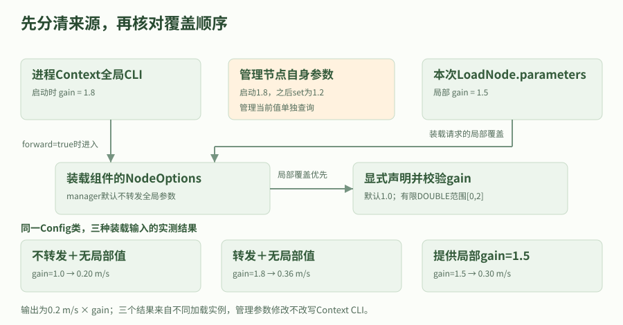

本图针对标准manager创建的组件options，数值取自第3轮真实Config实验。管理节点从1.8改为1.2不改写Context的启动CLI；局部加载参数优先。gain无量纲，输出按0.2m/s基值换算；不是硬件速度或任意NodeOptions默认值的示意。

### shared single、shared mt与per-component executor的实际区别

同一SlowComponent与HeartbeatComponent分别加载到三种官方容器。记录PID、线程ID、回调开始/结束稳态时戳和慢回调窗口内heartbeat；相同进程内的时戳可比较，不使用节点图数量推断并发。受控等待让回调保持活跃，但不是CPU负载基准或硬实时证明。

默认component_container共享单线程执行器；component_container_mt共享多线程执行器，本轮显式thread_num=2，不把旧教程文字中的4当固定线程数。默认component_container_isolated为每组件建立单线程执行器和线程，管理节点由外层执行器推进；--use_multi_threaded_executor额外模式仅核源码，没有混入本次三容器实测。

isolated中的两个组件仍共享PID、地址空间和进程故障边界。它隔开执行资源，不会让堆破坏、进程崩溃或CPU资源自动隔离。需要进程故障隔离时仍应选择独立进程并验证恢复链。

thread_num在管理节点声明为只读，mt入口在启动时读取；启动override和运行时修改是两条路径。官方默认管理参数服务关闭，不能把远程get/set超时当作参数拒绝；本轮使用显式开启服务的可观察入口核对描述与运行时拒绝。卸载前先停止组件自己的周期工作，回收动作按自己的所有权执行。

#### 官方三容器的同PID与回调线程时间线

| 官方容器 | PID | slow线程ID | heartbeat线程ID | slow内heartbeat | 最大业务并发 | 管理接口/只读作用范围 |
| --- | --- | --- | --- | --- | --- | --- |
| component_container | 232971 | 232971 | 232971 | 0 | 1 | 默认管理参数服务关闭；readonly另由observable_manager验收 |
| component_container_mt | 233001 | 233015 | 233001, 233015 | 17 | 2 | 默认管理参数服务关闭；readonly另由observable_manager验收 |
| component_container_isolated | 233032 | 233047 | 233046 | 17 | 2 | 默认管理参数服务关闭；readonly另由observable_manager验收 |

官方三个容器同一软件门闩负载实测。isolated仍为同PID、默认每组件ST执行器；mt显式thread_num=2。只断言重叠，不保证精确频率。 显式observable_manager另测thread_num=2、read_only=true，改为范围内1被拒绝并保留2；不冒充官方默认参数接口。

### 完整组件包与复现脚本

按component_labs/README从独立目录构建包，加载本机安装前缀，再运行脚本。以下完整文件自动取自已实测源码；CMake注册、插件名、独立入口和加载命令应一起使用，不能只复制节点类而省略包描述。

构造失败、参数拒绝、动态卸载和线程清理属于不同验收阶段。报告保留有限输入与事件；本轮没有测零复制、DDS共享内存、容器崩溃恢复、跨机或硬件性能。

#### component_labs/runtime_lab_components/CMakeLists.txt

代码类型：complete

```cmake

# 输入：Jazzy依赖及两个原创C++文件；输出共享组件库、独立Config入口及可观察管理容器。
# 构建目录由colcon参数放到/tmp；这里不修改官方包或生成物。
cmake_minimum_required(VERSION 3.8)
project(runtime_lab_components)
find_package(ament_cmake REQUIRED)
find_package(rclcpp REQUIRED)
find_package(rclcpp_components REQUIRED)
find_package(rcl_interfaces REQUIRED)
find_package(std_msgs REQUIRED)
find_package(std_srvs REQUIRED)
add_library(runtime_components SHARED src/components.cpp)
target_compile_features(runtime_components PUBLIC cxx_std_17)
ament_target_dependencies(runtime_components rclcpp rclcpp_components rcl_interfaces std_msgs std_srvs)
# 同一Config类既可被容器装入，也可由生成的独立main入口创建；不是复制另一套算法。
rclcpp_components_register_node(runtime_components
  PLUGIN "runtime_lab_components::ConfigComponent" EXECUTABLE config_node)
rclcpp_components_register_nodes(runtime_components
  "runtime_lab_components::SlowComponent" "runtime_lab_components::HeartbeatComponent")
add_executable(observable_manager src/observable_manager.cpp)
target_compile_features(observable_manager PUBLIC cxx_std_17)
ament_target_dependencies(observable_manager rclcpp rclcpp_components)
install(TARGETS runtime_components observable_manager
  ARCHIVE DESTINATION lib LIBRARY DESTINATION lib RUNTIME DESTINATION lib/${PROJECT_NAME})
ament_package()


```

本文件与报告绑定的原创工程同源；输入、单位、默认参数、执行顺序及关闭边界见中文注释。请按配套README构建并加载环境。

#### component_labs/runtime_lab_components/package.xml

代码类型：complete

```xml

<?xml version="1.0"?>
<!-- 原创组件实验包：仅发布教学速度/事件，不接机器人。依赖声明不等于自动安装。 -->
<package format="3">
  <name>runtime_lab_components</name>
  <version>0.1.0</version>
  <description>原创 NodeOptions 参数与组件容器调度实验</description>
  <maintainer email="learner@example.com">ROS 2 Learning Hub</maintainer>
  <license>Apache-2.0</license>
  <buildtool_depend>ament_cmake</buildtool_depend>
  <depend>rclcpp</depend>
  <depend>rclcpp_components</depend>
  <depend>rcl_interfaces</depend>
  <depend>std_msgs</depend>
  <depend>std_srvs</depend>
  <exec_depend>composition_interfaces</exec_depend>
  <export><build_type>ament_cmake</build_type></export>
</package>


```

本文件与报告绑定的原创工程同源；输入、单位、默认参数、执行顺序及关闭边界见中文注释。请按配套README构建并加载环境。

#### component_labs/runtime_lab_components/src/components.cpp

代码类型：complete

```cpp

// 原创教学组件。输入为NodeOptions、参数与专属临时目录的软件门闩；不连接设备。
// Config输出Float64教学速度(m/s)；Slow/Heartbeat输出带PID/TID和稳态纳秒的JSON事件。
// 所有构造函数建立实体后返回，不在加载服务中等待硬件；prepare_unload在本组件
// 默认互斥组中取消timer，驱动收到响应后再请求管理容器卸载。
#include <atomic>
#include <chrono>
#include <cmath>
#include <cstdint>
#include <filesystem>
#include <iomanip>
#include <iostream>
#include <memory>
#include <mutex>
#include <sstream>
#include <stdexcept>
#include <string>
#include <thread>
#include <utility>
#include <vector>
#include <sys/syscall.h>
#include <unistd.h>
#include "rclcpp/rclcpp.hpp"
#include "rclcpp_components/register_node_macro.hpp"
#include "rcl_interfaces/msg/set_parameters_result.hpp"
#include "std_msgs/msg/float64.hpp"
#include "std_srvs/srv/trigger.hpp"

namespace runtime_lab_components {
namespace {
using Steady = std::chrono::steady_clock;
using Trigger = std_srvs::srv::Trigger;
std::mutex event_mutex;
std::atomic<std::uint64_t> span_sequence{0};

std::int64_t monotonic_ns() {
  return std::chrono::duration_cast<std::chrono::nanoseconds>(Steady::now().time_since_epoch()).count();
}
std::string quoted(const std::string & value) {
  // JSON字符串转义；节点名/目录不被直接拼成未转义JSON或shell命令。
  std::ostringstream out; out << '"';
  for (unsigned char c : value) {
    if (c == '"' || c == '\\') {out << '\\' << static_cast<char>(c);}
    else if (c < 0x20) {out << "\\u" << std::hex << std::setw(4) << std::setfill('0') << static_cast<int>(c) << std::dec;}
    else {out << static_cast<char>(c);}
  }
  out << '"'; return out.str();
}
std::string number(double value) {
  std::ostringstream out; out << std::setprecision(17) << value; return out.str();
}
void event(const std::string & role, const std::string & name, const std::string & kind,
           std::uint64_t span = 0,
           const std::vector<std::pair<std::string, std::string>> & fields = {}) {
  // 同一共享库内的短锁只防止JSON行交错；绝不在锁内等待门闩或执行慢工作。
  std::lock_guard<std::mutex> guard(event_mutex);
  std::cout << "COMPONENT_LAB_EVENT {\"role\":" << quoted(role)
    << ",\"node\":" << quoted(name) << ",\"event\":" << quoted(kind)
    << ",\"span\":" << span << ",\"pid\":" << ::getpid()
    << ",\"tid\":" << ::syscall(SYS_gettid) << ",\"monotonic_ns\":" << monotonic_ns();
  for (const auto & item : fields) {std::cout << ',' << quoted(item.first) << ':' << item.second;}
  std::cout << '}' << std::endl;
}
std::filesystem::path control_directory(rclcpp::Node & node) {
  const auto text = node.declare_parameter<std::string>("control_dir", "");
  const std::filesystem::path directory(text);
  if (!directory.is_absolute() || !std::filesystem::is_directory(directory)) {
    throw std::invalid_argument("control_dir must be an existing absolute private directory");
  }
  return directory;
}
bool flag(const std::filesystem::path & directory, const char * name) {
  return std::filesystem::exists(directory / name);
}
}  // namespace

class ConfigComponent : public rclcpp::Node {
public:
  explicit ConfigComponent(const rclcpp::NodeOptions & options)
  : Node("config_component", options) {
    // 必须把容器提供的options转交Node。静态double声明会先拒绝错误类型；
    // 然后显式检查启动值有限且在[0,2]，不能只对动态更新施加约束。
    const double initial = declare_parameter<double>("gain", 1.0);
    if (!valid(initial)) {throw std::invalid_argument("gain must be finite DOUBLE within [0,2]");}
    validator_ = add_on_set_parameters_callback([](const std::vector<rclcpp::Parameter> & values) {
      rcl_interfaces::msg::SetParametersResult result; result.successful = true;
      for (const auto & value : values) {
        if (value.get_name() == "gain" &&
            (value.get_type() != rclcpp::ParameterType::PARAMETER_DOUBLE || !valid(value.as_double()))) {
          result.successful = false; result.reason = "gain must be finite DOUBLE within [0,2]"; break;
        }
      }
      // 纯校验，不改应用cache/硬件；未知参数是否已声明由Node参数框架处理。
      return result;
    });
    publisher_ = create_publisher<std_msgs::msg::Float64>("~/configured_velocity", 10);
    timer_ = create_wall_timer(std::chrono::milliseconds(100), [this]() {
      std_msgs::msg::Float64 output;
      output.data = 0.2 * get_parameter("gain").as_double();  // 0.2m/s基值×无量纲gain。
      publisher_->publish(output);  // 教学测量输出，不是底盘命令或已停车证明。
    });
    prepare_ = create_service<Trigger>("~/prepare_unload",
      [this](const std::shared_ptr<Trigger::Request>, std::shared_ptr<Trigger::Response> response) {
        timer_->cancel(); response->success = true; response->message = "timer canceled before unload";
      });
    const auto & actual = get_node_options();
    event("config", get_fully_qualified_name(), "constructed", 0,
      {{"gain", number(initial)}, {"use_global_arguments", actual.use_global_arguments() ? "true" : "false"},
       {"use_intra_process_comms", actual.use_intra_process_comms() ? "true" : "false"},
       {"allow_undeclared_parameters", actual.allow_undeclared_parameters() ? "true" : "false"},
       {"automatically_declare_parameters_from_overrides", actual.automatically_declare_parameters_from_overrides() ? "true" : "false"}});
  }
  ~ConfigComponent() override {event("config", get_fully_qualified_name(), "destroyed");}
private:
  static bool valid(double value) {return std::isfinite(value) && value >= 0.0 && value <= 2.0;}
  rclcpp::node_interfaces::OnSetParametersCallbackHandle::SharedPtr validator_;
  rclcpp::Publisher<std_msgs::msg::Float64>::SharedPtr publisher_;
  rclcpp::TimerBase::SharedPtr timer_;
  rclcpp::Service<Trigger>::SharedPtr prepare_;
};

class SlowComponent : public rclcpp::Node {
public:
  explicit SlowComponent(const rclcpp::NodeOptions & options) : Node("slow_component", options) {
    directory_ = control_directory(*this);
    const double cap = declare_parameter<double>("cap_s", 2.0);
    if (!std::isfinite(cap) || cap < 0.5 || cap > 5.0) {throw std::invalid_argument("cap_s must be finite within [0.5,5] seconds");}
    cap_s_ = cap;
    timer_ = create_wall_timer(std::chrono::milliseconds(20), [this]() {
      if (fired_ || !flag(directory_, "start_slow")) {return;}
      fired_ = true;
      const auto span = ++span_sequence;
      event("slow", get_fully_qualified_name(), "start", span);
      const auto deadline = Steady::now() + std::chrono::duration<double>(cap_s_);
      // 私有/tmp文件只是跨进程软件门闩。sleep模拟等待IO，既不是计算基准，
      // 也不能被ROS取消请求抢占；每5ms检查释放、Context与有限保护期限。
      while (!flag(directory_, "release_slow") && rclcpp::ok(get_node_base_interface()->get_context()) && Steady::now() < deadline) {
        std::this_thread::sleep_for(std::chrono::milliseconds(5));
      }
      const bool released = flag(directory_, "release_slow");
      timer_->cancel();
      event("slow", get_fully_qualified_name(), "end", span, {{"released_by_driver", released ? "true" : "false"}});
    });
    prepare_ = create_service<Trigger>("~/prepare_unload",
      [this](const std::shared_ptr<Trigger::Request>, std::shared_ptr<Trigger::Response> response) {
        timer_->cancel(); response->success = true;
      });
    event("slow", get_fully_qualified_name(), "constructed");
  }
  ~SlowComponent() override {event("slow", get_fully_qualified_name(), "destroyed");}
private:
  std::filesystem::path directory_;
  double cap_s_{2.0};
  bool fired_{false};  // 仅在本节点默认互斥组内读写，不供外部线程直接修改。
  rclcpp::TimerBase::SharedPtr timer_;
  rclcpp::Service<Trigger>::SharedPtr prepare_;
};

class HeartbeatComponent : public rclcpp::Node {
public:
  explicit HeartbeatComponent(const rclcpp::NodeOptions & options) : Node("heartbeat_component", options) {
    directory_ = control_directory(*this);
    timer_ = create_wall_timer(std::chrono::milliseconds(20), [this](const rclcpp::TimerInfo & info) {
      if (!ready_recorded_) {
        ready_recorded_ = true;
        event("heartbeat", get_fully_qualified_name(), "timer_ready");
      }
      if (!flag(directory_, "heartbeat_enabled")) {return;}
      const auto span = ++span_sequence;
      event("heartbeat", get_fully_qualified_name(), "start", span,
        {{"expected_call_ns", std::to_string(info.expected_call_time.nanoseconds())},
         {"actual_call_ns", std::to_string(info.actual_call_time.nanoseconds())}});
      ++count_;
      event("heartbeat", get_fully_qualified_name(), "end", span, {{"count", std::to_string(count_)}});
    });
    prepare_ = create_service<Trigger>("~/prepare_unload",
      [this](const std::shared_ptr<Trigger::Request>, std::shared_ptr<Trigger::Response> response) {
        timer_->cancel(); response->success = true;
      });
    event("heartbeat", get_fully_qualified_name(), "constructed");
  }
  ~HeartbeatComponent() override {event("heartbeat", get_fully_qualified_name(), "destroyed");}
private:
  std::filesystem::path directory_;
  bool ready_recorded_{false};
  std::uint64_t count_{0};
  rclcpp::TimerBase::SharedPtr timer_;
  rclcpp::Service<Trigger>::SharedPtr prepare_;
};
}  // namespace runtime_lab_components

RCLCPP_COMPONENTS_REGISTER_NODE(runtime_lab_components::ConfigComponent)
RCLCPP_COMPONENTS_REGISTER_NODE(runtime_lab_components::SlowComponent)
RCLCPP_COMPONENTS_REGISTER_NODE(runtime_lab_components::HeartbeatComponent)


```

本文件与报告绑定的原创工程同源；输入、单位、默认参数、执行顺序及关闭边界见中文注释。请按配套README构建并加载环境。

#### component_labs/runtime_lab_components/src/observable_manager.cpp

代码类型：complete

```cpp

// 可观察管理容器：仍使用安装版本的ComponentManager与MultiThreadedExecutor。
// 与官方可执行默认不同：明确打开管理参数服务，并声明管理节点自己的gain。
// 目的是通过真实Get/Describe/SetParameters验证thread_num只读及参数作用对象；
// 三种官方容器调度验收不会用本程序冒充官方默认接口。
#include <iostream>
#include <memory>
#include <stdexcept>
#include <unistd.h>
#include "rclcpp/rclcpp.hpp"
#include "rclcpp_components/component_manager.hpp"

int main(int argc, char ** argv) {
  rclcpp::init(argc, argv);
  int exit_code = 0;
  try {
    rclcpp::NodeOptions options;
    options.start_parameter_services(true).start_parameter_event_publisher(true);
    // 管理类先声明其thread_num（只读范围来自官方类），随后本程序才创建执行器。
    auto manager = std::make_shared<rclcpp_components::ComponentManager>(
      std::weak_ptr<rclcpp::Executor>(), "observable_manager", options);
    const double manager_gain = manager->declare_parameter<double>("gain", 0.5);
    const auto thread_num = manager->get_parameter("thread_num").as_int();
    auto executor = std::make_shared<rclcpp::executors::MultiThreadedExecutor>(
      rclcpp::ExecutorOptions(), static_cast<std::size_t>(thread_num));
    manager->set_executor(executor);
    executor->add_node(manager);
    std::cout << "OBSERVABLE_MANAGER_READY {\"pid\":" << ::getpid()
      << ",\"thread_num\":" << thread_num << ",\"manager_gain\":" << manager_gain
      << ",\"management_parameter_services\":true}" << std::endl;
    executor->spin();
    executor->remove_node(manager);
  } catch (const std::exception & error) {
    std::cerr << "observable manager failed: " << error.what() << std::endl;
    exit_code = 1;
  }
  if (rclcpp::ok()) {rclcpp::shutdown();}
  return exit_code;
}


```

本文件与报告绑定的原创工程同源；输入、单位、默认参数、执行顺序及关闭边界见中文注释。请按配套README构建并加载环境。

#### component_labs/validate_components.py

代码类型：complete

```python

#!/usr/bin/env python3
"""真实Jazzy组件配置/容器调度验收；--help不依赖ROS。

先构建runtime_lab_components并source安装前缀，再运行：
  COMPONENT_LABS_INSTALL_PREFIX=/tmp/ros2-component-labs/install \
    timeout --signal=INT --kill-after=10s 180s /usr/bin/python3 validate_components.py \
      --report /tmp/component-labs-local-result.json

输入：原创Config组件、私有/tmp软件门闩和官方三个容器；不接设备或仿真。
输出：参数/加载响应、Float64速度(m/s)、PID/TID/monotonic纳秒/span及JSON证据。
每例独立worker进程组；服务等待是monotonic软期限，父进程另有总期限保护。
清理只使用本例保存的PID/进程组；先prepare_unload取消组件timer再按实际ID卸载。
官方容器管理参数服务默认关闭；readonly通过显式开启服务的observable_manager
验收，不把等待服务超时当拒绝证据。其他NodeOptions默认值不随extra任意键设置。
"""

from __future__ import annotations

import argparse
from datetime import datetime
import hashlib
import importlib.metadata
import json
import math
import os
from pathlib import Path
import platform
import signal
import subprocess
import sys
import tempfile
import time
import traceback
import xml.etree.ElementTree as ET
from zoneinfo import ZoneInfo

HERE=Path(__file__).resolve().parent
HUB=HERE.parents[1]
MARKER="COMPONENT_DRIVER_RESULT="
EVENT="COMPONENT_LAB_EVENT "
CASES=("standalone_config","component_parameters","container_single","container_mt","container_isolated")


def require(condition,message):
    if not condition:
        raise AssertionError(message)


def arguments():
    parser=argparse.ArgumentParser(description=__doc__,formatter_class=argparse.RawDescriptionHelpFormatter)
    parser.add_argument("--install-prefix",type=Path,default=Path(os.environ.get("COMPONENT_LABS_INSTALL_PREFIX",HERE/"install")))
    parser.add_argument("--build-root",type=Path,help="可选/tmp构建根目录，仅用于读取本轮colcon日志")
    parser.add_argument("--domain-id",type=int,default=225)
    parser.add_argument("--hold-s",type=float,default=0.35,help="slow开始后保持的软件门闩窗口，秒")
    parser.add_argument("--timeout-s",type=float,default=5.0,help="服务/消息/事件软等待，秒")
    parser.add_argument("--worker-timeout-s",type=float,default=30.0,help="父进程包住每例的期限")
    parser.add_argument("--case",choices=("all",*CASES),default="all")
    parser.add_argument("--report",type=Path,default=HUB/"validation-evidence/component-labs-current-validation.json")
    parser.add_argument("--worker",choices=CASES,help=argparse.SUPPRESS)
    result=parser.parse_args()
    for value in (result.hold_s,result.timeout_s,result.worker_timeout_s):
        if not math.isfinite(value) or value<=0:
            parser.error("所有时间须为有限正秒数")
    if not 0<=result.domain_id<=232 or not 0.15<=result.hold_s<=1.0:
        parser.error("域须位于0..232，hold-s须位于[0.15,1.0]，低于2秒回调保护上限")
    if result.worker_timeout_s<4*result.timeout_s+5:
        parser.error("worker期限至少覆盖4倍软等待及5秒清理余量")
    result.install_prefix=result.install_prefix.resolve()
    return result


def environment(options):
    env=dict(os.environ)
    env.pop("ROS_LOCALHOST_ONLY",None)
    env.pop("ROS_STATIC_PEERS",None)
    env.update(ROS_DOMAIN_ID=str(options.domain_id),ROS_AUTOMATIC_DISCOVERY_RANGE="LOCALHOST",
               RMW_IMPLEMENTATION="rmw_fastrtps_cpp",PYTHONUNBUFFERED="1",PYTHONDONTWRITEBYTECODE="1")
    return env


class Processes:
    """孩子继承worker进程组；父级超时时能整体清理，正常只给自有PID发信号。"""
    def __init__(self,directory):
        self.directory=Path(directory)
        self.items=[]

    def start(self,command,label):
        path=self.directory/f"{len(self.items):02d}-{label}.log"
        stream=path.open("w")
        process=subprocess.Popen(command,stdout=stream,stderr=stream,env=dict(os.environ))
        item={"command":command,"label":label,"process":process,"stream":stream,"path":path}
        self.items.append(item)
        return item

    @staticmethod
    def text(item):
        return item["path"].read_text(errors="replace")

    def events(self,item):
        parsed=[]
        for line in self.text(item).splitlines():
            if EVENT in line:
                parsed.append(json.loads(line.split(EVENT,1)[1]))
        return parsed

    def stop(self,item):
        process=item["process"]
        if process.poll() is None:
            try:process.send_signal(signal.SIGINT)
            except ProcessLookupError:pass
            try:
                process.wait(timeout=3)
            except subprocess.TimeoutExpired:
                try:process.kill()
                except ProcessLookupError:pass
                process.wait(timeout=3)

    def close(self):
        records=[]
        for item in reversed(self.items):
            error=None
            try:
                self.stop(item)
            except BaseException:
                error=traceback.format_exc()
            records.append({"label":item["label"],"command":item["command"],
                "pid":item["process"].pid,"exitCode":item["process"].poll(),
                "cleanupError":error,"log":self.text(item),"events":self.events(item)})
            item["stream"].close()
        return list(reversed(records))


class Probe:
    """同Context执行器有界推进；所有订阅回调只是追加小数值，不阻塞。"""
    def __init__(self,namespace,options):
        import rclpy
        from rclpy.context import Context
        from rclpy.executors import SingleThreadedExecutor
        from rclpy.node import Node
        self.rclpy=rclpy
        self.options=options
        self.context=Context()
        rclpy.init(args=[],context=self.context)
        self.node=Node("component_probe",namespace=namespace,context=self.context,enable_rosout=False)
        self.executor=SingleThreadedExecutor(context=self.context)
        self.executor.add_node(self.node)
        self.clients={}
        self.samples={}
        self.subscriptions=[]

    def until(self,predicate,message,timeout=None):
        end=time.monotonic()+(self.options.timeout_s if timeout is None else timeout)
        while not predicate() and time.monotonic()<end:
            self.executor.spin_once(timeout_sec=min(0.02,max(0,end-time.monotonic())))
        require(predicate(),message)

    def call(self,kind,name,request):
        key=(kind,name)
        if key not in self.clients:
            self.clients[key]=self.node.create_client(kind,name)
        client=self.clients[key]
        require(client.wait_for_service(timeout_sec=self.options.timeout_s),f"服务未发现：{name}")
        future=client.call_async(request)
        self.until(future.done,f"服务响应软期限到达：{name}")
        require(future.exception() is None,f"服务异常：{future.exception()}")
        return future.result()

    def get(self,node,names):
        from rcl_interfaces.srv import GetParameters
        return self.call(GetParameters,node+"/get_parameters",GetParameters.Request(names=names)).values

    def set(self,node,name,value):
        from rcl_interfaces.srv import SetParameters
        from rclpy.parameter import Parameter
        request=SetParameters.Request(parameters=[Parameter(name,value=value).to_parameter_msg()])
        return self.call(SetParameters,node+"/set_parameters",request).results[0]

    def output(self,node,expected):
        from std_msgs.msg import Float64
        if node not in self.samples:
            self.samples[node]=[]
            self.subscriptions.append(self.node.create_subscription(Float64,node+"/configured_velocity",
                lambda message,key=node:self.samples[key].append(message.data),10))
        self.samples[node].clear()
        self.until(lambda:any(math.isclose(v,expected,abs_tol=1e-12) for v in self.samples[node]),
                   f"{node}未观察到{expected}m/s")
        require(all(math.isfinite(v) for v in self.samples[node]),"发布结果含非有限数")
        return list(self.samples[node])

    def close(self):
        self.executor.remove_node(self.node)
        stopped=self.executor.shutdown(timeout_sec=1)
        self.node.destroy_node()
        if self.context.ok():
            self.rclpy.shutdown(context=self.context)
        return {"executorStopped":bool(stopped),"contextOkAfterCleanup":self.context.ok()}


def binary(options,name):
    path=options.install_prefix/"lib/runtime_lab_components"/name
    require(path.is_file() and os.access(path,os.X_OK),f"尚未构建安装：{path}")
    return str(path)


def start_container(options,processes,namespace,executable,observable=False):
    from ament_index_python.packages import get_package_prefix
    path=(binary(options,"observable_manager") if observable else
          str(Path(get_package_prefix("rclcpp_components"))/"lib/rclcpp_components"/executable))
    command=[path,"--ros-args","-r","__node:=manager","-r",f"__ns:={namespace}"]
    if executable=="component_container_mt" or observable:
        command.extend(["-p","thread_num:=2"])
    if observable:
        command.extend(["-p","gain:=1.8"])
    return processes.start(command,"container"),namespace+"/manager"


def component_call(probe,manager,operation,request):
    from composition_interfaces.srv import LoadNode,ListNodes,UnloadNode
    kind={"load":LoadNode,"list":ListNodes,"unload":UnloadNode}[operation]
    return probe.call(kind,manager+"/_container/"+{"load":"load_node","list":"list_nodes","unload":"unload_node"}[operation],request)


def load(probe,manager,plugin,name,namespace,parameters=None,extras=None):
    from composition_interfaces.srv import LoadNode
    from rclpy.parameter import Parameter
    request=LoadNode.Request(package_name="runtime_lab_components",
        plugin_name="runtime_lab_components::"+plugin,node_name=name,node_namespace=namespace,
        parameters=[Parameter(key,value=value).to_parameter_msg() for key,value in (parameters or {}).items()],
        extra_arguments=[Parameter(key,value=value).to_parameter_msg() for key,value in (extras or {}).items()])
    return component_call(probe,manager,"load",request)


def listed(probe,manager):
    from composition_interfaces.srv import ListNodes
    response=component_call(probe,manager,"list",ListNodes.Request())
    require(len(response.full_node_names)==len(response.unique_ids),"ListNodes名称/ID长度不符")
    return dict(zip(response.full_node_names,response.unique_ids))


def unload(probe,manager,name,uid):
    from composition_interfaces.srv import UnloadNode
    from std_srvs.srv import Trigger
    # 先在组件自身互斥组内取消timer，避免把任意运行中卸载包装成安全保证。
    ready=probe.call(Trigger,name+"/prepare_unload",Trigger.Request())
    require(ready.success,"组件未进入可卸载教学状态")
    response=component_call(probe,manager,"unload",UnloadNode.Request(unique_id=uid))
    require(response.success,f"卸载实际ID={uid}失败：{response.error_message}")
    return {"node":name,"id":uid,"prepared":ready.success,"unloaded":response.success}


def standalone(options,processes,probe,namespace,record):
    node=namespace+"/standalone"
    child=processes.start([binary(options,"config_node"),"--ros-args","-r","__node:=standalone",
        "-r",f"__ns:={namespace}","-p","gain:=1.5"],"standalone")
    initial=probe.get(node,["gain"])[0]
    require(initial.type==3 and initial.double_value==1.5,"独立入口gain覆盖不符")
    samples=probe.output(node,0.3)
    changes=[]
    expected_gain=1.5
    for label,value,accepted in [("valid",1.2,True),("too-large",3.0,False),("negative",-0.1,False),
                                 ("NaN",math.nan,False),("positive-Inf",math.inf,False),
                                 ("negative-Inf",-math.inf,False),("integer",1,False),("string","bad",False),
                                 ("lower-bound",0.0,True),("upper-bound",2.0,True),("restore",1.2,True)]:
        outcome=probe.set(node,"gain",value)
        require(outcome.successful==accepted,f"动态{label}接纳结果不符：{outcome}")
        if accepted:expected_gain=value
        gain=probe.get(node,["gain"])[0].double_value
        require(gain==expected_gain and math.isfinite(gain),f"动态{label}改变了应保存的值：{gain}")
        observed=probe.output(node,0.2*expected_gain) if accepted else None
        changes.append({"input":label,"accepted":outcome.successful,"reason":outcome.reason,
                        "storedGain":gain,"observedAfterAccepted":observed})
    final=probe.output(node,0.24)
    record.update(node=node,pid=child["process"].pid,initialGain=1.5,initialOutputMps=0.3,
                  observedInitial=samples,dynamic=changes,observedAfterDynamic=final)


def parameter_components(options,processes,probe,namespace,record):
    from rcl_interfaces.srv import DescribeParameters
    child,manager=start_container(options,processes,namespace,"observable",observable=True)
    manager_values=probe.get(manager,["gain","thread_num"])
    require(manager_values[0].double_value==1.8 and manager_values[1].integer_value==2,"管理参数启动覆盖不符")
    descriptor=probe.call(DescribeParameters,manager+"/describe_parameters",DescribeParameters.Request(names=["thread_num"])).descriptors[0]
    require(descriptor.read_only,"thread_num描述符必须只读")
    rejected=probe.set(manager,"thread_num",1)  # 1在合法范围内，排除“越界”作为拒绝原因。
    require(not rejected.successful and probe.get(manager,["thread_num"])[0].integer_value==2,"只读thread_num未被拒绝或值改变")
    configs=[]
    ids={}
    def good(label,params,extras,gain,unknown=False):
        response=load(probe,manager,"ConfigComponent",label,namespace+"/nodes",params,extras)
        require(response.success,f"有效组件{label}加载失败：{response.error_message}")
        values=probe.get(response.full_node_name,["gain"])
        require(len(values)==1 and values[0].type==3 and values[0].double_value==gain,"组件生效gain不符")
        unknown_values=[]
        if unknown:
            from rcl_interfaces.srv import ListParameters
            # 严格GetParameters遇未声明名会捕获异常并给空values；不能从
            # get_parameter_or/allow_undeclared的fallback推导逐项NOT_SET。
            unknown_values=probe.get(response.full_node_name,["typo_gain"])
            require(len(unknown_values)==0,"本版C++未知参数Get应返回空values")
            listing=probe.call(ListParameters,response.full_node_name+"/list_parameters",
                ListParameters.Request(prefixes=[],depth=0))
            require("typo_gain" not in listing.result.names,"未知覆盖不应自动成为已声明参数")
            dynamic_unknown=probe.set(response.full_node_name,"typo_gain",1.1)
            require(not dynamic_unknown.successful,"未声明参数动态设置应拒绝")
        else:
            dynamic_unknown=None
        observed=probe.output(response.full_node_name,0.2*gain)
        ids[response.full_node_name]=response.unique_id
        configs.append({"label":label,"node":response.full_node_name,"id":response.unique_id,
            "parameters":params,"extraArguments":extras,"gain":gain,"outputMps":0.2*gain,
            "observed":observed,"unknownGetValuesCount":len(unknown_values) if unknown else None,
            "unknownGetRepresentation":"empty values; C++ undeclared exception caught by service" if unknown else None,
            "dynamicUnknownAccepted":None if dynamic_unknown is None else dynamic_unknown.successful,
            "dynamicUnknownReason":None if dynamic_unknown is None else dynamic_unknown.reason})
        return response.full_node_name
    default=good("default_config",{}, {},1.0)
    local=good("local_config",{"gain":1.5},{"use_intra_process_comms":True},1.5)
    good("forward_config",{}, {"forward_global_arguments":True},1.8)
    good("forward_local",{"gain":1.5},{"forward_global_arguments":True},1.5)
    good("typo_config",{"typo_gain":1.9},{},1.0,unknown=True)
    good("unknown_extra",{"typo_gain":1.9},{"automatically_declare_parameters_from_overrides":True,
         "allow_undeclared_parameters":True},1.0,unknown=True)
    changed=probe.set(manager,"gain",1.2)
    require(changed.successful,"管理节点自身gain修改失败")
    require(probe.get(default,["gain"])[0].double_value==1.0 and probe.get(local,["gain"])[0].double_value==1.5,
            "管理节点gain不应自动传播到已有组件")
    # 转发的是Context全局CLI参数，不是管理参数服务当前值1.2。
    good("forward_after_manager_change",{}, {"forward_global_arguments":True},1.8)
    invalid=[]
    for label,value in [("out_of_range",3.0),("wrong_type","bad"),("nonfinite",math.nan)]:
        response=load(probe,manager,"ConfigComponent",label,namespace+"/nodes",{"gain":value})
        require(not response.success and bool(response.error_message),f"非法{label}未产生明确加载失败")
        current=listed(probe,manager)
        require(current==ids and child["process"].poll() is None,"失败构造后管理节点或已有组件受影响")
        invalid.append({"input":label,"loadSuccess":response.success,"error":response.error_message,
                        "existingListUnchanged":True})
    wrong_extra=load(probe,manager,"ConfigComponent","wrong_extra_type",namespace+"/nodes",
                     extras={"forward_global_arguments":"bad"})
    require(not wrong_extra.success and "boolean" in wrong_extra.error_message,
            "已识别extra的错误类型必须被明确拒绝")
    require(listed(probe,manager)==ids and child["process"].poll() is None,"错误extra影响已有组件")
    invalid.append({"input":"wrong_extra_type","source":"extra_arguments",
        "loadSuccess":wrong_extra.success,"error":wrong_extra.error_message,"existingListUnchanged":True})
    events=processes.events(child)
    constructs={e["node"]:e for e in events if e["role"]=="config" and e["event"]=="constructed"}
    for entry in configs:
        options_event=constructs[entry["node"]]
        require(not options_event["allow_undeclared_parameters"] and not options_event["automatically_declare_parameters_from_overrides"],
                "标准extra不应启用任意NodeOptions setter")
        require(options_event["use_global_arguments"]==entry["extraArguments"].get("forward_global_arguments",False),"forward选项未生效")
        entry["actualNodeOptions"]=options_event
    removed=[unload(probe,manager,name,uid) for name,uid in ids.items()]
    require(listed(probe,manager)=={},"卸载后列表不为空")
    record.update(manager=manager,managerPid=child["process"].pid,managerStartupGain=1.8,
        managerGainAfterChange=1.2,managementParameterServicesExplicitlyEnabled=True,
        threadNum={"startup":2,"readOnly":descriptor.read_only,"attemptedValue":1,
            "dynamicAccepted":rejected.successful,"reason":rejected.reason,
            "range":[{"from":r.from_value,"to":r.to_value} for r in descriptor.integer_range]},
        configurations=configs,invalidConstruction=invalid,unload=removed,listEmptyAfterUnload=True)


def scheduling(options,processes,probe,namespace,case,directory,record):
    name={"container_single":"component_container","container_mt":"component_container_mt",
          "container_isolated":"component_container_isolated"}[case]
    child,manager=start_container(options,processes,namespace,name)
    control=Path(directory)/"gates";control.mkdir()
    heartbeat=load(probe,manager,"HeartbeatComponent","heartbeat",namespace+"/nodes",{"control_dir":str(control)})
    slow=load(probe,manager,"SlowComponent","slow",namespace+"/nodes",{"control_dir":str(control),"cap_s":2.0})
    require(heartbeat.success and slow.success,"调度组件加载失败")
    probe.until(lambda:any(e["event"]=="timer_ready" for e in processes.events(child)),"heartbeat未先证明timer可运行")
    # 观察实际管理服务图；源码明确默认关闭，不能把参数服务等待超时当只读拒绝。
    services=probe.node.get_service_names_and_types_by_node("manager",namespace)
    parameter_services=[s for s,_ in services if any(s.endswith("/"+suffix) for suffix in ["get_parameters","set_parameters","describe_parameters"])]
    require(not parameter_services,"当前官方默认管理参数服务与预期不符，需报告而非假定")
    (control/"start_slow").touch()
    probe.until(lambda:any(e["role"]=="slow" and e["event"]=="start" for e in processes.events(child)),"slow未进入真实回调")
    begin=time.monotonic()
    (control/"heartbeat_enabled").touch()
    deadline=begin+options.hold_s
    while time.monotonic()<deadline:
        probe.executor.spin_once(timeout_sec=min(0.02,max(0,deadline-time.monotonic())))
    hold_elapsed=time.monotonic()-begin
    held_events=processes.events(child)
    require(not any(e["role"]=="slow" and e["event"]=="end" for e in held_events),"slow提前由保护上限释放")
    held_heartbeats=[e for e in held_events if e["role"]=="heartbeat" and e["event"]=="start"]
    if case=="container_single":
        require(not held_heartbeats,"单线程slow窗口中不应执行heartbeat")
    else:
        require(bool(held_heartbeats),"mt/isolated在受控窗口未观察到heartbeat重叠")
    (control/"release_slow").touch()
    probe.until(lambda:any(e["role"]=="slow" and e["event"]=="end" for e in processes.events(child)),"slow释放后未结束")
    probe.until(lambda:any(e["role"]=="heartbeat" and e["event"]=="end" for e in processes.events(child)),"heartbeat释放后未运行")
    removed=[unload(probe,manager,r.full_node_name,r.unique_id) for r in [heartbeat,slow]]
    require(listed(probe,manager)=={},"调度组件卸载后列表不为空")
    events=processes.events(child)
    spans={}
    for e in events:
        if e["event"] in ["start","end"]:
            spans.setdefault(e["span"],{})[e["event"]]=e
    require(all(set(s)=={"start","end"} for s in spans.values()),"时间线span不成对")
    slow_span=next(s for s in spans.values() if s["start"]["role"]=="slow")
    require(slow_span["end"]["released_by_driver"],"slow不是由驱动释放")
    hb_spans=[s for s in spans.values() if s["start"]["role"]=="heartbeat"]
    overlap=[s for s in hb_spans if s["start"]["monotonic_ns"]<slow_span["end"]["monotonic_ns"] and
             s["end"]["monotonic_ns"]>slow_span["start"]["monotonic_ns"]]
    require((len(overlap)==0)==(case=="container_single"),"span交叠与调度配置不符")
    pid=child["process"].pid
    require(all(e["pid"]==pid for e in events),"组件不是同一实际容器PID")
    hb_threads=sorted({s["start"]["tid"] for s in hb_spans})
    slow_tid=slow_span["start"]["tid"]
    if case=="container_single":
        require(hb_threads==[slow_tid],"单线程组件callback线程应相同")
        first=hb_spans[0]["start"]
        require(first["expected_call_ns"]<slow_span["end"]["monotonic_ns"],"负例缺少已到期timer证据")
    if case=="container_isolated":
        require(len(hb_threads)==1 and hb_threads[0]!=slow_tid,"isolated默认每组件ST专属线程未观察到")
    ordering=[]
    for s in spans.values():ordering.extend([(s["start"]["monotonic_ns"],1),(s["end"]["monotonic_ns"],-1)])
    active=maximum=0
    for _,delta in sorted(ordering,key=lambda x:(x[0],x[1])):
        active+=delta;maximum=max(maximum,active)
    require(maximum==(1 if case=="container_single" else 2),"业务回调最大并发不符")
    record.update(executable=name,pid=pid,manager=manager,defaultManagementParameterServices=False,
        observedManagerServices=services,threadNumStartupArgument=2 if case=="container_mt" else None,
        holdWindowRequestedS=options.hold_s,holdWindowActualS=hold_elapsed,
        slowDurationS=(slow_span["end"]["monotonic_ns"]-slow_span["start"]["monotonic_ns"])/1e9,
        slowTid=slow_tid,heartbeatTids=hb_threads,heartbeatCount=len(hb_spans),
        heartbeatDuringSlow=len(overlap),maxConcurrency=maximum,rawEvents=events,
        spans=list(spans.values()),unload=removed,listEmptyAfterUnload=True)


def versions():
    from ament_index_python.packages import get_package_share_directory
    values={"python":sys.version,"pythonExecutable":sys.executable,"platform":platform.platform(),
        "rosDistro":os.environ.get("ROS_DISTRO"),"rclpy":importlib.metadata.version("rclpy"),"packages":{}}
    for name in ["runtime_lab_components","rclcpp","rclcpp_components","composition_interfaces","rmw_fastrtps_cpp"]:
        values["packages"][name]=ET.parse(Path(get_package_share_directory(name))/"package.xml").getroot().findtext("version")
    return values


def worker(options):
    record={"case":options.worker,"passed":False,"pid":os.getpid()}
    began=time.monotonic()
    with tempfile.TemporaryDirectory(prefix="ros2-component-lab-") as directory:
        env=environment(options)
        os.environ.pop("ROS_LOCALHOST_ONLY",None);os.environ.pop("ROS_STATIC_PEERS",None)
        os.environ.update(env);os.environ["ROS_LOG_DIR"]=str(Path(directory)/"ros-logs")
        processes=Processes(directory);probe=None
        namespace=f"/component_lab/p{os.getpid()}/{options.worker}"
        try:
            record["versions"]=versions()
            probe=Probe(namespace,options)
            measurements={}
            if options.worker=="standalone_config":standalone(options,processes,probe,namespace,measurements)
            elif options.worker=="component_parameters":parameter_components(options,processes,probe,namespace,measurements)
            else:scheduling(options,processes,probe,namespace,options.worker,directory,measurements)
            record["measurements"]=measurements
            record["passed"]=True
        except BaseException:
            record["error"]=traceback.format_exc()
        finally:
            record["processes"]=processes.close()
            if probe is not None:record["probeCleanup"]=probe.close()
            if any(p["cleanupError"] or p["exitCode"] is None for p in record["processes"]):record["passed"]=False
    record["durationS"]=time.monotonic()-began
    print(MARKER+json.dumps(record,ensure_ascii=False,allow_nan=False),flush=True)
    return 0 if record["passed"] else 1


def run_worker(options,case):
    command=["/usr/bin/python3",str(Path(__file__).resolve()),"--worker",case,
        "--install-prefix",str(options.install_prefix),"--domain-id",str(options.domain_id),
        "--hold-s",str(options.hold_s),"--timeout-s",str(options.timeout_s),
        "--worker-timeout-s",str(options.worker_timeout_s)]
    p=subprocess.Popen(command,stdout=subprocess.PIPE,stderr=subprocess.PIPE,text=True,
        env=environment(options),start_new_session=True)
    error=None;started=time.monotonic();interrupted=False;fatal=False
    try:
        stdout,stderr=p.communicate(timeout=options.worker_timeout_s)
    except BaseException as exc:
        # KeyboardInterrupt及其它异常都先清理本例新进程组，再交给main停止或报告；
        # 不能让已start_new_session的worker在父driver退出后留在后台。
        error=repr(exc)
        interrupted=isinstance(exc,KeyboardInterrupt)
        fatal=not isinstance(exc,subprocess.TimeoutExpired)
        try:os.killpg(p.pid,signal.SIGINT)
        except ProcessLookupError:pass
        try:stdout,stderr=p.communicate(timeout=4)
        except subprocess.TimeoutExpired:
            try:os.killpg(p.pid,signal.SIGKILL)
            except ProcessLookupError:pass
            stdout,stderr=p.communicate(timeout=3)
    results=[line[len(MARKER):] for line in stdout.splitlines() if line.startswith(MARKER)]
    result=json.loads(results[-1]) if results else None
    return {"case":case,"command":command,"workerDeadlineS":options.worker_timeout_s,
        "exitCode":p.returncode,"outerError":error,"interrupted":interrupted,"fatalOuterError":fatal,
        "stdout":stdout,"stderr":stderr,
        "result":result,"durationS":time.monotonic()-started,
        "passed":p.returncode==0 and error is None and result is not None and result["passed"]}


def tables(results):
    by={r["case"]:r["result"]["measurements"] for r in results if r["passed"]}
    config=[];containers=[]
    if "standalone_config" in by:
        s=by["standalone_config"];config.append(["独立Config入口","CLI gain=1.5",s["initialGain"],s["initialOutputMps"],"真实Float64接收"])
        config.append(["独立动态校验","越界/NaN/±Inf/整数/字符串",1.2,0.24,"拒绝后保留合法值"])
        config.append(["gain两端点","依次设置0.0与2.0","0 / 2","0 / 0.4","接受并实际观察两端输出"])
    if "component_parameters" in by:
        p=by["component_parameters"]
        for c in p["configurations"]:
            config.append([c["label"],"LoadNode参数/extra见原始记录",c["gain"],c["outputMps"],
                           "typo未声明/动态拒绝" if c["dynamicUnknownAccepted"] is False else "加载/数值通过"])
        for bad in p["invalidConstruction"]:config.append([bad["input"],
            "非法extra类型" if bad.get("source")=="extra_arguments" else "非法gain构造",
            "未创建","无组件输出","加载拒绝，已有列表不变"])
    for case in ["container_single","container_mt","container_isolated"]:
        if case in by:
            c=by[case];containers.append([c["executable"],c["pid"],c["slowTid"],", ".join(map(str,c["heartbeatTids"])),
                c["heartbeatDuringSlow"],c["maxConcurrency"],"默认管理参数服务关闭；readonly另由observable_manager验收"])
    return [{"id":"config","columns":["场景","配置入口","生效gain","输出m/s","实际结果"],"rows":config,
             "caption":"同一Config类的独立入口与动态装载；数值来自真实参数服务和Float64接收。管理参数、Context全局CLI与LoadNode.parameters分开验证。"},
            {"id":"containers","columns":["官方容器","PID","slow线程ID","heartbeat线程ID","slow内heartbeat","最大业务并发","管理接口/只读作用范围"],
             "rows":containers,"caption":"官方三个容器同一软件门闩负载实测。isolated仍为同PID、默认每组件ST执行器；mt显式thread_num=2。只断言重叠，不保证精确频率。"}]


def main():
    options=arguments()
    if options.worker:return worker(options)
    def terminate_as_interrupt(signum,frame):
        raise KeyboardInterrupt(f"parent received signal {signum}")
    signal.signal(signal.SIGTERM,terminate_as_interrupt)
    began=time.monotonic();results=[]
    for case in (CASES if options.case=="all" else [options.case]):
        r=run_worker(options,case);results.append(r)
        print(case+": "+("PASS" if r["passed"] else "FAIL"),flush=True)
        if r["result"] and not r["passed"]:print(r["result"].get("error",""),file=sys.stderr)
        if r["interrupted"] or r["fatalOuterError"]:break
    sources=[{"path":str(p.relative_to(HUB)),"sha256":hashlib.sha256(p.read_bytes()).hexdigest()}
        for p in sorted(HERE.rglob("*")) if p.is_file() and (p.suffix in [".cpp",".py",".xml"] or p.name=="CMakeLists.txt")]
    report={"schemaVersion":1,"checkedAt":datetime.now(ZoneInfo("Asia/Shanghai")).isoformat(timespec="seconds"),
        "passed":all(r["passed"] for r in results),"interrupted":any(r["interrupted"] for r in results),
        "durationS":time.monotonic()-began,
        "parameters":{k:str(v) if isinstance(v,Path) else v for k,v in vars(options).items() if k not in ["worker","report"]},
        "environment":{"ROS_DOMAIN_ID":str(options.domain_id),"ROS_AUTOMATIC_DISCOVERY_RANGE":"LOCALHOST", "RMW_IMPLEMENTATION":"rmw_fastrtps_cpp","ROS_LOCALHOST_ONLY":"unset","ROS_STATIC_PEERS":"unset"},
        "results":results,"sourceHashes":sources,"teachingTables":tables(results),
        "scope":"真实原创C++组件、官方single/mt/isolated与显式开启管理参数服务的原创wrapper；本机软件实验，无仿真/硬件。",
        "limits":["标准容器默认关闭管理参数服务；readonly拒绝来自observable_manager真实Describe/Set接口，不能混称标准容器参数接口。",
            "mt本轮显式2线程，不把文档固定4线程写成默认；isolated默认每组件ST，本轮不测试--use_multi_threaded_executor分支。",
            "forward_global_arguments只控制Context全局ROS CLI；不会屏蔽已进入LoadNode.parameters的值。",
            "未知extra键被忽略属于记录的实现行为，不是可用的NodeOptions setter或未来版本保证。",
            "sleep和/tmp门闩是模拟IO；只比较业务span重叠，不推导CPU加速、严格实时期限、零复制或故障隔离。",
            "本例只做先取消timer再卸载的受控路径，不证明任意持有外部线程/资源组件可安全动态卸载。"]}
    if options.build_root:
        folder=options.build_root/"log/latest_build/runtime_lab_components"
        report["buildEvidence"]={"root":str(options.build_root),"logs":{
            p.name:p.read_text(errors="replace") for p in folder.glob("*.log") if p.name in ["command.log","stdout_stderr.log","stderr.log"]}}
    if options.report.is_file():
        old=json.loads(options.report.read_text());history=old.pop("previousAttempts",[]);report["previousAttempts"]=[*history,old]
    options.report.parent.mkdir(parents=True,exist_ok=True)
    options.report.write_text(json.dumps(report,ensure_ascii=False,indent=2,allow_nan=False)+"\n")
    print(json.dumps({"passed":report["passed"],"report":str(options.report.resolve())},ensure_ascii=False))
    return 130 if report["interrupted"] else (0 if report["passed"] else 1)


if __name__=="__main__":sys.exit(main())


```

本文件与报告绑定的原创工程同源；输入、单位、默认参数、执行顺序及关闭边界见中文注释。请按配套README构建并加载环境。

#### 按本轮报告复现

代码类型：commands

```bash

# 在ros2-learning-hub目录执行；新报告另存/tmp，不覆盖教材绑定证据。
source /opt/ros/jazzy/setup.bash
colcon --log-base /tmp/ros2-component-labs/log build --base-paths examples/component_labs/runtime_lab_components --build-base /tmp/ros2-component-labs/build --install-base /tmp/ros2-component-labs/install --merge-install --symlink-install
source /tmp/ros2-component-labs/install/setup.bash
COMPONENT_LABS_INSTALL_PREFIX=/tmp/ros2-component-labs/install timeout --signal=INT --kill-after=10s 180s /usr/bin/python3 examples/component_labs/validate_components.py --build-root /tmp/ros2-component-labs --report /tmp/component-labs-local-result.json

```

源码路径相对教材根目录，构建和新报告位于/tmp；环境由当前机器重新构建并source。5s服务等待是需执行器推进的软期限，worker/外层timeout另作退出保护。只读参数拒绝通过显式开启管理服务的wrapper验证；清理只针对自有PID/进程组。

### 执行器、回调组与可重入性

| 机制 | 作用 | 不自动保证的事 | 实现检查 |
| --- | --- | --- | --- |
| SingleThreadedExecutor | 在一个执行线程上调度就绪回调 | 不会让阻塞服务调用自动取得响应 | 避免长回调、忙等和同线程同步依赖。 |
| MultiThreadedExecutor | 允许多个工作线程调度符合组约束的回调 | 不保证所有回调并行，也不保证 Python CPU 密集任务线性加速 | 核对回调组、共享数据、锁、GIL及计算库是否释放GIL。 |
| MutuallyExclusive 组 | 同组回调不同时执行 | 不同组或外部线程仍可能并发访问同一对象 | 将需要互斥的数据访问放在统一同步设计中。 |
| Reentrant 组 | 允许组内回调重叠，包括同一回调的多次调用 | 回调本身不会自动变为线程安全 | 检查消息缓存、控制状态、非线程安全库及对象销毁时机。 |
| 组件组合 | 把多个节点放在同一进程，选择执行器与进程内通信 | 不等于所有消息均零复制，也不等于隔离故障 | 记录回调所有权、进程内通信设置、容器线程模型与实际拷贝路径。 |

以延迟、吞吐和最大阻塞时间等实际指标比较实现；线程数量不是实时性证明。

固定Jazzy rclpy Future的应用done continuation可作为通用executor Task调度，不自动继承客户端实体的互斥回调组；共享状态仍需同步。

自建Context时Node和Executor显式使用同一Context；不要混用默认全局spin辅助执行器，也不要由多线程并发调用同一spin_once。

### 组件配置：NodeOptions、加载参数与管理节点

| 入口或选项 | 作用对象 | 调用/检查顺序 | 重要边界 |
| --- | --- | --- | --- |
| NodeOptions构造并转交Node | 当前被创建的节点 | 构造参数→Node基类→declare_parameter→读取有效值 | 同一个类的独立入口和组件入口都应转交选项；构造中不spin或无限等待。 |
| LoadNode.parameters | 本次加载的组件 | 发送有类型Parameter→构建parameter_overrides→组件声明读取 | 给管理节点传-p gain不等于给每个组件传gain；名称/命名空间与参数服务按返回值检查。 |
| LoadNode.extra_arguments | 标准manager支持的装载开关 | 核对固定版本create_node_options实现 | 本轮实现映射use_intra_process_comms和forward_global_arguments；任意NodeOptions setter不自动成为可用extra键。 |
| forward_global_arguments | 组件是否采用进程全局ROS参数 | 默认false，明确选择后才转发 | 全局节点重命名/参数可能影响组件；实验默认不启用，不把管理节点参数等同加载请求。 |
| 未声明参数与自动声明 | 组件自身参数策略 | 显式declare gain并验证有限DOUBLE；未知项另查 | NodeOptions默认自动声明关闭；声明前的override、已声明参数、运行时set是不同阶段。 |
| 管理节点参数服务 | ComponentManager自身 | 先确认参数服务实际存在，再用远程API | 本机官方默认关闭管理参数服务；专用observable_manager显式开启，不能冒充官方可执行默认接口。 |

本轮ConfigComponent与管理节点/容器对照按报告实测；接口只证明列出的有限输入。自动声明选项本身不替代业务校验。

上游教程文字与固定实现存在版本描述差异；执行器默认与参数入口按固定源码、安装版本及实际结果说明。

### 三种容器：执行器边界、进程边界与thread_num

| 模型 | 执行资源 | 可启动配置 | 需要单独验证的边界 |
| --- | --- | --- | --- |
| component_container | 共享SingleThreadedExecutor | 本次实际容器名与组件加载ID | 一个长回调会占用该执行线程，管理请求也可能被延迟。 |
| component_container_mt | 共享MultiThreadedExecutor | 本轮显式thread_num=2 | 线程数不是并发保证；仍受回调组、锁与负载影响。不是固定4线程。 |
| component_container_isolated默认 | 每组件独立SingleThreadedExecutor及线程 | 本轮默认模式；管理节点另由外层执行器推进 | 组件仍同PID/地址空间；隔开执行器不隔离内存破坏或进程崩溃。 |
| isolated的--use_multi_threaded_executor | 每组件改用MultiThreadedExecutor | 仅按固定源码核对该开关 | 本轮三容器时间线没有把此额外模式计为已运行。 |
| thread_num只读参数 | 管理节点声明，mt入口读取 | 在启动时覆盖；运行时拒绝另用可观察管理入口验收 | 官方管理参数服务默认关闭；read_only不代表启动override也被拒绝，更不是动态线程池重配。 |

本轮记录PID、线程和受控span；sleep/等待演示资源许可，不是实时频率、CPU独占或性能倍数证明。

卸载前取消组件自己的timer/工作并回收资源；请求已返回与任意设备处于安全状态不能画等号。

### 部署清单：链接、环境、进程与容器边界

| 对象 | 记录什么 | 可以证明什么 | 仍需另证 |
| --- | --- | --- | --- |
| 安装前缀 | 普通文件SHA、链接文本/目标与边界 | 本次输入的内容与外部依赖 | 保留symlink复制后仍可能依赖原source/build/underlay。 |
| 环境与包 | 显式allowlist、目标包及underlay来源 | 本次可追溯配置 | 环境清单不是依赖闭包或包源锁文件。 |
| 校验/归档 | 同范围文件和链接逐项比对 | 传输/复制保持哪些字节与指向 | 不证明迁移、ABI、硬件或实际可运行。 |
| shell source+exec | 实际PID、可执行映射与信号退出 | 宿主正例的进程替换/TERM处理 | exec ros2 run替换的是CLI；容器PID1和叶子节点分别查。 |
| Docker默认CMD | 镜像内固定前缀的直接节点入口 | 代码静态结构及预期信号路径 | 本轮无Docker命令，镜像构建、docker stop与跨容器通信未运行。 |

本轮审计只读显式前缀/允许路径并有扫描上限，不扫描用户凭据或无限展开链接。

宿主exec信号正例与Docker验收分开；安装复制副本未执行，更未冒称跨机成功。

### 把一条图像处理链迁入容器

现有采集、滤波、检测三节点独立运行，怀疑大型图像复制导致开销。

1. 先固定图像大小、频率、订阅者数量，记录原布局下的延迟分布与资源使用。

2. 逐个把类改为 NodeOptions 构造并完成注册，先保持原 QoS 和算法验证输出一致。

3. 选择适合回调组的容器，开启进程内选项，再加入和移除进程外观察者，分别测量。

验收：只有输出合同仍满足且测量显示收益，才把该布局作为部署选择；还需接受一个组件崩溃可能带走整条链的故障范围。

### 深入练习 1

component types 能看到类型，但 node list 看不到节点，是否异常？

参考答案：不一定。types 只说明已安装的资源索引包含该组件类型，尚未证明实例已经加载。应启动容器并执行 load，检查其响应，再看 list 和节点图。

### 深入练习 2

删去 main 后原来并行的节点开始阻塞，优先查什么？

参考答案：检查 main 原先的执行器类型和回调组设置是否在组件容器中保留。默认单线程容器可能改变调度；换成多线程容器后仍需确保相关回调组允许并发。

### 深入练习 3

同进程且开启进程内选项，能否断言没有任何复制？

参考答案：不能。需要结合消息所有权、订阅数量、回调签名、跨进程消费者与传输机制判断，并以测量或追踪佐证。进程内选项不等于 DDS 共享内存或借用消息支持。

### 深入练习 4

给管理节点-p gain:=1.5，能证明新加载组件的gain也是1.5吗？

参考答案：不能。管理节点参数与LoadNode.parameters属于不同节点和入口。查询加载返回的完整组件名，在组件上检查gain与输出；显式启用全局参数转发是另一项配置。

### 深入练习 5

给extra_arguments写automatically_declare_parameters_from_overrides=true一定生效吗？

参考答案：不能。标准manager只映射它明确支持的extra键；NodeOptions完整API不等于加载服务暴露的选项集合。要核该版本create_node_options，并检查实际声明的参数。

### 深入练习 6

一次查询gain和未知名后收到空values，能用下标0继续读取gain吗？

参考答案：不能。严格参数服务可能整批失败，应检查返回长度、先核对已声明列表并分开查询合法名。空列表也不是gain=0或逐项NOT_SET；该行为由配置/API决定，不能只按语言猜测。

### 深入练习 7

同PID的两个组件在isolated不同线程执行，能否分别承受一个组件进程崩溃？

参考答案：不能。它们没有变成两个进程，仍共享地址空间及进程生死。专属执行器减少调度耦合，不隔离内存破坏或进程终止。

### 深入练习 8

thread_num是read_only，为何启动时还能设成2？

参考答案：声明时应用启动override，read_only主要约束后续参数修改。mt入口启动读取该值创建线程池；拒绝动态修改不是动态重建线程池。

### 深入练习 9

官方容器ros2 param get超时，可以记为thread_num拒绝吗？

参考答案：不可以。应先查管理参数服务是否存在；本机默认关闭。只有收到实际设置响应且原因/状态符合，才能记为拒绝；本轮另用显式开启服务的管理入口验收。

### 深入练习 10

非法gain的组件加载失败，为什么还检查已有组件与后续卸载？

参考答案：失败响应只说明这次构造未成功。已有实例、管理服务及资源回收仍可能受影响，需分别查询并卸载实际成功ID，形成完整配置与生命周期验收。

### 部署：独立节点与 C++ 组件容器

同样的节点功能怎样选择进程边界？

#### 独立进程

可直接运行；各自为独立进程

输入输出：输入为已安装组件插件、容器和 NodeOptions；输出为已装入同一进程的节点与话题。
执行顺序与边界：C++ 组件由容器持有，无独立 main；注册插件、导出库、安装、加载缺一不可。进程内通信要求相应选项，组件故障仍可影响同一容器。
组件共享进程地址空间和故障边界；进程内通信需显式选项与相容类型，容器名称/组件ID是运行时证据而非永久固定值。

```bash

# 【中文教学注释】 独立进程
# 本例作用：可直接运行；各自为独立进程
# 输入输出：输入为已安装组件插件、容器和 NodeOptions；输出为已装入同一进程的节点与话题。
# 执行顺序与边界：C++ 组件由容器持有，无独立 main；注册插件、导出库、安装、加载缺一不可。进程内通信要求相应选项，组件故障仍可影响同一容器。
# 两个终端分别运行
# 从已安装包demo_nodes_cpp启动talker；此进程通常持续运行，另用新终端执行观察命令，Ctrl+C结束。
ros2 run demo_nodes_cpp talker
# 从已安装包demo_nodes_cpp启动listener；此进程通常持续运行，另用新终端执行观察命令，Ctrl+C结束。
ros2 run demo_nodes_cpp listener

```

#### 组件容器

可直接运行；需官方 composition 包

输入输出：输入为已安装组件插件、容器和 NodeOptions；输出为已装入同一进程的节点与话题。
执行顺序与边界：C++ 组件由容器持有，无独立 main；注册插件、导出库、安装、加载缺一不可。进程内通信要求相应选项，组件故障仍可影响同一容器。
组件共享进程地址空间和故障边界；进程内通信需显式选项与相容类型，容器名称/组件ID是运行时证据而非永久固定值。

```bash

# 【中文教学注释】 组件容器
# 本例作用：可直接运行；需官方 composition 包
# 输入输出：输入为已安装组件插件、容器和 NodeOptions；输出为已装入同一进程的节点与话题。
# 执行顺序与边界：C++ 组件由容器持有，无独立 main；注册插件、导出库、安装、加载缺一不可。进程内通信要求相应选项，组件故障仍可影响同一容器。
# 终端 A
# 从已安装包rclcpp_components启动component_container；此进程通常持续运行，另用新终端执行观察命令，Ctrl+C结束。
ros2 run rclcpp_components component_container
# 终端 B
# 把指定包/插件装入已有容器，返回运行时组件ID；同进程共享故障边界，类型名须与注册名相同。
ros2 component load /ComponentManager composition composition::Talker
ros2 component load /ComponentManager composition composition::Listener

```

这里对照相同话题功能的两种官方示例部署；不是声称二者是同一可执行文件。

Python 多节点 executor 不等于 rclcpp_components 动态共享库加载。

是否获得零拷贝收益需要单独验证。

组件共享进程地址空间和故障边界；进程内通信需显式选项与相容类型，容器名称/组件ID是运行时证据而非永久固定值。

### 基础验证流程

先按component_labs/README构建原创组件包，在各终端加载安装环境，检查注册类型与包前缀。

对照同一ConfigComponent的独立入口和加载参数，检查实际节点名、gain与m/s输出；管理节点参数另查。

用实际返回ID检查、拒绝无效配置并卸载；先停止组件自己的周期工作，再观察资源清理。

分别运行三种官方容器记录PID/线程/span；只读参数使用显式开启管理参数服务的入口验收，不把默认服务缺失当拒绝。

#### 终端 A：启动容器

```bash

# 【中文教学注释】 终端 A：启动容器
# 本例作用：终端 A：启动容器
# 输入输出：输入为已安装组件插件、容器和 NodeOptions；输出为已装入同一进程的节点与话题。
# 执行顺序与边界：C++ 组件由容器持有，无独立 main；注册插件、导出库、安装、加载缺一不可。进程内通信要求相应选项，组件故障仍可影响同一容器。
# 从已安装包rclcpp_components启动component_container；此进程通常持续运行，另用新终端执行观察命令，Ctrl+C结束。
ros2 run rclcpp_components component_container

```

#### 终端 B：加载与检查

```bash

# 【中文教学注释】 终端 B：加载与检查
# 本例作用：终端 B：加载与检查
# 输入输出：输入为已安装组件插件、容器和 NodeOptions；输出为已装入同一进程的节点与话题。
# 执行顺序与边界：C++ 组件由容器持有，无独立 main；注册插件、导出库、安装、加载缺一不可。进程内通信要求相应选项，组件故障仍可影响同一容器。
# 查询已注册组件插件类型；注册/安装正确后才能由容器装载。
ros2 component types
# 把指定包/插件装入已有容器，返回运行时组件ID；同进程共享故障边界，类型名须与注册名相同。
ros2 component load /ComponentManager composition composition::Talker
ros2 component load /ComponentManager composition composition::Listener
# 列出容器中已加载组件与ID，用于验证实际进程组织，不推导所有回调已经并行。
ros2 component list

```

### 预期结果

- 一个容器进程中出现多个节点并收发消息。

- 知道组件 ID 与 ROS 节点名称是不同标识。

- 独立入口与加载gain=1.5的组件得到约0.3m/s；非法构造失败后已有组件仍可查询和卸载。

- 从PID/线程和受控时间线区分三种容器，运行时只读拒绝使用真实参数响应确认。

### 常见问题

- 认为多个节点在同一容器里就必定并行。

- 忘记注册、安装或导出共享库，导致 component types 找不到类型。

- 未经测量即宣称所有消息实现零拷贝。

- 标准管理节点默认没有参数服务，远程参数调用超时不能当作read_only拒绝证据。

- LoadNode.extra_arguments只映射实现支持的键；未知自动声明选项不构成实际启用。

- isolated默认每组件单线程执行器，组件仍共享进程地址空间和故障边界。

### 练习

比较两个独立 demo 进程与一个容器的启动方式，记录优缺点并注明尚未实测的性能假设。

#### 参考答案

独立进程启动简单，故障隔离较强，通信需要跨进程；组件容器可动态加载并探索进程内优化，但一个进程的崩溃可能影响全部组件。线程模型由容器执行器与回调组决定。只有实测后才能比较 CPU、内存和延迟，不能仅凭进程数量给出性能结论。

### 验证范围

已真实构建原创C++包并完成5组主场景：gain类型/有限性/端点、7种NodeOptions加载配置与4类失败、官方三容器调度，以及显式管理参数服务的thread_num只读；另完成父driver有界Ctrl+C清理实测，无仿真或硬件。

### 依据

- [在一个进程里组合节点](https://docs.ros.org/en/jazzy/Tutorials/Intermediate/Composition.html)

- [把 C++ 节点写成组件](https://docs.ros.org/en/jazzy/Tutorials/Intermediate/Writing-a-Composable-Node.html)

- [执行器概念](https://docs.ros.org/en/jazzy/Concepts/Intermediate/About-Executors.html)

- [组件加载选项的官方实现](https://github.com/ros2/rclcpp/blob/35b821a9fb1f937bfbd9c741b7e3353e101d9593/rclcpp_components/src/component_manager.cpp)

- [组件管理节点的默认选项](https://github.com/ros2/rclcpp/blob/35b821a9fb1f937bfbd9c741b7e3353e101d9593/rclcpp_components/include/rclcpp_components/component_manager.hpp)

- [NodeOptions的参数与全局选项](https://github.com/ros2/rclcpp/blob/35b821a9fb1f937bfbd9c741b7e3353e101d9593/rclcpp/include/rclcpp/node_options.hpp)

- [安装对应版本的多线程容器入口](https://raw.githubusercontent.com/ros2/rclcpp/3aa906a2c7ad13d1623b31a55731993f56538e72/rclcpp_components/src/component_container_mt.cpp)

- [安装对应版本的isolated容器入口](https://raw.githubusercontent.com/ros2/rclcpp/3aa906a2c7ad13d1623b31a55731993f56538e72/rclcpp_components/src/component_container_isolated.cpp)

- [严格参数服务的整批查询错误处理](https://github.com/ros2/rclcpp/blob/35b821a9fb1f937bfbd9c741b7e3353e101d9593/rclcpp/src/rclcpp/parameter_service.cpp)

## 24. ROS 时间、录包与可重复实验

ROS time 可由 /clock 驱动；use_sim_time 是节点参数。系统时间和 steady time 适用于不同目的，不应把所有时间差都来自同一种时钟。

### 学习目标

- 让仿真、回放与节点共享一致的时间基准

- 用 rosbag2 固定输入重现算法问题

### 先修

已安装 ROS 2 Jazzy；每个新终端先 source /opt/ros/jazzy/setup.bash。

### 概念

ROS time 可由 /clock 驱动；use_sim_time 是节点参数。系统时间和 steady time 适用于不同目的，不应把所有时间差都来自同一种时钟。

bag 保存消息与元数据，回放会重新发布数据。录制时应考虑 /tf、/tf_static、传感器与配置上下文。

记录数据不会自动记录整个系统的运行逻辑；重现结果还依赖代码版本、参数与时间配置。

### 三种时钟分别回答不同问题

系统时间用于与真实日期和其它主机对齐，但校时可能让它跳变；单调时间用于本机经过多久的测量，适合设备超时和性能计时；ROS 时间用于把算法放在真实运行、仿真或回放的共同时间轴。选择时钟首先看问题：传感器观测属于哪个时刻，与等待串口还剩多少时间，不一定使用同一种时钟。

节点启用 use_sim_time 后，其 ROS 时间由 /clock 驱动。这个参数是逐节点设置的，一个节点启用不会自动替整个图启用。在尚未收到时钟时 ROS 时间可能为零；暂停或向后跳转也属于可能行为。依赖时间差的积分器、滤波缓存和超时逻辑必须定义如何处理零值与回退，不能默认时间永远递增。

仿真章用真实 Harmonic 观察到暂停后 ROS 时间与五类采样时戳冻结，恢复后同步继续。软件定时器、录放与真实世界控制分别有证据。重放接入同一域前，先划清现场桥和回放的 /clock 发布职责；监测暂停或服务无响应时采用单调超时。

### 把消息时间与录制时间区别开

消息Header.stamp、录制接收时间与中间件source发送时间是三项不同证据。按本机Linux/Jazzy实现，普通录制取MessageInfo.received_timestamp与source_timestamp；--use-sim-time分支把接收记录时间改为节点ROS时间。录制器不自动解析任意消息Header，也不能据记录起止时刻反推采样同步精度。

use_sim_time是录制节点自己的配置。当前实现先wait_until_started，再建立数据订阅；ROS Clock.started要求当前值严格大于零，所以“收到了首条/clock”若其值恰为零，仍不放行。门前易失样本没有被订阅，之后不会自动补录；仍存活的transient_local发布者则可能在匹配后提供缓存，二者不能混为同一种丢包。

### 录制一个有明确输入输出的最小实验

安装 turtlesim 和 rosbag2 后，在独立实验域中启动 turtlesim。先启动录制，再启动速度发布者，使包里包含命令和实际姿态；持续数秒后依次停止发布者与录制器，用 bag info 检查类型、数量和时长。记录命令不等于记录运动结果，因此同时保存姿态有助于区分输入缺失和模型行为差异。

回放前将海龟重置到初始状态，停止所有实时速度发布者。本次只播放 cmd_vel，保留当前模拟器作为 pose 的唯一来源；若同时重放原 pose，会在同一主题混入录制轨迹与新轨迹。比较两次姿态时需区分主题或保存独立结果，不能把观察到任意姿态消息当作重现成功。

#### 按终端分别运行的录制与回放步骤

代码类型：commands

```bash

# 【中文教学注释】 按终端分别运行的录制与回放步骤
# 本例作用：record 订阅并保存指定主题；info 检查实际录到什么；reset 恢复起点；play 的主题筛选避免旧姿态与新姿态竞争。该实验演示数据重放，不保证 GUI 模拟器在不同调度负载下逐浮点数完全一致。
# 输入输出：输入为话题数据、Header 时间戳与选定时钟；输出为 bag 文件、回放消息和时间观测值。
# 执行顺序与边界：先录制再停止检查，回放前停掉同话题实时发布者；use_sim_time 需 /clock，暂停/跳转可能使 ROS 时间停住或倒退，QoS 覆盖不修复原始坏数据。
# 所有终端先加载 Jazzy 环境并使用同一实验域
# 在当前shell加载/opt/ros/jazzy/setup.bash；它影响本终端的包索引/库路径，另一个终端必须单独加载。
source /opt/ros/jazzy/setup.bash
# 设置ROS_DOMAIN_ID。Domain ID是无量纲发现域编号；相关端点需一致，它不是认证或网络加密。
export ROS_DOMAIN_ID=42
# 终端甲
# 从已安装包turtlesim启动turtlesim_node；此进程通常持续运行，另用新终端执行观察命令，Ctrl+C结束。
ros2 run turtlesim turtlesim_node
# 终端乙：目录 turtle_trial 必须尚不存在
# 录制指定话题到新目录；先确保消息/TF/QoS完整，-o目录应尚不存在，Ctrl+C后再检查关闭后的元数据。
ros2 bag record -o turtle_trial --topics /turtle1/cmd_vel /turtle1/pose
# 终端丙：运行约十秒后 Ctrl+C
# 按指定接口序列化消息并发布；--once只发一条，--rate单位Hz。Twist线速度m/s、角速度rad/s，不能把不同类型强行互发。
ros2 topic pub /turtle1/cmd_vel geometry_msgs/msg/Twist '{linear: {x: 1.0}, angular: {z: 0.5}}' --rate 2
# 终端乙 Ctrl+C 停止录制后，在该目录检查
# 只读检查bag话题、类型、时长和数量；有文件不代表数据覆盖完整或时钟可比。
ros2 bag info turtle_trial
# 已停止实时速度发布者，再重置与回放
# 发送一次类型匹配的请求并等待响应；无响应要区分未发现、回调阻塞和业务失败，重试可能重复远端副作用。
ros2 service call /reset std_srvs/srv/Empty '{}'
# 重放选定消息；此命令未请求生成/clock。先停同话题实时输入源，避免竞争。
ros2 bag play turtle_trial --topics /turtle1/cmd_vel

```

record 订阅并保存指定主题；info 检查实际录到什么；reset 恢复起点；play 的主题筛选避免旧姿态与新姿态竞争。该实验演示数据重放，不保证 GUI 模拟器在不同调度负载下逐浮点数完全一致。

输入输出：输入为话题数据、Header 时间戳与选定时钟；输出为 bag 文件、回放消息和时间观测值。
执行顺序与边界：先录制再停止检查，回放前停掉同话题实时发布者；use_sim_time 需 /clock，暂停/跳转可能使 ROS 时间停住或倒退，QoS 覆盖不修复原始坏数据。

### 让消费算法与回放共享时间轴

对定位等依赖时间戳的算法，应在启动配置里把所有相关消费者的 use_sim_time 设为 true，并选一个 /clock 来源。使用 bag play --clock 时由播放器产生时钟；若仿真器仍同时发 /clock，应停用其中一个。Jazzy 播放器在该模式下排除包中原 /clock 的重放，但不能替你停止外部仿真器的时钟。

下面完整探针故意用单调时钟触发打印，输出的却是节点 ROS 时间。保存为 clock_probe.py，带 use_sim_time 参数运行后，即使回放暂停或没有 /clock，探针仍能打印并揭示 ROS 时间停在哪里。若探针本身也采用暂停的 ROS 定时器，恰好会失去观察“时钟暂停”的能力。

#### clock_probe.py 完整脚本

代码类型：complete

```python

# 【中文教学注释】 clock_probe.py 完整脚本
# 本例作用：单调时钟只负责一秒一次的观察节奏；node.get_clock 返回节点选定的 ROS 时钟。两种时钟用于不同目的，不在同一个时间差公式中相减。
# 输入输出：输入为话题数据、Header 时间戳与选定时钟；输出为 bag 文件、回放消息和时间观测值。
# 执行顺序与边界：先录制再停止检查，回放前停掉同话题实时发布者；use_sim_time 需 /clock，暂停/跳转可能使 ROS 时间停住或倒退，QoS 覆盖不修复原始坏数据。
import rclpy
from rclpy.node import Node
from rclpy.clock import Clock, ClockType

# 程序入口按本章顺序组织资源；本例仅在 __main__ 下运行，import 时不应启动节点或连接硬件。
def main():
    # 初始化当前进程的 ROS 上下文并解析传入 ROS 参数；在创建节点/端点之前调用。
    rclpy.init()
    # 创建并持有节点对象；本进程退出前应显式 destroy_node，创建节点本身不会自动处理回调。
    node = Node('clock_probe')
    steady = Clock(clock_type=ClockType.STEADY_TIME)
    # 定时周期单位为秒，回调由执行器调度而非自动新建独占线程；显式clock=steady驱动观察节奏；/clock暂停不暂停此timer，回调读取的节点ROS时间仍可能停止。
    timer = node.create_timer(
        # 输出可观测日志用于核对状态；日志成功写出不等于对端收到消息或任务执行成功。
        1.0, lambda: node.get_logger().info(
            # 时间字段中的 sec 为秒、nanosec 为纳秒，1秒=10^9纳秒；二者不是相互独立的任意整数。
            f'ros_time_ns={node.get_clock().now().nanoseconds}'),
        clock=steady)
    try:
        # 进入执行器事件循环，定时器、订阅、服务和 Future 回调在这里才被推进；通常阻塞到中断或上下文关闭。
        rclpy.spin(node)
    except KeyboardInterrupt:
        pass
    finally:
        node.destroy_timer(timer)
        # 显式释放节点所属端点与定时器；应在相关执行器不再访问节点后执行。
        node.destroy_node()
        # 检查 ROS 上下文仍有效，避免退出流程重复 shutdown；它不表示节点业务健康。
        if rclpy.ok():
            # 关闭本进程 ROS 上下文；先停止执行器、销毁端点/节点，再在上下文仍有效时调用。
            rclpy.shutdown()

if __name__ == '__main__':
    main()

```

单调时钟只负责一秒一次的观察节奏；node.get_clock 返回节点选定的 ROS 时钟。两种时钟用于不同目的，不在同一个时间差公式中相减。

输入输出：输入为话题数据、Header 时间戳与选定时钟；输出为 bag 文件、回放消息和时间观测值。
执行顺序与边界：先录制再停止检查，回放前停掉同话题实时发布者；use_sim_time 需 /clock，暂停/跳转可能使 ROS 时间停住或倒退，QoS 覆盖不修复原始坏数据。

#### 探针与播放器分别在两个终端运行

代码类型：commands

```bash

# 【中文教学注释】 探针与播放器分别在两个终端运行
# 本例作用：先运行探针且没有时钟来源时可看到未初始化时间；播放器开始后时间推进，半速回放使包内时间相对墙钟更慢。若回放速度提高，消费算法也必须有足够计算能力。
# 输入输出：输入为话题数据、Header 时间戳与选定时钟；输出为 bag 文件、回放消息和时间观测值。
# 执行顺序与边界：先录制再停止检查，回放前停掉同话题实时发布者；use_sim_time 需 /clock，暂停/跳转可能使 ROS 时间停住或倒退，QoS 覆盖不修复原始坏数据。
# 用当前Python解释器运行指定本地脚本；脚本参数/输出路径按本段约定，ROS脚本还需source与包依赖，标准库实验不连接硬件。
python3 clock_probe.py --ros-args -p use_sim_time:=true
# 另一终端，使用已录好的包
# 重放记录的数据；--clock发布回放时钟，依赖节点需use_sim_time。先停同话题实时发布者，防止双来源混入。
ros2 bag play turtle_trial --clock --rate 0.5 --topics /turtle1/cmd_vel

```

先运行探针且没有时钟来源时可看到未初始化时间；播放器开始后时间推进，半速回放使包内时间相对墙钟更慢。若回放速度提高，消费算法也必须有足够计算能力。

输入输出：输入为话题数据、Header 时间戳与选定时钟；输出为 bag 文件、回放消息和时间观测值。
执行顺序与边界：先录制再停止检查，回放前停掉同话题实时发布者；use_sim_time 需 /clock，暂停/跳转可能使 ROS 时间停住或倒退，QoS 覆盖不修复原始坏数据。

### QoS、静态 TF 与不完整录包

录制器也是订阅者，播放器也是发布者，因此同样受 QoS 相容性限制。自动推导通常能覆盖常见情况，但对特殊策略或晚加入静态数据，应检查实际端点及包中的数量。若 /tf_static 没录到，回放时图上可能只剩动态链；要么录到原静态消息，要么按原标定启动唯一的静态来源。

下面 YAML 展示一个主题的显式覆盖，保存为 bag_qos.yaml。它让静态 TF 的录制订阅请求可靠、瞬态本地的有限历史，前提是原发布者确实提供匹配策略。覆盖文件只解决匹配与缓存请求，不会自动重建已经丢失的数据，也不会修正错误的传感器 frame_id。

#### bag_qos.yaml

代码类型：complete

```yaml

# 【中文教学注释】 bag_qos.yaml
# 本例作用：顶层是完整主题名，下面是对应策略。这里深度十仅为教学选择，实际应结合静态发布者组织方式和资源需求确定。
# 输入输出：输入为话题数据、Header 时间戳与选定时钟；输出为 bag 文件、回放消息和时间观测值。
# 执行顺序与边界：先录制再停止检查，回放前停掉同话题实时发布者；use_sim_time 需 /clock，暂停/跳转可能使 ROS 时间停住或倒退，QoS 覆盖不修复原始坏数据。
/tf_static:
  history: keep_last
  # KeepLast历史样本条数，无量纲；不表示采样频率，也不是磁盘保留时长。
  depth: 10
  # reliable或best_effort决定可靠传输请求/提供约束，和消息是否已经被业务处理无关。
  reliability: reliable
  # transient_local保留存活发布者的有限历史；volatile晚加入者通常只能接收后续样本。
  durability: transient_local

```

顶层是完整主题名，下面是对应策略。这里深度十仅为教学选择，实际应结合静态发布者组织方式和资源需求确定。

输入输出：输入为话题数据、Header 时间戳与选定时钟；输出为 bag 文件、回放消息和时间观测值。
执行顺序与边界：先录制再停止检查，回放前停掉同话题实时发布者；use_sim_time 需 /clock，暂停/跳转可能使 ROS 时间停住或倒退，QoS 覆盖不修复原始坏数据。

#### 为现有机器人数据使用覆盖配置

代码类型：commands

```bash

# 【中文教学注释】 为现有机器人数据使用覆盖配置
# 本例作用：前提是这些主题已由待调查系统发布，且输出目录未存在。仿真数据还应给录制器加 --use-sim-time，并确认 /clock 正常到达。
# 输入输出：输入为话题数据、Header 时间戳与选定时钟；输出为 bag 文件、回放消息和时间观测值。
# 执行顺序与边界：先录制再停止检查，回放前停掉同话题实时发布者；use_sim_time 需 /clock，暂停/跳转可能使 ROS 时间停住或倒退，QoS 覆盖不修复原始坏数据。
# 录制指定话题到新目录；先确保消息/TF/QoS完整，-o目录应尚不存在，Ctrl+C后再检查关闭后的元数据。
ros2 bag record -o localization_trial --qos-profile-overrides-path bag_qos.yaml --topics /scan /odom /tf /tf_static

```

前提是这些主题已由待调查系统发布，且输出目录未存在。仿真数据还应给录制器加 --use-sim-time，并确认 /clock 正常到达。

输入输出：输入为话题数据、Header 时间戳与选定时钟；输出为 bag 文件、回放消息和时间观测值。
执行顺序与边界：先录制再停止检查，回放前停掉同话题实时发布者；use_sim_time 需 /clock，暂停/跳转可能使 ROS 时间停住或倒退，QoS 覆盖不修复原始坏数据。

### 把可重现条件作为录包的一部分保存

可复查实验还包括代码提交、软件包/接口版本、参数、地图、标定、启动命令、时钟来源和初始状态。bag不自动封存固件、模型权重、外部服务或随机种子。同主题输入能够重放，不等于整个算法或硬件系统按同样行为重现。

先查实际消息、类型与数量，再查来源/QoS、时钟/TF，最后比较新计算的输出。循环或跳转可令时间倒退，需要按算法合同清理历史状态。旧turtlesim步骤保留为未运行练习；下方软件实验有独立实测证据。

### 受控软件时钟：把未初始化、暂停和推进分开

clock_timer_lab.py手动发布合成/clock，同时在目标节点创建周期0.1秒的默认ROS timer和显式STEADY timer。所有阶段由同一Context的单线程执行器和单调外层期限推进，不启动Gazebo、turtlesim或其他仿真。use_sim_time只是节点选择软件时钟的参数，不能据此记录仿真已运行。

第一阶段没有收到/clock，节点ROS时间保持零，0.8秒窗口中ROS timer不触发、STEADY timer继续计数。第二阶段先把时钟设为正值10秒，留出0.25秒处理跳变与已就绪事件，再单独测量0.8秒暂停窗口；不能把正值跳变引起的一次回调混入“暂停时持续运行”的结论。第三阶段以有限频率逐步推进clock，两种timer均应获得调度。

本机最终三个窗口的ROS/STEADY回调增量分别为0/8、0/8、8/8。计数依赖输入步长、观察窗口和调度，只对这次有限配置成立，不是任意机器的精确频率保证。该实验解释了为什么monotonic年龄公式还需要能推进的检查路径；异步服务的三项独立实验另外验证实际应答超时，不把两个实验的计数混为同一种证明。

海龟练习仍只回放cmd_vel，保留turtlesim为pose唯一来源；GUI流程尚未执行。第5轮下方已用标准合成消息实际录制、读回并筛选回放，验证其自身字段、计数和时钟，不把它称为海龟轨迹或完整算法重现。

#### runtime_labs/clock_timer_lab.py

代码类型：complete

```python

#!/usr/bin/env python3
"""真实 rclpy 软件时钟实验：比较 ROS timer 与显式 STEADY timer。

准备与执行（--help 不需要 ROS，不会导入 rclpy）：
    source /opt/ros/jazzy/setup.bash
    timeout --signal=INT --kill-after=5s 25s /usr/bin/python3 clock_timer_lab.py

输入：手动生成的 rosgraph_msgs/Clock，单位为秒/纳秒；不启动仿真器。
输出：三个有限观察窗口内的回调计数、时间值、断言和版本/源码摘要JSON。
过程：等待本例发布者/订阅者发现 → 未收到clock → 设置正值并排空跳变事件
      → 正值暂停 → 逐步推进 → 清理timer、节点、执行器、Context。
意义：单调年龄计算不保证检查回调仍可调度；检查timer若依赖暂停的ROS时间，
      基于该timer的看门狗也会停止检查。本例所有阶段由单调外层等待推进。
边界：本机独立ROS域、LOCALHOST，只发布软件/clock，不发布任何设备命令。
      回调只计数，20ms有界spin不逐帧打印；外层timeout另防护原生调用卡住。
"""

from __future__ import annotations

import argparse
from datetime import datetime
import hashlib
import importlib.metadata
import inspect
import json
import math
import os
from pathlib import Path
import platform
import sys
import tempfile
import time
import traceback
import xml.etree.ElementTree as ET
from zoneinfo import ZoneInfo


def arguments():
    """仅用标准库解析参数，让没有source ROS的机器也能查看帮助。"""
    parser = argparse.ArgumentParser(description=__doc__, formatter_class=argparse.RawDescriptionHelpFormatter)
    parser.add_argument("--domain-id", type=int, default=223, help="独立ROS域，默认223")
    parser.add_argument("--period-s", type=float, default=0.1, help="两timer周期，秒，默认0.1")
    parser.add_argument("--window-s", type=float, default=0.8, help="每观察窗口墙上经过秒数，默认0.8")
    parser.add_argument("--step-s", type=float, default=0.05, help="推进阶段每条clock增加的ROS秒数")
    parser.add_argument("--publish-interval-s", type=float, default=0.04, help="推进clock的单调经过秒间隔")
    parser.add_argument("--total-timeout-s", type=float, default=15.0, help="单调总软期限，秒")
    parser.add_argument("--report", type=Path,
                        default=Path(__file__).resolve().parents[2]/"validation-evidence/clock-timer-current-validation.json",
                        help="结构化实际结果路径；失败也写入")
    result = parser.parse_args()
    values = [result.period_s,result.window_s,result.step_s,result.publish_interval_s,result.total_timeout_s]
    if not all(math.isfinite(value) and value > 0 for value in values):
        parser.error("所有时间参数必须是有限正数，单位秒")
    if not 0 <= result.domain_id <= 232:
        parser.error("domain-id须位于0..232")
    if result.period_s < 0.05 or result.publish_interval_s < 0.02:
        parser.error("教学实验限制timer至少50ms、发布间隔至少20ms，避免高频忙循环")
    if result.window_s < 3*result.period_s:
        parser.error("观察窗口至少为三个timer周期")
    if result.step_s > result.period_s:
        parser.error("clock推进步长不得超过timer周期，便于观察逐步推进")
    if round(result.step_s*1_000_000_000) < 1:
        parser.error("clock推进步长换算后至少为1ns")
    if result.total_timeout_s < 3*result.window_s+3.0:
        parser.error("总期限须给三个窗口及设置/清理留下至少三秒余量")
    return result


def check(condition, description):
    """断言物理语义，失败保留计数；不缩小断言来掩盖未观测到的行为。"""
    if not condition:
        raise AssertionError(description)


def run(options, report):
    """所有ROS导入都放在帮助解析之后；本函数只持有本例创建的资源。"""
    import rclpy
    from rclpy.clock import Clock as RclpyClock
    from rclpy.clock_type import ClockType
    from rclpy.context import Context
    from rclpy.executors import SingleThreadedExecutor
    from rclpy.node import Node
    from rclpy.parameter import Parameter
    from rclpy.qos import DurabilityPolicy, HistoryPolicy, QoSProfile, ReliabilityPolicy
    from rclpy.time_source import TimeSource
    from rclpy.timer import Timer
    from rosgraph_msgs.msg import Clock as ClockMessage
    from ament_index_python.packages import get_package_share_directory

    started = time.monotonic()
    deadline = started+options.total_timeout_s
    context = Context()
    executor = None
    source = None
    target = None
    counters = {"ros":0,"steady":0}
    events = {"ros":[],"steady":[]}
    publication_count = 0
    software_time_ns = 10_000_000_000  # 正值暂停设为10s，与主机实际日期时间无关。
    report["versions"] = {"python":sys.version,"pythonExecutable":sys.executable,
                          "platform":platform.platform(),"rosDistro":os.environ.get("ROS_DISTRO"),
                          "rclpy":importlib.metadata.version("rclpy"),"packages":{}}
    for name in ("rclpy","rclcpp","rmw_fastrtps_cpp","rosgraph_msgs"):
        package = Path(get_package_share_directory(name))/"package.xml"
        report["versions"]["packages"][name] = ET.parse(package).getroot().findtext("version")
    # 运行库源码可能与下载快照提交不同；直接记录本次实际导入文件的摘要。
    report["runtimeSourceFingerprints"] = []
    for cls in (Node,RclpyClock,Timer,SingleThreadedExecutor,TimeSource):
        path = Path(inspect.getsourcefile(cls)).resolve()
        report["runtimeSourceFingerprints"].append({"api":cls.__name__,"file":str(path),
                                                   "sha256":hashlib.sha256(path.read_bytes()).hexdigest()})

    def spin_once(until):
        # timeout_sec只约束等待就绪；本例回调均为短计数，另有进程级timeout兜底。
        now=time.monotonic()
        check(now < deadline,"单调外层等待达到总期限")
        remaining = min(until,deadline)-now
        if remaining <= 0:
            # 正常阶段窗口刚好结束，不把微秒级检查竞争误报为总期限故障。
            return
        executor.spin_once(timeout_sec=min(0.02,remaining))

    def wait_for(predicate, timeout_s, label):
        end = min(time.monotonic()+timeout_s,deadline)
        while not predicate() and time.monotonic() < end:
            spin_once(end)
        check(predicate(),f"{label}在{timeout_s}s内未满足")

    def publish_clock(value_ns):
        nonlocal publication_count
        message = ClockMessage()
        message.clock.sec,message.clock.nanosec = divmod(value_ns,1_000_000_000)
        publisher.publish(message)
        publication_count += 1

    def observe(name, advance=False, window_s=None):
        """记录首尾而不要求精确tick数；正值暂停期不再发送任何clock消息。"""
        nonlocal software_time_ns
        beginning = time.monotonic()
        end = beginning+(options.window_s if window_s is None else window_s)
        check(end < deadline,f"{name}开始前总时间预算不足")
        counts_before = counters.copy()
        ros_before = target.get_clock().now().nanoseconds
        sent_before = publication_count
        next_publish = beginning
        while time.monotonic() < end:
            now = time.monotonic()
            if advance and now >= next_publish:
                software_time_ns += round(options.step_s*1_000_000_000)
                publish_clock(software_time_ns)
                # 不追赶堆积的“欠发消息”，避免调度迟到后形成发布突发。
                next_publish = now+options.publish_interval_s
            spin_once(end)
        result = {"name":name,"requestedWindowS":end-beginning,
                  "actualElapsedS":time.monotonic()-beginning,
                  "rosTimeStartNs":ros_before,"rosTimeEndNs":target.get_clock().now().nanoseconds,
                  "countsBefore":counts_before,"countsAfter":counters.copy(),
                  "delta":{key:counters[key]-counts_before[key] for key in counters},
                  "clockMessagesPublished":publication_count-sent_before}
        return result

    try:
        rclpy.init(args=[],context=context)
        namespace=f"/clock_timer_lab/p{os.getpid()}"
        source=Node("software_clock_source",namespace=namespace,context=context,enable_rosout=False)
        target=Node("timer_probe",namespace=namespace,context=context,enable_rosout=False,
                    parameter_overrides=[Parameter("use_sim_time",value=True)])
        check(target.get_parameter("use_sim_time").value is True,"use_sim_time未生效")
        # Jazzy没有统一导出的qos_profile_clock快捷常量；显式列出与
        # TimeSource订阅相容的KeepLast 1、BestEffort、Volatile合同。
        clock_qos=QoSProfile(depth=1,history=HistoryPolicy.KEEP_LAST,
                             reliability=ReliabilityPolicy.BEST_EFFORT,
                             durability=DurabilityPolicy.VOLATILE)
        publisher=source.create_publisher(ClockMessage,"/clock",clock_qos)
        report["clockQoS"]={"history":"KEEP_LAST","depth":1,
                            "reliability":"BEST_EFFORT","durability":"VOLATILE"}
        # 保留时钟对象引用；STEADY_TIME不是SYSTEM_TIME，也不会被/clock覆盖。
        steady_clock=RclpyClock(clock_type=ClockType.STEADY_TIME)

        def count(kind):
            counters[kind]+=1
            events[kind].append({"monotonicElapsedS":time.monotonic()-started,
                                 "rosTimeNs":target.get_clock().now().nanoseconds})

        target.create_timer(options.period_s,lambda:count("ros"))
        target.create_timer(options.period_s,lambda:count("steady"),clock=steady_clock)
        # 显式Context必须与Node/Executor一致，避免默认全局执行器的隐式依赖。
        executor=SingleThreadedExecutor(context=context)
        executor.add_node(source)
        executor.add_node(target)
        wait_for(lambda:publisher.get_subscription_count() >= 1,5.0,"/clock订阅发现")
        check(target.count_publishers("/clock") == 1,"该独立域存在额外/clock发布者，无法归因")
        check(target.get_clock().now().nanoseconds == 0,"尚未发布clock时ROS时间应为0")
        report["namespace"]=namespace
        report["useSimTime"]=True
        report["clockTopic"]="/clock"
        report["phases"]=[]

        missing=observe("clock-not-received")
        report["phases"].append(missing)
        check(missing["delta"]["ros"] == 0 and missing["delta"]["steady"] >= 1,
              f"clock未到时计数不符：{missing}")
        check(missing["rosTimeStartNs"] == missing["rosTimeEndNs"] == 0,"未到阶段ROS时间不应推进")

        # BestEffort不承诺单包必达，故在有界设置阶段重复同一正值，直到真实订阅生效。
        activation_started=time.monotonic()
        activation_end=min(activation_started+3.0,deadline)
        next_send=0.0
        before_activation=publication_count
        while target.get_clock().now().nanoseconds != software_time_ns and time.monotonic() < activation_end:
            if time.monotonic() >= next_send:
                publish_clock(software_time_ns)
                next_send=time.monotonic()+0.05
            spin_once(activation_end)
        check(target.get_clock().now().nanoseconds == software_time_ns,"正值/clock未被实际接收")
        report["positiveClockActivation"]={"valueNs":software_time_ns,
            "messagesPublished":publication_count-before_activation,
            "actualElapsedS":time.monotonic()-activation_started}
        # 跳变可能使某次timer已就绪；先有限排空，再观察真正稳定暂停窗口。
        report["settling"]=observe("settle-positive-clock",window_s=max(0.25,2*options.period_s))
        paused=observe("positive-clock-paused")
        report["phases"].append(paused)
        check(paused["delta"]["ros"] == 0 and paused["delta"]["steady"] >= 1,
              f"正值暂停时计数不符：{paused}")
        check(paused["rosTimeStartNs"] == paused["rosTimeEndNs"] == software_time_ns,
              "正值暂停阶段ROS时间应保持同一正值")

        advancing=observe("clock-advancing",advance=True)
        report["phases"].append(advancing)
        check(advancing["delta"]["ros"] >= 1 and advancing["delta"]["steady"] >= 1,
              f"clock推进时两个计时器都应前进：{advancing}")
        check(advancing["rosTimeEndNs"] > advancing["rosTimeStartNs"],"推进阶段未实际收到新clock")
        report["assertions"]={"noClockRosStoppedSteadyProgressed":True,
                              "positivePauseRosStoppedSteadyProgressed":True,
                              "advancingClockBothProgressed":True}
        report["passed"]=True
    except BaseException:
        report["passed"]=False
        report["error"]=traceback.format_exc()
    finally:
        cleanup=[]
        if executor is not None:
            try:
                for node in (target,source):
                    if node is not None:
                        executor.remove_node(node)
                check(executor.shutdown(timeout_sec=2.0),"执行器未在2s内清理")
                cleanup.append("executor stopped")
            except BaseException:
                report["passed"]=False
                cleanup.append(traceback.format_exc())
        for node in (target,source):
            if node is not None:
                node.destroy_node()
        if context.ok():
            rclpy.shutdown(context=context)
        report["cleanup"]={"steps":cleanup,"nodesDestroyed":True,"contextOkAfterCleanup":context.ok()}
        report["totalElapsedS"]=time.monotonic()-started
        report["clockMessagesPublished"]=publication_count
        report["timerCounts"]=counters
        report["events"]=events


def main():
    options=arguments()
    # 只采用Jazzy发现范围配置，不同时保留会覆盖它的旧LOCALHOST变量。
    previous_localhost=os.environ.pop("ROS_LOCALHOST_ONLY",None)
    os.environ.pop("ROS_STATIC_PEERS",None)
    os.environ.update(ROS_DOMAIN_ID=str(options.domain_id),
                      ROS_AUTOMATIC_DISCOVERY_RANGE="LOCALHOST",RMW_IMPLEMENTATION="rmw_fastrtps_cpp")
    report={"schemaVersion":1,"checkedAt":datetime.now(ZoneInfo("Asia/Shanghai")).isoformat(timespec="seconds"),
            "passed":False,"script":str(Path(__file__).resolve()),
            "invocation":[sys.executable,str(Path(__file__).resolve()),*sys.argv[1:]],
            "scriptSha256":hashlib.sha256(Path(__file__).read_bytes()).hexdigest(),
            "parameters":{key:value for key,value in vars(options).items() if key != "report"},
            "environment":{"ROS_DOMAIN_ID":os.environ["ROS_DOMAIN_ID"],
                           "ROS_AUTOMATIC_DISCOVERY_RANGE":"LOCALHOST",
                           "RMW_IMPLEMENTATION":"rmw_fastrtps_cpp","ROS_LOCALHOST_ONLY":"unset",
                           "legacyLocalhostVariableWasPresent":previous_localhost is not None},
            "scope":"真实rclpy与软件/clock实验，没有启动仿真器、没有硬件或设备命令。",
            "limits":["计数只证明本机有限窗口的触发条件，不是精确频率、硬实时或任意负载保证。",
                      "正值设置后的跳变结算窗口与正式暂停窗口分开，不把一次跳变回调当持续推进。",
                      "仅软件ROS时间；use_sim_time参数名不表示本轮已经启动仿真。",
                      "单调软期限不能打断任意原生阻塞调用；执行命令另用进程级timeout。"]}
    with tempfile.TemporaryDirectory(prefix="ros2-clock-timer-lab-") as directory:
        os.environ["ROS_LOG_DIR"]=directory
        try:
            run(options,report)
        except BaseException:
            report["passed"]=False
            report["error"]=traceback.format_exc()
    options.report.parent.mkdir(parents=True,exist_ok=True)
    if options.report.is_file():
        previous=json.loads(options.report.read_text())
        history=previous.pop("previousAttempts",[])
        report["previousAttempts"]=[*history,previous]
    options.report.write_text(json.dumps(report,ensure_ascii=False,indent=2,allow_nan=False)+"\n")
    summary={"passed":report["passed"],"report":str(options.report.resolve()),
             "phases":[{"name":p["name"],"delta":p["delta"]} for p in report.get("phases",[])]}
    print(json.dumps(summary,ensure_ascii=False))
    if not report["passed"]:
        print(report.get("error","清理阶段失败，见JSON"),file=sys.stderr)
    return 0 if report["passed"] else 1


if __name__ == "__main__":
    sys.exit(main())


```

完整受控软件时钟实验；输入周期/窗口/推进步长均为秒，输出三阶段计数、时间和源码版本证据。默认域223、LOCALHOST、FastDDS；有界spin和总软期限，另外建议进程级timeout防护原生调用卡住。

#### 运行时钟对照实验

代码类型：commands

```bash

# 从ros2-learning-hub执行；--help不需要加载ROS。
source /opt/ros/jazzy/setup.bash
# 仅本机软件/clock；报告另存/tmp，避免覆盖随教材保留的原始验证记录。
timeout --signal=INT --kill-after=5s 25s /usr/bin/python3 examples/runtime_labs/clock_timer_lab.py --report /tmp/clock-timer-validation.json

```

25秒为外层进程保护；程序内15秒总软期限与各观察窗口分开。该程序只发布合成clock，不代表启动仿真。

### 真实录制：零值clock仍不是已启动时钟

record_replay_lab启动独立CLI录制器。MCAP软件时间正例先发100/101而不发clock，再只发零clock并发200/201；两个有限阶段数据订阅均为零。正值10秒后等三个数据端点出现，才发送0..5；关闭读回只含这六个input，没有把之前四条补录。

每个有效Header从1000秒按10ms推进，记录ROS时间从10秒按250ms推进；原Header完整保留。此输入故意区分时间，不代表真实传感器存在990秒延迟。等待、总期限与观察窗口用monotonic，不会随软件钟暂停而失去检查。

#### 正值时钟前：数据订阅与最终录入分别查

| 阶段 | 发送的input序号 | 数据订阅input/derived/static | 最终录到这组input条数 |
| --- | --- | --- | --- |
| no_clock | 100/101 | 0/0/0 | 0 |
| zero_clock | 200/201 | 0/0/0 | 0 |

两个有限阶段中，三个数据订阅都尚未建立。正值10s后才等匹配并发送0..5，关闭后读回六条；这不是订阅已接收后再丢弃的证明。

### 筛选回放：让输入与派生输出各有责任

先关闭录制器、只读检查并销毁全部原发布者，再核图上input/derived/static/clock都没有发布者。播放器start-paused，等待实际订阅匹配与Resume服务，确认暂停未发数据后继续。端点存在、QoS已匹配、已收消息和进程退出分别记录。

SQLite完整回放得到6/6/1，但未加--clock；use_sim_time消费者仍为零，Header不会自动驱动ROS时钟。MCAP只筛选input并显式--clock 40、--rate 2.0，实际收到6/0/0与唯一clock来源。新的计算模块若要重算derived，应自行发布新输出；本实验只验数据责任，不冒称已经运行了该算法。

快照与安装包都标0.26.11，Player会话结束是否取消clock timer仍有补丁差异。这里实际测的是自然退出的CLI，不推广到Player节点保活或嵌入式会话。原始采集clock、播放器产生的clock与外部仿真器也须分开，不能靠选项替你关闭外部来源。

SLAM 台架的 trajectory.json 是已记录扫描及参考位姿的实验输入。这里由驱动自行重放，时钟和 TF 与扫描明确配对，Gazebo 采集钟仍停在独立话题。本章前面的 SQLite/MCAP 实验提供 rosbag2 的存储和 CLI 证据，两条回放路线各有自己的格式与验证记录。

#### 暂停就绪后回放：筛选、来源与ROS时间

| 场景 | input | derived | static | /clock发布者 | 观测clock条数 | 消费者最终ROS时间 |
| --- | --- | --- | --- | --- | --- | --- |
| play_all_no_clock | 6 | 6 | 1 | 0 | 0 | 0 ns |
| play_filtered_clock | 6 | 0 | 0 | 1 | 31 | 11232125020 ns |

Resume前实际等待选定订阅匹配并核唯一来源，暂停数据为零。31条clock只属于本次40Hz/2倍速的有限运行，不是固定频率或确定性保证。

### 完整有界录放工程与配置

下面driver与两份QoS输入直接来自实测源码；只读工具和字段探针在数据诊断章给出，全部同属bag_labs下载目录。

#### bag_labs/record_replay_lab.py

代码类型：complete

```python

#!/usr/bin/env python3
"""有界rosbag2实测：真实CLI录制→关闭读回→停原源→暂停就绪→筛选回放。

输入：合成PointStamped/Int32/缓存String及软件Clock，不接任何设备。
输出：/tmp中新bag、日志、JSON；指定--report才能写工作区验证报告。
顺序：两种时钟/存储正例、缓存QoS反例、两种回放、显式存储字段探针。
单位：point.x为合成米且整数值兼作序号；Header/记录时间ns；等待期限用monotonic秒。
边界：6条有限输入和本机独立域，不能证明磁盘吞吐、多机、真实传感器同步或恢复。
      --help仅用标准库；ROS导入在解析之后。父中断有清理分支，但需单独注入才算验证。
"""
from __future__ import annotations
import argparse
from datetime import datetime, timezone
import hashlib
import json
import os
from pathlib import Path
import platform
import signal
import subprocess
import tempfile
import time
import traceback
import xml.etree.ElementTree as ET

HERE = Path(__file__).resolve().parent
HUB = HERE.parents[1]
INPUT, DERIVED, STATIC = '/bag_lab/input', '/bag_lab/derived', '/bag_lab/static'
TOPICS = (INPUT, DERIVED, STATIC)


def arguments():
    parser = argparse.ArgumentParser(description=__doc__, formatter_class=argparse.RawDescriptionHelpFormatter)
    parser.add_argument('--domain-id', type=int, default=231, help='本例专用域0..232，默认231')
    parser.add_argument('--report', type=Path, help='JSON报告；省略则写本次/tmp目录')
    parser.add_argument('--total-timeout-s', type=float, default=75.0, help='总软期限秒，范围30..180')
    options = parser.parse_args()
    if not 0 <= options.domain_id <= 232:parser.error('domain-id须在0..232')
    if not 30 <= options.total_timeout_s <= 180:parser.error('总软期限须在30..180秒')
    return options


class Experiment:
    """显式Context/Executor；只管理本实例创建的节点和进程组。"""
    def __init__(self, options, report, output):
        import rclpy
        from rclpy.context import Context
        from rclpy.executors import SingleThreadedExecutor
        from rclpy.signals import SignalHandlerOptions
        self.rclpy, self.report, self.output = rclpy, report, output
        self.deadline = time.monotonic() + options.total_timeout_s
        self.context = Context()
        # Python父进程保留KeyboardInterrupt；自建Context不隐式装全局ROS信号处理器。
        rclpy.init(context=self.context, signal_handler_options=SignalHandlerOptions.NO)
        self.executor = SingleThreadedExecutor(context=self.context)
        self.nodes, self.processes = [], []

    def node(self, name, simulation=False):
        from rclpy.node import Node
        from rclpy.parameter import Parameter
        node = Node(name, context=self.context,
                    parameter_overrides=[Parameter('use_sim_time', value=simulation)])
        self.executor.add_node(node)
        self.nodes.append(node)
        return node

    def destroy(self, node):
        self.executor.remove_node(node)
        node.destroy_node()
        self.nodes.remove(node)

    def pump(self, seconds):
        """外层只用单调时间，/clock零值或暂停不会冻结验收等待。"""
        until = time.monotonic() + seconds
        while time.monotonic() < until:
            if time.monotonic() >= self.deadline:raise TimeoutError('实验总软期限到达')
            # 防止临界时刻负数被解释为无限等待，所有spin均保持非负有界。
            self.executor.spin_once(timeout_sec=max(0.0, min(0.02, until - time.monotonic())))

    def wait(self, condition, label, seconds=8.0):
        until = min(self.deadline, time.monotonic() + seconds)
        while not condition():
            if time.monotonic() >= until:raise TimeoutError(label)
            self.pump(0.025)

    def start(self, name, argv):
        """直接argv，不经shell；输出落本例文件，不用PIPE造成缓冲阻塞。"""
        path = self.output / (name + '.log')
        stream = path.open('wb')
        process = subprocess.Popen(argv, stdout=stream, stderr=subprocess.STDOUT, start_new_session=True)
        item = dict(name=name, argv=argv, pid=process.pid, signals=[], logFile=str(path))
        self.processes.append((process, stream, item))
        self.report.setdefault('processes', []).append(item)
        return process

    def stop(self, process, graceful=True):
        """已有退出不补信号；先对本次独立进程组发一次INT，再有界升级并记录。"""
        _, stream, item = next(p for p in self.processes if p[0] is process)
        def send(sig):
            # poll与kill之间进程可能自然退出；该竞态不应跳过其余资源清理。
            try:
                os.killpg(process.pid, sig)
                item['signals'].append(signal.Signals(sig).name)
            except ProcessLookupError:
                item.setdefault('signalRaces', []).append(signal.Signals(sig).name)
        if process.poll() is None and graceful:
            send(signal.SIGINT)
        try:
            process.wait(timeout=5.0)
        except subprocess.TimeoutExpired:
            send(signal.SIGTERM)
            try:process.wait(timeout=2.0)
            except subprocess.TimeoutExpired:
                send(signal.SIGKILL)
                process.wait(timeout=2.0)
        stream.close()
        log = Path(item['logFile']).read_bytes()
        item.update(returnCode=process.returncode, logBytes=len(log), logSha256=hashlib.sha256(log).hexdigest(),
                    logTail=log[-16000:].decode(errors='replace'), pidGone=not Path('/proc', str(process.pid)).exists())
        if len(log) > 4 * 1024 * 1024:raise ValueError('日志超出教学大小上限')
        return process.returncode

    def close(self):
        for process, _, _ in self.processes:
            self.stop(process)
        for node in list(self.nodes):self.destroy(node)
        self.executor.shutdown(timeout_sec=2.0)
        if self.context.ok():self.context.shutdown()
        self.report['cleanup'] = dict(nodesRemaining=len(self.nodes), contextValid=self.context.ok(),
            processPidsGone=all(p[2].get('pidGone') for p in self.processes),
            escalatedSignals=[p[2]['name'] for p in self.processes if any(s != 'SIGINT' for s in p[2]['signals'])])
        assert self.report['cleanup']['processPidsGone'] and not self.context.ok()

    def record(self, name, storage, simulation, cached):
        from geometry_msgs.msg import PointStamped
        from std_msgs.msg import Int32, String
        from rosgraph_msgs.msg import Clock
        from rclpy.qos import QoSProfile, ReliabilityPolicy, DurabilityPolicy
        from inspect_bag import read_closed_bag

        source = self.node('bag_lab_source_' + name)
        reliable = QoSProfile(depth=20, reliability=ReliabilityPolicy.RELIABLE)
        transient = QoSProfile(depth=1, reliability=ReliabilityPolicy.RELIABLE,
                               durability=DurabilityPolicy.TRANSIENT_LOCAL)
        data_pub = source.create_publisher(PointStamped, INPUT, reliable)
        output_pub = source.create_publisher(Int32, DERIVED, reliable)
        static_pub = source.create_publisher(String, STATIC, transient)
        clock_pub = source.create_publisher(Clock, '/clock', reliable) if simulation else None
        # 在录制器存在之前只发布一次；仍持有发布者，transient缓存才有提供者。
        static_pub.publish(String(data='calibration:v1'))
        self.pump(0.12)
        target = self.output / name
        qos = HERE / ('qos_transient.yaml' if cached else 'qos_volatile.yaml')
        argv = ['ros2', 'bag', 'record', '--storage', storage, '--output', str(target),
                '--node-name', 'bag_lab_recorder', '--disable-keyboard-controls', '--max-cache-size', '0',
                '--qos-profile-overrides-path', str(qos)]
        if simulation:argv.append('--use-sim-time')
        argv += ['--topics', *TOPICS]
        process = self.start(name, argv)
        result = dict(name=name, storage=storage, useSimTime=simulation, requestCachedStatic=cached,
                      bagDirectory=str(target), beforeClock=[], expectedInputFields={})
        self.report.setdefault('recordings', []).append(result)

        def publish(sequence):
            # Header从1000秒开始，每序号增加10ms；与记录用的10秒软件钟故意不同。
            stamp_ns = 1000 * 10**9 + sequence * 10_000_000
            message = PointStamped()
            message.header.frame_id = 'synthetic_frame'
            message.header.stamp.sec, message.header.stamp.nanosec = divmod(stamp_ns, 10**9)
            message.point.x = float(sequence)
            data_pub.publish(message)
            output_pub.publish(Int32(data=sequence))
            # DDS序列化的对齐padding不具有消息字段语义；不另序列化后误比原始SHA。
            return dict(headerNs=stamp_ns, frameId=message.header.frame_id,
                        xM=message.point.x, yM=message.point.y, zM=message.point.z)

        def clock(ns):
            value = Clock()
            value.clock.sec, value.clock.nanosec = divmod(ns, 10**9)
            clock_pub.publish(value)

        if simulation:
            self.wait(lambda: clock_pub.get_subscription_count() >= 1, '录制器/clock订阅未发现')
            for stage, value, sentinels in [('no_clock', None, [100, 101]), ('zero_clock', 0, [200, 201])]:
                if value is not None:
                    for _ in range(4):clock(value);self.pump(0.03)
                for sequence in sentinels:publish(sequence);self.pump(0.10)
                counts = [p.get_subscription_count() for p in (data_pub, output_pub, static_pub)]
                result['beforeClock'].append(dict(stage=stage, sentSequences=sentinels, dataSubscriptions=counts))
                assert counts == [0, 0, 0], '正值clock前不应已建立数据订阅；按实际版本重查'
            # 只有正值才令ROS Clock.started成立；等待数据端点，而不只看一条日志。
            until = time.monotonic() + 8.0
            while min(p.get_subscription_count() for p in (data_pub, output_pub, static_pub)) < 1:
                if time.monotonic() >= until:raise TimeoutError('正值clock后数据端点未发现')
                clock(10 * 10**9)
                self.pump(0.05)
        else:
            self.wait(lambda: min(p.get_subscription_count() for p in (data_pub, output_pub, static_pub)) >= 1,
                      '普通录制数据端点未发现')
        for sequence in range(6):
            if simulation:
                for _ in range(3):clock(10 * 10**9 + sequence * 250_000_000);self.pump(0.025)
            result['expectedInputFields'][str(sequence)] = publish(sequence)
            self.pump(0.12)
        self.pump(0.30)
        assert process.poll() is None, '录制器在主动停止前意外退出'
        code = self.stop(process)
        assert code in (0, 130), f'录制关闭异常退出{code}'
        self.destroy(source)  # 回放前销毁原发布者；后续还核图上端点为零。
        bag = read_closed_bag(target, storage)
        result['readback'] = bag
        expected = {INPUT: 6, DERIVED: 6}
        if cached:expected[STATIC] = 1
        assert bag['counts'] == expected
        assert bag['metadataCount'] == len(bag['records']) == sum(expected.values())
        for topic in TOPICS:assert bag['metadataTopics'].get(topic, 0) == expected.get(topic, 0)
        assert [r['data'] for r in bag['records'] if r['topic'] == DERIVED] == list(range(6))
        assert [r['data'] for r in bag['records'] if r['topic'] == STATIC] == (['calibration:v1'] if cached else [])
        inputs = [r for r in bag['records'] if r['topic'] == INPUT]
        assert [r['sequence'] for r in inputs] == list(range(6))
        for item in inputs:
            assert all(item[key] == value for key, value in result['expectedInputFields'][str(item['sequence'])].items())
            assert item['receivedNs'] != item['headerNs']
            if simulation:assert item['receivedNs'] == 10 * 10**9 + item['sequence'] * 250_000_000
            else:assert item['receivedNs'] > 1_000_000_000 * 10**9
        # info是真实CLI运行；仅作元数据交叉检查，不把文字输出当载荷一致性证明。
        info = self.start(name + '_info', ['ros2', 'bag', 'info', str(target)])
        self.wait(lambda: info.poll() is not None, 'bag info未退出')
        assert self.stop(info, graceful=False) == 0
        result['passed'] = True
        return result

    def replay(self, recording, filtered, with_clock):
        from geometry_msgs.msg import PointStamped
        from std_msgs.msg import Int32, String
        from rosgraph_msgs.msg import Clock
        from rclpy.qos import QoSProfile, ReliabilityPolicy, DurabilityPolicy
        from rosbag2_interfaces.srv import Resume

        name = 'play_filtered_clock' if filtered else 'play_all_no_clock'
        observer = self.node('bag_lab_observer_' + name, simulation=True)
        self.wait(lambda: all(observer.count_publishers(t) == 0 for t in (*TOPICS, '/clock')),
                  '回放前仍存在原输入或clock发布者')
        received, clocks = {t: [] for t in TOPICS}, []
        def on_input(message):
            received[INPUT].append(dict(sequence=int(message.point.x),
                headerNs=message.header.stamp.sec * 10**9 + message.header.stamp.nanosec,
                frameId=message.header.frame_id, xM=message.point.x, yM=message.point.y, zM=message.point.z))
        reliable = QoSProfile(depth=20, reliability=ReliabilityPolicy.RELIABLE)
        transient = QoSProfile(depth=1, reliability=ReliabilityPolicy.RELIABLE, durability=DurabilityPolicy.TRANSIENT_LOCAL)
        subscriptions = {
            INPUT: observer.create_subscription(PointStamped, INPUT, on_input, reliable),
            DERIVED: observer.create_subscription(Int32, DERIVED, lambda m: received[DERIVED].append(m.data), reliable),
            STATIC: observer.create_subscription(String, STATIC, lambda m: received[STATIC].append(m.data), transient)}
        clock_qos = QoSProfile(depth=1, reliability=ReliabilityPolicy.BEST_EFFORT)
        clock_subscription = observer.create_subscription(Clock, '/clock',
            lambda m: clocks.append(m.clock.sec * 10**9 + m.clock.nanosec), clock_qos)
        assert observer.get_clock().now().nanoseconds == 0
        argv = ['ros2', 'bag', 'play', recording['bagDirectory'], '--start-paused',
                '--disable-keyboard-controls', '--qos-profile-overrides-path', str(HERE / 'qos_transient.yaml'),
                '--wait-for-all-acked', '1000']
        if with_clock:argv += ['--clock', '40', '--rate', '2.0']
        if filtered:argv += ['--topics', INPUT]
        process = self.start(name, argv)
        services = []
        def ready():
            nonlocal services
            services = [n for n, types in observer.get_service_names_and_types() if 'rosbag2_interfaces/srv/Resume' in types]
            selected = [INPUT] if filtered else list(TOPICS)
            return (len(services) == 1 and observer.count_publishers(INPUT) == 1
                    and all(subscriptions[t].get_publisher_count() == 1 for t in selected)
                    and (not with_clock or clock_subscription.get_publisher_count() == 1))
        self.wait(ready, '暂停播放器的端点或Resume服务未就绪')
        self.pump(0.25)
        assert all(not r for r in received.values()), '暂停期间不应已重发数据'
        endpoints = {t: observer.count_publishers(t) for t in (*TOPICS, '/clock')}
        assert endpoints[DERIVED] == (0 if filtered else 1)
        assert endpoints[STATIC] == (0 if filtered else 1)
        assert endpoints['/clock'] == (1 if with_clock else 0)
        matched = {t: subscriptions[t].get_publisher_count() for t in TOPICS}
        client = observer.create_client(Resume, services[0])
        self.wait(lambda: client.service_is_ready(), 'Resume客户端尚未发现服务')
        future = client.call_async(Resume.Request())
        self.wait(future.done, 'Resume应答未到')
        assert future.exception() is None
        self.wait(lambda: process.poll() is not None, '回放未自然结束', seconds=12.0)
        assert self.stop(process, graceful=False) == 0
        self.pump(0.25)
        assert [r['sequence'] for r in received[INPUT]] == list(range(6))
        assert received[DERIVED] == ([] if filtered else list(range(6)))
        assert received[STATIC] == ([] if filtered else ['calibration:v1'])
        for item in received[INPUT]:
            assert all(item[key] == value for key, value in recording['expectedInputFields'][str(item['sequence'])].items())
        now = observer.get_clock().now().nanoseconds
        if with_clock:
            assert clocks and 10 * 10**9 <= now < 12 * 10**9
        else:assert clocks == [] and now == 0, 'Header有时间不等于节点自动收到/clock'
        result = dict(name=name, filterInputOnly=filtered, generatedClock=with_clock, pausedDataCount=0,
                      publishers=endpoints, matchedSubscriptionsAtResume=matched,
                      received=received, clocksNs=clocks, observerRosTimeNs=now,
                      passed=True)
        self.report.setdefault('playbacks', []).append(result)
        self.destroy(observer)


def main():
    options = arguments()
    output = Path(tempfile.mkdtemp(prefix='ros2-bag-lab-'))
    report_path = options.report or output / 'report.json'
    # 仅更改本进程及其子进程的发现环境，不记录全部用户环境。
    os.environ.update(ROS_DOMAIN_ID=str(options.domain_id), ROS_AUTOMATIC_DISCOVERY_RANGE='LOCALHOST',
                      RMW_IMPLEMENTATION='rmw_fastrtps_cpp', ROS_LOG_DIR=str(output / 'ros-logs'))
    os.environ.pop('ROS_LOCALHOST_ONLY', None)
    report = dict(checkedAt=datetime.now(timezone.utc).isoformat(), passed=False, outputDirectory=str(output),
                  environment={k: os.environ[k] for k in ('ROS_DOMAIN_ID', 'ROS_AUTOMATIC_DISCOVERY_RANGE', 'RMW_IMPLEMENTATION')},
                  python=platform.python_version(), parameters=dict(inputCount=6, clockStepNs=250_000_000),
                  sourceHashes=[dict(path=p.relative_to(HUB).as_posix(), sha256=hashlib.sha256(p.read_bytes()).hexdigest())
                                for p in sorted(HERE.iterdir()) if p.is_file() and p.suffix in ('.py', '.yaml', '.md')],
                  limits=['本机有限合成输入，无真实采集、GUI海龟或完整仿真。',
                          '不是吞吐/压缩/磁盘恢复、网络校时、跨机或安全证明。',
                          '存储字段探针为显式Writer输入；send/source时间不是Header采样时间或已测网络时延。',
                          '父SIGINT/原生挂起清理分支尚未注入；常规子进程退出与节点清理另列。'])
    started, experiment, code = time.monotonic(), None, 1
    try:
        report['versions'] = {name: ET.parse(Path('/opt/ros/jazzy/share') / name / 'package.xml').findtext('version')
                              for name in ('rosbag2_transport', 'rosbag2_py', 'ros2bag', 'rosbag2_storage_mcap', 'rosbag2_storage_sqlite3', 'rclpy')}
        experiment = Experiment(options, report, output)
        normal = experiment.record('system_sqlite', 'sqlite3', False, True)
        simulation = experiment.record('sim_mcap', 'mcap', True, True)
        experiment.record('late_volatile_mcap', 'mcap', False, False)
        experiment.replay(normal, filtered=False, with_clock=False)
        experiment.replay(simulation, filtered=True, with_clock=True)
        from storage_fields import probe
        report['storageFields'] = probe(output / 'storage_fields')
        report['passed'], code = True, 0
    except KeyboardInterrupt:
        report['interrupted'], code = True, 130
    except Exception:
        report['error'] = traceback.format_exc()
    finally:
        if experiment:
            try:experiment.close()
            except Exception:
                report['cleanupError'] = traceback.format_exc()
                report['passed'], code = False, 1
        report['durationS'] = time.monotonic() - started
        if report_path.exists():
            old = json.loads(report_path.read_text())
            report['previousAttempts'] = old.get('previousAttempts', []) + [{k: v for k, v in old.items() if k != 'previousAttempts'}]
        report_path.parent.mkdir(parents=True, exist_ok=True)
        report_path.write_text(json.dumps(report, ensure_ascii=False, indent=2) + '\n')
    print(json.dumps(dict(passed=report['passed'], report=str(report_path), durationS=report['durationS'],
                         recordings=len(report.get('recordings', [])), playbacks=len(report.get('playbacks', [])))), flush=True)
    if report.get('error'):print(report['error'])
    return code


if __name__ == '__main__':
    raise SystemExit(main())


```

三个录制与两个暂停回放，记录失败、源码指纹和有限清理；父中断注入仍未运行。

#### bag_labs/qos_transient.yaml

代码类型：complete

```yaml

# 仅覆盖合成静态状态。输入/派生话题继续采用其发布者的可靠、易失QoS。
# 晚加入录制器请求历史缓存，前提是仍存活的发布者提供transient_local。
/bag_lab/static:
  history: keep_last
  depth: 1
  reliability: reliable
  durability: transient_local


```

静态状态请求可靠/瞬态本地/深度1，发布者必须实际提供匹配缓存。

#### bag_labs/qos_volatile.yaml

代码类型：complete

```yaml

# 受控反例：发布者仍是transient_local，但晚加入订阅只请求volatile。
# 策略可相容却不请求早先的历史样本；本例不会再次发布静态状态。
/bag_lab/static:
  history: keep_last
  depth: 1
  reliability: reliable
  durability: volatile


```

故意请求易失历史的受控反例；相容不等于请求旧样本。

#### 运行完整录制/读回/回放实验

代码类型：commands

```bash

# 输入：Jazzy及两个存储插件；输出在独立/tmp目录，不连接硬件。
source /opt/ros/jazzy/setup.bash
# 正常由有限输入和单调期限退出；外层timeout只作最后防护。
timeout --signal=INT --kill-after=8s 100s python3 examples/bag_labs/record_replay_lab.py
# 用本次报告bagDirectory替换路径；仅只读已停止录制的小包。
python3 examples/bag_labs/inspect_bag.py /tmp/本次实验/sim_mcap --storage mcap


```

在教材目录执行；依赖、字段单位、输出、失败历史及未覆盖边界见bag_labs/README。默认不覆盖工作区验证报告。

### 定时器：周期相同，时钟选择未必相同

| 问题 | C++ 写法 | Python 写法 | 解释 |
| --- | --- | --- | --- |
| 周期的单位 | `create_wall_timer(500ms, callback)` | `create_timer(0.5, callback)` | 500 毫秒等于 0.5 秒；理想频率 f=1/T=2 Hz，真实调度间隔受负载影响。 |
| 默认时钟 | `create_wall_timer` 使用 `RCL_STEADY_TIME` 稳态时钟 | `create_timer` 未传 clock 时使用节点时钟 | 该稳态时钟不随 ROS 仿真时间暂停，也不同于可因系统校时跳变的日期时钟。Python 默认节点时钟在 use_sim_time 启用后受 /clock 驱动。 |
| ROS 时间计时 | 显式使用节点 clock 的 `rclcpp::create_timer` 等 API | `create_timer(..., clock=node.get_clock())` | 读取参数 use_sim_time 和 /clock 状态，并确认模拟时间前进；不要把“传入一个时钟”当作时钟已正确接入。 |
| 调度与阻塞 | 回调由执行器调度 | 回调由执行器调度 | 长时间计算或等待会推迟后续回调。周期不是硬实时截止时间，也不自动创建每个 timer 的独立线程。 |

普通未启用仿真时间的入门实验可获得相近行为；需要暂停、加速、回放或确定性比较时，必须先对齐时钟语义。

### 录制、回放与可重复实验

| 操作 | 输入 | 输出 | 必须记录的条件 |
| --- | --- | --- | --- |
| ros2 bag record | 选定话题与可匹配的 QoS | 存储文件及 metadata | 记录的话题、消息类型、QoS、丢失情况和存储格式；进程存在不等于所有需要的数据都已录入。 |
| ros2 bag info | 已完成或可识别的 bag 目录 | 时长、数量、话题与格式信息 | 检查传感器、TF、目标与状态信息是否足够重现实验，而不只看总文件大小。 |
| ros2 bag play --clock | bag 消息与播放时钟选项 | 重新发布的消息和 /clock | 需要 ROS 时间的算法还要设置 use_sim_time；不要让实时节点和回放节点争夺同一输出责任。 |
| QoS 覆盖文件 | 按话题设置的匹配策略 | 播放器或录制器采用的显式 QoS | 覆盖要依据端点真实策略，不是遇到问题一律改成 reliable；发现、类型、时钟和回调调度仍要分别核查。 |
| Header.stamp / recv / send | 生产者消息时间字段、接收记录、RMW source记录 | 来源不同的整数ns | 本机普通record不解析Header；sim分支改recv为ROS clock。不同时间域不能直接相减称延迟。 |
| record --use-sim-time | 录制节点及正值/clock | 开始数据订阅、用ROS时间记录 | started要求当前值严格大于零；门前volatile数据不补录，历史缓存请求另按QoS核。 |
| SequentialWriter.write四参数 | topic、同一bytes、recv_ns、send_ns | 两个后端实际落盘 | 当前MCAP保留logTime/publishTime；SQLite只有接收timestamp。显式输入不是网络测量。 |
| SequentialReader.read_next | 已关闭bag与匹配存储插件/类型 | (topic, bytes, recv_ns) | 本机Python绑定不返回send；元数据数量、语义字段、实际bytes身份分别核。 |

重播相同消息不保证硬件、调度、随机数和外部服务相同；可重复性需要把这些条件一同控制或记录。

同版快照也可能有补丁差异；本轮实测CLI自然退出，不推广Player保活会话结束后的clock timer行为。

### QoS API：声明、发现和实际匹配分别核对

| 阶段 | C++ / rclcpp | Python / rclpy | 需要核对的细节 |
| --- | --- | --- | --- |
| 声明历史 | rclcpp::QoS(rclcpp::KeepLast(1)) | QoSProfile(history=KEEP_LAST, depth=1) | 1是条数；不是Hz、延迟上限或整个系统总缓存。 |
| 显式策略 | reliable/best_effort、transient_local/durability_volatile | ReliabilityPolicy、DurabilityPolicy | 本章端点创建时应用；单纯修改外部profile变量不证明既有端点已重配置。 |
| 发现端点 | get_publishers_info_by_topic / get_subscriptions_info_by_topic | 同名Node方法返回TopicEndpointInfo | 图可发现不代表已匹配；RMW可能不提供history/depth，UNKNOWN/depth0不是实际无缓存。 |
| 静态兼容 | rclcpp::qos_check_compatible | qos_check_compatible返回兼容等级和reason | SYSTEM_DEFAULT/UNKNOWN可能返回WARNING：无法确定。结合端点匹配和实际样本，不能直接强转通过。 |
| 实际匹配 | Publisher::get_subscription_count 等 | publisher.get_subscription_count、subscription.get_publisher_count | 数量不等于回调处理完成；需再核对序号、来源、时间与业务结果。 |
| 晚加入 | 提供和请求TRANSIENT_LOCAL，writer存活 | 可靠瞬态本地profile、有限KeepLast | 实验预发41/42，晚加入只收42；writer退出后的缓存不当数据库。 |
| 观察工具 | ros2 topic echo是额外订阅者 | 与应用订阅者分开登记 | 固定Jazzy自动适配路径与显式QoS覆盖不同，echo收到不证明应用请求相同。 |

本机7个端点场景已运行；跨机、性能、所有deadline/liveliness事件与实际设备未验证。

Jazzy sensor_data关键字段为KEEP_LAST/depth5/BEST_EFFORT/VOLATILE；预设不保证端到端新鲜度。

### 复现一次定位跳变

已有一次实机定位跳变，需要在离线机器上判断是扫描输入、TF 还是参数导致。

1. 保存扫描、里程计、动态与静态 TF、定位输出以及参数和地图快照，记录各主机校时状态。

2. 离线启动算法并统一 use_sim_time，只保留播放器时钟与录制输入；避免同时启动原驱动。

3. 先单次慢速回放，记录跳变前后的消息时间与变换范围；再只改变一个参数并保存输出到另一个主题或包。

验收：对照能够把输入不完整、时间基准错配和算法行为区分开；重发消息成功本身不足以证明问题已复现。

### 深入练习 1

启用 use_sim_time 后程序没有进展，第一步检查什么？

参考答案：检查 /clock 是否存在并更新，以及该节点是否真的启用了参数。没有收到时钟时 ROS 时间可能为零；若使用 ROS 定时器，它也可能不触发。用单调时钟探针观察可以避免自身被暂停。

### 深入练习 2

录了 pose 和 cmd_vel，为什么重放 pose 会干扰运动验收？

参考答案：模拟器本身也发布当前 pose，同主题会同时出现原记录和新结果。应只回放输入命令，或把原输出重映射到参考主题，再比较两条来源清晰的轨迹。

### 深入练习 3

把回放速度改为两倍是否会把消息 header.stamp 数值也乘二？

参考答案：不会按这种方式缩放原始消息内容。播放器改变发布调度，并可推进对应回放时钟；Header 通常仍是原观测时间。消费算法须使用同一时间轴，并处理更高的实际输入负载。

### 深入练习 4

检查期限的ROS timer与被观察的ROS时间都停住时，仅换monotonic年龄公式足够吗？

参考答案：不够。还需让检查路径由独立STEADY timer或有界外层循环推进，同时保留ROS时间作为数据时间轴，不能混合两种时钟做同一个时间差。执行器负载仍可能推迟检查。

### 深入练习 5

录制器收到值为零的/clock，为什么仍没建立数据订阅？

参考答案：本版等待Clock.started；当前值须严格大于零才放行。检查源码版本、clock值和实际数据端点，不能只看是否见过一条clock；本实验没有另外注入负时间。

### 深入练习 6

Header=1000秒而bag记录时间=10秒，能直接说网络延迟990秒吗？

参考答案：不能。它们可能来自不同时间域，本实验还故意指定不同值。先说明每个时戳来源/单位/校时条件，再定义可比较的延迟。

### 深入练习 7

启用use_sim_time后回放收到带Header消息，ROS时间为何还是零？

参考答案：Header是消息字段，不会自动发布/clock。需要明确时钟来源及消费者设置；本例未加--clock的回放真实观察ROS时间保持零。

### 深入练习 8

重算派生结果时为何只回放input？

参考答案：避免原bag派生结果与新算法同时占用同名输出。先停止实时输入、筛选需要的主题，再区分参考输出与新结果并按算法合同比较。

### 深入练习 9

Gazebo 暂停后，为何检查程序仍能在 0.40 秒结束？

参考答案：0.40 秒来自本机单调时钟。订阅的仿真时间保持不变，程序超时仍能继续计算。

### 基础验证流程

在 turtlesim 中录制控制话题。

停止录制并检查消息数量和时长。

停止键盘输入，重置场景后回放。

对使用时间戳的算法明确 use_sim_time，并由回放提供 /clock。

#### 录制：turtlesim 与键盘节点已运行

```bash

# 【中文教学注释】 录制：turtlesim 与键盘节点已运行
# 本例作用：录制：turtlesim 与键盘节点已运行
# 输入输出：输入为话题数据、Header 时间戳与选定时钟；输出为 bag 文件、回放消息和时间观测值。
# 执行顺序与边界：先录制再停止检查，回放前停掉同话题实时发布者；use_sim_time 需 /clock，暂停/跳转可能使 ROS 时间停住或倒退，QoS 覆盖不修复原始坏数据。
# 录制指定话题到新目录；先确保消息/TF/QoS完整，-o目录应尚不存在，Ctrl+C后再检查关闭后的元数据。
ros2 bag record -o turtle_session /turtle1/cmd_vel /turtle1/pose

```

#### 停止录制后检查与回放

```bash

# 【中文教学注释】 停止录制后检查与回放
# 本例作用：停止录制后检查与回放
# 输入输出：输入为话题数据、Header 时间戳与选定时钟；输出为 bag 文件、回放消息和时间观测值。
# 执行顺序与边界：先录制再停止检查，回放前停掉同话题实时发布者；use_sim_time 需 /clock，暂停/跳转可能使 ROS 时间停住或倒退，QoS 覆盖不修复原始坏数据。
# 只读检查bag话题、类型、时长和数量；有文件不代表数据覆盖完整或时钟可比。
ros2 bag info turtle_session
# 重放选定消息；此命令未请求生成/clock。先停同话题实时输入源，避免竞争。
ros2 bag play turtle_session --topics /turtle1/cmd_vel

```

#### 对依赖仿真时间的重放系统

```bash

# 【中文教学注释】 对依赖仿真时间的重放系统
# 本例作用：对依赖仿真时间的重放系统
# 输入输出：输入为话题数据、Header 时间戳与选定时钟；输出为 bag 文件、回放消息和时间观测值。
# 执行顺序与边界：先录制再停止检查，回放前停掉同话题实时发布者；use_sim_time 需 /clock，暂停/跳转可能使 ROS 时间停住或倒退，QoS 覆盖不修复原始坏数据。
# 重放记录的数据；--clock发布回放时钟，依赖节点需use_sim_time。先停同话题实时发布者，防止双来源混入。
ros2 bag play turtle_session --clock --topics /turtle1/cmd_vel
# 消费节点须配置 use_sim_time=true；勿同时启动竞争的 /clock 发布者。

```

### 预期结果

- 能查看录包包含的类型、数量和持续时间。

- 同一输入可重复用于调试，时间基准有明确来源。

### 常见问题

- 启用 use_sim_time 却没有 /clock，导致 ROS 时间不推进。

- 回放和实机驱动同时发布同名传感器数据。

- 以为重放速度改变后所有外部设备行为也会同步改变。

### 练习

为一次定位故障写录包清单：必需话题、参数快照、代码提交和时钟设置。

#### 参考答案

清单至少包含相关传感器话题、/tf、/tf_static，以及定位输出和诊断；另保存参数 YAML、地图/标定、Git 提交、ROS 发行版与软件包版本。记录使用真实时间还是 /clock；回放时停止竞争输入源，统一消费者 use_sim_time，并明确采用哪个 /clock 发布者。

### 验证范围

2026-11-07在本机Jazzy rosbag2 0.26.11、独立域231/LOCALHOST真实运行：3组CLI录制/关闭读回、2组暂停就绪后CLI回放及双后端显式字段探针通过；原始记录计数13/13/12，筛选回放6/0/0，常规自建节点/进程清理通过。6项帮助/非法参数及相对新路径双后端另验收；失败历史保留。未运行GUI海龟、真实传感器、Foxglove、tracing、压缩/性能/恢复、父中断注入或完整仿真。 既有软件clock/timer三阶段结果仍见前轮报告，本轮未重复。

### 依据

- [rosbag2 录制与回放](https://docs.ros.org/en/jazzy/Tutorials/Beginner-CLI-Tools/Recording-And-Playing-Back-Data/Recording-And-Playing-Back-Data.html)

- [ROS 时间设计](https://design.ros2.org/articles/clock_and_time.html)

- [QoS 策略与兼容性](https://docs.ros.org/en/jazzy/Concepts/Intermediate/About-Quality-of-Service-Settings.html)

- [录制时间与仿真时钟门控](https://github.com/ros2/rosbag2/blob/cb8fa198b93bfed90e2417b52b8645fb9ef89c2b/rosbag2_transport/src/rosbag2_transport/recorder.cpp)

- [回放主题筛选、clock选项与覆盖](https://github.com/ros2/rosbag2/blob/cb8fa198b93bfed90e2417b52b8645fb9ef89c2b/ros2bag/ros2bag/verb/play.py)

- [MCAP时间字段与读取实现](https://github.com/ros2/rosbag2/blob/cb8fa198b93bfed90e2417b52b8645fb9ef89c2b/rosbag2_storage_mcap/src/mcap_storage.cpp)

- [SQLite当前时间字段与schema](https://github.com/ros2/rosbag2/blob/cb8fa198b93bfed90e2417b52b8645fb9ef89c2b/rosbag2_storage_sqlite3/src/rosbag2_storage_sqlite3/sqlite_storage.cpp)

- [录制/回放两个方向的QoS适配](https://github.com/ros2/rosbag2/blob/cb8fa198b93bfed90e2417b52b8645fb9ef89c2b/rosbag2_storage/src/rosbag2_storage/qos.cpp)

- [Python显式接收/发送时间写入重载](https://github.com/ros2/rosbag2/blob/cb8fa198b93bfed90e2417b52b8645fb9ef89c2b/rosbag2_py/src/rosbag2_py/_writer.cpp)

- [Fast-CDR对齐字节与语义比较](https://github.com/eProsima/Fast-CDR/blob/1bc9c919311ffce555b445560bf7ae062a4e1c72/include/fastcdr/Cdr.h)

- [播放器会话时钟与同版本补丁差异](https://github.com/ros2/rosbag2/blob/12b5e8ba4eb5665501a16f0d9e050552a1149f56/rosbag2_transport/src/rosbag2_transport/player.cpp)

- [RCL时钟启动要求正值](https://github.com/ros2/rcl/blob/22c0b957140035c675f0a061daaab5fd6b2080e7/rcl/src/rcl/time.c#L76-L83)

- [世界控制请求与仿真时钟转换](https://github.com/gazebosim/ros_gz/blob/3c15c8edeb747824066e86990f6a4ebfda913c50/ros_gz_interfaces/srv/ControlWorld.srv)

- [Python TimeSource 与传感器 QoS](https://github.com/ros2/rclpy/blob/521012e60ba21319ef29141f8f521a0e072fe652/rclpy/rclpy/time_source.py)

- [LaserScan 与 PointCloud2 二进制合同](https://github.com/ros2/common_interfaces/blob/a941f14bb318d8d904505ed935ccbb97f24a70a4/sensor_msgs/msg/LaserScan.msg)

- [SLAM Toolbox 的输入过滤、地图发布和 TF 时戳](https://github.com/SteveMacenski/slam_toolbox/blob/f84dad92a6579aeff4fe0c2590bbc74d3348e5af/src/slam_toolbox_common.cpp)

## 25. 测试、诊断与持续集成

纯算法适合用 gtest/pytest 做输入输出测试；节点连接、进程退出和话题行为适合 launch_testing 等集成测试。

### 学习目标

- 把算法测试和节点集成测试分层

- 用可重复证据判断构建是否可用

### 先修

已安装 ROS 2 Jazzy；每个新终端先 source /opt/ros/jazzy/setup.bash。

### 概念

纯算法适合用 gtest/pytest 做输入输出测试；节点连接、进程退出和话题行为适合 launch_testing 等集成测试。

构建成功不等于测试成功；colcon test 启动测试后，还应检查 test-result。

诊断工具提供环境线索，不能替代业务验收。测试环境要记录发行版、依赖和参数。

### 测试从可观察合同出发

先写系统应在什么输入下产生什么结果，再选择测试工具。纯算法测试验证数值和边界，节点测试验证消息类型、参数和错误处理，集成测试验证多进程连接、就绪和退出。构建成功只能证明某些源码经过编译与链接，不能证明接口连接正确，更不能证明超时路径真正工作。

例如“命令停止更新后输出归零”至少包含新命令可用、过期判定、边界时刻、没有任何命令和时间异常五类情况。如果测试只重复给新命令并观察非零输出，即使通过，也没有覆盖最重要的停止条件。把计算策略从 ROS 回调中分离，可以用可控时间直接验证，而不必等待真实半秒反复试验。

### 用注入时间验证明确的边界

策略速度单位m/s，时刻和期限单位ns。修订合同限定内置整数纳秒，bool不作时刻；正整数期限是配置，非法时抛ValueError。缺失、格式错误、未来或过期运行观测返回0.0；速度需为可表示的有限int/float，bool及字符串不作速度。

age==timeout仍有效，超过一个纳秒才归零。整数相减保留精度，不先转float或舍入；带符号同一时基也按整数年龄处理。函数不识别不同时间域、不限制速度幅值，更不证明真实制动。旧4项通过而NaN时戳/期限绕过比较的基线已保留，新增31项验证明确合同。

#### testing_policy/policy.py

代码类型：complete

```python

"""注入整数纳秒时刻的教学输出策略，不连接ROS或车辆。

输入：speed为内置int/float速度，单位m/s，bool不作速度；last_seen_ns为
同一时基中的整数纳秒或None，now_ns为整数纳秒，timeout_ns为正整数纳秒。
输出：有效命令返回有限float速度；缺失、格式错误、未来或过期观测返回0.0。
非法timeout属于配置错误，抛ValueError；不将float纳秒先舍入成整数。
执行顺序：验证配置→验证数据类型/有限性→精确整数年龄→包含等号的边界判断。
本函数不访问时钟、限幅或控制设备；调用者负责时间来源相容与速度幅值合同。
"""
import math


def select_output(speed, last_seen_ns, now_ns, timeout_ns):
    """age==timeout仍有效，age>timeout或负年龄归零。

    纳秒整数可很大，Python整数相减不经过float，避免丢掉一个纳秒的边界。
    允许带符号整数时基，含义由调用者定义；不据正负号猜测不同时间域。
    """
    if type(timeout_ns) is not int or timeout_ns <= 0:
        raise ValueError('timeout_ns must be a positive integer number of nanoseconds')
    # bool是int的子类，但不是本合同中的时刻或速度，因此使用明确内置类型。
    if type(now_ns) is not int or type(last_seen_ns) is not int:
        return 0.0
    if type(speed) not in (int, float):
        return 0.0
    try:
        value = float(speed)
    except OverflowError:
        # 任意大整数不是可传递的有限DOUBLE速度；保持拒绝输出的策略。
        return 0.0
    if not math.isfinite(value):
        return 0.0
    age_ns = now_ns - last_seen_ns
    if age_ns < 0 or age_ns > timeout_ns:
        return 0.0
    return value


```

严格整数纳秒与有限速度的修订策略；非法配置抛ValueError，非法运行观测归零，幅值及时基来源由调用者约束。

#### testing_policy/test_policy.py

代码类型：complete

```python

"""按输入合同验证策略；pytest参数化项会分别计入实际XML测试数。

速度单位m/s，时刻/期限为整数纳秒。无需ROS、真实sleep或设备。
期望来自数据合同：非法配置抛异常，非法运行数据归零；不复写函数内部计算。
"""
import pytest
from policy import select_output


def test_fresh_command():
    assert select_output(0.4, 100, 150, 100) == 0.4
    assert select_output(1, 100, 150, 100) == 1.0


def test_timeout_boundary():
    # 相差一个纳秒的两项能区分 > 与 >= 的边界错误。
    assert select_output(0.4, 100, 200, 100) == 0.4
    assert select_output(0.4, 100, 201, 100) == 0.0


def test_missing_and_future_sample():
    assert select_output(0.4, None, 150, 100) == 0.0
    assert select_output(0.4, 200, 150, 100) == 0.0
    # 有符号时基也按相同整数年龄合同处理，不强行转成日期或ROS时间。
    assert select_output(0.4, -200, -100, 100) == 0.4


@pytest.mark.parametrize('speed', [float('nan'), float('inf'), -float('inf'), True, None, '0.4'])
def test_invalid_runtime_speed(speed):
    assert select_output(speed, 100, 150, 100) == 0.0


@pytest.mark.parametrize('field', ['last_seen_ns', 'now_ns'])
@pytest.mark.parametrize('invalid', [True, 150.0, float('nan'), float('inf'), '150', None])
def test_invalid_runtime_timestamp(field, invalid):
    values = dict(speed=0.4, last_seen_ns=100, now_ns=150, timeout_ns=100)
    values[field] = invalid
    assert select_output(**values) == 0.0


@pytest.mark.parametrize('timeout', [0, -1, True, 100.0, float('nan'), float('inf'), '100', None])
def test_invalid_timeout_is_configuration_error(timeout):
    with pytest.raises(ValueError):
        select_output(0.4, 100, 150, timeout)


def test_large_integer_timestamp_keeps_one_ns_boundary():
    # 转float会丢精度的整数时戳，仍应分清恰好期限与超一个纳秒。
    origin = 10**1000
    assert select_output(0.4, origin, origin + 100, 100) == 0.4
    assert select_output(0.4, origin, origin + 101, 100) == 0.0


def test_unrepresentable_integer_speed_is_rejected():
    assert select_output(10**1000, 100, 150, 100) == 0.0


```

31项参数化测试以本次JUnit为准，包含一个纳秒边界、畸形类型和大整数精度；不把有限样本称全集覆盖。

### 集成测试必须等实际消息并设置总期限

单元测试不验证 ROS 发现和消息传递。下面完整 launch_testing 文件启动官方 talker，用测试节点订阅独立命名空间中的 chatter，并在五秒真实时间内等待非空消息。ReadyToTest 只允许测试开始，不宣称 talker 已经完成发现；循环通过 spin_once 接收消息，以“条件满足或总期限到达”结束。

保存为 test_talker.py，安装 launch_testing、launch_ros、rclpy、std_msgs 与 demo_nodes_cpp 后运行 launch_test test_talker.py。该示例验证通信合同和退出码，没有把控制台日志文字作为唯一依据。固定测试主题仍需要隔离实验域，避免另一个同名测试的发布者让本测试错误通过。

这里保留的原talker完整文件已在本机域230/LOCALHOST实际运行：活动阶段观察消息，post-shutdown核退出，两项通过。它使用固定命名空间，只按独立专用域范围验收；下方新包再演示完整注册与受控失败。

#### test_talker.py 完整文件

代码类型：complete

```python

# 【中文教学注释】 test_talker.py 完整文件
# 本例作用：活动测试与被测进程同时运行，关闭后的测试再核对退出状态。测试节点在 finally 中清理，避免失败后残留订阅。总期限使用单调时间，因此仿真时钟暂停不会让测试无限等待。
# 输入输出：输入为速度、纳秒时间戳和超时阈值，或受控启动的 talker；输出为断言、消息观测及测试退出状态。
# 执行顺序与边界：边界含 age==timeout、负年龄、NaN 和缺失输入；集成测试用单调时间设上限，测试节点和订阅者最后销毁，不将单元通过冒充实机安全。
import time
import unittest
import launch
import launch_ros.actions
import launch_testing
import launch_testing.actions
import launch_testing.asserts
import rclpy
from std_msgs.msg import String

def generate_test_description():
    # 这是launch的Node启动动作：package/executable定位已安装入口，name/namespace决定ROS名称，parameters与remappings在启动阶段配置；不等于rclpy运行期Node对象。
    talker = launch_ros.actions.Node(
        package='demo_nodes_cpp', executable='talker',
        namespace='integration_case', output='screen')
    # 返回 launch 动作集合，由启动系统执行；列表顺序不能作为节点发现/生命周期就绪屏障。
    return launch.LaunchDescription([
        # 通知 launch_testing 可以开始测试代码；只表示测试阶段就绪，不替代应用消息/状态的实际等待。
        talker, launch_testing.actions.ReadyToTest()
    ]), {'talker': talker}

class TestMessages(unittest.TestCase):
    @classmethod
    def setUpClass(cls):
        # 初始化当前进程的 ROS 上下文并解析传入 ROS 参数；在创建节点/端点之前调用。
        rclpy.init()

    @classmethod
    def tearDownClass(cls):
        # 关闭本进程 ROS 上下文；先停止执行器、销毁端点/节点，再在上下文仍有效时调用。
        rclpy.shutdown()

    def test_nonempty_message(self):
        # 创建并持有节点对象；本进程退出前应显式 destroy_node，创建节点本身不会自动处理回调。
        node = rclpy.create_node('integration_observer')
        received = []
        # 绑定消息类型、话题、回调和 QoS，并持有订阅对象；/开头的名称是绝对话题，回调由执行器调度。
        subscription = node.create_subscription(
            String, '/integration_case/chatter',
            lambda message: received.append(message.data), 10)
        # 读取只用于测量经过时长的单调时钟，单位 s；不会随 ROS 仿真时间暂停或回拨。
        end = time.monotonic() + 5.0
        try:
            while not received and time.monotonic() < end:
                # 最多等待 timeout_sec 秒并执行一次可用回调；返回后仍须检查消息/期限，不能当成固定周期睡眠。
                rclpy.spin_once(node, timeout_sec=0.1)
            self.assertTrue(received, 'no message within 5 seconds')
            self.assertTrue(received[0], 'message is empty')
        finally:
            # 取消订阅并释放该订阅者的 ROS 资源；测试结束后不继续占用端点。
            node.destroy_subscription(subscription)
            # 显式释放节点所属端点与定时器；应在相关执行器不再访问节点后执行。
            node.destroy_node()

@launch_testing.post_shutdown_test()
class TestExit(unittest.TestCase):
    def test_exit_code(self, proc_info, talker):
        # 在进程退出后核对被测进程退出状态；与运行期间是否收到有效消息是两项独立断言。
        launch_testing.asserts.assertExitCodes(proc_info, process=talker)

```

活动测试与被测进程同时运行，关闭后的测试再核对退出状态。测试节点在 finally 中清理，避免失败后残留订阅。总期限使用单调时间，因此仿真时钟暂停不会让测试无限等待。

输入输出：输入为速度、纳秒时间戳和超时阈值，或受控启动的 talker；输出为断言、消息观测及测试退出状态。
执行顺序与边界：边界含 age==timeout、负年龄、NaN 和缺失输入；集成测试用单调时间设上限，测试节点和订阅者最后销毁，不将单元通过冒充实机安全。

### 注册测试与确认确实运行

把测试文件放进包的 test 目录并不总会自动注册。ament_cmake 包可在 BUILD_TESTING 条件内查找 launch_testing_ament_cmake 并添加 launch 测试，同时在 package.xml 声明测试依赖。Python 包则需要正确的 pytest 配置与依赖。注册失败可能导致报告显示零测试，而命令仍没有直接报编译错误。

运行时先构建，再执行 colcon test，最后读取 colcon test-result --verbose。必须确认期望的测试数量、失败和错误数量，以及日志路径。旧测试结果也可能留在构建目录中，持续集成最好使用干净工作空间或明确管理本次结果，不能拿昨天的 XML 当作今天的验证。

#### 加入已有 ament_cmake 包的注册片段

代码类型：snippet

```text

# 【中文教学注释】 加入已有 ament_cmake 包的注册片段
# 本例作用：该片段位于已有 CMakeLists.txt 的 ament_package() 之前。package.xml 需添加 launch_testing_ament_cmake、launch_ros、rclpy、std_msgs 和 demo_nodes_cpp 的 test_depend；这是注册片段，不是完整软件包。
# 输入输出：输入是本包源码、已安装依赖及目标配置；输出为构建目标、安装文件和ament导出元数据。
# 执行顺序与边界：先find_package再建立/连接目标并install，最后ament_package；VERSION是工具/语言版本而非物理单位，源码存在不等于已安装入口。
# 只在启用测试的构建中寻找并注册测试依赖，避免把测试工具当作运行期必需。
if(BUILD_TESTING)
  # 在已source的安装前缀查找此依赖并加载导出配置；REQUIRED使缺失时配置失败，不自动从网络获取依赖。
  find_package(launch_testing_ament_cmake REQUIRED)
  # 注册launch集成测试并设置TIMEOUT秒上限；测试还需自行等待实际消息/退出状态。
  add_launch_test(test/test_talker.py TIMEOUT 30)
endif()

```

该片段位于已有 CMakeLists.txt 的 ament_package() 之前。package.xml 需添加 launch_testing_ament_cmake、launch_ros、rclpy、std_msgs 和 demo_nodes_cpp 的 test_depend；这是注册片段，不是完整软件包。

输入输出：输入是本包源码、已安装依赖及目标配置；输出为构建目标、安装文件和ament导出元数据。
执行顺序与边界：先find_package再建立/连接目标并install，最后ament_package；VERSION是工具/语言版本而非物理单位，源码存在不等于已安装入口。

#### 工作空间中的验证命令

代码类型：commands

```bash

# 【中文教学注释】 工作空间中的验证命令
# 本例作用：test 负责运行，test-result 汇总结果。遇到失败应读取对应包的测试输出，不以终端最后出现一行 finished 推断所有断言通过。
# 输入输出：输入为速度、纳秒时间戳和超时阈值，或受控启动的 talker；输出为断言、消息观测及测试退出状态。
# 执行顺序与边界：边界含 age==timeout、负年龄、NaN 和缺失输入；集成测试用单调时间设上限，测试节点和订阅者最后销毁，不将单元通过冒充实机安全。
# 从工作空间根按依赖拓扑构建；--packages-select只选指定包，--packages-up-to连同所需上游包，构建后必须source安装环境。
colcon build
# 在当前shell加载install/setup.bash；它影响本终端的包索引/库路径，另一个终端必须单独加载。
source install/setup.bash
# 运行/汇总所选包的测试结果；先完成构建，检查失败和跳过项，不把命令退出或部分通过当作全部运行验证。
colcon test --event-handlers console_direct+
colcon test-result --verbose

```

test 负责运行，test-result 汇总结果。遇到失败应读取对应包的测试输出，不以终端最后出现一行 finished 推断所有断言通过。

输入输出：输入为速度、纳秒时间戳和超时阈值，或受控启动的 talker；输出为断言、消息观测及测试退出状态。
执行顺序与边界：边界含 age==timeout、负年龄、NaN 和缺失输入；集成测试用单调时间设上限，测试节点和订阅者最后销毁，不将单元通过冒充实机安全。

### 让集成测试免受其它 ROS 图干扰

每个并行测试应使用独立域或项目提供的域分配机制，并为节点和资源分配独立名称。仅改 namespace 不能隔离绝对主题、固定服务、设备文件或全局 /clock。手工学习实验可以在空闲域运行；持续集成应由测试启动器分配并回收资源，避免多个作业都硬编码四十二。

测试数据使用固定种子和已知初始状态，等待条件应有期限和有用错误消息。发现延迟、首次初始化和正常运行的性能要求需要分别规定，不能给所有断言套同一个任意 sleep。若只在繁忙机器偶尔失败，先保存时间线和资源指标，再判断是测试期限不合理还是产品确有负载问题。

### 故障注入与结果解释

关键路径应验证缺失输入、参数非法、消息过期、进程退出和时间异常，故障要对应具体断言。先用假设备或受控输入明确预期，再核失败原因，不能把任意异常都当预期反例。

旧原例和新增注册包的实际运行分开记录，数值、消息、就绪、XML与退出分别验收。源码能解析或构建成功不能替代这些行为证据；本轮没有硬件或安全制动测试。

### 旧测试全过，为什么新反例仍暴露缺口？

第3轮原policy的四项pytest先实际通过。它只对speed做有限性检查，NaN的now/last/timeout参与比较时，两边判断都可能为false，于是过期判断没有阻断输出；bool和字符串也没有完整输入策略。六个新合同反例保留原表现，说明绿色数量必须结合输入范围。

新policy按显式合同验证配置与运行数据；31项和原talker两阶段分别保存JUnit。基线JSON用于反例，不能当推荐策略；修订31项同样不代表任意速度、时钟或设备已验证。

#### 同一策略：通过旧测试之后仍需核对输入合同

| 阶段 | 实际测试/反例 | 结果 | 能说明什么 |
| --- | --- | --- | --- |
| 历史基线pytest | 4项 | 通过 | 原4项没有覆盖畸形时戳与期限 |
| 新增合同反例 | 6项 | 暴露原覆盖缺口 | NaN时戳/期限、bool、字符串另查 |
| 修订策略pytest | 31项 | 通过 | 整数纳秒、有限速度与配置/数据错误分开 |
| 原talker launch_test | 2项 | 通过 | 实际消息和post-shutdown退出码分别检查 |

真实pytest/launch_test与JUnit记录；原基线保留在JSON，只作已知缺口对照。31项是本次参数化测试计数，不代表输入全集。

#### testing_policy/baseline_sources.json

代码类型：complete

```json

{
  "scope": "第3轮testing章三个完整文件的逐字节基线；policy含故意保留的已知覆盖缺口，仅供对照，不是修订后的策略。",
  "capturedFrom": "dist/content.js / testing / 2026-11-07-r3",
  "files": {
    "policy.py": {
      "code": "# 【中文教学注释】 policy.py 完整文件\n# 本例作用：时间来自函数参数，函数没有访问系统时钟或 ROS 状态。这样测试可精确控制边界，运行节点则负责把同一时钟来源的时刻传入。\n# 输入输出：输入为速度、纳秒时间戳和超时阈值，或受控启动的 talker；输出为断言、消息观测及测试退出状态。\n# 执行顺序与边界：边界含 age==timeout、负年龄、NaN 和缺失输入；集成测试用单调时间设上限，测试节点和订阅者最后销毁，不将单元通过冒充实机安全。\nimport math\n\n# 输入 speed 与纳秒时间戳，输出原速度或0；age==timeout仍接受，负年龄/超时/缺失或NaN返回0。\ndef select_output(speed, last_seen_ns, now_ns, timeout_ns):\n    if timeout_ns <= 0:\n        raise ValueError('timeout must be positive')\n    if last_seen_ns is None or not math.isfinite(speed):\n        return 0.0\n    age = now_ns - last_seen_ns\n    if age < 0 or age > timeout_ns:\n        return 0.0\n    return speed",
      "sha256": "67479e7576ba9d50fa27dbae9126a350d0dd62b271bd315a349227d73152ea10"
    },
    "test_policy.py": {
      "code": "# 【中文教学注释】 test_policy.py 完整文件\n# 本例作用：四个测试函数分别覆盖正常、边界、异常数据及非法配置。使用 pytest -q test_policy.py 运行，需要已安装 python3-pytest；若故意把大于改为大于等于，边界测试应失败，以证明断言有区分力。\n# 输入输出：输入为速度、纳秒时间戳和超时阈值，或受控启动的 talker；输出为断言、消息观测及测试退出状态。\n# 执行顺序与边界：边界含 age==timeout、负年龄、NaN 和缺失输入；集成测试用单调时间设上限，测试节点和订阅者最后销毁，不将单元通过冒充实机安全。\nimport pytest\nfrom policy import select_output\n\ndef test_fresh_command():\n    # 断言检验本例明确的数值/边界性质；失败立即暴露问题，不能用这里的合成样本证明所有输入或实机安全。\n    assert select_output(0.4, 100, 150, 100) == 0.4\n\ndef test_timeout_boundary():\n    assert select_output(0.4, 100, 200, 100) == 0.4\n    assert select_output(0.4, 100, 201, 100) == 0.0\n\ndef test_missing_future_and_nonfinite():\n    assert select_output(0.4, None, 150, 100) == 0.0\n    assert select_output(0.4, 200, 150, 100) == 0.0\n    assert select_output(float('nan'), 100, 150, 100) == 0.0\n\ndef test_invalid_timeout():\n    with pytest.raises(ValueError):\n        select_output(0.4, 100, 150, 0)",
      "sha256": "d358e644d1719ea33c6d0a4b8817a29b0922200c35e3d48da2e85f2ea1be90fb"
    },
    "test_talker.py": {
      "code": "# 【中文教学注释】 test_talker.py 完整文件\n# 本例作用：活动测试与被测进程同时运行，关闭后的测试再核对退出状态。测试节点在 finally 中清理，避免失败后残留订阅。总期限使用单调时间，因此仿真时钟暂停不会让测试无限等待。\n# 输入输出：输入为速度、纳秒时间戳和超时阈值，或受控启动的 talker；输出为断言、消息观测及测试退出状态。\n# 执行顺序与边界：边界含 age==timeout、负年龄、NaN 和缺失输入；集成测试用单调时间设上限，测试节点和订阅者最后销毁，不将单元通过冒充实机安全。\nimport time\nimport unittest\nimport launch\nimport launch_ros.actions\nimport launch_testing\nimport launch_testing.actions\nimport launch_testing.asserts\nimport rclpy\nfrom std_msgs.msg import String\n\ndef generate_test_description():\n    # 这是launch的Node启动动作：package/executable定位已安装入口，name/namespace决定ROS名称，parameters与remappings在启动阶段配置；不等于rclpy运行期Node对象。\n    talker = launch_ros.actions.Node(\n        package='demo_nodes_cpp', executable='talker',\n        namespace='integration_case', output='screen')\n    # 返回 launch 动作集合，由启动系统执行；列表顺序不能作为节点发现/生命周期就绪屏障。\n    return launch.LaunchDescription([\n        # 通知 launch_testing 可以开始测试代码；只表示测试阶段就绪，不替代应用消息/状态的实际等待。\n        talker, launch_testing.actions.ReadyToTest()\n    ]), {'talker': talker}\n\nclass TestMessages(unittest.TestCase):\n    @classmethod\n    def setUpClass(cls):\n        # 初始化当前进程的 ROS 上下文并解析传入 ROS 参数；在创建节点/端点之前调用。\n        rclpy.init()\n\n    @classmethod\n    def tearDownClass(cls):\n        # 关闭本进程 ROS 上下文；先停止执行器、销毁端点/节点，再在上下文仍有效时调用。\n        rclpy.shutdown()\n\n    def test_nonempty_message(self):\n        # 创建并持有节点对象；本进程退出前应显式 destroy_node，创建节点本身不会自动处理回调。\n        node = rclpy.create_node('integration_observer')\n        received = []\n        # 绑定消息类型、话题、回调和 QoS，并持有订阅对象；/开头的名称是绝对话题，回调由执行器调度。\n        subscription = node.create_subscription(\n            String, '/integration_case/chatter',\n            lambda message: received.append(message.data), 10)\n        # 读取只用于测量经过时长的单调时钟，单位 s；不会随 ROS 仿真时间暂停或回拨。\n        end = time.monotonic() + 5.0\n        try:\n            while not received and time.monotonic() < end:\n                # 最多等待 timeout_sec 秒并执行一次可用回调；返回后仍须检查消息/期限，不能当成固定周期睡眠。\n                rclpy.spin_once(node, timeout_sec=0.1)\n            self.assertTrue(received, 'no message within 5 seconds')\n            self.assertTrue(received[0], 'message is empty')\n        finally:\n            # 取消订阅并释放该订阅者的 ROS 资源；测试结束后不继续占用端点。\n            node.destroy_subscription(subscription)\n            # 显式释放节点所属端点与定时器；应在相关执行器不再访问节点后执行。\n            node.destroy_node()\n\n@launch_testing.post_shutdown_test()\nclass TestExit(unittest.TestCase):\n    def test_exit_code(self, proc_info, talker):\n        # 在进程退出后核对被测进程退出状态；与运行期间是否收到有效消息是两项独立断言。\n        launch_testing.asserts.assertExitCodes(proc_info, process=talker)",
      "sha256": "74b70515ddd932ed583c4d3d2f1bcf2bcb0ab1b7d5af929e90e241ca51d21c22"
    }
  }
}


```

历史基线输入数据，保留原策略的已知合同缺口，只用于反例对照；推荐策略为同目录policy.py。

#### testing_policy/verify_existing.py

代码类型：complete

```python

#!/usr/bin/env python3
"""复现旧例覆盖盲点、修订策略及原talker集成例；不连接硬件。

输入是本目录可信基线JSON、policy/test文件、已加载Jazzy和launch_test。
输出报告默认/tmp/testing-existing-result.json，保留源码SHA、JUnit及命令日志。
速度单位m/s、策略时间单位整数ns；外层进程保护用monotonic秒。
--help只加载标准库；--unit-only跳过ROS例，但报告显式标出，不当完整验证。
"""
import argparse
import hashlib
import importlib.metadata
import json
import math
import os
from pathlib import Path
import platform
import signal
import subprocess
import sys
import tempfile
import time
import traceback
import xml.etree.ElementTree as ET

HERE=Path(__file__).resolve().parent
ROOT=HERE.parents[1]
SOURCE_NAMES=('README.md','baseline_sources.json','policy.py','test_policy.py','verify_existing.py')


def require(condition, message):
    if not condition:
        raise AssertionError(message)


def sha(file):
    return hashlib.sha256(Path(file).read_bytes()).hexdigest()


def run(command, directory, env, timeout_s):
    """每次新建进程组。只在仍运行时发一次INT，再按保护窗口升级TERM/KILL。"""
    start=time.monotonic()
    process=subprocess.Popen(command,cwd=directory,env=env,stdout=subprocess.PIPE,
                             stderr=subprocess.STDOUT,text=True,start_new_session=True)
    signals=[]
    try:
        output,_=process.communicate(timeout=timeout_s)
    except BaseException:
        for sig in (signal.SIGINT,signal.SIGTERM,signal.SIGKILL):
            if process.poll() is not None:break
            try:os.killpg(process.pid,sig)
            except ProcessLookupError:break
            signals.append(sig.name)
            try:
                process.communicate(timeout=3.0)
                break
            except subprocess.TimeoutExpired:pass
        if process.poll() is None:process.wait(timeout=3.0)
        raise
    return dict(command=command,exitCode=process.returncode,elapsedS=time.monotonic()-start,
                pid=process.pid,signalsSent=signals,reaped=process.poll() is not None,output=output)


def junit(file):
    root=ET.parse(file).getroot()
    # 只计最底层testcase，避免testsuites和testsuite的汇总数重复相加。
    cases=list(root.iter('testcase'))
    return dict(testcases=len(cases),failures=sum(c.find('failure') is not None for c in cases),
                errors=sum(c.find('error') is not None for c in cases),
                skipped=sum(c.find('skipped') is not None for c in cases),xml=file.read_text())


def baseline_gaps(code):
    namespace={}
    exec(compile(code,'trusted_baseline_policy.py','exec'),namespace)
    policy=namespace['select_output']
    checks=[
        ('nonfinite-now',(0.4,100,float('nan'),100),0.0),
        ('nonfinite-last',(0.4,float('nan'),150,100),0.0),
        ('nonfinite-timeout',(0.4,100,150,float('nan')),'ValueError'),
        ('bool-timeout',(0.4,100,150,True),'ValueError'),
        ('bool-speed',(True,100,150,100),0.0),
        ('string-speed',('0.4',100,150,100),0.0)]
    rows=[]
    for name,values,expected in checks:
        try:
            value=policy(*values)
            observed=repr(value)
            matched=expected!='ValueError' and type(value) is not bool and value==expected
        except Exception as error:
            observed=type(error).__name__
            matched=expected=='ValueError' and isinstance(error,ValueError)
        rows.append(dict(case=name,inputRepr=repr(values),expected=str(expected),observed=observed,
                         exposesUncoveredContract=not matched))
    require(all(row['exposesUncoveredContract'] for row in rows),'历史基线表现变化，先核读，不自动改成通过')
    return rows


def main():
    parser=argparse.ArgumentParser(description=__doc__)
    parser.add_argument('--output',type=Path,default=Path('/tmp/testing-existing-result.json'))
    parser.add_argument('--unit-only',action='store_true')
    parser.add_argument('--domain-id',type=int,default=230)
    args=parser.parse_args()
    if not 0<=args.domain_id<=232:parser.error('domain-id须在0..232，默认230')
    fixture=json.loads((HERE/'baseline_sources.json').read_text())
    for name,item in fixture['files'].items():
        require(hashlib.sha256(item['code'].encode()).hexdigest()==item['sha256'],'基线文件字节不一致：'+name)
    report=dict(checkedAt='2026-11-07',passed=False,unitOnly=args.unit_only,domain=args.domain_id,
                sourceHashes=[dict(path=(HERE/name).relative_to(ROOT).as_posix(),sha256=sha(HERE/name))
                              for name in SOURCE_NAMES],results={},
                baselineSnippetHashes={name:item['sha256'] for name,item in fixture['files'].items()},
                versions=dict(python=platform.python_version(),pythonExecutable=sys.executable,
                              platform=platform.platform(),pytest=importlib.metadata.version('pytest')))
    for package in ('rclpy','launch_testing','launch_ros'):
        try:report['versions'][package]=importlib.metadata.version(package)
        except importlib.metadata.PackageNotFoundError:report['versions'][package]='not available in current metadata path'
    env=dict(os.environ,ROS_DOMAIN_ID=str(args.domain_id),ROS_AUTOMATIC_DISCOVERY_RANGE='LOCALHOST',
             RMW_IMPLEMENTATION='rmw_fastrtps_cpp',PYTHONDONTWRITEBYTECODE='1',RCUTILS_COLORIZED_OUTPUT='0')
    env.pop('ROS_STATIC_PEERS',None);env.pop('ROS_LOCALHOST_ONLY',None)
    try:
        with tempfile.TemporaryDirectory(prefix='ros2-existing-testing-') as folder:
            work=Path(folder);old=work/'baseline';new=work/'revised';old.mkdir();new.mkdir()
            # 将本次ROS/launch日志定向至自有临时目录，避免写到用户的默认ROS目录。
            env['ROS_LOG_DIR']=str(work/'ros-logs')
            report['environment']={key:env[key] for key in ('ROS_DOMAIN_ID','ROS_AUTOMATIC_DISCOVERY_RANGE','RMW_IMPLEMENTATION','ROS_LOG_DIR')}
            for name,item in fixture['files'].items():(old/name).write_text(item['code'])
            result=run([sys.executable,'-m','pytest','-q','test_policy.py','--junitxml',str(old/'pytest.xml')],old,env,20)
            result['junit']=junit(old/'pytest.xml')
            require(result['exitCode']==0 and result['junit']['testcases']==4 and result['junit']['failures']==0,'旧4项没有实际通过')
            report['results']['originalFourTests']=result
            report['results']['coverageGaps']=baseline_gaps(fixture['files']['policy.py']['code'])
            for name in ('policy.py','test_policy.py'):(new/name).write_bytes((HERE/name).read_bytes())
            result=run([sys.executable,'-m','pytest','-q','test_policy.py','--junitxml',str(new/'pytest.xml')],new,env,20)
            result['junit']=junit(new/'pytest.xml')
            require(result['exitCode']==0 and result['junit']['testcases']==31 and result['junit']['failures']==0,'修订策略31项未全部通过')
            report['results']['revisedPolicy']=result
            if not args.unit_only:
                result=run(['launch_test','test_talker.py','--junit-xml',str(old/'launch.xml')],old,env,40)
                result['junit']=junit(old/'launch.xml')
                require(result['exitCode']==0 and result['junit']['testcases']==2 and not result['junit']['failures'] and not result['junit']['errors'],'原talker两阶段集成没有通过')
                report['results']['originalTalker']=result
            report['passed']=True
    except BaseException:
        report['error']=traceback.format_exc()
    report['teachingTables']=[dict(title='同一策略：通过旧测试之后仍需核对输入合同',
        columns=['阶段','实际测试/反例','结果','能说明什么'],rows=[
            ['历史基线pytest','4项','通过' if report['results'].get('originalFourTests',{}).get('exitCode')==0 else '未通过','原4项没有覆盖畸形时戳与期限'],
            ['新增合同反例','6项','暴露原覆盖缺口' if len(report['results'].get('coverageGaps',[]))==6 else '未完成','NaN时戳/期限、bool、字符串另查'],
            ['修订策略pytest','31项','通过' if report['results'].get('revisedPolicy',{}).get('exitCode')==0 else '未通过','整数纳秒、有限速度与配置/数据错误分开'],
            ['原talker launch_test','2项','未运行' if args.unit_only else '通过' if report['results'].get('originalTalker',{}).get('exitCode')==0 else '未通过','实际消息和post-shutdown退出码分别检查']],
        caption='真实pytest/launch_test与JUnit记录；原基线保留在JSON，只作已知缺口对照。31项是本次参数化测试计数，不代表输入全集。')]
    report['teachingValidation']=('旧策略4项通过但6个新合同反例暴露缺口，修订策略31项已实测；'+
        ('本次unit-only未运行talker。' if args.unit_only else '原talker活动/退出2项按本机有限范围实测。')+'无硬件或制动验证。')
    report['teachingCommand']='source /opt/ros/jazzy/setup.bash\n/usr/bin/python3 examples/testing_policy/verify_existing.py --output /tmp/testing-existing-result.json'
    report['teachingCommandNote']='从ros2-learning-hub目录运行；需要pytest、launch_testing、launch_ros、rclpy、std_msgs和demo_nodes_cpp。默认域230/LOCALHOST，子进程保护20或40秒，不当硬实时界限。'
    report['limits']=['只验证列出的有限输入和本机talker软件协议；未运行机器人或安全制动。',
                      '旧4项通过与新增反例暴露缺口可以同时成立；JSON基线不是推荐策略。',
                      '策略不限制速度幅值、不转换时间域、不代替超时节点或设备停止。',
                      '本辅助driver的父中断/挂死保护未另作故障注入；原talker正常退出由post-shutdown例核对。']
    if args.output.exists():
        previous=json.loads(args.output.read_text())
        report['previousAttempts']=[*previous.pop('previousAttempts',[]),previous]
    args.output.parent.mkdir(parents=True,exist_ok=True)
    args.output.write_text(json.dumps(report,ensure_ascii=False,indent=2,allow_nan=False)+'\n')
    print(json.dumps(dict(passed=report['passed'],unitOnly=args.unit_only,report=str(args.output)),ensure_ascii=False))
    if not report['passed']:print(report.get('error',''),file=sys.stderr)
    return 0 if report['passed'] else 1


if __name__=='__main__':
    raise SystemExit(main())


```

完整原创文件与报告指纹同源，依赖及复现顺序见同目录README；输入、单位、保护期限和清理范围见中文注释。

#### 按本轮已记录命令复现

代码类型：commands

```bash

source /opt/ros/jazzy/setup.bash
/usr/bin/python3 examples/testing_policy/verify_existing.py --output /tmp/testing-existing-result.json

```

从ros2-learning-hub目录运行；需要pytest、launch_testing、launch_ros、rclpy、std_msgs和demo_nodes_cpp。默认域230/LOCALHOST，子进程保护20或40秒，不当硬实时界限。

### 完整注册包：业务就绪、受控失败与结果清单

新增testing_labs是独立ament_cmake包，以差速轮速合同、消息解释和真实软件进程验证gtest、pytest与launch_testing的分工。输入速度/角速度和几何单位在源码中定义，实测话题输出与改零输入分别检查；不是只复制实现公式再比较一次。

ReadyToTest只放行测试阶段，业务就绪需要实际条件。受控变体保留启动标记而隐藏READY，确保失败来自预期就绪断言；早期NoMatchingProcess夹具错误与修正过程原样保存，未冒充同一种业务失败。

本机正常注册3个CTest，细分JUnit为4+7+2=13；test-result还汇总3个包装项，显示16。一次内部失败也可被包装层再次计数。把注册、细分和聚合分开，不能把16称为16种独立功能验证。

受控缺READY时默认colcon test可退出0，但同次细分XML失败、test-result退出1；启用return-code-on-test-failure后测试CLI也退出1。空结果查询CLI0仍没有执行证据，验收需要本次新XML、预期数量及失败/错误/跳过，不单看一行finished。

#### 受控就绪失败与CLI退出码

| 阶段 | JUnit案例/失败 | colcon test退出码 | test-result退出码 | 判定 |
| --- | --- | --- | --- | --- |
| good_default | 13 / 0 | 0 | 0 | 软件测试通过 |
| fault_default | 13 / 1 | 0 | 1 | 预期故障已被测试捕获；该配置没有通过软件测试 |
| fault_strict | 13 / 1 | 1 | 1 | 预期故障已被测试捕获；该配置没有通过软件测试 |
| good_final_strict | 13 / 0 | 0 | 0 | 软件测试通过 |
| empty_results | 0 / 未执行 | 未运行test | 0 | 拒绝验收：没有预期结果 |

本机真实colcon/JUnit结果；13个细分案例与3个CTest注册项分开计数。

#### 测试注册与细分结果的实际数量

| 层次 | CTest注册项 | 细分JUnit案例 |
| --- | --- | --- |
| gtest物理合同 | test_wheel_math | 4 |
| pytest消息边界 | test_rate_reader | 7 |
| launch真实话题/退出 | test_wheel_launch | 2 |

预期注册数必须与XML一致；数量不是每条测试内部assert的条数。

### 完整测试工程与构建/运行命令

正常与故障变体使用各自/tmp构建和结果目录，保留日志/版本/清理，最后的正常结果与故障结果不覆盖混用。

#### testing_labs/learning_testing_lab/CMakeLists.txt

代码类型：complete

```cmake

# 完整独立测试包：算法gtest、消息解释pytest、真实进程/话题launch_testing各注册一个CTest。
cmake_minimum_required(VERSION 3.8)
project(learning_testing_lab)
set(CMAKE_CXX_STANDARD 17)
set(CMAKE_CXX_STANDARD_REQUIRED ON)
find_package(ament_cmake REQUIRED)
find_package(rclcpp REQUIRED)
find_package(geometry_msgs REQUIRED)
find_package(std_msgs REQUIRED)
add_executable(wheel_processor src/wheel_processor.cpp)
target_include_directories(wheel_processor PRIVATE include)
ament_target_dependencies(wheel_processor rclcpp geometry_msgs std_msgs)
install(TARGETS wheel_processor DESTINATION lib/${PROJECT_NAME})
install(DIRECTORY include/ DESTINATION include)
install(DIRECTORY python/ DESTINATION share/${PROJECT_NAME}/python)

# 只改变测试启动配置，不覆盖源文件、不故意写坏算法；默认关闭受控就绪故障。
option(TESTING_LAB_READY_FAULT "Suppress the application's readiness marker in the launch test" OFF)
if(TESTING_LAB_READY_FAULT)
  set(READY_FAULT_VALUE 1)
else()
  set(READY_FAULT_VALUE 0)
endif()

if(BUILD_TESTING)
  find_package(ament_cmake_gtest REQUIRED)
  find_package(ament_cmake_pytest REQUIRED)
  find_package(launch_testing_ament_cmake REQUIRED)
  ament_add_gtest(test_wheel_math test/test_wheel_math.cpp)
  target_include_directories(test_wheel_math PRIVATE include)
  ament_add_pytest_test(test_rate_reader test/test_rate_reader.py
    APPEND_ENV PYTHONPATH=${CMAKE_CURRENT_SOURCE_DIR}/python TIMEOUT 15)
  # ReadyToTest只是框架屏障；文件内另查业务ready标记和真实消息，不用任意长sleep代替。
  add_launch_test(test/test_wheel_launch.py TARGET test_wheel_launch TIMEOUT 25
    ENV TESTING_LAB_READY_FAULT=${READY_FAULT_VALUE})
endif()
ament_export_include_directories(include)
ament_package()


```

完整原创文件与报告指纹同源，依赖及复现顺序见同目录README；输入、单位、保护期限和清理范围见中文注释。

#### testing_labs/learning_testing_lab/include/learning_testing_lab/wheel_rates.hpp

代码类型：complete

```cpp

// 输入：车体前向速度m/s、偏航角速度rad/s、左右轮距m、轮半径m。
// 输出：左/右轮角速度rad/s。约定正yaw左转，左右轮速度差为yaw*track。
// 模型：平面差速、纯滚动、相同轮半径；没有限幅、打滑或硬件制动保证。
#pragma once
#include <cmath>
#include <stdexcept>

namespace learning_testing_lab
{
struct WheelRates {double left_rad_s; double right_rad_s;};

inline WheelRates wheel_rates(double forward_m_s, double yaw_rad_s,
  double track_m, double radius_m)
{
  if (!std::isfinite(forward_m_s) || !std::isfinite(yaw_rad_s) ||
    !std::isfinite(track_m) || !std::isfinite(radius_m) || track_m <= 0.0 || radius_m <= 0.0)
  {
    throw std::invalid_argument("finite velocities and positive finite geometry required");
  }
  WheelRates out{(forward_m_s - yaw_rad_s * track_m / 2.0) / radius_m,
    (forward_m_s + yaw_rad_s * track_m / 2.0) / radius_m};
  if (!std::isfinite(out.left_rad_s) || !std::isfinite(out.right_rad_s)) {
    throw std::overflow_error("wheel rate overflow");
  }
  return out;
}
}  // namespace learning_testing_lab


```

完整原创文件与报告指纹同源，依赖及复现顺序见同目录README；输入、单位、保护期限和清理范围见中文注释。

#### testing_labs/learning_testing_lab/package.xml

代码类型：complete

```xml

<?xml version="1.0"?>
<!-- 原创软件测试教材包，不运行电机、仿真器或原始参考仓库中的节点。 -->
<package format="3">
  <name>learning_testing_lab</name>
  <version>0.0.1</version>
  <description>Contract based unit and launch integration testing examples</description>
  <maintainer email="learner@example.com">ROS 2 Learning Hub</maintainer>
  <license>Apache-2.0</license>
  <buildtool_depend>ament_cmake</buildtool_depend>
  <depend>rclcpp</depend>
  <depend>geometry_msgs</depend>
  <depend>std_msgs</depend>
  <test_depend>ament_cmake_gtest</test_depend>
  <test_depend>ament_cmake_pytest</test_depend>
  <test_depend>launch_testing</test_depend>
  <test_depend>launch_testing_ament_cmake</test_depend>
  <test_depend>launch</test_depend>
  <test_depend>launch_ros</test_depend>
  <test_depend>rclpy</test_depend>
  <test_depend>python3-pytest</test_depend>
  <export><build_type>ament_cmake</build_type></export>
</package>


```

完整原创文件与报告指纹同源，依赖及复现顺序见同目录README；输入、单位、保护期限和清理范围见中文注释。

#### testing_labs/learning_testing_lab/python/wheel_reader.py

代码类型：complete

```python

"""下游消息边界：将[左,右]有限轮速rad/s解释为不可变快照，不重复实现差速换算。"""
from dataclasses import dataclass
import math


@dataclass(frozen=True)
class Rates:
    left_rad_s: float
    right_rad_s: float


def decode_pair(values):
    """输入两个实数，输出带单位命名字段；错误长度、bool、字符串和非有限值拒绝。

    校验属于下游数据入口，不把维数相同的其它物理量自动解释为轮速。
    """
    if len(values) != 2:
        raise ValueError('expected exactly [left_rad_s,right_rad_s]')
    if not all(type(v) in (int, float) and math.isfinite(v) for v in values):
        raise ValueError('wheel rates must be finite real values')
    return Rates(float(values[0]), float(values[1]))


```

完整原创文件与报告指纹同源，依赖及复现顺序见同目录README；输入、单位、保护期限和清理范围见中文注释。

#### testing_labs/learning_testing_lab/src/wheel_processor.cpp

代码类型：complete

```cpp

// 软件转换节点：input_twist的linear.x[m/s]和angular.z[rad/s]→wheel_rates.data[左,右][rad/s]。
// 没有/cmd_vel、电机或仿真连接。进程仅在收到输入时计算输出，不自行生成通过测试的数据。
#include <memory>
#include "rclcpp/rclcpp.hpp"
#include "geometry_msgs/msg/twist.hpp"
#include "std_msgs/msg/float64_multi_array.hpp"
#include "learning_testing_lab/wheel_rates.hpp"

class WheelProcessor : public rclcpp::Node
{
public:
  WheelProcessor()
  : Node("wheel_processor", rclcpp::NodeOptions().start_parameter_services(false))
  {
    track_m_ = declare_parameter<double>("track_m", 0.4);
    radius_m_ = declare_parameter<double>("radius_m", 0.1);
    const bool suppress_ready = declare_parameter<bool>("suppress_ready", false);
    // 启动时即验证几何；参数只读入一次，不宣称参数服务能自动重建本节点配置。
    learning_testing_lab::wheel_rates(0.0, 0.0, track_m_, radius_m_);
    publisher_ = create_publisher<std_msgs::msg::Float64MultiArray>("wheel_rates", 10);
    subscription_ = create_subscription<geometry_msgs::msg::Twist>("input_twist", 10,
      [this](geometry_msgs::msg::Twist::ConstSharedPtr input) {
        try {
          const auto rates = learning_testing_lab::wheel_rates(
            input->linear.x, input->angular.z, track_m_, radius_m_);
          std_msgs::msg::Float64MultiArray output;
          output.data = {rates.left_rad_s, rates.right_rad_s};
          publisher_->publish(output);
        } catch (const std::exception & error) {
          // 非法输入不沿用旧输出、不把NaN转发到下游；测试的故障开关不改变这段算法。
          RCLCPP_WARN(get_logger(), "input rejected: %s", error.what());
        }
      });
    // 可观测业务就绪标记只在输入/输出端点和配置均建立后打印。
    // 测试故障只隐藏此标记，使原样的就绪断言失败，而不是在测试中分支“预期失败即通过”。
    // 独立启动标记让故障配置也有进程I/O记录；不能把“进程有输出”误当业务READY。
    RCLCPP_INFO(get_logger(), "WHEEL_PROCESSOR_STARTED");
    if (!suppress_ready) {RCLCPP_INFO(get_logger(), "WHEEL_PROCESSOR_READY");}
  }
private:
  double track_m_, radius_m_;
  rclcpp::Publisher<std_msgs::msg::Float64MultiArray>::SharedPtr publisher_;
  rclcpp::Subscription<geometry_msgs::msg::Twist>::SharedPtr subscription_;
};

int main(int argc, char ** argv)
{
  rclcpp::init(argc, argv);
  rclcpp::spin(std::make_shared<WheelProcessor>());
  if (rclcpp::ok()) {rclcpp::shutdown();}
  return 0;
}


```

完整原创文件与报告指纹同源，依赖及复现顺序见同目录README；输入、单位、保护期限和清理范围见中文注释。

#### testing_labs/learning_testing_lab/test/test_rate_reader.py

代码类型：complete

```python

"""7个pytest案例：1个已知消息+6个公开消息边界；不生成ROS通信或重复C++算法。"""
import math
import pytest
from wheel_reader import decode_pair


def test_known_pair_has_explicit_left_right_units():
    pair = decode_pair([5.0, 7.0])
    assert (pair.left_rad_s, pair.right_rad_s) == (5.0, 7.0)


@pytest.mark.parametrize('bad', [[], [1.0], [1.0, 2.0, 3.0],
                                [math.nan, 1.0], [math.inf, 1.0], [True, 1.0]])
def test_malformed_or_nonfinite_pair_is_rejected(bad):
    with pytest.raises(ValueError):
        decode_pair(bad)


```

完整原创文件与报告指纹同源，依赖及复现顺序见同目录README；输入、单位、保护期限和清理范围见中文注释。

#### testing_labs/learning_testing_lab/test/test_wheel_launch.py

代码类型：complete

```python

"""真实launch_testing：1个active话题合同+1个post-shutdown退出合同。

ReadyToTest只通知框架开始运行测试；业务标记、DDS端点和真实输出分别验证。
所有本地等待基于monotonic秒；测试只使用唯一命名空间的软件Twist和轮速主题。
"""
import json
import math
import os
from pathlib import Path
import sys
import time
import unittest
import uuid

import launch
import launch_ros.actions
import launch_testing
import launch_testing.actions
import launch_testing.asserts
from geometry_msgs.msg import Twist
from std_msgs.msg import Float64MultiArray
from rclpy.context import Context
from rclpy.executors import SingleThreadedExecutor
from rclpy.node import Node

sys.path.insert(0, str(Path(__file__).resolve().parents[1] / 'python'))
from wheel_reader import decode_pair


def generate_test_description():
    namespace = 'testing_lab_' + uuid.uuid4().hex[:10]
    processor = launch_ros.actions.Node(
        package='learning_testing_lab', executable='wheel_processor', namespace=namespace,
        name='wheel_processor', output='screen',
        parameters=[{'suppress_ready': os.environ.get('TESTING_LAB_READY_FAULT', '0') == '1'}])
    return launch.LaunchDescription([processor, launch_testing.actions.ReadyToTest()]), {
        'processor': processor, 'namespace': namespace}


class TestWheelTopicContract(unittest.TestCase):
    def setUp(self):
        self.context = Context()
        self.context.init(args=[], initialize_logging=False)
        self.node = Node('bounded_wheel_probe', context=self.context,
                         enable_rosout=False, start_parameter_services=False)
        self.executor = SingleThreadedExecutor(context=self.context)
        self.executor.add_node(self.node)
        self.publisher = self.subscription = None

    def tearDown(self):
        # 即便就绪断言失败也执行fixture清理；不把destroy节点当成被测进程已退出。
        self.executor.remove_node(self.node)
        self.executor.shutdown(timeout_sec=0.0)
        if self.publisher is not None:
            self.node.destroy_publisher(self.publisher)
        if self.subscription is not None:
            self.node.destroy_subscription(self.subscription)
        self.node.destroy_node()
        if self.context.ok():
            self.context.shutdown()

    def test_ready_and_known_twist(self, processor, namespace, proc_output):
        # 故障构建隐藏此业务标记，原样测试应在2.5秒后失败；测试不分支放宽预期。
        proc_output.assertWaitFor('WHEEL_PROCESSOR_READY', process=processor, timeout=2.5)
        observed = []
        self.publisher = self.node.create_publisher(Twist, f'/{namespace}/input_twist', 10)
        self.subscription = self.node.create_subscription(
            Float64MultiArray, f'/{namespace}/wheel_rates', lambda msg: observed.append(list(msg.data)), 10)
        endpoint_deadline = time.monotonic() + 4.0
        while self.publisher.get_subscription_count() < 1:
            self.assertLess(time.monotonic(), endpoint_deadline, '被测输入订阅没有就绪')
            self.executor.spin_once(timeout_sec=0.02)
        command = Twist()
        command.linear.x = 0.6   # m/s；软件输入，不是/cmd_vel。
        command.angular.z = 0.5  # rad/s；轮距0.4m，轮半径0.1m。
        deadline, next_send, sent = time.monotonic() + 4.0, 0.0, 0
        while not observed and time.monotonic() < deadline:
            if time.monotonic() >= next_send:
                self.publisher.publish(command)
                sent += 1
                next_send = time.monotonic() + 0.05  # 最多约20Hz，等待真正输出后立即结束。
            self.executor.spin_once(timeout_sec=0.02)
        self.assertTrue(observed, '未收到由真实软件输入触发的轮速输出')
        pair = decode_pair(observed[0])
        self.assertTrue(math.isclose(pair.left_rad_s, 5.0, rel_tol=0.0, abs_tol=1e-12))
        self.assertTrue(math.isclose(pair.right_rad_s, 7.0, rel_tol=0.0, abs_tol=1e-12))
        first_pair = observed[0]
        # 第二种真实输入可发现“节点无视输入，只固定输出5/7”的假实现。先前排队消息
        # 可能晚到，因此等待匹配零输入的输出，不把第一条任意消息当成功。
        observed.clear()
        zero = Twist()
        deadline, next_send = time.monotonic() + 4.0, 0.0
        zero_pair = None
        while time.monotonic() < deadline:
            if time.monotonic() >= next_send:
                self.publisher.publish(zero)
                sent += 1
                next_send = time.monotonic() + 0.05
            self.executor.spin_once(timeout_sec=0.02)
            candidates = [decode_pair(values) for values in observed]
            if any(p.left_rad_s == 0.0 and p.right_rad_s == 0.0 for p in candidates):
                zero_pair = [0.0, 0.0]
                break
        self.assertIsNotNone(zero_pair, '修改软件输入后未得到对应零轮速')
        print('TESTING_LAB_OBSERVATION ' + json.dumps(dict(
            namespace=namespace, input_m_s=0.6, input_rad_s=0.5,
            expected_rad_s=[5.0, 7.0], actual_rad_s=first_pair, zero_actual_rad_s=zero_pair,
            sent_commands=sent, received_messages=len(observed)), ensure_ascii=False), flush=True)
        # 仅供独立父SIGINT清理检查保持真实测试进程存活；正常测试默认0，不改变被测节点逻辑。
        hold_s = float(os.environ.get('TESTING_LAB_PROBE_HOLD_SECONDS', '0'))
        self.assertTrue(math.isfinite(hold_s) and 0.0 <= hold_s <= 5.0)
        end = time.monotonic() + hold_s
        while time.monotonic() < end:
            self.executor.spin_once(timeout_sec=0.02)


@launch_testing.post_shutdown_test()
class TestWheelProcessExit(unittest.TestCase):
    def test_process_exits_cleanly(self, proc_info):
        # 框架已关闭被测进程，随后独立检查退出码；active断言通过不是退出证明。
        launch_testing.asserts.assertExitCodes(proc_info, allowable_exit_codes=[0])


```

完整原创文件与报告指纹同源，依赖及复现顺序见同目录README；输入、单位、保护期限和清理范围见中文注释。

#### testing_labs/learning_testing_lab/test/test_wheel_math.cpp

代码类型：complete

```cpp

// 4个gtest案例来自外部几何合同和手算值，不从实现返回值反推“正确答案”。
// 所有角速度rad/s；浮点绝对容差1e-12。纯算法不启动ROS节点。
#include <limits>
#include <gtest/gtest.h>
#include "learning_testing_lab/wheel_rates.hpp"
using learning_testing_lab::wheel_rates;

TEST(WheelContract, StraightLineHasEqualWheelRates)
{
  // 每秒0.6米、半径0.1米→每轮6rad/s；轮距不会改变直行对称性。
  const auto out = wheel_rates(0.6, 0.0, 0.4, 0.1);
  EXPECT_NEAR(out.left_rad_s, 6.0, 1e-12);
  EXPECT_NEAR(out.right_rad_s, 6.0, 1e-12);
}
TEST(WheelContract, PureLeftRotationHasOppositeRates)
{
  // yaw=0.5、轮距0.4：轮缘线速度为±0.1m/s，所以左右为-1/+1rad/s。
  const auto out = wheel_rates(0.0, 0.5, 0.4, 0.1);
  EXPECT_NEAR(out.left_rad_s, -1.0, 1e-12);
  EXPECT_NEAR(out.right_rad_s, 1.0, 1e-12);
}
TEST(WheelContract, CombinedMotionMatchesHandCalculatedOracle)
{
  // 0.6m/s直行叠加±0.1m/s轮缘速度，除以0.1m得5/7rad/s。
  const auto out = wheel_rates(0.6, 0.5, 0.4, 0.1);
  EXPECT_NEAR(out.left_rad_s, 5.0, 1e-12);
  EXPECT_NEAR(out.right_rad_s, 7.0, 1e-12);
}
TEST(WheelContract, InvalidGeometryNonfiniteAndOverflowAreRejected)
{
  EXPECT_THROW(wheel_rates(0.6, 0.0, 0.4, 0.0), std::invalid_argument);
  EXPECT_THROW(wheel_rates(0.6, 0.0, -0.4, 0.1), std::invalid_argument);
  EXPECT_THROW(wheel_rates(std::numeric_limits<double>::quiet_NaN(), 0.0, 0.4, 0.1), std::invalid_argument);
  EXPECT_THROW(wheel_rates(1e308, 0.0, 0.4, 0.1), std::overflow_error);
}


```

完整原创文件与报告指纹同源，依赖及复现顺序见同目录README；输入、单位、保护期限和清理范围见中文注释。

#### testing_labs/verify_testing_labs.py

代码类型：complete

```python

#!/usr/bin/env python3
"""独立ament测试包的真实build/test/test-result与失败/中断验收。

--help只使用标准库。默认报告写/tmp，构建也在专属/tmp目录，不覆盖教材绑定证据。
3个CTest注册项对应4个gtest、7个pytest、2个launch unittest，共13个细分JUnit案例。
受控就绪故障必须产生实际失败XML；默认colcon退出0不能替代XML数量/失败检查。
全部等待以monotonic秒计，Linux /proc和子收割器只跟踪/回收本驱动创建的进程树。
"""
from __future__ import annotations

import argparse
import ctypes
from datetime import datetime, timezone
import hashlib
import json
import math
import os
from pathlib import Path
import platform
import re
import shlex
import signal
import subprocess
import sys
import tempfile
import time
import traceback
import xml.etree.ElementTree as ET

HERE = Path(__file__).resolve().parent
ROOT = HERE.parents[1]
PACKAGE = 'learning_testing_lab'
EXPECTED = {'test_wheel_math.gtest.xml': 4, 'test_rate_reader.xunit.xml': 7,
            'test_wheel_launch.xunit.xml': 2}


def require(condition, message):
    if not condition:
        raise AssertionError(message)  # 不依赖assert关键字，python -O不会悄悄关闭验收。


def sha(path):
    return hashlib.sha256(Path(path).read_bytes()).hexdigest()


def process_info(pid):
    try:
        raw = Path(f'/proc/{pid}/stat').read_text()
        fields = raw[raw.rfind(')') + 2:].split()
        return dict(pid=pid, state=fields[0], ppid=int(fields[1]), pgid=int(fields[2]),
                    session=int(fields[3]), startTicks=int(fields[19]),
                    command=[x.decode(errors='replace') for x in Path(f'/proc/{pid}/cmdline').read_bytes().split(b'\0') if x])
    except (FileNotFoundError, ProcessLookupError):
        return None


def child_pids(pid):
    try:
        return [int(v) for v in Path(f'/proc/{pid}/task/{pid}/children').read_text().split()]
    except FileNotFoundError:
        return []


def isolated_environment(domain_id):
    env = dict(os.environ)
    env.update(ROS_DOMAIN_ID=str(domain_id), ROS_AUTOMATIC_DISCOVERY_RANGE='LOCALHOST',
               RMW_IMPLEMENTATION='rmw_fastrtps_cpp', PYTHONUNBUFFERED='1',
               PYTHONDONTWRITEBYTECODE='1', RCUTILS_COLORIZED_OUTPUT='0')
    env.pop('ROS_LOCALHOST_ONLY', None)
    env.pop('ROS_STATIC_PEERS', None)
    return env


def with_setup(env, setup):
    # shell只接收固定代码和位置参数，路径不拼接成shell代码；返回环境仅留在内存，不写凭据。
    result = subprocess.run(['bash', '-c', 'source "$1"\nenv -0', 'testing-env', str(setup)],
                            env=env, capture_output=True, check=True)
    return dict(entry.split('=', 1) for entry in result.stdout.decode().split('\0') if '=' in entry)


class Commands:
    """每条命令独立会话。/proc按父子关系登记身份，必要时只给仍匹配startTicks的自建PID发信号。"""
    def __init__(self, root):
        self.root = Path(root)
        self.root.mkdir(parents=True, exist_ok=True)
        self.records = []
        # Linux子收割器只影响当前驱动，使被中断的colcon/launch孤儿可由本驱动waitpid回收。
        require(sys.platform.startswith('linux'), '该进程清理夹具需要Linux /proc')
        libc = ctypes.CDLL(None, use_errno=True)
        require(libc.prctl(36, 1, 0, 0, 0) == 0, 'PR_SET_CHILD_SUBREAPER失败')

    @staticmethod
    def observe(root_pid, tracked):
        queue = [root_pid] + list(tracked)
        visited = set()
        while queue:
            pid = queue.pop()
            if pid in visited:
                continue
            visited.add(pid)
            info = process_info(pid)
            if info is None:
                continue
            if pid in tracked and tracked[pid]['startTicks'] != info['startTicks']:
                continue  # PID已复用，不碰无关进程。
            tracked.setdefault(pid, info)
            queue.extend(child_pids(pid))

    @staticmethod
    def reap_and_remaining(process, tracked):
        process.poll()  # 根Popen由它自己wait，避免与waitpid竞争。
        remaining = []
        for pid, identity in tracked.items():
            if pid != process.pid:
                try:
                    os.waitpid(pid, os.WNOHANG)  # 只收割已被本驱动接管的自建后代。
                except ChildProcessError:
                    pass
            info = process_info(pid)
            if info and info['startTicks'] == identity['startTicks']:
                remaining.append(info)
        return remaining

    def run(self, command, env, label, timeout_s=80.0):
        path = self.root / f'{len(self.records):02d}-{label}.log'
        tracked, signals_sent = {}, []
        interrupted = timed_out = False
        start = time.monotonic()
        stream = path.open('w')
        process = subprocess.Popen(command, cwd=ROOT, env=env, stdout=stream, stderr=stream,
                                   start_new_session=True)
        try:
            while process.poll() is None:
                self.observe(process.pid, tracked)
                if time.monotonic() - start >= timeout_s:
                    timed_out = True
                    break
                time.sleep(0.03)
        except KeyboardInterrupt:
            interrupted = True
        finally:
            self.observe(process.pid, tracked)
            if process.poll() is None:
                # 先只向colcon/命令根PID发一次INT，让其测试框架关闭fixture；不向同组重复INT。
                process.send_signal(signal.SIGINT)
                signals_sent.append(dict(pid=process.pid, signal='SIGINT', reason='interrupt_or_timeout'))
            deadline = time.monotonic() + 5.0
            while time.monotonic() < deadline:
                self.observe(process.pid, tracked)
                if not self.reap_and_remaining(process, tracked):
                    break
                time.sleep(0.03)
            # launch子进程可能另建会话，因此以本次登记的PID身份为依据，而不误杀其他组。
            for sig in (signal.SIGTERM, signal.SIGKILL):
                remaining = self.reap_and_remaining(process, tracked)
                if not remaining:
                    break
                for info in reversed(remaining):
                    try:
                        os.kill(info['pid'], sig)
                        signals_sent.append(dict(pid=info['pid'], signal=sig.name, reason='owned_descendant_fallback'))
                    except ProcessLookupError:
                        pass
                deadline = time.monotonic() + 2.0
                while time.monotonic() < deadline and self.reap_and_remaining(process, tracked):
                    time.sleep(0.03)
            process.wait(timeout=1.0)
            stream.close()
        remaining = self.reap_and_remaining(process, tracked)
        record = dict(label=label, command=command, cwd=str(ROOT), exitCode=process.returncode,
                      elapsed_s=round(time.monotonic() - start, 6), interrupted=interrupted, timedOut=timed_out,
                      rootPid=process.pid, ownedProcesses=list(tracked.values()), signalsSent=signals_sent,
                      remainingProcesses=remaining, allOwnedProcessesReaped=not remaining,
                      log=path.read_text(errors='replace'))
        record['logSha256'] = hashlib.sha256(record['log'].encode()).hexdigest()
        self.records.append(record)
        return record


def test_command(root, strict=False):
    command = ['colcon', '--log-base', str(root / 'log-test'), 'test',
               '--base-paths', str(HERE / PACKAGE), '--build-base', str(root / 'build'),
               '--install-base', str(root / 'install'), '--merge-install', '--packages-select', PACKAGE,
               '--executor', 'sequential', '--event-handlers', 'console_direct+']
    if strict:
        command.append('--return-code-on-test-failure')
    return command


def xml_snapshot(root):
    directory = root / 'build' / PACKAGE / 'test_results' / PACKAGE
    files = []
    for name, expected_count in EXPECTED.items():
        path = directory / name
        require(path.is_file(), '缺少预期JUnit结果：' + str(path))
        text = path.read_text()
        xml = ET.fromstring(text)
        cases = list(xml.iter('testcase'))
        require(len(cases) == expected_count, f'{name}应有{expected_count}例，实际{len(cases)}；不能接受零测试')
        failures = sum(c.find('failure') is not None for c in cases)
        errors = sum(c.find('error') is not None for c in cases)
        skipped = sum(c.find('skipped') is not None for c in cases)
        files.append(dict(path=str(path), name=name, expectedCases=expected_count, cases=len(cases),
                          failures=failures, errors=errors, skipped=skipped,
                          testcaseNames=[c.attrib.get('name') for c in cases],
                          sha256=sha(path), xml=text))
    return dict(files=files, junitCases=sum(f['cases'] for f in files),
                failures=sum(f['failures'] for f in files), errors=sum(f['errors'] for f in files),
                skipped=sum(f['skipped'] for f in files))


def phase(commands, root, env, label, strict, expected_failures):
    for name in EXPECTED:
        (root / 'build' / PACKAGE / 'test_results' / PACKAGE / name).unlink(missing_ok=True)
    test = commands.run(test_command(root, strict), env, label + '-test', 60.0)
    result = commands.run(['colcon', '--log-base', str(root / 'log-result'),
                           'test-result', '--test-result-base', str(root / 'build'), '--verbose'],
                          env, label + '-result', 15.0)
    summary = re.search(r'Summary: (\d+) tests, (\d+) errors, (\d+) failures?, (\d+) skipped', result['log'])
    require(summary is not None, '无法解析本机test-result汇总，应核读原始输出')
    cli_summary = dict(zip(('tests', 'errors', 'failures', 'skipped'), map(int, summary.groups())))
    snapshot = xml_snapshot(root)
    expected_test_exit = 1 if strict and expected_failures else 0
    require(test['exitCode'] == expected_test_exit, f'{label}的colcon test退出码与安装版本合同不符')
    require(result['exitCode'] == (1 if expected_failures else 0), f'{label}的test-result退出码不符')
    require(snapshot['junitCases'] == 13 and snapshot['failures'] == expected_failures and
            snapshot['errors'] == snapshot['skipped'] == 0, f'{label}的XML数量或失败分类不符')
    require(test['allOwnedProcessesReaped'] and result['allOwnedProcessesReaped'], '测试fixture留下进程')
    launch_log = root / 'build' / PACKAGE / 'launch_test/test_wheel_launch.txt'
    observation = []
    for line in launch_log.read_text(errors='replace').splitlines():
        if 'TESTING_LAB_OBSERVATION ' in line:
            observation.append(json.loads(line.split('TESTING_LAB_OBSERVATION ', 1)[1]))
    if expected_failures == 0:
        require(observation and len(observation[-1]['actual_rad_s']) == 2 and
                all(math.isclose(v, e, rel_tol=0.0, abs_tol=1e-12)
                    for v, e in zip(observation[-1]['actual_rad_s'], [5.0, 7.0])),
                '缺少真实话题输入输出证据')
    else:
        require(not observation, '故障应在业务ready前失败，不能假装完成话题验证')
    return dict(label=label, strictFlag=strict, expectedFailures=expected_failures,
                test=test, testResult=result, testResultCliSummary=cli_summary, xml=snapshot, observations=observation,
                acceptance=('预期故障已被测试捕获；该配置没有通过软件测试' if expected_failures else '软件测试通过'),
                launchLog=launch_log.read_text(errors='replace'), passed=True)


def technical_references():
    paths = [
        (ROOT / 'references/sources/official-core/ros2--launch/jazzy--ede227f7d0d0/launch_testing_ament_cmake/cmake/add_launch_test.cmake',
         '固定Jazzy：add_launch_test注册CTest、TIMEOUT秒及xunit结果路径；未把固定提交当成本机安装版本。'),
        (ROOT / 'references/sources/official-docs/ros2--ros2_documentation/jazzy--929e37c4c6d0/source/Tutorials/Intermediate/Testing/Integration.rst',
         '官方Jazzy教程：ReadyToTest、active/post-shutdown、独立ROS域和CTest注册。'),
        (Path('/usr/lib/python3/dist-packages/colcon_cmake/task/cmake/test.py'),
         '本机colcon-cmake：CTest return8表示测试失败，触发TestFailure事件而非任务错误。'),
        (Path('/usr/lib/python3/dist-packages/colcon_core/verb/test.py'),
         '本机colcon-core：--return-code-on-test-failure将TestFailure事件映射到命令非零。'),
        (Path('/usr/lib/python3/dist-packages/colcon_test_result/verb/test_result.py'),
         '本机colcon-test-result：聚合错误/失败决定退出1；没有结果也可能退出0，必须另查期望数量。'),
        (Path('/opt/ros/jazzy/share/ament_cmake_pytest/cmake/ament_add_pytest_test.cmake'),
         '本机ament：pytest结果文件及测试依赖/注册；注册包装项与内部案例分开计数。')]
    return [dict(path=str(path), sha256=sha(path), observation=note, verification='只读一手源码/文档')
            for path, note in paths]


def source_hashes():
    return [dict(path=p.relative_to(ROOT).as_posix(), sha256=sha(p))
            for p in sorted(HERE.rglob('*')) if p.is_file() and p.suffix in ('.py', '.cpp', '.hpp', '.xml', '.txt', '.md')]


def main(argv=None):
    parser = argparse.ArgumentParser(description=__doc__)
    parser.add_argument('--build-root', type=Path, default=Path('/tmp/ros2-hub-testing-labs'))
    parser.add_argument('--output', type=Path, default=Path('/tmp/testing-labs-rerun.json'))
    parser.add_argument('--domain-id', type=int, default=231)
    parser.add_argument('--interrupt-worker', action='store_true', help=argparse.SUPPRESS)
    args = parser.parse_args(argv)
    require(0 <= args.domain_id <= 232, 'domain-id必须为0..232')
    args.build_root = args.build_root.resolve()
    env = isolated_environment(args.domain_id)
    env['ROS_LOG_DIR'] = str(args.build_root / 'ros-log')
    commands = Commands(args.build_root / ('interrupt-logs' if args.interrupt_worker else 'driver-logs'))
    report = dict(validatedAt=datetime.now(timezone.utc).isoformat(), passed=False,
                  sourceHashes=source_hashes(), phases=[], builds=[], expectedCTestRegistrations=3,
                  expectedJUnitCases=13, domainId=args.domain_id, discoveryRange='LOCALHOST',
                  rmw='rmw_fastrtps_cpp', subreaperEnabled=True)
    versions = subprocess.run(['dpkg-query', '-W', 'ros-jazzy-ament-cmake-gtest',
                               'ros-jazzy-ament-cmake-pytest', 'ros-jazzy-launch-testing',
                               'ros-jazzy-launch-testing-ament-cmake', 'ros-jazzy-launch-testing-ros',
                               'ros-jazzy-rclpy', 'ros-jazzy-rclcpp', 'python3-pytest',
                               'python3-colcon-core', 'python3-colcon-cmake', 'python3-colcon-test-result',
                               'libgtest-dev'], capture_output=True, text=True, timeout=10.0)
    report['installedPackages'] = dict(line.split('\t', 1) for line in versions.stdout.splitlines() if '\t' in line)
    report['technicalReferences'] = technical_references()
    report['pythonVersion'] = platform.python_version()
    try:
        good = args.build_root / 'good'
        if args.interrupt_worker:
            worker_env = with_setup(env, good / 'install/setup.bash')
            worker_env['TESTING_LAB_PROBE_HOLD_SECONDS'] = '4'
            record = commands.run(test_command(good, True), worker_env, 'interrupted-real-test', 45.0)
            report.update(interruptedCommand=record, interrupted=record['interrupted'])
            require(record['interrupted'], '生命周期worker必须真的收到父SIGINT')
            require(record['allOwnedProcessesReaped'], '中断后遗留自建测试进程')
        else:
            variants = {}
            for name, fault in [('good', False), ('missing_ready', True)]:
                root = args.build_root / name
                command = ['colcon', '--log-base', str(root / 'log-build'), 'build',
                           '--base-paths', str(HERE / PACKAGE), '--build-base', str(root / 'build'),
                           '--install-base', str(root / 'install'), '--merge-install', '--symlink-install',
                           '--packages-select', PACKAGE, '--cmake-args', '-DBUILD_TESTING=ON',
                           '-DTESTING_LAB_READY_FAULT=' + ('ON' if fault else 'OFF')]
                build = commands.run(command, env, name + '-build', 100.0)
                report['builds'].append(build)
                require(build['exitCode'] == 0 and build['allOwnedProcessesReaped'], name + '构建失败')
                listing = commands.run(['ctest', '--test-dir', str(root / 'build' / PACKAGE), '--show-only=json-v1'],
                                       env, name + '-registered', 15.0)
                ctest = json.loads(listing['log'])
                require({x['name'] for x in ctest['tests']} == {'test_wheel_math', 'test_rate_reader', 'test_wheel_launch'},
                        'CTest没有注册预期三项，不能接受零测试')
                binary = root / 'install/lib' / PACKAGE / 'wheel_processor'
                report.setdefault('artifacts', []).append(dict(variant=name, path=str(binary), sha256=sha(binary)))
                report.setdefault('ctestRegistrations', {})[name] = ctest
                variants[name] = dict(root=root, env=with_setup(env, root / 'install/setup.bash'))
            report['phases'].append(phase(commands, **variants['good'], label='good_default', strict=False, expected_failures=0))
            report['phases'].append(phase(commands, **variants['missing_ready'], label='fault_default', strict=False, expected_failures=1))
            report['phases'].append(phase(commands, **variants['missing_ready'], label='fault_strict', strict=True, expected_failures=1))
            # 本例生命周期检查另外运行真实集成测试并中断；之后正常严格测试恢复最终XML。
            report['lifecycleValidation'] = interrupt_probe(args, env)
            require(report['lifecycleValidation']['passed'], '父SIGINT测试进程清理失败')
            report['phases'].append(phase(commands, **variants['good'], label='good_final_strict', strict=True, expected_failures=0))
            empty = args.build_root / 'empty-results'
            empty.mkdir(parents=True, exist_ok=True)
            empty_result = commands.run(['colcon', '--log-base', str(args.build_root / 'log-empty-result'),
                                         'test-result', '--test-result-base', str(empty), '--verbose'],
                                        env, 'empty-results', 10.0)
            report['zeroTestGuard'] = dict(command=empty_result, actualXmlFiles=list(map(str, empty.rglob('*.xml'))),
                                           meetsExpectedCount=False, acceptance='拒绝验收：0份结果不是13例通过')
            require(empty_result['exitCode'] == 0 and not list(empty.rglob('*.xml')), '零结果示例行为不同，需重新核对')
            report['passed'] = True
    except (Exception, KeyboardInterrupt) as error:
        report.update(error=repr(error), traceback=traceback.format_exc())
        snapshots = {}
        for name in ('good', 'missing_ready'):
            paths = args.build_root / name / 'build' / PACKAGE / 'test_results' / PACKAGE
            snapshots[name] = [dict(path=str(p), sha256=sha(p), xml=p.read_text()) for p in paths.glob('*.xml')]
        report['unexpectedXmlSnapshots'] = snapshots
    finally:
        report['commands'] = commands.records
        report['sourcesUnchanged'] = all(sha(ROOT / s['path']) == s['sha256'] for s in report['sourceHashes'])
        report['cleanupPassed'] = all(r['allOwnedProcessesReaped'] for r in commands.records)
        report['teachingTables'] = [dict(caption='本机真实colcon/JUnit结果；13个细分案例与3个CTest注册项分开计数。',
            columns=['阶段', 'JUnit案例/失败', 'colcon test退出码', 'test-result退出码', '判定'],
            rows=[[p['label'], f"{p['xml']['junitCases']} / {p['xml']['failures']}",
                   str(p['test']['exitCode']), str(p['testResult']['exitCode']), p['acceptance']]
                  for p in report['phases']]),
            dict(caption='预期注册数必须与XML一致；数量不是每条测试内部assert的条数。',
                 columns=['层次', 'CTest注册项', '细分JUnit案例'],
                 rows=[['gtest物理合同', 'test_wheel_math', '4'],
                       ['pytest消息边界', 'test_rate_reader', '7'],
                       ['launch真实话题/退出', 'test_wheel_launch', '2']])]
        if report.get('zeroTestGuard'):
            report['teachingTables'][0]['rows'].append(['empty_results', '0 / 未执行', '未运行test',
                str(report['zeroTestGuard']['command']['exitCode']), '拒绝验收：没有预期结果'])
        report['teachingValidation'] = (
            '独立ament_cmake包真实构建；gtest4、pytest7、launch active/post-shutdown各1，共13个细分JUnit案例。'
            '受控缺失业务ready保持相同注册数量但实际失败；比较默认/严格colcon退出码与test-result。'
            '使用软件Twist输入和5/7rad/s手算值，不运行仿真或硬件；是否通过以passed和各阶段原始XML为准。')
        report['teachingCommand'] = ('source /opt/ros/jazzy/setup.bash\n' + shlex.join([
            sys.executable, 'examples/testing_labs/verify_testing_labs.py', '--build-root', str(args.build_root),
            '--domain-id', str(args.domain_id), '--output', '/tmp/testing-labs-rerun.json']))
        report['teachingCommandNote'] = ('从ros2-learning-hub运行；构建、故障版、日志在专属/tmp目录。'
            '报告另存/tmp不覆盖教材证据；只清理本驱动创建且startTicks匹配的进程。'
            'colcon退出0与零测试都不能独立证明通过；案例XML数量和失败数必须核对。')
        report['limits'] = ['只验证本机软件计算、消息合同和测试夹具，不验证机器人控制或硬件停车。',
                            '受控故障是缺失业务就绪标记，未声称实际测试了所有启动故障或网络故障。',
                            'Linux子收割器和/proc用于自建进程清理；没有终止ROS daemon或无关节点。']
        if args.output.exists():
            previous = json.loads(args.output.read_text())
            report['priorAttempts'] = previous.get('priorAttempts', []) + [{
                'validatedAt': previous.get('validatedAt'), 'passed': previous.get('passed'),
                'error': previous.get('error'), 'phases': previous.get('phases'),
                'commands': previous.get('commands'), 'sourceHashes': previous.get('sourceHashes'),
                'lifecycleValidation': previous.get('lifecycleValidation'),
                'unexpectedXmlSnapshots': previous.get('unexpectedXmlSnapshots')}]
        args.output.parent.mkdir(parents=True, exist_ok=True)
        args.output.write_text(json.dumps(report, ensure_ascii=False, indent=2, allow_nan=False) + '\n')
        print('报告：' + str(args.output), flush=True)
    if args.interrupt_worker:
        return 130 if report.get('interrupted') and report['cleanupPassed'] else 1
    return 0 if report['passed'] and report['cleanupPassed'] else 1


def interrupt_probe(args, env):
    """仅给自建driver发SIGINT；独立检查真实wheel进程消失，控制器退路清理不能算通过。"""
    record = dict(passed=False, emergencySignals=[])
    with tempfile.TemporaryDirectory(prefix='testing-interrupt-') as directory:
        output_path = Path(directory) / 'worker.json'
        command = [sys.executable, str(Path(__file__).resolve()), '--interrupt-worker',
                   '--build-root', str(args.build_root), '--domain-id', str(args.domain_id),
                   '--output', str(output_path)]
        driver = subprocess.Popen(command, env=env, stdout=subprocess.PIPE, stderr=subprocess.STDOUT,
                                  text=True, start_new_session=True)
        record.update(command=command, driverPid=driver.pid)
        observed = {}
        try:
            deadline = time.monotonic() + 15.0
            while time.monotonic() < deadline:
                Commands.observe(driver.pid, observed)
                apps = [p for p in observed.values() if any(Path(v).name == 'wheel_processor' for v in p['command'])]
                log_path = args.build_root / 'good/build' / PACKAGE / 'launch_test/test_wheel_launch.txt'
                text = log_path.read_text(errors='replace') if log_path.exists() else ''
                lines = [line.split('TESTING_LAB_OBSERVATION ', 1)[1] for line in text.splitlines()
                         if 'TESTING_LAB_OBSERVATION ' in line]
                if apps and lines:
                    measurement = json.loads(lines[-1])
                    matches = [p for p in apps if measurement['namespace'] in ' '.join(p['command'])]
                    if matches:
                        record.update(applicationPid=matches[-1]['pid'], observationBeforeInterrupt=measurement)
                        break
                require(driver.poll() is None, '中断探针driver提前退出')
                time.sleep(0.03)
            else:
                raise AssertionError('没有观察到本轮真实话题结果及存活进程')
            driver.send_signal(signal.SIGINT)
            text, _ = driver.communicate(timeout=15.0)
            result = json.loads(output_path.read_text())
            record.update(exitCode=driver.returncode, driverOutput=text, workerReport=result)
            require(driver.returncode == 130 and result.get('interrupted'), '必须真实进入父SIGINT分支')
            require(result['cleanupPassed'], '子driver清理失败')
            require(process_info(record['applicationPid']) is None and process_info(driver.pid) is None,
                    '被测进程或driver尚未回收')
            record['passed'] = True
        except (Exception, KeyboardInterrupt) as error:
            record.update(error=repr(error), traceback=traceback.format_exc())
        finally:
            Commands.observe(driver.pid, observed)
            for identity in list(observed.values())[::-1]:
                current = process_info(identity['pid'])
                if current and current['startTicks'] == identity['startTicks']:
                    try:
                        os.kill(identity['pid'], signal.SIGKILL)
                        record['emergencySignals'].append(identity['pid'])
                    except ProcessLookupError:
                        pass
            if driver.poll() is None:
                driver.wait(timeout=3.0)
            deadline = time.monotonic() + 3.0
            while time.monotonic() < deadline:
                remaining = []
                for identity in observed.values():
                    try:
                        os.waitpid(identity['pid'], os.WNOHANG)
                    except ChildProcessError:
                        pass
                    current = process_info(identity['pid'])
                    if current and current['startTicks'] == identity['startTicks']:
                        remaining.append(current)
                if not remaining:
                    break
                time.sleep(0.03)
            record['remainingProcessesAfterControllerCleanup'] = remaining
            if record['emergencySignals']:
                record['passed'] = False
    return record


if __name__ == '__main__':
    sys.exit(main())


```

完整原创文件与报告指纹同源，依赖及复现顺序见同目录README；输入、单位、保护期限和清理范围见中文注释。

#### 按本轮已记录命令复现

代码类型：commands

```bash

source /opt/ros/jazzy/setup.bash
/usr/bin/python3 examples/testing_labs/verify_testing_labs.py --build-root /tmp/ros2-hub-testing-labs --domain-id 231 --output /tmp/testing-labs-rerun.json

```

从ros2-learning-hub运行；构建、故障版、日志在专属/tmp目录。报告另存/tmp不覆盖教材证据；只清理本驱动创建且startTicks匹配的进程。colcon退出0与零测试都不能独立证明通过；案例XML数量和失败数必须核对。

### 服务 API：发现、请求、Future 与超时

| 阶段 | C++ | Python | 调用顺序与失败条件 |
| --- | --- | --- | --- |
| 创建服务 | `create_service<ServiceT>(name, callback)` | `create_service(ServiceT, name, callback)` | C++ 示例常通过响应指针写字段；Python 回调接收 request/response 并返回 response。回调签名需与所选重载一致。 |
| 等待服务可用 | `client->wait_for_service(timeout)` | `client.wait_for_service(timeout_sec=...)` | 只证明此刻发现了服务，不保证随后请求一定成功；应处理退出信号和等待超时。时间单位须在代码中写明。 |
| 异步发送 | `client->async_send_request(request)` | `future = client.call_async(request)` | 返回待完成结果或与请求关联的 Future，不是服务响应本身。需要执行器处理接收事件。 |
| 等待与取值 | 合适上下文使用 `spin_until_future_complete`，检查返回码后 `get()` | 外层主程序使用 `spin_until_future_complete`，再检查 done/exception/result | 不能把等待超时当作值为0；Future 可能未完成或包含异常。网络请求已发出后，客户端超时也不等于服务端工作已撤销。 |
| 超时后清理登记 | 保留 FutureAndRequestId；不再等待时调用 `client->remove_pending_request(future)`，或使用适合的 prune API | 按 rclpy Client 的公开接口管理未完成请求，不机械套用 C++ 重载 | 长期客户端反复超时而不清理，会使待处理请求持续积累。清理本地登记不会撤销服务端工作，重试仍要考虑业务幂等性。 |
| 回调内继续服务调用 | 异步 continuation 或独立回调组/执行器设计 | Future 的完成回调或状态机 | 默认互斥回调组中同步等待同组回调可能死锁；简单把执行器改多线程也不保证解决。 |

AddTwoInts 是无物理单位的整型算术例子。真实服务要规定幂等性、重试策略和请求有效期限；普通 ROS 服务不提供通用的任务取消语义。

### 录制、回放与可重复实验

| 操作 | 输入 | 输出 | 必须记录的条件 |
| --- | --- | --- | --- |
| ros2 bag record | 选定话题与可匹配的 QoS | 存储文件及 metadata | 记录的话题、消息类型、QoS、丢失情况和存储格式；进程存在不等于所有需要的数据都已录入。 |
| ros2 bag info | 已完成或可识别的 bag 目录 | 时长、数量、话题与格式信息 | 检查传感器、TF、目标与状态信息是否足够重现实验，而不只看总文件大小。 |
| ros2 bag play --clock | bag 消息与播放时钟选项 | 重新发布的消息和 /clock | 需要 ROS 时间的算法还要设置 use_sim_time；不要让实时节点和回放节点争夺同一输出责任。 |
| QoS 覆盖文件 | 按话题设置的匹配策略 | 播放器或录制器采用的显式 QoS | 覆盖要依据端点真实策略，不是遇到问题一律改成 reliable；发现、类型、时钟和回调调度仍要分别核查。 |
| Header.stamp / recv / send | 生产者消息时间字段、接收记录、RMW source记录 | 来源不同的整数ns | 本机普通record不解析Header；sim分支改recv为ROS clock。不同时间域不能直接相减称延迟。 |
| record --use-sim-time | 录制节点及正值/clock | 开始数据订阅、用ROS时间记录 | started要求当前值严格大于零；门前volatile数据不补录，历史缓存请求另按QoS核。 |
| SequentialWriter.write四参数 | topic、同一bytes、recv_ns、send_ns | 两个后端实际落盘 | 当前MCAP保留logTime/publishTime；SQLite只有接收timestamp。显式输入不是网络测量。 |
| SequentialReader.read_next | 已关闭bag与匹配存储插件/类型 | (topic, bytes, recv_ns) | 本机Python绑定不返回send；元数据数量、语义字段、实际bytes身份分别核。 |

重播相同消息不保证硬件、调度、随机数和外部服务相同；可重复性需要把这些条件一同控制或记录。

同版快照也可能有补丁差异；本轮实测CLI自然退出，不推广Player保活会话结束后的clock timer行为。

### 测试入口：就绪、执行、XML与验收

| 入口 | 实际含义 | 需保留的证据 | 误读边界 |
| --- | --- | --- | --- |
| ReadyToTest | 允许活动测试开始 | 另等业务消息/状态/明确就绪 | 不等于ROS发现或应用已经就绪。 |
| colcon test默认 | 运行已注册测试 | 命令RC、CTest输出、细分JUnit | 本机受控断言失败仍可RC0，不能单用它验收。 |
| --return-code-on-test-failure | 让已记录测试失败影响CLI状态 | 与同次XML失败原因、数量对应 | 参数行为按安装版本与插件核对；缺结果另查。 |
| colcon test-result | 汇总现有结果 | 本次新生成路径、失败/错误/跳过与预期数 | 空目录也可能CLI0；旧XML和零用例不是功能通过。 |
| CTest包装与细分JUnit | 不同层次的结果 | 包装项与真正testcase分别统计 | 3注册、13细分、16聚合不是三套独立功能覆盖。 |
| post_shutdown_test | 进程关闭后的测试阶段 | 被测进程退出码与回收 | 消息正例和正常退出都不证明硬件或任意中断清理。 |

受控失败应匹配预期业务断言；NoMatchingProcess等夹具错误不能冒充缺READY反例。

旧4项测试通过与新合同反例暴露缺口可同时成立；测试数量不能替代输入范围。

### 验证命令过期后的输出策略

系统收到一条有效命令，之后输入中断，需要确认边界和节点集成都符合约定。

1. 先用注入整数时间验证未收到命令、刚好到界限和超过界限三种输出，不依赖真实等待。

2. 再启动节点并发送带测试标识的命令，等待确认输入已处理，然后停止发送，在有界期限内等待零输出。

3. 隔离测试域和时钟，检查节点正常退出；失败时保留接收、过期判断与输出的关联日志。

验收：算法边界与 ROS 连接被分层验证，既不会把网络迟到误判为计算错误，也不会用纯函数通过掩盖节点没有调用策略。

### 深入练习 1

colcon test 结束但报告零测试，能否视为通过？

参考答案：不能。需要检查测试注册、BUILD_TESTING、依赖和发现规则，并确认本次期望的测试数量。零测试只表示没有执行到这些断言，不证明功能正确。

### 深入练习 2

为什么等待五秒后检查一次比条件循环更容易出问题？

参考答案：固定等待既可能浪费时间，也可能在繁忙环境仍不够。带总期限的条件循环能尽早成功并在失败时清楚报告缺少什么证据；同时必须 spin 或采用能推进回调的等待方式。

### 深入练习 3

只有正常输入测试通过，是否覆盖了超时保护？

参考答案：没有。应独立测试缺失输入、恰好边界、过期和异常时钟，并在节点层验证策略确实影响输出。故意破坏边界条件后测试应失败，这有助于发现空洞断言。

### 深入练习 4

四项测试通过后，为何NaN时戳仍可能让旧策略输出速度？

参考答案：旧测试未覆盖该输入，NaN比较不按普通大小关系进入过期分支。先定义整数纳秒合同，再验证非法运行数据与非法配置的各自策略。

### 深入练习 5

3注册、13细分、16聚合能相加成32个用例吗？

参考答案：不能。这些是结果层次的重复包装，应保留注册项和真实testcase的对应关系；聚合不是新增覆盖。

### 深入练习 6

缺READY反例因NoMatchingProcess异常失败，能算就绪断言有效吗？

参考答案：不能。那是夹具没有匹配到进程，需独立启动标记与正确目标，再证明预期业务断言失败。

### 深入练习 7

默认colcon test为0，test-result为1，该采用哪个作验收？

参考答案：结合当次XML、预期数量和失败原因。可启用return-code-on-test-failure让CLI反映失败，但仍检查无结果、跳过和旧XML。

### 深入练习 8

空结果目录查询返回0，是否已经通过？

参考答案：没有测试执行证据，应按预期用例数拒绝验收。CLI正常返回只说明查询本身完成。

### 深入练习 9

为什么旧talker正例与新注册包分别记录？

参考答案：旧文件验证的是它自己的消息和退出路径；新包验证注册、物理合同和受控失败。一个通过不能替代另一个源码/配置的行为。

### 基础验证流程

先为纯计算函数写可重复单元测试。

增加进程启动、有效消息到达与退出行为的集成检查。

在干净的 Jazzy 环境运行构建和测试。

失败时保存日志、依赖版本和最小重现命令。

#### 工作空间根目录

```bash

# 【中文教学注释】 工作空间根目录
# 本例作用：工作空间根目录
# 输入输出：输入为速度、纳秒时间戳和超时阈值，或受控启动的 talker；输出为断言、消息观测及测试退出状态。
# 执行顺序与边界：边界含 age==timeout、负年龄、NaN 和缺失输入；集成测试用单调时间设上限，测试节点和订阅者最后销毁，不将单元通过冒充实机安全。
# 从工作空间根按依赖拓扑构建；--packages-select只选指定包，--packages-up-to连同所需上游包，构建后必须source安装环境。
colcon build --symlink-install
# 运行/汇总所选包的测试结果；先完成构建，检查失败和跳过项，不把命令退出或部分通过当作全部运行验证。
colcon test --event-handlers console_direct+
colcon test-result --verbose

```

#### 环境基线

```bash

# 【中文教学注释】 环境基线
# 本例作用：环境基线
# 输入输出：输入为速度、纳秒时间戳和超时阈值，或受控启动的 talker；输出为断言、消息观测及测试退出状态。
# 执行顺序与边界：边界含 age==timeout、负年龄、NaN 和缺失输入；集成测试用单调时间设上限，测试节点和订阅者最后销毁，不将单元通过冒充实机安全。
# 输出当前ROS环境和中间件诊断基线，保留版本信息以便复现实验。
ros2 doctor --report

```

### 预期结果

- 能区分构建失败、测试断言失败和测试根本未注册。

- 报告包含测试数量、失败数量与日志路径。

### 常见问题

- 只看 colcon test 命令退出，而不读取 test-result。

- 依赖任意 sleep 代替就绪检测，造成偶发失败。

- 在同一 ROS_DOMAIN_ID 上并行运行互相干扰的集成测试。

### 练习

给“超时后停止输出命令”的行为添加一个可重复测试，并说明如何隔离 ROS 图。

#### 参考答案

给控制逻辑注入可控时间和命令输入：有效命令到达后输出应更新；超过超时阈值后输出应为零。集成测试用独立 ROS_DOMAIN_ID 和明确命名空间，等待端点就绪而非固定长 sleep；在测试结束销毁进程，检查退出状态与消息内容。

### 验证范围

旧策略4项通过但6个新合同反例暴露缺口，修订策略31项已实测；原talker活动/退出2项按本机有限范围实测。无硬件或制动验证。 独立ament_cmake包真实构建；gtest4、pytest7、launch active/post-shutdown各1，共13个细分JUnit案例。受控缺失业务ready保持相同注册数量但实际失败；比较默认/严格colcon退出码与test-result。使用软件Twist输入和5/7rad/s手算值，不运行仿真或硬件；是否通过以passed和各阶段原始XML为准。

### 依据

- [ROS 2 自动化测试](https://docs.ros.org/en/jazzy/Tutorials/Intermediate/Testing/Testing-Main.html)

- [colcon 快速开始](https://colcon.readthedocs.io/en/released/user/quick-start.html)

- [ros2 doctor 诊断](https://docs.ros.org/en/jazzy/Tutorials/Beginner-Client-Libraries/Getting-Started-With-Ros2doctor.html)

- [Jazzy官方集成测试教程固定快照](https://github.com/ros2/ros2_documentation/blob/929e37c4c6d0746e75d10f1fd76f024743ff75ea/source/Tutorials/Intermediate/Testing/Integration.rst)

- [colcon测试失败退出选项实现](https://github.com/colcon/colcon-core/blob/898f40407f6fc1fde5f4cb94026d9887a97c3192/colcon_core/verb/test.py)

## 26. DDS、RMW、多机发现与隔离

RMW 是 ROS 客户端与中间件之间的适配层。切换实现要先安装对应软件包，并保持整个实验的配置可追溯。

### 学习目标

- 为双机通信建立一致的发现配置

- 按层定位网络与中间件问题

### 先修

已安装 ROS 2 Jazzy；每个新终端先 source /opt/ros/jazzy/setup.bash。

### 概念

RMW 是 ROS 客户端与中间件之间的适配层。切换实现要先安装对应软件包，并保持整个实验的配置可追溯。

ROS_DOMAIN_ID 用于逻辑分组，不是安全认证。DDS 发现还受子网、多播、防火墙、网络接口和发现范围影响。

Jazzy 的动态发现环境变量用于支持它们的 DDS 实现；rmw_zenoh 使用自己的配置方式。

### 把 ROS 图、发现与数据通道分开理解

客户端库通过 RMW 适配层调用通信实现；在常见 DDS 部署中，参与者先发现彼此，再交换端点资料，匹配类型与 QoS，最后传输业务数据。图中出现远端节点只证明部分发现信息已经到达，不等于每种消息都能通过网络，更不等于应用回调已经处理完数据。

多机故障应先从最小发布订阅对定位。若连字符串都无法跨机传输，先处理环境和网络；若字符串正常而大图像卡顿，再检查带宽、分片、缓存和负载。每次改变一个条件，并记录两端的观察。一次同时换中间件、域和路由，虽然可能暂时成功，却无法知道哪个条件真正起作用。


从上向下读接口层次：应用可选择并列的 rclcpp 或 rclpy，两者都位于共同的 rcl 之上，再经 RMW 接入具体通信实现。图中只画常见 DDS 路径，省略类型支持、执行器内部和操作系统；不表示所有 RMW 都基于 DDS。

### 域号提供逻辑隔离，名称提供接口组织

ROS_DOMAIN_ID 把实验图划入不同逻辑域。同一实验的发布者、订阅者和命令行观察者应使用同一个值；相同主题名位于不同域时通常不会互相发现。域号不是密码，知道或尝试相同域的进程仍可加入。因此它适合让两组学习实验避免误连，不能代替身份认证、加密和访问控制。

域号也影响常见 DDS 的端口计算，不能任意选一个很大的整数。少量进程的入门实验可以在官方建议的零到一百零一区间选取如四十二，并避开同网络已有实验；大量参与者、特定系统临时端口范围和厂商配置仍需单独核查。命名空间则组织同一图中的接口，即使两个机器人名称不同，仍可能共享 /tf 或其它绝对主题，不能混淆两种隔离。

### 先建立能解释的单机与双机基线

以下以两台 Ubuntu 24.04/Jazzy 学习机为例，默认它们已安装 demo_nodes_cpp 与同一个可用 RMW。先在每台机器各自验证 talker 和 listener，再在甲机运行 talker、乙机运行 listener。停止单机试验中的旧进程，避免远端失败却误把本机残留消息当成跨机成功。

每个实际运行节点的终端都需要设置环境，修改另一个终端不会改变已启动进程。先加载系统环境，再加载需要的工作空间；自定义消息应在两机使用一致定义与构建版本。下面显式选择已安装的 Fast DDS，清除与基线相冲突的旧发现设置；如果未安装该 RMW，应先安装对应 Jazzy 软件包。

#### 两台机器的每个实验终端都执行

代码类型：commands

```bash

# 【中文教学注释】 两台机器的每个实验终端都执行
# 本例作用：先统一域、实现与发现范围，减少不必要变量。SUBNET 对支持此配置的 DDS 实现使用子网发现，并不保证跨路由器或被隔离无线客户端之间可达。
# 输入输出：输入为各终端的 Domain ID、RMW、发现范围和对端地址；输出为发现/组播诊断结果。
# 执行顺序与边界：设置后重启节点与 CLI daemon；Domain ID 无量纲且不是访问控制。静态对端地址必须替换为实际学习机，网络连通不保证 QoS/类型相容。
# 在当前shell加载/opt/ros/jazzy/setup.bash；它影响本终端的包索引/库路径，另一个终端必须单独加载。
source /opt/ros/jazzy/setup.bash
# 设置ROS_DOMAIN_ID。Domain ID是无量纲发现域编号；相关端点需一致，它不是认证或网络加密。
export ROS_DOMAIN_ID=42
# 设置RMW_IMPLEMENTATION。指定本进程使用的通信后端；设置后需重启相关节点/daemon，DDS-Security实验须明确选受支持DDS实现。
export RMW_IMPLEMENTATION=rmw_fastrtps_cpp
# 清除当前终端的指定覆盖变量，避免上一轮实验设置影响本次身份/配置；已运行进程不会因此自动重配。
unset ROS_LOCALHOST_ONLY
unset ROS_STATIC_PEERS
# 设置ROS_AUTOMATIC_DISCOVERY_RANGE。限制自动发现范围；LOCALHOST通常只自动发现本机，对端还需按所用RMW配置静态发现。
export ROS_AUTOMATIC_DISCOVERY_RANGE=SUBNET
# 停止CLI后台发现缓存，后续查询会按当前环境重建；这不会关闭正在运行的业务节点。
ros2 daemon stop
# 甲机
# 从已安装包demo_nodes_cpp启动talker；此进程通常持续运行，另用新终端执行观察命令，Ctrl+C结束。
ros2 run demo_nodes_cpp talker
# 乙机，另一个终端
# 从已安装包demo_nodes_cpp启动listener；此进程通常持续运行，另用新终端执行观察命令，Ctrl+C结束。
ros2 run demo_nodes_cpp listener

```

先统一域、实现与发现范围，减少不必要变量。SUBNET 对支持此配置的 DDS 实现使用子网发现，并不保证跨路由器或被隔离无线客户端之间可达。

输入输出：输入为各终端的 Domain ID、RMW、发现范围和对端地址；输出为发现/组播诊断结果。
执行顺序与边界：设置后重启节点与 CLI daemon；Domain ID 无量纲且不是访问控制。静态对端地址必须替换为实际学习机，网络连通不保证 QoS/类型相容。

#### 在两端分别保留诊断输出

代码类型：commands

```bash

# 【中文教学注释】 在两端分别保留诊断输出
# 本例作用：只读取相关环境项。比较两端端点数量、名称、类型与策略；环境值未设置时 printenv 可能返回非零，这本身不等于 ROS 节点故障。
# 输入输出：输入为各终端的 Domain ID、RMW、发现范围和对端地址；输出为发现/组播诊断结果。
# 执行顺序与边界：设置后重启节点与 CLI daemon；Domain ID 无量纲且不是访问控制。静态对端地址必须替换为实际学习机，网络连通不保证 QoS/类型相容。
# 读取当前文件、摘要或环境证据，不改变ROS业务状态；核对实际路径和输出，不把示例占位值当成本机事实。
printenv ROS_DISTRO ROS_DOMAIN_ID RMW_IMPLEMENTATION ROS_AUTOMATIC_DISCOVERY_RANGE ROS_STATIC_PEERS
# 列出本发现域中可见节点；节点存在不证明其回调、生命周期或业务状态正常。
ros2 node list
# 查询实际消息类型与发布/订阅端点；--verbose显示QoS等证据，先查类型再选择发送消息结构。
ros2 topic info /chatter --verbose
# 输出当前ROS环境和中间件诊断基线，保留版本信息以便复现实验。
ros2 doctor --report

```

只读取相关环境项。比较两端端点数量、名称、类型与策略；环境值未设置时 printenv 可能返回非零，这本身不等于 ROS 节点故障。

输入输出：输入为各终端的 Domain ID、RMW、发现范围和对端地址；输出为发现/组播诊断结果。
执行顺序与边界：设置后重启节点与 CLI daemon；Domain ID 无量纲且不是访问控制。静态对端地址必须替换为实际学习机，网络连通不保证 QoS/类型相容。

### 发现范围与静态对端的选择条件

Jazzy 对支持这些设置的 DDS RMW 提供 SUBNET、LOCALHOST、OFF 与 SYSTEM_DEFAULT。LOCALHOST 限制自动发现到本机；OFF 禁止发现其它节点；SYSTEM_DEFAULT 不主动覆盖中间件自己的设置。ROS_STATIC_PEERS 是以分号分隔的指定对端列表，可在关闭子网自动发现而保留本机发现时联系明确的远端地址。

假设甲机地址为一九二点一六八点五十点十一，乙机末段为十二，下方配置在两边互相填对端。执行前应换成实际地址，并确认两边都没有 OFF；地址列表不是防火墙规则，更不是访问许可名单，网络路由和所需数据端口仍必须可达。rmw_zenoh 不采用这两项发现变量，应使用它自己的路由与会话配置，不能机械照搬。

#### 明确对端的示例，先终止原节点再重新启动

代码类型：commands

```bash

# 【中文教学注释】 明确对端的示例，先终止原节点再重新启动
# 本例作用：分号用于多个对端时必须留在引号内，避免被 shell 当作命令分隔符。配置影响后续创建的节点；现有进程不会随终端变量改变而自动重新配置。
# 输入输出：输入为各终端的 Domain ID、RMW、发现范围和对端地址；输出为发现/组播诊断结果。
# 执行顺序与边界：设置后重启节点与 CLI daemon；Domain ID 无量纲且不是访问控制。静态对端地址必须替换为实际学习机，网络连通不保证 QoS/类型相容。
# 甲机：把地址替换为乙机实际地址
# 设置ROS_AUTOMATIC_DISCOVERY_RANGE。限制自动发现范围；LOCALHOST通常只自动发现本机，对端还需按所用RMW配置静态发现。
export ROS_AUTOMATIC_DISCOVERY_RANGE=LOCALHOST
# 设置ROS_STATIC_PEERS。配置静态对端地址；示例IP必须替换为实际可达学习机，作用和防火墙策略不同。
export ROS_STATIC_PEERS='192.168.50.12'
# 乙机：把地址替换为甲机实际地址
export ROS_AUTOMATIC_DISCOVERY_RANGE=LOCALHOST
export ROS_STATIC_PEERS='192.168.50.11'
# 各机在自己的配置下重新启动节点与观察工具
# 停止CLI后台发现缓存，后续查询会按当前环境重建；这不会关闭正在运行的业务节点。
ros2 daemon stop

```

分号用于多个对端时必须留在引号内，避免被 shell 当作命令分隔符。配置影响后续创建的节点；现有进程不会随终端变量改变而自动重新配置。

输入输出：输入为各终端的 Domain ID、RMW、发现范围和对端地址；输出为发现/组播诊断结果。
执行顺序与边界：设置后重启节点与 CLI daemon；Domain ID 无量纲且不是访问控制。静态对端地址必须替换为实际学习机，网络连通不保证 QoS/类型相容。

### 网络证据应逐层缩小问题范围

先核查主机地址、路由和所选网卡，再测试基本可达性与多播。ping 成功只说明 ICMP 路径可用，不能证明 DDS 发现或数据端口可用。无线接入点可能隔离客户端，VPN 可能改变路由，多网卡机器可能选择了不可达接口；容器还会增加网络命名空间与地址转换层。

使用 ros2 multicast 的发送接收可以辅助判断多播路径，但它成功也只代表该测试的组和端口通过，不是所有 DDS 配置都正确。若发现正常而大消息异常，应进一步观察丢包、分片、接口 MTU 和接收缓冲，并复核两端 QoS。保留最小消息大小和负载，逐步增加，才能看出故障阈值。

#### 仅在有权限诊断的两台学习机执行

代码类型：commands

```bash

# 【中文教学注释】 仅在有权限诊断的两台学习机执行
# 本例作用：receive 应先运行，再从另一台发送。工具若不存在需安装 ros-jazzy-ros2multicast。测试结果应与实际 DDS 端点结果分开记录，不通过时再检查允许的网络策略和接口配置。
# 输入输出：输入为各终端的 Domain ID、RMW、发现范围和对端地址；输出为发现/组播诊断结果。
# 执行顺序与边界：设置后重启节点与 CLI daemon；Domain ID 无量纲且不是访问控制。静态对端地址必须替换为实际学习机，网络连通不保证 QoS/类型相容。
# 接收机
# 在接收机监听组播测试数据；只诊断网络通路，不验证ROS接口、发现或QoS。
ros2 multicast receive
# 发送机
# 在另一台经授权的学习机发送组播测试数据，与receive共同检查网络限制。
ros2 multicast send
# 分别查看本机地址与路由
# 只读观测已配置的设备/接口状态；本段没有替代波特率、驱动和厂商协议配置，也不向电机发送运动指令。
ip -brief address
ip route

```

receive 应先运行，再从另一台发送。工具若不存在需安装 ros-jazzy-ros2multicast。测试结果应与实际 DDS 端点结果分开记录，不通过时再检查允许的网络策略和接口配置。

输入输出：输入为各终端的 Domain ID、RMW、发现范围和对端地址；输出为发现/组播诊断结果。
执行顺序与边界：设置后重启节点与 CLI daemon；Domain ID 无量纲且不是访问控制。静态对端地址必须替换为实际学习机，网络连通不保证 QoS/类型相容。

### 更换 RMW 与 CLI 缓存时保持实验一致

RMW_IMPLEMENTATION 指定的是进程启动时要加载的实现，设置一个未安装的标识会导致加载失败。比较不同实现时，应先安装其软件包、终止旧节点、统一两端配置并重新启动。不同 DDS 厂商的普通数据互通存在条件，安全互通又有额外限制，入门基线最好先用同一实现排除变量。

ROS 命令行可能使用后台 daemon 缓存图信息。更换实现后旧 daemon 不会自动按新环境重建，所以可能出现应用彼此通信而 node list 仍异常的现象。停止对应 daemon 后再观察，必要时使用支持的无 daemon 查询方式。最终验收应有跨机接收内容与序号、恢复连接和负载记录，而不是仅截取一个节点列表。本章未在本次写作中进行双机联网试验。

### 两台电脑同域却看不到彼此

甲机单机演示正常，乙机单机演示正常，跨机没有字符串到达。

1. 终止所有旧演示，分别保存两端相关环境、消息类型和 RMW；确认观察命令与节点在同域。

2. 检查子网、路由、多播与无线隔离；若需要明确对端，使用 LOCALHOST 加互相填写的静态对端重新试验。

3. 若图已出现而消息仍不到，再检查实际端点 QoS 与数据路径；切换 RMW 后停止旧 daemon。

验收：每一步都有能排除一层原因的证据，避免把网络、匹配和执行器三个问题混为“DDS 不稳定”。

### 深入练习 1

两个节点在不同域，但主题和消息完全相同，是否应该通信？

参考答案：通常不会。不同域用于逻辑隔离；把实际节点进程与诊断工具都设置为同域后重新启动。修改某个 shell 的变量不能改变已经运行的节点。

### 深入练习 2

ping 成功、multicast 测试成功，能否排除网络问题？

参考答案：不能。它们只验证特定协议路径和测试端口，DDS 端口、接口选择、大消息分片及回程路由仍可能不同。还需端点发现和实际业务消息证据。

### 深入练习 3

把静态对端列表设为两台可信主机是否完成访问控制？

参考答案：没有。发现名单只影响主动联系的方式，不认证身份或限制对方发布哪些内容。敏感图应独立设计身份、权限、加密和网络边界；域号也不是安全凭证。

### 基础验证流程

先确保单机 talker/listener 能通信。

在两台机器使用相同域和兼容消息定义。

逐项检查发现范围、网络互通与接口配置。

切换 RMW 后停止旧 daemon，再启动诊断工具。

#### 每个相关终端统一设置

```bash

# 【中文教学注释】 每个相关终端统一设置
# 本例作用：每个相关终端统一设置
# 输入输出：输入为各终端的 Domain ID、RMW、发现范围和对端地址；输出为发现/组播诊断结果。
# 执行顺序与边界：设置后重启节点与 CLI daemon；Domain ID 无量纲且不是访问控制。静态对端地址必须替换为实际学习机，网络连通不保证 QoS/类型相容。
# 设置ROS_DOMAIN_ID。Domain ID是无量纲发现域编号；相关端点需一致，它不是认证或网络加密。
export ROS_DOMAIN_ID=42
# 设置ROS_AUTOMATIC_DISCOVERY_RANGE。限制自动发现范围；LOCALHOST通常只自动发现本机，对端还需按所用RMW配置静态发现。
export ROS_AUTOMATIC_DISCOVERY_RANGE=SUBNET
# 停止CLI后台发现缓存，后续查询会按当前环境重建；这不会关闭正在运行的业务节点。
ros2 daemon stop

```

#### 可选：安装并选择 Cyclone DDS

```bash

# 【中文教学注释】 可选：安装并选择 Cyclone DDS
# 本例作用：可选：安装并选择 Cyclone DDS
# 输入输出：输入为各终端的 Domain ID、RMW、发现范围和对端地址；输出为发现/组播诊断结果。
# 执行顺序与边界：设置后重启节点与 CLI daemon；Domain ID 无量纲且不是访问控制。静态对端地址必须替换为实际学习机，网络连通不保证 QoS/类型相容。
# 安装本段明确列出的系统/ROS依赖；-y自动接受软件包确认，发行版前缀须与目标环境一致。
sudo apt install ros-jazzy-rmw-cyclonedds-cpp
# 设置RMW_IMPLEMENTATION。指定本进程使用的通信后端；设置后需重启相关节点/daemon，DDS-Security实验须明确选受支持DDS实现。
export RMW_IMPLEMENTATION=rmw_cyclonedds_cpp
# 停止CLI后台发现缓存，后续查询会按当前环境重建；这不会关闭正在运行的业务节点。
ros2 daemon stop
# 从已安装包demo_nodes_cpp启动talker；此进程通常持续运行，另用新终端执行观察命令，Ctrl+C结束。
ros2 run demo_nodes_cpp talker

```

### 预期结果

- 同域、匹配配置的两台机器能收发 demo 消息。

- 改变域后节点不再互相发现，恢复后重新发现。

### 常见问题

- 把 domain ID 当成访问控制。

- 后台 daemon 使用旧 RMW，CLI 视图与节点环境不一致。

- 在 DDS 和 Zenoh 间机械复制发现变量。

### 练习

写一份双机诊断顺序：环境、域、消息类型、QoS、网络、RMW，再记录每步证据。

#### 参考答案

先确认两个终端加载相同目标发行版和预期 overlay，再核对域与发现范围；检查 interface 定义与 topic info 的 QoS；确认主机网络、接口和多播/防火墙条件；最后比较 RMW 配置及 daemon。每一步保存输出，并用最小 talker/listener 排除上层算法问题。

### 验证范围

依据官方 Jazzy 文档与示例核对；本研究未运行 ROS 节点

### 依据

- [选择不同 RMW 实现](https://docs.ros.org/en/jazzy/How-To-Guides/Working-with-multiple-RMW-implementations.html)

- [ROS_DOMAIN_ID 与端口约束](https://docs.ros.org/en/jazzy/Concepts/Intermediate/About-Domain-ID.html)

- [动态发现范围与静态对等端](https://docs.ros.org/en/jazzy/Tutorials/Advanced/Improved-Dynamic-Discovery.html)

- [ros2 doctor 诊断](https://docs.ros.org/en/jazzy/Tutorials/Beginner-Client-Libraries/Getting-Started-With-Ros2doctor.html)

## 27. SROS2：身份、加密与权限

SROS2 为支持 DDS-Security 的中间件准备身份与权限材料。节点使用 enclave 选择安全身份；安全通信还依赖治理和访问权限配置。

### 学习目标

- 理解 keystore 与 enclave 的职责

- 完成安全通信前的配置检查

### 先修

已安装 ROS 2 Jazzy；每个新终端先 source /opt/ros/jazzy/setup.bash。

### 概念

SROS2 为支持 DDS-Security 的中间件准备身份与权限材料。节点使用 enclave 选择安全身份；安全通信还依赖治理和访问权限配置。

安全模式不能只靠 ROS_DOMAIN_ID 实现。证书配置和应用权限应分开审查。

不同中间件及发行版的安全支持存在限制，不能直接假设跨厂商安全互通。

### 身份、授权与保密分别解决什么问题

身份认证回答通信对端是谁；授权决定该身份能发布、订阅或调用哪些接口；加密保护传输内容。仅把域号改成难猜的数字，没有提供上述保证。SROS2 为支持 DDS-Security 的中间件管理证书与权限材料，使 ROS 应用能够选择安全身份，但操作系统账号、进程文件权限和设备访问仍是另外的管理层。

先明确哪些节点需要哪些接口，再准备身份。传感器可发布观测，监控器可订阅观测，监控器不应因为“能看数据”就获得控制指令发布权。一个 enclave 表示一组安全材料与权限边界，不必机械等同于节点名；同一进程或共享上下文的组件身份设计还需要结合中间件参与者布局，不能假设每个组件天然隔离。

### 在独立实验目录准备身份材料

以下实验限定同一台 Jazzy 学习机、已具备安全支持的 rmw_fastrtps_cpp，以及 sros2、demo_nodes_cpp、demo_nodes_py。使用全新的 security_lab 目录，先创建 keystore，再为两个独立进程创建 enclave。默认生成的权限适合连通性演示，不能直接当成最终最小权限策略。

keystore 包含身份与权限的证书颁发材料，以及每个 enclave 的证书、私钥、治理和权限文件。运行节点只需适当的运行材料；能够签发或签署权限的管理员私钥不应随所有运行节点一起分发。实验采用 umask 收紧新文件默认权限，目录不要加入代码仓库或作为普通教材附件分享。

#### 一次性建立实验材料

代码类型：commands

```bash

# 【中文教学注释】 一次性建立实验材料
# 本例作用：mkdir 使用新的目录名，避免误改已有 keystore。两个 enclave 路径用于定位材料，并不改变程序的 ROS 节点名：demo 仍分别叫 talker 和 listener。
# 输入输出：输入为实验密钥库、enclave 与 DDS 权限规则；输出为签名权限文件和受限通信结果。
# 执行顺序与边界：先创建身份和签名材料，再显式选 DDS 后端并启用 Enforce；示例仅用于独立实验目录，修改 XML 后必须重签，私钥不能随学习包发布。
# 在当前shell加载/opt/ros/jazzy/setup.bash；它影响本终端的包索引/库路径，另一个终端必须单独加载。
source /opt/ros/jazzy/setup.bash
# 按本行的实际参数执行本段验证步骤；保持引号和变量引用，检查返回状态后再继续依赖它的下一步。
umask 077
# 创建本段所需目录；相对路径以当前工作目录为基准，-p只容忍目录已存在，不验证其已有内容是否适合覆盖。
mkdir security_lab
# 切换到紧随其后的路径，后续相对文件操作由此解析；目录不存在应停止并修正，不继续在错误目录操作。
cd security_lab
# 仅在独立实验目录创建密钥库和CA材料；不要覆盖既有生产密钥库或把私钥上传。
ros2 security create_keystore keystore
# 在指定密钥库为给定enclave生成身份材料；运行时路径与权限签名必须匹配。
ros2 security create_enclave keystore /lab/talker
ros2 security create_enclave keystore /lab/listener

```

mkdir 使用新的目录名，避免误改已有 keystore。两个 enclave 路径用于定位材料，并不改变程序的 ROS 节点名：demo 仍分别叫 talker 和 listener。

输入输出：输入为实验密钥库、enclave 与 DDS 权限规则；输出为签名权限文件和受限通信结果。
执行顺序与边界：先创建身份和签名材料，再显式选 DDS 后端并启用 Enforce；示例仅用于独立实验目录，修改 XML 后必须重签，私钥不能随学习包发布。

### 显式启用并强制使用安全身份

所有运行终端都需设置 keystore 的绝对路径、启用开关和 Enforce 策略，再通过 --enclave 选择自己的身份。Enforce 使缺失或错误材料不能悄悄降级为无安全运行。两个终端必须采用一致域和兼容的安全中间件；Jazzy 官方教程不支持把跨厂商安全互通当作可保证条件。

下面先做正常收发，证明证书和环境能够一起工作。另一个测试使用不存在的 enclave，预期创建安全节点失败。这个失败仅证明缺失身份被拒绝，还不能证明某个已经认证的身份受到主题权限限制；后面必须再做真实的越权发布测试。

#### 两个终端均进入 security_lab 后执行共同配置

代码类型：commands

```bash

# 【中文教学注释】 两个终端均进入 security_lab 后执行共同配置
# 本例作用：ROS_SECURITY_KEYSTORE 必须指向实际同一个实验目录。最后一条应失败；正常演示应收到 chatter。命令行工具也是进程，若参与受保护图，需要独立考虑其身份和允许的操作，不能把无权限的 CLI 视图当成图不存在。
# 输入输出：输入为实验密钥库、enclave 与 DDS 权限规则；输出为签名权限文件和受限通信结果。
# 执行顺序与边界：先创建身份和签名材料，再显式选 DDS 后端并启用 Enforce；示例仅用于独立实验目录，修改 XML 后必须重签，私钥不能随学习包发布。
# 在当前shell加载/opt/ros/jazzy/setup.bash；它影响本终端的包索引/库路径，另一个终端必须单独加载。
source /opt/ros/jazzy/setup.bash
# 设置ROS_DOMAIN_ID。Domain ID是无量纲发现域编号；相关端点需一致，它不是认证或网络加密。
export ROS_DOMAIN_ID=42
# 设置RMW_IMPLEMENTATION。指定本进程使用的通信后端；设置后需重启相关节点/daemon，DDS-Security实验须明确选受支持DDS实现。
export RMW_IMPLEMENTATION=rmw_fastrtps_cpp
# 设置ROS_SECURITY_KEYSTORE。选择本实验密钥库目录；路径应在每个实际运行终端解析正确，私钥不应复制到公共学习包。
export ROS_SECURITY_KEYSTORE="$(pwd)/keystore"
# 设置ROS_SECURITY_ENABLE。请求启用对应后端支持的ROS安全机制；只设置变量不代表身份/签名/权限已配齐。
export ROS_SECURITY_ENABLE=true
# 设置ROS_SECURITY_STRATEGY。Enforce使缺少安全材料时显式失败；不能用空身份悄悄回退未保护通信来证明实验成功。
export ROS_SECURITY_STRATEGY=Enforce
# 清除当前终端的指定覆盖变量，避免上一轮实验设置影响本次身份/配置；已运行进程不会因此自动重配。
unset ROS_SECURITY_ENCLAVE_OVERRIDE
# 终端甲
# 从已安装包demo_nodes_cpp启动talker；此进程通常持续运行，另用新终端执行观察命令，Ctrl+C结束。
ros2 run demo_nodes_cpp talker --ros-args --enclave /lab/talker
# 终端乙
# 从已安装包demo_nodes_py启动listener；此进程通常持续运行，另用新终端执行观察命令，Ctrl+C结束。
ros2 run demo_nodes_py listener --ros-args --enclave /lab/listener
# 停止一个演示后，单独验证不存在的身份
ros2 run demo_nodes_cpp talker --ros-args --enclave /lab/missing

```

ROS_SECURITY_KEYSTORE 必须指向实际同一个实验目录。最后一条应失败；正常演示应收到 chatter。命令行工具也是进程，若参与受保护图，需要独立考虑其身份和允许的操作，不能把无权限的 CLI 视图当成图不存在。

输入输出：输入为实验密钥库、enclave 与 DDS 权限规则；输出为签名权限文件和受限通信结果。
执行顺序与边界：先创建身份和签名材料，再显式选 DDS 后端并启用 Enforce；示例仅用于独立实验目录，修改 XML 后必须重签，私钥不能随学习包发布。

### 将主题允许清单写入权限并重新签名

权限最终以签名文件交给中间件使用，只编辑可读 XML 不会自动改变已签署的策略。下面完整脚本应保存为 restrict_permissions.py，在 security_lab 目录且两节点都停止后运行。它只修改本实验两份权限，保留生成的身份主体和有效期，把域限制为四十二，并分别只允许业务主题 chatter 的发布或订阅。

普通 ROS 主题映射为带 rt/ 前缀的 DDS 主题；参数服务还包含请求和响应实体。脚本允许每个 demo 自己节点名称下的服务实体，以及日志、参数事件和必要发现信息，所以它是限制业务主题的教学策略，并非适用于任意应用的通用最小权限模板。新增动作或改变命名空间前，需要重新梳理实际接口。

#### restrict_permissions.py 完整实验脚本

代码类型：complete

```python

# 【中文教学注释】 restrict_permissions.py 完整实验脚本
# 本例作用：脚本先移除原允许规则，避免旧的广泛权限继续生效，再写唯一域和允许清单，最后用权限 CA 签名。check=True 使签名失败立即报错；不应在失败后继续把旧权限当作新策略。它使用的是权限 CA 私钥，不是某个节点的身份私钥。
# 输入输出：输入为实验密钥库、enclave 与 DDS 权限规则；输出为签名权限文件和受限通信结果。
# 执行顺序与边界：先创建身份和签名材料，再显式选 DDS 后端并启用 Enforce；示例仅用于独立实验目录，修改 XML 后必须重签，私钥不能随学习包发布。
from pathlib import Path
import subprocess
import xml.etree.ElementTree as ET

root = Path('keystore').resolve()
for role in ('talker', 'listener'):
    enclave = root / 'enclaves' / 'lab' / role
    path = enclave / 'permissions.xml'
    # 读取实验权限 XML；后续只修改本实验授权规则，修改后旧签名失效，必须重新签名。
    tree = ET.parse(path)
    grant = tree.getroot().find('./permissions/grant')
    if grant is None:
        raise RuntimeError(f'grant missing: {path}')
    for child in list(grant):
        if child.tag in ('allow_rule', 'deny_rule', 'default'):
            grant.remove(child)
    rule = ET.SubElement(grant, 'allow_rule')
    domains = ET.SubElement(rule, 'domains')
    ET.SubElement(domains, 'id').text = '42'
    # 为本实验角色生成服务内部通道匹配范围；通配规则需按目标RMW实际名称展开核对，不能无条件沿用到其他机器人。
    own_services = f'*/{role}/*'
    published = ['rt/rosout', 'rt/parameter_events',
                 own_services, 'ros_discovery_info']
    subscribed = ['rt/parameter_events', own_services, 'ros_discovery_info']
    if role == 'talker':
        published.append('rt/chatter')
    else:
        subscribed.append('rt/chatter')
    for direction, names in (('publish', published), ('subscribe', subscribed)):
        topics = ET.SubElement(ET.SubElement(rule, direction), 'topics')
        for name in names:
            ET.SubElement(topics, 'topic').text = name
    # 未由allow_rule明确授权的行为默认拒绝；签名后的权限文件才会被DDS安全插件采信。
    ET.SubElement(grant, 'default').text = 'DENY'
    ET.indent(tree, space='  ')
    tree.write(path, encoding='utf-8', xml_declaration=True)
    # 以参数列表调用 openssl 重签权限文件，check=True 使失败显式抛出；不使用 shell 拼接，不输出私钥内容。
    subprocess.run([
        'openssl', 'smime', '-sign', '-text',
        '-in', str(path), '-out', str(enclave / 'permissions.p7s'),
        '-signer', str(enclave / 'permissions_ca.cert.pem'),
        '-inkey', str(root / 'private' / 'permissions_ca.key.pem')
    ], check=True)
    print(f'updated and signed: {role}')

```

脚本先移除原允许规则，避免旧的广泛权限继续生效，再写唯一域和允许清单，最后用权限 CA 签名。check=True 使签名失败立即报错；不应在失败后继续把旧权限当作新策略。它使用的是权限 CA 私钥，不是某个节点的身份私钥。

输入输出：输入为实验密钥库、enclave 与 DDS 权限规则；输出为签名权限文件和受限通信结果。
执行顺序与边界：先创建身份和签名材料，再显式选 DDS 后端并启用 Enforce；示例仅用于独立实验目录，修改 XML 后必须重签，私钥不能随学习包发布。

### 同时验证允许路径与拒绝路径

重新启动原 talker 和 listener，正常 chatter 应仍能传输；随后停止原 talker，用同一合法 enclave 把 chatter 重映射为 forbidden_chatter。身份没有变化，但新的业务主题不在允许清单，应被中间件拒绝创建对应通信实体，应用可能因此退出并记录授权错误。再恢复原命令，应恢复正常。

拒绝测试需要看拒绝原因，不能只看“没有收到”。程序崩溃、网络断开或 QoS 不兼容也会导致没有消息，却不是权限发挥作用。保留安全日志、所用 enclave、域、最终话题名及策略版本。修改 XML 后忘记重新签名、修改了错误目录、进程没有重启，都会让实验仍使用旧配置。

#### 停止原 talker 后测试越权发布

代码类型：commands

```bash

# 【中文教学注释】 停止原 talker 后测试越权发布
# 本例作用：该命令仍使用有效身份，但试图创建未授权主题。需保持 Enforce 和正确 keystore 环境，确认报错来自权限拒绝，再用未重映射命令复验正常路径。
# 输入输出：输入为实验密钥库、enclave 与 DDS 权限规则；输出为签名权限文件和受限通信结果。
# 执行顺序与边界：先创建身份和签名材料，再显式选 DDS 后端并启用 Enforce；示例仅用于独立实验目录，修改 XML 后必须重签，私钥不能随学习包发布。
# 从已安装包demo_nodes_cpp启动talker；此进程通常持续运行，另用新终端执行观察命令，Ctrl+C结束。
ros2 run demo_nodes_cpp talker --ros-args --enclave /lab/talker --remap chatter:=forbidden_chatter

```

该命令仍使用有效身份，但试图创建未授权主题。需保持 Enforce 和正确 keystore 环境，确认报错来自权限拒绝，再用未重映射命令复验正常路径。

输入输出：输入为实验密钥库、enclave 与 DDS 权限规则；输出为签名权限文件和受限通信结果。
执行顺序与边界：先创建身份和签名材料，再显式选 DDS 后端并启用 Enforce；示例仅用于独立实验目录，修改 XML 后必须重签，私钥不能随学习包发布。

### 从实验策略过渡到可维护部署

部署材料需要记录身份主体、证书有效期、签署者、权限版本和目标设备。到期、撤换设备或接口变化后，应有重新签发、分发和恢复验证流程；系统时间错误也可能使本来正确的证书被判定尚未生效或已过期。权限变更应与接口变更一起审查，防止应用改了名称而策略仍指向旧名称。

发现信息可见不代表所有业务数据都可读取，加密包也不等于端点被攻陷后仍安全。把管理员签名能力与运行私钥分开、限制文件可读范围，并以必要权限部署，才能让通信保护成为系统中的一层。本章依据官方安全与访问控制教程补齐离线步骤，未声称已经在本机完成加密抓包或拒绝验证。

### 监控器可读但不能改写控制指令

需要让只读监控进程读取传感器，同时防止它借用合法身份发布控制主题。

1. 先把读取、日志和必要基础接口列为允许项，不给控制主题发布权限；为监控进程分配独立运行材料。

2. 正常启动监控并核对数据，再用同一身份尝试未授权发布，检查明确的授权拒绝日志。

3. 保留正常与拒绝两种验证记录，签署后的策略、证书有效期和应用版本一同管理。

验收：身份有效与动作被授权被分别验证；域隔离和主题名称约定不会被误当作访问控制。

### 深入练习 1

打开 ROS_SECURITY_ENABLE 就一定禁止降级吗？

参考答案：不够。还需设置 Enforce、提供正确 keystore 与 enclave，并选择支持安全的 RMW。用缺失身份启动应失败，才能验证没有静默回落；之后还需验证权限拒绝。

### 深入练习 2

编辑 permissions.xml 后越权发布仍成功，优先检查什么？

参考答案：检查是否移除了旧的广泛允许规则、是否用正确权限 CA 重新生成 permissions.p7s、进程是否重启、环境是否指向修改的目录。再核对最终 DDS 主题匹配与域，不能仅凭 XML 文件内容断言运行策略。

### 深入练习 3

为何运行设备不应带整个 keystore 的管理员私钥？

参考答案：运行节点只需要自身身份和受信任的签名材料，签发权限的 CA 私钥能为其它身份或更大权限背书。把它分发到每台设备会扩大单台失陷的影响，应在受控签署环境保存，按身份分发运行材料。

### 基础验证流程

先确认所用 RMW 的安全支持。

在专用实验目录创建 keystore 和两个 enclave。

按官方教程设置 ROS_SECURITY_KEYSTORE、ROS_SECURITY_ENABLE 和 Enforce 策略。

分别启动带 enclave 的 talker/listener，最后收紧权限测试拒绝路径。

#### 只创建实验身份材料

```bash

# 【中文教学注释】 只创建实验身份材料
# 本例作用：只创建实验身份材料
# 输入输出：输入为实验密钥库、enclave 与 DDS 权限规则；输出为签名权限文件和受限通信结果。
# 执行顺序与边界：先创建身份和签名材料，再显式选 DDS 后端并启用 Enforce；示例仅用于独立实验目录，修改 XML 后必须重签，私钥不能随学习包发布。
# 仅在独立实验目录创建密钥库和CA材料；不要覆盖既有生产密钥库或把私钥上传。
ros2 security create_keystore ./security_demo
# 在指定密钥库为给定enclave生成身份材料；运行时路径与权限签名必须匹配。
ros2 security create_enclave ./security_demo /demo/talker
ros2 security create_enclave ./security_demo /demo/listener

```

#### 后续配置入口

```bash

# 【中文教学注释】 后续配置入口
# 本例作用：后续配置入口
# 输入输出：输入为实验密钥库、enclave 与 DDS 权限规则；输出为签名权限文件和受限通信结果。
# 执行顺序与边界：先创建身份和签名材料，再显式选 DDS 后端并启用 Enforce；示例仅用于独立实验目录，修改 XML 后必须重签，私钥不能随学习包发布。
# 按官方 SROS2 教程设置绝对 keystore 路径、启用安全及 Enforce 策略。
# 运行节点时通过 --ros-args --enclave 指定其身份。

```

### 预期结果

- 能找到为各 enclave 生成的材料并解释谁可以访问哪个话题。

- 启用强制策略后错误身份不能静默退回无安全模式。

### 常见问题

- 把带私钥的整个 keystore 提交到公共仓库。

- 仅启用加密却未检查发布/订阅权限。

- 将某一 DDS 厂商验证成功推断为所有 RMW 均适用。

### 练习

为传感器发布者和只读监控器列出最小话题权限，并测试未授权写入被拒绝。

#### 参考答案

传感器身份只获得发布其数据话题所需权限；监控身份只允许订阅这些数据及必要诊断接口，默认拒绝控制命令发布。用未授权身份尝试写入控制话题并核对拒绝日志；同时验证正常订阅仍可用。证书和私钥按各节点身份分发，不共享整套管理员材料。

### 验证范围

依据官方 Jazzy 文档与示例核对；本研究未运行 ROS 节点

### 依据

- [启用 DDS-Security / SROS2](https://docs.ros.org/en/jazzy/Tutorials/Advanced/Security/Introducing-ros2-security.html)

- [SROS2 安全教程目录](https://docs.ros.org/en/jazzy/Tutorials/Advanced/Security/Security-Main.html)

- [选择不同 RMW 实现](https://docs.ros.org/en/jazzy/How-To-Guides/Working-with-multiple-RMW-implementations.html)

## 28. 性能分析、Tracing 与实时边界

topic hz 是观测工具，测得的接收频率会受观察节点和资源竞争影响；它不是端到端延迟的完整证明。

### 学习目标

- 建立吞吐、延迟和回调耗时的测量方法

- 区分平均性能与截止时间保证

### 先修

已安装 ROS 2 Jazzy；每个新终端先 source /opt/ros/jazzy/setup.bash。

### 概念

topic hz 是观测工具，测得的接收频率会受观察节点和资源竞争影响；它不是端到端延迟的完整证明。

tracing 可关联执行器与回调事件，用于定位排队、阻塞和过长计算。优化前要固定负载、消息大小和机器配置。

多线程、组合节点与零拷贝各有条件；在普通桌面内核上平均更快并不等于硬实时保证。

### 先把指标定义到时间点与单位

性能问题可能是发布太慢、消息排队、计算太久或输出过旧。首先为链路定义时间点：产生输入、调用发布、开始订阅回调、完成处理、形成输出。发布到回调开始的差值包括传输与调度等待；回调开始到结束反映处理区间；采样到执行结果则是更完整的端到端延迟。不同差值不能共用一个含糊的“延迟”名称。

同时记录吞吐、丢失或重复序号、内存和处理器使用率。接收频率达到三十赫兹，数据仍可能落后一秒；平均耗时很低，也可能每隔几秒出现一次长暂停。应在确定业务目标后报告中位数、较高分位数、最大观测值和超时次数，并保留负载与观察时长。

### 保证时钟可比较并控制测量扰动

在同一台 Linux 主机上，可用共享的单调时钟来源记录发布与回调时刻，不受系统校时和仿真暂停影响。跨主机的单调时刻没有共同起点，不能直接相减；跨机单向延迟需要对齐时钟并评估同步误差，或者改测同一时钟下的往返时间。往返的一半也只在额外对称假设成立时近似单向延迟。

每条消息都打印长日志、保存大文件或调用外部绘图，会改变被测程序的调度和 I/O。优先记录紧凑序号与时间，使用有界缓冲，结束后再输出。还要报告工具开关：同一话题多一个观察者可能增加序列化、复制或带宽，测量工具不是没有成本的透明窗口。

### 一个可以手算并核对的分布示例

把同一发布者的每个样本记录为序号、调用发布前时刻、订阅回调开始和结束时刻。下方 CSV 只是合成数据，时间单位纳秒，对应发布到回调开始分别为一、二、三、四、五十毫秒。平均值为十二毫秒，中位数三毫秒，最高延迟五十毫秒；若目标是十毫秒，其中一个样本已经违约。

完整分析脚本采用最近秩方法计算分位数，并明确计算的是内部序号缺口，而非完整网络丢包率。测试开始前和结束后的丢失无法仅由接收到的序号范围推断。五个样本只用于核对算法，正式实验需要足够样本与多轮运行，不能把小样本百分之九十九分位数包装成稳定的系统保证。

#### sample_latency.csv 合成数据

代码类型：complete

```text

seq,send_ns,start_ns,end_ns
1,100000000,101000000,102000000
2,200000000,202000000,203000000
3,300000000,303000000,304000000
4,400000000,404000000,405000000
5,500000000,550000000,551000000

```

send_ns 与 start_ns 差值包含该观察边界内的等待；end_ns 与 start_ns 差值在合成例中均为一毫秒。数据并非任何机器人实测结果。

输入输出：输入为合成 CSV 或真实追踪事件；输出为等待/回调时延、分位数和样本缺失等统计。
执行顺序与边界：CSV 时间均为 ns，除以 1,000,000 才是 ms；端到端时延不能与回调执行时间混淆，合成数据和一次追踪都不能证明实时性上界。
数据字段：seq为无量纲序号；send_ns/start_ns/end_ns为同一时基下的纳秒时间戳，必须send≤start≤end。合成样本不能视为实际测速。

#### latency_report.py 完整分析脚本

代码类型：complete

```python

# 【中文教学注释】 latency_report.py 完整分析脚本
# 本例作用：用 python3 latency_report.py sample_latency.csv 运行。程序拒绝时钟顺序矛盾的样本，而不是把负延迟取绝对值；跨机器未经同步的数据不能靠此脚本自动修复。分析以单一发布者且序号不重置为前提。
# 输入输出：输入为合成 CSV 或真实追踪事件；输出为等待/回调时延、分位数和样本缺失等统计。
# 执行顺序与边界：CSV 时间均为 ns，除以 1,000,000 才是 ms；端到端时延不能与回调执行时间混淆，合成数据和一次追踪都不能证明实时性上界。
import csv
import math
import sys

with open(sys.argv[1], newline='', encoding='utf-8') as stream:
    rows = list(csv.DictReader(stream))
if not rows:
    raise SystemExit('no samples')
sequences = []
waiting_ms = []
callback_ms = []
for row in rows:
    sequence = int(row['seq'])
    sent, start, end = (int(row[key]) for key in ('send_ns', 'start_ns', 'end_ns'))
    if not sent <= start <= end:
        raise ValueError(f'invalid clock ordering at sequence {sequence}')
    sequences.append(sequence)
    # 把纳秒差转换为毫秒：1 ms = 1,000,000 ns；先确保两个时间戳来自可比较的时钟。
    waiting_ms.append((start - sent) / 1_000_000)
    callback_ms.append((end - start) / 1_000_000)

def report(name, values):
    ordered = sorted(values)
    # 非空样本的nearest-rank分位数：索引ceil(q×N)-1；与GPU教学数组中的线性插值定义不同。
    def percentile(fraction):
        # nearest-rank分位数使用ceil(q×N)-1并夹住下界；这是经验样本统计定义，有限样本p99不是时延上界。
        index = max(0, math.ceil(fraction * len(ordered)) - 1)
        return ordered[index]
    print(name, {
        'count': len(ordered),
        'mean_ms': sum(ordered) / len(ordered),
        'p50_ms': percentile(0.50),
        'p95_ms': percentile(0.95),
        'p99_ms': percentile(0.99),
        'max_ms': ordered[-1],
    })

report('publish_to_callback_start', waiting_ms)
report('callback_duration', callback_ms)
# 按序号集合区分重复和观测范围内缺号；没有观测范围外的期望总数，不能推算完整丢包率。
unique = set(sequences)
print('duplicate_samples', len(sequences) - len(unique))
print('missing_inside_observed_range', max(unique) - min(unique) + 1 - len(unique))
print('out_of_order_pairs', sum(b < a for a, b in zip(sequences, sequences[1:])))

```

用 python3 latency_report.py sample_latency.csv 运行。程序拒绝时钟顺序矛盾的样本，而不是把负延迟取绝对值；跨机器未经同步的数据不能靠此脚本自动修复。分析以单一发布者且序号不重置为前提。

输入输出：输入为合成 CSV 或真实追踪事件；输出为等待/回调时延、分位数和样本缺失等统计。
执行顺序与边界：CSV 时间均为 ns，除以 1,000,000 才是 ms；端到端时延不能与回调执行时间混淆，合成数据和一次追踪都不能证明实时性上界。

### 用 tracing 找到延迟落在哪一段

如果外部测量显示长尾，下一步需要观察内部事件。ROS 追踪点可记录回调进入和退出、发布及执行相关事件。对同一回调实例匹配开始结束，结合进程、线程和对象标识，能够区别回调自身很慢与回调迟迟没有被调度。跨多个节点的因果链还需要业务序号或其它关联信息，不能把相邻两条事件直接当作同一消息。

下面是在有追踪支持的 Linux/Jazzy 环境中的采集流程。先确认 Tracing enabled，再启动会话，按提示开始记录，然后在另一个终端启动待测程序。若节点在追踪开始前已经创建，某些初始化映射事件可能缺失，后续分析会更困难。采集结束后读取实际事件，确认不是一个空目录。

#### 追踪能力、会话与原始事件检查

代码类型：commands

```bash

# 【中文教学注释】 追踪能力、会话与原始事件检查
# 本例作用：--list 会显示将启用的事件，交互式会话仍需按提示开始和停止。输出目录以工具实际打印为准；如果设置过追踪基础目录，应采用对应路径。这里只采集并检查数据，不把“追踪已开启”当作性能已达标。
# 输入输出：输入为合成 CSV 或真实追踪事件；输出为等待/回调时延、分位数和样本缺失等统计。
# 执行顺序与边界：CSV 时间均为 ns，除以 1,000,000 才是 ms；端到端时延不能与回调执行时间混淆，合成数据和一次追踪都不能证明实时性上界。
# 安装本段明确列出的系统/ROS依赖；-y自动接受软件包确认，发行版前缀须与目标环境一致。
sudo apt install ros-jazzy-ros2trace ros-jazzy-tracetools-analysis babeltrace
# 在当前shell加载/opt/ros/jazzy/setup.bash；它影响本终端的包索引/库路径，另一个终端必须单独加载。
source /opt/ros/jazzy/setup.bash
# 从已安装包tracetools启动status；此进程通常持续运行，另用新终端执行观察命令，Ctrl+C结束。
ros2 run tracetools status
# 创建指定会话的追踪采集；需预先验证LTTng/权限和实际启用事件，追踪开销与本机采样条件要记录。
ros2 trace --session-name engineering_probe --list
# 按提示开始后，在另一终端运行待测 ROS 程序
# 程序完成后回到追踪终端，按提示停止
# 按本行的实际参数执行本段验证步骤；保持引号和变量引用，检查返回状态后再继续依赖它的下一步。
babeltrace "$HOME/.ros/tracing/engineering_probe"

```

--list 会显示将启用的事件，交互式会话仍需按提示开始和停止。输出目录以工具实际打印为准；如果设置过追踪基础目录，应采用对应路径。这里只采集并检查数据，不把“追踪已开启”当作性能已达标。

输入输出：输入为合成 CSV 或真实追踪事件；输出为等待/回调时延、分位数和样本缺失等统计。
执行顺序与边界：CSV 时间均为 ns，除以 1,000,000 才是 ms；端到端时延不能与回调执行时间混淆，合成数据和一次追踪都不能证明实时性上界。

### 一次改变一个因素并解释取舍

固定处理器、系统版本、RMW、消息大小、发布频率、订阅数、QoS、参数和数据集，先预热再采集基线。比较不同执行器或组件布局时，保持业务工作量相同，并重复多轮。可以交错运行甲乙配置，减少温度、后台负载和缓存状态随时间变化造成的偏差；保留异常样本，不只挑最好的一次。

优化方向应由证据决定：回调计算长可降低算法成本，等待锁长应缩短临界区，排队长应控制负载，传输复制成本大再考虑组件、进程内路径或支持的共享内存。降低可靠性可能减少等待却增加丢样，减小队列可能改善新鲜度却放弃历史，应同时报告收益与业务代价。

### 实时性是可满足截止时间的系统属性

普通桌面系统平均更快，不意味着最坏情况存在可保证上界。硬实时需要对调度、内存、锁、驱动和硬件链路一起分析；实时路径中不可控的内存分配、缺页、同步打印和无限等待都可能制造长尾。安装实时内核或提高线程优先级只是其中一环，不会自动解决回调组死锁或设备阻塞。

工程报告应写“在何种负载、多久观察、多少样本下，最大观测值和违约次数是多少”。最大观测值不是理论最坏值，没有看到违约也不证明任何未来负载都安全。先把功能正确、软实时性能与硬实时论证区分，才能为后续优化留下可信基线。本章合成数据可离线核算，追踪命令未在本次写作中执行。

### 执行器、回调组与可重入性

| 机制 | 作用 | 不自动保证的事 | 实现检查 |
| --- | --- | --- | --- |
| SingleThreadedExecutor | 在一个执行线程上调度就绪回调 | 不会让阻塞服务调用自动取得响应 | 避免长回调、忙等和同线程同步依赖。 |
| MultiThreadedExecutor | 允许多个工作线程调度符合组约束的回调 | 不保证所有回调并行，也不保证 Python CPU 密集任务线性加速 | 核对回调组、共享数据、锁、GIL及计算库是否释放GIL。 |
| MutuallyExclusive 组 | 同组回调不同时执行 | 不同组或外部线程仍可能并发访问同一对象 | 将需要互斥的数据访问放在统一同步设计中。 |
| Reentrant 组 | 允许组内回调重叠，包括同一回调的多次调用 | 回调本身不会自动变为线程安全 | 检查消息缓存、控制状态、非线程安全库及对象销毁时机。 |
| 组件组合 | 把多个节点放在同一进程，选择执行器与进程内通信 | 不等于所有消息均零复制，也不等于隔离故障 | 记录回调所有权、进程内通信设置、容器线程模型与实际拷贝路径。 |

以延迟、吞吐和最大阻塞时间等实际指标比较实现；线程数量不是实时性证明。

固定Jazzy rclpy Future的应用done continuation可作为通用executor Task调度，不自动继承客户端实体的互斥回调组；共享状态仍需同步。

自建Context时Node和Executor显式使用同一Context；不要混用默认全局spin辅助执行器，也不要由多线程并发调用同一spin_once。

### 三种容器：执行器边界、进程边界与thread_num

| 模型 | 执行资源 | 可启动配置 | 需要单独验证的边界 |
| --- | --- | --- | --- |
| component_container | 共享SingleThreadedExecutor | 本次实际容器名与组件加载ID | 一个长回调会占用该执行线程，管理请求也可能被延迟。 |
| component_container_mt | 共享MultiThreadedExecutor | 本轮显式thread_num=2 | 线程数不是并发保证；仍受回调组、锁与负载影响。不是固定4线程。 |
| component_container_isolated默认 | 每组件独立SingleThreadedExecutor及线程 | 本轮默认模式；管理节点另由外层执行器推进 | 组件仍同PID/地址空间；隔开执行器不隔离内存破坏或进程崩溃。 |
| isolated的--use_multi_threaded_executor | 每组件改用MultiThreadedExecutor | 仅按固定源码核对该开关 | 本轮三容器时间线没有把此额外模式计为已运行。 |
| thread_num只读参数 | 管理节点声明，mt入口读取 | 在启动时覆盖；运行时拒绝另用可观察管理入口验收 | 官方管理参数服务默认关闭；read_only不代表启动override也被拒绝，更不是动态线程池重配。 |

本轮记录PID、线程和受控span；sleep/等待演示资源许可，不是实时频率、CPU独占或性能倍数证明。

卸载前取消组件自己的timer/工作并回收资源；请求已返回与任意设备处于安全状态不能画等号。

### 平均延迟正常但周期性出现卡顿

一条图像链平均六毫秒，但界面每隔数秒停顿，要求定位是否来自计算或调度。

1. 采集输入到输出的序号与时刻，报告高分位、最大值和超过业务期限的次数，确认卡顿对应真实数据延迟。

2. 在相同负载下追踪回调，比较异常样本的回调持续时间与开始前等待，检查日志、磁盘和锁行为。

3. 只改变一个已确认因素，如把同步写盘移出回调，再重复测量并核对输出质量与丢样。

验收：结论说明具体延迟段和变更代价，不用频率均值或某次最快记录代替长尾证据。

### 深入练习 1

两台机器分别取 monotonic_ns 后相减，为什么可能得到无意义延迟？

参考答案：两机单调时钟没有共同起点，值之间不能直接比较。应采用评估过同步误差的公共时间基准，或测同一端时钟下的往返时间；不能把负数简单修成正数。

### 深入练习 2

五个样本延迟为一、二、三、四、五十毫秒，平均与中位数分别多少？

参考答案：平均为十二毫秒，中位数三毫秒，最大五十毫秒。最近秩方法下百分之九十五和百分之九十九分位都是五十毫秒；样本很少，仅说明计算方式，不能表示稳定的长尾概率。

### 深入练习 3

topic hz 达到目标且没有丢序号，能否证明实时性？

参考答案：不能。频率不反映样本年龄，可靠队列可能完整传递过时消息；还需时间点明确的延迟分布、违约次数和负载条件。有限测量也只能给观测证据，不能独自证明硬实时最坏上界。

### 基础验证流程

选定指标：发布频率、端到端延迟分布、CPU、内存和丢失序号。

记录原始基线并启用 tracing。

一次只改变一个因素，例如执行器或部署方式。

比较分位数和最坏样本，解释异常来自何处。

#### 安装并检查追踪能力

```bash

# 【中文教学注释】 安装并检查追踪能力
# 本例作用：安装并检查追踪能力
# 输入输出：输入为合成 CSV 或真实追踪事件；输出为等待/回调时延、分位数和样本缺失等统计。
# 执行顺序与边界：CSV 时间均为 ns，除以 1,000,000 才是 ms；端到端时延不能与回调执行时间混淆，合成数据和一次追踪都不能证明实时性上界。
# 安装本段明确列出的系统/ROS依赖；-y自动接受软件包确认，发行版前缀须与目标环境一致。
sudo apt install ros-jazzy-ros2trace ros-jazzy-tracetools-analysis
# 从已安装包tracetools启动status；此进程通常持续运行，另用新终端执行观察命令，Ctrl+C结束。
ros2 run tracetools status

```

#### 按教程采集会话

```bash

# 【中文教学注释】 按教程采集会话
# 本例作用：按教程采集会话
# 输入输出：输入为合成 CSV 或真实追踪事件；输出为等待/回调时延、分位数和样本缺失等统计。
# 执行顺序与边界：CSV 时间均为 ns，除以 1,000,000 才是 ms；端到端时延不能与回调执行时间混淆，合成数据和一次追踪都不能证明实时性上界。
# 创建指定会话的追踪采集；需预先验证LTTng/权限和实际启用事件，追踪开销与本机采样条件要记录。
ros2 trace --session-name learning-trace --list
# 根据提示开始记录，再在另一终端运行待分析节点。

```

### 预期结果

- 能获得一份可用于分析回调耗时的 trace。

- 每个优化结论都有固定负载和前后测量数据。

### 常见问题

- 只报告平均值，忽略长尾和超时。

- 把 intra-process、DDS shared memory 与 loaned message 混成同一个开关。

- 为追求频率在实时路径里大量分配内存或同步打印日志。

### 练习

比较单进程组件与独立进程的同一消息链；列明环境、指标和未验证的推测。

#### 参考答案

保持同一机器、发行版、RMW、消息类型、大小、频率与订阅数。分别记录进程布局、intra-process 配置、CPU/内存、延迟分布与序号丢失；重复多轮并报告分位数和异常样本。把未测的零拷贝、实时性或跨机器收益明确标为假设。

### 验证范围

依据官方 Jazzy 文档与示例核对；本研究未运行 ROS 节点

### 依据

- [ros2_tracing 性能分析](https://docs.ros.org/en/jazzy/Tutorials/Advanced/ROS2-Tracing-Trace-and-Analyze.html)

- [执行器概念](https://docs.ros.org/en/jazzy/Concepts/Intermediate/About-Executors.html)

- [在一个进程里组合节点](https://docs.ros.org/en/jazzy/Tutorials/Intermediate/Composition.html)

- [QoS 策略与兼容性](https://docs.ros.org/en/jazzy/Concepts/Intermediate/About-Quality-of-Service-Settings.html)

## 29. 可重复部署：依赖、容器与版本固定

让另一台电脑复现结果，需要记录的不只是源码。把操作系统、发行版、依赖版本、参数和运行入口作为一份交付物管理。

### 学习目标

- 分清构建环境与运行环境

- 建立可复查的依赖和启动记录

- 识别容器对网络与硬件的边界

### 先修

已理解 package.xml 与 colcon；可选 Docker；先按其官方安装文档配置

### 概念

colcon 组织构建，rosdep 按 package.xml 解析系统依赖，容器固定用户空间；三者解决不同问题。容器共享宿主机内核，不会自动替你提供实时调度或 GPU 驱动。

先固定源码提交与发行版，再记录软件包版本。镜像标签可能移动，发布记录中应保存实际镜像摘要。params.yaml、标定文件和地图也是配置输入，应与运行结果关联。

开发镜像可以保留编译器和调试工具；部署镜像只需可执行文件、共享库和必要资源。先证明 install 目录包含 launch、配置和模型，再缩减镜像。

DDS 发现、设备文件权限、时钟和 GPU 访问需要独立配置。容器能启动只说明进程起来了；还需要从外部观察话题、TF 和退出行为。

### 交付物是可运行系统的全部输入

把源码复制到另一台机器，并不意味着系统可以复现。实际运行还取决于操作系统、ROS 发行版、系统依赖、编译选项、消息定义、参数、标定、地图和设备固件。应把这些输入与一次验收结果关联，使别人能够知道“运行的是哪一版”，而不是只知道某个文件夹的名字。

先区分开发环境、构建环境与运行环境。开发环境可能包含编辑器和调试工具，构建环境需要编译器与头文件，运行环境需要可执行文件、共享库和资源。精简运行环境的前提是证明安装产物齐全；如果 launch 或模型只在源码目录中存在，删除源码就会暴露之前被开发路径掩盖的问题。

### 依赖声明、源码版本与安装规则

package.xml 描述包的依赖关系，rosdep 将系统依赖键映射为平台软件包，colcon 按工作空间组织构建。它们不是同一层的锁文件：安装成功不代表每次取到完全相同的软件版本。可复现交付应保存源码提交或精确仓库清单、系统包版本以及所用依赖来源，涉及离线部署还需提前准备对应包或镜像。

运行入口应通过包索引定位资源，不把开发者家目录写死到 launch 中。C++ 包应安装共享库、程序、launch、配置和模型；Python 包应配置正确的模块、console_scripts 与数据文件。重新开一个只加载目标环境的终端，检查包前缀与程序入口，可以发现旧 overlay 偶然提供依赖的情况。

#### 在已经构建的目标工作空间记录环境与产物

代码类型：commands

```bash

# 【中文教学注释】 在已经构建的目标工作空间记录环境与产物
# 本例作用：示例包来自组件章节；换成自己的包时应检查实际名称。prefix 应指向本次目标安装目录，executables 应包含约定入口。版本清单用于追溯，不能自动替代依赖包归档。
# 输入输出：输入为已验证源码、依赖和镜像构建上下文；输出为安装产物、容器镜像及归档摘要。
# 执行顺序与边界：先固定版本再构建验证；容器仍共享主机内核和网络条件。entrypoint 应 exec 传递信号，镜像可加载不代表架构、设备与实时能力相容。
# 在当前shell加载/opt/ros/jazzy/setup.bash；它影响本终端的包索引/库路径，另一个终端必须单独加载。
source /opt/ros/jazzy/setup.bash
# 在当前shell加载install/setup.bash；它影响本终端的包索引/库路径，另一个终端必须单独加载。
source install/setup.bash
# 输出当前ROS环境和中间件诊断基线，保留版本信息以便复现实验。
ros2 doctor --report
# 查询当前叠加环境实际选中的包安装前缀，用于识别overlay覆盖或包未找到。
ros2 pkg prefix hub_component
# 列出已安装可执行入口；源码文件存在不代表入口已按CMake/console_scripts安装。
ros2 pkg executables hub_component
# 按本行的实际参数执行本段验证步骤；保持引号和变量引用，检查返回状态后再继续依赖它的下一步。
dpkg-query -W 'ros-jazzy-*'

```

示例包来自组件章节；换成自己的包时应检查实际名称。prefix 应指向本次目标安装目录，executables 应包含约定入口。版本清单用于追溯，不能自动替代依赖包归档。

输入输出：输入为已验证源码、依赖和镜像构建上下文；输出为安装产物、容器镜像及归档摘要。
执行顺序与边界：先固定版本再构建验证；容器仍共享主机内核和网络条件。entrypoint 应 exec 传递信号，镜像可加载不代表架构、设备与实时能力相容。

### 容器固定用户空间，但不固定整个机器人

容器把用户空间文件与依赖封装起来，仍共享宿主机内核。它不能自动提供真实硬件、实时调度、GPU 驱动兼容性或跨主机 DDS 发现。初次验证可以把发布和观察命令放在同一个容器内，先证明应用产物可用；然后分别增加宿主机、网络和设备边界，逐层验收。

下面是完整教学镜像，构建上下文包含本章 Dockerfile、entrypoint.sh，以及组件章节生成的 src/hub_component 包。它保留编译工具和源码以方便学习，并不宣称是最小生产镜像。构建时需要已配置的软件源和网络，完成后镜像可以归档带到符合平台条件的离线机器；网站正文阅读本身不依赖联网。

#### Dockerfile 完整示例

代码类型：complete

```text

# 【中文教学注释】 Dockerfile 完整示例
# 本例作用：基础 ros-base 镜像提供构建与依赖工具；COPY 只复制本项目源码；rosdep 读取 package.xml，随后生成合并安装目录。删除 apt 索引减少无用体积，不等于删除已安装依赖。
# 输入输出：输入为已验证源码、依赖和镜像构建上下文；输出为安装产物、容器镜像及归档摘要。
# 执行顺序与边界：先固定版本再构建验证；容器仍共享主机内核和网络条件。entrypoint 应 exec 传递信号，镜像可加载不代表架构、设备与实时能力相容。
# 声明构建时可覆盖的镜像参数；为复现应记录实际镜像摘要，标签本身可移动。
ARG ROS_IMAGE=ros:jazzy-ros-base
# 选择目标ROS/Jazzy基础镜像及架构；基础镜像不包含所有应用依赖。
FROM ${ROS_IMAGE}
# 后续RUN使用bash并启用pipefail；只是构建shell策略，不是运行时节点执行器。
SHELL ["/bin/bash", "-o", "pipefail", "-c"]
# 建立后续COPY/RUN的工作目录，所有相对路径在此解析。
WORKDIR /work
# 仅复制构建上下文内本行指定文件；源码、安装产物和运行数据的职责分别核对。
COPY src/ src/
# 构建阶段准备依赖并编译，&&保证前一步成功才继续；反斜杠连接属于同一逻辑指令，不能插入破坏续行的内容。
RUN apt-get update && \
    rosdep update --rosdistro jazzy && \
    rosdep install --from-paths src --ignore-src --rosdistro jazzy -y && \
    source /opt/ros/jazzy/setup.bash && \
    colcon build --merge-install --cmake-args -DCMAKE_BUILD_TYPE=Release && \
    rm -rf /var/lib/apt/lists/*
COPY entrypoint.sh /entrypoint.sh
RUN chmod +x /entrypoint.sh
# 运行时入口负责source安装环境并exec目标程序，让退出信号/退出码传给ROS进程。
ENTRYPOINT ["/entrypoint.sh"]
# 提供默认运行命令，可由docker run参数替换；镜像构建成功并不等于此节点已通过运行验证。
# 镜像内使用固定merge-install前缀，直接启动CMake生成的节点入口。
# shell exec后是节点本身；本例Docker镜像尚未构建，停机仍需按下方计划验收。
CMD ["/work/install/lib/hub_component/hub_talker_node"]

```

完整教学Dockerfile使用镜像内固定/work/install前缀与直接节点CMD；没有把宿主exec测试当Docker构建/停机已通过。

#### entrypoint.sh 完整文件

代码类型：complete

```bash

#!/usr/bin/env bash
# 输入：可信的ROS/应用setup脚本与命令argv；两个绝对前缀是Dockerfile内约定。
# 输出：exec目标的stdout/stderr和退出状态；不构建镜像或产生归档摘要。
# 顺序：启用错误退出→加载ROS underlay→加载应用overlay→替换当前shell。
# source末尾的--传给setup脚本，避免它把应用argv当作自身选项；返回后原argv保留。
set -e
source /opt/ros/jazzy/setup.bash --
source /work/install/setup.bash --
# exec只替换成指定命令；默认CMD直接到节点，自定义包装器的信号合同需另验收。
# Docker构建/停机未运行，宿主source+exec正例的范围独立记录。
exec "$@"


```

入口只加载可信环境并exec命令，输出来自目标stdout/stderr与退出状态；镜像内路径前提和自定义包装器信号边界已写明。

### 固定镜像输入并验证正常停止

镜像标签可能变化，应记录实际仓库摘要、平台、后续apt来源与最终产物。固定基础摘要也没有自动固定所有软件包解析；保留结果、包清单和配置能说明运行的具体输入。

下列Docker步骤仍待执行，需核对PID1、叶子节点、停止信号、退出码与资源。exec通用命令只替换到该命令；默认CMD已直达固定前缀的节点。宿主source+exec正例单独实测，不能替代Docker内运行、跨容器或硬件验收。

#### 构建、启动与容器内观察

代码类型：commands

```bash

# 【中文教学注释】 构建、启动与容器内观察
# 本例作用：构建参数保存实际基础摘要，镜像名称 hub-demo:local 是本地标签。exec 启动观察进程时也加载工作空间，因为它不会自动继承另一个进程后来修改的 shell 环境。stop 后检查应用是否正常退出及是否有清理错误。
# 输入输出：输入为已验证源码、依赖和镜像构建上下文；输出为安装产物、容器镜像及归档摘要。
# 执行顺序与边界：先固定版本再构建验证；容器仍共享主机内核和网络条件。entrypoint 应 exec 传递信号，镜像可加载不代表架构、设备与实时能力相容。
# 执行本段容器镜像/进程操作；镜像标签、主机架构、网络和设备映射须核对，镜像可启动不证明ROS发现或硬件实时能力。
docker pull ros:jazzy-ros-base
# 为当前实验保存本行明确的路径/版本变量；使用前检查展开值，后续命令只引用该实验变量，不修改用户HOME等系统变量。
JAZZY_BASE_IMAGE=$(docker image inspect ros:jazzy-ros-base --format '{{index .RepoDigests 0}}')
docker build --build-arg ROS_IMAGE="$JAZZY_BASE_IMAGE" -t hub-demo:local .
# 终端甲：前台运行
docker run --rm -it --name hub-demo hub-demo:local
# 终端乙：进入同一容器，复用明确的环境入口
docker exec -it hub-demo /entrypoint.sh ros2 topic echo /chatter std_msgs/msg/String
# 观察结束后停止容器
docker stop hub-demo

```

构建参数保存实际基础摘要，镜像名称 hub-demo:local 是本地标签。exec 启动观察进程时也加载工作空间，因为它不会自动继承另一个进程后来修改的 shell 环境。stop 后检查应用是否正常退出及是否有清理错误。

输入输出：输入为已验证源码、依赖和镜像构建上下文；输出为安装产物、容器镜像及归档摘要。
执行顺序与边界：先固定版本再构建验证；容器仍共享主机内核和网络条件。entrypoint 应 exec 传递信号，镜像可加载不代表架构、设备与实时能力相容。

### 硬件、网络与配置作为显式部署边界

真实驱动通常需要特定设备文件、组权限和稳定设备标识；只授予需要的设备和资源，比把所有问题交给全特权容器更易维护。DDS 跨容器或跨主机发现需要考虑网络命名空间、多播和路由，不能因为容器内部演示成功就推断宿主机一定能看到节点。时钟同步与安全身份材料也必须按目标部署提供。

参数、地图和标定可作为只读配置输入，与运行日志分开保存。配置变更应有版本或校验值，避免镜像相同但现场文件不同造成难复现的问题。启动顺序依赖实际就绪条件：设备打开、地图可用、TF 连通和所需生命周期状态；简单延迟十秒不能证明这些条件已经满足。

### 从发布包到可回退验收

交付清单应包含入口命令、环境变量、预期节点与主题、参数值、坐标边、日志位置、停止方式以及已验证的平台。先在不加载开发工作空间的环境中执行，再从外部确认消息内容、QoS、时间与退出行为。若涉及硬件，再加入固件、设备权限和设备反馈验收，不能把进程启动当成整机成功。

保留上一版镜像与配置，先验证新版本再切换，并定义回退条件。离线导出可用 docker save，导入可用 docker load；还要检查架构与宿主机能力，并用文件校验值确认传输完整。回退应同时恢复相容配置和数据格式，否则换回旧程序仍可能读不了新配置。本章示例未在本次写作中构建容器。

#### 归档已验证的本地镜像

代码类型：commands

```bash

# 【中文教学注释】 归档已验证的本地镜像
# 本例作用：本地镜像 ID、基础仓库摘要与 tar 校验值是不同标识，均应注明用途。tar 校验值确认传输内容一致，不能代替运行验收或证明目标硬件兼容。
# 输入输出：输入为已验证源码、依赖和镜像构建上下文；输出为安装产物、容器镜像及归档摘要。
# 执行顺序与边界：先固定版本再构建验证；容器仍共享主机内核和网络条件。entrypoint 应 exec 传递信号，镜像可加载不代表架构、设备与实时能力相容。
# 执行本段容器镜像/进程操作；镜像标签、主机架构、网络和设备映射须核对，镜像可启动不证明ROS发现或硬件实时能力。
docker image inspect hub-demo:local --format '{{.Id}}'
docker save -o hub-demo.tar hub-demo:local
# 读取当前文件、摘要或环境证据，不改变ROS业务状态；核对实际路径和输出，不把示例占位值当成本机事实。
sha256sum hub-demo.tar
# 在已安装 Docker、平台相容的目标机器上
docker load -i hub-demo.tar

```

本地镜像 ID、基础仓库摘要与 tar 校验值是不同标识，均应注明用途。tar 校验值确认传输内容一致，不能代替运行验收或证明目标硬件兼容。

输入输出：输入为已验证源码、依赖和镜像构建上下文；输出为安装产物、容器镜像及归档摘要。
执行顺序与边界：先固定版本再构建验证；容器仍共享主机内核和网络条件。entrypoint 应 exec 传递信号，镜像可加载不代表架构、设备与实时能力相容。

### 安装目录审计：复制成功不等于自包含

新增deployment_labs只读显式安装前缀，记录普通文件SHA、符号链接文本/目标、允许路径边界和包来源。只收集有限环境allowlist，不扫描家目录或凭据；扫描数量、文件大小和链接解析有上限，未展开部分明确列出。

真实symlink-install前缀及保留链接的自建/tmp副本分别审计。副本可保持文件SHA和链接文本一致，却仍指向原source、build和underlay；原目录存在时看起来正常，不代表复制到另一台机器仍可用。本轮没有移走原目录，也没有执行复制产物。

安装文件齐全、依赖闭包、ABI、架构、驱动和运行配置是不同证据。审计器输出是可追溯清单，不是可运行性认证；Docker示例采用正常merge-install，也仍要考虑underlay和动态库。

#### 实际安装前缀与保留链接的副本

| 范围 | 普通文件 | 符号链接 | 前缀外链接 | 未解析链接 | 验证层次 |
| --- | --- | --- | --- | --- | --- |
| 原安装前缀 | 24 | 18 | 18 | 0 | 仅文件清点 |
| 保留链接的临时副本 | 24 | 18 | 18 | 0 | 未运行副本 |

条数来自有限清点；SHA/链接文本一致不证明独立部署或跨机可运行。

#### 外部链接实际解析到的显式允许根

| 目标根 | 链接数 | 相对安装入口举例（最多3项） |
| --- | --- | --- |
| /tmp/ros2-component-labs/build/runtime_lab_components | 15 | share/runtime_lab_components/local_setup.bash, share/runtime_lab_components/local_setup.dsv, share/runtime_lab_components/local_setup.sh |
| /home/wjz/ros2_robot/ros2-learning-hub/examples/component_labs/runtime_lab_components | 1 | share/runtime_lab_components/package.xml |
| /opt/ros/jazzy | 2 | share/runtime_lab_components/environment/ament_prefix_path.sh, share/runtime_lab_components/environment/path.sh |

仅归类已解析的直接清点条目；不递归展开underlay，也不证明全部传递依赖。

#### 原安装节点的宿主直接exec信号正例

| PID | 同PID成为节点 | 信号前孩子数 | 发送信号 | 退出码 | 回收耗时（秒） |
| --- | --- | --- | --- | --- | --- |
| 240317 | True | 0 | SIGTERM | 0 | 0.113426 |

耗时为该次宿主观测；未运行Docker或副本，不构成设备停车验证。 小数显示6位有效数字，完整数值保留在报告。

### 入口与信号：宿主正例和Docker计划分开

entrypoint先加载ROS与应用环境，再exec默认节点。直接节点正例跟踪同一PID完成shell到可执行的替换，只向该PID发送TERM，核对退出和后代；该结果限定本机原安装前缀，复制产物没有运行。

exec ros2 run替换的是CLI，叶子节点仍由它创建。终端Ctrl+C进程组与Docker发给PID1的停机信号不同，固定CLI源码中未见TERM转发不能替代实际容器实验；这里通过直接默认CMD减少一层包装，保留Docker未验证边界。

如果自定义命令重新引入包装器，应明确其信号、等待与清理合同。进程退出也不证明设备停车；镜像归档校验与宿主TERM正例不扩大为跨机部署或真实驱动已验收。

### 只读审计与宿主信号实验的完整文件

按README指定目标前缀和允许根，仅操作自建/tmp副本；不要把工作区中的开发链接当发布工件。

#### deployment_labs/audit_prefix.py

代码类型：complete

```python

#!/usr/bin/env python3
"""用标准库审计显式安装前缀；不source脚本、不运行产物或Docker。

输入：--prefix、额外只读--allow-root、--underlay、逐个--source-file/--package。
输出：文件/链接SHA、链接外部目标、指定包版本、有限环境变量与ELF直接依赖JSON。
--copy-demo只把已清点条目复制到自建/tmp，保留链接，再检查外部依赖仍存在。
所有大小单位为字节，时间上限为monotonic秒；默认报告/tmp/deployment-audit.json。
不遍历HOME、凭据目录，不跟随目录链接递归，不执行ldd、安装器或容器。
文件完整性和依赖清点不证明跨机可运行；无外部链接也不能推出自包含。
"""
from __future__ import annotations

import argparse
import datetime
import hashlib
import json
import math
import os
from pathlib import Path
import platform
import re
import shlex
import shutil
import stat
import struct
import sys
import tempfile
import time
import traceback
import xml.etree.ElementTree as ET


HERE = Path(__file__).resolve().parent
HUB = HERE.parents[1]
ENV_ALLOWLIST = ("ROS_DISTRO", "ROS_DOMAIN_ID", "RMW_IMPLEMENTATION",
                 "ROS_AUTOMATIC_DISCOVERY_RANGE", "AMENT_PREFIX_PATH",
                 "CMAKE_PREFIX_PATH", "COLCON_PREFIX_PATH", "LD_LIBRARY_PATH", "PYTHONPATH")
DENIED_PARTS = {".ssh", ".aws", ".azure", ".gnupg", ".kube", ".docker", ".git", ".config",
                ".netrc", ".npmrc", ".pypirc", "credentials", "keyrings", "secrets", "id_rsa", "id_ed25519"}
MAX_LINK_HOPS = 24


class AuditLimit(RuntimeError):
    pass


def require(condition, message):
    if not condition:
        raise AssertionError(message)


def sensitive(path):
    """按名字排除凭据；不是内容扫描，也不读取被排除文件来判断是否真的含密钥。"""
    return any(part in DENIED_PARTS or part.startswith(".env") or
               part.lower().endswith((".pem", ".key")) for part in Path(path).parts)


def inside(path, root):
    return path == root or path.is_relative_to(root)


def scope_root(value):
    """显式路径可位于用户工作区；禁止把整个HOME、根目录或其上级当扫描范围。"""
    path = Path(value).expanduser().absolute()
    if sensitive(path):
        raise ValueError("不允许凭据名称作为审计范围")
    path = path.resolve(strict=True)
    home = Path.home().resolve()
    if (not path.is_dir() or path in {Path("/"), Path("/home"), Path("/tmp"), Path("/opt"), home}
            or path.parts[1:2] in [("etc",), ("proc",), ("sys",), ("dev",), ("run",), ("root",)]
            or sensitive(path)):
        raise ValueError("范围必须是具体项目/安装目录，不能是根、HOME或凭据目录")
    return path


class Budget:
    def __init__(self, entries=1000, per_file=16 * 1024 * 1024,
                 total=96 * 1024 * 1024, seconds=10.0):
        self.max_entries, self.per_file, self.max_total = entries, per_file, total
        self.entries = self.bytes = 0
        self.started = time.monotonic()
        self.deadline = self.started + seconds

    def check(self):
        if time.monotonic() > self.deadline:
            raise AuditLimit("到达单调扫描软期限；本次不能标为完整清点")

    def entry(self):
        self.check()
        self.entries += 1
        if self.entries > self.max_entries:
            raise AuditLimit("目录条目超过上限；没有继续扫描")

    def read(self, path):
        """只打开最终普通文件且不跟随最终symlink；前后fstat发现变化即停止。

        路径来自显式可信工作区；allowlist是防误读范围，不是抵御恶意并发改路径的沙箱。
        原生文件系统调用不可被软期限抢占，读者可再用外层timeout保护。
        """
        self.check()
        descriptor = os.open(path, os.O_RDONLY | os.O_NOFOLLOW)
        with os.fdopen(descriptor, "rb") as stream:
            before = os.fstat(stream.fileno())
            require(stat.S_ISREG(before.st_mode), "只读取普通文件，拒绝设备/FIFO/socket")
            if before.st_size > self.per_file or self.bytes + before.st_size > self.max_total:
                raise AuditLimit("文件或累计读取字节超限")
            chunks, amount = [], 0
            while True:
                self.check()
                chunk = stream.read(min(65536, self.per_file + 1 - amount))
                if not chunk:
                    break
                chunks.append(chunk)
                amount += len(chunk)
                if amount > self.per_file:
                    raise AuditLimit("读取期间文件超过单文件上限")
            after = os.fstat(stream.fileno())
            require((before.st_ino, before.st_size, before.st_mtime_ns) ==
                    (after.st_ino, after.st_size, after.st_mtime_ns), "文件读取期间发生变化")
            result = b"".join(chunks)
            require(len(result) == before.st_size, "文件长度与读取快照不一致")
            self.bytes += len(result)
            return result


def resolve_allowed(path, roots, budget):
    """逐个路径分量解析，最多24次链接；越出allowlist的目标不读取内容。

    只对给定路径做lstat/readlink，不枚举外部目录。已允许根的祖先只用于解析该路径。
    """
    candidate = Path(os.path.normpath(str(Path(path).absolute())))
    if sensitive(candidate) or not any(inside(candidate, root) for root in roots):
        return None, "outside_allowlist_or_sensitive", []
    pending, current, hops, chain = list(candidate.parts[1:]), Path("/"), 0, []
    steps = 0
    while pending:
        budget.check()
        steps += 1
        if steps > 256:
            return None, "path_component_budget", chain
        current /= pending.pop(0)
        try:
            mode = current.lstat().st_mode
        except FileNotFoundError:
            return None, "missing_target", chain
        if stat.S_ISLNK(mode):
            hops += 1
            if hops > MAX_LINK_HOPS:
                return None, "link_hop_limit", chain
            raw = os.readlink(current)
            if len(raw) > 4096:
                return None, "link_text_too_long", chain
            target = Path(raw) if os.path.isabs(raw) else current.parent / raw
            target = Path(os.path.normpath(str(target.joinpath(*pending))))
            chain.append({"link": str(current), "text": raw, "nextPath": str(target)})
            if sensitive(target) or not any(inside(target, root) for root in roots):
                return None, "outside_allowlist_or_sensitive", chain
            pending, current = list(target.parts[1:]), Path("/")
    return current, "resolved", chain


def elf_summary(data):
    """只解析有界ELF64小端section信息；不是动态装载器，不递归解析共享库。

    DT_NEEDED是直接soname，不能由此断言依赖均存在。无section或其他格式返回未覆盖。
    """
    if not data.startswith(b"\x7fELF"):
        return None
    result = {"format": "ELF", "needed": [], "runpath": [], "rpath": [],
              "transitiveResolutionPerformed": False}
    if len(data) < 64 or data[4:6] != b"\x02\x01":
        return {**result, "scan": "unsupported_or_truncated_elf_not_dependency_free"}
    header = struct.unpack_from("<16sHHIQQQIHHHHHH", data)
    machine, offset, entry_size, count = header[2], header[6], header[11], header[12]
    result["machine"] = {62: "x86_64", 183: "aarch64"}.get(machine, str(machine))
    if not count or count > 4096 or entry_size < 64 or offset + entry_size * count > len(data):
        return {**result, "scan": "no_supported_section_table_not_dependency_free"}
    sections = [struct.unpack_from("<IIQQQQIIQQ", data, offset + i * entry_size)
                for i in range(count)]
    dynamic_found = False
    for section in sections:
        if section[1] != 6:
            continue
        dynamic_found = True
        location, size, linked = section[4], section[5], section[6]
        if linked >= count or location + size > len(data) or size // 16 > 4096:
            return {**result, "scan": "invalid_dynamic_section"}
        strings = sections[linked]
        start, string_size = strings[4], strings[5]
        if start + string_size > len(data):
            return {**result, "scan": "invalid_dynamic_strings"}
        for position in range(location, location + size - 15, 16):
            tag, value = struct.unpack_from("<qQ", data, position)
            if tag not in (1, 15, 29):
                continue
            if value >= string_size:
                return {**result, "scan": "invalid_dynamic_string_offset"}
            end = data.find(b"\0", start + value, min(start + string_size, start + value + 4096))
            if end < 0:
                return {**result, "scan": "unterminated_dynamic_string"}
            text = data[start + value:end].decode("utf-8", errors="replace")
            result[{1: "needed", 15: "rpath", 29: "runpath"}[tag]].append(text)
    return {**result, "scan": "dynamic_sections_read" if dynamic_found else "no_dynamic_section"}


def file_evidence(path, roots, budget):
    resolved, status, chain = resolve_allowed(path, roots, budget)
    result = {"path": str(path), "resolutionStatus": status, "linkChain": chain}
    if resolved is None:
        return result
    result["resolvedPath"] = str(resolved)
    if not stat.S_ISREG(resolved.lstat().st_mode):
        result["resolutionStatus"] = "not_regular_file"
        return result
    data = budget.read(resolved)
    result.update(bytes=len(data), sha256=hashlib.sha256(data).hexdigest())
    elf = elf_summary(data)
    if elf:
        result["elf"] = elf
    return result


def inventory(prefix, roots, budget):
    """深度遍历普通目录；目录链接仅记录，绝不递归到链接目标。"""
    stack, rows, skipped = [prefix], [], []
    while stack:
        directory = stack.pop()
        entries = []
        with os.scandir(directory) as scan:
            for entry in scan:
                budget.entry()
                entries.append(entry)
        for entry in sorted(entries, key=lambda item: item.name):
            path = Path(entry.path)
            relative = path.relative_to(prefix).as_posix()
            if sensitive(path):
                skipped.append({"relativePath": relative, "reason": "excluded_sensitive_name"})
                continue
            mode = path.lstat().st_mode
            if stat.S_ISLNK(mode):
                text = os.readlink(path)
                info = file_evidence(path, roots, budget)
                target = info.get("resolvedPath")
                rows.append({"relativePath": relative, "kind": "symlink", "linkText": text,
                             "linkTextSha256": hashlib.sha256(text.encode()).hexdigest(),
                             "targetOutsidePrefix": None if target is None else not inside(Path(target), prefix),
                             "targetEvidence": info})
            elif stat.S_ISDIR(mode):
                rows.append({"relativePath": relative, "kind": "directory"})
                stack.append(path)
            elif stat.S_ISREG(mode):
                info = file_evidence(path, roots, budget)
                rows.append({"relativePath": relative, "kind": "file", "evidence": info})
            else:
                skipped.append({"relativePath": relative, "reason": "not_regular_file_or_directory"})
    return {"prefix": str(prefix), "entries": rows, "skipped": skipped,
            "counts": {"files": sum(x["kind"] == "file" for x in rows),
                       "links": sum(x["kind"] == "symlink" for x in rows),
                       "externalLinks": sum(x.get("targetOutsidePrefix") is True for x in rows),
                       "unresolvedLinks": sum(x["kind"] == "symlink" and x.get("targetOutsidePrefix") is None for x in rows)}}


def setup_literals(prefix, roots, budget):
    """只读这几个已知环境入口，提取字面prefix；不eval或source任何内容。"""
    records = []
    pattern = re.compile(r"(?:COLCON_CURRENT_PREFIX)=['\"]?(/[^\s'\"]+)")
    for name in ("setup.bash", "setup.sh", "local_setup.bash", "local_setup.sh"):
        path = prefix / name
        resolved, _, _ = resolve_allowed(path, roots, budget)
        if resolved is None:
            continue
        data = budget.read(resolved)
        if len(data) > 65536:
            raise AuditLimit("环境入口超出64KiB文本读取范围")
        for number, line in enumerate(data.decode("utf-8", errors="replace").splitlines(), 1):
            for match in pattern.finditer(line):
                records.append({"file": name, "line": number, "literalPrefix": match.group(1)})
    return records


def copy_evidence(original, roots, settings):
    """只复制有限清单中的条目，保留链接文本；不移动/删除原source、build或underlay。"""
    require(not original["skipped"], "副本实验要求原始清点无排除项；否则不冒充完整install复制")
    with tempfile.TemporaryDirectory(prefix="ros2-deployment-copy-") as temporary:
        destination = Path(temporary) / "install"
        destination.mkdir()
        origin = Path(original["prefix"])
        copy_budget = Budget(**settings)
        for entry in sorted(original["entries"], key=lambda row: (len(Path(row["relativePath"]).parts), row["relativePath"])):
            copy_budget.check()
            source, target = origin / entry["relativePath"], destination / entry["relativePath"]
            if entry["kind"] == "directory":
                target.mkdir(exist_ok=True)
            elif entry["kind"] == "symlink":
                target.symlink_to(entry["linkText"])
            else:
                data = copy_budget.read(source)
                require(hashlib.sha256(data).hexdigest() == entry["evidence"]["sha256"],
                        "原文件在复制前变化")
                target.write_bytes(data)
                target.chmod(stat.S_IMODE(source.lstat().st_mode))
        audit = inventory(destination, [destination, *roots], Budget(**settings))
        before = {e["relativePath"]: e for e in original["entries"]}
        for entry in audit["entries"]:
            old = before[entry["relativePath"]]
            if entry["kind"] == "symlink":
                require(entry["linkText"] == old["linkText"], "保留链接文本失败")
                require(entry["targetEvidence"].get("sha256") == old["targetEvidence"].get("sha256"),
                        "链接目标在副本实验期间发生变化")
            if entry["kind"] == "file":
                require(entry["evidence"]["sha256"] == old["evidence"]["sha256"], "副本文件SHA不同")
        require(set(before) == {e["relativePath"] for e in audit["entries"]}, "复制条目集合不同")
        return {"temporaryCopyPath": str(destination), "linkTextsAndFilesMatched": True,
                "originalSourceBuildUnderlayUntouched": True, "copyAudit": audit,
                "conclusion": "副本仍可指向原source/build；同机目标存在不证明换机时也存在。",
                "copiedProgramsExecuted": False, "crossMachineExecutionPerformed": False,
                "temporaryCopyRemovedAfterReturn": True}


def self_test():
    """用自建/tmp小夹具检查链接/范围/上限；不读取真实凭据或启动ROS。"""
    rows = []
    with tempfile.TemporaryDirectory(prefix="deployment-audit-selftest-") as temporary:
        base = Path(temporary); root = base / "prefix"; root.mkdir()
        outside = base / "outside"; outside.mkdir()
        (root / "data.txt").write_text("样本", encoding="utf-8")
        (outside / "source.txt").write_text("fixture", encoding="utf-8")
        (root / "inside").symlink_to("data.txt")
        (root / "external").symlink_to(outside / "source.txt")
        (root / ".env").write_text("synthetic-excluded-fixture")
        result = inventory(root, [root, outside], Budget())
        require(result["counts"]["links"] == 2 and result["counts"]["externalLinks"] == 1,
                "内/外部链接分类失败")
        require(len(result["skipped"]) == 1 and result["skipped"][0]["reason"] == "excluded_sensitive_name",
                "敏感名字排除失败")
        rows.append({"case": "internal_external_and_sensitive_exclusion", "passed": True})
        resolved, status, _ = resolve_allowed(root / "external", [root], Budget())
        require(resolved is None and status == "outside_allowlist_or_sensitive", "越界目标不应打开")
        rows.append({"case": "unallowed_target_not_read", "passed": True})
        (root / "loop_a").symlink_to("loop_b"); (root / "loop_b").symlink_to("loop_a")
        require(resolve_allowed(root / "loop_a", [root], Budget())[1] == "link_hop_limit", "链接环未有界停止")
        rows.append({"case": "link_loop_hop_budget", "passed": True})
        for name, action in [("entry_budget", lambda: inventory(root, [root], Budget(entries=1))),
                             ("file_byte_budget", lambda: Budget(per_file=1).read(root / "data.txt"))]:
            try:
                action()
            except AuditLimit:
                rows.append({"case": name, "passed": True})
            else:
                raise AssertionError(name + "没有拒绝超限")
        require(elf_summary(b"plain") is None and "unsupported" in elf_summary(b"\x7fELF")["scan"],
                "截断ELF不应伪装无依赖")
        rows.append({"case": "truncated_elf_not_dependency_free", "passed": True})
        for name in (Path.home(), Path("/"), Path("/etc")):
            try:
                scope_root(name)
            except ValueError:
                rows.append({"case": "reject_broad_scope_" + (name.name or "root"), "passed": True})
            else:
                raise AssertionError("不应允许HOME/系统范围")
    return rows


def arguments():
    parser = argparse.ArgumentParser(description=__doc__, formatter_class=argparse.RawDescriptionHelpFormatter)
    parser.add_argument("--prefix", type=Path)
    parser.add_argument("--allow-root", type=Path, action="append", default=[])
    parser.add_argument("--underlay", type=Path, action="append", default=[])
    parser.add_argument("--source-file", type=Path, action="append", default=[])
    parser.add_argument("--package", action="append", default=[])
    parser.add_argument("--copy-demo", action="store_true")
    parser.add_argument("--host-signal-report", type=Path, help="可选/tmp实际宿主信号检查报告，只读合并")
    parser.add_argument("--max-entries", type=int, default=1000)
    parser.add_argument("--max-file-mib", type=float, default=16.0)
    parser.add_argument("--max-total-mib", type=float, default=96.0)
    parser.add_argument("--timeout-s", type=float, default=10.0)
    parser.add_argument("--report", type=Path, default=Path("/tmp/deployment-audit.json"))
    parser.add_argument("--self-test", action="store_true")
    args = parser.parse_args()
    if not args.self_test and args.prefix is None:
        parser.error("需要显式--prefix；没有自动工作空间或HOME搜索")
    if not 1 <= args.max_entries <= 5000:
        parser.error("max-entries须为1..5000")
    for value, low, high in [(args.max_file_mib, 0.001, 64), (args.max_total_mib, 0.001, 256),
                             (args.timeout_s, 0.1, 60)]:
        if not math.isfinite(value) or not low <= value <= high:
            parser.error("大小/期限须为帮助范围内的有限正数")
    if len(args.package) > 32 or len(args.source_file) > 32 or len(args.allow_root) > 16 or len(args.underlay) > 8:
        parser.error("包/源码/范围数量超过教学上限")
    if any(not re.fullmatch(r"[a-z][a-z0-9_]*", name) for name in args.package):
        parser.error("package须为普通ROS包名，不接受路径")
    return args


def teaching_summary(result):
    """把本次原始清点转换为教材表；数值均取当前结果，不写死实验计数。

    输入为内存中的实际报告，输出为附加字段；不新增文件读取或运行产物。
    表中的“外部”仅相对于各自install根，不是对依赖是否已安装的判定。
    """
    original = result.get("originalAudit")
    if original is None:
        return
    copy = result.get("copyDemo")
    copy_audit = copy.get("copyAudit") if copy else None
    rows = []
    for name, audit in (("原安装前缀", original), ("保留链接的临时副本", copy_audit)):
        if audit is None:
            continue
        counts = audit["counts"]
        rows.append([name, counts["files"], counts["links"], counts["externalLinks"],
                     counts["unresolvedLinks"], "未运行副本" if name.startswith("保留") else "仅文件清点"])
    tables = [{"id": "prefix-copy", "title": "实际安装前缀与保留链接的副本",
               "columns": ["范围", "普通文件", "符号链接", "前缀外链接", "未解析链接", "验证层次"],
               "rows": rows,
               "caption": "条数来自有限清点；SHA/链接文本一致不证明独立部署或跨机可运行。"}]
    target_rows = []
    roots = result.get("parameters", {}).get("allowRoots", [])[1:]
    for root in roots:
        matches = [entry for entry in original["entries"] if entry["kind"] == "symlink"
                   and entry.get("targetOutsidePrefix") is True
                   and entry["targetEvidence"].get("resolvedPath")
                   and inside(Path(entry["targetEvidence"]["resolvedPath"]), Path(root))]
        if matches:
            target_rows.append([root, len(matches), ", ".join(row["relativePath"] for row in matches[:3])])
    tables.append({"id": "external-targets", "title": "外部链接实际解析到的显式允许根",
                   "columns": ["目标根", "链接数", "相对安装入口举例（最多3项）"], "rows": target_rows,
                   "caption": "仅归类已解析的直接清点条目；不递归展开underlay，也不证明全部传递依赖。"})
    checks = [
        {"id": "ordinary-file-sha", "passed": all(entry["evidence"].get("sha256") for entry in original["entries"]
         if entry["kind"] == "file"), "meaning": "原前缀所有已清点普通文件均有实际字节SHA。"},
        {"id": "copy-not-executed", "passed": copy is None or copy["copiedProgramsExecuted"] is False,
         "meaning": "副本没有运行；这项为实验边界记录，不是运行成功断言。"}]
    if copy:
        removed = not Path(copy["temporaryCopyPath"]).exists()
        require(removed, "自建临时副本返回后仍存在")
        checks.extend([
            {"id": "copy-files-links-targets-match", "passed": copy["linkTextsAndFilesMatched"],
             "meaning": "副本普通文件SHA、链接文本和本机可解析目标SHA匹配。"},
            {"id": "temporary-copy-removed", "passed": removed,
             "meaning": "只删除自建临时副本，没有移除原source/build/underlay。"}])
    host = result.get("hostSignal")
    if host:
        # 这里引用独立宿主实测；没有再次启动ROS节点，也不等同Docker PID1验证。
        checks.append({"id": "host-direct-exec-term", "passed": host["passed"] and
                       host["samePidBecameNode"] and host["childrenBeforeSignal"] == [] and
                       host["signalsSent"] == ["SIGTERM"] and host["exitCode"] == 0 and host["pidAbsentAfterReap"],
                       "meaning": "原安装合成节点同PID直接exec，一次TERM后exit0并回收。"})
        tables.append({"id": "host-signal", "title": "原安装节点的宿主直接exec信号正例",
                       "columns": ["PID", "同PID成为节点", "信号前孩子数", "发送信号", "退出码", "回收耗时（秒）"],
                       "rows": [[host["pid"], host["samePidBecameNode"], len(host["childrenBeforeSignal"]),
                                 ", ".join(host["signalsSent"]), host["exitCode"], host["signalToExitS"]]],
                       "caption": "耗时为该次宿主观测；未运行Docker或副本，不构成设备停车验证。"})
    require(all(check["passed"] for check in checks), "教学汇总的精确一致性断言失败")
    command = list(result["invocation"])
    if "--report" in command:
        command[command.index("--report") + 1] = "/tmp/deployment-local-audit.json"
    result.update(assertions=checks, teachingTables=tables,
                  teachingValidation="已实际清点显式安装前缀，复制并核对保留链接的临时副本；另引用原节点宿主exec/TERM实测。Docker、复制产物及跨机运行未执行。",
                  teachingCommand=shlex.join(command),
                  teachingCommandNote="路径是本机原构建记录；换机须先构建组件实验并替换明确前缀。报告另存/tmp；若没有宿主报告，去掉--host-signal-report，不能补称信号已验证。")


def main():
    args = arguments()
    if args.self_test:
        print(json.dumps({"passed": True, "checks": self_test()}, ensure_ascii=False)); return 0
    # 只允许默认/tmp或本任务专用证据文件，防止读者误覆盖已有绑定报告。
    report_path = args.report.absolute()
    report_parent = report_path.parent.resolve(strict=True)
    report_path = report_parent / report_path.name
    require(inside(report_path, Path("/tmp")) or report_path == HUB / "validation-evidence/deployment-current-validation.json",
            "报告只能写/tmp或本任务专用deployment证据，不覆盖其他绑定报告")
    result = {"schemaVersion": 1, "checkedAt": datetime.datetime.now().astimezone().isoformat(timespec="seconds"),
              "passed": False, "invocation": [sys.executable, *sys.argv],
              "environmentAllowlist": {key: os.environ.get(key, "")[:4096] for key in ENV_ALLOWLIST},
              "environmentKeysCollected": list(ENV_ALLOWLIST), "python": sys.version,
              "platform": platform.platform(), "selfTests": self_test(),
              "docker": {"commandAvailable": shutil.which("docker") is not None,
                         "imageBuilt": False, "containerRun": False}}
    try:
        prefix = scope_root(args.prefix)
        roots = [prefix, *[scope_root(value) for value in args.allow_root]]
        underlays = [scope_root(value) for value in args.underlay]
        require(all(any(inside(value, root) for root in roots) for value in underlays),
                "underlay必须同时位于显式allow-root内")
        settings = dict(entries=args.max_entries, per_file=round(args.max_file_mib * 1024 * 1024),
                        total=round(args.max_total_mib * 1024 * 1024), seconds=args.timeout_s)
        budget = Budget(**settings)
        result.update(parameters={"prefix": str(prefix), "allowRoots": [str(x) for x in roots],
                                  "underlays": [str(x) for x in underlays], "budget": settings})
        result["originalAudit"] = inventory(prefix, roots, budget)
        result["setupLiteralPrefixes"] = setup_literals(prefix, roots, budget)
        result["requestedSourceFiles"] = [file_evidence(value.absolute(), roots, budget) for value in args.source_file]
        require(all(x.get("sha256") for x in result["requestedSourceFiles"]),
                "显式请求的源码没有全部在allowlist内完成SHA读取")
        versions = []
        for name in args.package:
            for location in (prefix, *underlays):
                path = location / "share" / name / "package.xml"
                resolved, _, _ = resolve_allowed(path, roots, budget)
                if resolved is not None:
                    data = budget.read(resolved)
                    require(len(data) <= 262144, "package.xml超过256KiB")
                    xml = ET.fromstring(data)
                    versions.append({"name": name, "version": xml.findtext("version"),
                                     "path": str(path), "resolvedPath": str(resolved),
                                     "sha256": hashlib.sha256(data).hexdigest()})
                    break
            else:
                versions.append({"name": name, "status": "not_found_in_explicit_prefixes"})
        result["packageVersions"] = versions
        if args.copy_demo:
            result["copyDemo"] = copy_evidence(result["originalAudit"], roots, settings)
        if args.host_signal_report:
            host_path = args.host_signal_report.resolve(strict=True)
            require(inside(host_path, Path("/tmp")), "宿主信号报告应显式另存/tmp")
            data = budget.read(host_path)
            host = json.loads(data)
            require(host.get("passed") is True, "宿主信号检查未通过，不能混成通过证据")
            result["hostSignal"] = host
            result["hostSignalInputSha256"] = hashlib.sha256(data).hexdigest()
        result["readBudgetUsed"] = {"entries": budget.entries, "bytes": budget.bytes,
                                     "elapsedS": time.monotonic() - budget.started}
        teaching_summary(result)
        result["passed"] = True
    except BaseException:
        result["error"] = traceback.format_exc(limit=10)[-8000:]
    result["sourceHashes"] = [{"path": str(path.relative_to(HUB)),
                                "sha256": hashlib.sha256(path.read_bytes()).hexdigest()}
                               for path in sorted(HERE.iterdir()) if path.is_file() and path.suffix in (".py", ".sh", ".md")]
    result["limits"] = [
        "审计/副本只读取显式范围，未移除原source/build/underlay，未运行复制产物。",
        "保留链接的副本仍指向原位置；同机可解引用不证明换机可运行。",
        "环境脚本只提取有限字面prefix，未执行；ELF只读直接DT_NEEDED/RUNPATH，不解析全部传递依赖。",
        "默认不采集完整环境，不扫描HOME或凭据；排除项、未知格式或超限均不构成自包含证明。",
        "哈希只证明本次读取/复制一致；没有Docker构建、容器停止或跨架构/跨机验证。",
        "可选宿主SIGTERM检查仅针对原安装前缀的合成节点，不是Docker PID1或设备停车验收。"]
    report_path.write_text(json.dumps(result, ensure_ascii=False, indent=2, allow_nan=False) + "\n")
    print(json.dumps({"passed": result["passed"], "report": str(report_path),
                      "counts": result.get("originalAudit", {}).get("counts")}, ensure_ascii=False))
    return 0 if result["passed"] else 1


if __name__ == "__main__":
    sys.exit(main())


```

完整原创文件与报告指纹同源，依赖及复现顺序见同目录README；输入、单位、保护期限和清理范围见中文注释。

#### deployment_labs/host_entrypoint.sh

代码类型：complete

```bash

#!/usr/bin/env bash
# 宿主软件信号实验的显式入口；不是Docker镜像构建/运行证据。
# 输入：第1个参数为underlay setup.bash，第2个为原始overlay setup.bash，随后为直接可执行及参数。
# 输出：完成两个环境入口后，exec把同一PID替换成节点；退出码来自该节点。
# 顺序：检查文件→source underlay→source overlay→exec，不后台启动、不开子shell守护节点。
# 边界：source执行的是调用者明确选择的可信环境脚本，不应给本入口不可信脚本。
set -e
if [[ "$#" -lt 3 ]]; then
  printf '%s\n' '需要underlay setup、overlay setup和直接可执行路径' >&2
  exit 2
fi
_deployment_underlay="$1"
_deployment_overlay="$2"
shift 2
[[ -f "$_deployment_underlay" && -f "$_deployment_overlay" ]]
# --限定环境脚本的临时位置参数；返回后本入口的命令参数仍保留。
source "$_deployment_underlay" --
source "$_deployment_overlay" --
exec "$@"


```

完整原创文件与报告指纹同源，依赖及复现顺序见同目录README；输入、单位、保护期限和清理范围见中文注释。

#### deployment_labs/host_exec_signal.py

代码类型：complete

```python

#!/usr/bin/env python3
"""原安装产物的宿主source+exec+SIGTERM正例；不运行副本或Docker。

输入：显式underlay/overlay入口、Config可执行及预期SHA；这些都应来自可信本机记录。
输出：同一PID已成为指定ELF、合成节点ready、子进程快照、一次TERM、exit0及原始日志。
所有期限为monotonic秒。只清理本程序创建的PID；默认报告/tmp/host-exec-signal.json。
--help只用标准库。节点只输出合成Float64教学速度，不发送任何设备命令。
"""
import argparse
import datetime
import hashlib
import json
import math
import os
from pathlib import Path
import re
import signal
import subprocess
import sys
import tempfile
import time
import traceback

HERE = Path(__file__).resolve().parent


def require(condition, message):
    if not condition:
        raise AssertionError(message)


def file_sha(path):
    # 只对三个显式可信文件计算SHA；节点文件限制64MiB，不递归扫描目录。
    resolved = path.resolve(strict=True)
    require(resolved.is_file() and resolved.stat().st_size <= 64 * 1024 * 1024, "文件不存在或超过64MiB")
    return hashlib.sha256(resolved.read_bytes()).hexdigest()


def children_of(pid):
    """仅枚举本次PID自己的task目录，检查所有线程的孩子，最多128个task。"""
    tasks = []
    with os.scandir(f"/proc/{pid}/task") as entries:
        for entry in entries:
            require(len(tasks) < 128, "本例task数量超过128，停止检查")
            tasks.append(Path(entry.path))
    children = set()
    for task in tasks:
        try:
            data = (task / "children").read_text()
        except FileNotFoundError:
            continue
        require(len(data) <= 4096, "子进程列表超过有界范围")
        children.update(int(value) for value in data.split())
    return sorted(children)


def main():
    parser = argparse.ArgumentParser(description=__doc__, formatter_class=argparse.RawDescriptionHelpFormatter)
    parser.add_argument("--underlay-setup", type=Path, required=True)
    parser.add_argument("--overlay-setup", type=Path, required=True)
    parser.add_argument("--executable", type=Path, required=True)
    parser.add_argument("--expected-sha256", required=True)
    parser.add_argument("--domain-id", type=int, default=226)
    parser.add_argument("--timeout-s", type=float, default=8.0)
    parser.add_argument("--report", type=Path, default=Path("/tmp/host-exec-signal.json"))
    args = parser.parse_args()
    if not math.isfinite(args.timeout_s) or not 1 <= args.timeout_s <= 20:
        parser.error("timeout-s须为[1,20]有限秒数")
    if not 0 <= args.domain_id <= 232 or not re.fullmatch(r"[0-9a-f]{64}", args.expected_sha256):
        parser.error("domain-id须在0..232，expected-sha256须为64个小写十六进制字符")
    report_path = args.report.absolute()
    require(report_path.parent.resolve(strict=True).is_relative_to(Path("/tmp")), "报告只能另存/tmp")
    require(file_sha(args.executable) == args.expected_sha256, "原安装可执行SHA与明确预期不同")
    result = {"schemaVersion": 1, "checkedAt": datetime.datetime.now().astimezone().isoformat(timespec="seconds"),
              "passed": False, "invocation": [sys.executable, *sys.argv], "signalsSent": [],
              "expectedExecutable": str(args.executable), "expectedSha256": args.expected_sha256,
              "underlaySetup": str(args.underlay_setup), "underlaySetupSha256": file_sha(args.underlay_setup),
              "overlaySetup": str(args.overlay_setup), "overlaySetupSha256": file_sha(args.overlay_setup),
              "containerExecuted": False, "copiedArtifactExecuted": False}
    child = None
    with tempfile.TemporaryDirectory(prefix="deployment-host-signal-") as temporary:
        log_path = Path(temporary) / "node.log"
        with log_path.open("w") as stream:
            try:
                env = dict(os.environ)
                # 环境入口自己建立ROS路径，避免当前终端的旧overlay意外补齐缺失项。
                for key in ("AMENT_PREFIX_PATH", "CMAKE_PREFIX_PATH", "COLCON_PREFIX_PATH",
                            "PYTHONPATH", "LD_LIBRARY_PATH", "COLCON_CURRENT_PREFIX", "AMENT_CURRENT_PREFIX"):
                    env.pop(key, None)
                env.update(ROS_DOMAIN_ID=str(args.domain_id), ROS_AUTOMATIC_DISCOVERY_RANGE="LOCALHOST",
                           RMW_IMPLEMENTATION="rmw_fastrtps_cpp", ROS_LOG_DIR=str(Path(temporary) / "ros-log"))
                env.pop("ROS_LOCALHOST_ONLY", None); env.pop("ROS_STATIC_PEERS", None)
                command = ["/bin/bash", "--noprofile", "--norc", str(HERE / "host_entrypoint.sh"),
                           str(args.underlay_setup.resolve()), str(args.overlay_setup.resolve()),
                           str(args.executable.absolute()), "--ros-args", "-r", "__node:=host_exec_probe",
                           "-r", f"__ns:=/deployment_signal_{os.getpid()}", "-p", "gain:=1.0"]
                # 新会话使读者Ctrl+C后仍能由finally按保存的PID清理，不波及其他ROS进程。
                child = subprocess.Popen(command, stdout=stream, stderr=stream, env=env, start_new_session=True)
                result.update(command=command, pid=child.pid, environment={key: env[key] for key in
                    ("ROS_DOMAIN_ID", "ROS_AUTOMATIC_DISCOVERY_RANGE", "RMW_IMPLEMENTATION")})
                deadline = time.monotonic() + args.timeout_s
                events = []
                while time.monotonic() < deadline:
                    require(child.poll() is None, "节点就绪前已退出")
                    require(log_path.stat().st_size <= 65536, "日志超过64KiB上限")
                    for line in log_path.read_text(errors="replace").splitlines():
                        if "COMPONENT_LAB_EVENT " in line:
                            events.append(json.loads(line.split("COMPONENT_LAB_EVENT ", 1)[1]))
                    if any(e["event"] == "constructed" and e["role"] == "config" for e in events):
                        break
                    time.sleep(0.02)
                else:
                    raise AssertionError("未在单调软期限内观察到合成Config节点ready")
                observed_exe = Path(os.readlink(f"/proc/{child.pid}/exe"))
                require(os.path.samefile(observed_exe, args.executable), "原shell PID没有变成指定节点ELF")
                require(any(e["pid"] == child.pid for e in events), "节点日志PID与父启动PID不符")
                descendants = children_of(child.pid)
                require(not descendants, "此直接exec正例不应有子进程")
                result.update(observedExecutable=str(observed_exe),
                              observedExecutableSha256=file_sha(observed_exe),
                              samePidBecameNode=True, childrenBeforeSignal=descendants)
                sent_at = time.monotonic()
                child.send_signal(signal.SIGTERM)  # 只给这个PID发一次TERM；不是终端进程组Ctrl+C。
                result["signalsSent"].append("SIGTERM")
                child.wait(timeout=3.0)
                result.update(exitCode=child.returncode, signalToExitS=time.monotonic() - sent_at,
                              pidAbsentAfterReap=not Path(f"/proc/{child.pid}").exists())
                require(child.returncode == 0 and result["pidAbsentAfterReap"], "原节点未正常exit0并回收")
                require(file_sha(args.executable) == args.expected_sha256, "实验改变了原安装文件")
                result["passed"] = True
            except BaseException:
                result["error"] = traceback.format_exc(limit=10)[-6000:]
            finally:
                if child is not None and child.poll() is None:
                    # 已发TERM的进程不再重复TERM；先等有限窗口，必要时仅对自建PID升级KILL。
                    if "SIGTERM" not in result["signalsSent"]:
                        child.terminate(); result["signalsSent"].append("SIGTERM_cleanup")
                    try:
                        child.wait(timeout=2.0)
                    except (subprocess.TimeoutExpired, KeyboardInterrupt):
                        child.kill(); result["signalsSent"].append("SIGKILL_cleanup")
                        child.wait(timeout=2.0)
                result["reaped"] = child is not None and child.poll() is not None
        data = log_path.read_bytes()
        result.update(log=data[:65536].decode(errors="replace"), logTruncated=len(data) > 65536,
                      logSha256=hashlib.sha256(data).hexdigest())
    result["sourceHashes"] = [{"file": name, "sha256": file_sha(HERE / name)}
                               for name in ("host_exec_signal.py", "host_entrypoint.sh")]
    result["limits"] = ["只对原安装Config合成节点做宿主exec/TERM检查；未运行副本或Docker。",
                        "同PID/无子进程为本次观测，不等于任意入口或ros2 run包装都会转发TERM。",
                        "exit0和进程回收不证明设备停车；本例没有设备命令。"]
    report_path.write_text(json.dumps(result, ensure_ascii=False, indent=2, allow_nan=False) + "\n")
    print(json.dumps({"passed": result["passed"], "pid": result.get("pid"),
                      "exitCode": result.get("exitCode"), "report": str(report_path)}, ensure_ascii=False))
    return 0 if result["passed"] else 1


if __name__ == "__main__":
    sys.exit(main())


```

完整原创文件与报告指纹同源，依赖及复现顺序见同目录README；输入、单位、保护期限和清理范围见中文注释。

#### 按本轮已记录命令复现

代码类型：commands

```bash

/usr/bin/python3 ros2-learning-hub/examples/deployment_labs/audit_prefix.py --prefix /tmp/ros2-component-labs/install --allow-root /tmp/ros2-component-labs/build/runtime_lab_components --allow-root /home/wjz/ros2_robot/ros2-learning-hub/examples/component_labs/runtime_lab_components --allow-root /opt/ros/jazzy --underlay /opt/ros/jazzy --package runtime_lab_components --package rclcpp --package rclcpp_components --package rcl_interfaces --package std_msgs --package std_srvs --source-file /home/wjz/ros2_robot/ros2-learning-hub/examples/component_labs/runtime_lab_components/src/components.cpp --source-file /home/wjz/ros2_robot/ros2-learning-hub/examples/component_labs/runtime_lab_components/src/observable_manager.cpp --source-file /home/wjz/ros2_robot/ros2-learning-hub/examples/component_labs/runtime_lab_components/CMakeLists.txt --source-file /home/wjz/ros2_robot/ros2-learning-hub/examples/component_labs/runtime_lab_components/package.xml --copy-demo --host-signal-report /tmp/host-exec-signal.json --report /tmp/deployment-local-audit.json

```

路径是本机原构建记录；换机须先构建组件实验并替换明确前缀。报告另存/tmp；若没有宿主报告，去掉--host-signal-report，不能补称信号已验证。

### 参数 API：声明、类型、批量校验与副作用

| 操作 | C++ | Python | 细节 |
| --- | --- | --- | --- |
| 声明参数 | `declare_parameter<double>(name, default)` | `declare_parameter(name, default)` | 默认值决定常见声明类型。是否接受未声明参数、自动声明覆盖等由节点选项控制，不可混为统一默认。 |
| 读取参数 | `get_parameter(name).as_double()` 等 | `get_parameter(name).value` 或 typed value | 参数不存在、类型不符和未初始化需分别处理；读取频率为 Hz 时要检查大于0、有限且在允许范围。 |
| 设置前校验 | `add_on_set_parameters_callback` 并保留 handle | `add_on_set_parameters_callback` | 回调得到的实际批次由设置 API 决定。将传入新值与当前配置合并成候选再校验，避免验证阶段执行不可回滚硬件副作用。 |
| 逐项设置 | `set_parameters(...)` | `set_parameters(...)` | 逐个参数执行设置与回调，可能出现部分成功；调用一次函数不等于整个列表原子提交。 |
| 原子设置 | `set_parameters_atomically(...)` | `set_parameters_atomically(...)` | 需要上下限等跨参数不变量时使用：整批验证，全成或全败。服务层也要区分 SetParameters 与 SetParametersAtomically。 |
| 重建依赖对象 | 校验通过后的适当提交阶段更新 timer 等对象 | 相应参数后置回调或受控配置流程 | 参数服务写入成功不一定会自动重建定时器。更新频率、对象寿命和线程同步需要单独实现。 |

范围描述符有助于描述接口，但复杂跨参数约束仍要显式校验。不同节点之间不自动共享参数；一个节点的批量原子设置也不是跨机器人分布式事务。

### 同一启动合同：Python、XML 与 YAML launch

| 能力 | Python | XML / YAML | 选择和边界 |
| --- | --- | --- | --- |
| 启动节点 | `launch_ros.actions.Node(...)` | 前端 node 标签/映射 | 同一目标需对齐 package、executable、name、namespace、parameters 和 remappings。语法相似不保证参数类型一致。 |
| 运行时参数 | DeclareLaunchArgument + LaunchConfiguration | arg + var substitution | LaunchConfiguration 是运行时替换对象，不能在生成描述时直接当作普通 bool 或路径字符串使用。 |
| 参数类型 | 必要时使用 ParameterValue(..., value_type=...) | 由前端和参数表示规则解析 | 'false' 字符串与布尔 false、整数与浮点数不同。用 ros2 param get 验证真实类型与值。 |
| 条件和组合 | 条件、IncludeLaunchDescription、事件动作 | 前端支持的条件、include 与 substitution | Python 适合复杂组合逻辑；声明式格式更直观。不能断言 XML/YAML 都不支持条件，也不能把任意 Python 逻辑直接逐字翻译。 |
| 打包安装 | 通过 install/data_files 安装到包 share/launch | 同样安装到包的 share/launch | ros2 launch 读取安装后的包资源；只在源码目录里有文件，不代表安装结果可找到它。 |

依赖、启动顺序、节点就绪与生命周期激活需要显式设计；launch 描述中的书写先后不能独自保证服务已经可用。

### 参数pre/on/post：两种语言的签名与提交边界

| 阶段 | C++ / rclcpp | Python / rclpy | 验证与副作用边界 |
| --- | --- | --- | --- |
| pre | void(std::vector<Parameter>&)，就地修改 | List[Parameter] → List[Parameter]，返回修改列表 | 合并当前完整配置并生成候选/派生值；尚未提交，不做不可回滚操作。 |
| on | const vector& → SetParametersResult | List[Parameter] → SetParametersResult | 只校验；后续验证者仍可拒绝。参数拒绝不撤销已发生的缓存写入。 |
| post | void(const vector&) | List[Parameter] → None | 存储提交之后运行，不是否决接口；Python反例中错误返回/异常均不回滚存储。 |
| 注册与寿命 | 保留SharedPtr回调句柄 | Node持有callable；注册返回None | Python使用同一callable注销，不能照搬C++句柄写法。 |
| 应用状态 | 自行同步及失败恢复 | 区分参数存储、缓存、apply_failed | 原子参数批次不是跨节点/线程或硬件资源事务。 |

Python11组主案例已实测；C++签名/顺序/句柄只核对固定Jazzy源码，未运行C++三阶段示例。

本例每节点只有一个pre。固定Jazzy多pre组合路径跨语言有差异；阶段名相同不代表组合语义完全等价。

### 组件配置：NodeOptions、加载参数与管理节点

| 入口或选项 | 作用对象 | 调用/检查顺序 | 重要边界 |
| --- | --- | --- | --- |
| NodeOptions构造并转交Node | 当前被创建的节点 | 构造参数→Node基类→declare_parameter→读取有效值 | 同一个类的独立入口和组件入口都应转交选项；构造中不spin或无限等待。 |
| LoadNode.parameters | 本次加载的组件 | 发送有类型Parameter→构建parameter_overrides→组件声明读取 | 给管理节点传-p gain不等于给每个组件传gain；名称/命名空间与参数服务按返回值检查。 |
| LoadNode.extra_arguments | 标准manager支持的装载开关 | 核对固定版本create_node_options实现 | 本轮实现映射use_intra_process_comms和forward_global_arguments；任意NodeOptions setter不自动成为可用extra键。 |
| forward_global_arguments | 组件是否采用进程全局ROS参数 | 默认false，明确选择后才转发 | 全局节点重命名/参数可能影响组件；实验默认不启用，不把管理节点参数等同加载请求。 |
| 未声明参数与自动声明 | 组件自身参数策略 | 显式declare gain并验证有限DOUBLE；未知项另查 | NodeOptions默认自动声明关闭；声明前的override、已声明参数、运行时set是不同阶段。 |
| 管理节点参数服务 | ComponentManager自身 | 先确认参数服务实际存在，再用远程API | 本机官方默认关闭管理参数服务；专用observable_manager显式开启，不能冒充官方可执行默认接口。 |

本轮ConfigComponent与管理节点/容器对照按报告实测；接口只证明列出的有限输入。自动声明选项本身不替代业务校验。

上游教程文字与固定实现存在版本描述差异；执行器默认与参数入口按固定源码、安装版本及实际结果说明。

### 三种容器：执行器边界、进程边界与thread_num

| 模型 | 执行资源 | 可启动配置 | 需要单独验证的边界 |
| --- | --- | --- | --- |
| component_container | 共享SingleThreadedExecutor | 本次实际容器名与组件加载ID | 一个长回调会占用该执行线程，管理请求也可能被延迟。 |
| component_container_mt | 共享MultiThreadedExecutor | 本轮显式thread_num=2 | 线程数不是并发保证；仍受回调组、锁与负载影响。不是固定4线程。 |
| component_container_isolated默认 | 每组件独立SingleThreadedExecutor及线程 | 本轮默认模式；管理节点另由外层执行器推进 | 组件仍同PID/地址空间；隔开执行器不隔离内存破坏或进程崩溃。 |
| isolated的--use_multi_threaded_executor | 每组件改用MultiThreadedExecutor | 仅按固定源码核对该开关 | 本轮三容器时间线没有把此额外模式计为已运行。 |
| thread_num只读参数 | 管理节点声明，mt入口读取 | 在启动时覆盖；运行时拒绝另用可观察管理入口验收 | 官方管理参数服务默认关闭；read_only不代表启动override也被拒绝，更不是动态线程池重配。 |

本轮记录PID、线程和受控span；sleep/等待演示资源许可，不是实时频率、CPU独占或性能倍数证明。

卸载前取消组件自己的timer/工作并回收资源；请求已返回与任意设备处于安全状态不能画等号。

### 生命周期：回调返回、请求应答、状态与资源

| 阶段 | 回调/协议 | 需要查询的证据 | 本轮范围 |
| --- | --- | --- | --- |
| configure | SUCCESS→inactive；FAILURE→unconfigured | GetState、候选资源释放与可再次配置 | 假资源完整往返和配置失败后重试；不打开设备。 |
| activate | SUCCESS→active；FAILURE→inactive | 发布者is_activated、资源快照与新消息 | 失败保留已配置资源，再激活成功。 |
| ERROR/受控异常 | 进入errorprocessing并调用on_error | 原始转换应答与最终恢复状态分别查 | on_error SUCCESS恢复unconfigured，原ChangeState仍可能false。 |
| on_error | SUCCESS→unconfigured；FAILURE/ERROR→finalized | GetTransitionGraph、回调事件和清理结果 | 标准异常转换路径按本机实现实测；不推广任意崩溃。 |
| LifecyclePublisher | is_activated控制发送 | 有限窗口内新序号、发布者状态 | 普通timer与普通诊断发布仍可运行，业务工作需显式门控。 |
| shutdown/finalized | 生命周期终结，不等于ROS Context已关闭 | 同实例可用转换、资源与普通接口 | 本例finalized后仍有普通诊断，直至进程退出。 |

成功返回、最终状态、消息与资源是不同证据；状态标签不会自动处理任意文件、线程或设备。

本轮没有穷尽cleanup/shutdown各失败返回、未知原生异常、跨节点管理器或硬件状态。

### 测试入口：就绪、执行、XML与验收

| 入口 | 实际含义 | 需保留的证据 | 误读边界 |
| --- | --- | --- | --- |
| ReadyToTest | 允许活动测试开始 | 另等业务消息/状态/明确就绪 | 不等于ROS发现或应用已经就绪。 |
| colcon test默认 | 运行已注册测试 | 命令RC、CTest输出、细分JUnit | 本机受控断言失败仍可RC0，不能单用它验收。 |
| --return-code-on-test-failure | 让已记录测试失败影响CLI状态 | 与同次XML失败原因、数量对应 | 参数行为按安装版本与插件核对；缺结果另查。 |
| colcon test-result | 汇总现有结果 | 本次新生成路径、失败/错误/跳过与预期数 | 空目录也可能CLI0；旧XML和零用例不是功能通过。 |
| CTest包装与细分JUnit | 不同层次的结果 | 包装项与真正testcase分别统计 | 3注册、13细分、16聚合不是三套独立功能覆盖。 |
| post_shutdown_test | 进程关闭后的测试阶段 | 被测进程退出码与回收 | 消息正例和正常退出都不证明硬件或任意中断清理。 |

受控失败应匹配预期业务断言；NoMatchingProcess等夹具错误不能冒充缺READY反例。

旧4项测试通过与新合同反例暴露缺口可同时成立；测试数量不能替代输入范围。

### 部署清单：链接、环境、进程与容器边界

| 对象 | 记录什么 | 可以证明什么 | 仍需另证 |
| --- | --- | --- | --- |
| 安装前缀 | 普通文件SHA、链接文本/目标与边界 | 本次输入的内容与外部依赖 | 保留symlink复制后仍可能依赖原source/build/underlay。 |
| 环境与包 | 显式allowlist、目标包及underlay来源 | 本次可追溯配置 | 环境清单不是依赖闭包或包源锁文件。 |
| 校验/归档 | 同范围文件和链接逐项比对 | 传输/复制保持哪些字节与指向 | 不证明迁移、ABI、硬件或实际可运行。 |
| shell source+exec | 实际PID、可执行映射与信号退出 | 宿主正例的进程替换/TERM处理 | exec ros2 run替换的是CLI；容器PID1和叶子节点分别查。 |
| Docker默认CMD | 镜像内固定前缀的直接节点入口 | 代码静态结构及预期信号路径 | 本轮无Docker命令，镜像构建、docker stop与跨容器通信未运行。 |

本轮审计只读显式前缀/允许路径并有扫描上限，不扫描用户凭据或无限展开链接。

宿主exec信号正例与Docker验收分开；安装复制副本未执行，更未冒称跨机成功。

### 交给另一台离线学习机复现

目标机器不能临时下载依赖，需要运行组件章节的字符串发布程序。

1. 在可构建机器上固定基础摘要，构建并验收最终镜像，记录架构、镜像 ID、入口和预期消息。

2. 导出镜像并计算校验值，同时交付明确配置和验证命令；在目标机器导入前核对文件和平台。

3. 运行后检查消息内容、包前缀和停止行为，再保存目标机器的验收日志。

验收：离线机器不需要重新猜测依赖和构建路径；仍需已具备相容的容器运行环境，且本实验不包含真实设备验证。

### 深入练习 1

固定源码提交是否足以固定部署结果？

参考答案：不够。基础系统、依赖版本、编译选项、消息定义和运行配置都可能变化。应保存这些输入或最终产物，并记录实际运行验收。

### 深入练习 2

同一 Dockerfile 一个月后构建为什么可能不同？

参考答案：基础标签和软件源内容可能更新，依赖解析结果也可能变化。固定基础摘要、保存依赖版本并归档最终镜像可以改善可追溯性；只固定标签并不能锁住所有输入。

### 深入练习 3

容器中话题正常，宿主机看不到，首先应该重新编译吗？

参考答案：先查网络命名空间、发现范围、域与接口路由，再核对宿主机观察环境和 QoS。容器内部成功说明部分应用链路已工作，不能直接说明跨边界通信配置正确。

### 深入练习 4

复制install后SHA相同，为什么换机仍可能失败？

参考答案：保留的链接仍可外指原source/build/underlay，当前机器可能偶然满足它们；还要核对依赖、ABI、配置并实际运行。

### 深入练习 5

环境allowlist和包版本清单等于完整锁文件吗？

参考答案：不等于。它记录本次可见输入，未自动固定软件源、依赖闭包、编译选项、驱动和平台。

### 深入练习 6

exec ros2 run后PID1一定是叶子节点吗？

参考答案：exec替换到ROS CLI，节点通常由CLI另建；需要直接入口或明确信号转发方案，并核对真实PID与退出。

### 深入练习 7

宿主TERM正例能证明docker stop已完成清理吗？

参考答案：不能。Docker的PID1、命名空间、停机超时和资源边界不同，本轮Docker未运行，需独立验收。

### 深入练习 8

为什么审计副本保留外链而不先删原source/build？

参考答案：为了只读证明依赖关系，避免破坏原工作空间。外链存在已足以说明不是自包含，运行迁移另设环境。

### 深入练习 9

检查器达到扫描上限后可以输出完整清单吗？

参考答案：不能，应标出未扫描/未哈希范围及原因。部分清点不是全部依赖或可运行性证明。

### 基础验证流程

#### 先记录工作环境

保存结果到项目自己的验证记录；不同机器对比这些信息后再排查代码。

输入输出：输入为已验证源码、依赖和镜像构建上下文；输出为安装产物、容器镜像及归档摘要。
执行顺序与边界：先固定版本再构建验证；容器仍共享主机内核和网络条件。entrypoint 应 exec 传递信号，镜像可加载不代表架构、设备与实时能力相容。

```bash

# 【中文教学注释】 先记录工作环境
# 本例作用：保存结果到项目自己的验证记录；不同机器对比这些信息后再排查代码。
# 输入输出：输入为已验证源码、依赖和镜像构建上下文；输出为安装产物、容器镜像及归档摘要。
# 执行顺序与边界：先固定版本再构建验证；容器仍共享主机内核和网络条件。entrypoint 应 exec 传递信号，镜像可加载不代表架构、设备与实时能力相容。
# 读取当前文件、摘要或环境证据，不改变ROS业务状态；核对实际路径和输出，不把示例占位值当成本机事实。
printenv ROS_DISTRO
# 输出当前ROS环境和中间件诊断基线，保留版本信息以便复现实验。
ros2 doctor --report
# 按本行的实际参数执行本段验证步骤；保持引号和变量引用，检查返回状态后再继续依赖它的下一步。
dpkg-query -W 'ros-jazzy-*'

```

#### 检查安装产物

在已经构建并 source 的独立工作空间中，确认包解析到预期 overlay。

输入输出：输入为已验证源码、依赖和镜像构建上下文；输出为安装产物、容器镜像及归档摘要。
执行顺序与边界：先固定版本再构建验证；容器仍共享主机内核和网络条件。entrypoint 应 exec 传递信号，镜像可加载不代表架构、设备与实时能力相容。

```bash

# 【中文教学注释】 检查安装产物
# 本例作用：在已经构建并 source 的独立工作空间中，确认包解析到预期 overlay。
# 输入输出：输入为已验证源码、依赖和镜像构建上下文；输出为安装产物、容器镜像及归档摘要。
# 执行顺序与边界：先固定版本再构建验证；容器仍共享主机内核和网络条件。entrypoint 应 exec 传递信号，镜像可加载不代表架构、设备与实时能力相容。
# 查询当前叠加环境实际选中的包安装前缀，用于识别overlay覆盖或包未找到。
ros2 pkg prefix atlas_cpp
# 列出已安装可执行入口；源码文件存在不代表入口已按CMake/console_scripts安装。
ros2 pkg executables atlas_cpp

```

#### 选择明确版本的容器入口

仅在已安装 Docker 且允许联网的学习机执行。这个示例进入一个新的临时容器；不会自动获得宿主机器人的设备访问。

输入输出：输入为已验证源码、依赖和镜像构建上下文；输出为安装产物、容器镜像及归档摘要。
执行顺序与边界：先固定版本再构建验证；容器仍共享主机内核和网络条件。entrypoint 应 exec 传递信号，镜像可加载不代表架构、设备与实时能力相容。

```bash

# 【中文教学注释】 选择明确版本的容器入口
# 本例作用：仅在已安装 Docker 且允许联网的学习机执行。这个示例进入一个新的临时容器；不会自动获得宿主机器人的设备访问。
# 输入输出：输入为已验证源码、依赖和镜像构建上下文；输出为安装产物、容器镜像及归档摘要。
# 执行顺序与边界：先固定版本再构建验证；容器仍共享主机内核和网络条件。entrypoint 应 exec 传递信号，镜像可加载不代表架构、设备与实时能力相容。
# 执行本段容器镜像/进程操作；镜像标签、主机架构、网络和设备映射须核对，镜像可启动不证明ROS发现或硬件实时能力。
docker run --rm -it ros:jazzy-ros-base bash

```

#### 给部署写验收条件

列出必须出现的节点、话题类型、参数值、TF 边和退出条件。把同样的检查用于本机、容器和目标设备，并保存各次日志。

### 预期结果

- 源码、依赖和配置都有可辨认的版本记录。

- 同一套验证步骤能够区分包未安装、环境未加载、网络不通和设备未映射。

### 常见问题

- 把开发工作空间的 source 绝对路径写死到另一台机器。

- 把宿主网络、设备访问和特权模式作为所有问题的默认解决方式。

- 只打包源码，忘记安装 launch、URDF、YAML 与资源文件。

### 练习

为自己的底盘项目设计一份交付清单：别人拿到哪些文件、执行哪些命令、看到哪些证据，才算复现成功？

#### 参考答案

清单应包括源码提交、Ubuntu/ROS版本、依赖或镜像摘要、构建命令、安装产物、启动入口、参数/地图/标定及验证日志。验收至少检查节点名称、输入输出类型与QoS、TF时间一致性和退出行为。涉及硬件时另外记录固件、设备权限、接口协议和停止策略。

### 验证范围

已实际清点显式安装前缀，复制并核对保留链接的临时副本；另引用原节点宿主exec/TERM实测。Docker、复制产物及跨机运行未执行。

### 依据

- [OSRF Docker Images](https://github.com/osrf/docker_images)

- [ROS Jazzy 发行清单](https://github.com/ros/rosdistro/blob/master/jazzy/distribution.yaml)

- [ament_cmake符号链接安装实现](https://github.com/ament/ament_cmake/blob/5741cff5b9f83253bf3521bd8f44108fde3504ad/ament_cmake_core/cmake/symlink_install/install.cmake)

- [ROS Jazzy ros-base官方镜像定义](https://github.com/osrf/docker_images/blob/f2ee99a331072e116201141279f4e4b4477ddab5/ros/jazzy/ubuntu/noble/ros-base/Dockerfile)

- [ros2 run可执行进程入口实现](https://github.com/ros2/ros2cli/blob/221ce584a937ac234ae6337cac71c22d42e8b692/ros2run/ros2run/api/__init__.py)

## 30. 迁移与版本边界：ROS 1、Humble 与 Jazzy

迁移不是替换几个命令名称。先列出接口与行为，再逐项迁移构建、API、参数、时间和依赖，让变化保持可验证。

### 学习目标

- 理解ROS 1与ROS 2的结构差异

- 识别Humble教程中需要重查的内容

- 为旧工程设计渐进迁移顺序

### 先修

熟悉一个ROS节点的输入输出；已明确项目目标发行版

### 概念

ROS 2 的发现与通信机制不依赖 ROS 1 的 roscore。节点参数由节点持有，回调由执行器调度；仅把 ros:: 前缀改成 rclcpp:: 不足以完成迁移。

迁移先确定外部可观察的合同：话题/服务/动作的名称与类型、坐标系、时间戳、参数含义、错误和取消行为。内部组织可以变化，但必须逐项验证这些合同。

Humble 与 Jazzy 示例常共享概念，操作系统、第三方库、Gazebo、控制器和命令类型却可能不同。选择目标发行版源码和文档作为裁决依据，旧教程作为解释材料。

ros1_bridge 需要可同时提供两端依赖和类型的兼容构建环境。其 README 明确列出 Ubuntu/ROS 组合限制；Ubuntu 24.04 上不能把它当成默认可安装的 Jazzy 软件包。

### 迁移目标是保持明确的行为合同

迁移不能只按函数名称搜索替换。先列出每个模块的输入输出名称、消息类型、单位、坐标系、时间含义、频率、超时、错误与取消行为，再确定哪些保持不变、哪些有意改变。旧程序中未写出的默认行为也属于风险来源，例如默认队列、参数缺失处理或启动先后顺序。

先选一条不直接操作设备的最小链路作为样板，把计算与通信封装分开。保留旧版本的已知输入和结果，用同一数据验证新实现。每完成一个模块都能说明“这个输入会得到什么输出”，比等所有文件都编译通过之后才排查整机更容易定位差异，也便于在某阶段失败时回退。

### ROS 1 到 ROS 2 的结构变化

ROS 2 的常见发现机制不依赖 ROS 1 的 roscore，节点参数由各节点持有，回调由执行器和回调组控制。原来的全局参数读取、同步等待与自定义线程假设都需要重新检查。服务请求发出并不等于副作用完成，动作的接受、反馈、取消和结果也应分别验证，不能仅因为接口有相似名称就视为语义相同。

构建从 catkin 迁到 ament 与 colcon 时，要更新依赖声明、消息生成、安装规则和运行入口；Python 导入从旧接口模块迁到对应 msg、srv 或 action 命名空间。迁移后应从 install 环境运行，确认程序不是偶然从源码目录找到资源。旧 roslaunch 配置也需要逐项翻译参数归属、重映射和条件，不是只改文件后缀。

### 跨发行版先建立目标平台矩阵

本教材目标是 Ubuntu 24.04 与 ROS 2 Jazzy。来自 Humble 的教程可能使用不同系统库、Python 版本、Gazebo 代际、控制器接口或插件 API；来自 Rolling 的代码则可能使用 Jazzy 尚不存在的功能。把发行版、源码分支、实际安装版本和插件类型一起写入迁移记录，才能在遇到不一致时选定裁决依据。

Gazebo Classic 的插件不能仅改一个名字就当作现代 Gazebo 插件加载；速度输入也可能是 Twist 或 TwistStamped，必须检查实际控制器，而非认定所有 Jazzy 软件都统一更换了类型。参数名相似也不保证单位和默认值相同。先通过运行端点和接口定义取证，再决定是否需要适配层。

#### 在目标环境核对真实合同

代码类型：commands

```bash

# 【中文教学注释】 在目标环境核对真实合同
# 本例作用：前两条需要对应系统正在运行；controller_manager 也须实际存在。不存在应回到启动与安装检查，而非据此编造参数。接口定义说明字段，真实端点详情说明目标到底接受哪种消息。
# 输入输出：输入为旧 Twist 或待迁移接口/参数；输出为新消息结构和兼容性检查结果。
# 执行顺序与边界：速度值仍是 m/s、rad/s；适配器用接收时刻补 stamp，并不能恢复旧消息真实采样时间或完成坐标变换，两个输出发布者会产生竞争。
# 在当前shell加载/opt/ros/jazzy/setup.bash；它影响本终端的包索引/库路径，另一个终端必须单独加载。
source /opt/ros/jazzy/setup.bash
# 列出可见话题；-t附带类型，不能从名字推断消息结构或物理单位。
ros2 topic list -t
# 查询实际消息类型与发布/订阅端点；--verbose显示QoS等证据，先查类型再选择发送消息结构。
ros2 topic info /cmd_vel --verbose
# 展开消息/服务/Action字段定义；字段类型不自动表达坐标系、单位和语义约定。
ros2 interface show geometry_msgs/msg/Twist
ros2 interface show geometry_msgs/msg/TwistStamped
# 列出指定节点已声明的参数；节点名需与实际命名空间和重命名后的名称对应。
ros2 param list /controller_manager

```

前两条需要对应系统正在运行；controller_manager 也须实际存在。不存在应回到启动与安装检查，而非据此编造参数。接口定义说明字段，真实端点详情说明目标到底接受哪种消息。

输入输出：输入为旧 Twist 或待迁移接口/参数；输出为新消息结构和兼容性检查结果。
执行顺序与边界：速度值仍是 m/s、rad/s；适配器用接收时刻补 stamp，并不能恢复旧消息真实采样时间或完成坐标变换，两个输出发布者会产生竞争。

### 桥接能够连接系统，但有平台和类型前提

ros1_bridge 需要一个能同时提供两侧依赖的可构建环境，桥接能力取决于构建时可见的接口。自定义消息通常需要先在两侧构建并提供映射，再构建桥；动态桥也可能要等匹配的发布订阅关系出现才建立连接。它不是一种把任意未知字节流自动理解成新消息的通用转换器。

截至本教材核查日，维护者支持表明确 Ubuntu 24.04 不提供 ROS 1 支持，不能把 ros1_bridge 当作 Jazzy 主机上的默认二进制依赖。旧系统若必须保留，应单独设计相容的桥接环境或明确的边界协议，并评估维护和部署成本。桥接会增加延迟、故障点和类型约束，因此仍需逐接口验收，不能把“桥启动了”当作迁移完成。

### 完整适配案例：明确新时间戳的含义

假设旧软件输出不带 Header 的速度消息，目标消费合同要求带时间戳的消息。下面完整脚本在独立教学主题间适配，接收旧消息时读取当前 ROS 时间并填入 Header。它只能声明“适配器在此时接收这条命令”，无法恢复旧消息真正产生的时刻；若旧链路可能积压，这种加戳会把旧命令伪装成新鲜输入，正式设计应在源头提供时间。

保存为 stamp_twist.py，依赖 rclpy 和 geometry_msgs。这里 frame_id 固定为 base_link，仅在旧数据的速度语义本来就相对该坐标系时成立；代码没有做坐标旋转。消息结构适配、坐标变换、单位转换和过期保护是四件不同的事，应分别定义与验证。下面所有主题均是教学名称，不连接真实控制器。

#### stamp_twist.py 完整教学适配器

代码类型：complete

```python

# 【中文教学注释】 stamp_twist.py 完整教学适配器
# 本例作用：发布与订阅采用明确的不同主题，避免形成回路。赋给 twist 的是原消息数值；新 Header 来自适配器当前时钟。仿真使用时适配器与消费者必须一致设置 use_sim_time。
# 输入输出：输入为旧 Twist 或待迁移接口/参数；输出为新消息结构和兼容性检查结果。
# 执行顺序与边界：速度值仍是 m/s、rad/s；适配器用接收时刻补 stamp，并不能恢复旧消息真实采样时间或完成坐标变换，两个输出发布者会产生竞争。
import rclpy
from rclpy.node import Node
from geometry_msgs.msg import Twist, TwistStamped

class StampTwist(Node):
    def __init__(self):
        # 构造 Node 基类并确定节点名；后续相对话题/服务名由命名空间解析，重命名需与参数文件选择器对应。
        super().__init__('stamp_twist')
        # 创建指定消息类型和话题的发布端并持久保存；整数 QoS 是 KeepLast 历史深度，不是 Hz，真正发送由 publish 调用决定。
        self.publisher = self.create_publisher(
            TwistStamped, '/migration/stamped_cmd', 10)
        # 绑定消息类型、话题、回调和 QoS，并持有订阅对象；/开头的名称是绝对话题，回调由执行器调度。
        self.subscription = self.create_subscription(
            Twist, '/migration/legacy_cmd', self.receive, 10)

    def receive(self, message):
        output = TwistStamped()
        # 取得节点当前 ROS 时刻并转换为 sec/nanosec 消息；use_sim_time 时来自 /clock，采样时刻应尽量靠近数据生成。
        output.header.stamp = self.get_clock().now().to_msg()
        # 坐标系名称是离散标识；它必须与数值实际表达的坐标系相符，改字符串不会完成坐标变换。
        output.header.frame_id = 'base_link'
        output.twist = message
        # 提交已填好的消息给 ROS 发布端；这不是业务处理完成确认，端到端接收仍取决于发现、类型、QoS 和执行器。
        self.publisher.publish(output)

# 程序入口按本章顺序组织资源；本例仅在 __main__ 下运行，import 时不应启动节点或连接硬件。
def main():
    # 初始化当前进程的 ROS 上下文并解析传入 ROS 参数；在创建节点/端点之前调用。
    rclpy.init()
    node = StampTwist()
    try:
        # 进入执行器事件循环，定时器、订阅、服务和 Future 回调在这里才被推进；通常阻塞到中断或上下文关闭。
        rclpy.spin(node)
    except KeyboardInterrupt:
        pass
    finally:
        # 显式释放节点所属端点与定时器；应在相关执行器不再访问节点后执行。
        node.destroy_node()
        # 检查 ROS 上下文仍有效，避免退出流程重复 shutdown；它不表示节点业务健康。
        if rclpy.ok():
            # 关闭本进程 ROS 上下文；先停止执行器、销毁端点/节点，再在上下文仍有效时调用。
            rclpy.shutdown()

if __name__ == '__main__':
    main()

```

发布与订阅采用明确的不同主题，避免形成回路。赋给 twist 的是原消息数值；新 Header 来自适配器当前时钟。仿真使用时适配器与消费者必须一致设置 use_sim_time。

输入输出：输入为旧 Twist 或待迁移接口/参数；输出为新消息结构和兼容性检查结果。
执行顺序与边界：速度值仍是 m/s、rad/s；适配器用接收时刻补 stamp，并不能恢复旧消息真实采样时间或完成坐标变换，两个输出发布者会产生竞争。

#### 在三个终端验证结构与数值

代码类型：commands

```bash

# 【中文教学注释】 在三个终端验证结构与数值
# 本例作用：应看到 linear.x 与 angular.z 保持输入值，并增加 base_link 和当前接收时刻。这个观察只证明适配器按设计赋值，不能证明旧命令足够新或真实控制器接受该合同。
# 输入输出：输入为旧 Twist 或待迁移接口/参数；输出为新消息结构和兼容性检查结果。
# 执行顺序与边界：速度值仍是 m/s、rad/s；适配器用接收时刻补 stamp，并不能恢复旧消息真实采样时间或完成坐标变换，两个输出发布者会产生竞争。
# 所有终端先 source /opt/ros/jazzy/setup.bash
# 终端甲
# 用当前Python解释器运行指定本地脚本；脚本参数/输出路径按本段约定，ROS脚本还需source与包依赖，标准库实验不连接硬件。
python3 stamp_twist.py
# 终端乙
# 临时创建订阅者观察消息；--once收到一条后退出，持续模式用Ctrl+C结束，其QoS也须匹配。
ros2 topic echo /migration/stamped_cmd geometry_msgs/msg/TwistStamped
# 终端丙
# 按指定接口序列化消息并发布；--once只发一条，--rate单位Hz。Twist线速度m/s、角速度rad/s，不能把不同类型强行互发。
ros2 topic pub --once /migration/legacy_cmd geometry_msgs/msg/Twist '{linear: {x: 0.2}, angular: {z: 0.1}}'

```

应看到 linear.x 与 angular.z 保持输入值，并增加 base_link 和当前接收时刻。这个观察只证明适配器按设计赋值，不能证明旧命令足够新或真实控制器接受该合同。

输入输出：输入为旧 Twist 或待迁移接口/参数；输出为新消息结构和兼容性检查结果。
执行顺序与边界：速度值仍是 m/s、rad/s；适配器用接收时刻补 stamp，并不能恢复旧消息真实采样时间或完成坐标变换，两个输出发布者会产生竞争。

### 回归顺序与可回退的变更边界

回归从纯计算与接口定义开始，再测试单节点、跨语言通信、参数和完整启动；之后用固定录制输入验证时间与坐标，进入仿真，最后才在明确边界下验证设备。每一阶段都保存输入、期望结果、允许误差和失败日志。与旧系统比较时，应说明算法、依赖或时间语义是否有意变化，而不是把所有差异都算作错误或都忽略。

迁移期间保留旧环境和配置快照，在新环境使用独立工作空间，避免同时加载相互覆盖的包。对于必须改变的接口，提供清楚的适配责任与退役条件；不能让临时桥永久隐藏未迁移的关键模块。完成标准应是合同、构建、运行、诊断和部署均有对应证据。本章只提供迁移方法和教学适配器，未移植用户实机工程。

### 运动接口的共同合同：单位、坐标、时间与终止

| 接口 | 输入输出 | 单位与坐标 | 验收边界 |
| --- | --- | --- | --- |
| Twist / TwistStamped | 线速度、角速度；带时间戳版本另有 header | 线速度 m/s，角速度 rad/s；frame_id 必须与控制端合同一致 | 增加 header 不会自动变换速度坐标或补偿数据年龄。核对实际话题类型，不直接假设所有 Jazzy 配置相同。 |
| NavigateToPose | 带坐标系与时间戳的目标位姿，返回结果/状态 | 位置 m；姿态单位四元数；常见全局 frame 为 map，但以系统配置为准 | 目标被接受、规划成功、控制结束和底盘停止分别检查。 |
| JointTrajectory | joint_names 与逐点位置/速度/加速度/时刻 | 旋转关节 rad，移动关节 m；速度和加速度相应每秒、每秒平方 | 关节顺序、数组长度、时间单调性、限位、碰撞与执行端接口都要核对。 |
| 规划结果 | 候选路径或轨迹 | 模型坐标、时间参数化和控制周期明确 | 路径无碰撞不等于轨迹可执行；执行前还需新鲜场景、可达性、速度/加速度和控制器检查。 |

仅在仿真或离线模型中验证不会自动证明真实设备安全。教材工程先从可观察的低速仿真与数值检查开始，具体实机状态以设备接口为准。

### 将旧底盘教程迁到 Jazzy

旧教程使用 Humble、某款 Classic 仿真插件和不带戳的速度消息，目标是现有 Jazzy 工程。

1. 先记录旧工程实际插件、输入类型、TF 与时钟约定，建立可重放的基线，不从教程标题猜接口。

2. 在 Jazzy 环境确认替代仿真与控制器插件、消息类型和参数；必要的适配层逐项声明单位、坐标和时间含义。

3. 先在教学或仿真主题验证，再完成启动、录包回归和部署检查；保留旧版本与配置供回退。

验收：版本变化被拆成可检查的依赖、接口和行为差异，而不是一次性全局替换 Twist 或插件名字。

### 深入练习 1

把 Twist 包装成 TwistStamped 是否恢复了原始采样时间？

参考答案：没有。接收时加戳只记录适配器接收时刻，不能知道此前排队多久。若业务依赖命令新鲜度，应让源头携带时间或使用另有明确保证的时效合同。

### 深入练习 2

旧 C++ 包编译通过但 launch 找不到参数文件，优先查什么？

参考答案：检查安装规则是否把配置复制到 share 下，以及 launch 是否通过包索引定位资源。开发目录存在文件不表示 install 中存在；再核对目标环境是否加载了正确 overlay。

### 深入练习 3

能否直接在 Ubuntu 24.04 安装 ROS 1 再默认使用 ros1_bridge？

参考答案：不能按维护者支持情况作此假设。需要同时支持两侧依赖的专门环境，并为自定义接口完成构建和映射。Jazzy 迁移计划必须把桥接平台与验证作为独立工作项，而非默认可用组件。

### 基础验证流程

#### 建立接口清单

对旧系统列出每个接口的生产者、消费者、类型、单位、频率和坐标系。优先迁移不直接驱动设备的模块。

#### 先移植一个最小包

把清晰的算法从ROS API封装中分离，建立ament包，迁移依赖声明与安装规则，使用录制数据验证输出。

#### 对照实际类型与参数

新旧版本不要根据教程标题猜输入类型；下面的检查只在已有匹配节点时有意义。

输入输出：输入为旧 Twist 或待迁移接口/参数；输出为新消息结构和兼容性检查结果。
执行顺序与边界：速度值仍是 m/s、rad/s；适配器用接收时刻补 stamp，并不能恢复旧消息真实采样时间或完成坐标变换，两个输出发布者会产生竞争。

```bash

# 【中文教学注释】 对照实际类型与参数
# 本例作用：新旧版本不要根据教程标题猜输入类型；下面的检查只在已有匹配节点时有意义。
# 输入输出：输入为旧 Twist 或待迁移接口/参数；输出为新消息结构和兼容性检查结果。
# 执行顺序与边界：速度值仍是 m/s、rad/s；适配器用接收时刻补 stamp，并不能恢复旧消息真实采样时间或完成坐标变换，两个输出发布者会产生竞争。
# 列出可见话题；-t附带类型，不能从名字推断消息结构或物理单位。
ros2 topic list -t
# 查询实际消息类型与发布/订阅端点；--verbose显示QoS等证据，先查类型再选择发送消息结构。
ros2 topic info /cmd_vel --verbose
# 展开消息/服务/Action字段定义；字段类型不自动表达坐标系、单位和语义约定。
ros2 interface show geometry_msgs/msg/TwistStamped

```

#### 安排回归顺序

先单节点与跨语言通信，再完整launch，然后回放、仿真，最后设备。每一阶段保留基线与可回退配置。

### 预期结果

- 每项变化都关联一个可检查的输入输出行为。

- 能够解释为何Twist与TwistStamped、Gazebo Classic与Harmonic不能直接混用。

### 常见问题

- 误认为 ros1_bridge 在 Ubuntu24.04/Jazzy 上有默认二进制支持。

- 把ROS 1参数服务器语义直接套到ROS 2节点参数。

- 用Rolling文档修Jazzy程序，却没有核对API所在的发布版本。

### 练习

一套Humble底盘教程使用Twist和Gazebo Classic。迁到Jazzy前，你会先核查哪四类接口？

#### 参考答案

先核查目标驱动或控制器实际订阅的速度消息类型与话题名；再核查仿真插件/ros_gz桥接及消息方向；再查TF、/clock与use_sim_time；最后核查控制器、硬件插件API、依赖和launch参数。Twist是否需要转换取决于目标节点的真实合同，不能全局替换。

### 验证范围

依据官方迁移资料与已检出源码核对；未迁移或启动用户实机工程。

### 依据

- [官方 ROS 1 → ROS 2 迁移指南](https://docs.ros.org/en/jazzy/How-To-Guides/Migrating-from-ROS1.html)

- [ros1_bridge 官方仓库与平台支持](https://github.com/ros2/ros1_bridge)

- [Gazebo 与 ROS 版本配对](https://gazebosim.org/docs/harmonic/ros_installation/)

- [diff_drive_controller 参数与接口](https://control.ros.org/jazzy/doc/ros2_controllers/diff_drive_controller/doc/userdoc.html)

## 31. tf2：坐标树、时间戳与外参

tf2 保存随时间变化的坐标关系。查询不仅需要两个 frame，还需要数据对应的时间。

### 学习目标

- 把传感器观测变换到机器人或地图坐标系

- 用工具排查断链、方向与时间问题

### 先修

已安装 ROS 2 Jazzy；每个新终端先 source /opt/ros/jazzy/setup.bash。

### 概念

tf2 保存随时间变化的坐标关系。查询不仅需要两个 frame，还需要数据对应的时间。

静态外参表达固定安装关系；运动关系需要动态发布。坐标树要求每个子 frame 有明确父节点，避免多个发布者竞争同一关系。

常见移动机器人链是 map → odom → base_link → sensor。不同边由不同模块负责，不能重复发布。

### 一个坐标数值必须带上坐标系和时刻

激光报告前方一点距离一米，只能说明它相对激光原点的位置。若激光安装在车体前方二十厘米，那么同一点在车体坐标系的前向坐标是一点二米。坐标变换改变的是同一几何对象的表示，不能只改消息中的 frame_id 而保留原来的数值；那样相当于把一个不同位置的点冒充原观测。

约定目标坐标系为 A、源坐标系为 B，变换写成 p_A = R_AB p_B + t_AB。lookup_transform 的前两个参数正是目标、源：它返回把源中的数值转换到目标所需的变换。反向变换需要旋转矩阵转置和负的旋转后平移，只有没有旋转的特殊情况才是直接把平移取负。

### 树结构与每条边的责任

一棵 TF 树中，每个子坐标系在同一有效关系中应有明确父坐标系，不能形成环。移动机器人常把全局修正放在 map 到 odom，把连续局部运动放在 odom 到 base_link，再通过固定外参连接传感器。每条边只由职责明确的模块维护，两个模块同时抢发同一子坐标系会让跳变难以解释。

固定安装关系通过静态广播器发布到 /tf_static；车轮里程计、关节运动等关系通过动态广播发布到 /tf。静态关系对查询时刻不随时间变化，但仍要让订阅者确实获得这条边。动态关系需要时间序列，缓冲区仅保留有限历史。发布一个看起来正确的当前姿态，不能回答已经被丢弃的很久以前姿态。

### 先用可手算的外参检验方向和单位

以下实验只创建 base_link 到 laser 的静态关系，平移单位是米，欧拉角参数单位是弧度。保持静态广播器运行，在另一终端查询正反方向。正向应得到约零点二、零、零点三的平移；反向在本例无旋转时为对应负数。再用激光中的点一、零、零手算车体中的一点二、零、零点三。

若观察结果与预期相反，先画出父子关系和源、目标的箭头，再考虑是否写错数值。四元数采用四个分量表示旋转，需要是有效的单位四元数；不能把三个欧拉角直接填进其前三项。相机光学坐标轴与车体常用坐标轴不同，外参应包含方向转换，不能只关注安装位置。

#### 建立并检查固定安装关系

代码类型：commands

```bash

# 【中文教学注释】 建立并检查固定安装关系
# 本例作用：前两个 frame 参数决定查询方向；view_frames 汇总一段观察窗口内收到的树，生成的图可用来找断链和重复责任，但图形连通并不自动证明每个历史时刻均有可用数据。
# 输入输出：输入是带 source frame 和采样时间的 PointStamped 及 TF 缓存；输出为 base_link 中的点。
# 执行顺序与边界：平移单位 m、旋转 rad；按输入消息时刻查变换，缺失/外推失败时丢弃并记录。Time(0) 与消息时间不是同一语义，不在单线程回调中长期阻塞等 TF。
# 终端甲，先 source /opt/ros/jazzy/setup.bash
# 从已安装包tf2_ros启动static_transform_publisher；此进程通常持续运行，另用新终端执行观察命令，Ctrl+C结束。 静态平移为m、roll/pitch/yaw为rad；父/子方向必须与后续查询一致。
ros2 run tf2_ros static_transform_publisher --x 0.2 --y 0 --z 0.3 --roll 0 --pitch 0 --yaw 0 --frame-id base_link --child-frame-id laser
# 终端乙：分别运行并观察，Ctrl+C 后切换下一条
# 从已安装包tf2_ros启动tf2_echo；此进程通常持续运行，另用新终端执行观察命令，Ctrl+C结束。 静态平移为m、roll/pitch/yaw为rad；父/子方向必须与后续查询一致。
ros2 run tf2_ros tf2_echo base_link laser
ros2 run tf2_ros tf2_echo laser base_link
# view_frames默认收集约5秒后生成当前目录中的图文件并退出；不是持续广播器。可用-o tf_snapshot固定前缀，需Graphviz的dot，正常等待完成。
ros2 run tf2_tools view_frames

```

前两个 frame 参数决定查询方向；view_frames 汇总一段观察窗口内收到的树，生成的图可用来找断链和重复责任，但图形连通并不自动证明每个历史时刻均有可用数据。

输入输出：输入是带 source frame 和采样时间的 PointStamped 及 TF 缓存；输出为 base_link 中的点。
执行顺序与边界：平移单位 m、旋转 rad；按输入消息时刻查变换，缺失/外推失败时丢弃并记录。Time(0) 与消息时间不是同一语义，不在单线程回调中长期阻塞等 TF。

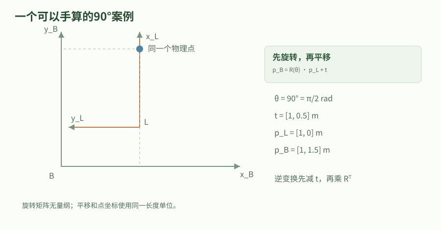

连续版保存一个静态参数案例；交互版可在相关章节调整平移与旋转。

### 查询采样时刻，理解最新与当前的差别

传感器消息的 header.stamp 应表示数据对应的采样时刻，算法一般要查询该时刻的变换。用接收时刻替代，会把传输延迟期间机器人的运动混入空间误差。速度每秒一米、延迟一百毫秒，就可能仅因时间错位产生十厘米位置偏差；机器人转弯时还会产生与观测距离相关的角度误差。

零时间在 TF 查询中有特殊含义，表示最新可用变换；它不是“此刻”，多段动态链路还要满足共同可用时间。查询 now 时最新 TF 可能尚未到达，出现向未来外推；查询过旧观测则可能早于缓存。增大等待超时只能等待未来到达的数据，不能制造已丢失历史，也不能修复一台机器使用系统时间、另一台使用仿真时间的错误。

### 非阻塞地消费带时间戳的点

下面完整脚本保存为 point_transform.py，依赖 rclpy、geometry_msgs、tf2_ros 和 tf2_geometry_msgs。它订阅 /sensor_point，按原始时间查询到 base_link 的变换，成功后发布 /base_point。查询不设置阻塞等待，因此单线程执行器仍有机会处理 TF 订阅；如果暂时缺少变换，本教学程序明确丢弃该点并记录原因。

生产应用若不能丢弃，应加入有界待处理队列或合适的消息过滤机制，等待对应 TF 到达，再按采样顺序处理，并设最大等待时间。不要在同一个单线程回调中长时间等待还需要该线程接收的 TF。例子将输出时间保留为原观测时刻，让下游知道坐标换了，而数据并没有因此变新。

#### point_transform.py 完整文件

代码类型：complete

```python

# 【中文教学注释】 point_transform.py 完整文件
# 本例作用：Buffer 保存收到的关系，TransformListener 建立 TF 订阅；Time.from_msg 把输入时间转换为查询类型；do_transform_point 同时计算旋转和平移。异常表示当前无法完成这一坐标请求，不能悄悄把未变换数据标为目标坐标系。
# 输入输出：输入是带 source frame 和采样时间的 PointStamped 及 TF 缓存；输出为 base_link 中的点。
# 执行顺序与边界：平移单位 m、旋转 rad；按输入消息时刻查变换，缺失/外推失败时丢弃并记录。Time(0) 与消息时间不是同一语义，不在单线程回调中长期阻塞等 TF。
import rclpy
from rclpy.node import Node
from rclpy.time import Time
from geometry_msgs.msg import PointStamped
from tf2_ros import Buffer, TransformListener, TransformException
from tf2_geometry_msgs import do_transform_point

class PointTransformer(Node):
    def __init__(self):
        # 构造 Node 基类并确定节点名；后续相对话题/服务名由命名空间解析，重命名需与参数文件选择器对应。
        super().__init__('point_transformer')
        # 创建按时间缓存的 TF 查询器；缓存内容由 TransformListener 接收，创建 Buffer 不会凭空生成变换。
        self.buffer = Buffer(node=self)
        # 订阅 /tf 与 /tf_static 并填充 Buffer，监听器及节点必须保持存活，接收仍需要执行器。
        self.listener = TransformListener(self.buffer, self)
        # 创建指定消息类型和话题的发布端并持久保存；整数 QoS 是 KeepLast 历史深度，不是 Hz，真正发送由 publish 调用决定。
        self.publisher = self.create_publisher(PointStamped, '/base_point', 10)
        # 绑定消息类型、话题、回调和 QoS，并持有订阅对象；/开头的名称是绝对话题，回调由执行器调度。
        self.subscription = self.create_subscription(
            PointStamped, '/sensor_point', self.receive, 10)

    def receive(self, message):
        if not message.header.frame_id:
            # 输出可观测日志用于核对状态；日志成功写出不等于对端收到消息或任务执行成功。
            self.get_logger().warning('empty source frame')
            return
        try:
            # 按目标坐标系、源坐标系和输入消息时刻查变换；方向不能反用，找不到或外推失败会抛 TransformException。
            transform = self.buffer.lookup_transform(
                'base_link', message.header.frame_id,
                # 把消息采样时间转换为查询所需 Time；这是测量时刻，不能任意改成回调接收时刻。
                Time.from_msg(message.header.stamp))
        except TransformException as error:
            self.get_logger().warning(f'point dropped: {error}')
            return
        # 对点应用查询到的旋转与平移，坐标单位 m；先保证 transform 对应正确源/目标和采样时刻。
        result = do_transform_point(message, transform)
        result.header.stamp = message.header.stamp
        # 提交已填好的消息给 ROS 发布端；这不是业务处理完成确认，端到端接收仍取决于发现、类型、QoS 和执行器。
        self.publisher.publish(result)

# 程序入口按本章顺序组织资源；本例仅在 __main__ 下运行，import 时不应启动节点或连接硬件。
def main():
    # 初始化当前进程的 ROS 上下文并解析传入 ROS 参数；在创建节点/端点之前调用。
    rclpy.init()
    node = PointTransformer()
    try:
        # 进入执行器事件循环，定时器、订阅、服务和 Future 回调在这里才被推进；通常阻塞到中断或上下文关闭。
        rclpy.spin(node)
    except KeyboardInterrupt:
        pass
    finally:
        # 显式释放节点所属端点与定时器；应在相关执行器不再访问节点后执行。
        node.destroy_node()
        # 检查 ROS 上下文仍有效，避免退出流程重复 shutdown；它不表示节点业务健康。
        if rclpy.ok():
            # 关闭本进程 ROS 上下文；先停止执行器、销毁端点/节点，再在上下文仍有效时调用。
            rclpy.shutdown()

if __name__ == '__main__':
    main()

```

Buffer 保存收到的关系，TransformListener 建立 TF 订阅；Time.from_msg 把输入时间转换为查询类型；do_transform_point 同时计算旋转和平移。异常表示当前无法完成这一坐标请求，不能悄悄把未变换数据标为目标坐标系。

输入输出：输入是带 source frame 和采样时间的 PointStamped 及 TF 缓存；输出为 base_link 中的点。
执行顺序与边界：平移单位 m、旋转 rad；按输入消息时刻查变换，缺失/外推失败时丢弃并记录。Time(0) 与消息时间不是同一语义，不在单线程回调中长期阻塞等 TF。

#### 仅针对上面的静态关系进行数值验证

代码类型：commands

```bash

# 【中文教学注释】 仅针对上面的静态关系进行数值验证
# 本例作用：本次只验证固定外参，零时间查询最新关系足够。动态机器人数据必须使用真实采样时间，不能照搬省略 stamp 的测试输入。预期输出 frame_id 为 base_link，坐标约为 1.2、0、0.3。
# 输入输出：输入是带 source frame 和采样时间的 PointStamped 及 TF 缓存；输出为 base_link 中的点。
# 执行顺序与边界：平移单位 m、旋转 rad；按输入消息时刻查变换，缺失/外推失败时丢弃并记录。Time(0) 与消息时间不是同一语义，不在单线程回调中长期阻塞等 TF。
# 保持静态广播器运行，另开终端运行脚本
# 用当前Python解释器运行指定本地脚本；脚本参数/输出路径按本段约定，ROS脚本还需source与包依赖，标准库实验不连接硬件。
python3 point_transform.py
# 再开终端观察输出
# 临时创建订阅者观察消息；--once收到一条后退出，持续模式用Ctrl+C结束，其QoS也须匹配。
ros2 topic echo /base_point geometry_msgs/msg/PointStamped
# 最后一个终端发送测试点；省略 stamp 得到零时间
# 按指定接口序列化消息并发布；--once只发一条，--rate单位Hz。Twist线速度m/s、角速度rad/s，不能把不同类型强行互发。
ros2 topic pub --once /sensor_point geometry_msgs/msg/PointStamped '{header: {frame_id: laser}, point: {x: 1.0, y: 0.0, z: 0.0}}'

```

本次只验证固定外参，零时间查询最新关系足够。动态机器人数据必须使用真实采样时间，不能照搬省略 stamp 的测试输入。预期输出 frame_id 为 base_link，坐标约为 1.2、0、0.3。

输入输出：输入是带 source frame 和采样时间的 PointStamped 及 TF 缓存；输出为 base_link 中的点。
执行顺序与边界：平移单位 m、旋转 rad；按输入消息时刻查变换，缺失/外推失败时丢弃并记录。Time(0) 与消息时间不是同一语义，不在单线程回调中长期阻塞等 TF。

### 先分类型再排查时间与发布来源

找不到坐标系时，检查拼写、命名空间是否误加到 frame 名以及广播者是否存活；树不连通时，查缺失的中间边和父子责任；时间外推时，保留请求时间、最早和最新可用时间、各节点 use_sim_time 与 /clock 来源。三个问题的解决路径不同，不能统一用加大 timeout 处理。

对于实机跨计算机数据，检查时钟同步和驱动是否把设备时钟转换到约定时间基准；对于回放，检查 TF 与传感器是否来自同一次记录，以及回放跳转后缓存是否被重建。不要把所有 frame 强行连接到世界原点来消除报错，这会把可诊断的缺边变成隐蔽的错误几何。本章为资料核对与推演，未验证目标机器的外参。

### 把时间查询和非零旋转做成可复算实验

新增tf_buffer_lab.py只向本进程Buffer写入合成变换，不创建Node、TransformListener或DDS端点。它使用安装的Jazzy公开API和明确的绝对容差，适合先把方向、时间和数值算清，再进入ROS图排错。缓存中直接写入变换不等于已经发布/tf；成功结果不能证明网络接收、时钟同步或真实外参正确。

静态例子让laser在base_link中平移(0.2,0,0.3)米并绕正Z旋转90度。laser点(1,0,0)变为(0.2,1,0.3)米，逆平移为(0,0.2,-0.3)米，不能简单把原平移取负。脚本把结果再变回laser并检查单位四元数；相同静态关系在0、1、10.5和1000000秒查询保持同一几何结果，零时刻仍按latest语义使用。

动态例子仅放两条数据：10秒时平移零、yaw零，12秒时平移(2,0,0)米、yaw为π/2。11秒观测点(1,0,0)应先插值平移为1米、旋转为π/4，得到(1+√0.5,√0.5,0)米；错误地使用Time(0)会得到12秒的(2,1,0)米，位置差约0.414213562米。这个差来自时间错位，不是浮点舍入，也不能靠改header标签修复。

查询数据范围外的过去/未来应抛外推异常，缺frame应抛查询异常；延长等待不能制造不存在的历史。tf2同步timeout还有语言与时钟前提：固定Jazzy C++等待按Buffer构造clock推进，冻结ROS时间时不能自动当墙钟上界；该版本Python同步路径用SYSTEM_TIME且会sleep，也不是monotonic抢占机制。需要业务期限时，用有界队列和非阻塞查询配单调监督，并保证执行器能接收后续TF。

#### runtime_labs/tf_buffer_lab.py

代码类型：complete

```python

#!/usr/bin/env python3
"""Jazzy tf2 的进程内数值实验：不创建 Node、DDS 端点、仿真或硬件连接。

输入均固定在源码中：平移/点坐标为米，yaw 为绕 +Z 的右手弧度，时间为秒。
实验顺序：非零旋转正变换→逆变换→静态任意时刻→动态插值→latest 对比→失败路径。
默认绝对容差为 1e-9（米/四元数分量）；时间戳以整数纳秒精确比较。
输出每项的输入、预期与实际值；任何断言失败返回非零。--json 输出完整机器可读结果。
--help 仅加载 Python 标准库，实际计算才导入已安装的 ROS Jazzy Python 包。
运行：source /opt/ros/jazzy/setup.bash 后执行 python3 examples/runtime_labs/tf_buffer_lab.py。
"""

import argparse
import json
import math
import sys


def parse_tolerance(text):
    """容差必须是有限正数；不允许用过松容差掩盖米与毫米等量纲错误。"""
    value = float(text)
    if not math.isfinite(value) or not 0.0 < value <= 1.0e-6:
        raise argparse.ArgumentTypeError('atol 必须是 (0, 1e-6] 内的有限正数')
    return value


def run_lab(atol=1.0e-9):
    # 这些依赖由 Jazzy 的 rclpy、geometry_msgs、tf2_ros_py、tf2_geometry_msgs 提供。
    # 故意不调用 rclpy.init()，也不创建 Node、TransformListener 或广播/订阅端点。
    # Buffer.set_transform* 直接向本进程的缓存写入合成数据，不会发布 /tf 或 /tf_static。
    from geometry_msgs.msg import PointStamped, TransformStamped
    from rclpy.clock import ClockType
    from rclpy.duration import Duration
    from rclpy.time import Time
    from tf2_geometry_msgs import do_transform_point
    from tf2_ros import Buffer, ExtrapolationException, LookupException

    results = []

    def query_time(seconds):
        """把给定秒数转换为 ROS 时间类型；0 在 tf2 查询中具有 latest 特殊含义。"""
        return Time(seconds=seconds, clock_type=ClockType.ROS_TIME)

    def transform(parent, child, stamp_s, translation_m, yaw_rad):
        """输出 parent←child 的 TransformStamped：把 child 坐标中的数据变到 parent。

        translation_m 是 child 原点在 parent 中的位置，yaw_rad 是 child 相对 parent
        的方向。平面四元数为 (0,0,sin(yaw/2),cos(yaw/2))，不把欧拉角塞进 z 字段。
        """
        msg = TransformStamped()
        msg.header.frame_id = parent
        msg.child_frame_id = child
        msg.header.stamp = query_time(stamp_s).to_msg()
        msg.transform.translation.x, msg.transform.translation.y, msg.transform.translation.z = translation_m
        msg.transform.rotation.z = math.sin(yaw_rad / 2.0)
        msg.transform.rotation.w = math.cos(yaw_rad / 2.0)
        return msg

    def point(frame, xyz_m, stamp_s):
        """输出带源坐标系与采样时刻的点；消息本身不会因改 frame_id 自动变换数值。"""
        msg = PointStamped()
        msg.header.frame_id = frame
        msg.header.stamp = query_time(stamp_s).to_msg()
        msg.point.x, msg.point.y, msg.point.z = xyz_m
        return msg

    def xyz(msg):
        return [msg.point.x, msg.point.y, msg.point.z]

    def translation(msg):
        return [msg.transform.translation.x, msg.transform.translation.y, msg.transform.translation.z]

    def quaternion(msg):
        q = msg.transform.rotation
        return [q.x, q.y, q.z, q.w]

    def stamp_ns(header):
        # 时间戳比较使用整数；1 秒=10^9 纳秒，不把浮点时间误差混入数值容差。
        return header.stamp.sec * 1_000_000_000 + header.stamp.nanosec

    def close_vector(actual, expected, label):
        """只用绝对容差；输入量级固定且小，避免相对容差掩盖固定的几何偏差。"""
        assert len(actual) == len(expected), label + ' 维数不同'
        assert all(math.isfinite(v) for v in actual), label + ' 出现非有限值'
        for i, (got, wanted) in enumerate(zip(actual, expected)):
            assert math.isclose(got, wanted, rel_tol=0.0, abs_tol=atol), (
                f'{label}[{i}]: actual={got!r}, expected={wanted!r}, atol={atol}')

    def same_rotation(actual_q, expected_q, label):
        """q 与 -q 表示同一旋转；比较时允许整体变号，同时检查单位长度。"""
        q = actual_q
        if sum(a * e for a, e in zip(q, expected_q)) < 0.0:
            q = [-v for v in q]
        close_vector(q, expected_q, label)
        assert math.isclose(sum(v * v for v in actual_q), 1.0, rel_tol=0.0, abs_tol=atol)

    # 一、带 +90° 非零旋转的静态外参，避免“方向反了只需平移取负”的错误直觉。
    # 输入：laser 原点在 base_link 中为 (0.2,0,0.3)m，laser +X 指向 base_link +Y。
    # 手算：Rz(π/2)·(1,0,0)+(0.2,0,0.3)=(0.2,1,0.3)m。
    static_buffer = Buffer()
    static_buffer.set_transform_static(
        transform('base_link', 'laser', 123.0, (0.2, 0.0, 0.3), math.pi / 2.0),
        'tf_buffer_lab_static')
    laser_point = point('laser', (1.0, 0.0, 0.0), 10.5)
    forward_tf = static_buffer.lookup_transform('base_link', 'laser', query_time(10.5))
    base_point = do_transform_point(laser_point, forward_tf)
    close_vector(xyz(base_point), [0.2, 1.0, 0.3], '静态正向点')
    assert base_point.header.frame_id == 'base_link'
    assert forward_tf.header.frame_id == 'base_link' and forward_tf.child_frame_id == 'laser'
    results.append(dict(
        id='static_forward_direction_rotation', passed=True,
        input=dict(source='laser', target='base_link', point_m=[1.0, 0.0, 0.0],
                   translation_m=[0.2, 0.0, 0.3], yaw_rad=math.pi / 2.0, query_s=10.5),
        expected_point_m=[0.2, 1.0, 0.3], actual_point_m=xyz(base_point)))

    # 二、逆变换必须使用 R^T 和 -R^T·t。本例逆平移是 (0,0.2,-0.3)m，
    # 与直接把 t 取负得到 (-0.2,0,-0.3)m 不同；把刚才的目标点变回源应恢复原值。
    inverse_tf = static_buffer.lookup_transform('laser', 'base_link', query_time(10.5))
    restored = do_transform_point(base_point, inverse_tf)
    close_vector(translation(inverse_tf), [0.0, 0.2, -0.3], '旋转后的逆平移')
    close_vector(xyz(restored), [1.0, 0.0, 0.0], '正逆组合恢复源点')
    same_rotation(quaternion(inverse_tf), [0.0, 0.0, -math.sqrt(0.5), math.sqrt(0.5)], '逆旋转')
    assert restored.header.frame_id == 'laser'
    results.append(dict(
        id='static_inverse_nonzero_rotation', passed=True,
        expected_inverse_translation_m=[0.0, 0.2, -0.3],
        actual_inverse_translation_m=translation(inverse_tf),
        expected_restored_point_m=[1.0, 0.0, 0.0], actual_restored_point_m=xyz(restored),
        actual_inverse_quaternion_xyzw=quaternion(inverse_tf)))

    # 三、静态缓存的几何关系对所有查询时刻相同，而不是只在发布 stamp=123 秒有效。
    # 0 秒使用 latest 特殊查询；其余非零时刻分别在发布时刻前后。不是在等待真实时间。
    static_queries = []
    for seconds in (0.0, 1.0, 10.5, 1_000_000.0):
        tf_msg = static_buffer.lookup_transform('base_link', 'laser', query_time(seconds))
        out = do_transform_point(laser_point, tf_msg)
        close_vector(xyz(out), [0.2, 1.0, 0.3], '静态任意时刻')
        static_queries.append(dict(query_s=seconds, actual_point_m=xyz(out),
                                   returned_transform_stamp_ns=stamp_ns(tf_msg.header)))
    results.append(dict(id='static_arbitrary_query_times', passed=True,
                        published_stamp_s=123.0, queries=static_queries,
                        expected_point_m=[0.2, 1.0, 0.3]))

    # 四、动态缓存只写两条合成变换。显式保留20秒历史，两个样本相隔2秒，均在缓存内。
    # t=10s: 平移0m、yaw=0；t=12s: 平移(2,0,0)m、yaw=π/2。
    # t=11s 的平移线性插值为(1,0,0)m，最短弧四元数插值为 yaw=π/4。
    # 对 sensor 中(1,0,0)m，手算 base 中为(1+√0.5,√0.5,0)m。
    dynamic_buffer = Buffer(cache_time=Duration(seconds=20.0))
    for seconds, x_m, yaw_rad in ((10.0, 0.0, 0.0), (12.0, 2.0, math.pi / 2.0)):
        dynamic_buffer.set_transform(
            transform('base_dynamic', 'sensor', seconds, (x_m, 0.0, 0.0), yaw_rad),
            'tf_buffer_lab_dynamic')
    measured_point = point('sensor', (1.0, 0.0, 0.0), 11.0)
    sampled_tf = dynamic_buffer.lookup_transform(
        'base_dynamic', 'sensor', Time.from_msg(measured_point.header.stamp))
    sampled_point = do_transform_point(measured_point, sampled_tf)
    sampled_expected = [1.0 + math.sqrt(0.5), math.sqrt(0.5), 0.0]
    close_vector(translation(sampled_tf), [1.0, 0.0, 0.0], '动态平移插值')
    same_rotation(quaternion(sampled_tf), [0.0, 0.0, math.sin(math.pi / 8.0), math.cos(math.pi / 8.0)],
                  '动态旋转插值')
    close_vector(xyz(sampled_point), sampled_expected, '采样时刻插值点')
    assert stamp_ns(sampled_tf.header) == 11_000_000_000
    results.append(dict(
        id='dynamic_translation_rotation_interpolation', passed=True,
        input=dict(sample_times_s=[10.0, 12.0], sample_x_m=[0.0, 2.0],
                   sample_yaw_rad=[0.0, math.pi / 2.0], query_s=11.0, point_m=[1.0, 0.0, 0.0]),
        expected_translation_m=[1.0, 0.0, 0.0], actual_translation_m=translation(sampled_tf),
        expected_point_m=sampled_expected, actual_point_m=xyz(sampled_point),
        actual_quaternion_xyzw=quaternion(sampled_tf)))

    # 五、同一个11秒观测如果错误地用Time(0)，得到的是最新12秒的变换。
    # 此处故意比较“正确按采样时刻”与“换成latest”的数值；不把后者冒充有效测量。
    # do_transform_point 输出的 header 来自变换，因此也记录查询返回的时刻以暴露错位。
    latest_tf = dynamic_buffer.lookup_transform('base_dynamic', 'sensor', query_time(0.0))
    latest_point = do_transform_point(measured_point, latest_tf)
    close_vector(xyz(latest_point), [2.0, 1.0, 0.0], 'latest点')
    assert stamp_ns(latest_tf.header) == 12_000_000_000
    difference_m = math.sqrt(sum((a - b) ** 2 for a, b in zip(xyz(latest_point), xyz(sampled_point))))
    assert math.isclose(difference_m, math.sqrt(2.0) - 1.0, rel_tol=0.0, abs_tol=atol)
    assert difference_m > 0.4  # 本固定算例约0.414m；要求明显大于浮点容差。
    results.append(dict(
        id='latest_differs_from_sampling_time', passed=True,
        measurement_stamp_s=11.0, sampled_transform_stamp_ns=stamp_ns(sampled_tf.header),
        latest_transform_stamp_ns=stamp_ns(latest_tf.header),
        expected_latest_point_m=[2.0, 1.0, 0.0], actual_latest_point_m=xyz(latest_point),
        sampled_point_m=xyz(sampled_point), point_difference_m=difference_m,
        expected_point_difference_m=math.sqrt(2.0) - 1.0,
        limitation='latest 不等于当前系统日期时间，也不等于原观测采样时刻；多段链还受共同可用时间约束。'))

    def expect_failure(case_id, source, seconds, exception_class):
        """无阻塞timeout的查询必须立即返回或抛异常；只接受要求的明确异常类型。"""
        try:
            dynamic_buffer.lookup_transform('base_dynamic', source, query_time(seconds))
        except exception_class as error:
            results.append(dict(id=case_id, passed=True, query_s=seconds, source=source,
                                expected_exception=exception_class.__name__,
                                actual_exception=type(error).__name__, message=str(error)))
        else:
            raise AssertionError(case_id + ' 未按预期失败')

    # 六、可用历史只有10~12秒：9秒不是“多等一会就必然有”的历史，13秒尚无新数据。
    # 缺frame是名字不存在；它与已存在frame但查询时刻不在历史范围内是不同错误。
    expect_failure('past_extrapolation', 'sensor', 9.0, ExtrapolationException)
    expect_failure('future_extrapolation', 'sensor', 13.0, ExtrapolationException)
    expect_failure('missing_frame', 'missing_sensor', 11.0, LookupException)

    assert len(results) == 8 and all(item['passed'] for item in results)
    return dict(
        lab='tf_buffer_lab', passed=True, checks=len(results),
        units=dict(position='m', angle='rad', time='s', timestamp='整数ns', quaternion='无量纲，x/y/z/w'),
        absolute_tolerance=atol, relative_tolerance=0.0, results=results,
        scope='固定合成数据的进程内Jazzy Buffer与几何运算；未调用rclpy.init，未创建Node或通信端点。',
        not_verified=['TransformListener与执行器调度', 'DDS或网络传输', '跨进程静态TF晚加入QoS',
                      '阻塞TF等待的超时行为', '完整机器人TF树、外参标定、仿真与硬件'])


def main(argv=None):
    parser = argparse.ArgumentParser(description=__doc__)
    parser.add_argument('--json', action='store_true', help='将完整结果作为一个JSON对象写到标准输出')
    parser.add_argument('--atol', type=parse_tolerance, default=1.0e-9,
                        help='有限正绝对容差，默认1e-9，上限1e-6；不改变固定数据')
    args = parser.parse_args(argv)  # --help 在此退出，尚未导入任何ROS模块。
    if not __debug__:
        print('本实验依赖数值assert，请使用普通python3，不能启用-O/PYTHONOPTIMIZE。', file=sys.stderr)
        return 2
    try:
        result = run_lab(args.atol)
    except ImportError as error:
        print('缺少ROS依赖：先安装Jazzy相应包并 source /opt/ros/jazzy/setup.bash。' + str(error), file=sys.stderr)
        return 2
    except AssertionError as error:
        print('数值断言失败：' + str(error), file=sys.stderr)
        return 1
    if args.json:
        print(json.dumps(result, ensure_ascii=False, indent=2, allow_nan=False))
    else:
        for item in result['results']:
            print(f"通过 {item['id']}: " + json.dumps(item, ensure_ascii=False, allow_nan=False))
        print(f"全部{result['checks']}项通过，绝对容差={args.atol}。仅进程内计算，未验证ROS通信或硬件。")
    return 0


if __name__ == '__main__':
    sys.exit(main())


```

8组实际tf2数值/异常检查；位置米、yaw弧度、时间秒/整数纳秒，默认绝对容差1e-9。只写进程内Buffer，无Node、网络、仿真或硬件；不设置同步等待timeout。

#### 运行进程内tf2实验

代码类型：commands

```bash

# 从ros2-learning-hub运行；实际计算需要Jazzy Python包。
source /opt/ros/jazzy/setup.bash
/usr/bin/python3 examples/runtime_labs/tf_buffer_lab.py --json

```

--help无需加载ROS包；非法容差和-O被拒绝，不能用放宽容差或关闭断言伪造通过。

### tf2 API：目标坐标、源坐标、时刻与四元数

| 问题 | 接口概念 | 单位／约定 | 常见错误 |
| --- | --- | --- | --- |
| 查询变换 | lookupTransform / lookup_transform(target, source, time, ...) | 把 source 坐标表达的量变为 target 坐标表达；平移通常为 m | 目标与源顺序写反会取到逆变换。用一个已知点代入验证方向。 |
| 查询时刻 | 给定消息时间戳，或接口约定的 latest | 时间戳包含秒与纳秒；零时刻具有特殊含义时以 API 为准 | “最新”不是“恰好与传感器消息同一时刻”。动态变换要检查外推与时间同步。 |
| 变换消息 | PointStamped / PoseStamped / Vector3Stamped 等 | 点包含平移；方向向量只旋转；速度还需解释参考点和表达坐标 | 不能把所有三元素数组都当同一种几何量；相同维度不代表同一变换规则。 |
| ROS 四元数 | geometry_msgs/Quaternion 的字段 x, y, z, w | 无量纲；通常要求单位四元数，旋转角用 rad | 某些数学库采用 w,x,y,z，不能不检查顺序直接拷贝。也不能把欧拉角直接塞进四元数字段。 |
| 异常处理 | Lookup / Connectivity / Extrapolation 等异常 | timeout按具体API和构造时钟计算，不能自动当墙钟上界 | 异常后应跳过本次计算或进入降级流程，不能沿用未经标记的旧变换当当前观测。 |

TF 是时间相关的坐标关系。发布一个同名 frame 既不能修复真实标定，也不能替代外参、里程计和全局定位各自的责任。

固定Jazzy C++ Buffer::canTransform用构造clock_->now()推进期限；冻结ROS clock可能使等待不自然超时。Python同步can_transform用默认SYSTEM_TIME并sleep，不能当monotonic机制，也不能自行调度被阻塞执行器的TF回调。

业务单调截止需要非阻塞查询/有界队列等可继续推进的路径；外层deadline放在内部阻塞调用返回之后不能约束内部等待。

### 激光点在转弯时拖出重影

静止时点云与地图重合，转弯时明显拖尾，传感器消息晚于采样一百毫秒到达。

1. 检查传感器 header 是否记录采样时刻，比较处理代码是否用 now 或零时间查询。

2. 读取相同时间段的 odom 到 base_link 及固定激光外参，按消息原时间计算变换。

3. 若原时间不在缓存中，再查延迟、缓存长度和时钟；只在确认关系稍晚到达时采用有界等待。

验收：空间误差被分解为安装外参、时间错位和缓存可用性三类，不能用静态外参调偏来补偿随速度变化的时间误差。

### 深入练习 1

laser 相对 base_link 前移零点二米，laser 中 x=1 的点在车体中 x 是多少？

参考答案：无旋转时为一点二米，因为目标坐标等于源坐标加激光原点在车体中的位置。反向查询应使用逆变换；存在旋转时先旋转再平移，不能只给 x 加常量。

### 深入练习 2

查询 now 报未来外推，是否说明系统时间来自未来？

参考答案：不一定。TF 生成与传输需要时间，查询时最新变换可能比 now 早几毫秒。先比对时间差与时钟来源；合理延迟可用有界等待解决，巨大时间差则优先查时间基准。

### 深入练习 3

把旧点的 frame_id 改为 map 后发布，为什么不是坐标变换？

参考答案：数值仍表示旧坐标系中的位置，修改标签没有应用旋转和平移。应在原采样时刻查询从源到 map 的变换并计算新坐标，同时保留观测时间。

### 基础验证流程

先用静态广播器建立 base_link → laser。

用 tf2_echo 检查方向和平移。

运行 view_frames 观察树结构。

再加入带 Header 的传感器数据，按其时间戳查询变换。

#### 终端 A：显式参数静态变换

```bash

# 【中文教学注释】 终端 A：显式参数静态变换
# 本例作用：终端 A：显式参数静态变换
# 输入输出：输入是带 source frame 和采样时间的 PointStamped 及 TF 缓存；输出为 base_link 中的点。
# 执行顺序与边界：平移单位 m、旋转 rad；按输入消息时刻查变换，缺失/外推失败时丢弃并记录。Time(0) 与消息时间不是同一语义，不在单线程回调中长期阻塞等 TF。
# 从已安装包tf2_ros启动static_transform_publisher；此进程通常持续运行，另用新终端执行观察命令，Ctrl+C结束。 静态平移为m、roll/pitch/yaw为rad；父/子方向必须与后续查询一致。
ros2 run tf2_ros static_transform_publisher --x 0.2 --y 0 --z 0.3 --roll 0 --pitch 0 --yaw 0 --frame-id base_link --child-frame-id laser

```

#### 终端 B：检查

```bash

# 【中文教学注释】 终端 B：检查
# 本例作用：终端 B：检查
# 输入输出：输入是带 source frame 和采样时间的 PointStamped 及 TF 缓存；输出为 base_link 中的点。
# 执行顺序与边界：平移单位 m、旋转 rad；按输入消息时刻查变换，缺失/外推失败时丢弃并记录。Time(0) 与消息时间不是同一语义，不在单线程回调中长期阻塞等 TF。
# 从已安装包tf2_ros启动tf2_echo；此进程通常持续运行，另用新终端执行观察命令，Ctrl+C结束。 静态平移为m、roll/pitch/yaw为rad；父/子方向必须与后续查询一致。
ros2 run tf2_ros tf2_echo base_link laser
# view_frames默认收集约5秒后生成当前目录中的图文件并退出；不是持续广播器。可用-o tf_snapshot固定前缀，需Graphviz的dot，正常等待完成。
ros2 run tf2_tools view_frames

```

### 预期结果

- laser 相对 base_link 的位置与输入一致。

- 能分清缺少 frame、树不连通和时间外推三类错误。

### 常见问题

- 交换 target/source 后误以为结果数值应不变。

- 混用角度制和弧度制，或给四元数填入欧拉角。

- 实机时间与 use_sim_time 混用，导致变换时间不在缓存范围。

### 练习

再添加 camera_link，解释如何由 tf2 合成 laser 到 camera_link 的变换。

#### 参考答案

给 camera_link 也定义相对 base_link 的固定外参。查询 camera_link 与 laser 的关系时，tf2 沿树组合一条变换及另一条的逆变换。查询时明确目标坐标系和源坐标系，先用已知点验证方向；固定外参只需静态发布，避免重复动态发布同一边。

### 验证范围

2026-11-07已用已安装Jazzy tf2公开Buffer API完成8组进程内数值/异常检查，另有CLI/容差/无通信检查；没有rclpy.init、Node、DDS或机器人。原始跨终端静态广播/point_transform/view_frames流程仍未运行；C++冻结时钟下timeout风险为固定源码推断，不宣称已执行该挂起实验。

### 依据

- [tf2 C++ / Python 教程路线](https://docs.ros.org/en/jazzy/Tutorials/Intermediate/Tf2/Tf2-Main.html)

- [静态 TF 与命令行广播器](https://docs.ros.org/en/jazzy/Tutorials/Intermediate/Tf2/Writing-A-Tf2-Static-Broadcaster-Py.html)

- [ROS 时间设计](https://design.ros2.org/articles/clock_and_time.html)

## 32. tf2：建立一致的坐标与时间关系

机器人并不是只有一个位置。激光、相机、车体和地图分别拥有坐标系，tf2 负责在指定时刻把数据从一个坐标系换算到另一个。先画出树，再写广播器，通常比到 RViz 中反复调整更有效。

### 学习目标

- 分清 map、odom、base_link 和传感器坐标系

- 区分静态标定与运动变换

- 能通过 CLI 定位断开的 TF 边

### 先修

节点与话题；时间戳与 ROS 时钟；三维平移与四元数基础

### 概念

map→odom 表示全局定位对局部里程计的修正；odom→base_link 应连续，适合短时间控制，但允许长期漂移。

base_link→laser 等固定安装关系用静态变换；关节引起的动态关系由 robot_state_publisher 根据 joint_states 计算。

一次变换查询同时约束源坐标系、目标坐标系和时间。时间超出缓存范围也会失败，不能只看 frame 名字是否存在。

### 先把位置问题写成坐标问题

一个激光点的数值只有连同坐标系和采样时刻才有意义。雷达测得前方一米，指的是雷达自身轴向；雷达装在车头偏左的位置时，这个点在车体坐标中会改变。tf2 保存坐标关系，使每个算法不必自己维护整套安装和运动关系。它不负责判断定位是否准确，也不会从图像或编码器自动推导缺失的变换。

本章使用三个层次：世界或地图、连续局部里程计、车体与传感器。地图允许全局定位修正，里程计要求短时间平滑，车体内部关系来自机械安装和关节状态。先把每条边的发布者写在纸上，再运行节点，可以提前发现两个节点同时声明同一关系的问题。

### 理解变换的方向和复合

把激光坐标中的点变换到车体坐标时，先按激光坐标轴相对车体的旋转转动点，再加上激光原点在车体中的平移。交换源和目标得到的是逆变换，不能只把平移改为负数而保持旋转不动。多级变换按照路径依次相乘，顺序通常不可交换。

ROS 常用右手坐标约定：车体向前为 x、向左为 y、向上为 z。相机 optical frame 常用另一种专门约定，不能因为模型画面看起来正确就省略它与 camera_link 的旋转。四元数应为合法单位四元数；全零不是没有旋转，单位四元数的 w 为一。

- 长度使用米，角速度使用弧度每秒；角度命令需检查是欧拉角还是四元数。

- 命名空间不会自动重写消息内的 frame_id。


连续版保存一个静态参数案例；交互版可在相关章节调整平移与旋转。

### 给每条消息定义时间与发布合同

TF 动态关系通过 /tf 发布，固定安装关系通过 /tf_static 发布。静态广播使用适合晚加入订阅者的持久性语义，因此传感器节点晚启动仍能取得安装关系。动态广播则需要连续更新，缓存只能回答其保存时间范围内的问题。查询失败既可能是树不连通，也可能是请求时间落在缓存之外。

传感器 header.stamp 应表达测量发生的时间，而不是任意改成算法收到消息的时间。仿真时让传感器、TF 与消费节点都使用同一个 /clock；实机上则要同步主机和设备时间。将查询改成最新变换能够帮助诊断，却可能把延迟数据投到错误位置，不能视作所有时间问题的正式修复。

在导航台架中，AMCL 用扫描时戳加 transform_tolerance 发布 map 到 odom。查看最新 TF 与按激光采集时刻查询是两项检查。台架通过当时的 map 到 laser_link 查询，验证固定安装平移仍为 0.30 m。

SLAM 台架把错误激光帧放在有效回放时间窗内，缺少该帧到 odom 的可用链时无位姿回执。随后以 laser_link 和真实安装关系恢复，最终用 16.00 s 的采集时刻查询到 map 到 laser_link。TF 消息过滤器按消息帧和时戳等待目标帧，算法还会另查基座运动边。

### 最小实验：定义一个雷达安装位置

实验只需要已安装 Jazzy 与 tf2_ros。每个新终端先执行 source /opt/ros/jazzy/setup.bash。终端一保持静态发布进程运行，终端二执行查询。下面命令为可复现实验说明，本次编写时没有启动 ROS 节点。它只发布坐标关系，不会向底盘发送运动命令。

这里假定雷达在车体前方二十厘米、上方十五厘米，方向与车体一致。先查询车体到雷达，再交换顺序。由于旋转为单位旋转，这个特例的逆变换平移恰好取负；随后把 yaw 改为九十度，就能观察为什么一般情况不能仅取负。

#### 终端一：静态安装关系

代码类型：commands

```bash

# 【中文教学注释】 终端一：静态安装关系
# 本例作用：保持进程运行；修改参数时先停止旧进程，防止两个发布者同时声明 laser。
# 输入输出：输入为 map/odom/base_link/sensor 的父子关系、时间戳与静态安装参数；输出为可查询的变换链。
# 执行顺序与边界：平移 m、角度 rad；每个 child 应只有一个有效父关系，静态外参不能代替动态里程计，查询成功还需核对方向和时间。
# 在当前shell加载/opt/ros/jazzy/setup.bash；它影响本终端的包索引/库路径，另一个终端必须单独加载。
source /opt/ros/jazzy/setup.bash
# 从已安装包tf2_ros启动static_transform_publisher；此进程通常持续运行，另用新终端执行观察命令，Ctrl+C结束。 静态平移为m、roll/pitch/yaw为rad；父/子方向必须与后续查询一致。
ros2 run tf2_ros static_transform_publisher --x 0.2 --y 0 --z 0.15 --roll 0 --pitch 0 --yaw 0 --frame-id base_link --child-frame-id laser

```

保持进程运行；修改参数时先停止旧进程，防止两个发布者同时声明 laser。

输入输出：输入为 map/odom/base_link/sensor 的父子关系、时间戳与静态安装参数；输出为可查询的变换链。
执行顺序与边界：平移 m、角度 rad；每个 child 应只有一个有效父关系，静态外参不能代替动态里程计，查询成功还需核对方向和时间。

#### 终端二：查询与检查

代码类型：commands

```bash

# 【中文教学注释】 终端二：查询与检查
# 本例作用：输出平移应为指定安装位置。结束查询后可交换两个 frame 名重复实验。
# 输入输出：输入为 map/odom/base_link/sensor 的父子关系、时间戳与静态安装参数；输出为可查询的变换链。
# 执行顺序与边界：平移 m、角度 rad；每个 child 应只有一个有效父关系，静态外参不能代替动态里程计，查询成功还需核对方向和时间。
# 在当前shell加载/opt/ros/jazzy/setup.bash；它影响本终端的包索引/库路径，另一个终端必须单独加载。
source /opt/ros/jazzy/setup.bash
# 从已安装包tf2_ros启动tf2_echo；此进程通常持续运行，另用新终端执行观察命令，Ctrl+C结束。 静态平移为m、roll/pitch/yaw为rad；父/子方向必须与后续查询一致。
ros2 run tf2_ros tf2_echo base_link laser

```

输出平移应为指定安装位置。结束查询后可交换两个 frame 名重复实验。

输入输出：输入为 map/odom/base_link/sensor 的父子关系、时间戳与静态安装参数；输出为可查询的变换链。
执行顺序与边界：平移 m、角度 rad；每个 child 应只有一个有效父关系，静态外参不能代替动态里程计，查询成功还需核对方向和时间。

### 把实验扩展成一棵真实机器人树

通常由定位或建图节点发布 map 到 odom，由轮式里程计或融合节点发布 odom 到 base_link，由 robot_state_publisher 发布车体内部关系。传感器安装也可以放进 URDF 的固定关节，此时不要再另外运行同名静态发布者。对旋转云台等运动部件，关节状态必须随测量更新。

检查时从局部到全局逐段证明连通性。先确认 base_link 到 laser，再确认 odom 到 base_link，最后确认 map 到 odom。只在 RViz 使用 map 显示整个系统，容易把最末端的缺失关系误认为地图问题。一个稳定的 TF 树不应存在环，每个 child 应有明确且唯一的父节点。

#### 有完整机器人后执行

代码类型：commands

```bash

# 【中文教学注释】 有完整机器人后执行
# 本例作用：需要安装 tf2_tools；生成树图后对照预先画出的发布责任表。
# 输入输出：输入为 map/odom/base_link/sensor 的父子关系、时间戳与静态安装参数；输出为可查询的变换链。
# 执行顺序与边界：平移 m、角度 rad；每个 child 应只有一个有效父关系，静态外参不能代替动态里程计，查询成功还需核对方向和时间。
# 从已安装包tf2_tools启动view_frames；此进程通常持续运行，另用新终端执行观察命令，Ctrl+C结束。
ros2 run tf2_tools view_frames
# 从已安装包tf2_ros启动tf2_echo；此进程通常持续运行，另用新终端执行观察命令，Ctrl+C结束。 静态平移为m、roll/pitch/yaw为rad；父/子方向必须与后续查询一致。
ros2 run tf2_ros tf2_echo odom base_link

```

需要安装 tf2_tools；生成树图后对照预先画出的发布责任表。

输入输出：输入为 map/odom/base_link/sensor 的父子关系、时间戳与静态安装参数；输出为可查询的变换链。
执行顺序与边界：平移 m、角度 rad；每个 child 应只有一个有效父关系，静态外参不能代替动态里程计，查询成功还需核对方向和时间。

### 用现象定位失败层次

报 unknown frame 时先检查名字和发布者是否存在；报无法连接时检查中间边；报过去外推时检查消息是否过旧或缓存是否太短；报未来外推时检查时间源、时间偏差和最新 TF 是否滞后。增大等待时间只能处理短暂到达顺序问题，无法修正两个时钟相差几分钟的系统。

如果点云会偶尔跳动，除了定位算法，还要检查重复发布和时间戳。把 odom 到 base_link 的发布者缩减到一个，录制 /tf、/tf_static 和原始传感器后再重放。验收不仅是查询成功，还应包括静止时关系稳定、运动时变化连续，以及在传感器实际时间戳处可以查询。

可以用一个已知位置的点检查变换方向：令雷达前方一米的点为输入，在无旋转安装条件下，车体坐标应为前方一米二、上方十五厘米。先手算再与程序结果比较，这比只确认 TF 树连通更能发现父子关系写反或单位混用。

### 用真实光学frame检查三个基轴与原点

新增模型的camera_link采用X前/Y左/Z上；光学frame采用Z前/X右/Y下。固定rpy=(-π/2,0,-π/2)rad后，三个光学基轴在base中分别朝-Y、-Z、+X。joint origin给出父到关节安装关系，运动轴定义在joint局部系；非零安装旋转会改变轴在父系的表达，不能只看axis文字三个数。

下表是三个相距光学原点1m的点，变换到base_link时还加相机安装平移[0.18,0,0.1]m。点与自由方向向量不同：方向只旋转，点还平移。默认和覆盖模型共六点由实际RSP、DDS与tf2检查，1e-16量级余数在原报告保留，不当成轴向错误。

这里的base_footprint只是平地几何参考，没有自动获得odom/map位姿；模型发布者也不提供定位。可把固定边晚加入、活动状态、外部定位和真实图像分开验收。本轮活动origin为零，没有把非零origin的旋转轴复合或真实相机标定冒称实测。

仿真章另以真实桥接相机 Header 时戳查询 rig_base ← camera_optical_frame。光学单位点 (0, 0, 1) m 和同原点激光的 (1, 0, 0) m 都变到台架 (1, 0, 0) m。桥的 frame_id 覆盖只改标签，轴向关系由独立静态 TF 提供。模型章带安装平移的光学试验仍单独记录。

#### 光学单位点转到base_link：含安装平移

| 光学点沿轴 | 输入点m | base_link输出m | 手算期望m |
| --- | --- | --- | --- |
| z | [0, 0, 1] | [1.18, 0, 0.1] | [1.18, 0, 0.1] |
| x | [1, 0, 0] | [0.18, -1, 0.1] | [0.18, -1, 0.1] |
| y | [0, 1, 0] | [0.18, 0, -0.9] | [0.18, 0, -0.9] |

t=[0.18,0,0.1]m，rpy=(-π/2,0,-π/2)rad；两配置共六点实际通过。显示把绝对值<1e-12m归零，原始报告保留浮点余数，验收绝对容差1e-9m。

### tf2 API：目标坐标、源坐标、时刻与四元数

| 问题 | 接口概念 | 单位／约定 | 常见错误 |
| --- | --- | --- | --- |
| 查询变换 | lookupTransform / lookup_transform(target, source, time, ...) | 把 source 坐标表达的量变为 target 坐标表达；平移通常为 m | 目标与源顺序写反会取到逆变换。用一个已知点代入验证方向。 |
| 查询时刻 | 给定消息时间戳，或接口约定的 latest | 时间戳包含秒与纳秒；零时刻具有特殊含义时以 API 为准 | “最新”不是“恰好与传感器消息同一时刻”。动态变换要检查外推与时间同步。 |
| 变换消息 | PointStamped / PoseStamped / Vector3Stamped 等 | 点包含平移；方向向量只旋转；速度还需解释参考点和表达坐标 | 不能把所有三元素数组都当同一种几何量；相同维度不代表同一变换规则。 |
| ROS 四元数 | geometry_msgs/Quaternion 的字段 x, y, z, w | 无量纲；通常要求单位四元数，旋转角用 rad | 某些数学库采用 w,x,y,z，不能不检查顺序直接拷贝。也不能把欧拉角直接塞进四元数字段。 |
| 异常处理 | Lookup / Connectivity / Extrapolation 等异常 | timeout按具体API和构造时钟计算，不能自动当墙钟上界 | 异常后应跳过本次计算或进入降级流程，不能沿用未经标记的旧变换当当前观测。 |

TF 是时间相关的坐标关系。发布一个同名 frame 既不能修复真实标定，也不能替代外参、里程计和全局定位各自的责任。

固定Jazzy C++ Buffer::canTransform用构造clock_->now()推进期限；冻结ROS clock可能使等待不自然超时。Python同步can_transform用默认SYSTEM_TIME并sleep，不能当monotonic机制，也不能自行调度被阻塞执行器的TF回调。

业务单调截止需要非阻塞查询/有界队列等可继续推进的路径；外层deadline放在内部阻塞调用返回之后不能约束内部等待。

### 模型接口：结构、状态、TF与物理数值

| 对象 | 输入/单位 | 输出或语义 | 必须另核的边界 |
| --- | --- | --- | --- |
| joint origin / axis | xyz m、rpy rad、局部轴单位向量 | 安装变换先于局部关节运动 | 本例活动origin旋转0；一般轴按安装旋转变到父系，不能只读axis数值。 |
| JointState.position | RSP需位置与name等长；转动rad/平移m | 算活动TF，保留输入时戳并受节流 | 协议允许velocity-only，但RSP会跳过无位置输入；不自动积分速度，名称/来源/日志另核。 |
| frame_prefix | 直接前缀字符串 | 只拼接TF父子frame | 不改URDF/JointState键，也不自动补斜杠；本例launch另约束格式。 |
| 固定/活动TF | robot_description与有效关节位置 | 固定边可晚加入；活动边依赖状态 | 20Hz不是自动生成运动；不提供odom/map定位或物理状态保证。 |
| check_urdf / 数值检查 | 展开URDF、质量kg、惯量kg*m² | 结构解析与明确数值合同分别输出 | 本例负Iyy可解析却数值失败；无GUI、无碰撞/动力学实测。 |
| camera optical frame | Z前/X右/Y下，安装平移m | 点旋转加平移，方向仅旋转 | 有TF不等于相机标定或图像正确；本例只检查软件单位点。 |

模型树、TF数值、显示资源、动力学与硬件是不同证据。

安装与参考xacro同版仍可能有动态arg名补丁差异；本例用字面arg名，不推广未测功能。

### 给一台差速小车接入前置雷达

雷达安装正确，但 RViz 使用 map 作为 Fixed Frame 后仍无法显示扫描。

1. 证明 base_link 到 laser 可查询，排除安装边缺失。

2. 证明 odom 到 base_link 连续更新，确认里程计发布者。

3. 发现 map 到 odom 尚未发布；启动定位或在无全局定位的实验中暂用 odom 显示。

4. 核对扫描时间与 TF 时间同属仿真时钟后再观察。

验收：显示恢复的原因是补齐正确层次的坐标关系，而非修改雷达数据。

### 深入练习 1

为什么静态坐标关系不能用每帧最新测量来回覆盖？

参考答案：固定安装关系应保持稳定。若安装会变化，它就是动态关系，需要真实关节测量和正确时间戳，而不是多个节点竞争发布。

### 深入练习 2

查询最新变换能消除时间问题吗？

参考答案：它可能避免缓存外推报错，但延迟传感器会被转换到错误时刻的机器人姿态，运动中产生几何误差。

### 深入练习 3

EKF 与底盘都发布 odom→base_link 会怎样？

参考答案：同一 child 的来源竞争可能造成跳变和不一致，应保留一个负责该边的发布者，另一方仅发布测量话题。

### 深入练习 4

光学点[0,0,1]变到base为何是[1.18,0,0.1]而不是[1,0,0]？

参考答案：它是从光学原点出发的点，先旋转为base的+X，再加安装平移[0.18,0,0.1]m；只有自由方向向量才不加原点平移。

### 深入练习 5

joint axis=[0,1,0]能不看origin就断言父系+Y是转轴吗？

参考答案：不能。axis在joint局部系，非零origin旋转会改变父系表达。本轮两个活动origin旋转为零；一般关系按KDL源码和旋转复合处理，不扩大本轮实测。

### 深入练习 6

获得base_footprint到全部link的TF就有全局定位了吗？

参考答案：没有。这只是模型内部运动学树；odom/map到机器人参考系还需要对应定位/里程计来源、时戳与唯一发布责任。

### 深入练习 7

拿到有效位置之前静态TF已出现，为什么不是节点启动顺序错误？

参考答案：固定关节在RSP构造期发布且可按瞬态历史供晚加入者；活动关节依赖有效位置。应分别核固定边、匹配状态、消息与时间，不能要求它们同一时刻出现。

### 深入练习 8

只把 Gazebo 图像的 frame_id 改成 camera_optical_frame，会发生轴变换吗？

参考答案：改名不改变像素或三维轴。应为相机安装位置与光学旋转发布相应 TF，并用采样时戳查变换。

### 基础验证流程

#### 先做一个完全独立的静态变换实验

在已经 source Jazzy 的终端发布一个传感器安装位姿。此命令只发布坐标关系，不控制任何设备。

输入输出：输入为 map/odom/base_link/sensor 的父子关系、时间戳与静态安装参数；输出为可查询的变换链。
执行顺序与边界：平移 m、角度 rad；每个 child 应只有一个有效父关系，静态外参不能代替动态里程计，查询成功还需核对方向和时间。

```bash

# 【中文教学注释】 先做一个完全独立的静态变换实验
# 本例作用：在已经 source Jazzy 的终端发布一个传感器安装位姿。此命令只发布坐标关系，不控制任何设备。
# 输入输出：输入为 map/odom/base_link/sensor 的父子关系、时间戳与静态安装参数；输出为可查询的变换链。
# 执行顺序与边界：平移 m、角度 rad；每个 child 应只有一个有效父关系，静态外参不能代替动态里程计，查询成功还需核对方向和时间。
# 从已安装包tf2_ros启动static_transform_publisher；此进程通常持续运行，另用新终端执行观察命令，Ctrl+C结束。 静态平移为m、roll/pitch/yaw为rad；父/子方向必须与后续查询一致。
ros2 run tf2_ros static_transform_publisher --x 0.2 --y 0 --z 0.15 --roll 0 --pitch 0 --yaw 0 --frame-id base_link --child-frame-id laser

```

#### 从另一个终端查询

观察查询结果是否保持不变，再交换两个 frame 的顺序，解释逆变换的含义。

输入输出：输入为 map/odom/base_link/sensor 的父子关系、时间戳与静态安装参数；输出为可查询的变换链。
执行顺序与边界：平移 m、角度 rad；每个 child 应只有一个有效父关系，静态外参不能代替动态里程计，查询成功还需核对方向和时间。

```bash

# 【中文教学注释】 从另一个终端查询
# 本例作用：观察查询结果是否保持不变，再交换两个 frame 的顺序，解释逆变换的含义。
# 输入输出：输入为 map/odom/base_link/sensor 的父子关系、时间戳与静态安装参数；输出为可查询的变换链。
# 执行顺序与边界：平移 m、角度 rad；每个 child 应只有一个有效父关系，静态外参不能代替动态里程计，查询成功还需核对方向和时间。
# 从已安装包tf2_ros启动tf2_echo；此进程通常持续运行，另用新终端执行观察命令，Ctrl+C结束。 静态平移为m、roll/pitch/yaw为rad；父/子方向必须与后续查询一致。
ros2 run tf2_ros tf2_echo base_link laser

```

#### 接入已有机器人后检查完整链

安装 tf2_tools 后生成坐标树。先分别证明 map→odom、odom→base_link、base_link→laser 可查询，再观察完整链。

输入输出：输入为 map/odom/base_link/sensor 的父子关系、时间戳与静态安装参数；输出为可查询的变换链。
执行顺序与边界：平移 m、角度 rad；每个 child 应只有一个有效父关系，静态外参不能代替动态里程计，查询成功还需核对方向和时间。

```bash

# 【中文教学注释】 接入已有机器人后检查完整链
# 本例作用：安装 tf2_tools 后生成坐标树。先分别证明 map→odom、odom→base_link、base_link→laser 可查询，再观察完整链。
# 输入输出：输入为 map/odom/base_link/sensor 的父子关系、时间戳与静态安装参数；输出为可查询的变换链。
# 执行顺序与边界：平移 m、角度 rad；每个 child 应只有一个有效父关系，静态外参不能代替动态里程计，查询成功还需核对方向和时间。
# 从已安装包tf2_tools启动view_frames；此进程通常持续运行，另用新终端执行观察命令，Ctrl+C结束。
ros2 run tf2_tools view_frames
# 从已安装包tf2_ros启动tf2_echo；此进程通常持续运行，另用新终端执行观察命令，Ctrl+C结束。 静态平移为m、roll/pitch/yaw为rad；父/子方向必须与后续查询一致。
ros2 run tf2_ros tf2_echo odom base_link

```

#### 将时间当成接口的一部分

仿真节点统一使用 use_sim_time；真机传感器使用同步后的时间。查日志中的 extrapolation 方向，而不是增大所有超时来隐藏错误。

### 预期结果

- 静态实验中 base_link 到 laser 的平移为设置值，重复查询保持一致。

- 完整机器人每个子 frame 有明确且唯一的父关系。

### 常见问题

- 同一条 TF 边被 EKF 与底盘驱动同时发布会导致跳变。

- frame_id 不带前导斜杠；命名空间不自动改变消息内的 frame_id。

- 把仿真时间与系统时间混用，通常会出现过去或未来外推错误。

### 练习

设计一台带雷达、IMU、云台相机的底盘 TF 树，逐条写出发布者与静态/动态属性，并验证相机到地图的完整查询。

#### 参考答案

可采用 map→odom→base_link→laser、base_link→imu_link 和 base_link→pan_link→camera_link→camera_optical_frame。map→odom 由定位/SLAM 发布，odom→base_link 由轮式里程计或融合节点发布，固定传感器安装边为静态。

云台可动关节由关节状态和 robot_state_publisher 发布动态变换。验收时每个 child frame 只能有一个有效父关系；在传感器消息时间处可查询 camera_optical_frame 到 map。

### 验证范围

2026-11-07在Jazzy RSP 3.3.4/xacro 2.1.1、独立域219/LOCALHOST实际构建安装一个描述包，从异目录启动默认/覆盖配置并检查真实TF。参数回应后晚加入固定边、六个JointState阶段、两配置六光学点、两个非法launch拒绝、原最小URDF解析及负惯量反例通过。未运行RViz/urdf_tutorial GUI、真实相机、动力学/仿真/硬件、父中断或非零活动joint origin旋转反例；根惯量局限按源码核对。 本章原静态广播CLI/view_frames流程未运行，新增证据来自完整RSP模型。

### 依据

- [geometry2／tf2 Jazzy 源码](https://github.com/ros2/geometry2/tree/jazzy)

- [robot_state_publisher 源码](https://github.com/ros/robot_state_publisher/tree/jazzy)

- [Nav2 首次机器人接入指南](https://docs.nav2.org/jazzy/configuration_and_development/first_time_robot_setup_guide/)

- [RSP固定/活动TF与输入合同](https://github.com/ros/robot_state_publisher/blob/d1b994d2d2eb19e4d2886be57211114134f25b50/src/robot_state_publisher.cpp)

- [JointState可选数组和单位](https://github.com/ros2/common_interfaces/blob/a941f14bb318d8d904505ed935ccbb97f24a70a4/sensor_msgs/msg/JointState.msg)

- [URDF joint origin与child frame](https://github.com/ros/urdfdom_headers/blob/af0f9306bcb6b88dcc79d75f28f6c5257c883bfd/include/urdf_model/joint.h)

- [KDL轴转换与根惯量边界](https://github.com/ros2-gbp/kdl_parser-release/blob/7caef414fed4694614276c4b6226f466e158eac3/kdl_parser/src/kdl_parser.cpp)

- [REP103单位与坐标约定](https://github.com/ros-infrastructure/rep/blob/11ca24a41f31480dfb9562ba99f2a5b93d3ebda5/rep-0103.rst)

- [Xacro展开与版本化参数行为](https://github.com/ros/xacro/blob/390772abfe1e068f54aed674ce43873229a7db4e/xacro/__init__.py)

- [TF静态持久性与晚加入](https://github.com/ros2/geometry2/blob/f702874b1c8535d6a038230ab2cda0ba5d521ebd/tf2_ros/include/tf2_ros/qos.hpp)

- [Image 与 CameraInfo 采样合同](https://github.com/ros2/common_interfaces/blob/a941f14bb318d8d904505ed935ccbb97f24a70a4/sensor_msgs/msg/Image.msg)

- [LaserScan 与 PointCloud2 二进制合同](https://github.com/ros2/common_interfaces/blob/a941f14bb318d8d904505ed935ccbb97f24a70a4/sensor_msgs/msg/LaserScan.msg)

- [ros_gz_bridge 映射和 Header 覆盖](https://github.com/gazebosim/ros_gz/blob/3c15c8edeb747824066e86990f6a4ebfda913c50/ros_gz_bridge/README.md)

- [AMCL 的初始位姿、扫描更新和 TF](https://github.com/ros-navigation/navigation2/blob/94d1c2a345dda6ff637e6a72c9101d927ee99f19/nav2_amcl/src/amcl_node.cpp)

- [TF 消息过滤器的等待与目标帧](https://github.com/ros2/geometry2/blob/f702874b1c8535d6a038230ab2cda0ba5d521ebd/tf2_ros/include/tf2_ros/message_filter.hpp)

- [SLAM Toolbox 的输入过滤、地图发布和 TF 时戳](https://github.com/SteveMacenski/slam_toolbox/blob/f84dad92a6579aeff4fe0c2590bbc74d3348e5af/src/slam_toolbox_common.cpp)

## 33. URDF、Xacro 与 RViz：把机器人描述变成可检查模型

用 URDF 表达刚体和关节，用 Xacro 把尺寸及重复结构参数化，再用 RViz 检查坐标、外观和关节关系。模型不仅服务显示，还会影响碰撞检测、运动学与控制器中的关节名称。

### 学习目标

- 建立 link/joint 的树状结构

- 理解 visual、collision、inertial 的职责

- 将模型、关节状态和 TF 三者对应起来

### 先修

tf2 坐标树；XML 基础；ROS 包资源路径

### 概念

visual 只决定显示，collision 决定碰撞几何；惯量和质量进入动力学计算，不能用随意的零值敷衍。

Xacro 是生成 URDF 的宏语言；先展开再检查，可以把宏求值问题与模型问题分开。

robot_state_publisher 消费模型和 joint_states，RViz 消费 TF 与显示消息；两者都不是物理模拟器。

### 模型是多个模块共享的结构合同

URDF 用 link 描述刚体，用 joint 描述刚体之间的连接。一个轮子是一个 link，轮轴约束由 joint 表达；传感器固定安装也通过 fixed joint 连接。模型应构成树，模型中的名字会继续出现在 joint_states、控制器参数和运动规划配置中，因此名字属于跨模块接口，不能只为了显示方便随意改变。

同一个 link 可以有不同的 visual 和 collision。前者决定外观，后者决定接触与碰撞检测；为了计算效率，复杂网格常用简单几何近似碰撞体。质量与惯量描述动力学。RViz 可以显示一个没有合理惯量的模型，但物理仿真可能发散，所以外观正确只是第一层验收。

### 理解关节原点、轴和状态的关系

joint 的 origin 定义子关节坐标相对父 link 的安装变换，axis 定义在关节坐标中的运动方向。车轮的旋转轴通常不沿车体前进方向。若左右轮使用镜像模型，要分别核对正方向，不能只凭 mesh 外观推断编码器符号。continuous 用于连续旋转，revolute 需要上下限，fixed 没有可变关节状态。

robot_state_publisher 读取 robot_description，并结合 JointState 中的关节位置发布 TF。它不会从速度目标积分出正确轮子位置，也不会提供底盘全局位姿。joint_state_publisher 可以为显示提供人为关节值，实际运行时应由硬件或控制系统提供真实状态，避免两套状态同时驱动模型。


这是交互模型默认姿态的静态几何图，仅验证运动学关系，不包含质量、碰撞、接触、驱动或ROS连接。交互版可在正文中调整视角和关节。

### 先制作可独立打开的最小描述

原最小robot.urdf仍只含车体和固定雷达，用于分离显示、资源和TF问题，没有提供完整惯性、车轮或控制。其同源minimal.urdf现已用check_urdf实际解析；原urdf_tutorial/RViz显示命令未执行。后文新增完整参数化包与无GUI TF验收，不把解析通过扩成显示或物理仿真通过。

几何使用米，颜色值在零到一之间。此最小雷达几何中心与link原点重合，joint origin是安装位姿。使用mesh时还需安装资源；新包先用盒体/圆柱，让加载与轴向不依赖外部网格。

#### robot.urdf：完整的最小显示模型

代码类型：complete

```xml

<?xml version="1.0"?>
<!-- 【中文教学注释】 robot.urdf：完整的最小显示模型 -->
<!-- 本例作用：这是显示/TF 教学文件，未提供用于物理仿真的惯量与传感器插件。 -->
<!-- 输入输出：输入为 URDF/Xacro、关节状态和 RViz 固定坐标系；输出为展开后的模型与可视化。 -->
<!-- 执行顺序与边界：几何尺寸 m、rpy 为 rad；先展开宏再检查 URDF，visual/collision/inertial 职责不同，此最小显示模型没有完整动力学和控制能力。 -->
<!-- URDF机器人根元素；此最小模型用于显示，不能由此推断已配齐惯性、控制器和真实硬件。 -->
<robot name="learning_base">
  <link name="base_link">
    <visual>
      <!-- 几何尺寸采用m；visual用于显示、collision用于碰撞，二者不能替代inertial动力学参数。 -->
      <geometry><box size="0.4 0.3 0.12"/></geometry>
      <material name="body"><color rgba="0.15 0.4 0.55 1"/></material>
    </visual>
    <collision><geometry><box size="0.4 0.3 0.12"/></geometry></collision>
  </link>
  <link name="laser">
    <visual>
      <geometry><cylinder radius="0.04" length="0.05"/></geometry>
      <material name="sensor"><color rgba="0.9 0.5 0.1 1"/></material>
    </visual>
  </link>
  <!-- 定义父/子link间关节；fixed表示固定安装关系，不从joint_states读取自由度。 -->
  <joint name="base_to_laser" type="fixed">
    <!-- 声明此关节的父link；整个URDF应形成无环树，不能让同一子link有多个父关系。 -->
    <parent link="base_link"/><child link="laser"/>
    <!-- xyz平移单位m，rpy旋转单位rad；这是相对父元素的姿态，不是世界坐标的任意标注。 -->
    <origin xyz="0.15 0 0.1" rpy="0 0 0"/>
  </joint>
</robot>

```

这是显示/TF 教学文件，未提供用于物理仿真的惯量与传感器插件。

输入输出：输入为 URDF/Xacro、关节状态和 RViz 固定坐标系；输出为展开后的模型与可视化。
执行顺序与边界：几何尺寸 m、rpy 为 rad；先展开宏再检查 URDF，visual/collision/inertial 职责不同，此最小显示模型没有完整动力学和控制能力。

### 按模型、状态、显示的顺序启动

在已经安装 urdf_tutorial、robot_state_publisher 和 RViz 的环境中，可用官方 display launch 加载刚保存的文件。终端当前目录要包含 robot.urdf；路径应展开成完整路径。启动后先把 RViz Fixed Frame 设为 base_link，再打开 RobotModel 和 TF，检查雷达是否处于车头上方。

只有固定关节时，即使没有持续 joint_states，固定边也应出现。加入活动关节后才需要关节状态，状态数组中的 name 与 position 必须对应，位置单位通常为弧度或米。先确认 TF 变化，再看 mesh 是否跟随，能区分状态问题与资源显示问题。

未安装urdf_tutorial时，可先用后文自己的完整资源包检查TF；该入口不启GUI，也不隐式启动joint_state_publisher。不能据TF数值通过声称已经在RViz看到模型。

#### 加载本地文件

代码类型：commands

```bash

# 【中文教学注释】 加载本地文件
# 本例作用：此命令依赖已安装的教学包。可在另一个终端执行 tf2_echo base_link laser 检查安装关系。
# 输入输出：输入为 URDF/Xacro、关节状态和 RViz 固定坐标系；输出为展开后的模型与可视化。
# 执行顺序与边界：几何尺寸 m、rpy 为 rad；先展开宏再检查 URDF，visual/collision/inertial 职责不同，此最小显示模型没有完整动力学和控制能力。
# 在当前shell加载/opt/ros/jazzy/setup.bash；它影响本终端的包索引/库路径，另一个终端必须单独加载。
source /opt/ros/jazzy/setup.bash
# 解析指定launch描述并启动其动作；key:=value为启动参数覆盖。节点发现、TF、控制器和生命周期就绪仍需另行检查。
ros2 launch urdf_tutorial display.launch.py model:="$(pwd)/robot.urdf"

```

此命令依赖已安装的教学包。可在另一个终端执行 tf2_echo base_link laser 检查安装关系。

输入输出：输入为 URDF/Xacro、关节状态和 RViz 固定坐标系；输出为展开后的模型与可视化。
执行顺序与边界：几何尺寸 m、rpy 为 rad；先展开宏再检查 URDF，visual/collision/inertial 职责不同，此最小显示模型没有完整动力学和控制能力。

### 用 Xacro 消除尺寸与重复结构的不一致

当左右轮、螺栓或传感器结构重复时，复制 XML 很容易遗漏一次修改。Xacro 允许定义尺寸属性和结构宏，最终仍展开成普通 URDF。应先单独展开文件并检查输出，再交给 launch；这样宏错误不会被大量启动日志淹没。

参数化不应只覆盖外观。轮半径和轮距还进入控制器运动学，关节名称进入控制资源清单。可以让同一份工程配置生成各文件，或至少在验收清单中比较两边值。Xacro 中修改一个尺寸，并不会神奇地修改独立 YAML 中的数字，维护者仍需建立它们的关联。

#### 展开并检查

代码类型：commands

```bash

# 在教材目录运行。Xacro输入已随工程下载，不再引用缺失文件。
source /opt/ros/jazzy/setup.bash
# m/rad/kg为模型单位；展开只产生普通URDF，不自动验证本例所有物理合同。
xacro examples/model_labs/learning_description/urdf/robot.urdf.xacro > /tmp/learning_robot.urdf
# 语法/树与数值各自检查；check_urdf为0不等于惯量已经合格。
check_urdf /tmp/learning_robot.urdf
python3 examples/model_labs/inspect_model.py /tmp/learning_robot.urdf


```

所用Xacro文件已提供；安装副本的默认/覆盖展开与check_urdf均实际执行，源码路径便捷命令和数值检查保持同一文件内容。

### 把模型验收分成四个层次

第一层是语法和树结构，确认没有重复 link、断开的 joint 或多个根。第二层是坐标，检查轮轴、传感器轴和光学轴。第三层是资源，确认 mesh 与材料可以在安装后的 share 路径找到。第四层才是动力学与控制，核对惯量正定、关节限位、碰撞几何和导出的控制接口。

常见现象可以按层判断：模型完全不出现时先查 robot_description 和 Fixed Frame；单个部件缺失时查资源路径与父子关系；关节转反时查 axis、驱动符号和状态单位；仿真爆炸时查碰撞穿透、质量、惯量及步长。不要在 RViz 中随意旋转显示来掩盖源模型的轴向错误。

### 组织文件与保证安装后仍能打开

建议把描述文件放在 description 或 urdf 目录，网格放 meshes，显示配置放 rviz，启动文件放 launch。包的安装规则应覆盖这些目录，使用者通过包的 share 路径查找资源，而不依赖源码目录。检查时先构建并 source 安装空间，再从另一个当前目录启动同一模型，能够发现被本地相对路径掩盖的问题。

修改一个 link 或 joint 的名称后，搜索模型、控制器、状态发布和规划配置中的所有引用，并重新生成 TF 图。把命名表作为模型的一部分维护，避免同一机械部件在不同文件中使用多个近似名字。版本记录应包含模型参数，而不只是 mesh 文件；轮距、工具偏置和安装旋转的变化都可能改变算法结果。

### 完整参数化模型：先把几何与惯量放在同一约定

learning_description提供七link、四fixed和两continuous关节。默认半径0.08m、轮距0.36m，覆盖0.10/0.40m另验收；base高度按r+0.06计算，车轮中心在base中为[0,±轮距/2,-0.06]。默认值仅在Xacro定义，launch空值沿用，再检查展开值的有限范围。Xacro本身只展开，不代替模型语义或控制参数验收。

五个实体采用假设均匀盒体/圆柱的质量和对角惯量，惯性原点在其几何中心。车轮visual/collision的圆柱由Z转到Y，轴向惯量相应放在Iyy；不能只转外观却保留错误惯量轴。数值正定、主惯量三角关系和check_urdf分别检查，仍没有测真实质量、接触或仿真稳定性。

base_footprint和camera_optical_frame仅表达参考坐标，没有实体质量。当前KDL对根inertia会警告并继续，但不按普通刚体根使用它；本例用空参考根连接有惯量base_link。根惯量警告只核实现，本轮没有再运行该反例。

#### 两种配置：同一安装模型的尺寸与结构

| 配置 | 半径m | 轮距m | base高度m | link | fixed | continuous | 惯量实体 |
| --- | --- | --- | --- | --- | --- | --- | --- |
| default | 0.08 | 0.36 | 0.14 | 7 | 4 | 2 | 5 |
| override | 0.1 | 0.4 | 0.16 | 7 | 4 | 2 | 5 |

普通复制安装资源逐字节核对；从空当前目录通过安装share启动。根与光学frame不赋刚体质量，两个配置均有五个假设实体惯量。不是实测机械尺寸或动力学。

### 固定边、关节状态与节流频率分开看

driver先获取真实RSP参数响应，之后才创建Listener，实际获得构造时已发送的固定边；活动轮子尚无有效JointState，所以动态边不存在。20Hz参数是回调发布节流上限，不是定时生成未知关节位置。RSP按收到的位置算运动学，不从velocity或目标命令积分轮子位置。

TF帧前缀model/、alternate/只加到父子frame；发送的关节键仍为left_wheel_joint/right_wheel_joint。本例launch约束前缀格式，RSP本身是直接拼接，不能默认它替任意字符串补斜杠。活动轴在joint局部坐标中，两轮均为+Y；镜像安装位置不自动反转状态符号。

默认先验证0/0rad，再发送两种不同输入：name/position不等长是非法长度；position空且velocity等长是协议允许的velocity-only，只是RSP无法用它计算位置。两种日志分别确认拒绝/跳过，0.25s窗口内TF时戳维持旧值，随后π/2、-π/4的位置输入在同实例恢复并得到期望旋转。该有限观察不证明物理停车，也不穷尽输入边界。活动joint origin旋转均为零；非零origin对局部轴的复合仅按KDL源码/手算解释。

#### 关节状态：位置、非法长度与仅速度消息

| 模型 | 输入阶段 | 位置rad | TF时戳 | 附加证据 |
| --- | --- | --- | --- | --- |
| default | valid_positions | [0, 0] | 更新到本条输入时戳 | 几何与旋转通过 |
| default | unequal_arrays | 非法长度 | 0.25s内时戳未变 | ignored an invalid JointState message |
| default | velocity_without_position | 合法velocity-only，position空 | 0.25s内时戳未变 | whose position member was empty |
| default | valid_positions | [1.5708, -0.785398] | 更新到本条输入时戳 | 几何与旋转通过 |
| override | valid_positions | [0, 0] | 更新到本条输入时戳 | 几何与旋转通过 |
| override | valid_positions | [1.5708, -0.785398] | 更新到本条输入时戳 | 几何与旋转通过 |

默认两位置阶段、一非法长度、一合法velocity-only；覆盖两位置阶段。拒绝/跳过有RSP日志；有限窗口TF未更新不等于物理停车。20Hz是节流上限，不是缺状态时自动发TF。

### 结构检查通过后，再做物理数值检查

边界夹具只把left_wheel Iyy改为负值。真正check_urdf仍返回0，标准库数值自检返回1并指出质量/惯量须正且有限。这说明语法/树可解析与物理数值合格是不同层次；不能从一个“Successfully Parsed”推断模型已适合仿真。

inspect_model限定小型普通URDF、盒体/圆柱与对角惯量，检查正值、有限值、轴向和树；它不是通用URDF解析器、碰撞检测器或任意非对角惯量特征值工具。对角主惯量满足关系也不能替代真实质量、单位、惯性原点或机械标定验证。

#### 同一负惯量文件：结构通过仍需数值验收

| 检查入口 | 本次退出码 | 实际观察 | 能支持的结论 |
| --- | --- | --- | --- |
| check_urdf | 0 | 语法/树可解析 | 没有证明惯量正定或物理参数可信 |
| inspect_model.py | 1 | 拒绝left_wheel负Iyy | 本例对角惯量正值检查有效，非一般动力学验证 |

只改默认展开文件的left_wheel Iyy为-0.00064 kg*m²，保持其他内容；完整命令、输出与夹具SHA另存边界报告。

### 完整包与异目录启动：验证安装资源而非当前目录

CMake普通复制urdf与launch进share，排除Python缓存，不使用symlink-install。driver核安装文件字节一致，并从空当前目录启动；launch通过ament索引定位安装Xacro，robot_description显式强制字符串类型。该证据解决当前目录依赖，不扩大成跨机依赖闭包或GUI资源显示。

后续控制框架章直接复用这个默认 Xacro，并在运行时追加独立的 GenericSystem 标签。实验会先核两轮的半径、轮距和关节名，再让关节广播器替代手发 JointState，保留原模型的车体与光学 TF。模型几何验证和控制资源验证由各自报告记录。

#### model_labs/learning_description/package.xml

代码类型：complete

```xml

<?xml version="1.0"?>
<!-- 描述资源包：不编译节点；运行依赖与构建依赖分别声明。 -->
<package format="3">
  <name>learning_description</name>
  <version>0.1.0</version>
  <description>原创参数化模型及无GUI状态发布入口</description>
  <maintainer email="maintainer@example.com">ROS2 Learning Hub</maintainer>
  <license>Apache-2.0</license>
  <buildtool_depend>ament_cmake</buildtool_depend>
  <exec_depend>robot_state_publisher</exec_depend>
  <exec_depend>xacro</exec_depend>
  <exec_depend>launch_ros</exec_depend>
  <exec_depend>ament_index_python</exec_depend>
  <export><build_type>ament_cmake</build_type></export>
</package>


```

资源包构建/运行依赖分开，许可证独立保留。

#### model_labs/learning_description/CMakeLists.txt

代码类型：complete

```cmake

cmake_minimum_required(VERSION 3.8)
project(learning_description)
find_package(ament_cmake REQUIRED)
# 输入：本包urdf/launch资源；输出：安装前缀share/learning_description。
# 普通复制安装，实验不启用symlink-install；不能由此推广跨机依赖闭包。
install(DIRECTORY urdf launch DESTINATION share/${PROJECT_NAME}
  PATTERN "__pycache__" EXCLUDE PATTERN "*.pyc" EXCLUDE)
ament_package()


```

正常复制安装URDF与launch，避免缓存与源码软链接。

#### model_labs/learning_description/urdf/robot.urdf.xacro

代码类型：complete

```xml

<?xml version="1.0"?>
<!-- 原创显示/TF/惯量数值练习；几何与质量是假设，不是某台真实机器人标定。 -->
<!-- xyz及半径/轮距m，rpy/关节位置rad，质量kg，惯量kg*m^2。 -->
<!-- 输入：两个Xacro参数；输出普通URDF。单独xacro只展开，有限范围由launch入口另验。 -->
<robot xmlns:xacro="http://www.ros.org/wiki/xacro" name="learning_wheeled_model">
  <xacro:arg name="wheel_radius" default="0.08"/>
  <xacro:arg name="wheel_separation" default="0.36"/>
  <xacro:property name="r" value="${float('$(arg wheel_radius)')}"/>
  <xacro:property name="separation" value="${float('$(arg wheel_separation)')}"/>
  <xacro:property name="width" value="0.04"/>
  <xacro:property name="pi_rad" value="3.141592653589793"/>

  <!-- 均匀实心盒体，惯性系与几何中心/轴重合；交叉项在这些假设下为零。 -->
  <xacro:macro name="box_inertial" params="mass x y z">
    <inertial><origin xyz="0 0 0" rpy="0 0 0"/><mass value="${mass}"/>
      <inertia ixx="${mass*(y*y+z*z)/12}" ixy="0" ixz="0"
               iyy="${mass*(x*x+z*z)/12}" iyz="0" izz="${mass*(x*x+y*y)/12}"/>
    </inertial>
  </xacro:macro>
  <!-- base_footprint仅是无质量参考系，避免把根刚体惯量交给不支持它的KDL树。 -->
  <link name="base_footprint"/>
  <link name="base_link">
    <visual><geometry><box size="0.4 0.3 0.12"/></geometry>
      <material name="body"><color rgba="0.15 0.4 0.55 1"/></material></visual>
    <collision><geometry><box size="0.4 0.3 0.12"/></geometry></collision>
    <xacro:box_inertial mass="3.0" x="0.4" y="0.3" z="0.12"/>
  </link>
  <joint name="footprint_to_base" type="fixed">
    <parent link="base_footprint"/><child link="base_link"/>
    <!-- 平地几何约定：轮心离地r，车体中心比轮心高0.06m；不是地面接触仿真。 -->
    <origin xyz="0 0 ${r+0.06}" rpy="0 0 0"/>
  </joint>

  <xacro:macro name="wheel" params="side sign">
    <link name="${side}_wheel">
      <!-- cylinder固有轴沿Z，visual/collision各自绕X旋转-π/2后沿关节Y轴。 -->
      <visual><origin xyz="0 0 0" rpy="${-pi_rad/2} 0 0"/>
        <geometry><cylinder radius="${r}" length="${width}"/></geometry>
        <material name="wheel_color"><color rgba="0.18 0.2 0.19 1"/></material></visual>
      <collision><origin xyz="0 0 0" rpy="${-pi_rad/2} 0 0"/>
        <geometry><cylinder radius="${r}" length="${width}"/></geometry></collision>
      <!-- 均匀圆柱轴已沿Y；不要只旋转外观却仍把轴向惯量放到Izz。 -->
      <inertial><origin xyz="0 0 0" rpy="0 0 0"/><mass value="0.2"/>
        <inertia ixx="${0.2*(3*r*r+width*width)/12}" ixy="0" ixz="0"
                 iyy="${0.2*r*r/2}" iyz="0" izz="${0.2*(3*r*r+width*width)/12}"/></inertial>
    </link>
    <joint name="${side}_wheel_joint" type="continuous">
      <parent link="base_link"/><child link="${side}_wheel"/>
      <origin xyz="0 ${sign*separation/2} -0.06" rpy="0 0 0"/>
      <!-- 左右均绕各自关节坐标+Y；镜像位置不自动反转状态正号。 -->
      <axis xyz="0 1 0"/>
      <!-- 数值仅作模型上限示例：effort N*m、velocity rad/s；此处无实际控制器。 -->
      <limit effort="2.0" velocity="10.0"/>
    </joint>
  </xacro:macro>
  <xacro:wheel side="left" sign="1"/>
  <xacro:wheel side="right" sign="-1"/>

  <link name="laser">
    <visual><geometry><cylinder radius="0.04" length="0.05"/></geometry></visual>
    <collision><geometry><cylinder radius="0.04" length="0.05"/></geometry></collision>
    <inertial><origin xyz="0 0 0"/><mass value="0.1"/>
      <inertia ixx="${0.1*(3*0.04*0.04+0.05*0.05)/12}" ixy="0" ixz="0"
               iyy="${0.1*(3*0.04*0.04+0.05*0.05)/12}" iyz="0" izz="${0.1*0.04*0.04/2}"/></inertial>
  </link>
  <joint name="base_to_laser" type="fixed"><parent link="base_link"/><child link="laser"/>
    <origin xyz="0.15 0 0.1" rpy="0 0 0"/></joint>
  <link name="camera_link">
    <visual><geometry><box size="0.04 0.05 0.04"/></geometry></visual>
    <collision><geometry><box size="0.04 0.05 0.04"/></geometry></collision>
    <xacro:box_inertial mass="0.1" x="0.04" y="0.05" z="0.04"/>
  </link>
  <joint name="base_to_camera" type="fixed"><parent link="base_link"/><child link="camera_link"/>
    <origin xyz="0.18 0 0.1" rpy="0 0 0"/></joint>
  <!-- 光学frame仅表达轴：Z前、X右、Y下；无相机插件、图像或额外刚体质量。 -->
  <link name="camera_optical_frame"/>
  <joint name="camera_to_optical" type="fixed"><parent link="camera_link"/><child link="camera_optical_frame"/>
    <origin xyz="0 0 0" rpy="${-pi_rad/2} 0 ${-pi_rad/2}"/></joint>
</robot>


```

完整默认/覆盖模型；单位、几何轴与惯量假设见中文注释。

#### model_labs/learning_description/launch/model.launch.py

代码类型：complete

```python

"""从安装share读取Xacro并只启动RSP；不启动GUI、关节状态源或仿真器。

输入：可选轮半径/轮距m、TF帧前缀；输出robot_description和固定/活动TF。
默认尺寸只在Xacro定义，空launch参数沿用它们。校验在创建节点前完成。
"""
import math
from pathlib import Path
import xml.etree.ElementTree as ET
from ament_index_python.packages import get_package_share_directory
from launch import LaunchDescription
from launch.actions import DeclareLaunchArgument, OpaqueFunction
from launch.substitutions import LaunchConfiguration
from launch_ros.actions import Node
from launch_ros.parameter_descriptions import ParameterValue
import xacro


def setup(context):
    mappings = {}
    # 教学几何有效范围，不是任意硬件的安全限位。轮距下限留出本例车体/轮宽间隙。
    ranges = {'wheel_radius': (0.04, 0.15), 'wheel_separation': (0.35, 0.80)}
    for name, (low, high) in ranges.items():
        value = LaunchConfiguration(name).perform(context)
        if value:
            try:number = float(value)
            except ValueError:raise ValueError(name + '必须为有限数，单位m')
            if not math.isfinite(number) or not low <= number <= high:
                raise ValueError(f'{name}必须在[{low},{high}]m内且有限')
            mappings[name] = str(number)
    prefix = LaunchConfiguration('frame_prefix').perform(context)
    if prefix and (prefix.startswith('/') or not prefix.endswith('/')):
        raise ValueError('frame_prefix为空或以/结尾，且不以/开头')
    share = Path(get_package_share_directory('learning_description'))
    expanded = xacro.process_file(str(share / 'urdf/robot.urdf.xacro'), mappings=mappings).toxml()
    # 同样核默认值，避免以后只改Xacro默认而绕过launch的尺寸合同。
    model = ET.fromstring(expanded)
    radius = float(model.find("link[@name='left_wheel']/visual/geometry/cylinder").get('radius'))
    origin = model.find("joint[@name='left_wheel_joint']/origin")
    separation = 2 * float(origin.get('xyz').split()[1])
    for name, number in [('wheel_radius', radius), ('wheel_separation', separation)]:
        low, high = ranges[name]
        if not math.isfinite(number) or not low <= number <= high:raise ValueError('Xacro默认'+name+'超出合同')
    # URDF字符串强制str，避免launch_ros按YAML猜测其类型。
    return [Node(package='robot_state_publisher', executable='robot_state_publisher',
                 namespace='model_lab', name='state_publisher', output='screen',
                 parameters=[{'robot_description': ParameterValue(expanded, value_type=str),
                              'frame_prefix': prefix, 'publish_frequency': 20.0}])]


def generate_launch_description():
    return LaunchDescription([
        DeclareLaunchArgument('wheel_radius', default_value='', description='轮半径m；空值采用Xacro默认'),
        DeclareLaunchArgument('wheel_separation', default_value='', description='轮距m；空值采用Xacro默认'),
        DeclareLaunchArgument('frame_prefix', default_value='model/', description='只前缀TF frame，不改关节名字'),
        OpaqueFunction(function=setup)])


```

仅启动RSP，参数有限范围在创建节点前核验；不生成JointState或GUI。

#### model_labs/inspect_model.py

代码类型：complete

```python

#!/usr/bin/env python3
"""标准库读取已展开的小URDF，检查本章几何与对角惯量合同，不启动DDS。

输入：普通URDF（先展开Xacro）；输出树、尺寸、关节轴和惯量JSON。
边界：只处理盒体/圆柱与对角惯量；不是通用URDF验证器、碰撞或动力学仿真。
      check_urdf另用真正URDF解析器检查，几何正确仍需实际机械/标定验证。
"""
import argparse
import json
import math
from pathlib import Path
import xml.etree.ElementTree as ET


def values(text):
    result = [float(x) for x in text.split()]
    if not all(math.isfinite(x) for x in result):raise ValueError('数值必须有限')
    return result


def inspect_model(path):
    path = Path(path)
    if path.stat().st_size > 512 * 1024:raise ValueError('本例URDF不超过512KiB')
    model = ET.parse(path).getroot()
    if model.tag != 'robot':raise ValueError('需要普通robot根元素')
    links, joints = model.findall('link'), model.findall('joint')
    names = [x.get('name') for x in links]
    if not all(names) or len(set(names)) != len(names):raise ValueError('空或重复link')
    joint_names, children, adjacency, joint_rows = set(), set(), {}, []
    for joint in joints:
        name = joint.get('name')
        if not name or name in joint_names:raise ValueError('空或重复joint')
        joint_names.add(name)
        parent, child = joint.find('parent').get('link'), joint.find('child').get('link')
        if parent not in names or child not in names or child in children:raise ValueError('未知link或多父关系')
        children.add(child);adjacency.setdefault(parent, []).append(child)
        origin = joint.find('origin')
        xyz = values(origin.get('xyz', '0 0 0')) if origin is not None else [0.0]*3
        rpy = values(origin.get('rpy', '0 0 0')) if origin is not None else [0.0]*3
        if len(xyz) != 3 or len(rpy) != 3:raise ValueError('origin必须3维')
        axis = joint.find('axis')
        vector = values(axis.get('xyz')) if axis is not None else None
        if vector is not None and (len(vector) != 3 or not math.isclose(sum(x*x for x in vector), 1.0, abs_tol=1e-12)):
            raise ValueError('本例关节轴须显式单位向量')
        joint_rows.append(dict(name=name, type=joint.get('type'), parent=parent, child=child,
                               xyzM=xyz, rpyRad=rpy, axis=vector))
    roots = set(names) - children
    if len(roots) != 1:raise ValueError('不是单根树')
    visited, pending = set(), list(roots)
    while pending:
        node = pending.pop()
        if node in visited:raise ValueError('环')
        visited.add(node);pending.extend(adjacency.get(node, []))
    if visited != set(names):raise ValueError('存在不连通分支或环')
    inertias, geometry, no_inertia = [], [], []
    for link in links:
        for role in ('visual', 'collision'):
            for entry in link.findall(role):
                shape = entry.find('geometry')
                if shape is None or len(shape) != 1:raise ValueError('需单一盒体或圆柱geometry')
                item = list(shape)[0]
                dims = values(item.get('size')) if item.tag == 'box' else [float(item.get('radius')), float(item.get('length'))] if item.tag == 'cylinder' else []
                if len(dims) != (3 if item.tag == 'box' else 2) or not all(math.isfinite(x) and x > 0 for x in dims):raise ValueError('只检查正值盒体/圆柱')
                geometry.append(dict(link=link.get('name'), role=role, shape=item.tag, dimensionsM=dims))
        inertial = link.find('inertial')
        if inertial is None:no_inertia.append(link.get('name'));continue
        mass = float(inertial.find('mass').get('value'));tensor = inertial.find('inertia')
        diag = [float(tensor.get(n)) for n in ('ixx', 'iyy', 'izz')]
        off = [float(tensor.get(n)) for n in ('ixy', 'ixz', 'iyz')]
        if not math.isfinite(mass) or mass <= 0 or not all(math.isfinite(x) and x > 0 for x in diag):raise ValueError('质量/惯量须正且有限')
        if any(x != 0 for x in off):raise ValueError('本例仅检查对角惯量，不冒充一般特征值检验')
        if max(diag) > sum(diag) - max(diag) + 1e-12:raise ValueError('主惯量不满足三角关系')
        inertias.append(dict(link=link.get('name'), massKg=mass, diagonalKgM2=diag))
    return dict(root=next(iter(roots)), links=len(links), joints=joint_rows, inertias=inertias,
                frameLinksWithoutInertia=no_inertia, geometry=geometry)


def main():
    parser = argparse.ArgumentParser(description=__doc__)
    parser.add_argument('urdf', type=Path)
    options = parser.parse_args()
    print(json.dumps(inspect_model(options.urdf), ensure_ascii=False, indent=2))


if __name__ == '__main__':main()


```

标准库小型数值自检，范围明确，与真正check_urdf分工。

#### model_labs/validate_model.py

代码类型：complete

```python

#!/usr/bin/env python3
"""构建安装描述包，再用真实RSP和tf2检查模型；不启动RViz或仿真器。

输入：本目录完整包、两组轮半径/轮距、有限JointState位置rad。
输出：独立/tmp构建、展开模型、日志、安装指纹与JSON报告。
步骤：复制安装→异目录启动→晚加入固定TF→位置/非法长度/合法仅速度状态→光学轴。
等待用monotonic秒，几何m，时间戳ns；源码SHA是文件身份，TF按语义数值比较。
边界：只验证本例树、数值与正常退出；父中断、GUI、动力学和硬件未覆盖。
"""
from __future__ import annotations
import argparse
from datetime import datetime, timezone
import hashlib
import json
import math
import os
from pathlib import Path
import re
import signal
import subprocess
import tempfile
import time
import traceback
import xml.etree.ElementTree as ET
from inspect_model import inspect_model

HERE = Path(__file__).resolve().parent
HUB = HERE.parents[1]


def arguments():
    parser = argparse.ArgumentParser(description=__doc__, formatter_class=argparse.RawDescriptionHelpFormatter)
    parser.add_argument('--domain-id', type=int, default=219, help='专用本机域，默认219')
    parser.add_argument('--report', type=Path, help='省略则写本次/tmp目录，不覆盖教材证据')
    args = parser.parse_args()
    if not 0 <= args.domain_id <= 232:parser.error('domain-id须在0..232')
    return args


def near(actual, expected):
    if len(actual) != len(expected) or not all(math.isclose(a, b, rel_tol=1e-10, abs_tol=1e-9) for a, b in zip(actual, expected)):
        raise AssertionError(f'几何不符：actual={actual}, expected={expected}')


def transform_values(transform):
    t, q = transform.transform.translation, transform.transform.rotation
    return dict(xyzM=[t.x, t.y, t.z], quaternion=[q.x, q.y, q.z, q.w],
                parent=transform.header.frame_id, child=transform.child_frame_id,
                stampNs=transform.header.stamp.sec*10**9+transform.header.stamp.nanosec)


class Lab:
    def __init__(self, output, report):
        self.output, self.report, self.processes = output, report, []
        self.deadline = time.monotonic()+100.0
        self.context = self.executor = self.node = None

    def start(self, label, argv, cwd=None):
        path = self.output/(label+'.log');stream = path.open('wb')
        process = subprocess.Popen(argv, cwd=cwd, stdout=stream, stderr=subprocess.STDOUT, start_new_session=True)
        record = dict(label=label, argv=argv, cwd=str(cwd or Path.cwd()), pid=process.pid, logFile=str(path), signals=[])
        self.processes.append((process, stream, record));self.report.setdefault('processes', []).append(record)
        return process, record

    def collect(self, process, interrupt=False):
        _, stream, record = next(x for x in self.processes if x[0] is process)
        def send(sig, group=False):
            try:
                # 正常停止只发launch父PID，交由launch转发，避免同时对父子重复INT。
                if group:os.killpg(process.pid, sig)
                else:process.send_signal(sig)
                record['signals'].append(dict(signal=signal.Signals(sig).name, target='group' if group else 'pid'))
            except ProcessLookupError:record.setdefault('signalRaces', []).append(signal.Signals(sig).name)
        if interrupt and process.poll() is None:send(signal.SIGINT)
        try:process.wait(timeout=6.0)
        except subprocess.TimeoutExpired:
            send(signal.SIGTERM, group=True)
            try:process.wait(timeout=2.0)
            except subprocess.TimeoutExpired:
                send(signal.SIGKILL, group=True);process.wait(timeout=2.0)
        stream.close();raw=Path(record['logFile']).read_bytes();text=raw.decode(errors='replace')
        children = [int(n) for n in re.findall(r'process started with pid \[(\d+)\]', text)]
        record.update(returnCode=process.returncode, logSha256=hashlib.sha256(raw).hexdigest(), logText=text,
                      launchedChildPids=children, allRecordedPidsGone=all(not Path('/proc',str(p)).exists() for p in [process.pid,*children]))
        if len(raw)>2*1024*1024:raise ValueError('教学日志超出2MiB')
        return process.returncode

    def command(self, label, argv, cwd=None):
        process, record = self.start(label, argv, cwd)
        try:process.wait(timeout=min(45.0,max(0.1,self.deadline-time.monotonic())))
        except BaseException:
            self.collect(process, interrupt=True);raise
        self.collect(process)
        return record

    def pump(self, duration):
        until=time.monotonic()+duration
        while time.monotonic()<until:
            if time.monotonic()>self.deadline:raise TimeoutError('总单调软期限')
            self.executor.spin_once(timeout_sec=max(0.0,min(0.02,until-time.monotonic())))

    def wait(self, condition, label, seconds=7.0):
        until=min(self.deadline,time.monotonic()+seconds)
        while not condition():
            if time.monotonic()>=until:raise TimeoutError(label)
            self.pump(0.025)

    def prepare(self):
        package=HERE/'learning_description'
        build=self.command('build', ['colcon','--log-base',str(self.output/'log'),'build','--base-paths',str(package),
                            '--build-base',str(self.output/'build'),'--install-base',str(self.output/'install'),'--merge-install'])
        assert build['returnCode']==0,build['logText']
        share=self.output/'install/share/learning_description'
        installed=[]
        for relative in ['package.xml','urdf/minimal.urdf','urdf/robot.urdf.xacro','launch/model.launch.py']:
            source=package/relative;target=share/relative
            assert target.is_file() and not target.is_symlink() and target.read_bytes()==source.read_bytes()
            installed.append(dict(file=relative,sha256=hashlib.sha256(target.read_bytes()).hexdigest()))
        self.report['installedResources']=dict(share=str(share),normalCopy=True,files=installed)
        minimum=self.command('check_minimal', ['check_urdf',str(share/'urdf/minimal.urdf')]);assert minimum['returnCode']==0
        self.report['minimalModel']=inspect_model(share/'urdf/minimal.urdf')
        for label, args in [('default',[]),('override',['wheel_radius:=0.10','wheel_separation:=0.40'])]:
            target=self.output/(label+'.urdf')
            expanded=self.command('expand_'+label,['xacro',str(share/'urdf/robot.urdf.xacro'),*args,'-o',str(target)])
            checked=self.command('check_'+label,['check_urdf',str(target)])
            assert expanded['returnCode']==checked['returnCode']==0
            info=inspect_model(target)
            assert info['links']==7 and len(info['joints'])==6 and len(info['inertias'])==5
            self.report.setdefault('expandedModels',[]).append(dict(name=label,file=str(target),summary=info))

    def launch_argv(self, args):
        # Shell程序是固定字符串，路径作为位置参数传递并引用，不做字符串拼接执行。
        return ['bash','-c','source "$1" --; cd "$2"; exec ros2 launch learning_description model.launch.py "${@:3}"',
                'model-lab',str(self.output/'install/setup.bash'),str(self.output/'empty-cwd'),*args]

    def runtime(self):
        import rclpy
        from rclpy.context import Context
        from rclpy.executors import SingleThreadedExecutor
        from rclpy.node import Node
        from rclpy.signals import SignalHandlerOptions
        from rclpy.time import Time
        from rcl_interfaces.srv import GetParameters
        from sensor_msgs.msg import JointState
        from geometry_msgs.msg import PointStamped
        from tf2_ros import Buffer, TransformListener
        from tf2_geometry_msgs import do_transform_point
        self.context=Context();rclpy.init(context=self.context,signal_handler_options=SignalHandlerOptions.NO)
        self.executor=SingleThreadedExecutor(context=self.context)
        self.node=Node('model_lab_probe',context=self.context);self.executor.add_node(self.node)
        publisher=self.node.create_publisher(JointState,'/model_lab/joint_states',10)
        (self.output/'empty-cwd').mkdir()
        for label,radius,separation,prefix,args in [
                ('default',0.08,0.36,'model/',[]),
                ('override',0.10,0.40,'alternate/',['wheel_radius:=0.10','wheel_separation:=0.40','frame_prefix:=alternate/'])]:
            process,log=self.start('launch_'+label,self.launch_argv(args))
            client=self.node.create_client(GetParameters,'/model_lab/state_publisher/get_parameters')
            self.wait(client.service_is_ready,'状态发布者参数服务未发现')
            request=GetParameters.Request(names=['robot_description','frame_prefix','publish_frequency'])
            future=client.call_async(request);self.wait(future.done,'参数响应未到');response=future.result()
            assert response.values[0].type==4 and response.values[1].string_value==prefix and response.values[2].double_value==20.0
            description=response.values[0].string_value
            received=self.output/(label+'-from-parameter.urdf');received.write_text(description)
            assert inspect_model(received)==self.report['expandedModels'][0 if label=='default' else 1]['summary']
            # 参数响应经RSP执行器处理，故其构造期固定TF已发送；此后才创建Listener。
            # Buffer不绑定node，避免重复案例在同一node自动创建同名tf2_frames服务。
            buffer=Buffer();listener=TransformListener(buffer,self.node,spin_thread=False)
            target=prefix+'base_link';left=prefix+'left_wheel';right=prefix+'right_wheel'
            self.wait(lambda: buffer.can_transform(target,prefix+'laser',Time()),'晚加入固定TF未到')
            self.wait(lambda: buffer.can_transform(target,prefix+'camera_optical_frame',Time()),'光学固定TF未到')
            self.wait(lambda: publisher.get_subscription_count()==1,'JointState实际匹配未完成')
            assert not buffer.can_transform(target,left,Time()) and not buffer.can_transform(target,right,Time())
            footprint=transform_values(buffer.lookup_transform(prefix+'base_footprint',target,Time()))
            near(footprint['xyzM'],[0,0,radius+0.06])
            result=dict(name=label,radiusM=radius,separationM=separation,framePrefix=prefix,
                        lateJoinAfterParameterReply=True,dynamicAbsentBeforeStates=True,
                        footprintToBase=footprint,phases=[],opticalPoints=[])
            self.report.setdefault('runtimeModels',[]).append(result)
            def send(names,positions,velocities=None):
                message=JointState();message.header.stamp=self.node.get_clock().now().to_msg()
                message.name=names;message.position=positions;message.velocity=velocities or []
                publisher.publish(message)
                return message.header.stamp.sec*10**9+message.header.stamp.nanosec
            joint_names=['left_wheel_joint','right_wheel_joint']  # 不加TF frame_prefix。
            def set_angles(angles):
                self.pump(0.07)  # 超过本配置50ms节流间隔；不是用它替代DDS发现。
                sent=send(joint_names,angles)
                def updated():
                    return all(buffer.can_transform(target,f,Time()) and transform_values(buffer.lookup_transform(target,f,Time()))['stampNs']==sent for f in (left,right))
                self.wait(updated,'活动TF未更新到本条JointState时戳')
                values=[transform_values(buffer.lookup_transform(target,f,Time())) for f in (left,right)]
                for i,value in enumerate(values):
                    near(value['xyzM'],[0,(1 if i==0 else -1)*separation/2,-0.06])
                    expected=[0,math.sin(angles[i]/2),0,math.cos(angles[i]/2)]
                    # q与-q表达同一旋转；用绝对点积判定，避免误判符号选择。
                    assert math.isclose(abs(sum(a*b for a,b in zip(value['quaternion'],expected))),1.0,abs_tol=1e-9)
                result['phases'].append(dict(kind='valid_positions',positionsRad=angles,sentStampNs=sent,transforms=values))
                return sent
            initial=set_angles([0.0,0.0])
            if label=='default':
                for kind,positions,velocity,marker in [
                    ('unequal_arrays',[0.25],[], 'ignored an invalid JointState message'),
                    ('velocity_without_position',[],[1.0,1.0], 'whose position member was empty')]:
                    sent=send(joint_names,positions,velocity)
                    self.wait(lambda: marker in Path(log['logFile']).read_text(errors='replace'),'预期拒绝或忽略日志未出现')
                    self.pump(0.25)
                    stamps=[transform_values(buffer.lookup_transform(target,f,Time()))['stampNs'] for f in (left,right)]
                    assert stamps==[initial,initial]
                    result['phases'].append(dict(kind=kind,sentStampNs=sent,logMarker=marker,
                                                  unchangedTfStampsNs=stamps,windowS=0.25))
            set_angles([math.pi/2,-math.pi/4])  # 非法输入后同实例恢复有效状态。
            optical=buffer.lookup_transform(target,prefix+'camera_optical_frame',Time())
            for axis,xyz,expected in [('z',[0,0,1],[1.18,0,0.1]),('x',[1,0,0],[0.18,-1,0.1]),('y',[0,1,0],[0.18,0,-0.9])]:
                point=PointStamped();point.header.frame_id=prefix+'camera_optical_frame'
                point.point.x,point.point.y,point.point.z=map(float,xyz)
                out=do_transform_point(point,optical);actual=[out.point.x,out.point.y,out.point.z];near(actual,expected)
                result['opticalPoints'].append(dict(axis=axis,inputM=xyz,targetFrame=target,outputM=actual,expectedM=expected))
            listener.unregister();self.node.destroy_client(client)
            code=self.collect(process,interrupt=True)
            assert code==0 and log['allRecordedPidsGone'] and len(log['launchedChildPids'])==1
            assert all(s['signal']=='SIGINT' and s['target']=='pid' for s in log['signals'])
            result['passed']=True
            self.wait(lambda: publisher.get_subscription_count()==0,'前个状态节点未从图中消失')
        for label,args,marker in [('negative_radius',['wheel_radius:=-0.08'],'wheel_radius必须在'),
                                  ('nan_separation',['wheel_separation:=nan'],'wheel_separation必须在')]:
            result=self.command('reject_'+label,self.launch_argv(args))
            assert result['returnCode']!=0 and marker in result['logText'] and result['launchedChildPids']==[]
            self.report.setdefault('rejectedLaunchInputs',[]).append(dict(name=label,returnCode=result['returnCode'],marker=marker,nodeStarted=False))

    def close(self):
        for process,_,_ in self.processes:self.collect(process,interrupt=True)
        if self.node:
            self.executor.remove_node(self.node);self.node.destroy_node();self.node=None
        if self.executor:self.executor.shutdown(timeout_sec=2.0)
        if self.context and self.context.ok():self.context.shutdown()
        self.report['cleanup']=dict(allRecordedPidsGone=all(r['allRecordedPidsGone'] for _,_,r in self.processes),
                                    contextValid=self.context.ok() if self.context else False,
                                    escalations=[r['label'] for _,_,r in self.processes if any(s['signal']!='SIGINT' for s in r['signals'])])
        assert self.report['cleanup']['allRecordedPidsGone'] and not self.report['cleanup']['contextValid']


def main():
    args=arguments();output=Path(tempfile.mkdtemp(prefix='ros2-model-lab-'));report_path=args.report or output/'report.json'
    os.environ.update(ROS_DOMAIN_ID=str(args.domain_id),ROS_AUTOMATIC_DISCOVERY_RANGE='LOCALHOST',
                      RMW_IMPLEMENTATION='rmw_fastrtps_cpp',ROS_LOG_DIR=str(output/'ros-logs'))
    os.environ.pop('ROS_LOCALHOST_ONLY',None);os.environ.pop('ROS_STATIC_PEERS',None)
    source_files=[p for p in HERE.rglob('*') if p.is_file() and '__pycache__' not in p.parts]
    report=dict(checkedAt=datetime.now(timezone.utc).isoformat(),passed=False,outputDirectory=str(output),domainId=args.domain_id,
                sourceHashes=[dict(path=p.relative_to(HUB).as_posix(),sha256=hashlib.sha256(p.read_bytes()).hexdigest()) for p in sorted(source_files)],
                limits=['本例无GUI、无图像、无物理仿真、无硬件或真实标定；正惯量数值不等于动力学已验证。',
                        '正常子进程退出与PID检查不覆盖父SIGINT/原生挂起；TF静止不证明物理停车。',
                        '复制安装与异目录启动不证明跨机、ABI或依赖闭包；原urdf_tutorial显示命令未运行。'])
    started=time.monotonic();lab=Lab(output,report);code=1
    try:
        report['versions']={name:ET.parse(Path('/opt/ros/jazzy/share')/name/'package.xml').findtext('version')
                            for name in ('robot_state_publisher','xacro','urdf','kdl_parser','rclpy','launch_ros')}
        lab.prepare();lab.runtime();report['passed']=True;code=0
    except KeyboardInterrupt:report['interrupted']=True;code=130
    except Exception:report['error']=traceback.format_exc()
    finally:
        try:lab.close()
        except Exception:report['cleanupError']=traceback.format_exc();report['passed']=False;code=1
        report['durationS']=time.monotonic()-started
        if report_path.exists():
            old=json.loads(report_path.read_text());report['previousAttempts']=old.get('previousAttempts',[])+[{k:v for k,v in old.items() if k!='previousAttempts'}]
        report_path.parent.mkdir(parents=True,exist_ok=True);report_path.write_text(json.dumps(report,ensure_ascii=False,indent=2)+'\n')
    print(json.dumps(dict(passed=report['passed'],report=str(report_path),durationS=report['durationS'])))
    if report.get('error'):print(report['error'])
    return code


if __name__=='__main__':raise SystemExit(main())


```

实际构建/安装/TF/位置、非法长度与仅速度输入driver；父中断未注入。

#### 完整无GUI模型验收

代码类型：commands

```bash

# 输入：完整描述包和Jazzy依赖；输出到每次新建的/tmp目录，不接设备。
source /opt/ros/jazzy/setup.bash
# 普通复制安装、展开/解析、安装异目录启动、真实TF、错误输入与正常收尾。
timeout --signal=INT --kill-after=8s 120s python3 examples/model_labs/validate_model.py


```

依赖和手动构建见model_labs/README；默认不覆盖教材绑定证据。外层timeout不是已做父中断注入的证明。

### 模型接口：结构、状态、TF与物理数值

| 对象 | 输入/单位 | 输出或语义 | 必须另核的边界 |
| --- | --- | --- | --- |
| joint origin / axis | xyz m、rpy rad、局部轴单位向量 | 安装变换先于局部关节运动 | 本例活动origin旋转0；一般轴按安装旋转变到父系，不能只读axis数值。 |
| JointState.position | RSP需位置与name等长；转动rad/平移m | 算活动TF，保留输入时戳并受节流 | 协议允许velocity-only，但RSP会跳过无位置输入；不自动积分速度，名称/来源/日志另核。 |
| frame_prefix | 直接前缀字符串 | 只拼接TF父子frame | 不改URDF/JointState键，也不自动补斜杠；本例launch另约束格式。 |
| 固定/活动TF | robot_description与有效关节位置 | 固定边可晚加入；活动边依赖状态 | 20Hz不是自动生成运动；不提供odom/map定位或物理状态保证。 |
| check_urdf / 数值检查 | 展开URDF、质量kg、惯量kg*m² | 结构解析与明确数值合同分别输出 | 本例负Iyy可解析却数值失败；无GUI、无碰撞/动力学实测。 |
| camera optical frame | Z前/X右/Y下，安装平移m | 点旋转加平移，方向仅旋转 | 有TF不等于相机标定或图像正确；本例只检查软件单位点。 |

模型树、TF数值、显示资源、动力学与硬件是不同证据。

安装与参考xacro同版仍可能有动态arg名补丁差异；本例用字面arg名，不推广未测功能。

### 为已有底盘增加雷达

模型已能显示，但新增雷达与扫描相差九十度。

1. 单独展开 Xacro，确认固定关节安装位置。

2. 显示 TF 坐标轴，区分 laser 与 camera optical 等不同约定。

3. 核对驱动消息的 frame_id 是否正是新增 link。

4. 在 URDF 中修正真实安装旋转，重新启动发布者。

验收：雷达模型、扫描方向与 TF 坐标一致，修改保持在唯一的模型来源中。

### 深入练习 1

visual 和 collision 能否使用不同形状？

参考答案：可以。显示网格可详细，碰撞体可简化，但简化必须覆盖实际需要避免的接触区域。

### 深入练习 2

为什么 joint_state_publisher 不能替代编码器反馈？

参考答案：它提供人为或默认关节值，不代表实际测量。用于实机状态会让显示与真实机械状态脱离。

### 深入练习 3

Xacro 改了轮距，控制器会自动改变吗？

参考答案：不会。独立 YAML 仍保留原值，需要共同配置来源或明确同步和校验。

### 深入练习 4

publish_frequency=20，为什么活动车轮TF仍不存在？

参考答案：没有有效关节位置时RSP不会生成这条活动变换。频率用于回调发布节流，不是自动模拟关节运动；先核JointState位置、名字、时间戳和匹配。

### 深入练习 5

TF叫model/left_wheel，JointState也要改成model/left_wheel_joint吗？

参考答案：本例不需要。frame_prefix只加TF frame，URDF与JointState关节键保持原名；若改关节名字，必须一起改模型和所有状态/控制引用。

### 深入练习 6

check_urdf为0，能证明负惯量被排除吗？

参考答案：不能。本轮同一负Iyy文件被check_urdf解析通过，却被数值自检拒绝。语法树、物理参数与仿真/硬件分别验收。

### 深入练习 7

车轮圆柱外观从Z轴转向Y轴，惯量也应如何处理？

参考答案：在本例均匀圆柱且惯性系与link重合的假设下，轴向项放Iyy，另外两项为横向惯量。外观旋转不自动改惯量，任意旋转张量需按RIRᵀ转换。

### 模型描述：URDF 与 Xacro

重复的机器人结构，如何从手写XML变成可复用的参数和宏？

#### URDF · 直接描述

robot元素内的局部片段；完整模型还需要父子link与其他关节。

输入输出：输入为 URDF/Xacro、关节状态和 RViz 固定坐标系；输出为展开后的模型与可视化。
执行顺序与边界：几何尺寸 m、rpy 为 rad；先展开宏再检查 URDF，visual/collision/inertial 职责不同，此最小显示模型没有完整动力学和控制能力。
xyz使用m，rpy使用rad；Xacro只做建模文本生成，展开成功仍需检查TF树、碰撞与惯性，不将宏参数化当成运动学或物理验证。

```xml

<!-- 【中文教学注释】 URDF · 直接描述 -->
<!-- 本例作用：robot元素内的局部片段；完整模型还需要父子link与其他关节。 -->
<!-- 输入输出：输入为 URDF/Xacro、关节状态和 RViz 固定坐标系；输出为展开后的模型与可视化。 -->
<!-- 执行顺序与边界：几何尺寸 m、rpy 为 rad；先展开宏再检查 URDF，visual/collision/inertial 职责不同，此最小显示模型没有完整动力学和控制能力。 -->
<!-- 定义父/子link间关节；fixed表示固定安装关系，不从joint_states读取自由度。 -->
<joint name="laser_joint" type="fixed">
  <!-- 声明此关节的父link；整个URDF应形成无环树，不能让同一子link有多个父关系。 -->
  <parent link="base_link"/>
  <!-- 声明关节的子link；其位姿由父link及origin/关节变量共同确定。 -->
  <child link="laser"/>
  <!-- xyz平移单位m，rpy旋转单位rad；这是相对父元素的姿态，不是世界坐标的任意标注。 -->
  <origin xyz="0.2 0 0.15" rpy="0 0 0"/>
</joint>

```

#### Xacro · 参数化描述

放在声明xmlns:xacro的robot元素中；先经xacro展开再交给URDF读取者。

输入输出：输入为 URDF/Xacro、关节状态和 RViz 固定坐标系；输出为展开后的模型与可视化。
执行顺序与边界：几何尺寸 m、rpy 为 rad；先展开宏再检查 URDF，visual/collision/inertial 职责不同，此最小显示模型没有完整动力学和控制能力。
xyz使用m，rpy使用rad；Xacro只做建模文本生成，展开成功仍需检查TF树、碰撞与惯性，不将宏参数化当成运动学或物理验证。

```xml

<!-- 【中文教学注释】 Xacro · 参数化描述 -->
<!-- 本例作用：放在声明xmlns:xacro的robot元素中；先经xacro展开再交给URDF读取者。 -->
<!-- 输入输出：输入为 URDF/Xacro、关节状态和 RViz 固定坐标系；输出为展开后的模型与可视化。 -->
<!-- 执行顺序与边界：几何尺寸 m、rpy 为 rad；先展开宏再检查 URDF，visual/collision/inertial 职责不同，此最小显示模型没有完整动力学和控制能力。 -->
<!-- 定义Xacro宏参数供后续表达式替换；必须声明xmlns:xacro并先展开，再作为URDF读取。 -->
<xacro:property name="laser_height" value="0.15"/>
<!-- 定义父/子link间关节；fixed表示固定安装关系，不从joint_states读取自由度。 -->
<joint name="laser_joint" type="fixed">
  <!-- 声明此关节的父link；整个URDF应形成无环树，不能让同一子link有多个父关系。 -->
  <parent link="base_link"/>
  <!-- 声明关节的子link；其位姿由父link及origin/关节变量共同确定。 -->
  <child link="laser"/>
  <!-- xyz平移单位m，rpy旋转单位rad；这是相对父元素的姿态，不是世界坐标的任意标注。 -->
  <origin xyz="0.2 0 ${laser_height}" rpy="0 0 0"/>
</joint>

```

Xacro是生成URDF的宏处理工具，不是另一种物理仿真器。

先运行 xacro robot.urdf.xacro > /tmp/robot.urdf，再检查最终结构；不要只检查源模板。

ros2_control标签、惯性、碰撞与视觉是不同层面的描述，不能相互替代。

xyz使用m，rpy使用rad；Xacro只做建模文本生成，展开成功仍需检查TF树、碰撞与惯性，不将宏参数化当成运动学或物理验证。

### 基础验证流程

#### 检查可用教学包

需要安装 Jazzy 的 urdf_tutorial、xacro、robot_state_publisher 与 RViz 相关包。先确认包资源目录。

输入输出：输入为 URDF/Xacro、关节状态和 RViz 固定坐标系；输出为展开后的模型与可视化。
执行顺序与边界：几何尺寸 m、rpy 为 rad；先展开宏再检查 URDF，visual/collision/inertial 职责不同，此最小显示模型没有完整动力学和控制能力。

```bash

# 【中文教学注释】 检查可用教学包
# 本例作用：需要安装 Jazzy 的 urdf_tutorial、xacro、robot_state_publisher 与 RViz 相关包。先确认包资源目录。
# 输入输出：输入为 URDF/Xacro、关节状态和 RViz 固定坐标系；输出为展开后的模型与可视化。
# 执行顺序与边界：几何尺寸 m、rpy 为 rad；先展开宏再检查 URDF，visual/collision/inertial 职责不同，此最小显示模型没有完整动力学和控制能力。
# 查询当前叠加环境实际选中的包安装前缀，用于识别overlay覆盖或包未找到。
ros2 pkg prefix --share urdf_tutorial
ros2 pkg prefix --share robot_state_publisher

```

#### 运行官方最小模型

下面命令引用已安装教学包中的模型，不依赖当前目录。

输入输出：输入为 URDF/Xacro、关节状态和 RViz 固定坐标系；输出为展开后的模型与可视化。
执行顺序与边界：几何尺寸 m、rpy 为 rad；先展开宏再检查 URDF，visual/collision/inertial 职责不同，此最小显示模型没有完整动力学和控制能力。

```bash

# 【中文教学注释】 运行官方最小模型
# 本例作用：下面命令引用已安装教学包中的模型，不依赖当前目录。
# 输入输出：输入为 URDF/Xacro、关节状态和 RViz 固定坐标系；输出为展开后的模型与可视化。
# 执行顺序与边界：几何尺寸 m、rpy 为 rad；先展开宏再检查 URDF，visual/collision/inertial 职责不同，此最小显示模型没有完整动力学和控制能力。
# 解析指定launch描述并启动其动作；key:=value为启动参数覆盖。节点发现、TF、控制器和生命周期就绪仍需另行检查。
ros2 launch urdf_tutorial display.launch.py model:="$(ros2 pkg prefix --share urdf_tutorial)/urdf/01-myfirst.urdf"

```

#### 将自己的模型展开为 URDF

Xacro已提供在完整model_labs包中；在教材目录使用明确源路径，展开、结构解析与限定数值自检分别核对。

```bash

# 在教材目录运行。Xacro输入已随工程下载，不再引用缺失文件。
source /opt/ros/jazzy/setup.bash
# m/rad/kg为模型单位；展开只产生普通URDF，不自动验证本例所有物理合同。
xacro examples/model_labs/learning_description/urdf/robot.urdf.xacro > /tmp/learning_robot.urdf
# 语法/树与数值各自检查；check_urdf为0不等于惯量已经合格。
check_urdf /tmp/learning_robot.urdf
python3 examples/model_labs/inspect_model.py /tmp/learning_robot.urdf


```

#### 在 RViz 分层排查

先设置 Fixed Frame 为模型根 frame，启用 TF 与 RobotModel；再观察 /joint_states。没有关节状态时不要先修改 mesh。

输入输出：输入为 URDF/Xacro、关节状态和 RViz 固定坐标系；输出为展开后的模型与可视化。
执行顺序与边界：几何尺寸 m、rpy 为 rad；先展开宏再检查 URDF，visual/collision/inertial 职责不同，此最小显示模型没有完整动力学和控制能力。

```bash

# 【中文教学注释】 在 RViz 分层排查
# 本例作用：先设置 Fixed Frame 为模型根 frame，启用 TF 与 RobotModel；再观察 /joint_states。没有关节状态时不要先修改 mesh。
# 输入输出：输入为 URDF/Xacro、关节状态和 RViz 固定坐标系；输出为展开后的模型与可视化。
# 执行顺序与边界：几何尺寸 m、rpy 为 rad；先展开宏再检查 URDF，visual/collision/inertial 职责不同，此最小显示模型没有完整动力学和控制能力。
# 临时创建订阅者观察消息；--once收到一条后退出，持续模式用Ctrl+C结束，其QoS也须匹配。
ros2 topic echo /joint_states --once

```

### 预期结果

- RViz 模型显示与设计的坐标树一致。

- 调整关节时，对应子 link 和 TF 一起变化。

### 常见问题

- joint 名称在 URDF、控制器 YAML 和 JointState 中必须逐字一致。

- mesh 路径优先用 package://；绝对个人路径无法在另一台机器复现。

- URDF 显示正确不代表碰撞模型、惯量或控制接口正确。

### 练习

把一个双轮底盘的轮距和轮半径改成 Xacro 参数，增加雷达 link，并用 TF 显示核对轴向。

#### 参考答案

轮距和轮半径设置为 Xacro 属性或参数，左右轮位置由同一轮距参数的正负一半生成；控制器参数也必须使用对应数值或由同一配置来源生成。

雷达 link 通过 fixed joint 连到 base_link；展开 Xacro 后核对 joint 名称、轮轴方向和 TF。改变参数后模型与控制配置若不一致，视为练习未完成。

### 验证范围

2026-11-07在Jazzy RSP 3.3.4/xacro 2.1.1、独立域219/LOCALHOST实际构建安装一个描述包，从异目录启动默认/覆盖配置并检查真实TF。参数回应后晚加入固定边、六个JointState阶段、两配置六光学点、两个非法launch拒绝、原最小URDF解析及负惯量反例通过。未运行RViz/urdf_tutorial GUI、真实相机、动力学/仿真/硬件、父中断或非零活动joint origin旋转反例；根惯量局限按源码核对。

### 依据

- [URDF 官方教程源码](https://github.com/ros/urdf_tutorial/tree/ros2)

- [Xacro 项目](https://github.com/ros/xacro)

- [robot_state_publisher 源码](https://github.com/ros/robot_state_publisher/tree/jazzy)

- [RViz2 源码与说明](https://github.com/ros2/rviz/tree/jazzy)

- [RSP固定/活动TF与输入合同](https://github.com/ros/robot_state_publisher/blob/d1b994d2d2eb19e4d2886be57211114134f25b50/src/robot_state_publisher.cpp)

- [JointState可选数组和单位](https://github.com/ros2/common_interfaces/blob/a941f14bb318d8d904505ed935ccbb97f24a70a4/sensor_msgs/msg/JointState.msg)

- [URDF joint origin与child frame](https://github.com/ros/urdfdom_headers/blob/af0f9306bcb6b88dcc79d75f28f6c5257c883bfd/include/urdf_model/joint.h)

- [KDL轴转换与根惯量边界](https://github.com/ros2-gbp/kdl_parser-release/blob/7caef414fed4694614276c4b6226f466e158eac3/kdl_parser/src/kdl_parser.cpp)

- [REP103单位与坐标约定](https://github.com/ros-infrastructure/rep/blob/11ca24a41f31480dfb9562ba99f2a5b93d3ebda5/rep-0103.rst)

- [Xacro展开与版本化参数行为](https://github.com/ros/xacro/blob/390772abfe1e068f54aed674ce43873229a7db4e/xacro/__init__.py)

- [TF静态持久性与晚加入](https://github.com/ros2/geometry2/blob/f702874b1c8535d6a038230ab2cda0ba5d521ebd/tf2_ros/include/tf2_ros/qos.hpp)

- [Example 2 的内存后端与轮接口](https://github.com/ros-controls/ros2_control_demos/blob/fbab026e147824971c97996f3789f97c2ee9e9ac/example_2/description/ros2_control/diffbot.ros2_control.xacro)

- [GenericSystem 的速度与位置反馈](https://github.com/ros-controls/ros2_control/blob/f9e24287fc1d6996e5ba1656a9ee24e5f33adef7/hardware_interface/src/mock_components/generic_system.cpp)

## 34. Gazebo Harmonic：仿真、桥接与统一时钟

先把仿真世界跑起来，再桥接一个消息，最后接入控制器。这样可以区分物理模型、Gazebo Transport、ROS 消息和控制器四个层次。Jazzy 路线使用现代 Gazebo Harmonic。

### 学习目标

- 辨认 Gazebo 与 ROS 的两个通信图

- 显式配置桥接方向和类型

- 让传感器、TF、导航共用仿真时间

### 先修

URDF/Xacro；话题类型与 QoS；use_sim_time

### 概念

ros_gz_bridge 只转换已经支持的消息类型，并非任意消息的自动桥。

/clock 是仿真时间源；需要仿真时间的 ROS 节点必须开启 use_sim_time。

gz_ros2_control 把仿真关节作为硬件后端，controller_manager 与控制器仍运行相同的 ROS 控制接口。

### 先区分模拟器、传输桥和机器人算法

Gazebo 计算世界中的物理和传感器，Gazebo Transport 传送模拟器消息，ros_gz_bridge 在已支持的 ROS 与 Gazebo 类型间转换，ROS 节点再处理数据。机器人在 Gazebo 中出现，不等于 ROS 已经收到传感器；ROS 能看到话题，也不等于控制器真正驱动了模拟关节。

Jazzy 与 Ubuntu24.04 的本章主线使用 Harmonic。旧 Gazebo Classic 的插件名、启动包与模型搜索变量不能直接迁移使用。先固定这三个版本，再选择 ros_gz 与 gz_ros2_control，能避免把不同代的仿真接口拼在同一个工程里。

### 用一个文件定义可观察的世界

下面的 SDF 是独立最小世界，包含物理、用户命令和场景广播系统。它不包含机器人，目的是证明世界可以运行并产生时间。将文件保存为 learning.sdf，在有可用图形环境的终端启动。此处给出的是实验文件和运行方法，本次没有实际启动 Gazebo。

世界文件决定物理步长与实时目标。仿真时间每一步增加多少与墙上时钟走了多少是两个概念。机器算力不足时实时因子可能下降，但正确使用仿真时间的机器人算法仍能按仿真时间理解事件；若一部分节点坚持使用系统时间，时间关系就会被破坏。

#### learning.sdf：完整最小世界

代码类型：complete

```xml

<?xml version="1.0"?>
<!-- 【中文教学注释】 learning.sdf：完整最小世界 -->
<!-- 本例作用：完整世界文件只验证时间与基础系统；没有机器人、地面和传感器。 -->
<!-- 输入输出：输入为 SDF 世界与桥配置；输出为仿真进程及 ROS /clock。 -->
<!-- 执行顺序与边界：物理步长单位 s，实时因子无量纲；先运行世界再运行单向时钟桥，算法 use_sim_time 须一致，ROS 与 Gazebo 类型名不能直接互换。 -->
<sdf version="1.9">
  <world name="learning">
    <physics name="default" type="ignored">
      <!-- 仿真最大积分步长，单位s；0.001s=1ms，不等于所有ROS回调以1kHz实时运行。 -->
      <max_step_size>0.001</max_step_size>
      <!-- 仿真时间/墙钟时间的目标比例，无量纲；1.0只是目标，实际值受计算资源影响。 -->
      <real_time_factor>1.0</real_time_factor>
    </physics>
    <!-- 加载本行指定插件实现；名称/库必须与目标Gazebo版本相容，源码标签存在不代表插件已安装。 -->
    <plugin filename="gz-sim-physics-system" name="gz::sim::systems::Physics"/>
    <plugin filename="gz-sim-user-commands-system" name="gz::sim::systems::UserCommands"/>
    <plugin filename="gz-sim-scene-broadcaster-system" name="gz::sim::systems::SceneBroadcaster"/>
  </world>
</sdf>

```

完整世界文件只验证时间与基础系统；没有机器人、地面和传感器。

输入输出：输入为 SDF 世界与桥配置；输出为仿真进程及 ROS /clock。
执行顺序与边界：物理步长单位 s，实时因子无量纲；先运行世界再运行单向时钟桥，算法 use_sim_time 须一致，ROS 与 Gazebo 类型名不能直接互换。

### 把桥接配置当作明确的数据合同

每条桥都应列出 Gazebo 话题、ROS 话题、两端消息类型和方向。时钟通常只从模拟器流向 ROS，速度命令通常从 ROS 流向模拟器，传感器通常反向。随意开启双向桥会引入重复发布或循环，最小权限式的数据方向也更便于排错。

下面配置将 /clock 单向转换成 rosgraph_msgs/msg/Clock。如果你的世界只发布 /world/learning/clock，就把 gz_topic_name 改成实际列出的名字，ROS 一侧仍可保持 /clock。不要靠猜测桥接消息存在，先查看 Gazebo 话题，再查看 ROS 输出。

#### bridge.yaml：完整时钟桥配置

代码类型：complete

```yaml

# 【中文教学注释】 bridge.yaml：完整时钟桥配置
# 本例作用：可继续追加传感器映射；每条映射需要检查 ros_gz_bridge 是否支持该类型。
# 输入输出：输入为 SDF 世界与桥配置；输出为仿真进程及 ROS /clock。
# 执行顺序与边界：物理步长单位 s，实时因子无量纲；先运行世界再运行单向时钟桥，算法 use_sim_time 须一致，ROS 与 Gazebo 类型名不能直接互换。
# 桥接后ROS侧话题名；与Gazebo内部话题名是两套命名空间。
- ros_topic_name: /clock
  # Gazebo侧源话题名；桥配置必须与实际世界发布者一致。
  gz_topic_name: /clock
  # ROS消息的包/msg/类型路径，不能直接填写Gazebo类型名。
  ros_type_name: rosgraph_msgs/msg/Clock
  # Gazebo消息类型名；桥需支持与ROS类型的明确转换。
  gz_type_name: gz.msgs.Clock
  # GZ_TO_ROS为单向Gazebo→ROS；时钟桥不应形成双向回路或多个互相竞争的主时钟。
  direction: GZ_TO_ROS

```

可继续追加传感器映射；每条映射需要检查 ros_gz_bridge 是否支持该类型。

输入输出：输入为 SDF 世界与桥配置；输出为仿真进程及 ROS /clock。
执行顺序与边界：物理步长单位 s，实时因子无量纲；先运行世界再运行单向时钟桥，算法 use_sim_time 须一致，ROS 与 Gazebo 类型名不能直接互换。

### 按世界、桥、算法的次序运行

首先启动世界并让其运行，再启动桥接器，确认 ROS 收到时钟后才启动依赖仿真时间的算法。每个 ROS 终端先 source Jazzy。启动命令中的 config_file 使用绝对路径，避免不同终端当前目录造成“文件存在但加载不到”的误解。

暂停世界时，/clock 数值应停止推进，恢复后继续增长。观察节点的定时器是否跟随暂停：使用 ROS 时钟的定时器和基于墙上时钟的监控逻辑可能有不同表现，这种区别应该是设计选择。一次实验只启用一个时钟源，避免回放 bag 时另一个模拟器还在发布 /clock。

#### 三个独立终端的操作

代码类型：commands

```bash

# 【中文教学注释】 三个独立终端的操作
# 本例作用：前两个命令是常驻进程，必须在不同终端运行。
# 输入输出：输入为 SDF 世界与桥配置；输出为仿真进程及 ROS /clock。
# 执行顺序与边界：物理步长单位 s，实时因子无量纲；先运行世界再运行单向时钟桥，算法 use_sim_time 须一致，ROS 与 Gazebo 类型名不能直接互换。
# 启动Gazebo仿真世界；-r使仿真开始推进，仿真物理时间与墙钟的比例由世界配置和运行负载决定。
gz sim -r learning.sdf
# 在另一个已 source Jazzy 的终端运行：
# 从已安装包ros_gz_bridge启动parameter_bridge；此进程通常持续运行，另用新终端执行观察命令，Ctrl+C结束。 配置明确ROS/Gazebo类型及桥接方向；/clock只应有清楚的主时钟来源。
ros2 run ros_gz_bridge parameter_bridge --ros-args -p config_file:="$(pwd)/bridge.yaml"
# 在第三个终端检查：
# 临时创建订阅者观察消息；--once收到一条后退出，持续模式用Ctrl+C结束，其QoS也须匹配。
ros2 topic echo /clock --once

```

前两个命令是常驻进程，必须在不同终端运行。

输入输出：输入为 SDF 世界与桥配置；输出为仿真进程及 ROS /clock。
执行顺序与边界：物理步长单位 s，实时因子无量纲；先运行世界再运行单向时钟桥，算法 use_sim_time 须一致，ROS 与 Gazebo 类型名不能直接互换。

### 再接入机器人、传感器和控制器

机器人模型进入 Gazebo 后，需要质量、惯量、碰撞与关节结构形成有效物理对象。添加激光或相机时，还需要对应传感器系统和插件配置。先从一个传感器开始，列出频率、frame、噪声和消息编码，再在 RViz 检查几何方向。显示帧率不一定等于传感器采样频率。

使用 gz_ros2_control 时，仿真关节成为 ros2_control 的硬件后端。控制器看到的状态和命令接口可以与实机一致，但摩擦、延迟与饱和不会自动等同真实设备。保持同一控制接口有利于迁移，仍需用实测数据逐项校准模型，而不是把模拟成功视为最终硬件验收。

### 建立分层输出判据

世界层验收是时间持续推进且模型物理稳定；桥层验收是两端类型、方向和频率符合合同；算法层验收是参数时钟与 TF 一致；控制层验收是目标、关节状态和里程计形成预期关系。每层至少保留一个命令行观测点，使失败时不必只盯着三维画面猜测。

若模拟器有激光但 ROS 无话题，查桥配置和类型；ROS 有数据但 RViz 不显示，查 Fixed Frame、TF 和 QoS；机器人抖动或穿地，查惯量、碰撞和步长；控制器 active 却不动，查 joint 名、接口 claimed 状态和实际后端。把这些问题分开修复，避免同时调多个无关参数。

### 保存一套可迁移的仿真实验目录

把 learning.sdf、bridge.yaml、机器人描述、控制器配置和 RViz 配置放在同一个学习包中，并记录启动顺序。地图、模型材质或其他外部资源若由远程服务器首次下载，应说明缓存条件；网页能离线阅读不代表所有模拟资产已经在每台电脑存在。为了复现实验，应优先固定小型本地模型和确定的参数。

结束实验时先停止发送控制命令，再停止算法、桥和世界，避免下次运行仍有旧发布者。新实验开始前检查 /clock 和相关话题的发布者数量。若不同启动文件被重复运行，多个机器人状态发布者或桥接器可能同时存在，表现为重复数据而非明显启动错误。把进程生命周期也列入实验记录，才能区分模型问题与环境残留。

### 在本地小世界实测单向桥与暂停恢复

把 SDF 中的物理系统和 Sensors 系统分开观察。步长为 0.005 s，传感器配置 10 Hz。模型只由本地几何构成，ROS 端取得图像、内参、激光和点云之后再谈算法。

官方工程模板把速度命令放在 ROS 到 Gazebo 的方向，并把时钟、里程计和扫描放在反向。本例从世界专属 /world/hub_perception/clock 转发到 ROS /clock，五条数据映射实际查到桥发布端和单向图结构。ControlWorld 走单独服务路径，响应成功后还要检查时钟是否推进。

SDF 只描述仿真中的数据。桥的 ROS 类型、QoS 和命名空间由 YAML 显式给出，传感器 frame_id 与下游提供的 TF 逐一配对。原始 Header 保持仿真采集时间。本机无窗口运行选择了可用的 EGL vendor，先前的软件 EGL 路径在驱动初始化阶段失败。

导航章另有一个固定房间，它的真实扫描从同样的桥进入 AMCL 和 Nav2 障碍层。场景的运行期箱体与先验地图分开，用来比较标记前后的路径。当前相机实验的 ControlWorld 暂停回执继续独立解释。

SLAM 实验另使用 UserCommands 的实体位姿服务与世界步进，验证服务应答后读取同戳激光和位姿。OdometryPublisher 的世界参考位姿经独立话题进入 ROS，桥只改激光帧标签，回放另提供实际安装 TF。每处先移位再在稳定窗口采样，采集期间保留仿真 Header。

导航运行台架保留六个房间障碍的碰撞和视觉尺寸，给车辆加入地面、驱动轮、随动球与 GPU 激光。桥从 Gazebo 单向传时钟、扫描、两类里程计与关节，从 ROS 单向传平滑速度。控制运行阶段靠轮关节驱动车体。

#### 同一真实仿真世界的时钟和采样

| 阶段 | ROS 时间（s） | 采样与控制回执 |
| --- | --- | --- |
| 初始暂停 | 0 | 桥已发现，时间尚未推进 |
| 运行 | 0.655 | ControlWorld 恢复成功，收到图像与激光 |
| 暂停 | 0.660 | 排空队列后观察 0.40 单调秒，五类采样时戳不变 |
| 再恢复 | 0.700 | 服务回执成功，时钟与五类采样时戳推进 |

三处非零值取自这一轮采样。暂停窗口以单调时钟测量，不能用冻结的仿真时间限时。

#### 运行 Gazebo 传感器实验

代码类型：commands

```bash

# 在 ros2-learning-hub 目录执行，需已安装 Jazzy、Harmonic、ros_gz_bridge 与 cv_bridge。
source /opt/ros/jazzy/setup.bash
# 输入是本地小世界和桥映射。227 为隔离本机 DDS 域。结果写到新建 /tmp 目录。
python3 examples/gazebo_labs/validate_sensors.py --domain-id 227
# Ogre2 若无法创建 EGL 上下文，可用 --egl-vendor-json 指向本机有效的 vendor JSON。

```

先在暂停世界发现服务和端点，再让真实世界运行并核对时钟、相机、点云与 ROS 消费端。

#### gazebo_labs/sensors.sdf

代码类型：complete

```xml

<?xml version="1.0"?>
<!-- 输入为本地几何、相机参数和扫描范围，输出是 Gazebo Transport 中的仿真钟、图像和激光。 -->
<!-- 长度用 m、角度用 rad、步长用 s、采样频率用 Hz。没有远程模型、真实设备或底盘控制器。 -->
<sdf version="1.9">
  <world name="hub_perception">
    <physics name="lab_step" type="ignored">
      <max_step_size>0.005</max_step_size>
      <real_time_factor>1</real_time_factor>
    </physics>
    <!-- Physics 推进仿真步，Sensors 在服务端渲染相机和 GPU 激光。Ogre2 可用 EGL 无窗口运行。 -->
    <plugin filename="gz-sim-physics-system" name="gz::sim::systems::Physics"/>
    <plugin filename="gz-sim-sensors-system" name="gz::sim::systems::Sensors">
      <render_engine>ogre2</render_engine>
    </plugin>
    <scene>
      <ambient>0.65 0.65 0.65 1</ambient>
      <background>0.16 0.18 0.20 1</background>
      <shadows>false</shadows>
    </scene>
    <light name="lab_light" type="directional">
      <diffuse>0.75 0.75 0.75 1</diffuse>
      <direction>1 0 -0.3</direction>
    </light>
    <model name="target_panel">
      <static>true</static>
      <!-- 沿 X 厚 0.10 m，中心 x=2.25 m，所以正前方反射面距传感器 2.20 m。 -->
      <pose>2.25 0 1 0 0 0</pose>
      <link name="panel">
        <visual name="red_face">
          <geometry><box><size>0.10 2.0 2.0</size></box></geometry>
          <material>
            <ambient>0.82 0.05 0.04 1</ambient>
            <diffuse>0.82 0.05 0.04 1</diffuse>
          </material>
        </visual>
        <collision name="box">
          <geometry><box><size>0.10 2.0 2.0</size></box></geometry>
        </collision>
      </link>
    </model>
    <model name="rig">
      <static>true</static>
      <pose>0 0 1 0 0 0</pose>
      <link name="base">
        <!-- 两个传感器都在台架原点，沿台架 +X 看向目标。光学 frame 的旋转由 ROS 静态 TF 表达。 -->
        <sensor name="rgb" type="camera">
          <topic>/hub_sensors/image</topic>
          <always_on>true</always_on>
          <update_rate>10</update_rate>
          <camera>
            <camera_info_topic>/hub_sensors/camera_info</camera_info_topic>
            <horizontal_fov>1.047197551196598</horizontal_fov>
            <image><width>96</width><height>64</height><format>R8G8B8</format></image>
            <clip><near>0.1</near><far>8.0</far></clip>
          </camera>
        </sensor>
        <sensor name="scan" type="gpu_lidar">
          <topic>/hub_sensors/scan</topic>
          <always_on>true</always_on>
          <update_rate>10</update_rate>
          <lidar>
            <!-- 奇数条水平射线，索引 20 是 0 rad；两端射线越过板边。 -->
            <scan><horizontal>
              <samples>41</samples><resolution>1</resolution><min_angle>-0.6</min_angle><max_angle>0.6</max_angle>
            </horizontal></scan>
            <range><min>0.1</min><max>8.0</max><resolution>0.01</resolution></range>
          </lidar>
        </sensor>
      </link>
    </model>
  </world>
</sdf>


```

独立 SDF 文件。世界只包含本地红板和静止传感器台架，固定安装和无噪声设定只用于检查接口。

#### gazebo_labs/bridge.yaml

代码类型：complete

```yaml

# GZ_TO_ROS 只把仿真输出转给 ROS。ROS 侧传感器话题由桥节点命名空间解析。
# 使用世界专属的 Gazebo 时钟，ROS 侧保留绝对 /clock，供 use_sim_time 消费。
- ros_topic_name: /clock
  gz_topic_name: /world/hub_perception/clock
  ros_type_name: rosgraph_msgs/msg/Clock
  gz_type_name: gz.msgs.Clock
  direction: GZ_TO_ROS
  qos_profile: CLOCK

# RGB 图像和内参来自同一相机。按采样 Header 配对，两个 ROS frame 名须相同。
# frame_id 重标消息，不旋转几何；配套实验明确发布 camera_optical_frame 的静态 TF。
- ros_topic_name: camera/image_raw
  gz_topic_name: /hub_sensors/image
  ros_type_name: sensor_msgs/msg/Image
  gz_type_name: gz.msgs.Image
  direction: GZ_TO_ROS
  qos_profile: SENSOR_DATA
  frame_id: camera_optical_frame
- ros_topic_name: camera/camera_info
  gz_topic_name: /hub_sensors/camera_info
  ros_type_name: sensor_msgs/msg/CameraInfo
  gz_type_name: gz.msgs.CameraInfo
  direction: GZ_TO_ROS
  qos_profile: SENSOR_DATA
  frame_id: camera_optical_frame

# 激光距离 m、扫描角 rad。点云用 fields、point_step 和 row_step 描述二进制布局。
- ros_topic_name: scan
  gz_topic_name: /hub_sensors/scan
  ros_type_name: sensor_msgs/msg/LaserScan
  gz_type_name: gz.msgs.LaserScan
  direction: GZ_TO_ROS
  qos_profile: SENSOR_DATA
  frame_id: laser_link
- ros_topic_name: scan_points
  gz_topic_name: /hub_sensors/scan/points
  ros_type_name: sensor_msgs/msg/PointCloud2
  gz_type_name: gz.msgs.PointCloudPacked
  direction: GZ_TO_ROS
  qos_profile: SENSOR_DATA
  frame_id: laser_link


```

五条单向数据映射，世界控制作为单独服务桥。frame_id 字符串和实际 TF 分开设置。

#### gazebo_labs/validate_sensors.py

代码类型：complete

```python

#!/usr/bin/env python3
"""运行 Harmonic 的本地几何世界，验证 ROS 时钟、传感器、QoS 和 TF。

输入：同目录 SDF 与单向桥映射；长度 m、角度 rad、图像尺寸 px。
输出：新的临时目录，保存图像、边缘图、服务回执、消息字段、日志和 JSON。
顺序：先发现暂停的世界，再桥接控制与数据，最后检查暂停/恢复与采样。
范围：固定模拟相机和激光，不连接硬件、不运行 SLAM 或导航控制。
"""
from __future__ import annotations

import argparse
from collections import deque
import hashlib
import json
import math
import os
from pathlib import Path
import re
import resource
import signal
import struct
import subprocess
import tempfile
import time
import traceback
import xml.etree.ElementTree as ET

HERE = Path(__file__).resolve().parent
WORLD_CONTROL = "/world/hub_perception/control"
OPTICAL = "camera_optical_frame"
LASER = "laser_link"
BASE = "rig_base"


def arguments():
    parser = argparse.ArgumentParser(description=__doc__, formatter_class=argparse.RawDescriptionHelpFormatter)
    parser.add_argument("--domain-id", type=int, default=227, help="空闲的本机 DDS 域，范围 1..232")
    parser.add_argument("--egl-vendor-json", type=Path, help="仅为本次 Gazebo 进程选择可用的 EGL vendor")
    parser.add_argument("--report", type=Path, help="将报告另写到尚不存在的文件")
    args = parser.parse_args()
    if not 1 <= args.domain_id <= 232:
        parser.error("domain-id 须在 1..232")
    if args.report and args.report.exists():
        parser.error("报告文件已存在，请指定新路径")
    if args.egl_vendor_json and not args.egl_vendor_json.is_file():
        parser.error("EGL vendor JSON 不存在")
    return args


def ns(stamp):
    return stamp.sec * 10**9 + stamp.nanosec


def stamp(message):
    return ns(message.header.stamp)


def sha(path):
    return hashlib.sha256(path.read_bytes()).hexdigest()


def cloud_fields(message, float32):
    """按 ROS fields 中的偏移读 FLOAT32 坐标，逐行尊重 row_step，排除非有限点。"""
    fields = {field.name: field for field in message.fields}
    offsets = [fields[name].offset for name in ("x", "y", "z")]
    assert all(fields[name].datatype == float32 and fields[name].count == 1 for name in ("x", "y", "z"))
    assert max(offsets) + 4 <= message.point_step
    assert message.row_step >= message.width * message.point_step
    assert len(message.data) == message.height * message.row_step
    data = memoryview(message.data)
    fmt = ">f" if message.is_bigendian else "<f"
    points = []
    for row in range(message.height):
        for column in range(message.width):
            base = row * message.row_step + column * message.point_step
            point = tuple(struct.unpack_from(fmt, data, base + offset)[0] for offset in offsets)
            if all(map(math.isfinite, point)):
                points.append(point)
    assert points, "点云没有有限点"
    center = min(points, key=lambda point: abs(point[1]) + abs(point[2]))
    return dict(width=message.width, height=message.height, pointStep=message.point_step, rowStep=message.row_step,
                xyzOffsets=offsets, bigEndian=bool(message.is_bigendian), finitePoints=len(points),
                centerM=list(center), stampNs=stamp(message), frame=message.header.frame_id)


class Lab:
    def __init__(self, output, report):
        self.output, self.report = output, report
        self.namespace = "/gzlab_" + output.name.rsplit("-", 1)[-1].replace("-", "_")
        self.processes = []
        self.context = self.executor = self.node = None
        self.deadline = time.monotonic() + 45

    def start(self, label, argv, env=None):
        log = self.output / (label + ".log")
        with log.open("wb") as stream:
            process = subprocess.Popen(argv, cwd=self.output, env=env, stdout=stream,
                                       stderr=subprocess.STDOUT, start_new_session=True)
        record = dict(label=label, argv=argv, pid=process.pid, logFile=str(log), signals=[])
        self.report["processes"].append(record)
        self.processes.append((process, record))

    def assert_live(self):
        for process, record in self.processes:
            if process.poll() is not None:
                raise RuntimeError(f"{record['label']} 提前退出 {process.returncode}，见 {record['logFile']}")

    def wait(self, predicate, label, seconds=5.0):
        # 等待窗口与超时都用单调墙钟，暂停模拟不会让验证本身挂起。
        end = min(self.deadline, time.monotonic() + seconds)
        while not predicate():
            self.assert_live()
            if time.monotonic() >= end:
                raise TimeoutError(label)
            self.executor.spin_once(timeout_sec=min(0.02, max(0.0, end - time.monotonic())))

    def observe(self, seconds):
        end = time.monotonic() + seconds
        self.wait(lambda: time.monotonic() >= end, "有限观测窗口", seconds + 0.15)

    def run(self, egl_vendor):
        import cv2
        from ament_index_python.packages import get_package_prefix
        from cv_bridge import CvBridge
        from geometry_msgs.msg import PointStamped, TransformStamped
        import rclpy
        from rclpy.context import Context
        from rclpy.executors import SingleThreadedExecutor
        from rclpy.node import Node
        from rclpy.parameter import Parameter
        from rclpy.qos import QoSProfile, ReliabilityPolicy, qos_profile_sensor_data
        from rclpy.signals import SignalHandlerOptions
        from rclpy.time import Time
        from ros_gz_interfaces.srv import ControlWorld
        from rosgraph_msgs.msg import Clock
        from sensor_msgs.msg import CameraInfo, Image, LaserScan, PointCloud2, PointField
        from tf2_geometry_msgs import do_transform_point
        from tf2_ros import Buffer, StaticTransformBroadcaster, TransformListener

        versions = self.report["versions"]
        versions["gzSim"] = subprocess.check_output(["gz", "sim", "--version"], text=True, timeout=5).splitlines()[0]
        versions["opencv"] = cv2.__version__
        for name in ("ros_gz_bridge", "ros_gz_interfaces", "gz_sensors_vendor", "cv_bridge", "rclpy"):
            versions[name] = ET.parse(Path(get_package_prefix(name)) / "share" / name / "package.xml").findtext("version")
        cv2.setNumThreads(1)
        render_env = dict(os.environ)
        if egl_vendor:
            render_env["__EGL_VENDOR_LIBRARY_FILENAMES"] = str(egl_vendor.resolve())
            render_env.pop("LIBGL_ALWAYS_SOFTWARE", None)
        self.report.update(namespace=self.namespace, eglVendor=render_env.get("__EGL_VENDOR_LIBRARY_FILENAMES"),
                           renderMode="server-only EGL Ogre2")
        # 不带 -r：先以暂停世界启动。控制指令必须从下方的 ROS 服务桥成功送达。
        self.start("gazebo", ["gz", "sim", "-s", "--headless-rendering", "-v", "4", str(HERE / "sensors.sdf")], render_env)
        # ROS 服务端出现只表示桥就绪。先确认同一 Gazebo 分区实际公开世界控制服务。
        for _ in range(8):
            self.assert_live()
            services = subprocess.check_output(["gz", "service", "-l"], text=True, timeout=3).splitlines()
            if WORLD_CONTROL in services:
                break
        else:
            raise RuntimeError("Gazebo Transport 未发现世界控制服务")
        self.report["gazeboWorldControlDiscovered"] = True
        bridge_exe = Path(get_package_prefix("ros_gz_bridge")) / "lib/ros_gz_bridge/parameter_bridge"
        bridge_args = WORLD_CONTROL + "@ros_gz_interfaces/srv/ControlWorld@gz.msgs.WorldControl@gz.msgs.Boolean"
        self.start("bridge", [str(bridge_exe), bridge_args, "--ros-args", "-r", "__ns:=" + self.namespace,
                              "-r", "__node:=sensor_bridge", "-p", "config_file:=" + str(HERE / "bridge.yaml"),
                              "-p", "override_timestamps_with_wall_time:=false"])

        self.context = Context()
        rclpy.init(context=self.context, signal_handler_options=SignalHandlerOptions.NO)
        self.executor = SingleThreadedExecutor(context=self.context)
        self.node = Node("sensor_probe", namespace=self.namespace, context=self.context,
                         parameter_overrides=[Parameter("use_sim_time", value=True)])
        self.executor.add_node(self.node)
        node = self.node
        queues = {key: deque(maxlen=512) for key in ("clock", "image", "info", "scan", "cloud", "edges", "reliable")}
        image_bridge = CvBridge()
        edge_pub = node.create_publisher(Image, "camera/edges", qos_profile_sensor_data)

        def handle_image(message):
            # 红板的颜色对比在红通道更明显。请求 BGR 后第 2 索引是红色，再输出 mono8 边缘。
            # 处理像素不替换采集时戳或光学 frame。固定阈值只用于这个几何与材质。
            bgr = image_bridge.imgmsg_to_cv2(message, desired_encoding="bgr8")
            edges = cv2.Canny(bgr[:, :, 2], 40, 120)
            edge_pub.publish(image_bridge.cv2_to_imgmsg(edges, encoding="mono8", header=message.header))
            queues["image"].append(message)

        def subscribe(key, msg_type, topic, qos=qos_profile_sensor_data):
            return node.create_subscription(msg_type, topic, lambda message: queues[key].append(message), qos)

        # 与 Jazzy Python TimeSource 一样显式请求深度 1、尽力而为。
        subscribe("clock", Clock, "/clock", QoSProfile(depth=1, reliability=ReliabilityPolicy.BEST_EFFORT))
        node.create_subscription(Image, "camera/image_raw", handle_image, qos_profile_sensor_data)
        subscribe("info", CameraInfo, "camera/camera_info")
        scan = subscribe("scan", LaserScan, "scan")
        # 同一真发布端上的负例：RELIABLE 请求与 BEST_EFFORT 提供不匹配。
        reliable_scan = subscribe("reliable", LaserScan, "scan", 10)
        subscribe("cloud", PointCloud2, "scan_points")
        subscribe("edges", Image, "camera/edges")
        service = node.create_client(ControlWorld, WORLD_CONTROL)
        self.wait(service.service_is_ready, "ROS 侧世界控制服务未就绪")

        # 台架、相机与激光共原点；只有光学基轴旋转。重标 Header 不会替代这些变换。
        tf_buffer = Buffer()
        listener = TransformListener(tf_buffer, node, spin_thread=False)
        broadcaster = StaticTransformBroadcaster(node)
        transforms = []
        for parent, child, xyzw in ((BASE, "camera_link", (0.0, 0.0, 0.0, 1.0)),
                                    ("camera_link", OPTICAL, (-0.5, 0.5, -0.5, 0.5)),
                                    (BASE, LASER, (0.0, 0.0, 0.0, 1.0))):
            transform = TransformStamped()
            transform.header.frame_id = parent
            transform.child_frame_id = child
            q = transform.transform.rotation
            q.x, q.y, q.z, q.w = xyzw
            transforms.append(transform)
        broadcaster.sendTransform(transforms)

        self.wait(lambda: len(node.get_publishers_info_by_topic("/clock")) == 1, "未发现唯一 ROS 时钟提供者")
        self.observe(0.25)
        initially = node.get_clock().now().nanoseconds
        assert initially == 0, initially
        bridged_topics = ("/clock", *(self.namespace + "/" + topic for topic in
                                      ("camera/image_raw", "camera/camera_info", "scan", "scan_points")))
        for topic in bridged_topics:
            publishers = node.get_publishers_info_by_topic(topic)
            assert len(publishers) == 1 and publishers[0].node_name == "sensor_bridge"
            assert all(endpoint.node_name != "sensor_bridge" for endpoint in node.get_subscriptions_info_by_topic(topic))
        self.report["oneWayRosTopics"] = list(bridged_topics)

        def control(pause):
            request = ControlWorld.Request()
            request.world_control.pause = pause
            future = service.call_async(request)
            self.wait(future.done, "世界控制无回应")
            success = future.result().success
            self.report["controlReplies"].append(dict(pause=pause, success=success))
            assert success, "Gazebo 拒绝暂停控制"

        def same_frame_triplets():
            # 桥有三条不同 ROS 话题，按 Header 精确配对，禁止拿各队列的最后一条盲配。
            images, infos, edges = ({stamp(msg): msg for msg in queues[key]} for key in ("image", "info", "edges"))
            return [(images[t], infos[t], edges[t]) for t in sorted(images.keys() & infos.keys() & edges.keys())]

        control(False)
        self.wait(lambda: queues["clock"] and ns(queues["clock"][-1].clock) > 0 and
                  node.get_clock().now().nanoseconds > 0 and len(same_frame_triplets()) >= 3 and
                  len(queues["scan"]) >= 3 and len(queues["cloud"]) >= 3, "活动期未收到完整仿真观测", 15.0)
        self.observe(0.35)
        running = node.get_clock().now().nanoseconds
        actual_endpoints = node.get_publishers_info_by_topic(self.namespace + "/scan")
        assert len(actual_endpoints) == 1 and actual_endpoints[0].qos_profile.reliability.name == "BEST_EFFORT"
        assert scan.get_publisher_count() == 1 and reliable_scan.get_publisher_count() == 0 and not queues["reliable"]
        self.report["qos"] = dict(scanGraphPublishers=len(actual_endpoints), offered="BEST_EFFORT",
                                  bestEffortMatched=scan.get_publisher_count(), reliableMatched=0,
                                  bestEffortSamples=len(queues["scan"]), reliableSamples=0)

        # 给跨进程队列一个短暂排空窗口。测的是已暂停后的采集时戳和 ROS 时钟，不只相信回执。
        control(True)
        self.observe(0.22)
        frozen = node.get_clock().now().nanoseconds
        tracked = ("image", "info", "scan", "cloud", "edges")
        stopped_stamps = {key: stamp(queues[key][-1]) for key in tracked}
        self.observe(0.40)
        assert frozen >= running > initially and node.get_clock().now().nanoseconds == frozen
        assert ns(queues["clock"][-1].clock) == frozen
        assert all(stamp(queues[key][-1]) == value for key, value in stopped_stamps.items())
        control(False)
        self.wait(lambda: node.get_clock().now().nanoseconds > frozen and
                  all(stamp(queues[key][-1]) > value for key, value in stopped_stamps.items()), "恢复后采样未推进")
        self.report["clock"] = dict(initialNs=initially, runningNs=running, pausedNs=frozen, pausedWindowSteadyS=0.40,
                                    resumedNs=node.get_clock().now().nanoseconds, pausedSensorStampsNs=stopped_stamps)
        self.report["clock"]["resumedSensorStampsNs"] = {key: stamp(queues[key][-1]) for key in tracked}

        pairs = same_frame_triplets()
        raw, info, edge = pairs[-1]
        assert raw.header.frame_id == info.header.frame_id == edge.header.frame_id == OPTICAL
        assert raw.width == info.width == edge.width == 96 and raw.height == info.height == edge.height == 64
        assert raw.encoding == "rgb8" and raw.step == 96 * 3 and len(raw.data) == raw.step * raw.height
        assert edge.encoding == "mono8" and edge.step == 96 and len(edge.data) == edge.step * edge.height
        focal_px = 96 / (2 * math.tan(math.pi / 6))
        assert math.isclose(info.k[0], focal_px, abs_tol=0.02) and math.isclose(info.k[4], focal_px, abs_tol=0.02), list(info.k)
        bgr = image_bridge.imgmsg_to_cv2(raw, "bgr8")
        outline = image_bridge.imgmsg_to_cv2(edge, "mono8")
        blue, green, red = map(int, bgr[32, 48])
        nonzero = int(cv2.countNonZero(outline))
        assert red > max(blue, green) + 30 and nonzero > 0, ([blue, green, red], nonzero)
        gray = cv2.cvtColor(bgr, cv2.COLOR_BGR2GRAY)
        gray_count = int(cv2.countNonZero(cv2.Canny(gray, 40, 120)))
        for name, image in (("camera.png", bgr), ("edges.png", outline)):
            assert cv2.imwrite(str(self.output / name), image)
        self.report["camera"] = dict(sizePx=[raw.width, raw.height], encoding=raw.encoding, rowBytes=raw.step,
                                     dataBytes=len(raw.data), matchingTriplets=len(pairs), stampNs=stamp(raw), frame=OPTICAL,
                                     k=list(info.k), centerRgb=[red, green, blue], edgeEncoding=edge.encoding,
                                     edgeRowBytes=edge.step, redEdgePixels=nonzero, grayEdgePixelsSameThreshold=gray_count,
                                     imageSha256={name: sha(self.output / name) for name in ("camera.png", "edges.png")})

        scans, clouds = ({stamp(msg): msg for msg in queues[key]} for key in ("scan", "cloud"))
        lidar, cloud = (samples[max(scans.keys() & clouds.keys())] for samples in (scans, clouds))
        assert lidar.header.frame_id == cloud.header.frame_id == LASER
        assert len(lidar.ranges) == 41 and math.isclose(lidar.angle_min + 20 * lidar.angle_increment, 0.0, abs_tol=1e-5)
        assert lidar.range_min <= lidar.ranges[20] <= lidar.range_max
        assert math.isclose(lidar.ranges[20], 2.20, abs_tol=0.03)
        assert all(not math.isfinite(lidar.ranges[i]) for i in (0, 40))
        # 桥不会凭 SDF 更新率填入 LaserScan 的逐束和逐圈时长。
        assert lidar.scan_time == lidar.time_increment == 0.0
        scan_times = sorted(scans)
        self.report["scan"] = dict(stampNs=stamp(lidar), frame=LASER, beams=len(lidar.ranges),
                                  angleMinRad=lidar.angle_min, angleStepRad=lidar.angle_increment,
                                  centerRangeM=lidar.ranges[20], finiteRanges=sum(map(math.isfinite, lidar.ranges)),
                                  scanTimeS=lidar.scan_time, beamTimeIncrementS=lidar.time_increment,
                                  successiveHeaderIntervalsS=[(b - a) / 1e9 for a, b in zip(scan_times, scan_times[1:])])
        self.report["cloud"] = cloud_fields(cloud, PointField.FLOAT32)
        assert math.dist(self.report["cloud"]["centerM"], [2.20, 0.0, 0.0]) < 0.03

        frame_probes = []
        for frame, header, unit in ((OPTICAL, raw.header, (0.0, 0.0, 1.0)), (LASER, lidar.header, (1.0, 0.0, 0.0))):
            when = Time.from_msg(header.stamp)
            self.wait(lambda: tf_buffer.can_transform(BASE, frame, when), "按采集时戳查询静态 TF")
            probe = PointStamped()
            probe.header = header
            probe.point.x, probe.point.y, probe.point.z = unit
            projected = do_transform_point(probe, tf_buffer.lookup_transform(BASE, frame, when)).point
            result = [projected.x, projected.y, projected.z]
            assert math.dist(result, [1.0, 0.0, 0.0]) < 1e-9
            frame_probes.append(dict(source=frame, target=BASE, headerStampNs=ns(header.stamp), inputM=unit, outputM=result))
        self.report["tf"] = frame_probes
        control(True)
        listener.unregister()

    def close(self):
        try:
            if self.executor is not None:
                self.executor.shutdown(timeout_sec=2.0)
            if self.node is not None:
                self.node.destroy_node()
            if self.context is not None and self.context.ok():
                self.context.shutdown()
        finally:
            for process, record in reversed(self.processes):
                # -s 只启动 Gazebo 服务端。先给自建进程一次 INT；异常才升级其专用进程组。
                for sig, seconds in ((signal.SIGINT, 5), (signal.SIGTERM, 2), (signal.SIGKILL, 2)):
                    if process.poll() is not None:
                        break
                    try:
                        if sig == signal.SIGINT:
                            process.send_signal(sig)
                        else:
                            os.killpg(process.pid, sig)
                        record["signals"].append(sig.name)
                        process.wait(timeout=seconds)
                    except (subprocess.TimeoutExpired, ProcessLookupError):
                        continue
                path = Path(record["logFile"])
                record.update(returnCode=process.poll(), pidGone=not Path("/proc", str(process.pid)).exists(),
                              logSha256=sha(path), logTail=path.read_bytes()[-5000:].decode(errors="replace"))


def main():
    args = arguments()
    if os.environ.get("ROS_DISTRO") != "jazzy":
        raise SystemExit("请先加载 ROS 2 Jazzy。")
    output = Path(tempfile.mkdtemp(prefix="ros2-gz-sensor-"))
    (output / "fuel").mkdir()
    # 设各自的发现边界，去除继承的跨机发现配置。只使用本例几何，不下载 Fuel 模型。
    for key in ("ROS_LOCALHOST_ONLY", "ROS_STATIC_PEERS", "ROS_DISCOVERY_SERVER", "FASTDDS_DEFAULT_PROFILES_FILE",
                "FASTRTPS_DEFAULT_PROFILES_FILE", "GZ_RELAY"):
        os.environ.pop(key, None)
    os.environ.update(ROS_DOMAIN_ID=str(args.domain_id), ROS_AUTOMATIC_DISCOVERY_RANGE="LOCALHOST",
                      RMW_IMPLEMENTATION="rmw_fastrtps_cpp", SKIP_DEFAULT_XML="1",
                      ROS_LOG_DIR=str(output / "ros-log"), ROS_HOME=str(output / "ros-home"),
                      GZ_PARTITION="hub_" + output.name.rsplit("-", 1)[-1], GZ_IP="127.0.0.1",
                      GZ_FUEL_CACHE_PATH=str(output / "fuel"), MESA_SHADER_CACHE_DISABLE="true")
    resource.setrlimit(resource.RLIMIT_CORE, (0, 0))
    report = dict(passed=False, domainId=args.domain_id, discovery="LOCALHOST", output=str(output),
                  gazeboPartition=os.environ["GZ_PARTITION"], gazeboIp=os.environ["GZ_IP"], versions={},
                  sourceHashes={name: sha(HERE / name) for name in ("validate_sensors.py", "sensors.sdf", "bridge.yaml")},
                  controlReplies=[], processes=[])
    lab = Lab(output, report)
    try:
        lab.run(args.egl_vendor_json)
    except (Exception, KeyboardInterrupt):
        report["error"] = traceback.format_exc()
        print(report["error"], end="")
    finally:
        lab.close()
    report["passed"] = ("error" not in report and len(report["processes"]) == 2 and
                        all(p["returnCode"] == 0 and p["pidGone"] and p["signals"] == ["SIGINT"]
                            for p in report["processes"]))
    data = json.dumps(report, ensure_ascii=False, indent=2, allow_nan=False) + "\n"
    (output / "report.json").write_text(data)
    if args.report:
        with args.report.open("x") as target:
            target.write(data)
    print(json.dumps(dict(passed=report["passed"], report=str(output / "report.json")), ensure_ascii=False))
    return 0 if report["passed"] else 1


if __name__ == "__main__":
    raise SystemExit(main())


```

执行与回收进程，按时戳对齐消息，验证数据字段、图像与点云并留存报告和原始采样。


左侧 RGB、右侧红通道 Canny 来自同一台架的实际软件仿真采样。阈值固定为 40/120，像素以最近邻放大。图像处理保留原 Header。

### 定时器：周期相同，时钟选择未必相同

| 问题 | C++ 写法 | Python 写法 | 解释 |
| --- | --- | --- | --- |
| 周期的单位 | `create_wall_timer(500ms, callback)` | `create_timer(0.5, callback)` | 500 毫秒等于 0.5 秒；理想频率 f=1/T=2 Hz，真实调度间隔受负载影响。 |
| 默认时钟 | `create_wall_timer` 使用 `RCL_STEADY_TIME` 稳态时钟 | `create_timer` 未传 clock 时使用节点时钟 | 该稳态时钟不随 ROS 仿真时间暂停，也不同于可因系统校时跳变的日期时钟。Python 默认节点时钟在 use_sim_time 启用后受 /clock 驱动。 |
| ROS 时间计时 | 显式使用节点 clock 的 `rclcpp::create_timer` 等 API | `create_timer(..., clock=node.get_clock())` | 读取参数 use_sim_time 和 /clock 状态，并确认模拟时间前进；不要把“传入一个时钟”当作时钟已正确接入。 |
| 调度与阻塞 | 回调由执行器调度 | 回调由执行器调度 | 长时间计算或等待会推迟后续回调。周期不是硬实时截止时间，也不自动创建每个 timer 的独立线程。 |

普通未启用仿真时间的入门实验可获得相近行为；需要暂停、加速、回放或确定性比较时，必须先对齐时钟语义。

### 仿真桥接与传感器消费合同

| 接口 | 输入 | 实际检查 | 边界 |
| --- | --- | --- | --- |
| Clock | Gazebo 世界时间 | 单向发布到 ROS /clock | 消费者显式 use_sim_time，监控采用单调软期限 |
| ControlWorld | pause 布尔请求 | 服务回执与实际时钟推进 | 服务发现和世界执行是不同证据 |
| Image / CameraInfo | 编码、行字节、内参、采集 Header | 同帧同戳、颜色与尺寸 | 重标 frame 后另有正确 TF，校正另用相机模型 |
| LaserScan | 角度 rad，距离 m，采样时戳 | 41 束与中心 2.20 m | 零扫描时间字段按桥版本解释，非有限回波保留语义 |
| PointCloud2 | 字段、字节偏移、端序、行/点步长 | 解码中心三维坐标 | 先筛非有限点，别把数组直接当连续 XYZ |

### 定位一个“导航启动后一直等待”的仿真问题

Nav2 已启动，机器人模型可见，但时间相关日志持续等待。

1. 查看 ROS /clock 是否存在并有数值。

2. 发现 Gazebo 只发布世界路径时钟，而桥配置使用错误话题。

3. 修正 gz_topic_name，保持 ROS 输出为 /clock。

4. 确认所有导航和 TF 节点 use_sim_time 一致后重试。

验收：算法获得同一个有效时间源，后续定位和控制问题才有可比较的时间基础。

### 深入练习 1

为什么不能让 bag 和模拟器同时发布 /clock？

参考答案：两个时间源可能互相覆盖或跳变，使定时器、缓存与消息排序无法保持一致，应明确选择一个时间源。

### 深入练习 2

桥接成功说明物理模型正确吗？

参考答案：不说明。桥只转换数据，惯量、碰撞、摩擦与关节约束属于模拟器模型层。

### 深入练习 3

Jazzy 旧教程中的 gazebo_ros2_control 能直接用于 Harmonic 吗？

参考答案：不能直接当作同一接口。本路线使用现代 Gazebo 对应的 gz_ros2_control，需要核对插件和依赖版本。

### 深入练习 4

世界控制回执成功后还需要看什么？

参考答案：等待相应窗口内的 /clock 和传感器采集时戳按预期冻结或推进。用单调秒限制等待。

### 深入练习 5

多个 Gazebo 世界时，应怎样给同一 ROS 域提供 /clock？

参考答案：选择一个世界的限定时钟主题作为 ROS /clock 的唯一提供者。其他世界需要另设隔离域或时钟命名方案，避免同时驱动消费者。

### 基础验证流程

#### 确认版本配对

在已配置 ROS 软件源的 Ubuntu24.04 上，按官方配对安装 Jazzy ros_gz。

输入输出：输入为 SDF 世界与桥配置；输出为仿真进程及 ROS /clock。
执行顺序与边界：物理步长单位 s，实时因子无量纲；先运行世界再运行单向时钟桥，算法 use_sim_time 须一致，ROS 与 Gazebo 类型名不能直接互换。

```bash

# 【中文教学注释】 确认版本配对
# 本例作用：在已配置 ROS 软件源的 Ubuntu24.04 上，按官方配对安装 Jazzy ros_gz。
# 输入输出：输入为 SDF 世界与桥配置；输出为仿真进程及 ROS /clock。
# 执行顺序与边界：物理步长单位 s，实时因子无量纲；先运行世界再运行单向时钟桥，算法 use_sim_time 须一致，ROS 与 Gazebo 类型名不能直接互换。
# 安装本段明确列出的系统/ROS依赖；-y自动接受软件包确认，发行版前缀须与目标环境一致。
sudo apt install ros-jazzy-ros-gz

```

#### 启动一个空世界

图形环境需要可用显示和图形驱动；无图形环境按官方说明使用无 GUI 模式。

输入输出：输入为 SDF 世界与桥配置；输出为仿真进程及 ROS /clock。
执行顺序与边界：物理步长单位 s，实时因子无量纲；先运行世界再运行单向时钟桥，算法 use_sim_time 须一致，ROS 与 Gazebo 类型名不能直接互换。

```bash

# 【中文教学注释】 启动一个空世界
# 本例作用：图形环境需要可用显示和图形驱动；无图形环境按官方说明使用无 GUI 模式。
# 输入输出：输入为 SDF 世界与桥配置；输出为仿真进程及 ROS /clock。
# 执行顺序与边界：物理步长单位 s，实时因子无量纲；先运行世界再运行单向时钟桥，算法 use_sim_time 须一致，ROS 与 Gazebo 类型名不能直接互换。
# 解析指定launch描述并启动其动作；key:=value为启动参数覆盖。节点发现、TF、控制器和生命周期就绪仍需另行检查。
ros2 launch ros_gz_sim gz_sim.launch.py gz_args:="-r empty.sdf"

```

#### 桥接时钟

另开终端，下面的 [ 表示 Gazebo 到 ROS 的单向桥。引号避免 shell 解释特殊字符。

输入输出：输入为 SDF 世界与桥配置；输出为仿真进程及 ROS /clock。
执行顺序与边界：物理步长单位 s，实时因子无量纲；先运行世界再运行单向时钟桥，算法 use_sim_time 须一致，ROS 与 Gazebo 类型名不能直接互换。

```bash

# 【中文教学注释】 桥接时钟
# 本例作用：另开终端，下面的 [ 表示 Gazebo 到 ROS 的单向桥。引号避免 shell 解释特殊字符。
# 输入输出：输入为 SDF 世界与桥配置；输出为仿真进程及 ROS /clock。
# 执行顺序与边界：物理步长单位 s，实时因子无量纲；先运行世界再运行单向时钟桥，算法 use_sim_time 须一致，ROS 与 Gazebo 类型名不能直接互换。
# 从已安装包ros_gz_bridge启动parameter_bridge；此进程通常持续运行，另用新终端执行观察命令，Ctrl+C结束。 配置明确ROS/Gazebo类型及桥接方向；/clock只应有清楚的主时钟来源。
ros2 run ros_gz_bridge parameter_bridge "/clock@rosgraph_msgs/msg/Clock[gz.msgs.Clock"

```

#### 从 ROS 一侧验证

确认时钟连续推进，再向世界加入模型与传感器。按各传感器消息类型分别建立桥。

输入输出：输入为 SDF 世界与桥配置；输出为仿真进程及 ROS /clock。
执行顺序与边界：物理步长单位 s，实时因子无量纲；先运行世界再运行单向时钟桥，算法 use_sim_time 须一致，ROS 与 Gazebo 类型名不能直接互换。

```bash

# 【中文教学注释】 从 ROS 一侧验证
# 本例作用：确认时钟连续推进，再向世界加入模型与传感器。按各传感器消息类型分别建立桥。
# 输入输出：输入为 SDF 世界与桥配置；输出为仿真进程及 ROS /clock。
# 执行顺序与边界：物理步长单位 s，实时因子无量纲；先运行世界再运行单向时钟桥，算法 use_sim_time 须一致，ROS 与 Gazebo 类型名不能直接互换。
# 临时创建订阅者观察消息；--once收到一条后退出，持续模式用Ctrl+C结束，其QoS也须匹配。
ros2 topic echo /clock --once
# 列出可见话题；-t附带类型，不能从名字推断消息结构或物理单位。
ros2 topic list -t

```

### 预期结果

- Gazebo 启动，ROS 侧可收到 /clock。

- 暂停仿真时仿真时钟停止，恢复后继续推进。

### 常见问题

- gazebo_ros_pkgs 的 Classic 教程不能直接当作 ros_gz 教程。

- 桥接双向同名消息可能形成反馈或重复发布，应只开启需要的方向。

- use_sim_time 为 true 但没有 /clock 时，许多时间相关逻辑会等待。

### 练习

加入一个二维激光传感器，桥接 LaserScan，在 RViz 中同时显示机器人、TF 与激光，并说明数据链中每个组件的职责。

#### 参考答案

数据链应为 Gazebo 激光传感器→Gazebo Transport→ros_gz_bridge→sensor_msgs/LaserScan→RViz。桥只转换消息，传感器模拟由 Gazebo 完成。

从同一个 /clock 驱动仿真时间；LaserScan.header.frame_id 必须通过 TF 连到 RViz Fixed Frame。验收包括暂停时钟、恢复时钟后仍正确显示。

### 验证范围

固定相机、激光桥接和 SLAM 离散扫描各有独立报告。本机 Jazzy Nav2 1.3.13、Harmonic 8.15.0、ros_gz_bridge 1.0.24 实测。主试验域 223，实际解压示例和地图后在域 224 重跑。范围为静态房间的单机器人仿真。本轮加入仿真差速关节与地面。GUI、硬件和动态人车环境另验。

### 依据

- [Gazebo Harmonic 文档](https://gazebosim.org/docs/harmonic/)

- [Gazebo 与 ROS 版本配对](https://gazebosim.org/docs/harmonic/ros_installation/)

- [ros_gz Jazzy 源码](https://github.com/gazebosim/ros_gz/tree/jazzy)

- [gz_ros2_control 源码](https://github.com/ros-controls/gz_ros2_control/tree/jazzy)

- [Harmonic 世界与传感器系统](https://github.com/gazebosim/docs/blob/05287873c23e4a9cfc148e0ad6a08a109fc406d8/harmonic/sensors.md)

- [ros_gz_bridge 映射和 Header 覆盖](https://github.com/gazebosim/ros_gz/blob/3c15c8edeb747824066e86990f6a4ebfda913c50/ros_gz_bridge/README.md)

- [世界控制请求与仿真时钟转换](https://github.com/gazebosim/ros_gz/blob/3c15c8edeb747824066e86990f6a4ebfda913c50/ros_gz_interfaces/srv/ControlWorld.srv)

- [Gazebo 工程模板的方向划分](https://github.com/gazebosim/ros_gz_project_template/blob/045e981d03aac1cc3712ab6bb086f52ea79aebf9/ros_gz_example_bringup/config/ros_gz_example_bridge.yaml)

- [Nav2 障碍层的消息与 TF 门控](https://github.com/ros-navigation/navigation2/blob/94d1c2a345dda6ff637e6a72c9101d927ee99f19/nav2_costmap_2d/plugins/obstacle_layer.cpp)

- [Gazebo 世界控制、移位与里程计桥接](https://github.com/gazebosim/ros_gz/blob/3c15c8edeb747824066e86990f6a4ebfda913c50/ros_gz_bridge/src/service_factories/ros_gz_interfaces.cpp)

- [LaserScan 与 PointCloud2 二进制合同](https://github.com/ros2/common_interfaces/blob/a941f14bb318d8d904505ed935ccbb97f24a70a4/sensor_msgs/msg/LaserScan.msg)

- [官方模板的差速模型与世界结构](https://github.com/gazebosim/ros_gz_project_template/blob/045e981d03aac1cc3712ab6bb086f52ea79aebf9/ros_gz_example_description/models/diff_drive/model.sdf)

- [速度、里程计、关节与 TF 的桥接](https://github.com/gazebosim/ros_gz/blob/3c15c8edeb747824066e86990f6a4ebfda913c50/ros_gz_bridge/src/convert/nav_msgs.cpp)

## 35. 感知管线：图像、深度、点云与时间同步

感知节点接收的不只是像素或点。编码、相机内参、坐标系、时间戳和 QoS 共同组成数据契约。先证明输入的几何与时序正确，再接入检测模型或点云算法。

### 学习目标

- 理解 Image 与 CameraInfo 的配对

- 用 cv_bridge 正确转换编码

- 把点云变换与滤波接到可观察的数据链

### 先修

话题与 QoS；tf2；Python/OpenCV 或 C++ 基础

### 概念

cv_bridge 把 ROS 图像与 OpenCV 表示互换，颜色通道顺序和深度类型必须显式理解。

image_transport 选择 raw/compressed 等传输插件；压缩节省带宽，但会增加编解码和可能的损失。

PointCloud2 是带字段布局的二进制数据；不能假设每个点都只有 x,y,z 三个 float。

### 把图像当作带几何和时间的数据

一帧图像不仅是一块像素数组，还包含宽高、编码、行步长、坐标系和采样时间。相机内参描述像素射线与相机坐标之间的关系，畸变参数描述镜头造成的偏差。若处理节点修改尺寸或裁剪图像，却仍沿用旧 CameraInfo，后续三维计算会使用错误的几何模型。

ROS Image 与 OpenCV 图像之间由 cv_bridge 进行表示转换。BGR 和 RGB 的通道数相同，但含义不同；深度图可能是十六位无符号整数或浮点数，单位也依设备而异。不能把所有输入强制转换成普通彩色图后再做距离判断。先写清数据合同，再讨论检测模型精度。

### 设计源、处理和显示三个模块

最小管线由图像源发布原始帧，处理节点订阅并生成结果，显示工具只消费输出。各模块之间使用明确的话题和编码，处理节点保留输入时间与 frame，便于观察延迟和进行空间关联。若结果代表原图中的边缘，它应仍属于同一个光学坐标和采样时刻。

传感器流通常更重视新鲜数据，队列过深可能让处理器一直工作在几秒前的图像上。QoS 应兼容发布者，同时根据任务选择丢帧、可靠传输和缓冲策略。可靠通信不意味着队列不会积压，最好分别记录输入频率、处理耗时、输出频率与消息年龄。

### 完整合成图像与边缘实验

下面单文件节点既生成测试图像，也通过 ROS 订阅接口接收该图像并处理，因此能检查消息转换与回调链，不需要实体相机。它使用黑底白框的确定图案，以 bgr8 发布，输出 Canny 边缘为 mono8。源和处理器在真实工程中可以拆成不同节点，但其话题合同保持相同。

保存为 image_lab.py，使用系统 Python 与发行版提供的 cv_bridge、OpenCV、NumPy。不要为了运行示例随意用 pip 覆盖系统 NumPy，否则可能破坏二进制扩展兼容性。代码是完整教学节点，未在本次编写环境实际运行；它不包含真实相机标定和硬件驱动。

首次准备环境时，在 Ubuntu 24.04 / Jazzy 的系统 Python 中安装下列包，并执行导入预检。apt 提供的 cv_bridge 要与 ROS、Python 和 NumPy 的二进制接口匹配；看到 ImportError 或扩展 ABI 错误时先核对解释器和包来源，不能用重复 pip 升级替代诊断。依赖准备需要软件源，这与教材正文是否能离线阅读是两件事。

#### 首次依赖准备与导入预检

代码类型：commands

```bash

# 前提：Ubuntu 24.04 已配置 Jazzy 软件源；以下为读者准备步骤，本轮未执行 apt 安装。
# 输入：软件源中的发行版包；输出：系统 Python 可导入图像转换/处理库。
# cv_bridge 对应 ROS 消息桥，OpenCV 负责图像算法，NumPy 负责数组，rqt 用于显示。
sudo apt update
sudo apt install ros-jazzy-cv-bridge python3-opencv python3-numpy ros-jazzy-rqt-image-view
# 必须先加载 Jazzy，让 Python 找到 ROS 的发行版模块；不要混用其他 ROS 版本的 overlay。
source /opt/ros/jazzy/setup.bash
# -c 只作导入检查，不启动相机、ROS节点或设备。成功时输出依赖导入通过。
/usr/bin/python3 -c 'import rclpy, cv2, numpy; from cv_bridge import CvBridge; from sensor_msgs.msg import Image; print("图像实验依赖导入通过")'

```

安装命令是读者首次准备环境时执行的步骤，本轮没有自动安装软件。成功导入只验证 Python 依赖可见性；随后仍需按正文启动合成节点并检查消息、编码、header 与显示。

#### image_lab.py

代码类型：complete

```python

# 【中文教学注释】 image_lab.py
# 本例作用：处理结果保留输入 header；没有把处理完成时间冒充原始采样时间。
# 输入输出：输入为合成像素图像或 ROS Image；输出为原图和边缘图话题。
# 执行顺序与边界：图像尺寸以像素计，颜色 bgr8/mono8 为编码；生成周期 0.1 s。处理保留原采样 Header，转换不等于相机已标定或图像已同步。
import cv2
import numpy as np
import rclpy
from rclpy.node import Node
# 使用传感器 QoS 预设；关键是低积压和 best-effort 语义，双方仍需检查具体策略。
from rclpy.qos import qos_profile_sensor_data
from sensor_msgs.msg import Image
from cv_bridge import CvBridge

class ImageLab(Node):
    def __init__(self):
        # 构造 Node 基类并确定节点名；后续相对话题/服务名由命名空间解析，重命名需与参数文件选择器对应。
        super().__init__("image_lab")
        self.bridge = CvBridge()
        # 创建指定消息类型和话题的发布端并持久保存；整数 QoS 是 KeepLast 历史深度，不是 Hz，真正发送由 publish 调用决定。
        self.raw_pub = self.create_publisher(Image, "/camera/image_raw", qos_profile_sensor_data)
        self.edge_pub = self.create_publisher(Image, "/camera/edges", qos_profile_sensor_data)
        # 绑定消息类型、话题、回调和 QoS，并持有订阅对象；/开头的名称是绝对话题，回调由执行器调度。
        self.sub = self.create_subscription(Image, "/camera/image_raw", self.process, qos_profile_sensor_data)
        # 定时周期单位为秒，回调由执行器调度而非自动新建独占线程；使用节点时钟，仿真时间暂停可能影响触发。
        self.timer = self.create_timer(0.1, self.generate)

    def generate(self):
        # 创建 height×width×channels 的 uint8 图像，尺寸是像素；本例全零黑底，不来自实际相机。
        frame = np.zeros((240, 320, 3), dtype=np.uint8)
        # 按像素坐标绘制白色矩形，颜色顺序是 BGR，最后一个数是线宽像素。
        cv2.rectangle(frame, (80, 60), (240, 180), (255, 255, 255), 3)
        # 将 OpenCV 数组按指定 bgr8/mono8 编码转为 ROS Image；随后须正确设置或保留采样 Header。
        msg = self.bridge.cv2_to_imgmsg(frame, encoding="bgr8")
        # 取得节点当前 ROS 时刻并转换为 sec/nanosec 消息；use_sim_time 时来自 /clock，采样时刻应尽量靠近数据生成。
        msg.header.stamp = self.get_clock().now().to_msg()
        # 坐标系名称是离散标识；它必须与数值实际表达的坐标系相符，改字符串不会完成坐标变换。
        msg.header.frame_id = "camera_optical_frame"
        # 提交已填好的消息给 ROS 发布端；这不是业务处理完成确认，端到端接收仍取决于发现、类型、QoS 和执行器。
        self.raw_pub.publish(msg)

    def process(self, msg):
        # 按 desired_encoding 解释图像字节，编码不匹配可能转换或报错；不能只依据数组形状猜测颜色顺序。
        frame = self.bridge.imgmsg_to_cv2(msg, desired_encoding="bgr8")
        # 按明确的 BGR→灰度规则转换像素，避免将 RGB/BGR 顺序混淆；这不进行相机几何校准。
        gray = cv2.cvtColor(frame, cv2.COLOR_BGR2GRAY)
        # Canny 的50/150是梯度阈值，不是距离或置信概率；输出为单通道8位边缘图。
        edges = cv2.Canny(gray, 50, 150)
        output = self.bridge.cv2_to_imgmsg(edges, encoding="mono8")
        # 处理结果沿用原始采样时刻与坐标系，不能把回调完成时刻冒充相机曝光时刻。
        output.header = msg.header
        self.edge_pub.publish(output)

# 程序入口按本章顺序组织资源；本例仅在 __main__ 下运行，import 时不应启动节点或连接硬件。
def main():
    # 初始化当前进程的 ROS 上下文并解析传入 ROS 参数；在创建节点/端点之前调用。
    rclpy.init()
    node = ImageLab()
    try:
        # 进入执行器事件循环，定时器、订阅、服务和 Future 回调在这里才被推进；通常阻塞到中断或上下文关闭。
        rclpy.spin(node)
    except KeyboardInterrupt:
        pass
    finally:
        # 显式释放节点所属端点与定时器；应在相关执行器不再访问节点后执行。
        node.destroy_node()
        # 检查 ROS 上下文仍有效，避免退出流程重复 shutdown；它不表示节点业务健康。
        if rclpy.ok():
            # 关闭本进程 ROS 上下文；先停止执行器、销毁端点/节点，再在上下文仍有效时调用。
            rclpy.shutdown()

if __name__ == "__main__":
    main()

```

处理结果保留输入 header；没有把处理完成时间冒充原始采样时间。

输入输出：输入为合成像素图像或 ROS Image；输出为原图和边缘图话题。
执行顺序与边界：图像尺寸以像素计，颜色 bgr8/mono8 为编码；生成周期 0.1 s。处理保留原采样 Header，转换不等于相机已标定或图像已同步。

### 按输入、输出和元数据检查实验

启动后先检查 /camera/image_raw 的类型、编码和频率，再检查 /camera/edges。用 rqt_image_view 分别打开两条话题，预期原图为白框，结果为边缘线。由于像素边界与阈值会影响局部形状，验收重点是输入输出关系、尺寸和编码，而不是对某张截图逐像素猜测。

比较两条消息的 header，结果应保留相同 frame 与采样时间。若处理慢导致消息年龄增大，应通过减少计算、限制队列或合理丢帧改善，而不是把输出时间戳改成当前时间隐藏延迟。显示工具默认 QoS 不兼容时要调整订阅设置，不能据此断言处理节点没发布。

#### 检查与显示

代码类型：commands

```bash

# 【中文教学注释】 检查与显示
# 本例作用：显示命令需要 rqt_image_view；前两条常驻命令按需要在独立终端运行。
# 输入输出：输入为合成像素图像或 ROS Image；输出为原图和边缘图话题。
# 执行顺序与边界：图像尺寸以像素计，颜色 bgr8/mono8 为编码；生成周期 0.1 s。处理保留原采样 Header，转换不等于相机已标定或图像已同步。
# 用当前Python解释器运行指定本地脚本；脚本参数/输出路径按本段约定，ROS脚本还需source与包依赖，标准库实验不连接硬件。
python3 image_lab.py
# 另一个已 source 的终端：
# 查询实际消息类型与发布/订阅端点；--verbose显示QoS等证据，先查类型再选择发送消息结构。
ros2 topic info /camera/image_raw --verbose
# 用观察者的到达间隔估算接收频率Hz；它不是发布端硬实时周期或网络全部负载的证明。
ros2 topic hz /camera/edges
# 从已安装包rqt_image_view启动rqt_image_view；此进程通常持续运行，另用新终端执行观察命令，Ctrl+C结束。
ros2 run rqt_image_view rqt_image_view

```

显示命令需要 rqt_image_view；前两条常驻命令按需要在独立终端运行。

输入输出：输入为合成像素图像或 ROS Image；输出为原图和边缘图话题。
执行顺序与边界：图像尺寸以像素计，颜色 bgr8/mono8 为编码；生成周期 0.1 s。处理保留原采样 Header，转换不等于相机已标定或图像已同步。

### 传输压缩和几何处理要分开

image_transport 允许选择原始或压缩传输，目的是管理带宽和编解码开销。压缩传输并不自动完成去畸变、缩放或相机标定，丢失压缩也可能改变像素值。深度图需要符合其专门传输格式，不能作为普通彩色 JPEG 处理后再用于精确距离。

图像去畸变依赖正确 CameraInfo，双目深度依赖左右相机标定与同步，深度到点云还需要相机投影模型。每一步都应保留能够追溯的输入来源。若相机标定文件与实际分辨率不一致，即使图像看起来清楚，空间位置仍可能产生系统误差。

### 点云处理遵守字段和 frame 合同

PointCloud2 使用字段描述和二进制布局，点中可能包含颜色、强度、时间或其他数据。处理器不能假定所有点都是连续三个 float。转换到 PCL 或 NumPy 时检查字段名、偏移、字节序与有效点，滤波后也应正确更新消息结构和 header。

把点云变换到 base_link 或 map 时，使用采样时刻的 TF。不同传感器同时观测同一物体时，空间重叠不良可能来自外参或时间偏差。先用静止环境检查外参，再用运动环境检查同步，能够减少在几何与时序两种错误之间反复猜测。

### 建立端到端感知验收

一条合格管线应能回答：输入来自哪里、编码是什么、在哪个 frame、何时采样、处理花多久、丢了多少帧、输出如何用于下游。算法精度与系统新鲜度需要一起评估，迟到的高精度结果也可能不适合当前控制决策。保存固定 bag 是比较不同实现的可靠起点。

黑屏先查编码与显示订阅，颜色异常先查通道顺序，几何错位先查内外参，运动时重影先查同步，内存增长先查队列和缓存生命周期。只有这些合同成立后，调整检测阈值或替换模型才有可解释意义。

### 从模拟传感器核对采集、编码、内参与点字段

把 Image、CameraInfo 和处理后的边缘图按 Header.stamp 精确配对，再核对光学 frame。96 像素宽、水平视场 π/3 rad 时，fx=96/(2·tan(π/6))≈83.14 px。读 CameraInfo 的 K 与本次采样配置交叉核对，K、D、R、P 的校正过程在相机资料中分别说明。

RGB 输入经 cv_bridge 按显式编码转换成 BGR 数组。对这块红板，灰度换算压低了边界对比度；同一 Canny 阈值应用到红通道后检出竖边。输出 mono8 时保留原时戳和 frame，改像素颜色不需要重写采样位置或时间。阈值和选色结果仅限这个场景。

扫描中心束和点云中心点应对应同一板面。点云解析必须先看 fields、point_step、row_step 与端序，再用偏移读坐标，过滤非有限点。PointCloud2 与 PCL 结构的转换也有实际复制边界。本地 pcl_conversions 的 toPCL 给数据数组赋值，moveToPCL 则交换数组，应用要根据调用的重载判断开销与输入所有权。

本例 LiDAR 的 scan_time 和 time_increment 均为零，同时实测相邻采样 Header 间隔为 0.10 s。源码的桥转换没有从模拟器消息填入两个时长字段。对运动平台做去畸变前，应先确认驱动是否提供逐束时序及完整时间源。

#### 同戳 RGB、CameraInfo 与边缘检查

| 观测量 | 实测值 | 读法 |
| --- | --- | --- |
| 原图 | 96×64，rgb8 | 每行 288 字节，整帧 18432 字节 |
| K 内参 | 83.14 / 83.14 / 48.00 / 32.00 | 依次为 fx、fy、cx、cy，单位 px |
| 同戳样本组 | 7 | 按 Header.stamp 配对原图、内参与输出，三者同光学 frame |
| 边缘 | mono8，每行 96 字节 | 阈值 40/120 下灰度 0，红通道 128 个非零像素 |

96×64 图像来自固定红板与相机。内参核对的是本例视场和像素尺寸，实机标定需要另外的数据与验证。

#### 同戳 LaserScan 与 PointCloud2

| 消息 | 实测结构 | 几何与时间 |
| --- | --- | --- |
| LaserScan | 41 束，29 束有有限距离 | 中心 2.2001 m，angle_increment 0.030 rad |
| PointCloud2 | 41×1，每点 32 B，每行 1312 B | x/y/z 偏移 0 / 4 / 8 B，中心点 2.2001 / 0.0000 / 0.0000 m |
| 时间字段 | scan_time = time_increment = 0 s | 桥没有填逐束时差。此轮相邻扫描 Header 间隔为 0.10 s |

板面理论中心为 2.20 m。两端射线越过板边，样本含非有限回波。读取点云时按消息字段、行步长、点步长和端序解码。


左侧 RGB、右侧红通道 Canny 来自同一台架的实际软件仿真采样。阈值固定为 40/120，像素以最近邻放大。图像处理保留原 Header。

### 仿真桥接与传感器消费合同

| 接口 | 输入 | 实际检查 | 边界 |
| --- | --- | --- | --- |
| Clock | Gazebo 世界时间 | 单向发布到 ROS /clock | 消费者显式 use_sim_time，监控采用单调软期限 |
| ControlWorld | pause 布尔请求 | 服务回执与实际时钟推进 | 服务发现和世界执行是不同证据 |
| Image / CameraInfo | 编码、行字节、内参、采集 Header | 同帧同戳、颜色与尺寸 | 重标 frame 后另有正确 TF，校正另用相机模型 |
| LaserScan | 角度 rad，距离 m，采样时戳 | 41 束与中心 2.20 m | 零扫描时间字段按桥版本解释，非有限回波保留语义 |
| PointCloud2 | 字段、字节偏移、端序、行/点步长 | 解码中心三维坐标 | 先筛非有限点，别把数组直接当连续 XYZ |

### 边缘处理正常却看不到结果

输出话题有频率，图像显示窗口仍为空。

1. 查看输出编码为 mono8，确认显示工具支持。

2. 检查发布者为传感器数据 QoS。

3. 调整显示订阅兼容性，再比较原图与边缘。

4. 确认 header 没有被改写，记录数据年龄。

验收：把显示连接问题与图像算法问题分离。

### 深入练习 1

输出为什么保留输入时间戳？

参考答案：结果描述原始采样时刻的场景，保留它才能与 TF、其他传感器和延迟分析正确关联。

### 深入练习 2

压缩传输会自动去畸变吗？

参考答案：不会，传输编码与几何校正是不同步骤，后者需要有效标定。

### 深入练习 3

PointCloud2 能直接按三个浮点数一组读取吗？

参考答案：不能普遍如此，必须按字段、偏移、步长和字节序解析。

### 深入练习 4

为何同阈值的灰度图和红通道会有不同边缘结果？

参考答案：灰度对通道加权，颜色边界可能只有很小的亮度梯度。先核 RGB/BGR 顺序，再按所需目标选择通道或改阈值。

### 深入练习 5

点云有三个 FLOAT32 坐标，为何每点 32 B？

参考答案：点还可能有附加字段及对齐填充。字段的 offset 描述 x/y/z，每点和每行长度按 point_step、row_step 读取。

### 基础验证流程

#### 确认相机话题契约

以实际相机命名替换 /camera 路径，检查类型、QoS、分辨率、编码和 CameraInfo。

输入输出：输入为合成像素图像或 ROS Image；输出为原图和边缘图话题。
执行顺序与边界：图像尺寸以像素计，颜色 bgr8/mono8 为编码；生成周期 0.1 s。处理保留原采样 Header，转换不等于相机已标定或图像已同步。

```bash

# 【中文教学注释】 确认相机话题契约
# 本例作用：以实际相机命名替换 /camera 路径，检查类型、QoS、分辨率、编码和 CameraInfo。
# 输入输出：输入为合成像素图像或 ROS Image；输出为原图和边缘图话题。
# 执行顺序与边界：图像尺寸以像素计，颜色 bgr8/mono8 为编码；生成周期 0.1 s。处理保留原采样 Header，转换不等于相机已标定或图像已同步。
# 查询实际消息类型与发布/订阅端点；--verbose显示QoS等证据，先查类型再选择发送消息结构。
ros2 topic info /camera/image_raw --verbose
# 临时创建订阅者观察消息；--once收到一条后退出，持续模式用Ctrl+C结束，其QoS也须匹配。
ros2 topic echo /camera/camera_info --once

```

#### 先显示原始数据

在 RViz 或 image_view 中观察输入；显示有问题时不要先调识别模型。检查 optical frame 与机器人坐标之间的旋转。

#### 对比两个图像传输方案

记录 raw 与 compressed 的带宽、CPU 与延迟，同时确认订阅端支持所选 transport。

输入输出：输入为合成像素图像或 ROS Image；输出为原图和边缘图话题。
执行顺序与边界：图像尺寸以像素计，颜色 bgr8/mono8 为编码；生成周期 0.1 s。处理保留原采样 Header，转换不等于相机已标定或图像已同步。

```bash

# 【中文教学注释】 对比两个图像传输方案
# 本例作用：记录 raw 与 compressed 的带宽、CPU 与延迟，同时确认订阅端支持所选 transport。
# 输入输出：输入为合成像素图像或 ROS Image；输出为原图和边缘图话题。
# 执行顺序与边界：图像尺寸以像素计，颜色 bgr8/mono8 为编码；生成周期 0.1 s。处理保留原采样 Header，转换不等于相机已标定或图像已同步。
# 估算此观察端接收的序列化流量；结果受采样、编码、丢包与观察者性能影响。
ros2 topic bw /camera/image_raw

```

#### 让每个处理节点保留可追溯元数据

滤波或检测输出保留正确 header；需要多传感器同步时设定可解释的时间容差，并观察丢帧数量。

### 预期结果

- 图像方向、颜色与深度单位符合传感器说明。

- 点云在正确 TF 下与机器人和地图几何对齐。

### 常见问题

- BGR/RGB 混用会改变模型输入；16UC1 深度不能当作普通 8 位彩图。

- 只调整队列大小不能弥补不同设备的时钟偏移。

- 某些 image_pipeline 参数在 Jazzy 发生过更名，旧教程需要逐项核查。

### 练习

搭建相机→去畸变→处理→可视化链路，对每个节点记录输入类型、编码、frame、时间戳以及处理耗时。

#### 参考答案

输入契约至少包括 Image 编码、尺寸、步长、CameraInfo、frame_id、采样时间与 QoS；每个处理阶段列出输出格式和是否改变分辨率/相机内参。

验收用同一输入检查颜色、几何对齐、处理延迟和丢帧。改变图像尺寸后仍沿用旧内参，或丢弃 header，都属于链路错误。

### 验证范围

在本机 Gazebo Sim, version 8.15.0 与 Jazzy ros_gz_bridge 1.0.24，域 227/LOCALHOST、独立 Gazebo Transport 分区实际运行。真实桥接图像并使用 cv_bridge 4.1.0、OpenCV 4.6.0 处理，按二进制结构解码点云。范围为固定模拟相机、激光和实际桥接，GUI、实机、SLAM、Nav2 和底盘仿真由其他实验验收。

### 依据

- [image_pipeline Jazzy 源码](https://github.com/ros-perception/image_pipeline/tree/jazzy)

- [vision_opencv／cv_bridge](https://github.com/ros-perception/vision_opencv)

- [image_common／image_transport](https://github.com/ros-perception/image_common)

- [image_transport 教程源码](https://github.com/ros-perception/image_transport_tutorials)

- [perception_pcl 项目](https://github.com/ros-perception/perception_pcl)

- [Image 与 CameraInfo 采样合同](https://github.com/ros2/common_interfaces/blob/a941f14bb318d8d904505ed935ccbb97f24a70a4/sensor_msgs/msg/Image.msg)

- [内参、畸变与校正流程](https://github.com/ros-perception/image_pipeline/blob/6c3df3099bc7b1ec92215719215c8eefd0d3aa69/image_pipeline/doc/camera_info.rst)

- [cv_bridge 解码与编码接口](https://github.com/ros-perception/vision_opencv/blob/9800f67cea477c44cfb64e349854bcb6a09dc9ce/cv_bridge/python/cv_bridge/core.py)

- [LaserScan 与 PointCloud2 二进制合同](https://github.com/ros2/common_interfaces/blob/a941f14bb318d8d904505ed935ccbb97f24a70a4/sensor_msgs/msg/LaserScan.msg)

- [图像、LaserScan 和点云的桥转换](https://github.com/gazebosim/ros_gz/blob/3c15c8edeb747824066e86990f6a4ebfda913c50/ros_gz_bridge/src/convert/sensor_msgs.cpp)

- [点云字段、偏移与点类型](https://github.com/Michael-Jetson/Robotics_Tutorial/blob/7cb9e3d423196062c59dd346aae16285d962fb7c/02_C%2B%2B%E5%9F%BA%E7%A1%80%E4%B8%8E%E8%BF%9B%E9%98%B6/40_%E9%80%9A%E7%94%A8%E5%BA%93%E5%89%96%E6%9E%90/50_PCL%E7%82%B9%E4%BA%91%E5%BA%93.md)

- [PCL 转换的拷贝与移动入口](https://github.com/ros-perception/perception_pcl/blob/c5e7e72d20cbbc164e9d940f75ae2a6ae5bbf41a/pcl_conversions/include/pcl_conversions/pcl_conversions.h)

## 36. 数据与诊断：rosbag2、MCAP、Foxglove 与 tracing

可复现的机器人问题需要数据证据。记录输入、状态、TF 和关键配置，再用同一份记录重跑算法，能把偶发现场问题转化为可检查的回归场景。

### 学习目标

- 录制并回放一段完整数据

- 区分记录时间与消息 header 时间

- 选择日志、诊断与 trace 的合适用途

### 先修

话题与消息；ROS 时间；节点参数

### 概念

rosbag2 负责消息录制回放，存储插件决定文件格式；MCAP 能承载多话题与 Schema，但不会自动保存所有外部配置。

diagnostics 适合汇总健康状态，日志解释事件，trace 关注回调与执行时序，这三类证据互补。

回放机器人数据时需要重建原先的时钟与 TF 条件，避免现场驱动与 bag 同时发布相同数据。

### 先定义问题需要什么证据

机器人问题经常只在某一帧、某一次重连或某种负载下出现。日志可以解释节点做了什么，消息记录保存它看到了什么，诊断状态反映设备是否健康，trace 展示回调和调度的时间关系。这些工具回答不同问题，不能只保留一张终端截图就期待复现实验。

记录计划应从待验证假设出发。定位异常需要原始传感器、TF、里程计和参数；控制延迟需要输入命令、反馈与时间线；图像错误需要原始编码和相机信息。全量录制虽然简单，但可能增加磁盘和通信负载，应确认记录过程本身没有显著改变系统行为。

### 时间、QoS 和类型决定记录是否完整

bag 中的接收时间与消息 header 中的采样时间并不总相同。网络延迟和节点队列会拉开两者，回放时应保留这种区别。自定义消息还需要相应类型支持，单有文件不代表另一台机器就能解释所有字段。记录说明中应保存包版本、接口定义和配置。

录制器也是订阅者，需要与发布者 QoS 兼容。静态 TF 和某些状态话题使用持久性语义，晚启动的录制器是否能收到历史状态要检查。若话题存在却消息数为零，先查看端点和 QoS，而不是立即判断存储插件损坏。

### 从最小 chatter 实验学会完整闭环

先运行系统自带 talker，在另一个终端录制 /chatter，几秒后停止录制。输出目录使用一个尚不存在的新名字，避免误覆盖或混合实验。录制停止后先查看 metadata，再停止原始 talker，最后回放。这样观察者看到的消息来源只有一个，不会把实时发布与回放混在一起。

命令要求安装 demo_nodes_cpp、rosbag2 及 MCAP 存储插件，并在各终端 source Jazzy。本章未实际执行这些命令。实验成功标准是记录消息数大于零、能够说明录制时长，并在原始发布者停止后从回放再次收到同类消息。

#### 终端一：产生测试数据

代码类型：commands

```bash

# 【中文教学注释】 终端一：产生测试数据
# 本例作用：保持运行直到录制完成，再用 Ctrl+C 停止。
# 输入输出：输入为已知话题数据和录制配置；输出为 bag/MCAP 元数据、回放与诊断信息。
# 执行顺序与边界：先保留完整最小实验再对比；回放用原时钟须显式发布 /clock，端到端链路、存储和可视化各自可能丢失信息。
# 从已安装包demo_nodes_cpp启动talker；此进程通常持续运行，另用新终端执行观察命令，Ctrl+C结束。
ros2 run demo_nodes_cpp talker

```

保持运行直到录制完成，再用 Ctrl+C 停止。

输入输出：输入为已知话题数据和录制配置；输出为 bag/MCAP 元数据、回放与诊断信息。
执行顺序与边界：先保留完整最小实验再对比；回放用原时钟须显式发布 /clock，端到端链路、存储和可视化各自可能丢失信息。

#### 终端二：录制后检查

代码类型：commands

```bash

# 【中文教学注释】 终端二：录制后检查
# 本例作用：目录名必须是新实验目录；不要把停止提示当作另一个自动执行命令。
# 输入输出：输入为已知话题数据和录制配置；输出为 bag/MCAP 元数据、回放与诊断信息。
# 执行顺序与边界：先保留完整最小实验再对比；回放用原时钟须显式发布 /clock，端到端链路、存储和可视化各自可能丢失信息。
# 录制指定话题到新目录；先确保消息/TF/QoS完整，-o目录应尚不存在，Ctrl+C后再检查关闭后的元数据。
ros2 bag record -s mcap -o learning_chatter /chatter
# Ctrl+C 停止录制后运行：
# 只读检查bag话题、类型、时长和数量；有文件不代表数据覆盖完整或时钟可比。
ros2 bag info learning_chatter

```

目录名必须是新实验目录；不要把停止提示当作另一个自动执行命令。

输入输出：输入为已知话题数据和录制配置；输出为 bag/MCAP 元数据、回放与诊断信息。
执行顺序与边界：先保留完整最小实验再对比；回放用原时钟须显式发布 /clock，端到端链路、存储和可视化各自可能丢失信息。

#### 停止原 talker 后回放

代码类型：commands

```bash

# 【中文教学注释】 停止原 talker 后回放
# 本例作用：回放和观察分别运行；确认实时 talker 已经停止。
# 输入输出：输入为已知话题数据和录制配置；输出为 bag/MCAP 元数据、回放与诊断信息。
# 执行顺序与边界：先保留完整最小实验再对比；回放用原时钟须显式发布 /clock，端到端链路、存储和可视化各自可能丢失信息。
# 重放选定消息；此命令未请求生成/clock。先停同话题实时输入源，避免竞争。
ros2 bag play learning_chatter
# 另一个终端观察：
# 临时创建订阅者观察消息；--once收到一条后退出，持续模式用Ctrl+C结束，其QoS也须匹配。
ros2 topic echo /chatter

```

回放和观察分别运行；确认实时 talker 已经停止。

输入输出：输入为已知话题数据和录制配置；输出为 bag/MCAP 元数据、回放与诊断信息。
执行顺序与边界：先保留完整最小实验再对比；回放用原时钟须显式发布 /clock，端到端链路、存储和可视化各自可能丢失信息。

### MCAP 与 SQLite 是存储选择

rosbag2 负责发现、订阅、序列化与回放，存储插件决定数据如何落盘。MCAP 是可保存多种带时间数据和 schema 的容器，SQLite 插件使用数据库形式组织记录。格式选择会影响索引、压缩、工具兼容性和恢复方式，但不会自动修复缺失消息或错误时间戳。

比较格式时使用同一数据集和消息速率，记录写入吞吐、CPU、文件大小、随机访问与恢复需求。不要只以压缩后的大小判断优劣。压缩级别越高可能越耗 CPU，造成原本没有的丢帧；对实时录制而言，完整性和可恢复性往往比最小文件更关键。

### 重放机器人数据时重建时钟和 TF

包含运动数据的 bag 常需要 /tf、/tf_static 与地图等上下文。让下游算法开启 use_sim_time，再使用回放时钟。此时关闭其他 /clock 发布者，停止真实驱动对同名输入的发布，避免两个源竞争。改变播放速率也不意味着算法时钟和计算负载会自动保持原来的关系。

记录使用的参数与 launch 版本同样重要。bag 保存消息，不会自动捕获所有文件、模型权重、地图路径和系统环境。复现包应包括这些依赖的版本或内容，以及启动顺序和预期判据。数据可以离线读取，但某些算法仍需要额外模型或插件才能重跑。

#### 以回放时间驱动算法

代码类型：commands

```bash

# 【中文教学注释】 以回放时间驱动算法
# 本例作用：对时间敏感的下游节点需显式启用 use_sim_time；本例 chatter 本身没有空间语义。
# 输入输出：输入为已知话题数据和录制配置；输出为 bag/MCAP 元数据、回放与诊断信息。
# 执行顺序与边界：先保留完整最小实验再对比；回放用原时钟须显式发布 /clock，端到端链路、存储和可视化各自可能丢失信息。
# 重放记录的数据；--clock发布回放时钟，依赖节点需use_sim_time。先停同话题实时发布者，防止双来源混入。
ros2 bag play learning_chatter --clock

```

对时间敏感的下游节点需显式启用 use_sim_time；本例 chatter 本身没有空间语义。

输入输出：输入为已知话题数据和录制配置；输出为 bag/MCAP 元数据、回放与诊断信息。
执行顺序与边界：先保留完整最小实验再对比；回放用原时钟须显式发布 /clock，端到端链路、存储和可视化各自可能丢失信息。

### 诊断和 tracing 的使用边界

DiagnosticArray 可以汇总设备温度、通信状态、频率或错误码，关键是定义每项状态什么时候更新、何时过期以及怎样判为异常。一个绿色状态若十分钟前发布后再未更新，不应被当作当前健康。诊断聚合帮助观察，但不承担底层执行器的停止功能。

当问题是回调延迟或线程竞争时，需要时序 trace，而不是在每次循环中大量打印日志。ros2_tracing 的事件能够帮助区分等待、回调执行和消息路径，但使用前要确认系统工具、权限与插桩支持。采集会产生额外开销，应记录开启和关闭采集时的行为差异。

### 用复现包而不是口头描述交付问题

一个最小复现包可以包含 bag、参数 YAML、机器人模型版本、软件提交清单、启动命令和一句可自动或人工判定的故障描述。例如“第十秒到第十二秒输出位姿跳变超过某个阈值”比“定位有点怪”更适合比较修复。对敏感数据还应按实际权限控制共享范围。

验收时使用新终端或独立工作区，按记录顺序重新启动，确认不依赖旧进程和环境残留。修复后重放同一数据，再加入新的边界样例。若只有原作者的电脑能够重现，说明还存在未记录依赖，应继续补齐，而不是把问题归为不可重复。

### 存储实测：两个时间字段不等于Header

storage_fields把同一bytes写进两个插件：Header=7秒、recv=10秒、send=9秒。MCAP原始Message的logTime/publishTime保存10/9秒；当前SQLite messages只有id/topic_id/timestamp/data，保存接收10秒。格式差别除了性能和工具兼容，还包括这一版本的字段保留能力。

Python SequentialReader.read_next返回topic、bytes、recv三元组，不能凭它声称已经取到send。SQLite用只读SQL另核schema；MCAP只在本例noChunking单消息小文件内按v0结构核字段。普通大bag、分块/压缩仍使用正式库；本例不作通用解析器、磁盘恢复或跨版本schema保证。

这些值由Writer四参数显式指定，其差不是实际网络时延。普通record的RMW source时间也不自动等于传感器Header采样时间，时钟同步、设备驱动与接口合同仍需另查。

#### 同一载荷：Header、recv与send的实际保存

| 插件 | Header ns | recv/logTime ns | send/publishTime ns | Python read_next可见 |
| --- | --- | --- | --- | --- |
| sqlite3 | 7000000000 | 10000000000 | 无单独发送时间列 | topic/bytes/recv三元组 |
| mcap | 7000000000 | 10000000000 | 9000000000 | topic/bytes/recv三元组 |

四参数Writer显式输入Header=7s、recv=10s、send=9s；SQLite只读schema/数据和MCAP无分块Message字段分别检查。这些时间差不是网络测量。

### 缓存反例：QoS相容仍可能没有早先静态样本

三组录制都在Recorder启动前只发布一次静态String，并保持transient_local发布者存活。两个请求transient_local的正例读回静态1条；volatile反例仍能匹配，却没有请求旧历史，读回静态0条。它不证明MCAP损坏，也不代表真实/tf_static已测试；本例是相同持久性机制的合成状态。

元数据总数分别13/13/12，每主题计数、完整字段与原始载荷SHA分开记录。第一次夹具错误把另一次序列化的SHA当作DDS字节一致性：字段相同而CDR对齐padding不同。现比较完整Header/Point语义；原bag SHA只标识那次字节，显式同一bytes写入的探针才逐字节对照。

另一早期夹具误用了Jazzy不存在的qos_profile_clock名称；改为显式深度1/best_effort后再完整运行。两次失败和清理证据保留，不把它们算作录放功能通过。当前常规八个子进程均退出0且无升级信号；父SIGINT与原生挂起分支仍未注入。

#### 录制读回：缓存请求与消息数

| 场景 | 插件 | 记录时基 | 静态订阅持久性 | input | derived | static | 元数据总数 |
| --- | --- | --- | --- | --- | --- | --- | --- |
| system_sqlite | sqlite3 | 接收时间 | transient_local | 6 | 6 | 1 | 13 |
| sim_mcap | mcap | ROS软件钟 | transient_local | 6 | 6 | 1 | 13 |
| late_volatile_mcap | mcap | 接收时间 | volatile | 6 | 6 | 0 | 12 |

每组同样六条位置、六条派生序号，静态状态在录制器前仅发一次且发布者存活。不同时间录制，不作插件速度/大小性能对照。

### 只读检查与显式字段探针的完整源码

两个工具无需启动DDS，--help无需ROS导入；双后端探针还实际检查相对新输出路径。计数上限、类型白名单、文件大小与noChunking范围都在源码说明。

#### bag_labs/inspect_bag.py

代码类型：complete

```python

#!/usr/bin/env python3
"""只读检查已关闭的小型教学bag，不启动ROS节点或DDS。

输入：bag目录、显式mcap/sqlite3插件以及最多读取的消息数。
输出：JSON元数据、每条接收时间ns、载荷SHA及白名单消息字段。
顺序：解析帮助→打开Reader→检查大小/数量→读回→finally关闭。
边界：调用者先停止录制器；metadata存在本身不能证明写入已经停止。
      只解释本例三种标准类型，不动态导入任意bag声明的类型。
"""
from __future__ import annotations
import argparse
from collections import Counter
import hashlib
import json
from pathlib import Path


def read_closed_bag(directory: Path, storage: str, max_messages: int = 1000):
    """接收时间为存储记录的ns，不把Header、发送时间或墙上经过时间混用。"""
    import rosbag2_py
    from rclpy.serialization import deserialize_message
    from geometry_msgs.msg import PointStamped
    from std_msgs.msg import Int32, String

    directory = directory.resolve(strict=True)
    if storage not in ('mcap', 'sqlite3') or not 1 <= max_messages <= 10000:
        raise ValueError('只允许两个插件及1..10000条读取上限')
    if not (directory / 'metadata.yaml').is_file():
        raise ValueError('需要已关闭录制的metadata.yaml')
    # 限制本例输入大小；这不是通用大规模数据工具或不可信文件沙箱。
    if sum(p.stat().st_size for p in directory.iterdir() if p.is_file()) > 16 * 1024 * 1024:
        raise ValueError('教学探针只读取总量不超过16MiB的单目录bag')
    reader = rosbag2_py.SequentialReader()
    reader.open(rosbag2_py.StorageOptions(uri=str(directory), storage_id=storage),
                rosbag2_py.ConverterOptions('', ''))
    try:
        meta = reader.get_metadata()
        types = {t.name: t.type for t in reader.get_all_topics_and_types()}
        known = {'geometry_msgs/msg/PointStamped': PointStamped,
                 'std_msgs/msg/Int32': Int32, 'std_msgs/msg/String': String}
        records = []
        while reader.has_next():
            if len(records) >= max_messages:
                raise ValueError('实际消息超过读取上限；不将截断数据称为完整检查')
            topic, raw, received_ns = reader.read_next()
            item = dict(topic=topic, receivedNs=received_ns,
                        payloadSha256=hashlib.sha256(raw).hexdigest())
            if types[topic] not in known:
                raise ValueError('本例未解释的消息类型：' + types[topic])
            message = deserialize_message(raw, known[types[topic]])
            if isinstance(message, PointStamped):
                item.update(sequence=int(message.point.x), xM=message.point.x, yM=message.point.y, zM=message.point.z,
                            headerNs=message.header.stamp.sec * 10**9 + message.header.stamp.nanosec,
                            frameId=message.header.frame_id)
            else:
                item['data'] = message.data
            records.append(item)
        counts = Counter(r['topic'] for r in records)
        return dict(storageId=meta.storage_identifier, metadataCount=meta.message_count,
                    startNs=meta.starting_time.nanoseconds, durationNs=meta.duration.nanoseconds,
                    metadataTopics={t.topic_metadata.name: t.message_count for t in meta.topics_with_message_count},
                    files=list(meta.relative_file_paths), counts=dict(counts), records=records)
    finally:
        reader.close()


def main():
    parser = argparse.ArgumentParser(description=__doc__)
    parser.add_argument('directory', type=Path)
    parser.add_argument('--storage', choices=['mcap', 'sqlite3'], required=True)
    parser.add_argument('--max-messages', type=int, default=1000)
    options = parser.parse_args()  # --help不需要安装ROS Python模块。
    if not 1 <= options.max_messages <= 10000:
        parser.error('max-messages必须在1..10000')
    print(json.dumps(read_closed_bag(options.directory, options.storage, options.max_messages),
                     ensure_ascii=False, indent=2))


if __name__ == '__main__':
    main()


```

关闭后只读小包，保留记录时间、全部Point/Header字段及实际载荷SHA；不自动动态导入任意类型。

#### bag_labs/storage_fields.py

代码类型：complete

```python

#!/usr/bin/env python3
"""写入两个单消息bag，区分Header、接收记录时间和发送记录时间。

输入：尚不存在的输出子目录；不启动DDS、不接设备。
输出：两个实际文件及其字段检查结果。时间均为整数ns。
这是显式四参数Writer的受控输入，不能冒充网络传输延迟测量。
MCAP解析器仅支持本例noChunking小文件；通用读取用inspect_bag.py。
"""
from __future__ import annotations
import argparse
from contextlib import closing
import hashlib
import json
from pathlib import Path
import sqlite3
import struct
import tempfile


def mcap_messages(file: Path):
    """按MCAP v0记录头读取无分块Message；不解压、不读取外部引用。"""
    if file.stat().st_size > 2 * 1024 * 1024:
        raise ValueError('只允许本例不超过2MiB的文件')
    raw = file.read_bytes()
    magic = b'\x89MCAP0\r\n'
    if not raw.startswith(magic) or not raw.endswith(magic):
        raise ValueError('不是预期MCAP v0文件')
    offset, messages = len(magic), []
    while offset < len(raw) - len(magic):
        if offset + 9 > len(raw) - len(magic):raise ValueError('记录头截断')
        opcode, length = struct.unpack_from('<BQ', raw, offset)
        offset += 9
        end = offset + length
        if end > len(raw) - len(magic):raise ValueError('记录长度越界')
        if opcode == 0x06:raise ValueError('本例不处理Chunk；检查noChunking配置')
        if opcode == 0x05:
            if length < 22:raise ValueError('Message记录不足22字节')
            channel, sequence, log_ns, publish_ns = struct.unpack_from('<HIQQ', raw, offset)
            messages.append(dict(channel=channel, sequence=sequence, logTimeNs=log_ns,
                                 publishTimeNs=publish_ns,
                                 payloadSha256=hashlib.sha256(raw[offset + 22:end]).hexdigest()))
        offset = end
    return messages


def probe(directory: Path):
    """两个插件使用同一序列化载荷，避免把不同消息当成格式差异。"""
    import rosbag2_py
    from geometry_msgs.msg import PointStamped
    from rclpy.serialization import serialize_message
    from inspect_bag import read_closed_bag
    # CLI也允许相对新目录；先转绝对路径，后续只读SQLite URI才有明确定义。
    directory = directory.resolve()
    directory.mkdir(parents=True, exist_ok=False)
    message = PointStamped()
    message.header.frame_id = 'synthetic_frame'
    message.header.stamp.sec = 7  # Header采样时间7s，故意不同于下面两个记录时间。
    message.point.x = 1.0  # 合成位置m，非设备测量。
    payload = serialize_message(message)
    recv_ns, send_ns = 10_000_000_000, 9_000_000_000
    result = dict(headerNs=7_000_000_000, explicitReceivedNs=recv_ns, explicitSentNs=send_ns,
                  payloadSha256=hashlib.sha256(payload).hexdigest(), storages={})
    for storage in ('sqlite3', 'mcap'):
        target = directory / storage
        options = rosbag2_py.StorageOptions(uri=str(target), storage_id=storage)
        if storage == 'mcap':
            options.storage_config_uri = str(Path(__file__).with_name('mcap_no_chunk.yaml'))
        writer = rosbag2_py.SequentialWriter()
        writer.open(options, rosbag2_py.ConverterOptions('', ''))
        try:
            writer.create_topic(rosbag2_py.TopicMetadata(0, '/bag_lab/input',
                                'geometry_msgs/msg/PointStamped', 'cdr'))
            writer.write('/bag_lab/input', payload, recv_ns, send_ns)
        finally:
            writer.close()  # 关闭后才读取metadata/文件；不靠析构时机刷新。
        readback = read_closed_bag(target, storage)
        assert readback['metadataCount'] == len(readback['records']) == 1
        item = readback['records'][0]
        assert item['receivedNs'] == recv_ns and item['headerNs'] == result['headerNs']
        assert item['payloadSha256'] == result['payloadSha256']
        data = dict(readback=readback)
        if storage == 'sqlite3':
            # URI只读模式，不修改数据库；当前messages表仅存一个timestamp。
            db = next(target.glob('*.db3'))
            with closing(sqlite3.connect(db.as_uri() + '?mode=ro', uri=True)) as connection:
                columns = [r[1] for r in connection.execute('PRAGMA table_info(messages)')]
                rows = list(connection.execute('SELECT timestamp,data FROM messages'))
            assert columns == ['id', 'topic_id', 'timestamp', 'data']
            assert len(rows) == 1 and rows[0][0] == recv_ns and rows[0][1] == payload
            data.update(columns=columns, storedTimestampNs=rows[0][0], hasSeparateSentColumn=False)
        else:
            messages = mcap_messages(next(target.glob('*.mcap')))
            assert len(messages) == 1
            assert messages[0]['logTimeNs'] == recv_ns and messages[0]['publishTimeNs'] == send_ns
            assert messages[0]['payloadSha256'] == result['payloadSha256']
            data['messages'] = messages
        result['storages'][storage] = data
    return result


def main():
    parser = argparse.ArgumentParser(description=__doc__)
    parser.add_argument('--output', type=Path, help='尚不存在的新目录；省略则在/tmp中新建')
    options = parser.parse_args()
    output = options.output or Path(tempfile.mkdtemp(prefix='ros2-bag-fields-')) / 'fields'
    if output.exists():parser.error('输出目录已存在，避免覆盖实验')
    print(json.dumps(probe(output), ensure_ascii=False, indent=2))


if __name__ == '__main__':
    main()


```

同一序列化bytes的双后端字段探针，输出新目录且显式关闭资源；不是网络延迟实验。

#### bag_labs/mcap_no_chunk.yaml

代码类型：complete

```yaml

# 只给一个消息的存储字段探针使用，让标准库能够直接核对Message记录。
# noChunking关闭分块，不代表常规录制的推荐性能/压缩配置。
noChunking: true


```

只用于单消息字段探针的无分块配置，不是普通录制的性能建议。

### 录制、回放与可重复实验

| 操作 | 输入 | 输出 | 必须记录的条件 |
| --- | --- | --- | --- |
| ros2 bag record | 选定话题与可匹配的 QoS | 存储文件及 metadata | 记录的话题、消息类型、QoS、丢失情况和存储格式；进程存在不等于所有需要的数据都已录入。 |
| ros2 bag info | 已完成或可识别的 bag 目录 | 时长、数量、话题与格式信息 | 检查传感器、TF、目标与状态信息是否足够重现实验，而不只看总文件大小。 |
| ros2 bag play --clock | bag 消息与播放时钟选项 | 重新发布的消息和 /clock | 需要 ROS 时间的算法还要设置 use_sim_time；不要让实时节点和回放节点争夺同一输出责任。 |
| QoS 覆盖文件 | 按话题设置的匹配策略 | 播放器或录制器采用的显式 QoS | 覆盖要依据端点真实策略，不是遇到问题一律改成 reliable；发现、类型、时钟和回调调度仍要分别核查。 |
| Header.stamp / recv / send | 生产者消息时间字段、接收记录、RMW source记录 | 来源不同的整数ns | 本机普通record不解析Header；sim分支改recv为ROS clock。不同时间域不能直接相减称延迟。 |
| record --use-sim-time | 录制节点及正值/clock | 开始数据订阅、用ROS时间记录 | started要求当前值严格大于零；门前volatile数据不补录，历史缓存请求另按QoS核。 |
| SequentialWriter.write四参数 | topic、同一bytes、recv_ns、send_ns | 两个后端实际落盘 | 当前MCAP保留logTime/publishTime；SQLite只有接收timestamp。显式输入不是网络测量。 |
| SequentialReader.read_next | 已关闭bag与匹配存储插件/类型 | (topic, bytes, recv_ns) | 本机Python绑定不返回send；元数据数量、语义字段、实际bytes身份分别核。 |

重播相同消息不保证硬件、调度、随机数和外部服务相同；可重复性需要把这些条件一同控制或记录。

同版快照也可能有补丁差异；本轮实测CLI自然退出，不推广Player保活会话结束后的clock timer行为。

### 录制成功但回放无法显示激光

bag 文件可打开，RViz 报找不到 laser 到 map 的变换。

1. 检查记录话题，发现缺少 /tf_static。

2. 核对传感器安装模型，补充固定变换的可复现来源。

3. 统一回放时钟与消费节点 use_sim_time。

4. 再次记录包含必要上下文的数据并验证新终端回放。

验收：问题是记录上下文不完整，不是激光算法失效。

### 深入练习 1

bag 有文件就代表录制完整吗？

参考答案：不代表，应检查消息数、时长、话题、QoS 和所需上下文。

### 深入练习 2

为什么重放前停掉原始驱动？

参考答案：避免同名话题出现实时与回放两个发布者，造成重复数据和时间混乱。

### 深入练习 3

日志能替代 trace 分析回调延迟吗？

参考答案：通常不能。日志说明事件，trace 更适合精确时间关系，大量日志还可能改变系统时序。

### 深入练习 4

MCAP和SQLite都能读回Header，为何仍需单独核send字段？

参考答案：Header在载荷里；recv/send在存储记录层。当前SQLite表只存recv，MCAP另存publishTime。保留同一消息不代表所有记录层信息都相同。

### 深入练习 5

Python read_next返回的第三个整数可以直接称作发送时间吗？

参考答案：不可以，本机绑定返回recv时间。要核发送字段需对应后端/版本的实际读取接口或明确范围的原始字段检查，且仍不能把它当Header。

### 深入练习 6

晚加入volatile录制器与transient_local发布者相容，为什么静态计数仍为零？

参考答案：相容只说明可通信，不等于订阅请求历史。样本在录制器之前发送、之后未重发，易失请求不会取得旧缓存；先核端点、历史和时间顺序。

### 深入练习 7

字段完全相同而两次CDR SHA不同，应先判断消息损坏吗？

参考答案：先按类型检查全部语义字段及编码。对齐padding可不同；跨序列化比较用字段合同，原字节哈希用于标识实际bytes或验证同一bytes的传输/落盘。

### 基础验证流程

#### 录制一个小而完整的实验

仅录制实际存在的话题，给输出目录取新的名称。下面示例针对已有 /scan、/odom、/tf 和 /tf_static 的系统。

输入输出：输入为已知话题数据和录制配置；输出为 bag/MCAP 元数据、回放与诊断信息。
执行顺序与边界：先保留完整最小实验再对比；回放用原时钟须显式发布 /clock，端到端链路、存储和可视化各自可能丢失信息。

```bash

# 【中文教学注释】 录制一个小而完整的实验
# 本例作用：仅录制实际存在的话题，给输出目录取新的名称。下面示例针对已有 /scan、/odom、/tf 和 /tf_static 的系统。
# 输入输出：输入为已知话题数据和录制配置；输出为 bag/MCAP 元数据、回放与诊断信息。
# 执行顺序与边界：先保留完整最小实验再对比；回放用原时钟须显式发布 /clock，端到端链路、存储和可视化各自可能丢失信息。
# 录制指定话题到新目录；先确保消息/TF/QoS完整，-o目录应尚不存在，Ctrl+C后再检查关闭后的元数据。
ros2 bag record -s mcap -o learning_run /scan /odom /tf /tf_static

```

#### 查看记录内容

停止录制后检查话题数、消息数、时长和存储格式。

输入输出：输入为已知话题数据和录制配置；输出为 bag/MCAP 元数据、回放与诊断信息。
执行顺序与边界：先保留完整最小实验再对比；回放用原时钟须显式发布 /clock，端到端链路、存储和可视化各自可能丢失信息。

```bash

# 【中文教学注释】 查看记录内容
# 本例作用：停止录制后检查话题数、消息数、时长和存储格式。
# 输入输出：输入为已知话题数据和录制配置；输出为 bag/MCAP 元数据、回放与诊断信息。
# 执行顺序与边界：先保留完整最小实验再对比；回放用原时钟须显式发布 /clock，端到端链路、存储和可视化各自可能丢失信息。
# 只读检查bag话题、类型、时长和数量；有文件不代表数据覆盖完整或时钟可比。
ros2 bag info learning_run

```

#### 使用记录时钟回放

让下游算法开启 use_sim_time，再回放。不要同时保留原始驱动发布同名输入。

输入输出：输入为已知话题数据和录制配置；输出为 bag/MCAP 元数据、回放与诊断信息。
执行顺序与边界：先保留完整最小实验再对比；回放用原时钟须显式发布 /clock，端到端链路、存储和可视化各自可能丢失信息。

```bash

# 【中文教学注释】 使用记录时钟回放
# 本例作用：让下游算法开启 use_sim_time，再回放。不要同时保留原始驱动发布同名输入。
# 输入输出：输入为已知话题数据和录制配置；输出为 bag/MCAP 元数据、回放与诊断信息。
# 执行顺序与边界：先保留完整最小实验再对比；回放用原时钟须显式发布 /clock，端到端链路、存储和可视化各自可能丢失信息。
# 重放记录的数据；--clock发布回放时钟，依赖节点需use_sim_time。先停同话题实时发布者，防止双来源混入。
ros2 bag play learning_run --clock

```

#### 从现象深入到时间线

先用 RViz/Foxglove 比较输出，再用 diagnostics 观察健康状态；若问题是回调延迟，按 ros2_tracing 指南采集 trace。

### 预期结果

- 相同 bag 在固定参数下能重现相同类别的问题。

- 记录说明中包括软件提交、参数、frame 约定和实验环境。

### 常见问题

- 未录制 /tf_static 可能使回放无法重建传感器安装关系。

- QoS 不匹配会造成录制缺数据；先查看订阅兼容性，再使用 QoS override。

- 只看 ros2 topic hz 的平均频率可能漏掉长尾延迟与突发丢帧。

### 练习

制作一个故障复现包：bag、参数 YAML、版本清单、启动命令和预期现象；换一个新终端验证可复现性。

#### 参考答案

复现包应包含原始 bag、必要 TF、参数 YAML、软件提交/包版本、启动顺序、时钟设置与问题判定标准。若涉及外部模型和地图，也要记录来源与版本。

使用新终端和隔离话题环境重放，确认没有现场驱动重复发布；用同一判定标准再次观察问题才算复现成功。

### 验证范围

2026-11-07在本机Jazzy rosbag2 0.26.11、独立域231/LOCALHOST真实运行：3组CLI录制/关闭读回、2组暂停就绪后CLI回放及双后端显式字段探针通过；原始记录计数13/13/12，筛选回放6/0/0，常规自建节点/进程清理通过。6项帮助/非法参数及相对新路径双后端另验收；失败历史保留。未运行GUI海龟、真实传感器、Foxglove、tracing、压缩/性能/恢复、父中断注入或完整仿真。

### 依据

- [rosbag2 Jazzy 源码与使用说明](https://github.com/ros2/rosbag2/tree/jazzy)

- [MCAP 官方指南](https://mcap.dev/guides)

- [Foxglove Bridge 文档](https://docs.foxglove.dev/docs/fleet/bridge)

- [ROS diagnostics 项目](https://github.com/ros/diagnostics/tree/ros2)

- [ros2_tracing Jazzy](https://github.com/ros2/ros2_tracing/tree/jazzy)

- [录制时间与仿真时钟门控](https://github.com/ros2/rosbag2/blob/cb8fa198b93bfed90e2417b52b8645fb9ef89c2b/rosbag2_transport/src/rosbag2_transport/recorder.cpp)

- [回放主题筛选、clock选项与覆盖](https://github.com/ros2/rosbag2/blob/cb8fa198b93bfed90e2417b52b8645fb9ef89c2b/ros2bag/ros2bag/verb/play.py)

- [MCAP时间字段与读取实现](https://github.com/ros2/rosbag2/blob/cb8fa198b93bfed90e2417b52b8645fb9ef89c2b/rosbag2_storage_mcap/src/mcap_storage.cpp)

- [SQLite当前时间字段与schema](https://github.com/ros2/rosbag2/blob/cb8fa198b93bfed90e2417b52b8645fb9ef89c2b/rosbag2_storage_sqlite3/src/rosbag2_storage_sqlite3/sqlite_storage.cpp)

- [录制/回放两个方向的QoS适配](https://github.com/ros2/rosbag2/blob/cb8fa198b93bfed90e2417b52b8645fb9ef89c2b/rosbag2_storage/src/rosbag2_storage/qos.cpp)

- [Python显式接收/发送时间写入重载](https://github.com/ros2/rosbag2/blob/cb8fa198b93bfed90e2417b52b8645fb9ef89c2b/rosbag2_py/src/rosbag2_py/_writer.cpp)

- [Fast-CDR对齐字节与语义比较](https://github.com/eProsima/Fast-CDR/blob/1bc9c919311ffce555b445560bf7ae062a4e1c72/include/fastcdr/Cdr.h)

- [播放器会话时钟与同版本补丁差异](https://github.com/ros2/rosbag2/blob/12b5e8ba4eb5665501a16f0d9e050552a1149f56/rosbag2_transport/src/rosbag2_transport/player.cpp)

- [RCL时钟启动要求正值](https://github.com/ros2/rcl/blob/22c0b957140035c675f0a061daaab5fd6b2080e7/rcl/src/rcl/time.c#L76-L83)

## 37. ros2_control：读懂从命令到硬件的闭环

控制管理器周期性读取硬件状态、调用控制器更新，再写出硬件命令。学习时从官方 DiffBot 示例观察接口的申请与生命周期，比直接修改真实电机驱动更容易建立完整理解。

### 学习目标

- 区分硬件插件与控制器插件

- 理解状态接口、命令接口和资源占用

- 能解释控制器为何处于 inactive 或无法激活

### 先修

URDF 和关节命名；ROS 参数与 launch；基础 C++

### 概念

硬件插件抽象数据交换，控制器负责控制算法或命令转换；两者通过具名接口连接。

state interface 表示测得或估计的量，command interface 表示可写目标；velocity 一词出现在两边时含义不同。

activate 之前通常要完成配置及接口检查；同一个命令资源不能被不兼容的控制器同时独占。

### 从周期循环理解控制框架

ros2_control 将设备通信与控制算法拆开：硬件组件提供状态和可写命令，控制器消费状态并计算命令，controller_manager 管理生命周期、资源和更新顺序。典型循环先 read、再 update、最后 write。这里的顺序表示依赖关系，实际执行线程与异步设置还要由具体配置确定。

这种分层让同一个差速控制器可以连接模拟器、mock 硬件或真实设备，而硬件层不必重复实现导航速度转换。框架没有替用户提供完整设备协议，也没有自动保证任何控制周期都满足硬实时要求。必须测量循环耗时、阻塞和抖动，才能判断目标频率是否合适。

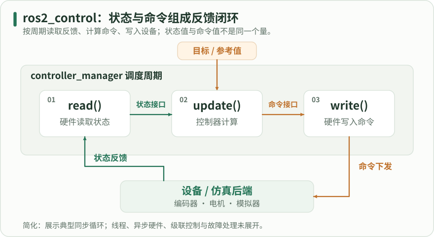

在 controller_manager 框内从左向右读一个典型周期：read 把测量或估计值送入状态接口，update 结合参考计算命令，write 将命令送往设备或仿真。绿色是状态反馈，橙色是参考或命令。省略异步硬件、线程分配、级联控制与故障处理，顺序不构成硬实时保证。

### 接口名称、单位与占用是一份合同

接口通常按 joint/interface 命名，例如 left_wheel_joint/velocity。状态侧的 velocity 是测量或估计的速度，命令侧的 velocity 是希望设备执行的目标，两者不应因为同名就混为一个数组。转动关节位置使用弧度、速度使用弧度每秒，硬件层负责把编码器计数和厂商单位换算到这个合同。

一个命令接口通常只能由被允许的控制链占用。available 表示资源存在且可供使用，claimed 表示当前控制器已经取得它。控制器 inactive 时可能配置完成但尚未占用执行资源。硬件生命周期和控制器生命周期相关却不相同，排错时要分别查看，而不是只看某一个节点是否存在。

#### URDF 中的控制标签示意

代码类型：snippet

```xml

<!-- 【中文教学注释】 URDF 中的控制标签示意 -->
<!-- 本例作用：这是嵌入合法 robot 模型中的片段；对应关节必须已在 URDF 定义。它不构成独立机器人文件。 -->
<!-- 输入输出：输入为 URDF 控制接口、硬件插件和控制器配置；输出为状态接口、命令接口和控制器状态。 -->
<!-- 执行顺序与边界：加载硬件并导出接口后才能配置/激活控制器；mock 反馈不是真实编码器，控制标签片段不包含完整机器人或启动工程。 -->
<!-- 描述供controller_manager使用的硬件与关节接口；它不是完整机器人URDF或自动启动控制循环的脚本。 -->
<ros2_control name="LearningSystem" type="system">
  <!-- 选择硬件组件插件；mock_components/GenericSystem只模拟状态，不连接电机/读取真实编码器。 -->
  <hardware><plugin>mock_components/GenericSystem</plugin></hardware>
  <!-- 这里引用URDF中已经存在的同名关节，并声明控制器可用的state/command接口；不在ros2_control标签内定义父子link或运动学关节。 -->
  <joint name="left_wheel_joint">
    <!-- 声明可被控制器占用的命令接口；轮关节velocity单位rad/s，与底盘Twist线速度m/s不同。 -->
    <command_interface name="velocity"/>
    <!-- 声明只读反馈接口；转动关节position为rad、velocity为rad/s，需由硬件read步骤正确填充。 -->
    <state_interface name="position"/>
    <state_interface name="velocity"/>
  </joint>
  <joint name="right_wheel_joint">
    <command_interface name="velocity"/>
    <state_interface name="position"/>
    <state_interface name="velocity"/>
  </joint>
</ros2_control>

```

这是嵌入合法 robot 模型中的片段；对应关节必须已在 URDF 定义。它不构成独立机器人文件。

输入输出：输入为 URDF 控制接口、硬件插件和控制器配置；输出为状态接口、命令接口和控制器状态。
执行顺序与边界：加载硬件并导出接口后才能配置/激活控制器；mock 反馈不是真实编码器，控制标签片段不包含完整机器人或启动工程。

### 用官方本地源码准备一个隔离实验

准备一份 Jazzy 分支的 ros2_control_demos 源码后，将它复制到独立学习工作区。先 source 系统 Jazzy，再用 rosdep 安装依赖并仅构建 example_2 及其工作区依赖。下面命令未在本次任务运行；如果某项依赖未解析，应先记录包名并解决版本问题。

复制的是参考源码，不代表必须重编整个 ros2_control。系统二进制包通常可提供框架依赖，但源码分支可能随维护更新；若出现 API 不一致，要将示例提交与框架包版本一起固定，不能随意修改头文件来让编译通过。构建成功后在新终端 source 学习工作区再运行。

此实验需要提前准备官方 ros2_control_demos 的 Jazzy 源码。若已有克隆，设置 CONTROL_DEMOS_SRC 为自己机器上的实际目录；若没有，可在联网准备阶段执行下方获取命令。断网运行前还需安装 rosdep 所列依赖。离线教材包不包含这一外部仿真工程或系统依赖。复制到新电脑时不要沿用作者的绝对路径。

#### 仅在联网准备阶段：获取 Jazzy 示例源码

代码类型：commands

```bash

# 【中文教学注释】 仅在联网准备阶段：获取 Jazzy 示例源码
# 本例作用：目标目录应尚不存在；已有仓库不必再次克隆。记录实际提交，并核对其 Jazzy 分支。也可以从另一台电脑复制已经准备的源码。
# 输入输出：输入为 URDF 控制接口、硬件插件和控制器配置；输出为状态接口、命令接口和控制器状态。
# 执行顺序与边界：加载硬件并导出接口后才能配置/激活控制器；mock 反馈不是真实编码器，控制标签片段不包含完整机器人或启动工程。
# 创建本段所需目录；相对路径以当前工作目录为基准，-p只容忍目录已存在，不验证其已有内容是否适合覆盖。
mkdir -p "$HOME/ros2_refs"
# 取得或核对本段明确的上游来源/分支/提交；分支会移动，记录commit才可追溯，clone本身不会安装依赖或运行示例。
git clone --branch jazzy https://github.com/ros-controls/ros2_control_demos.git "$HOME/ros2_refs/ros2_control_demos"
git -C "$HOME/ros2_refs/ros2_control_demos" rev-parse HEAD

```

目标目录应尚不存在；已有仓库不必再次克隆。记录实际提交，并核对其 Jazzy 分支。也可以从另一台电脑复制已经准备的源码。

输入输出：输入为 URDF 控制接口、硬件插件和控制器配置；输出为状态接口、命令接口和控制器状态。
执行顺序与边界：加载硬件并导出接口后才能配置/激活控制器；mock 反馈不是真实编码器，控制标签片段不包含完整机器人或启动工程。

#### 准备与构建本地示例

代码类型：commands

```bash

# 【中文教学注释】 准备与构建本地示例
# 本例作用：首次配置 rosdep 的环境还需完成 rosdep init/update。目标目录应是新学习目录，重复执行前先检查是否已有源码。
# 输入输出：输入为 URDF 控制接口、硬件插件和控制器配置；输出为状态接口、命令接口和控制器状态。
# 执行顺序与边界：加载硬件并导出接口后才能配置/激活控制器；mock 反馈不是真实编码器，控制标签片段不包含完整机器人或启动工程。
# 在当前shell加载/opt/ros/jazzy/setup.bash；它影响本终端的包索引/库路径，另一个终端必须单独加载。
source /opt/ros/jazzy/setup.bash
# 创建本段所需目录；相对路径以当前工作目录为基准，-p只容忍目录已存在，不验证其已有内容是否适合覆盖。
mkdir -p "$HOME/ros2_learning_ws/src"
# 为当前实验保存本行明确的路径/版本变量；使用前检查展开值，后续命令只引用该实验变量，不修改用户HOME等系统变量。
CONTROL_DEMOS_SRC="$HOME/ros2_refs/ros2_control_demos"
# 已有其他位置的克隆时，将上一行替换为该实际目录。
# 先检查本地前提是否成立，失败分支显式退出；不要在源码缺失时继续把空路径当作可运行工程。
test -d "$CONTROL_DEMOS_SRC/example_2" || { echo "请先准备 Jazzy 示例源码"; exit 1; }
# 按本段源/目标路径复制或移动已有文件；先确认目标没有需要保留的不同版本，复制源码不等于完成编译安装。
cp -a "$CONTROL_DEMOS_SRC" "$HOME/ros2_learning_ws/src/"
# 切换到紧随其后的路径，后续相对文件操作由此解析；目录不存在应停止并修正，不继续在错误目录操作。
cd "$HOME/ros2_learning_ws"
# 按package.xml解析目标发行版依赖；--ignore-src跳过src已提供包，源码已下载不等于系统依赖已离线备齐。
rosdep install --from-paths src --ignore-src --rosdistro jazzy -y
# 从工作空间根按依赖拓扑构建；--packages-select只选指定包，--packages-up-to连同所需上游包，构建后必须source安装环境。
colcon build --symlink-install --packages-up-to ros2_control_demo_example_2
# 在当前shell加载install/setup.bash；它影响本终端的包索引/库路径，另一个终端必须单独加载。
source install/setup.bash

```

首次配置 rosdep 的环境还需完成 rosdep init/update。目标目录应是新学习目录，重复执行前先检查是否已有源码。

输入输出：输入为 URDF 控制接口、硬件插件和控制器配置；输出为状态接口、命令接口和控制器状态。
执行顺序与边界：加载硬件并导出接口后才能配置/激活控制器；mock 反馈不是真实编码器，控制标签片段不包含完整机器人或启动工程。

### 启动、配置和激活分别在做什么

启动文件先提供 robot_description，再启动管理器和相关节点，spawner 负责加载、配置并按要求激活控制器。机器人模型告诉资源管理器有哪些硬件接口，控制器 YAML 告诉管理器选择什么控制算法和哪些关节。两边名字必须完全一致，单独能解析 YAML 并不证明资源匹配。

使用 mock 后端先检查整个管理链，能够在没有总线和电机的情况下观察接口占用。它的行为通常是根据命令模拟或回显状态，不包含真实编码器误差、设备延迟和失联。不要把 mock 中能动当作真实硬件闭环已经成立。

#### 常驻示例与另一个终端的检查

代码类型：commands

```bash

# 【中文教学注释】 常驻示例与另一个终端的检查
# 本例作用：若管理器使用自定义名字，给控制 CLI 的 -c 参数提供实际管理器路径。
# 输入输出：输入为 URDF 控制接口、硬件插件和控制器配置；输出为状态接口、命令接口和控制器状态。
# 执行顺序与边界：加载硬件并导出接口后才能配置/激活控制器；mock 反馈不是真实编码器，控制标签片段不包含完整机器人或启动工程。
# 解析指定launch描述并启动其动作；key:=value为启动参数覆盖。节点发现、TF、控制器和生命周期就绪仍需另行检查。
ros2 launch ros2_control_demo_example_2 diffbot.launch.py use_mock_hardware:=True
# 在另一个已 source 学习工作区的终端执行：
# 只读查看硬件组件生命周期状态；mock和真实硬件的状态不能混为实机验证。
ros2 control list_hardware_components
# 核对硬件导出的state/command接口及占用情况，关节名与类型须与控制器需求一致。
ros2 control list_hardware_interfaces
# 观察控制器是否unconfigured/inactive/active及其类型；加载成功不等于已激活并持有接口。
ros2 control list_controllers

```

若管理器使用自定义名字，给控制 CLI 的 -c 参数提供实际管理器路径。

输入输出：输入为 URDF 控制接口、硬件插件和控制器配置；输出为状态接口、命令接口和控制器状态。
执行顺序与边界：加载硬件并导出接口后才能配置/激活控制器；mock 反馈不是真实编码器，控制标签片段不包含完整机器人或启动工程。

### 逐项判读输出而不是只看机器人移动

先在硬件列表中确认组件生命周期符合预期，再在接口列表中找到左右轮的命令和状态。底盘控制器 active 后，其需要的命令接口应被 claimed；关节状态广播器应能发布 JointState。若控制器类型正确但接口仍未占用，查看配置阶段的第一条错误，不要直接重启整个桌面环境。

运动命令到达后，比较目标速度、关节状态和里程计。轮子显示转动只证明显示链收到了状态；里程计变化也可能来自 open_loop 对命令的积分。完整验收应写明状态来源、命令超时策略以及控制器停用后命令资源是否释放。

### 性能与故障要落到明确边界

read 和 write 中的长时间阻塞会占用周期预算，频繁分配内存和打印日志也会引入抖动。设备通信可使用独立线程和有界缓冲，但线程间必须定义数据的新鲜度、所有权和异常状态。不能为了“非阻塞”而把过期测量无限重复使用。

插件无法发现时查导出 XML 和安装路径；接口缺失时查模型与硬件导出；激活失败时查设备准备条件和资源冲突；运行不稳时查周期耗时和反馈时间。建议每次保留启动日志、参数文件和版本清单，使下一次修改能够与已知状态比较。

### 参数文件与资源表一起版本化

建议在实验目录同时保存 controllers.yaml、机器人描述和一份接口清单。清单逐项列出关节、状态接口、命令接口、单位、控制器及反馈来源。更新硬件插件或控制器后，重新导出 list_hardware_interfaces 和 list_controllers 的结果，与清单比较。这样可以在真正发送命令前发现接口删除、更名或占用变化。

需要切换控制器时，先明确旧控制器退出后的命令状态，以及新控制器是否使用当前测量作为起点。释放资源并不天然意味着设备立即停机，接管成功也不意味着目标连续。模拟中检查切换前后的命令突变和生命周期日志，比只验证切换服务返回成功更接近实际系统要求。

### 同一模型上的软件差速台架与资源切换

这里把模型章的原始 Xacro 展开为同一份 URDF，再追加内存硬件声明。RSP 先通过 robot_description 提供模型，管理器收到后加载 GenericSystem。关节广播器把两个位置和速度发给 RSP，活动 TF 由位置算出。

Example 2 的原配置启用了 open_loop，原始里程计可从命令积分。这个实验显式用 open_loop=false、position_feedback=true，要求控制器从 mock 的位置状态读数计算里程计。两种配置要分别看输入来源，不能用里程计话题存在证明闭环。

先看硬件组件 active，再看两个轮速命令是否 available。drive 激活后才被 claimed。reserve 已配置为 inactive，竞争相同的硬件接口。单独请求激活 reserve 被严格切换拒绝，两个控制器与资源状态保持；显式给零速后在同一请求里停用 drive、激活 reserve，随后再查实际状态。

接口服务还列出 drive 和 reserve 各自导出的 linear/velocity、angular/velocity。这些是给上游控制器的链式参考，不是两轮的硬件速度通道。比较占用时用关节接口全名，读取 ListControllers 的 claimed_interfaces 确认持有者。

#### 管理器实际资源回执

| 阶段 | drive | reserve | 占用的轮速接口 |
| --- | --- | --- | --- |
| 配置后 | inactive | inactive | 0 |
| 激活 drive | active | inactive | 2 |
| 拒绝 reserve 后 | active | inactive | 2 |
| 先释放后接管 | inactive | active | 2 |

两轮速度接口始终可用。严格激活 reserve 的失败回执与查询快照分开保留；接管时使用同一个切换请求。

#### 运行本地软件台架

代码类型：commands

```bash

# 在 ros2-learning-hub 目录执行。先加载已安装的 Jazzy 和相关控制/定位包。
source /opt/ros/jazzy/setup.bash
# 225 是独立本机 DDS 域。输入为同目录配置和固定合成速度，输出为 /tmp 新报告。
# 本脚本按模型、控制器、观测顺序启动，只接 GenericSystem，结束回收其进程。
python3 examples/drive_labs/validate_drive.py --domain-id 225
# 解压原创示例 ZIP 时，从 atlas_examples 目录用 python3 drive_labs/validate_drive.py。

```

先核包版本和 DDS 域，再读报告中的硬件、资源、速度、TF 与退出五部分。

#### drive_labs/validate_drive.py

代码类型：complete

```python

#!/usr/bin/env python3
"""用 Jazzy 真实节点检查软件差速底盘、局部 EKF 和 TF。

输入：同包 YAML、原学习模型和固定合成 TwistStamped。轮尺寸 m，命令 m/s 与 rad/s。
输出：/tmp 运行目录中的实际服务回执、传感器样本、进程日志和 JSON。
顺序：模型→接口→资源竞争→反馈→滤波→超时→恢复→双 TF 来源反例。
边界：仅 GenericSystem，无 Gazebo、IMU、GNSS、电机或实时性测试。
"""
from __future__ import annotations

import argparse
from collections import defaultdict, deque
from datetime import datetime, timezone
import hashlib
import json
import math
import os
from pathlib import Path
import signal
import subprocess
import tempfile
import time
import traceback
import xml.etree.ElementTree as ET

HERE = Path(__file__).resolve().parent
EXAMPLES = HERE.parent
MODEL = EXAMPLES / "model_labs/learning_description/urdf/robot.urdf.xacro"
JOINTS = ("left_wheel_joint", "right_wheel_joint")
ODOM_EDGE = ("odom", "base_footprint")
WHEEL_EDGES = {("base_link", name.removesuffix("_joint")) for name in JOINTS}
COMMAND_NAMES = {name + "/velocity" for name in JOINTS}
TIMEOUT_S = 0.30


def arguments():
    parser = argparse.ArgumentParser(description=__doc__, formatter_class=argparse.RawDescriptionHelpFormatter)
    parser.add_argument("--domain-id", default=225, type=int, help="用于实验的独立本机 DDS 域，默认 225")
    parser.add_argument("--report", type=Path, help="额外写入这个新路径，省略时只写 /tmp 运行目录")
    args = parser.parse_args()
    if not 1 <= args.domain_id <= 232:
        parser.error("domain-id 须在 1..232")
    if args.report and args.report.exists():
        parser.error("报告路径已存在，请使用新路径")
    return args


def stamp_ns(stamp):
    return stamp.sec * 10**9 + stamp.nanosec


def near(actual, expected, tolerance):
    return len(actual) == len(expected) and all(
        math.isclose(a, b, rel_tol=0.0, abs_tol=tolerance) for a, b in zip(actual, expected)
    )


def joints(message):
    # JointState 数组顺序由发布者决定。按名字关联值，不能直接假设第一个一定是左轮。
    return {
        "stampNs": stamp_ns(message.header.stamp),
        "positionRad": [message.position[message.name.index(name)] for name in JOINTS],
        "velocityRadS": [message.velocity[message.name.index(name)] for name in JOINTS],
    }


def odometry(message):
    return {
        "stampNs": stamp_ns(message.header.stamp),
        "frames": [message.header.frame_id, message.child_frame_id],
        "xyM": [message.pose.pose.position.x, message.pose.pose.position.y],
        "twist": [message.twist.twist.linear.x, message.twist.twist.angular.z],
        "twistVariance": [message.twist.covariance[0], message.twist.covariance[35]],
    }


class DriveLab:
    def __init__(self, output, report):
        self.output, self.report = output, report
        self.namespace = "/drive_" + output.name.rsplit("-", 1)[-1].replace("-", "_")
        self.processes = []
        self.context = self.node = self.executor = None
        self.deadline = time.monotonic() + 55.0
        self.samples = defaultdict(lambda: deque(maxlen=512))

    def start(self, label, argv, *, persistent=False):
        log = self.output / (label + ".log")
        with log.open("wb") as stream:
            process = subprocess.Popen(argv, cwd=self.output, stdout=stream, stderr=subprocess.STDOUT,
                                       start_new_session=True)
        record = dict(label=label, argv=argv, logFile=str(log), pid=process.pid, signals=[])
        self.report["processes"].append(record)
        self.processes.append((process, record, persistent))
        return process

    def command(self, label, argv):
        process = self.start(label, argv)
        status = process.wait(timeout=12.0)
        assert status == 0, (label, status, Path(self.report["processes"][-1]["logFile"]).read_text()[-4000:])

    def wait(self, condition, label, seconds=5.0):
        # 发现与消息等待采用单调时钟软期限，和消息中的 ROS 时钟相互独立。
        end = min(self.deadline, time.monotonic() + seconds)
        while not condition():
            if time.monotonic() >= end:
                raise TimeoutError(label)
            for process, record, persistent in self.processes:
                if persistent and process.poll() is not None:
                    raise RuntimeError(f'{record["label"]} 提前退出 {process.returncode}，见 {record["logFile"]}')
            self.executor.spin_once(timeout_sec=min(0.02, max(0.0, end - time.monotonic())))

    def observe(self, seconds):
        end = time.monotonic() + seconds
        self.wait(lambda: time.monotonic() >= end, "有限观测窗口", seconds + 0.1)

    def call(self, srv, suffix, request=None):
        name = self.namespace + "/controller_manager/" + suffix
        client = self.node.create_client(srv, name)
        try:
            self.wait(client.service_is_ready, "未发现 " + name)
            future = client.call_async(request if request is not None else srv.Request())
            self.wait(future.done, "无服务应答 " + name)
            return future.result()
        finally:
            self.node.destroy_client(client)

    def watch(self, key, message_type, topic, qos=10):
        def record(message):
            self.samples[key].append((time.monotonic(), message))
        self.node.create_subscription(message_type, self.namespace + "/" + topic, record, qos)

    def latest(self, key):
        return self.samples[key][-1][1]

    def window(self, key, since):
        return [message for at, message in self.samples[key] if at >= since]

    def edges(self, key, since=0.0):
        return {(t.header.frame_id, t.child_frame_id)
                for message in self.window(key, since) for t in message.transforms}

    def run(self):
        import yaml
        from ament_index_python.packages import get_package_prefix
        from builtin_interfaces.msg import Duration as DurationMsg
        from controller_manager_msgs.srv import ListControllers, ListHardwareComponents, ListHardwareInterfaces, SwitchController
        from geometry_msgs.msg import TwistStamped
        from nav_msgs.msg import Odometry
        import rclpy
        from rclpy.context import Context
        from rclpy.duration import Duration
        from rclpy.executors import SingleThreadedExecutor
        from rclpy.node import Node
        from rclpy.qos import DurabilityPolicy, QoSProfile
        from rclpy.signals import SignalHandlerOptions
        from sensor_msgs.msg import JointState
        from tf2_msgs.msg import TFMessage

        def exe(package, executable):
            return str(Path(get_package_prefix(package)) / "lib" / package / executable)

        packages = ("xacro", "robot_state_publisher", "controller_manager", "hardware_interface",
                    "joint_state_broadcaster", "diff_drive_controller", "robot_localization", "rclpy")
        self.report["versions"] = {
            p: ET.parse(Path(get_package_prefix(p)) / "share" / p / "package.xml").findtext("version")
            for p in packages
        }
        self.report["namespace"] = self.namespace
        ros_args = ["--ros-args", "-r", "__ns:=" + self.namespace]
        tf_args = ["-r", "/tf:=" + self.namespace + "/tf", "-r", "/tf_static:=" + self.namespace + "/tf_static"]

        # 复用既有几何，检查轮径、轮距及两端接口，再把唯一的内存后端追加到 URDF。
        config = yaml.safe_load((HERE / "diff_drive.yaml").read_text())
        drive_params = config["/**"]["ros__parameters"]
        radius, separation = drive_params["wheel_radius"], drive_params["wheel_separation"]
        assert drive_params["cmd_vel_timeout"] == TIMEOUT_S and not drive_params["enable_odom_tf"]
        assert tuple(drive_params[side + "_wheel_names"][0] for side in ("left", "right")) == JOINTS
        expanded = self.output / "expanded.urdf"
        self.command("xacro", [exe("xacro", "xacro"), str(MODEL), "-o", str(expanded)])
        robot = ET.parse(expanded).getroot()
        assert not robot.findall("ros2_control") and not robot.findall(".//plugin")
        wheel_y = [float(robot.find(f"joint[@name='{name}']/origin").attrib["xyz"].split()[1]) for name in JOINTS]
        assert near(wheel_y, [separation / 2.0, -separation / 2.0], 1e-10), wheel_y
        for name in JOINTS:
            cylinder = robot.find(f"link[@name='{name.removesuffix('_joint')}']/visual/geometry/cylinder")
            assert math.isclose(float(cylinder.attrib["radius"]), radius)
        hardware = ET.parse(HERE / "mock_system.xml").getroot()
        assert hardware.tag == "ros2_control"
        assert [plugin.text for plugin in hardware.findall(".//plugin")] == ["mock_components/GenericSystem"]
        assert [joint.attrib["name"] for joint in hardware.findall("joint")] == list(JOINTS)
        robot.append(hardware)
        self.report["geometry"] = dict(wheelRadiusM=radius, wheelSeparationM=separation, jointY_M=wheel_y)
        description = self.output / "description.yaml"
        description.write_text(yaml.safe_dump({
            self.namespace + "/robot_state_publisher": {"ros__parameters": {
                "robot_description": ET.tostring(robot, encoding="unicode"), "publish_frequency": 40.0,
            }},
        }))
        # reserve 的 TF 单独接到 controller_tf。对照时能直接认出哪个发布源产生了同名边。
        reserve_file = self.output / "reserve.yaml"
        drive_params["enable_odom_tf"] = True
        reserve_file.write_text(yaml.safe_dump(config))

        self.context = Context()
        rclpy.init(context=self.context, signal_handler_options=SignalHandlerOptions.NO)
        self.executor = SingleThreadedExecutor(context=self.context)
        self.node = Node("contract_probe", namespace=self.namespace, context=self.context)
        self.executor.add_node(self.node)
        self.watch("joint", JointState, "state_broadcaster/joint_states")
        self.watch("raw", Odometry, "drive/odom")
        self.watch("ekf", Odometry, "odometry/filtered")
        self.watch("tf", TFMessage, "tf")
        self.watch("controller_tf", TFMessage, "controller_tf")
        publisher = self.node.create_publisher(TwistStamped, self.namespace + "/drive/cmd_vel", 10)
        self.start("rsp", [exe("robot_state_publisher", "robot_state_publisher"), *ros_args, *tf_args,
                          "-r", "joint_states:=state_broadcaster/joint_states", "--params-file", str(description)],
                   persistent=True)
        manager_file = HERE / "manager.yaml"
        self.start("manager", [exe("controller_manager", "ros2_control_node"), *ros_args,
                              "--params-file", str(manager_file)], persistent=True)
        component, = self.call(ListHardwareComponents, "list_hardware_components").component
        assert component.plugin_name == "mock_components/GenericSystem" and component.state.label == "active"
        self.report["hardware"] = dict(name=component.name, plugin=component.plugin_name,
                                       state=component.state.label, rwRateHz=component.rw_rate)
        self.watch("static", TFMessage, "tf_static", QoSProfile(depth=10, durability=DurabilityPolicy.TRANSIENT_LOCAL))

        for name, config_file in (("state_broadcaster", manager_file), ("drive", HERE / "diff_drive.yaml"), ("reserve", reserve_file)):
            options = [] if name == "state_broadcaster" else [
                "--inactive", "--controller-ros-args", "-r /tf:=" + self.namespace + "/controller_tf",
            ]
            self.command("spawn_" + name, [exe("controller_manager", "spawner"), name,
                         "-c", self.namespace + "/controller_manager", "-p", str(config_file),
                         "--controller-manager-timeout", "5", "--service-call-timeout", "3",
                         "--switch-timeout", "2", *options, *ros_args])

        def inspect():
            controllers = self.call(ListControllers, "list_controllers").controller
            interfaces = self.call(ListHardwareInterfaces, "list_hardware_interfaces")
            states = {c.name: {"state": c.state, "claimed": sorted(c.claimed_interfaces),
                               "requiredState": sorted(c.required_state_interfaces)} for c in controllers}
            all_commands = {i.name: [i.is_available, i.is_claimed] for i in interfaces.command_interfaces}
            # 资源表还可能包含控制器导出的上游 reference，并不都是物理轮速接口。
            commands = {name: state for name, state in all_commands.items() if name in COMMAND_NAMES}
            references = sorted(all_commands.keys() - commands.keys())
            feedback = {i.name for i in interfaces.state_interfaces if i.is_available}
            assert set(commands) == COMMAND_NAMES
            assert feedback == {name + "/" + key for name in JOINTS for key in ("position", "velocity")}
            assert states["state_broadcaster"]["state"] == "active"
            return dict(controllers=states, commands=commands, stateInterfaces=sorted(feedback),
                        otherCommandNames=references)

        def switch(activate, deactivate=()):
            request = SwitchController.Request(activate_controllers=list(activate),
                                               deactivate_controllers=list(deactivate),
                                               strictness=SwitchController.Request.STRICT, activate_asap=False,
                                               timeout=DurationMsg(sec=2))
            response = self.call(SwitchController, "switch_controller", request)
            return dict(activate=list(activate), deactivate=list(deactivate), ok=response.ok, message=response.message)

        before = inspect()
        assert all(state == [True, False] for state in before["commands"].values())
        activation = switch(["drive"])
        active = inspect()
        assert activation["ok"] and active["controllers"]["drive"]["state"] == "active"
        assert set(active["controllers"]["drive"]["claimed"]) == COMMAND_NAMES
        assert set(active["controllers"]["drive"]["requiredState"]) == {name + "/position" for name in JOINTS}
        assert all(state == [True, True] for state in active["commands"].values())
        rejection = switch(["reserve"])
        after_rejection = inspect()
        assert not rejection["ok"] and after_rejection == active
        assert after_rejection["controllers"]["reserve"]["state"] == "inactive"
        self.report["resources"] = dict(before=before, activation=activation, active=active,
                                        rejection=rejection, afterRejection=after_rejection)

        self.wait(lambda: self.samples["joint"] and self.samples["raw"] and
                  WHEEL_EDGES <= self.edges("tf") and ("base_footprint", "base_link") in self.edges("static"),
                  "未观察到原始里程计、固定边和轮子活动边")
        start = time.monotonic()
        self.observe(0.35)
        before_ekf = self.edges("tf", start)
        assert WHEEL_EDGES <= before_ekf and ODOM_EDGE not in before_ekf and not self.edges("controller_tf", start)
        self.start("ekf", [exe("robot_localization", "ekf_node"), *ros_args, *tf_args,
                          "-r", "__node:=ekf_filter_node", "--params-file", str(HERE / "ekf.yaml")], persistent=True)
        self.wait(lambda: self.samples["ekf"] and ODOM_EDGE in self.edges("tf"), "EKF 未发布融合输出和局部 TF")
        self.wait(lambda: publisher.get_subscription_count() == 1, "命令端点未匹配或数量异常")
        self.report["frames"] = dict(staticEdges=sorted(self.edges("static")), beforeEkf=sorted(before_ekf),
                                     withEkf=sorted(self.edges("tf")), controlTfDisabled=not self.edges("controller_tf"))
        assert ("map", "odom") not in self.edges("tf")

        def send(vx, wz, age_s=0.0):
            msg = TwistStamped()
            msg.header.stamp = (self.node.get_clock().now() - Duration(seconds=age_s)).to_msg()
            msg.header.frame_id = "base_footprint"
            msg.twist.linear.x, msg.twist.angular.z = vx, wz
            publisher.publish(msg)
            return time.monotonic()

        def motion(label, vx, wz):
            # 以约 20 Hz 刷新系统时间戳。检查有限稳态窗口中的反馈，避开开始时的离散周期。
            start = time.monotonic()
            for _ in range(20):
                last = send(vx, wz)
                self.observe(0.05)
            wheels = [(vx - wz * separation / 2.0) / radius, (vx + wz * separation / 2.0) / radius]
            observed = {name: self.window(name, start + 0.75) for name in ("joint", "raw", "ekf")}
            assert all(len(messages) >= 3 for messages in observed.values()), label
            joint, raw, fused = joints(observed["joint"][-1]), odometry(observed["raw"][-1]), odometry(observed["ekf"][-1])
            assert near(joint["velocityRadS"], wheels, 1e-4), joint
            assert raw["frames"] == fused["frames"] == list(ODOM_EDGE), (raw, fused)
            assert near(raw["twist"], [vx, wz], 0.015), raw
            assert near(fused["twist"], [vx, wz], 0.03), fused
            assert all(math.isfinite(n) for n in joint["positionRad"] + raw["xyM"] + fused["xyM"])
            self.report["motion"][label] = dict(command=[vx, wz], expectedWheelRadS=wheels, joint=joint, raw=raw, fused=fused,
                                               windowSamples={k: len(v) for k, v in observed.items()})
            return last

        motion("straight", 0.16, 0.0)
        last_command = motion("turn", 0.16, 0.4)
        self.wait(lambda: near(joints(self.latest("joint"))["velocityRadS"], [0.0, 0.0], 1e-4) and
                  near(odometry(self.latest("raw"))["twist"], [0.0, 0.0], 0.015),
                  "停止刷新命令后反馈未归零", 2.0)
        elapsed = time.monotonic() - last_command
        assert 0.25 <= elapsed <= 1.5, elapsed
        self.report["timeout"] = dict(configuredRosSeconds=TIMEOUT_S, observedSteadySeconds=elapsed,
                                      joint=joints(self.latest("joint")), raw=odometry(self.latest("raw")))

        start = time.monotonic()
        send(0.16, 0.4, age_s=1.0)
        self.observe(0.35)
        stale_joints = [joints(message) for message in self.window("joint", start)]
        assert len(stale_joints) >= 3 and all(near(s["velocityRadS"], [0.0, 0.0], 1e-4) for s in stale_joints)
        self.report["stale"] = dict(stampAgeSeconds=1.0, windowSeconds=0.35, jointSamples=len(stale_joints),
                                    joint=stale_joints[-1])
        motion("recovered", 0.16, 0.0)
        motion("explicitZero", 0.0, 0.0)

        handoff = switch(["reserve"], ["drive"])
        switch_stamp = self.node.get_clock().now().nanoseconds
        after_handoff = inspect()
        assert handoff["ok"] and after_handoff["controllers"]["drive"]["state"] == "inactive"
        assert after_handoff["controllers"]["reserve"]["state"] == "active"
        assert set(after_handoff["controllers"]["reserve"]["claimed"]) == COMMAND_NAMES
        self.wait(lambda: ODOM_EDGE in self.edges("controller_tf"), "reserve 未广播同名里程计边")
        start = time.monotonic()
        # 结束新测量后，EKF 按 sensor_timeout 预测，输出不能继续按活跃输入的 30 Hz 来断言。
        self.observe(0.75)
        fusion_edges = self.edges("tf", start)
        controller_edges = self.edges("controller_tf", start)
        raw_stamps = [stamp_ns(message.header.stamp) for message in self.window("raw", start)]
        fused_stamps = [stamp_ns(message.header.stamp) for message in self.window("ekf", start)]
        new_raw = sum(stamp > switch_stamp for stamp in raw_stamps)
        new_fused = sum(stamp > switch_stamp for stamp in fused_stamps)
        self.report["handoff"] = dict(switch=handoff, resources=after_handoff, fusionEdges=sorted(fusion_edges),
                                      controllerEdges=sorted(controller_edges), windowSeconds=0.75,
                                      switchStampNs=switch_stamp, rawStampsNs=raw_stamps, fusedStampsNs=fused_stamps,
                                      newRawMessages=new_raw, newFusedMessages=new_fused)
        assert ODOM_EDGE in (fusion_edges & controller_edges), (fusion_edges, controller_edges)
        assert new_raw == 0 and new_fused >= 2, (raw_stamps, fused_stamps)

    def close(self):
        if self.executor is not None:
            self.executor.shutdown(timeout_sec=2.0)
        if self.node is not None:
            self.node.destroy_node()
        if self.context is not None and self.context.ok():
            self.context.shutdown()
        for process, record, _ in reversed(self.processes):
            # 只处理本脚本创建的独立进程。正常退出只给直接 PID 一次 INT，超时才升级到进程组。
            for sig, grace in ((signal.SIGINT, 4.0), (signal.SIGTERM, 2.0), (signal.SIGKILL, 2.0)):
                if process.poll() is not None:
                    break
                try:
                    if sig == signal.SIGINT:
                        process.send_signal(sig)
                    else:
                        os.killpg(process.pid, sig)
                    record["signals"].append(sig.name)
                    process.wait(timeout=grace)
                except (ProcessLookupError, subprocess.TimeoutExpired):
                    continue
            raw = Path(record["logFile"]).read_bytes()
            record.update(returnCode=process.poll(), pidGone=not Path("/proc", str(process.pid)).exists(),
                          logSha256=hashlib.sha256(raw).hexdigest(), logTail=raw[-4500:].decode(errors="replace"))


def main():
    args = arguments()
    if os.environ.get("ROS_DISTRO") != "jazzy":
        raise SystemExit("请先加载 ROS 2 Jazzy 环境。")
    # 保留本机域通信，清除外部 DDS 发现配置。实验没有发布到工作机器人话题。
    for key in ("ROS_LOCALHOST_ONLY", "ROS_STATIC_PEERS", "ROS_DISCOVERY_SERVER",
                "FASTDDS_DEFAULT_PROFILES_FILE", "FASTRTPS_DEFAULT_PROFILES_FILE"):
        os.environ.pop(key, None)
    os.environ.update(ROS_DOMAIN_ID=str(args.domain_id), ROS_AUTOMATIC_DISCOVERY_RANGE="LOCALHOST",
                      RMW_IMPLEMENTATION="rmw_fastrtps_cpp", SKIP_DEFAULT_XML="1")
    output = Path(tempfile.mkdtemp(prefix="ros2-learning-drive-"))
    os.environ.update(ROS_HOME=str(output / "ros-home"), ROS_LOG_DIR=str(output / "ros-log"))
    source = [Path(__file__).resolve(), MODEL, *(HERE / name for name in ("mock_system.xml", "manager.yaml", "diff_drive.yaml", "ekf.yaml"))]
    report = dict(passed=False, checkedAt=datetime.now(timezone.utc).isoformat(), scope=__doc__.splitlines()[-2],
                  domainId=args.domain_id, discovery="LOCALHOST", rmw="rmw_fastrtps_cpp", output=str(output),
                  sourceHashes={p.relative_to(EXAMPLES).as_posix(): hashlib.sha256(p.read_bytes()).hexdigest() for p in source},
                  processes=[], motion={})
    lab = DriveLab(output, report)
    try:
        lab.run()
    except (Exception, KeyboardInterrupt):
        report["error"] = traceback.format_exc()
        print(report["error"], end="")
    finally:
        lab.close()
    # 旧时间戳不触发软件运动，并且日志明确拒收。正常运行的七个直接进程必须全部退出。
    drive_log = (output / "manager.log").read_text(errors="replace") if (output / "manager.log").is_file() else ""
    report["staleLogged"] = "Ignoring the received message" in drive_log
    report["passed"] = ("error" not in report and report["staleLogged"] and len(report["processes"]) == 7 and
                        all(p["returnCode"] == 0 and p["pidGone"] and set(p["signals"]) <= {"SIGINT"}
                            for p in report["processes"]))
    encoded = json.dumps(report, ensure_ascii=False, indent=2, allow_nan=False) + "\n"
    (output / "report.json").write_text(encoded)
    if args.report:
        with args.report.open("x") as stream:
            stream.write(encoded)
    print(json.dumps({"passed": report["passed"], "report": str(output / "report.json")}, ensure_ascii=False))
    return 0 if report["passed"] else 1


if __name__ == "__main__":
    raise SystemExit(main())


```

读取同目录配置和已有学习 Xacro，按实际服务与消息就绪推进。单调软期限只用于测试等待。

#### drive_labs/mock_system.xml

代码类型：complete

```xml

<?xml version="1.0"?>
<!-- 将此单个系统追加到学习模型的 URDF。输入为每轮 rad/s，输出为模拟 rad 与 rad/s。 -->
<ros2_control name="LearningMockDrive" type="system">
  <hardware>
    <!-- 只在内存回显速度和按控制周期积分位置。这里没有设备、物理仿真、力矩或地面接触。 -->
    <plugin>mock_components/GenericSystem</plugin>
    <param name="calculate_dynamics">true</param>
  </hardware>
  <!-- 名称必须与几何 URDF 及控制器 YAML 一致。初始角度为 0 rad。 -->
  <joint name="left_wheel_joint">
    <command_interface name="velocity"/>
    <state_interface name="position"><param name="initial_value">0.0</param></state_interface>
    <state_interface name="velocity"/>
  </joint>
  <joint name="right_wheel_joint">
    <command_interface name="velocity"/>
    <state_interface name="position"><param name="initial_value">0.0</param></state_interface>
    <state_interface name="velocity"/>
  </joint>
</ros2_control>


```

完整的硬件配置输入文件。脚本将它追加到展开的 robot 元素，再交给 RSP。

#### drive_labs/manager.yaml

代码类型：complete

```yaml

# 管理器输入为 RSP 发布的 URDF。加载硬件后才配置并切换控制器。
# 100 Hz 是本例请求的读/更新/写频率。实验未测周期抖动或实时性。
/**/controller_manager:
  ros__parameters:
    update_rate: 100
    drive:
      type: diff_drive_controller/DiffDriveController
    reserve:
      # 与 drive 使用相同的两个速度命令接口。故意保持 inactive 以验证互斥。
      type: diff_drive_controller/DiffDriveController
    state_broadcaster:
      type: joint_state_broadcaster/JointStateBroadcaster
/**/state_broadcaster:
  ros__parameters:
    # 输出到自己的命名空间。RSP 只订阅这个 JointState，轮位置 rad、速度 rad/s。
    use_local_topics: true


```

管理器加载三种实例，广播器的话题限制在实验内。

#### drive_labs/diff_drive.yaml

代码类型：complete

```yaml

# 仅通过 spawner 传给 drive 和 reserve。两者使用同一份参数来构造资源竞争。
# 输入为带 ROS 时间戳的 TwistStamped，读取 linear.x (m/s) 与 angular.z (rad/s)。
/**:
  ros__parameters:
    left_wheel_names: [left_wheel_joint]
    right_wheel_names: [right_wheel_joint]
    wheel_radius: 0.08
    wheel_separation: 0.36
    # 半径和轮距用 m。闭环里程计读取 mock 的位置反馈 (rad)，而非积分车体命令。
    open_loop: false
    position_feedback: true
    cmd_vel_timeout: 0.30
    # 超时单位为 ROS 秒。实验使用系统时间，不接入 /clock。
    velocity_rolling_window_size: 1
    publish_rate: 50.0
    tf_frame_prefix_enable: false
    odom_frame_id: odom
    base_frame_id: base_footprint
    # 保留原始里程计话题；odom -> base_footprint 由局部 EKF 广播。
    enable_odom_tf: false
    # 6 个分量按 x,y,z,roll,pitch,yaw 排列；速度对应线速度与角速度。
    # 这是可复现的示例方差 (m²、rad² 或对应速度单位平方)，未经传感器标定。
    pose_covariance_diagonal: [0.001, 0.001, 0.001, 0.01, 0.01, 0.01]
    twist_covariance_diagonal: [0.0025, 0.01, 0.01, 0.01, 0.01, 0.01]


```

两个控制器使用相同轮接口。reserve 的 TF 开关由脚本在临时副本中打开。

#### drive_labs/ekf.yaml

代码类型：complete

```yaml

# 先让驱动输出原始 Odometry，再启动此节点。相对话题保留在实验命名空间内。
/**/ekf_filter_node:
  ros__parameters:
    use_sim_time: false
    frequency: 30.0
    sensor_timeout: 0.20
    two_d_mode: true
    publish_tf: true
    map_frame: map
    odom_frame: odom
    base_link_frame: base_footprint
    world_frame: odom
    odom0: drive/odom
    # 15 项依次为位置、姿态、线速度、角速度、线加速度，各组按 x/y/z。
    # 只融合 vx (m/s) 和 vyaw (rad/s)。避免把同一轮反馈生成的位姿重复当作独立测量。
    odom0_config: [false, false, false,
                   false, false, false,
                   true, false, false,
                   false, false, true,
                   false, false, false]
    # 输出为局部 Odometry 与 odom -> base_footprint。没有 map -> odom、IMU 或 GNSS。


```

只用轮反馈推得的前向和偏航速度，输出局部里程计与指定 TF 边。

### 从速度置零追到仿真车实际停稳

ControllerServer 用 RPP 计算 Twist，恢复行为有同一个原始速度入口。平滑器闭环读取轮积分里程计，根据加减速参数和速度上限发布下游命令。桥只把平滑后的速度送给 Gazebo DiffDrive，旁路同时记录前后两路。

最早的 0.85 rad/s 终点转向使动作已成功时车辆仍在减速，最终偏航误差 0.413 rad，超过 0.28 rad 的台架判据。调整为 0.45 rad/s 后重新实测，并为较慢的原地转向保留进度时间。当前主试验停稳偏航误差 0.026 rad。

行驶中取消后，按世界参考取平移速度不超过 0.018 m/s、偏航速度不超过 0.055 rad/s 的连续窗口。本次取消后的停稳窗口采到 26 帧，并独立核对两个关节速度。

取消终态、零速度消息、车体速度下降与停止距离应使用各自的测量量。无 Header 的速度消息只记录接收时钟。里程计和世界位姿保留发布端采样时戳，端到端通讯延迟需要另设同步测量。

#### 一次真实行驶中的取消与停稳时间线

| 事件 | 相对请求的仿真时间 | 证据 |
| --- | --- | --- |
| 发送取消 | +0.000 s | 独立世界位姿已记录可辨认的平移，取消使用同一目标 UUID |
| 取消服务回执 | +0.000 s | return_code=0，返回同一 UUID |
| 上层取消终态 | +0.025 s | NavigateToPose 为 CANCELED，FollowPath 也已取消 |
| 控制器最近一次运动后首次零速 | +0.045 s | 旁路收到 Twist |
| 平滑器最近一次运动后首次零速 | +1.510 s | 旁路收到送往 Gazebo 桥的 Twist |
| 停稳采样窗开始 | +1.500 s | 持续 0.500 s，并检查实际两轮速度 |

从发出请求到停稳观测结束，世界坐标累计行驶 0.340 m。命令使用旁路接收时刻，世界位姿使用采样时刻。

### 差速软件链的消息、资源和 TF

| 接口 | 输入与单位 | 输出或观察 | 关键边界 |
| --- | --- | --- | --- |
| ~/cmd_vel | TwistStamped，m/s 与 rad/s | 车体前向与偏航目标 | 检查类型、命名空间和命令时戳；不要用话题名猜消息类型。 |
| 两轮 velocity | 硬件目标 rad/s；反馈位置 rad | GenericSystem 回显速度并积分位置 | 同名 command/state 含义不同；链式参考也不是轮速资源。 |
| SwitchController | 激活/停用列表、STRICT、超时秒 | ok 与 message | 随后查状态和 claimed_interfaces；软件切换不证明物理停机。 |
| 原始 Odometry | 轮位置差、几何与时戳 | pose 在 odom，twist 在子帧 | 关 TF 仍可保留消息；同一轮反馈派生量有关联。 |
| 局部 EKF | vx、vyaw 与各自方差 | 滤波 Odometry 与 odom 边 | 分开核新测量与预测输出，同一 TF 边只指定一个来源。 |

### 控制器 active 失败的逐层排查

差速控制器类型能加载，但激活时提示找不到右轮速度接口。

1. 列出硬件接口，发现硬件使用 right_wheel_joint。

2. 检查 YAML，发现误写成 right_wheel。

3. 修正控制器关节名称并重新加载配置。

4. 再次确认两个 velocity 命令接口 claimed，随后检查 JointState。

验收：修复接口合同即可激活，无需更换控制器或修改底层算法。

### 深入练习 1

state velocity 与 command velocity 为什么要分开？

参考答案：一个表示实际反馈，一个表示目标；分开才能观察跟踪误差、饱和和故障。

### 深入练习 2

控制器进程存在等于控制器 active 吗？

参考答案：不等于。进程、加载、配置、激活和资源占用是不同状态，需要控制 CLI 与日志验证。

### 深入练习 3

提高 update_rate 一定改善控制吗？

参考答案：不一定。硬件通信和计算可能超过周期预算，导致更大抖动；应先测量耗时和真实反馈频率。

### 深入练习 4

硬件 active 且两轮命令 available，为何 drive 仍可能没有轮速接口？

参考答案：硬件可以提供接口，控制器还可能处于 inactive。先查配置状态，再执行明确的切换请求并核对 claimed_interfaces。

### 深入练习 5

为何接口列表中的 drive/linear/velocity 不能当左轮命令？

参考答案：它属于控制器导出的车体参考入口，左轮硬件命令的资源名是 left_wheel_joint/velocity，物理单位和持有者也不同。

### 深入练习 6

如果导航已经返回成功，但停稳偏航超差，优先对照哪些曲线？

参考答案：在同一仿真时基对照终点转向命令、平滑器角速度、世界偏航与轮速。检查目标容差、转向速度和减速余量后复验停稳角度。

### 基础验证流程

#### 使用已编译的 Jazzy 官方示例

本地源码位于 ros2_control_demos/example_2；先在独立工作区安装依赖并编译，再 source install/setup.bash。

输入输出：输入为 URDF 控制接口、硬件插件和控制器配置；输出为状态接口、命令接口和控制器状态。
执行顺序与边界：加载硬件并导出接口后才能配置/激活控制器；mock 反馈不是真实编码器，控制标签片段不包含完整机器人或启动工程。

```bash

# 【中文教学注释】 使用已编译的 Jazzy 官方示例
# 本例作用：本地源码位于 ros2_control_demos/example_2；先在独立工作区安装依赖并编译，再 source install/setup.bash。
# 输入输出：输入为 URDF 控制接口、硬件插件和控制器配置；输出为状态接口、命令接口和控制器状态。
# 执行顺序与边界：加载硬件并导出接口后才能配置/激活控制器；mock 反馈不是真实编码器，控制标签片段不包含完整机器人或启动工程。
# 解析指定launch描述并启动其动作；key:=value为启动参数覆盖。节点发现、TF、控制器和生命周期就绪仍需另行检查。
ros2 launch ros2_control_demo_example_2 diffbot.launch.py use_mock_hardware:=True

```

#### 查看硬件导出的接口

先确认 joint 名称和 velocity 接口都存在。

输入输出：输入为 URDF 控制接口、硬件插件和控制器配置；输出为状态接口、命令接口和控制器状态。
执行顺序与边界：加载硬件并导出接口后才能配置/激活控制器；mock 反馈不是真实编码器，控制标签片段不包含完整机器人或启动工程。

```bash

# 【中文教学注释】 查看硬件导出的接口
# 本例作用：先确认 joint 名称和 velocity 接口都存在。
# 输入输出：输入为 URDF 控制接口、硬件插件和控制器配置；输出为状态接口、命令接口和控制器状态。
# 执行顺序与边界：加载硬件并导出接口后才能配置/激活控制器；mock 反馈不是真实编码器，控制标签片段不包含完整机器人或启动工程。
# 核对硬件导出的state/command接口及占用情况，关节名与类型须与控制器需求一致。
ros2 control list_hardware_interfaces

```

#### 查看控制器状态

joint_state_broadcaster 与底盘控制器应按示例进入 active；若管理器改名，给 CLI 添加 -c 指定路径。

输入输出：输入为 URDF 控制接口、硬件插件和控制器配置；输出为状态接口、命令接口和控制器状态。
执行顺序与边界：加载硬件并导出接口后才能配置/激活控制器；mock 反馈不是真实编码器，控制标签片段不包含完整机器人或启动工程。

```bash

# 【中文教学注释】 查看控制器状态
# 本例作用：joint_state_broadcaster 与底盘控制器应按示例进入 active；若管理器改名，给 CLI 添加 -c 指定路径。
# 输入输出：输入为 URDF 控制接口、硬件插件和控制器配置；输出为状态接口、命令接口和控制器状态。
# 执行顺序与边界：加载硬件并导出接口后才能配置/激活控制器；mock 反馈不是真实编码器，控制标签片段不包含完整机器人或启动工程。
# 观察控制器是否unconfigured/inactive/active及其类型；加载成功不等于已激活并持有接口。
ros2 control list_controllers
# 只读查看硬件组件生命周期状态；mock和真实硬件的状态不能混为实机验证。
ros2 control list_hardware_components

```

#### 追溯配置来源

依次阅读模型中的 ros2_control 标签、插件 XML、控制器 YAML 与 spawner 启动动作，把每个名称连到定义位置。

### 预期结果

- 命令接口显示 available，并在控制器启动后由正确控制器 claimed。

- 控制器状态和关节状态发布符合示例预期。

### 常见问题

- 动态库能编译并不等于 pluginlib 能发现它；还需正确导出和安装描述文件。

- 硬件 on_activate 成功之前不应假定 write 已经可向电机下发。

- 示例 mock hardware 回显的是模型行为，不证明真实编码器闭环正确。

### 练习

绘制 read→update→write 的数据流，在每条连线上标出单位、数据来源和调用频率，并解释接口未被 claimed 时应查哪一层。

#### 参考答案

read 把编码器/仿真位置和速度更新到 state interfaces；update 读取状态并产生 command interfaces；write 将命令转换到驱动或仿真接口。轮速应是 rad/s，车体线速度是 m/s。

available 但未 claimed 时先查控制器是否配置/激活以及 joint/interface 名是否匹配；接口不存在时查 URDF 和硬件插件导出。不要先修改控制算法。

### 验证范围

GenericSystem 差速和局部 EKF 仍按软件台架独立验证。本机 Jazzy Nav2 1.3.13、Harmonic 8.15.0、ros_gz_bridge 1.0.24 实测。主试验域 223，实际解压示例和地图后在域 224 重跑。范围为静态房间的单机器人仿真。本轮测 Gazebo 关节、轮速里程计及独立世界参考，实机停机和故障制动待验。

### 依据

- [ros2_control 官方文档](https://control.ros.org/jazzy/index.html)

- [DiffBot 差速底盘官方示例](https://control.ros.org/jazzy/doc/ros2_control_demos/example_2/doc/userdoc.html)

- [Controller Manager](https://control.ros.org/jazzy/doc/ros2_control/controller_manager/doc/userdoc.html)

- [编写 ros2_control 硬件组件](https://control.ros.org/jazzy/doc/ros2_control/hardware_interface/doc/writing_new_hardware_component.html)

- [Example 2 的内存后端与轮接口](https://github.com/ros-controls/ros2_control_demos/blob/fbab026e147824971c97996f3789f97c2ee9e9ac/example_2/description/ros2_control/diffbot.ros2_control.xacro)

- [GenericSystem 的速度与位置反馈](https://github.com/ros-controls/ros2_control/blob/f9e24287fc1d6996e5ba1656a9ee24e5f33adef7/hardware_interface/src/mock_components/generic_system.cpp)

- [控制器管理服务与命令资源](https://github.com/ros-controls/ros2_control/blob/f9e24287fc1d6996e5ba1656a9ee24e5f33adef7/controller_manager/src/controller_manager.cpp)

- [差速控制器的命令、位置反馈与里程计](https://github.com/ros-controls/ros2_controllers/blob/bee185cbb98815116af9cfb00ff595b0b800e91a/diff_drive_controller/src/diff_drive_controller.cpp)

- [控制器循环、进度与到达检查](https://github.com/ros-navigation/navigation2/blob/94d1c2a345dda6ff637e6a72c9101d927ee99f19/nav2_controller/src/controller_server.cpp)

- [调节型纯追踪的前视、曲率和碰撞投影](https://github.com/ros-navigation/navigation2/blob/94d1c2a345dda6ff637e6a72c9101d927ee99f19/nav2_regulated_pure_pursuit_controller/src/regulated_pure_pursuit_controller.cpp)

- [速度平滑器的闭环反馈与限速](https://github.com/ros-navigation/navigation2/blob/94d1c2a345dda6ff637e6a72c9101d927ee99f19/nav2_velocity_smoother/src/velocity_smoother.cpp)

## 38. 差速与履带底盘：从 TwistStamped 到左右轮速

差速模型把车体线速度和角速度换算为左右侧速度。履带底盘可以先借用此接口组织软件，但转弯滑移会使几何轮距与有效轮距不同，必须通过实测与外部定位校准。

### 学习目标

- 理解 v_left = v − ωb/2、v_right = v + ωb/2

- 识别 Twist 与 TwistStamped 的接口差别

- 区分开环里程计和编码器反馈里程计

### 先修

ros2_control 基础；里程计与 TF；线速度/角速度单位

### 概念

diff_drive_controller 输出的是关节角速度，因此左右线速度还需除以有效轮半径。

Jazzy 文档使用带时间戳的 TwistStamped；时间戳用于判断命令是否过期。

履带滑移不是修改一个 PID 就能完全解决的问题；校准、速度限制、IMU 和外部定位应协同设计。

### 从车体命令推导左右侧运动

差速底盘的常用输入是车体前向速度 v 和绕竖直轴的角速度 ω。若左右轮接触线间距为 b，左右侧线速度分别为 v−ωb/2 与 v+ωb/2。轮半径为 r 时，再分别除以 r 得到轮轴角速度。这个推导假定平面运动和理想无侧滑滚动，解释了为什么正向直行时两侧同向、原地转向时两侧反向。

输入线速度单位为米每秒，角速度为弧度每秒，控制器输出的轮速通常为弧度每秒。若驱动使用每分钟转数或编码器每周期增量，转换必须放在明确的边界。左右电机安装镜像可能使电气正方向相反，应在硬件层统一成模型定义的关节正方向。


在 controller_manager 框内从左向右读一个典型周期：read 把测量或估计值送入状态接口，update 结合参考计算命令，write 将命令送往设备或仿真。绿色是状态反馈，橙色是参考或命令。省略异步硬件、线程分配、级联控制与故障处理，顺序不构成硬实时保证。

### 履带模型可借用，但滑移不能忽略

履带转向依靠地面接触中的滑移，几何轮距与从转弯数据反推的有效轮距可能不同，并随地面、载荷和速度变化。因此差速模型可以作为软件接口和初始近似，却不能承诺在所有场景得到无偏里程计。应分别记录直行距离误差和转角误差，再考虑半径和有效轮距的校准。

里程计还有两种数据来源：反馈模式根据实际关节位置或速度积分，open_loop 则根据命令估计运动。后者在示例和没有反馈的场景有用途，但无法知道轮子是否受阻、打滑或驱动未执行。若需要可靠状态估计，应把真实轮速、IMU 和外部定位纳入可解释的融合链。

### 先确认命令消息与时间戳合同

当前 Jazzy diff_drive_controller 文档的速度输入为 TwistStamped，其 linear.x 与 angular.z 承载平面速度，header.stamp 表示命令时间。控制器可据此拒绝过期命令。很多旧驱动和本地 BUNKER 示例仍使用 Twist，没有 header。两种消息不是可自动互换的同一类型，桥接节点必须明确处理补时间戳与过期语义。

实际话题可能是控制器私有的 cmd_vel，也可能被 launch 重映射到 /cmd_vel。先用 topic info 检查真实类型、发布者和订阅者，再写命令。速度命令属于持续控制流，不应只保证一条消息到达而忽略发布频率与看门狗；可靠传输也无法替代超时停止机制。

#### 查看实际端点

代码类型：commands

```bash

# 【中文教学注释】 查看实际端点
# 本例作用：如果实际输入名称不同，后续发布命令必须随之修改，不能假定所有机器人都使用全局 /cmd_vel。
# 输入输出：输入为底盘线速度/偏航角速度和轮几何；输出为左右轮命令、反馈及里程计。
# 执行顺序与边界：车速 m/s、偏航 rad/s、轮半径/轮距 m、关节速度 rad/s；先确认 Twist 或 TwistStamped，超时停车依赖控制器与硬件实现。
# 列出可见话题；-t附带类型，不能从名字推断消息结构或物理单位。
ros2 topic list -t
# 查询实际消息类型与发布/订阅端点；--verbose显示QoS等证据，先查类型再选择发送消息结构。
ros2 topic info /cmd_vel --verbose
# 观察控制器是否unconfigured/inactive/active及其类型；加载成功不等于已激活并持有接口。
ros2 control list_controllers

```

如果实际输入名称不同，后续发布命令必须随之修改，不能假定所有机器人都使用全局 /cmd_vel。

输入输出：输入为底盘线速度/偏航角速度和轮几何；输出为左右轮命令、反馈及里程计。
执行顺序与边界：车速 m/s、偏航 rad/s、轮半径/轮距 m、关节速度 rad/s；先确认 Twist 或 TwistStamped，超时停车依赖控制器与硬件实现。

### 读懂一份最小控制器参数

下面片段只描述差速控制器本身，应放入项目采用的参数加载结构中，并由 spawner 或管理器正确加载。关节名称必须匹配模型和硬件接口。示例设置反馈式里程计，并由控制器发布 odom 到 base_link；若 EKF 改为负责这条 TF，就应关闭这里的 TF 发布。

轮距和轮半径只是教学值，需要替换为实际模型和标定结果。命令超时、速度限制和加速度限制都属于系统合同，配置后还要通过实验验证。某些历史版本的参数名称和限速开关不同，使用当前安装包的参数定义，不要把跨发行版片段直接拼接。

#### controllers.yaml 中的控制器片段

代码类型：snippet

```yaml

# 【中文教学注释】 controllers.yaml 中的控制器片段
# 本例作用：配置片段依赖已存在的管理器、硬件、joint_state_broadcaster 和启动流程；不是独立可启动工程。
# 输入输出：输入为底盘线速度/偏航角速度和轮几何；输出为左右轮命令、反馈及里程计。
# 执行顺序与边界：车速 m/s、偏航 rad/s、轮半径/轮距 m、关节速度 rad/s；先确认 Twist 或 TwistStamped，超时停车依赖控制器与硬件实现。
diffbot_base_controller:
  # ROS参数文件的固定层级名；其父节点名/通配选择器必须匹配实际启动名称。
  ros__parameters:
    type: diff_drive_controller/DiffDriveController
    # 实际URDF/硬件导出的左轮关节名列表；名称必须逐字匹配接口。
    left_wheel_names: [left_wheel_joint]
    # 实际URDF/硬件导出的右轮关节名列表；左右对应错误会改变运动方向。
    right_wheel_names: [right_wheel_joint]
    # 左右轮接地点的有效轮距，单位m；误差会影响偏航里程计，履带滑移不能仅靠几何参数完全消除。
    wheel_separation: 0.30
    # 有效滚动半径，单位m；与轮角速度rad/s共同决定底盘线速度m/s。
    wheel_radius: 0.05
    # false要求从反馈估计里程计；true的命令积分不等于实际轮子已达到该速度。
    open_loop: false
    # true从position反馈求速度/里程计；轮关节位置为rad，硬件接口种类须与此设置一致。
    position_feedback: true
    # 坐标系名称必须与TF树及消息Header一致；名称配置不自动生成所需TF或完成外参标定。
    odom_frame_id: odom
    base_frame_id: base_link
    # 是否广播里程计TF；与robot_localization等同时使用时避免重复发布同一关系。
    enable_odom_tf: true
    # 速度命令过期阈值，单位s；这是控制器策略，还需设备端独立失联/制动设计。
    cmd_vel_timeout: 0.5
    # 状态发布频率，单位Hz；与控制循环频率、命令输入频率分开理解。
    publish_rate: 50.0
    # 底盘前向速度上限，单位m/s；具体控制器版本是否另需启用对应限制开关，应查目标版本配置。
    linear.x.max_velocity: 0.3
    # 底盘偏航角速度上限，单位rad/s；不要与轮关节速度上限混淆。
    angular.z.max_velocity: 0.5

```

配置片段依赖已存在的管理器、硬件、joint_state_broadcaster 和启动流程；不是独立可启动工程。

输入输出：输入为底盘线速度/偏航角速度和轮几何；输出为左右轮命令、反馈及里程计。
执行顺序与边界：车速 m/s、偏航 rad/s、轮半径/轮距 m、关节速度 rad/s；先确认 Twist 或 TwistStamped，超时停车依赖控制器与硬件实现。

### 在模拟后端执行三个小实验

先使用前章的 DiffBot mock 或仿真后端。第一步只发布低速直行，检查左右目标符号一致；第二步只发布低角速度，检查两侧符号相反；第三步停止发布，观察命令超时后的行为。下面命令没有在本次编写中执行，且只适用于确认类型为 TwistStamped 的模拟话题。

header: auto 由 CLI 在发布时生成时间戳。若 use_sim_time 为真，命令发布进程也需要正确使用模拟时间，避免命令落在不同时间域。停止键盘发布后不要只看画面，应查看控制器输出或轮速反馈是否按预期衰减到零，并记录达到停止状态的时间。

#### 模拟中低速直行

代码类型：commands

```bash

# 【中文教学注释】 模拟中低速直行
# 本例作用：先确认模拟后端和话题类型；停止发布后观察 cmd_vel_timeout 的效果。仿真时可通过 --ros-args -p use_sim_time:=true 为 CLI 节点选择模拟时间。
# 输入输出：输入为底盘线速度/偏航角速度和轮几何；输出为左右轮命令、反馈及里程计。
# 执行顺序与边界：车速 m/s、偏航 rad/s、轮半径/轮距 m、关节速度 rad/s；先确认 Twist 或 TwistStamped，超时停车依赖控制器与硬件实现。
# 按指定接口序列化消息并发布；--once只发一条，--rate单位Hz。Twist线速度m/s、角速度rad/s，不能把不同类型强行互发。
ros2 topic pub --rate 10 /cmd_vel geometry_msgs/msg/TwistStamped "{header: auto, twist: {linear: {x: 0.1}, angular: {z: 0.0}}}"

```

先确认模拟后端和话题类型；停止发布后观察 cmd_vel_timeout 的效果。仿真时可通过 --ros-args -p use_sim_time:=true 为 CLI 节点选择模拟时间。

输入输出：输入为底盘线速度/偏航角速度和轮几何；输出为左右轮命令、反馈及里程计。
执行顺序与边界：车速 m/s、偏航 rad/s、轮半径/轮距 m、关节速度 rad/s；先确认 Twist 或 TwistStamped，超时停车依赖控制器与硬件实现。

### 校准与失败定位需要可测量证据

直行一段距离后比较外部测量与 odom 距离，转动一整圈后比较外部角度与 odom 角度。每次只改一个校准因素，并记录地面、载荷、速度、时间和轮胎或履带状态。多次往返比单次测量更能揭示系统偏差。若正反向误差不对称，还要检查间隙、死区与机械阻力。

收到消息却不动时，先看控制器 active 和接口 claimed，再看命令时间是否过期，最后看硬件写入和驱动使能。方向相反时先查单位与符号，曲线误差大时再查轮距和滑移。导航控制器不应被用来掩盖底层里程计单位错误，否则所有上层调参都失去可靠基础。

用数值先检查公式：取 v 为每秒零点二米、ω 为每秒一弧度、b 为零点四米、r 为零点一米，则左轮角速度为零，右轮为每秒四弧度。这代表绕左侧接触点转弯。将这个结果与软件输出比较，可以在机器人不运动时发现左右次序或量纲错误。

### 用真实控制器观察轮反馈、命令过期与恢复

轮半径 0.08 m，轮距 0.36 m。前向 0.16 m/s 且无偏航时，两轮应各为 2 rad/s。保留前向速度并加入 0.4 rad/s 的正偏航，按 (v ± ωL/2)/r 算得左 1.1、右 2.9 rad/s。运行控制框架章的台架，同步检查 JointState、原始里程计与局部 EKF。

发布端约每 0.05 秒填入新的系统 ROS 时间戳。停发后，本次在 0.329 秒的本机单调观测时延后首次同时看到两轮和原始里程计归零。0.30 秒是控制器的 ROS 时间阈值，实际观测还经过更新、反馈和消息传递。

保持零速后另发一条旧 1 秒的非零指令。随后 0.35 秒观测到 35 条轮反馈均为零，控制器日志记录了旧时间戳拒收。下一批新指令恢复 2/2 rad/s。过期拒收与停发后的控制器超时是两次不同检查。

AgroSenseBot 固定快照的 asb_track_controller 使用电机轴速度，配置中的等效半径按 0.151 m 除以减速比 40.61 计算。它启用的是该分支的无戳入口。BUNKER 包装节点直接接收 Twist。两者与本机 diff_drive_controller 的 TwistStamped 入口分别核对，轮滑移、驱动延迟和设备 watchdog 另有独立验收。

导航执行台架的两轮半径为 0.09 m、间距 0.32 m。真实仿真轮关节随平滑后 Twist 转动，DiffDrive 用两轮积分发布 odom，独立 Gazebo 系统发布世界参考。前者可与差速方程对照，后者包含轮地接触后的实际仿真运动。

本节软件控制器的命令过期机制有独立试验。导航执行里的停稳来自控制器置零、平滑器减速与仿真反馈，验收分别看两路 Twist 与轮速。正式底盘的制动和急停仍按其驱动协议测试。

#### 从车体指令到轮反馈与里程计

| 阶段 | 指令 v/ω | 左/右 rad/s | 原始 v/ω | EKF v/ω |
| --- | --- | --- | --- | --- |
| 直行 | 0.16 / 0.00 | 2.00 / 2.00 | 0.1600 / 0.0000 | 0.1600 / 0.0000 |
| 转弯 | 0.16 / 0.40 | 1.10 / 2.90 | 0.1599 / 0.3998 | 0.1600 / 0.3999 |
| 新指令恢复 | 0.16 / 0.00 | 2.00 / 2.00 | 0.1599 / 0.0000 | 0.1603 / 0.0000 |
| 显式零速 | 0.00 / 0.00 | 0.00 / 0.00 | 0.0000 / 0.0000 | -0.0017 / 0.0000 |

v 为 m/s，ω 为 rad/s。各阶段末段取实际样本并显示四位小数。滤波输出可能在输入归零后有小残差。

### 运动接口的共同合同：单位、坐标、时间与终止

| 接口 | 输入输出 | 单位与坐标 | 验收边界 |
| --- | --- | --- | --- |
| Twist / TwistStamped | 线速度、角速度；带时间戳版本另有 header | 线速度 m/s，角速度 rad/s；frame_id 必须与控制端合同一致 | 增加 header 不会自动变换速度坐标或补偿数据年龄。核对实际话题类型，不直接假设所有 Jazzy 配置相同。 |
| NavigateToPose | 带坐标系与时间戳的目标位姿，返回结果/状态 | 位置 m；姿态单位四元数；常见全局 frame 为 map，但以系统配置为准 | 目标被接受、规划成功、控制结束和底盘停止分别检查。 |
| JointTrajectory | joint_names 与逐点位置/速度/加速度/时刻 | 旋转关节 rad，移动关节 m；速度和加速度相应每秒、每秒平方 | 关节顺序、数组长度、时间单调性、限位、碰撞与执行端接口都要核对。 |
| 规划结果 | 候选路径或轨迹 | 模型坐标、时间参数化和控制周期明确 | 路径无碰撞不等于轨迹可执行；执行前还需新鲜场景、可达性、速度/加速度和控制器检查。 |

仅在仿真或离线模型中验证不会自动证明真实设备安全。教材工程先从可观察的低速仿真与数值检查开始，具体实机状态以设备接口为准。

### 差速软件链的消息、资源和 TF

| 接口 | 输入与单位 | 输出或观察 | 关键边界 |
| --- | --- | --- | --- |
| ~/cmd_vel | TwistStamped，m/s 与 rad/s | 车体前向与偏航目标 | 检查类型、命名空间和命令时戳；不要用话题名猜消息类型。 |
| 两轮 velocity | 硬件目标 rad/s；反馈位置 rad | GenericSystem 回显速度并积分位置 | 同名 command/state 含义不同；链式参考也不是轮速资源。 |
| SwitchController | 激活/停用列表、STRICT、超时秒 | ok 与 message | 随后查状态和 claimed_interfaces；软件切换不证明物理停机。 |
| 原始 Odometry | 轮位置差、几何与时戳 | pose 在 odom，twist 在子帧 | 关 TF 仍可保留消息；同一轮反馈派生量有关联。 |
| 局部 EKF | vx、vyaw 与各自方差 | 滤波 Odometry 与 odom 边 | 分开核新测量与预测输出，同一 TF 边只指定一个来源。 |

### 计算并检查一次原地转向

轮距为零点三米、半径零点零五米，目标角速度零点四弧度每秒。

1. 左右线速度分别为负零点零六与正零点零六米每秒。

2. 除以轮半径得到负一点二与正一点二弧度每秒。

3. 在模拟中对比命令、关节状态和 odom 角速度。

4. 停止发布并测量超时停止；实机标定另需外部角度测量。

验收：理想模型的计算、接口单位与可观察输出形成一致链路。

### 深入练习 1

为何不能把 Twist 直接发到 TwistStamped 话题？

参考答案：消息结构与类型支持不同，ROS 不会自动补 header 或转换。需要显式适配并定义时间戳语义。

### 深入练习 2

open_loop 里程计能检测车轮受阻吗？

参考答案：不能，它依赖命令估计运动，即使电机未执行也可能继续积分。

### 深入练习 3

履带有效轮距能用一次实验永久确定吗？

参考答案：通常不能。接触和滑移随地面、载荷与速度变化，应记录条件并评估不同工况。

### 深入练习 4

0.16 m/s、0.4 rad/s、轮距 0.36 m 的输入为何使右轮更快？

参考答案：正偏航按本例坐标系向左转，左轮沿内侧走较短路径。左右线速度是 0.088 和 0.232 m/s，分别除以 0.08 m。

### 深入练习 5

旧指令回调拒收和命令更新循环超时，分别如何观察？

参考答案：前者在已归零时发带旧时戳的非零输入并检查拒收日志，后者要从持续运动停发，观测新反馈归零。

### 底盘速度：Twist 与 TwistStamped

同样表示车体速度，为什么有的驱动接收Twist，有的控制器需要带时间戳的消息？

#### BUNKER 示例 · Twist

仅在独立仿真或已确认的演示接口使用。先检查话题类型；这是零速度消息，不启动硬件。

输入输出：输入为底盘线速度/偏航角速度和轮几何；输出为左右轮命令、反馈及里程计。
执行顺序与边界：车速 m/s、偏航 rad/s、轮半径/轮距 m、关节速度 rad/s；先确认 Twist 或 TwistStamped，超时停车依赖控制器与硬件实现。
Twist和TwistStamped是不同接口契约；线速度m/s、角速度rad/s，增加header不会自动校准时钟或转换坐标，零速度消息也不能替代设备端急停验收。

```bash

# 【中文教学注释】 BUNKER 示例 · Twist
# 本例作用：仅在独立仿真或已确认的演示接口使用。先检查话题类型；这是零速度消息，不启动硬件。
# 输入输出：输入为底盘线速度/偏航角速度和轮几何；输出为左右轮命令、反馈及里程计。
# 执行顺序与边界：车速 m/s、偏航 rad/s、轮半径/轮距 m、关节速度 rad/s；先确认 Twist 或 TwistStamped，超时停车依赖控制器与硬件实现。
# 查询实际消息类型与发布/订阅端点；--verbose显示QoS等证据，先查类型再选择发送消息结构。
ros2 topic info /cmd_vel --verbose
# 按指定接口序列化消息并发布；--once只发一条，--rate单位Hz。Twist线速度m/s、角速度rad/s，不能把不同类型强行互发。
ros2 topic pub --once /cmd_vel geometry_msgs/msg/Twist \
  "{linear: {x: 0.0}, angular: {z: 0.0}}"

```

#### DiffBot Jazzy · TwistStamped

当前example_2将控制器输入重映射至/cmd_vel；header:auto为发布时间填入时钟值。

输入输出：输入为底盘线速度/偏航角速度和轮几何；输出为左右轮命令、反馈及里程计。
执行顺序与边界：车速 m/s、偏航 rad/s、轮半径/轮距 m、关节速度 rad/s；先确认 Twist 或 TwistStamped，超时停车依赖控制器与硬件实现。
Twist和TwistStamped是不同接口契约；线速度m/s、角速度rad/s，增加header不会自动校准时钟或转换坐标，零速度消息也不能替代设备端急停验收。

```bash

# 【中文教学注释】 DiffBot Jazzy · TwistStamped
# 本例作用：当前example_2将控制器输入重映射至/cmd_vel；header:auto为发布时间填入时钟值。
# 输入输出：输入为底盘线速度/偏航角速度和轮几何；输出为左右轮命令、反馈及里程计。
# 执行顺序与边界：车速 m/s、偏航 rad/s、轮半径/轮距 m、关节速度 rad/s；先确认 Twist 或 TwistStamped，超时停车依赖控制器与硬件实现。
# 查询实际消息类型与发布/订阅端点；--verbose显示QoS等证据，先查类型再选择发送消息结构。
ros2 topic info /cmd_vel --verbose
# 按指定接口序列化消息并发布；--once只发一条，--rate单位Hz。Twist线速度m/s、角速度rad/s，不能把不同类型强行互发。
ros2 topic pub --once /cmd_vel geometry_msgs/msg/TwistStamped \
  "{header: auto, twist: {linear: {x: 0.0}, angular: {z: 0.0}}}"

```

话题同名不代表类型相同；重映射也不转换类型。

TwistStamped增加header，速度数值位于twist内部。

命令新鲜度、发布频率和超时策略由驱动或控制器共同定义。不要用过期时间戳反复发送。

这里的零速度命令不能替代真实设备的独立停止机制。

Twist和TwistStamped是不同接口契约；线速度m/s、角速度rad/s，增加header不会自动校准时钟或转换坐标，零速度消息也不能替代设备端急停验收。

### 基础验证流程

#### 先查实际输入接口

在官方 DiffBot 示例运行时检查 /cmd_vel，其他工程要替换为真实控制器的话题名。

输入输出：输入为底盘线速度/偏航角速度和轮几何；输出为左右轮命令、反馈及里程计。
执行顺序与边界：车速 m/s、偏航 rad/s、轮半径/轮距 m、关节速度 rad/s；先确认 Twist 或 TwistStamped，超时停车依赖控制器与硬件实现。

```bash

# 【中文教学注释】 先查实际输入接口
# 本例作用：在官方 DiffBot 示例运行时检查 /cmd_vel，其他工程要替换为真实控制器的话题名。
# 输入输出：输入为底盘线速度/偏航角速度和轮几何；输出为左右轮命令、反馈及里程计。
# 执行顺序与边界：车速 m/s、偏航 rad/s、轮半径/轮距 m、关节速度 rad/s；先确认 Twist 或 TwistStamped，超时停车依赖控制器与硬件实现。
# 查询实际消息类型与发布/订阅端点；--verbose显示QoS等证据，先查类型再选择发送消息结构。
ros2 topic info /cmd_vel --verbose

```

#### 只在示例或已确认的仿真中发送低速命令

header: auto 让 CLI 填写当前时间。该示例针对 TwistStamped 订阅者。

输入输出：输入为底盘线速度/偏航角速度和轮几何；输出为左右轮命令、反馈及里程计。
执行顺序与边界：车速 m/s、偏航 rad/s、轮半径/轮距 m、关节速度 rad/s；先确认 Twist 或 TwistStamped，超时停车依赖控制器与硬件实现。

```bash

# 【中文教学注释】 只在示例或已确认的仿真中发送低速命令
# 本例作用：header: auto 让 CLI 填写当前时间。该示例针对 TwistStamped 订阅者。
# 输入输出：输入为底盘线速度/偏航角速度和轮几何；输出为左右轮命令、反馈及里程计。
# 执行顺序与边界：车速 m/s、偏航 rad/s、轮半径/轮距 m、关节速度 rad/s；先确认 Twist 或 TwistStamped，超时停车依赖控制器与硬件实现。
# 按指定接口序列化消息并发布；--once只发一条，--rate单位Hz。Twist线速度m/s、角速度rad/s，不能把不同类型强行互发。
ros2 topic pub --rate 10 /cmd_vel geometry_msgs/msg/TwistStamped "{header: auto, twist: {linear: {x: 0.1}, angular: {z: 0.0}}}"

```

#### 观察状态和里程计

从 ros2 topic list -t 查出 odom 路径，检查速度、位姿和 frame_id，而不只看 RViz 是否移动。

输入输出：输入为底盘线速度/偏航角速度和轮几何；输出为左右轮命令、反馈及里程计。
执行顺序与边界：车速 m/s、偏航 rad/s、轮半径/轮距 m、关节速度 rad/s；先确认 Twist 或 TwistStamped，超时停车依赖控制器与硬件实现。

```bash

# 【中文教学注释】 观察状态和里程计
# 本例作用：从 ros2 topic list -t 查出 odom 路径，检查速度、位姿和 frame_id，而不只看 RViz 是否移动。
# 输入输出：输入为底盘线速度/偏航角速度和轮几何；输出为左右轮命令、反馈及里程计。
# 执行顺序与边界：车速 m/s、偏航 rad/s、轮半径/轮距 m、关节速度 rad/s；先确认 Twist 或 TwistStamped，超时停车依赖控制器与硬件实现。
# 列出可见话题；-t附带类型，不能从名字推断消息结构或物理单位。
ros2 topic list -t
# 临时创建订阅者观察消息；--once收到一条后退出，持续模式用Ctrl+C结束，其QoS也须匹配。
ros2 topic echo /joint_states --once

```

#### 设计校准实验

在实机批准测试条件下分别记录直行距离和原地转角，使用外部测量估计半径与有效轮距；保留地面材质、载荷和速度条件。

### 预期结果

- 直行指令下左右侧目标方向一致；原地转向时左右侧方向相反。

- 停止发布后控制器依据 cmd_vel_timeout 处理过期命令。

### 常见问题

- 不要向 Twist 订阅者发布 TwistStamped，或反向混用；ROS 不会自动转换。

- open_loop=true 使用命令估计里程计，不等于测到了轮速。

- 本地 BUNKER 驱动与 ros2_control 示例的消息类型不同，应按实际驱动检查。

### 练习

对照本地 example_2 与 bunker_ros2，列出输入消息、底层通信、里程计发布者、TF 发布者和超时处理的差别。

#### 参考答案

当前 example_2 接收 TwistStamped 并经 diff_drive_controller 产生关节速度，BUNKER wrapper README 接收 Twist 并调用 ugv_sdk。差异必须由 topic info 与实际源码确认。

验收应把每套系统的 odom 和 TF 发布者、命令超时、编码器反馈路径列清。履带有效轮距需要标定，几何轮距只能作为起点。

### 验证范围

本机 Jazzy controller_manager 4.48.1、diff_drive_controller 4.42.1、robot_localization 3.8.3，独立 DDS 域 225/LOCALHOST 实测。实测同一软件后端的直行、转弯、停发、旧命令及恢复。旧版手工 CLI 练习和履带硬件未执行。同一 Xacro 的软件轮式模型，不接仿真器、设备、IMU 或 GNSS。观测不覆盖实时性、实机停车或地图定位。

### 依据

- [diff_drive_controller 参数与接口](https://control.ros.org/jazzy/doc/ros2_controllers/diff_drive_controller/doc/userdoc.html)

- [DiffBot 差速底盘官方示例](https://control.ros.org/jazzy/doc/ros2_control_demos/example_2/doc/userdoc.html)

- [bunker_ros2 本地固定提交](https://github.com/agilexrobotics/bunker_ros2/tree/f24f722b245eb1d2572c47d091fc847d9fd68cf4)

- [AgroSenseBot 本地固定提交](https://github.com/AIRLab-POLIMI/AgroSenseBot/tree/4ad700b090b9f3ddb8513c7519938bd7f0974709)

- [差速控制器的命令、位置反馈与里程计](https://github.com/ros-controls/ros2_controllers/blob/bee185cbb98815116af9cfb00ff595b0b800e91a/diff_drive_controller/src/diff_drive_controller.cpp)

- [轮式非完整约束与差速理想模型](https://github.com/Michael-Jetson/Robotics_Tutorial/blob/7cb9e3d423196062c59dd346aae16285d962fb7c/05_%E8%BF%90%E5%8A%A8%E6%8E%A7%E5%88%B6/30_%E5%A4%8D%E5%90%88/60_%E8%BD%AE%E5%BC%8F%E8%BF%90%E5%8A%A8%E5%AD%A6%E4%B8%8EPfaffian.md)

- [AgroSenseBot 的履带控制器与电机侧接口](https://github.com/AIRLab-POLIMI/AgroSenseBot/blob/4ad700b090b9f3ddb8513c7519938bd7f0974709/asb_ros2_control/bringup/config/asb_controllers.yaml)

- [BUNKER 包装节点的消息和里程计职责](https://github.com/agilexrobotics/bunker_ros2/blob/f24f722b245eb1d2572c47d091fc847d9fd68cf4/bunker_base/include/bunker_base/bunker_messenger.hpp)

- [官方模板的差速模型与世界结构](https://github.com/gazebosim/ros_gz_project_template/blob/045e981d03aac1cc3712ab6bb086f52ea79aebf9/ros_gz_example_description/models/diff_drive/model.sdf)

- [速度、里程计、关节与 TF 的桥接](https://github.com/gazebosim/ros_gz/blob/3c15c8edeb747824066e86990f6a4ebfda913c50/ros_gz_bridge/src/convert/nav_msgs.cpp)

- [速度平滑器的闭环反馈与限速](https://github.com/ros-navigation/navigation2/blob/94d1c2a345dda6ff637e6a72c9101d927ee99f19/nav2_velocity_smoother/src/velocity_smoother.cpp)

## 39. 实机接入：标准硬件接口与厂商 SDK 两条路线

真实底盘常见两种接入方式：通过 ros2_control 硬件插件暴露关节接口，或用厂商 SDK 包装成 ROS 驱动节点。先追踪测量与命令链路，再决定是否需要统一成控制器框架。

### 学习目标

- 理解驱动包装与硬件插件的分工

- 记录总线、协议、单位、超时和故障反馈

- 能从物理通信逐层定位故障

### 先修

ros2_control；C++ 与线程基础；CAN/串口基础

### 概念

SDK 通常解决报文编解码与设备抽象，ROS wrapper 解决话题、参数和时间戳；它们不是同一层。

read/write 热路径中要控制阻塞、内存分配与日志开销；通讯线程和控制周期的交界需要清晰。

驱动失联、命令超时与急停反馈应作为具体状态处理，不能只让上层继续发送零速。

### 先选择接入边界，再实现设备协议

一条路线是 ROS 驱动节点直接调用厂商 SDK，把车体速度、设备状态和里程计暴露为话题；另一条路线是 ros2_control 硬件插件把关节状态与命令暴露给通用控制器。前者适合已有完整底盘控制盒，后者适合需要统一关节控制资源的设备。两者可以共存，但不能让两个路径同时争夺同一执行器。

厂商 SDK 常负责报文打包、协议版本和设备类型抽象，ROS wrapper 负责话题、参数、时间戳和生命周期。把这两层分开，能让没有 ROS 的协议测试先证明设备通信，再检查 ROS 集成。不要把节点启动成功当作设备已经在线，也不要用持续重发运动命令来判断设备状态。

BUNKER 固定源码的包装节点订阅 /cmd_vel 的 Twist，并将前向速度与角速度交给厂商 SDK。包装节点自己生成里程计和 odom 边。AgroSenseBot 的固定配置通过 controller_manager 加载自定义履带控制器，其轮接口及参数合同与包装节点不同。迁移时要先确认执行器的唯一控制路径，再逐项核对消息类型、里程计和 TF 的所有者。

通用硬件插件路线可以先复现控制框架章的 GenericSystem 台架。它只证明相同关节名的速度命令资源在两个控制器之间严格互斥。换成 CAN 或串口后还要证明编码器单位、反馈时间、总线中断与安全状态。


在 controller_manager 框内从左向右读一个典型周期：read 把测量或估计值送入状态接口，update 结合参考计算命令，write 将命令送往设备或仿真。绿色是状态反馈，橙色是参考或命令。省略异步硬件、线程分配、级联控制与故障处理，顺序不构成硬实时保证。

### 写清楚硬件接口的六项合同

每项命令至少写出单位、范围、符号、刷新周期、超时动作与使能条件；每项反馈至少写出测量来源、采样时间、误差、无效值和丢失处理。例如编码器计数需要分辨率、减速比和方向才能转成关节弧度，电机内部速度目标也未必等于车轮真实速度。

时间合同尤其容易被忽略。设备报文可能没有时间戳，此时主机接收时间只是近似，不能假装它就是准确采样时刻。多个状态在不同报文到达时，还要决定一次 read 是否可以组合不同年龄的数据。为每个缓存维护更新时间和有效标志，比盲目重复最后一帧更可诊断。

### 最小无硬件实验：把协议转换单独验证

下面使用自定义教学报文，不代表 BUNKER、CANopen 或任何厂商协议。它规定速度以毫米每秒编码为有符号十六位小端数，温度以摄氏度编码为有符号字节。保存为 protocol_check.py，用普通 Python 即可验证单位、符号与长度检查，完全不需要 ROS 或连接设备。

这种实验把“数学和二进制转换是否正确”从“电机是否响应”中分离。真实项目应根据厂商公开协议替换字段、量程、校验和与消息标识，并用记录到的已知报文做回归。教学测试通过只证明这份自定义格式一致，不能推导真实硬件可以使用同样字节。

#### protocol_check.py：完整的离线编码实验

代码类型：complete

```python

# 【中文教学注释】 protocol_check.py：完整的离线编码实验
# 本例作用：这是完整可运行的纯 Python 教学程序，未在本次文档编写时执行；不存在任何实机写入操作。
# 输入输出：输入为教学协议的速度/字节串或已配置设备的观测数据；输出为编码字节和解码后的状态。
# 执行顺序与边界：速度 m/s 乘 1000 编成 mm/s int16，小端且溢出拒绝；示例没有厂商协议兼容承诺，CAN/串口命令需对应实际配置，不在此处发硬件运动命令。
import struct

# 输入 speed_m_s 为 m/s；先缩放、取整并检查int16范围，输出两个小端字节。
def encode_speed(speed_m_s):
    # 速度m/s放大1000成为mm/s整数；round引入量化，发送前还须检查有符号int16的可表示范围。
    raw = round(speed_m_s * 1000)
    if not -32768 <= raw <= 32767:
        raise ValueError("speed out of range")
    # 按 <h 编成小端有符号 int16；先将 m/s 放大为 mm/s 并检查 [-32768,32767]，不能静默溢出。
    return struct.pack("<h", raw)

# 输入恰为3字节；输出 (速度m/s, 教学协议温度整数)，不是某厂商报文的通用解码器。
def decode_status(payload):
    # 先检查精确报文长度再按协议字段解包；不能把截断或额外字节默默解释成有效状态。
    if len(payload) != 3:
        raise ValueError("expected three bytes")
    # 按 <hb 读取小端 int16 速度和有符号 int8 温度；输入必须恰为3字节，速度随后除1000还原 m/s。
    speed_raw, temperature = struct.unpack("<hb", payload)
    return speed_raw / 1000.0, temperature

if __name__ == "__main__":
    # 断言检验本例明确的数值/边界性质；失败立即暴露问题，不能用这里的合成样本证明所有输入或实机安全。
    assert encode_speed(-0.25) == bytes([6, 255])
    assert decode_status(bytes([250, 0, 30])) == (0.25, 30)
    print("teaching protocol checks passed")

```

这是完整可运行的纯 Python 教学程序，未在本次文档编写时执行；不存在任何实机写入操作。

输入输出：输入为教学协议的速度/字节串或已配置设备的观测数据；输出为编码字节和解码后的状态。
执行顺序与边界：速度 m/s 乘 1000 编成 mm/s int16，小端且溢出拒绝；示例没有厂商协议兼容承诺，CAN/串口命令需对应实际配置，不在此处发硬件运动命令。

### 从物理链路向 ROS 图逐层检查

真实接入时先确认设备、电源、驱动与通信接口准备好，再用只读观测查看总线状态和已有报文。Linux 中 can0 存在不代表波特率、接线终端、设备协议或报文 ID 正确。看见原始帧后，再运行只读 SDK 查询，最后启动 ROS wrapper 或硬件组件。

本地 BUNKER 工程通过 ugv_sdk 接入底盘，README 的速度接口使用 Twist；AgroSenseBot 展示 ros2_control 与 CANopen 的组合，但本地 Jazzy 分支 README 仍有 Iron 安装指令。阅读时固定提交并查代码实际接口，不应将旧安装命令简单替换发行版名称后执行。

#### 已经配置好的 CAN 接口只读观测

代码类型：commands

```bash

# 【中文教学注释】 已经配置好的 CAN 接口只读观测
# 本例作用：需要系统已有 can-utils 与正确接口配置。candump 常驻运行；这里只观测现有报文，不注入 CAN 帧。
# 输入输出：输入为教学协议的速度/字节串或已配置设备的观测数据；输出为编码字节和解码后的状态。
# 执行顺序与边界：速度 m/s 乘 1000 编成 mm/s int16，小端且溢出拒绝；示例没有厂商协议兼容承诺，CAN/串口命令需对应实际配置，不在此处发硬件运动命令。
# 只读观测已配置的设备/接口状态；本段没有替代波特率、驱动和厂商协议配置，也不向电机发送运动指令。
ip -details link show can0
candump can0

```

需要系统已有 can-utils 与正确接口配置。candump 常驻运行；这里只观测现有报文，不注入 CAN 帧。

输入输出：输入为教学协议的速度/字节串或已配置设备的观测数据；输出为编码字节和解码后的状态。
执行顺序与边界：速度 m/s 乘 1000 编成 mm/s int16，小端且溢出拒绝；示例没有厂商协议兼容承诺，CAN/串口命令需对应实际配置，不在此处发硬件运动命令。

### 控制循环和通信线程如何交换数据

把可能阻塞的串口读取放到通信线程，控制周期读取一个受保护或无锁设计正确的最新状态快照，是常见组织方式。关键不是使用了多少线程，而是快照是否原子一致、命令何时被发送、异常何时被看见。队列应有明确容量和满队列策略，不能让旧速度命令排队数秒后才执行。

硬件激活前应完成必要握手和状态确认；停用时定义停止指令、资源释放与故障保持方式。通信断开后，软件应将状态标为无效并触发定义好的控制行为。靠近执行器的看门狗和硬件停止条件应独立于上位机网页或调度程序，避免上位机卡死时只能期待下一条零速消息。

### 给每一层设计一个失败观测点

设备层查看供电、接口和使能状态；传输层查看错误计数与收发帧；协议层查看长度、校验和、ID 与量纲；SDK 层查看设备状态；ROS 层查看消息类型、频率、时间和控制器状态。故障定位时寻找第一个不满足合同的层次，不要从最上层不断增加重试次数。

验收至少包含正常启动、重复启动、客户端掉线、设备掉线、反馈过期和恢复。对每个场景记录状态迁移与停止时间，并明确哪些情况允许自动恢复、哪些需要人工确认。测试顺序从离线解码、虚拟后端到批准的实机条件逐步推进；本章没有声称这些实机测试已经完成。

设备心跳新鲜不代表每个传感器反馈都新鲜。控制盒可能持续发心跳，却停止更新编码器；应分别记录报文接收序号、数据采样序号和更新时间。通过回放重复编码器帧、同时保持心跳更新的记录，可以验证系统是否把旧测量误判为有效状态。

### 底盘状态不更新的定位过程

ROS 节点在线，但 odom 一直不变。

1. 确认 can0 有报文且错误计数没有持续增长。

2. 用已知协议检查报文 ID，发现设备配置为另一型号协议。

3. 在 SDK 层选择匹配型号并重新验证只读状态。

4. 确认反馈时间更新后，再检查 ROS 消息和里程计积分。

验收：问题定位在设备协议选择，而不是导航器或 RViz。

### 深入练习 1

为什么接收时间不总等于采样时间？

参考答案：设备内部采样、排队和传输都有延迟。没有设备时间戳时只能记录接收近似并评估误差。

### 深入练习 2

为何运动命令队列不宜无限增长？

参考答案：旧命令延迟执行会使机器人响应过去的意图，应使用有界队列、最新命令语义或明确拒绝策略。

### 深入练习 3

SDK 解码测试通过是否证明整车控制安全？

参考答案：不证明。还需验证使能、限幅、反馈、超时、急停和系统故障行为，且须在明确的实机条件下实施。

### 深入练习 4

用 EKF 接到会自行广播里程计 TF 的包装节点时，先查哪三项？

参考答案：查原始 Odometry 的 frame_id/child_frame_id、包装节点实际广播的边，以及 EKF 的 world_frame 与 publish_tf，随后为每条边指定一个发布者。

### 底盘速度：Twist 与 TwistStamped

同样表示车体速度，为什么有的驱动接收Twist，有的控制器需要带时间戳的消息？

#### BUNKER 示例 · Twist

仅在独立仿真或已确认的演示接口使用。先检查话题类型；这是零速度消息，不启动硬件。

输入输出：输入为底盘线速度/偏航角速度和轮几何；输出为左右轮命令、反馈及里程计。
执行顺序与边界：车速 m/s、偏航 rad/s、轮半径/轮距 m、关节速度 rad/s；先确认 Twist 或 TwistStamped，超时停车依赖控制器与硬件实现。
Twist和TwistStamped是不同接口契约；线速度m/s、角速度rad/s，增加header不会自动校准时钟或转换坐标，零速度消息也不能替代设备端急停验收。

```bash

# 【中文教学注释】 BUNKER 示例 · Twist
# 本例作用：仅在独立仿真或已确认的演示接口使用。先检查话题类型；这是零速度消息，不启动硬件。
# 输入输出：输入为底盘线速度/偏航角速度和轮几何；输出为左右轮命令、反馈及里程计。
# 执行顺序与边界：车速 m/s、偏航 rad/s、轮半径/轮距 m、关节速度 rad/s；先确认 Twist 或 TwistStamped，超时停车依赖控制器与硬件实现。
# 查询实际消息类型与发布/订阅端点；--verbose显示QoS等证据，先查类型再选择发送消息结构。
ros2 topic info /cmd_vel --verbose
# 按指定接口序列化消息并发布；--once只发一条，--rate单位Hz。Twist线速度m/s、角速度rad/s，不能把不同类型强行互发。
ros2 topic pub --once /cmd_vel geometry_msgs/msg/Twist \
  "{linear: {x: 0.0}, angular: {z: 0.0}}"

```

#### DiffBot Jazzy · TwistStamped

当前example_2将控制器输入重映射至/cmd_vel；header:auto为发布时间填入时钟值。

输入输出：输入为底盘线速度/偏航角速度和轮几何；输出为左右轮命令、反馈及里程计。
执行顺序与边界：车速 m/s、偏航 rad/s、轮半径/轮距 m、关节速度 rad/s；先确认 Twist 或 TwistStamped，超时停车依赖控制器与硬件实现。
Twist和TwistStamped是不同接口契约；线速度m/s、角速度rad/s，增加header不会自动校准时钟或转换坐标，零速度消息也不能替代设备端急停验收。

```bash

# 【中文教学注释】 DiffBot Jazzy · TwistStamped
# 本例作用：当前example_2将控制器输入重映射至/cmd_vel；header:auto为发布时间填入时钟值。
# 输入输出：输入为底盘线速度/偏航角速度和轮几何；输出为左右轮命令、反馈及里程计。
# 执行顺序与边界：车速 m/s、偏航 rad/s、轮半径/轮距 m、关节速度 rad/s；先确认 Twist 或 TwistStamped，超时停车依赖控制器与硬件实现。
# 查询实际消息类型与发布/订阅端点；--verbose显示QoS等证据，先查类型再选择发送消息结构。
ros2 topic info /cmd_vel --verbose
# 按指定接口序列化消息并发布；--once只发一条，--rate单位Hz。Twist线速度m/s、角速度rad/s，不能把不同类型强行互发。
ros2 topic pub --once /cmd_vel geometry_msgs/msg/TwistStamped \
  "{header: auto, twist: {linear: {x: 0.0}, angular: {z: 0.0}}}"

```

话题同名不代表类型相同；重映射也不转换类型。

TwistStamped增加header，速度数值位于twist内部。

命令新鲜度、发布频率和超时策略由驱动或控制器共同定义。不要用过期时间戳反复发送。

这里的零速度命令不能替代真实设备的独立停止机制。

Twist和TwistStamped是不同接口契约；线速度m/s、角速度rad/s，增加header不会自动校准时钟或转换坐标，零速度消息也不能替代设备端急停验收。

### 基础验证流程

#### 记录已固定的本地来源

本地有 Jazzy 的 AgroSenseBot、BUNKER、Linorobot2 和 main 的 ugv_sdk；阅读时记录提交，避免更新后示例含义变化。

#### 先检查通信设备

以下是只读观测命令；只有设备已由正确配置启用时，candump 才能看到数据。

输入输出：输入为教学协议的速度/字节串或已配置设备的观测数据；输出为编码字节和解码后的状态。
执行顺序与边界：速度 m/s 乘 1000 编成 mm/s int16，小端且溢出拒绝；示例没有厂商协议兼容承诺，CAN/串口命令需对应实际配置，不在此处发硬件运动命令。

```bash

# 【中文教学注释】 先检查通信设备
# 本例作用：以下是只读观测命令；只有设备已由正确配置启用时，candump 才能看到数据。
# 输入输出：输入为教学协议的速度/字节串或已配置设备的观测数据；输出为编码字节和解码后的状态。
# 执行顺序与边界：速度 m/s 乘 1000 编成 mm/s int16，小端且溢出拒绝；示例没有厂商协议兼容承诺，CAN/串口命令需对应实际配置，不在此处发硬件运动命令。
# 只读观测已配置的设备/接口状态；本段没有替代波特率、驱动和厂商协议配置，也不向电机发送运动指令。
ip -details link show can0
candump can0

```

#### 再检查 ROS 接口

启动实际驱动前核对厂商的电源、通信、使能与测试条件；启动后首先观察状态话题，而不是立即发送运动命令。

输入输出：输入为教学协议的速度/字节串或已配置设备的观测数据；输出为编码字节和解码后的状态。
执行顺序与边界：速度 m/s 乘 1000 编成 mm/s int16，小端且溢出拒绝；示例没有厂商协议兼容承诺，CAN/串口命令需对应实际配置，不在此处发硬件运动命令。

```bash

# 【中文教学注释】 再检查 ROS 接口
# 本例作用：启动实际驱动前核对厂商的电源、通信、使能与测试条件；启动后首先观察状态话题，而不是立即发送运动命令。
# 输入输出：输入为教学协议的速度/字节串或已配置设备的观测数据；输出为编码字节和解码后的状态。
# 执行顺序与边界：速度 m/s 乘 1000 编成 mm/s int16，小端且溢出拒绝；示例没有厂商协议兼容承诺，CAN/串口命令需对应实际配置，不在此处发硬件运动命令。
# 列出本发现域中可见节点；节点存在不证明其回调、生命周期或业务状态正常。
ros2 node list
# 列出可见话题；-t附带类型，不能从名字推断消息结构或物理单位。
ros2 topic list -t
# 查询实际消息类型与发布/订阅端点；--verbose显示QoS等证据，先查类型再选择发送消息结构。
ros2 topic info /cmd_vel --verbose

```

#### 把集成方案写成契约

为输入命令、状态反馈、坐标系、时钟、重连策略与停止路径各写一条可验证要求。选择虚拟 CAN 或 mock 后端先测试异常路径。

### 预期结果

- 能够明确指出每个关节状态或底盘状态来自哪一条测量链路。

- 通信中断时系统状态可被观察，并进入定义好的停止或降级流程。

### 常见问题

- AgroSenseBot 本地虽检出 jazzy，README 仍有 Iron 安装命令；不能直接复制执行。

- ugv_sdk 为通用 C++ SDK，main 不代表 ROS Jazzy 专用分支。

- 在 Linux 上看到 CAN 帧并不证明 ID、协议版本和设备型号匹配。

### 练习

选 BUNKER 或 AgroSenseBot，绘制从 ROS 命令到 CAN 报文再到反馈的链路，并为五个可能故障各指定一个观测点。

#### 参考答案

BUNKER 链路可归纳为 cmd_vel→ROS wrapper→ugv_sdk 设备抽象→CAN 报文→底盘控制器，反馈按相反方向转换成 ROS 状态与里程计。AgroSenseBot 采用 ros2_control 硬件层接入 CANopen。

五个观测点可选：设备枚举、ip link 总线状态、candump 原始报文、SDK 解码状态、ROS 话题/控制器状态。超时或协议不匹配应停在出现证据异常的最早层。

### 验证范围

本机 Jazzy controller_manager 4.48.1、diff_drive_controller 4.42.1、robot_localization 3.8.3，独立 DDS 域 225/LOCALHOST 实测。软件台架验证通用控制器的轮接口所有权。BUNKER、AgroSenseBot、SDK 与设备接线仍仅核本地源码。同一 Xacro 的软件轮式模型，不接仿真器、设备、IMU 或 GNSS。观测不覆盖实时性、实机停车或地图定位。

### 依据

- [编写 ros2_control 硬件组件](https://control.ros.org/jazzy/doc/ros2_control/hardware_interface/doc/writing_new_hardware_component.html)

- [AgroSenseBot 本地固定提交](https://github.com/AIRLab-POLIMI/AgroSenseBot/tree/4ad700b090b9f3ddb8513c7519938bd7f0974709)

- [bunker_ros2 本地固定提交](https://github.com/agilexrobotics/bunker_ros2/tree/f24f722b245eb1d2572c47d091fc847d9fd68cf4)

- [ugv_sdk 本地固定提交](https://github.com/agilexrobotics/ugv_sdk/tree/f2704eacdc90357078cd93ec60aae08bb4baab35)

- [linorobot2 本地固定提交](https://github.com/linorobot/linorobot2/tree/f6b0bd0350c4a9d6b815ef4bb5c701a1e5129711)

- [BUNKER 包装节点的消息和里程计职责](https://github.com/agilexrobotics/bunker_ros2/blob/f24f722b245eb1d2572c47d091fc847d9fd68cf4/bunker_base/include/bunker_base/bunker_messenger.hpp)

- [AgroSenseBot 的履带控制器与电机侧接口](https://github.com/AIRLab-POLIMI/AgroSenseBot/blob/4ad700b090b9f3ddb8513c7519938bd7f0974709/asb_ros2_control/bringup/config/asb_controllers.yaml)

- [GenericSystem 的速度与位置反馈](https://github.com/ros-controls/ros2_control/blob/f9e24287fc1d6996e5ba1656a9ee24e5f33adef7/hardware_interface/src/mock_components/generic_system.cpp)

- [控制器管理服务与命令资源](https://github.com/ros-controls/ros2_control/blob/f9e24287fc1d6996e5ba1656a9ee24e5f33adef7/controller_manager/src/controller_manager.cpp)

## 40. SLAM 原理：观测、位姿图与可观性

从带噪测量构造可检验的残差，理解里程计、回环和地图各自承担的角色，用一维位姿图揭示规范自由度与全局校正。

### 学习目标

- 建立运动与观测残差

- 解释锚点、回环与鲁棒核的条件

- 把优化结果映射到 ROS 的 map/odom 关系

### 先修

math-rigid；math-estimation；tf2

### 概念

建立运动与观测残差

解释锚点、回环与鲁棒核的条件

把优化结果映射到 ROS 的 map/odom 关系

### 先说明估计什么与测到了什么

SLAM 同时估计机器人运动和环境表示。轮速、图像或激光扫描是传感器测量，它们通常不是直接给出的真实位姿。前端根据邻近观测提取相对运动或特征约束，后端把不同时间的约束放进同一个估计问题；地图则是这些状态与观测在指定表示中的结果。把三个模块分清，才能理解一张看起来整齐的地图并不自动证明定位误差很小。

平面状态可写成位置与朝向，三维状态还需旋转的合法参数化。机体坐标中的位移必须先按当前朝向旋转，才能与世界坐标的位置相加。把局部测得的前进一米直接加到世界 x 轴，只在朝向恰好对齐的特例中正确。传感器安装外参、时间偏移和轮子尺度也可能成为待标定变量，忽略它们会把系统性误差错误地归因于随机噪声。

一个系统选择稀疏特征图、占据栅格或点云，与后续任务有关。导航需要可通行性及障碍信息，稀疏视觉路标未必能直接作为代价地图。地图保存也有不同含义：图像地图便于定位，序列化的位姿图支持继续建图；只保存最终栅格可能丢掉重新优化所需的原始约束。

### 用残差表达测量与预测的差异

测量模型回答假设状态为某值时，传感器应该看到什么。残差是预测与实际测量之差，方向和单位必须明确。直线位移残差使用米，角度残差使用弧度，并要处理角度跨越正负圆周边界。三维旋转不能逐项减四元数就当成统一误差，需要约定左扰动或右扰动以及误差所在的切空间。

独立高斯测量噪声的负对数似然可形成加权最小二乘。信息矩阵是协方差的逆，表达可信程度及不同残差分量之间的相关性。若两个约束重复使用同一批观测却被当成独立信息，估计会显得过分自信。位置与角度混合时，不能仅因数值大小相似就赋予相同权重；权重应与测量模型、尺度和噪声统计相配。

线性化把当前残差近似为残差加雅可比乘增量，再求解局部二次问题。这个解只在当前线性化附近有效；初值太差、关联错误或非凸结构可能造成失败。高斯牛顿每步都下降并不是无条件保证，阻尼和步长策略用于改善求解行为，但不能把错误的约束变成真实测量。

#### 测量加权残差目标

$$
J(X)=\sum_{(i,j)}r_{ij}(X)^T\Omega_{ij}r_{ij}(X)
$$

在测量关联已给定、噪声模型适用时，构造预测减测量的残差，再以逆协方差加权。每项单位需配对抵消，三维旋转误差还须明确扰动约定。

- `X`：待估计的全部状态；单位／维度：位置 m、朝向 rad 等

- `r_{ij}`：观测对应的残差；单位／维度：依具体测量而定

- `\Omega_{ij}`：测量信息矩阵，即协方差的逆；单位／维度：相应残差单位的逆平方

- `J`：加权目标函数；单位／维度：无量纲

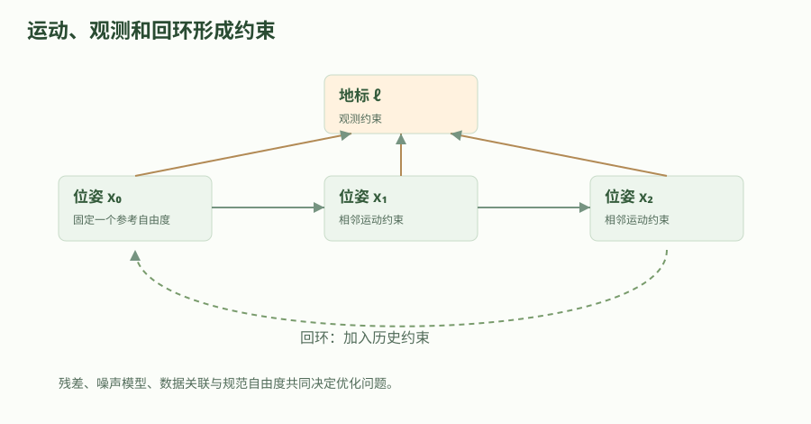

方框是待估计变量，连接表示模型残差或测量约束。回环需要可靠的数据关联；固定一个参考自由度可消除相应规范歧义，但不能自动修复错误观测或保证地图准确。

### 锚点消除规范自由度，不会创造外部精度

只有相对测量时，把全部位姿一起平移或旋转，观测往往不变。这称为规范自由度，在线性系统中表现为法方程奇异。固定第一帧是一种坐标选择，它消除求解中的任意整体运动，不代表第一帧已经拥有经过外部测量确认的全球坐标。单目纯视觉还可能有尺度自由度，需要额外传感器、尺寸先验或其他条件确定尺度。

本章用一维三节点图隔离最关键机制：两次里程计都报告前进一点一米，而起终点的回环报告总位移两米。固定第一帧为零后，只求两个未知位置。没有回环时累加结果是第一帧后一点一米、第二帧后二点二米；加入等权回环后，误差会在三条边之间折中，而不是把最后一个节点单独硬改为两米。

这个例子没有激光匹配、视觉特征或非线性旋转，因此适合手算检查优化方向，不足以代表完整 SLAM 实现。在真实图中，锚定过强还可能遮掩初始外参错误；如果引入 GNSS 等绝对观测，必须说明坐标系与不确定性如何接入，而不是同时把多个不一致的位姿都固定为绝对真值。

### 一步步解出一维回环校正

令第一帧位置为零，三个残差依次为 x1 减一点一、x2 减 x1 再减一点一、x2 减二。把它们平方相加并求导，第一行条件是两倍 x1 减 x2 等于零，第二行是负 x1 加两倍 x2 等于三点一。两式的系数矩阵行列式为三，故能得到唯一线性解。

先由第一行得到 x2 等于两倍 x1，代回第二行得到三倍 x1 等于三点一。因此 x1 约为一点零三三三米，x2 约为二点零六六七米。优化前的未加权残差平方和为零点零四平方米，优化后约为零点零一三三三平方米。三条残差都不必为零，最优意味着当前假设下的总目标最小。

如果回环来自错误匹配，较小的目标也可能对应错误轨迹。加入回环前要检查几何一致性、时间与场景重复性。鲁棒损失会限制大残差影响，却需要尺度参数，并可能把真实的大纠正误认为外点。不能根据一次优化收敛就认定所有数据关联正确，更不能把代价函数下降直接称为绝对定位精度提升。

#### 带回环的一维法方程

$$
\begin{bmatrix}2&-1\\-1&2\end{bmatrix}\begin{bmatrix}x_1\\x_2\end{bmatrix}=\begin{bmatrix}0\\3.1\end{bmatrix}
$$

这是固定 x0=0、等权位移测量的特例。对三个平方残差求导并令其为零得到两行方程；消元得到 x1=3.1/3、x2=6.2/3 m。

- `x_1,x_2`：两个待估计位置；单位／维度：m

- `3.1`：由位移测量组成的右侧常数；单位／维度：m

### 把估计结果放回 ROS 数据与 TF 链

轮式里程计通常承担连续短期运动，定位或 SLAM 提供全局校正。map 到 odom 可以因回环更新而跳变，odom 到 base_link 应保持适合局部控制的连续性。应为每条边指定唯一负责的发布者，避免 SLAM、融合节点和底盘同时竞争发布同一子坐标系。话题有数据不等于测量时刻的 TF 可以查到，必须按 header.stamp 核对缓存范围。

录制与重放时，保留原始扫描或图像、必要的惯性或轮速、动态 TF、静态 TF 和时钟。传感器数据不足以重建外参时，复现条件就不完整。重放后让参与节点统一使用仿真时间，不能让一部分节点拿系统时间查询一份过去的传感器包。开始、结束或暂停重放也可能触发缓存重建，需在实验记录中说明。

评估应比较同一时间基准下的轨迹与参考，先声明采用绝对误差、相对误差还是地图一致性指标。对齐过程是否消除了整体旋转、平移或尺度，会显著影响结果解释。没有外部真值时，可以检查闭环一致性和重复性，但应把它们称为内部一致性证据，避免将图形更好看当成经过真值验证的准确率。

### 用可重复残差实验建立调试顺序

运行下面程序后，先核对法方程给出的两个位置，再核对梯度接近零、代价比原里程计累加更低。程序还验证未锚定三节点矩阵乘全一向量为零，直接展示整体平移不改变相对约束。这比只看求解器返回成功更能发现目标构造、符号或锚点的错误。

随后逐项修改实验：提高一条边的权重，预测哪条残差应变小；删除回环，观察终点重新等于两段位移之和；删除锚点，检查矩阵奇异。不要把为了避免除零而随意增加的小常数解释为真实先验。若用阻尼改善数值，应另外记录阻尼与测量信息的不同作用。

从这个模型进入真实系统的顺序是：静态外参与时间检查、前端相邻约束、回环几何验证、后端数值条件，最后才是地图与导航集成。每一步保存可重放输入及失败样本。当前实验只验证一维线性图的计算，不声称已构建或运行 SLAM Toolbox、视觉 SLAM 或激光惯性系统。

#### applied_slam_lab.py

代码类型：complete

```python

def slam_lab():
    """求解固定第一帧的一维位姿图，并检验未固定时的平移规范自由度。"""
    from math import isclose

    # 输入：相邻位移 z01=z12=1.1 m，回环位移 z02=2.0 m；相同方差可约掉。
    # 固定 x0=0 后，最小化 (x1-1.1)^2+(x2-x1-1.1)^2+(x2-2.0)^2。
    h00, h01, h11 = 2.0, -1.0, 2.0
    b0, b1 = 0.0, 3.1
    determinant = h00*h11 - h01*h01
    assert determinant > 0.0  # 这个带锚点的小问题有唯一解。
    x1 = (h11*b0 - h01*b1) / determinant
    x2 = (-h01*b0 + h00*b1) / determinant

    def cost(a, b):
        return (a-1.1)**2 + (b-a-1.1)**2 + (b-2.0)**2

    assert isclose(x1, 1.0333333333333334)
    assert isclose(x2, 2.066666666666667)
    assert cost(x1, x2) < cost(1.1, 2.2)
    # 未锚定的三节点拉普拉斯矩阵乘全一向量为零：整体平移不改变相对残差。
    h_free = ((2,-1,-1), (-1,2,-1), (-1,-1,2))
    assert all(sum(row) == 0 for row in h_free)
    residuals = (x1-1.1, x2-x1-1.1, x2-2.0)
    # 在该一维线性模型中，梯度 J^T r 应为零；不等于每条测量都完全满足。
    assert abs(residuals[0]-residuals[1]) < 1e-12
    assert abs(residuals[1]+residuals[2]) < 1e-12
    result = {"x1_m": x1, "x2_m": x2, "优化前代价_m2": cost(1.1,2.2),
              "优化后代价_m2": cost(x1,x2)}
    print("一维位姿图", result)
    return result

if __name__ == "__main__":
    slam_lab()


```

完整独立文件，仅用 Python 标准库；含输入单位、断言和模型边界。可另存后执行；工程中的合并入口为 examples/theory_labs/applied_labs.py。

### 在实际二维位姿图里区分约束、锚点与误差

Robotics_Tutorial 用视觉里程计、关联、优化和回环来拆分 SLAM。放到二维激光案例，扫描匹配和里程计给相对状态估计，后端用约束联合调整位姿。固定版 Ceres 求解器取约束协方差的逆并作 Cholesky 分解，用上三角因子对白化残差；偏航误差先归一化。首个节点的 x、y 和偏航参数被固定以选定参考。

本次轨迹的首末 xy 接近重合，末帧偏航改变约 1.571 rad。MarkerArray 给出 37 个节点和 38 条建图约束。边数表示当前连接，若要把一条边归因为回环，还需记录约束类型或回环事件。

将每个接受帧的估计与独立采集位姿逐帧配对，再报告平面和偏航误差。图中的橙线输入是已知的注入偏差，青线是 ROS 位姿回执。结果反映这套几何和同一配置下的改正程度，初值、场景和走法会影响误差。

#### 沿采集路线对照输入偏差与估计误差

| 观测 | 里程计输入 | SLAM 输出 |
| --- | --- | --- |
| 第一帧平面误差 | 0.0000 m | 0.0000 m |
| 终点平面误差 | 0.1904 m | 0.0129 m |
| 终点绝对偏航误差 | 0.02720 rad | 0.00072 rad |
| 已接收帧中最大平面误差 | 0.1904 m | 0.0250 m |

各误差均以同帧 Gazebo 参考位姿计算。位姿回执是每帧在线输出，图标记记录的是相应阶段发布的图节点。

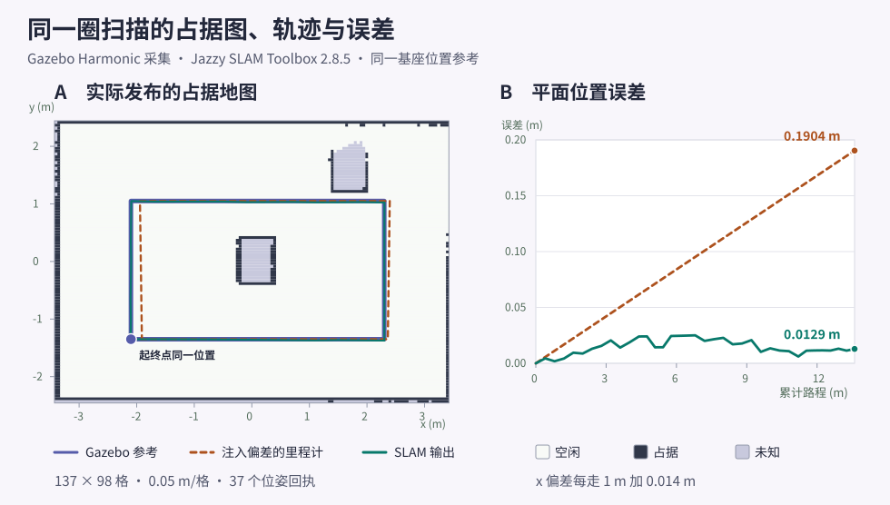

底图是 SLAM Toolbox 实际发布的占据栅格。路线取采集参考、注入偏差的里程计和接受扫描后的位姿回执。估计误差按采集参考位姿计算。

### 回环如何分摊里程计误差

机器人两段里程计各报告 1.1 m，但可靠回环测得起终点相距 2.0 m。

1. 固定 x0=0，写出三条位移残差。

2. 求导构造二阶线性方程。

3. 消元求得 x1=1.033333 m、x2=2.066667 m。

4. 比较校正前后目标，并检查未锚定问题的零空间。

验收：校正分布到整条轨迹；小残差并不自动证明回环关联真实。

### 深入练习 1

固定第一帧意味着获得绝对位置真值吗？

参考答案：不意味着。它先消除规范自由度并选择坐标原点，外部绝对精度仍需独立观测。

### 深入练习 2

为什么三条残差最优时可以都不为零？

参考答案：含噪且互相不完全一致的约束需要折中，最小化的是加权总目标。

### 深入练习 3

回环后的地图跳动一定是 TF 错误吗？

参考答案：不一定。全局校正可改变 map→odom；应检查是否符合系统约定，并保证局部 odom 连续及发布责任唯一。

### 深入练习 4

每走 1 m 在 x 方向注入 0.014 m 偏差。用本次路线计算末端平面误差，再比较实际估计。

参考答案：13.60 × 0.014 = 0.1904 m。其余平移分量未加偏差，所以是本例平面误差。终点估计误差为 0.0129 m。

### 深入练习 5

图里有 37 个节点和 38 条约束，怎样确认回环？

参考答案：先记录优化前后的位姿和新增边的两端。结合求解器或 SLAM 节点的约束类型、匹配事件与接受条件，区分邻接匹配和跨段回环。

### 基础验证流程

#### 运行本章离线实验

从 ros2-learning-hub 目录执行。它只计算本章的教学模型，不启动 ROS、仿真器或硬件；断言失败时停止并核对输入和单位。

```bash

# 输入固定在脚本中；--case 选择本章实验。
python3 examples/theory_labs/applied_labs.py --case slam

```

### 预期结果

- 位姿解为 1.033333 m 和 2.066667 m

- 残差平方和从 0.04 降到 0.013333 m²

- 未锚定矩阵存在整体平移零空间

### 常见问题

- 把局部位移直接加到世界坐标

- 把鲁棒核当成错误关联的万能修复

- 把相对轨迹对齐后的指标解释为未经对齐的绝对精度

### 练习

固定第一帧意味着获得绝对位置真值吗？

#### 参考答案

不意味着。它先消除规范自由度并选择坐标原点，外部绝对精度仍需独立观测。

### 验证范围

Python 标准库数值实验及断言已执行。在本机 Jazzy SLAM Toolbox 2.8.5、Nav2 MapServer 1.3.13、Harmonic 8.15.0 和 ros_gz_bridge 1.0.24 实测。主试验域 231，解压原创示例包后在域 232 重跑。采集使用离散移位和静止采样窗。轮地运动、扫描运动畸变、强制回环、远处重定位和跨版本图文件兼容性待测。

### 依据

- [Grisetti 等：A Tutorial on Graph-Based SLAM](https://www2.informatik.uni-freiburg.de/~stachnis/pdf/grisetti10titsmag.pdf)

- [Nav2 首次机器人接入指南](https://docs.nav2.org/jazzy/configuration_and_development/first_time_robot_setup_guide/)

- [Robotics_Tutorial：工程、SLAM 与规控范围对照](https://github.com/Michael-Jetson/Robotics_Tutorial/tree/7cb9e3d423196062c59dd346aae16285d962fb7c)

- [Ceres 的二维位姿图残差与锚点](https://github.com/SteveMacenski/slam_toolbox/blob/f84dad92a6579aeff4fe0c2590bbc74d3348e5af/solvers/ceres_solver.cpp)

- [位姿图节点与线列表标记](https://github.com/SteveMacenski/slam_toolbox/blob/f84dad92a6579aeff4fe0c2590bbc74d3348e5af/src/loop_closure_assistant.cpp)

- [机器人教程的 SLAM 前端与后端](https://github.com/Michael-Jetson/Robotics_Tutorial/blob/7cb9e3d423196062c59dd346aae16285d962fb7c/03_SLAM/10_SLAM%E7%90%86%E8%AE%BA/10_SLAM%E7%90%86%E8%AE%BA%E5%9F%BA%E7%A1%80.md)

## 41. 二维 SLAM：从传感器数据到可复用地图

SLAM 同时估计机器人轨迹与环境地图。先用可靠的扫描、短期里程计和时间同步建立输入条件，再讨论地图质量。成功显示一张图，只证明数据曾被处理，不代表地图可用于长期定位。

### 学习目标

- 检查 SLAM 必需的扫描和变换

- 区分栅格地图与位姿图

- 能保存地图并验证再次加载

### 先修

tf2；LaserScan；里程计和仿真时间

### 概念

SLAM 常提供 map→odom，底盘或融合节点提供 odom→base_link；这条链让扫描能被放到地图上。

地图分辨率会影响内存、细节和后续规划；更细不一定更准确。

栅格地图适合已知地图定位；可继续优化的 SLAM 会话还需要算法自己的位姿图数据。

### SLAM 的输入不是一张图，而是一段运动证据

二维激光 SLAM 将连续扫描和运动估计结合，构建机器人轨迹与占据栅格。激光提供周围障碍几何，里程计提供短期运动先验，扫描匹配再寻找与历史观测一致的姿态。回到已经见过的地方时，回环约束可调整累积误差，但算法无法凭空恢复从未被传感器观察到的区域。

本章先做一个静止方形房间实验：自己产生 LaserScan，不需要真实雷达或完整物理模拟器。实验只验证消息、TF 和地图生成的数据链，不证明移动建图质量。将静止输入替换为真实运动数据后，才需要评价重影、漂移、回环和地图一致性。

### 定义扫描、坐标与时钟合同

LaserScan 中每条距离对应 angle_min 加索引乘 angle_increment，长度单位是米，角度是弧度。range_min/range_max 之外的值需要按消息和算法约定处理，不能将“没有测到障碍”误写为零距离。header.frame_id 表示扫描坐标，header.stamp 应与 TF 查询的采样时间一致。

slam_toolbox 通常使用 odom 到 base frame 的运动关系，并发布 map 到 odom。机器人内部 base_link 到 laser 必须已知。只让扫描话题有数据而没有 TF，无法把不同时间的观测组合起来。最小实验使用系统时间，所有节点关闭 use_sim_time；以后回放或仿真时再整体切到统一时钟。

先用仿真章的实际扫描核第 20 束距离约 2.20 m、激光 frame 和采样时戳。SLAM Toolbox 配置还需独立指定 scan_topic、odom_frame、base_frame 与 map_frame。静止台架只检查入口；走廊、转弯和回环的建图效果需要有运动和里程计的不同数据。

### 生成一份完整的合成扫描

将下方脚本保存为 square_scan.py。它在原点朝四周发射三百六十条射线，房间边界位于 x、y 的正负两米。每条射线取与四面墙最先相交的距离，因此角点附近距离更长。脚本使用传感器数据 QoS，以十赫兹发布，所有值和几何关系都能直接检查。

运行前需要系统 Jazzy 的 rclpy 和 sensor_msgs，终端 source 系统环境后用 python3 启动。代码为完整单文件节点，编写时未实际运行。它故意不模拟噪声、遮挡、滚动扫描或运动畸变，避免把教学几何与真实雷达性能混为一谈。

#### square_scan.py：完整合成传感器

代码类型：complete

```python

# 【中文教学注释】 square_scan.py：完整合成传感器
# 本例作用：该节点没有运动控制功能，仅发布合成扫描。
# 输入输出：输入为 LaserScan、TF、时钟与建图参数；输出为合成扫描、地图和保存文件。
# 执行顺序与边界：距离 m、角度 rad、栅格分辨率 m/cell；合成方房间只是数据契约实验，没有真实运动或 SLAM 精度证明。保存前检查 TF 和扫描时间。
import math
import rclpy
from rclpy.node import Node
# 使用传感器 QoS 预设；关键是低积压和 best-effort 语义，双方仍需检查具体策略。
from rclpy.qos import qos_profile_sensor_data
from sensor_msgs.msg import LaserScan

class SquareScan(Node):
    def __init__(self):
        # 构造 Node 基类并确定节点名；后续相对话题/服务名由命名空间解析，重命名需与参数文件选择器对应。
        super().__init__("square_scan")
        # 创建指定消息类型和话题的发布端并持久保存；整数 QoS 是 KeepLast 历史深度，不是 Hz，真正发送由 publish 调用决定。
        self.pub = self.create_publisher(LaserScan, "/scan", qos_profile_sensor_data)
        # 定时周期单位为秒，回调由执行器调度而非自动新建独占线程；使用节点时钟，仿真时间暂停可能影响触发。
        self.timer = self.create_timer(0.1, self.publish_scan)

    def publish_scan(self):
        msg = LaserScan()
        # 取得节点当前 ROS 时刻并转换为 sec/nanosec 消息；use_sim_time 时来自 /clock，采样时刻应尽量靠近数据生成。
        msg.header.stamp = self.get_clock().now().to_msg()
        # 坐标系名称是离散标识；它必须与数值实际表达的坐标系相符，改字符串不会完成坐标变换。
        msg.header.frame_id = "laser"
        # 扫描角度单位 rad；angle_max 必须与角度起点、增量和实际样本数相符，360个点只有359个相邻间隔。
        msg.angle_min = -math.pi
        msg.angle_increment = 2.0 * math.pi / 360.0
        msg.angle_max = msg.angle_min + 359 * msg.angle_increment
        # 有效距离上下界单位 m；真实无返回/越界样本还需遵循 LaserScan 的约定，不可随意当作零距离。
        msg.range_min = 0.05
        msg.range_max = 10.0
        # 整次扫描时长单位 s；此合成实验不模拟每束激光在该时长内的真实运动畸变。
        msg.scan_time = 0.1
        for i in range(360):
            a = msg.angle_min + i * msg.angle_increment
            # 对边长4m、中心在传感器原点的合成方房间求射线到墙距离；1e-9只避免除零，不模拟真实噪声/遮挡。
            distance = min(2.0 / max(abs(math.cos(a)), 1e-9),
                           2.0 / max(abs(math.sin(a)), 1e-9))
            # 按角度从angle_min递增的相同顺序追加米制距离；数组长度与angle_increment/angle_max约定一致。
            msg.ranges.append(distance)
        # 提交已填好的消息给 ROS 发布端；这不是业务处理完成确认，端到端接收仍取决于发现、类型、QoS 和执行器。
        self.pub.publish(msg)

# 程序入口按本章顺序组织资源；本例仅在 __main__ 下运行，import 时不应启动节点或连接硬件。
def main():
    # 初始化当前进程的 ROS 上下文并解析传入 ROS 参数；在创建节点/端点之前调用。
    rclpy.init()
    node = SquareScan()
    try:
        # 进入执行器事件循环，定时器、订阅、服务和 Future 回调在这里才被推进；通常阻塞到中断或上下文关闭。
        rclpy.spin(node)
    except KeyboardInterrupt:
        pass
    finally:
        # 显式释放节点所属端点与定时器；应在相关执行器不再访问节点后执行。
        node.destroy_node()
        # 检查 ROS 上下文仍有效，避免退出流程重复 shutdown；它不表示节点业务健康。
        if rclpy.ok():
            # 关闭本进程 ROS 上下文；先停止执行器、销毁端点/节点，再在上下文仍有效时调用。
            rclpy.shutdown()

if __name__ == "__main__":
    main()

```

该节点没有运动控制功能，仅发布合成扫描。

输入输出：输入为 LaserScan、TF、时钟与建图参数；输出为合成扫描、地图和保存文件。
执行顺序与边界：距离 m、角度 rad、栅格分辨率 m/cell；合成方房间只是数据契约实验，没有真实运动或 SLAM 精度证明。保存前检查 TF 和扫描时间。

### 配置并按顺序启动建图

将配置保存为 mapping.yaml，先启动合成扫描，再分别启动 odom 到 base_link 和 base_link 到 laser 的静态变换，最后启动 slam_toolbox。静止机器人允许这两条关系保持单位变换；真实移动系统绝不能把里程计边固定为零来掩盖缺失驱动。每个常驻命令使用独立终端。

最小参数说明了地图、里程计、车体和扫描名称；其他参数采用安装包默认值。若节点报告参数或求解器不兼容，首先核查是否确实运行 Jazzy 包，并查看第一条配置错误。地图分辨率设为五厘米，表示每个栅格覆盖的地面长度，不等于传感器测量精度。

#### mapping.yaml

代码类型：complete

```yaml

# 【中文教学注释】 mapping.yaml
# 本例作用：供 slam_toolbox 的在线异步 launch 读取。
# 输入输出：输入为 LaserScan、TF、时钟与建图参数；输出为合成扫描、地图和保存文件。
# 执行顺序与边界：距离 m、角度 rad、栅格分辨率 m/cell；合成方房间只是数据契约实验，没有真实运动或 SLAM 精度证明。保存前检查 TF 和扫描时间。
slam_toolbox:
  # ROS参数文件的固定层级名；其父节点名/通配选择器必须匹配实际启动名称。
  ros__parameters:
    # 布尔开关：true使节点采用ROS仿真时间，必须有正确/clock；false使用正常节点时钟路径。
    use_sim_time: false
    mode: mapping
    # 坐标系名称必须与TF树及消息Header一致；名称配置不自动生成所需TF或完成外参标定。
    map_frame: map
    odom_frame: odom
    base_frame: base_link
    # 实际LaserScan输入话题；需要相容QoS、有效Header和可查TF。
    scan_topic: /scan
    # 二维地图栅格分辨率，单位m/cell；越细通常越耗内存和计算，不直接保证定位精度。
    resolution: 0.05
    # 地图更新间隔，单位s；不是激光扫描周期或控制器周期。
    map_update_interval: 2.0

```

供 slam_toolbox 的在线异步 launch 读取。

输入输出：输入为 LaserScan、TF、时钟与建图参数；输出为合成扫描、地图和保存文件。
执行顺序与边界：距离 m、角度 rad、栅格分辨率 m/cell；合成方房间只是数据契约实验，没有真实运动或 SLAM 精度证明。保存前检查 TF 和扫描时间。

#### 每个命令在独立已 source 的终端运行

代码类型：commands

```bash

# 【中文教学注释】 每个命令在独立已 source 的终端运行
# 本例作用：需要安装 ros-jazzy-slam-toolbox；静态边仅属于本节静止实验。
# 输入输出：输入为 LaserScan、TF、时钟与建图参数；输出为合成扫描、地图和保存文件。
# 执行顺序与边界：距离 m、角度 rad、栅格分辨率 m/cell；合成方房间只是数据契约实验，没有真实运动或 SLAM 精度证明。保存前检查 TF 和扫描时间。
# 用当前Python解释器运行指定本地脚本；脚本参数/输出路径按本段约定，ROS脚本还需source与包依赖，标准库实验不连接硬件。
python3 square_scan.py
# 从已安装包tf2_ros启动static_transform_publisher；此进程通常持续运行，另用新终端执行观察命令，Ctrl+C结束。 静态平移为m、roll/pitch/yaw为rad；父/子方向必须与后续查询一致。
ros2 run tf2_ros static_transform_publisher --frame-id odom --child-frame-id base_link
ros2 run tf2_ros static_transform_publisher --frame-id base_link --child-frame-id laser
# 解析指定launch描述并启动其动作；key:=value为启动参数覆盖。节点发现、TF、控制器和生命周期就绪仍需另行检查。
ros2 launch slam_toolbox online_async_launch.py slam_params_file:="$(pwd)/mapping.yaml" use_sim_time:=false

```

需要安装 ros-jazzy-slam-toolbox；静态边仅属于本节静止实验。

输入输出：输入为 LaserScan、TF、时钟与建图参数；输出为合成扫描、地图和保存文件。
执行顺序与边界：距离 m、角度 rad、栅格分辨率 m/cell；合成方房间只是数据契约实验，没有真实运动或 SLAM 精度证明。保存前检查 TF 和扫描时间。

### 判读地图并保存可以再次加载的结果

在 RViz 中选择 map 作为 Fixed Frame，添加 Map、LaserScan 和 TF。预期能观察到围绕原点的方形墙体，墙内空间被标为已观测自由区域。先比较扫描几何和地图，而不是追求图像边缘完全平滑：占据栅格离散化会使斜向边缘出现台阶。

保存导航用地图时，map_saver_cli 生成图像和 YAML。YAML 保存分辨率、原点和阈值，单独拷贝图像无法完整恢复地图。若希望以后继续优化建图，还需要 slam_toolbox 自己的位姿图序列化；导航栅格和算法内部图不是同一种持久化对象。

#### 检查并保存

代码类型：commands

```bash

# 【中文教学注释】 检查并保存
# 本例作用：需要 nav2_map_server。保存后应同时保留地图图像与 YAML。
# 输入输出：输入为 LaserScan、TF、时钟与建图参数；输出为合成扫描、地图和保存文件。
# 执行顺序与边界：距离 m、角度 rad、栅格分辨率 m/cell；合成方房间只是数据契约实验，没有真实运动或 SLAM 精度证明。保存前检查 TF 和扫描时间。
# 临时创建订阅者观察消息；--once收到一条后退出，持续模式用Ctrl+C结束，其QoS也须匹配。
ros2 topic echo /map --once --field info
# 从已安装包nav2_map_server启动map_saver_cli；此进程通常持续运行，另用新终端执行观察命令，Ctrl+C结束。
ros2 run nav2_map_server map_saver_cli -f /tmp/square_map

```

需要 nav2_map_server。保存后应同时保留地图图像与 YAML。

输入输出：输入为 LaserScan、TF、时钟与建图参数；输出为合成扫描、地图和保存文件。
执行顺序与边界：距离 m、角度 rad、栅格分辨率 m/cell；合成方房间只是数据契约实验，没有真实运动或 SLAM 精度证明。保存前检查 TF 和扫描时间。

### 从合成房间过渡到真实数据

接入移动平台时撤掉假的 odom 静态边，由底盘或融合节点提供运动变换，保留真实安装关系。先缓慢直行和转弯，检查扫描在 odom 中是否合理，再探索环境。重影可能来自时间偏差、错误安装、里程计尺度或运动畸变，不能只靠扫描匹配参数弥补。

比较参数时录制同一份 /scan、TF 和必要状态，固定时钟后重复建图。记录地图重影、回到起点后的对齐、CPU 和积压。空白地图先查扫描数量、TF、时间和节点状态；地图弯曲先查里程计尺度与传感器安装；重复墙体先查时间延迟和回环条件。

### 把“地图可用”写成可重复判据

最低验收包括：地图话题持续发布，frame 为 map，分辨率和尺寸符合预期，保存后可以重新加载，扫描与墙体在正确姿态下对齐。真实场景还应选取几段独立测量距离比较尺度，记录动态物体造成的污染，并确认导航所需区域没有因遮挡而被错误假定为自由空间。

静止方房实验提供一个确定基线。若更换算法后连这个简单输入都不能生成合理图形，应先修复接口；若基线正常而实测失败，再逐步引入噪声、运动和回环。这样的实验阶梯能够把系统集成问题与算法鲁棒性问题分开。

### 把占据图与可继续建图的位姿图区分保存

占据图交给 Nav2 MapServer 时，需要 PGM 与 YAML 配对保存。台架从已知几何生成这对文件，重载能核对分辨率、原点与占据结果。使用地图时应另记录地图数据来源、生成时刻和尺寸。

SLAM Toolbox 的 SaveMap 和 SerializePoseGraph 对应不同产物。序列化位姿图供继续建图或图定位使用，反序列化时还要选择首节点、指定姿态或定位匹配方式。只有栅格文件时，图中的扫描、位姿节点和约束无法从像素完整恢复。

本地 Jazzy 快照的 mapper_params_localization.yaml 中仍写着 mode: mapping 并带 localization 注释。准备图定位时，检查实际启动的节点、有效模式和图文件入口。Linorobot2 将建图与导航放在独立启动文件，这些参数也要按实际运行分支核对。

### 用真实仿真回波检验采集与回放合同

台架按长方形路线设置多处位姿，总路程 13.60 m。每处先用世界服务移位，再推进 80 个 0.005 s 步长，在稳定窗口里配对激光与 Gazebo 位姿。俯视盒形场景另算射线交点，用相同角度和基座位姿核对距离。

原始位姿流只作测量参考。回放驱动先供独立时钟和 TF，再送原始 LaserScan 距离。每走 1 m 给里程计 x 加 0.014 m、给偏航加 0.002 rad，得到可单独核算的偏差。首轮保留采集时戳，ROS 的处理次序通过回执检查。

固定源码中，LaserScan 先经 Sensor Data QoS 与朝 odom 的 TF 消息过滤，回调再查询扫描时刻的基座位姿和传感器安装。同步实现把通过门限的帧排入队列，异步实现从回调走自己的处理路径。

首次测量允许通过。后续需同时看暂停、节流、最小时间间隔和预热逻辑。测试启用了精确距离与转角判定，距离与转角都低于各自阈值时跳过。错误帧和故意留出的静止预热用于核对这两类边界。

#### 离散移位、采集时戳与扫描准入

| 检查 | 本次观测 | 解释 |
| --- | --- | --- |
| 激光与参考位姿 | 47/47 对同戳 | 每对含 361 束距离，采集窗 0.40 s，激光高 0.30 m |
| 盒形场景对照 | 各帧绝对距离误差的 P95 最大为 0.02945 m | 解析射线与 GPU 激光比对，用于核对几何、角度和单位 |
| 错误扫描帧 | 0.35 s 的 unlinked_laser 无位姿 | 时钟和基座里程计已提供，扫描帧到目标 odom 仍缺变换 |
| 修正后的建图回放 | 37/40 条扫描有位姿 | 首帧通过，接下来的三条静止预热帧无新位姿，随后依次接收路线扫描 |
| 采集时钟隔离 | 18.80 s | 采集结束后 Gazebo 保持暂停，SLAM 使用单独重映射的回放时钟 |

路线按离散位置采集，每个采样窗内台架静止。保留的 7 帧用于后续恢复和定位。

### 从有效位姿跟到实际发布的地图

首帧后记录占据图，完成整圈后再记录地图和位姿图。整圈有 37 个位姿回执，图标记给出 37 个节点和 38 条建图约束。四个路线拐角都可在最终图上查到空闲格，四处已知墙面或障碍探针到最近占据格的最大距离约 0.0181 m。

固定同步节点在完成建图前已更新扫描 Header。驱动先等同戳位姿，再清空旧接收缓存并等一次地图发布，最后核对 dynamic_map 的数据和话题一致。固定实现要求地图发布端已激活且有订阅者，动态地图服务读取缓存。

最后一个扫描时刻是 16.00 s。restamp_tf 关闭时，map 到 odom 的发布时戳为 16.20 s，即扫描加 0.20 s。验收使用扫描时刻查询 map 到 laser_link，实际保留约 0.30 m 的激光安装高度。

#### 首帧与整圈之后的实测占据图

| 阶段 | 尺寸（格） | 空闲 | 占据 | 未知 | 原点 x / y（m） |
| --- | --- | --- | --- | --- | --- |
| 首个有效扫描 | 137 × 97 | 1378 | 86 | 11825 | -3.41568 / -2.42917 |
| 最后一个建图扫描 | 137 × 98 | 12318 | 659 | 449 | -3.42765 / -2.45707 |

分辨率约 0.05 m/格。两张图的尺寸与原点发生变化，面积比较要先对齐到同一空间范围。


底图是 SLAM Toolbox 实际发布的占据栅格。路线取采集参考、注入偏差的里程计和接受扫描后的位姿回执。估计误差按采集参考位姿计算。

### 新进程分别重载栅格、恢复图并继续建图

先用 SLAM Toolbox 的 SaveMap 保存 PGM/YAML。然后用 SerializePoseGraph 按一个路径前缀保存图和扫描数据。两份二进制文件来自固定版的 Boost 归档，复跑时保留原配对和生成版本。ROS2 教程第 11 章的 YAML 节点和边适合说明数据结构，工程运行依赖实际接口定义与二进制文件。

将 learned.yaml 单独交给新 MapServer。它重载的 13426 个占据值与原图逐格相等。YAML 保存平移原点时保留三位小数，本次 xy 差约 0.354 mm。下游复用时仍要检查分辨率、帧、原点和格值。

关闭原建图节点，启动新的同步建图节点。请求字段包含前缀、匹配类型与可选初始位姿。缺失前缀和误用图定位模式都给出空响应，只有首节点模式实际恢复地图。还未重放扫描时，恢复栅格的 Header 时间为零，其格值、原点和节点数已能独立检查。

继续提供 7 帧留存数据，4 帧产生新位姿。使用不同的 continued 前缀保存新图，保留旧图以复现初始条件。两种前缀各保留成对文件，回执之外再检查图标记与文件指纹。

完整导航台架沿用这一对 PGM/YAML，在同一房间里让实际差速车执行任务。启动后再按原 OccupancyGrid 核 13426 格，并用地图系初值启动 AMCL。导航运行使用栅格，留存的位姿图仍供本章的继续建图与图定位。

#### 同一张图的栅格重载与位姿图恢复

| 操作 | 回执与产物 | 后验检查 |
| --- | --- | --- |
| 首图产生前 SaveMap | result=1 | 报告没有新文件 |
| 有图后 SaveMap | result=0 · learned.pgm + learned.yaml | 新 MapServer 的 13426 格逐格一致，平移原点差 0.000354 m |
| SerializePoseGraph | result=0 · learned.posegraph + learned.data | 37 个建图节点，38 条建图约束 |
| 恢复缺失前缀或匹配类型不符 | 两次响应都没有字段 | 新同步节点的地图仍为空 |
| 同步节点 START_AT_FIRST_NODE | 响应没有字段 | 回放前已复原全部 13426 格和原位姿图 |
| 恢复后继续提供留存扫描 | 4 条新增位姿 | 新前缀保存 41 个建图节点和 46 条约束 |

用有效地图、位姿图标记与文件指纹验收。恢复前的空回执和成功后的空回执具有相同的消息结构。

### SLAM Toolbox 的扫描、地图与位姿图接口

| 接口 | 输入与单位 | 实际输出或检查 | 边界 |
| --- | --- | --- | --- |
| LaserScan 与 TF | 距离 m，角度 rad，Header 为采集时刻 | 按扫描帧等目标 odom，再查基座运动 | 到达话题后仍可因缺 TF 或门限跳过 |
| map / dynamic_map | 订阅可靠瞬态本地地图，GetMap 为空请求 | OccupancyGrid 和地图元数据 | 固定实现读取缓存，空图与未发布要分开 |
| SaveMap | name 为栅格输出前缀 | PGM/YAML，result 0 为成功 | 首图前本次 result=1 |
| SerializePoseGraph | filename 为图文件前缀 | .posegraph + .data，result 0 为成功 | 两份文件一起备份，版本和来源随图记录 |
| DeserializePoseGraph | match_type 为 1、2 或 3，地图初值用 m、rad | 固定版响应无字段 | 本次同步恢复用 1，图定位用 3。2 由接口定义列出 |
| clear_localization_buffer | std_srvs/Empty | 短期图节点、边和栅格可重新观察 | 定位进程提供，回执无业务字段 |

命名空间用于 ROS 名称隔离。TF frame 字符串仍须按同一棵树规划。

### 从零消息到一张方形地图

没有实体雷达，希望学习扫描、TF、SLAM 和地图文件的关系。

1. 运行合成扫描，确认每帧三百六十个距离。

2. 发布静止机器人两条 TF，并用 tf2_echo 验证。

3. 加载最小建图参数，等待地图更新。

4. 在 RViz 比较方形扫描与地图，再保存图像和 YAML。

验收：完成一个可检查的静止建图链路；它只验证接口，不包含移动定位与回环性能结论。

### 深入练习 1

静止实验为何能用 odom→base_link 静态变换？

参考答案：因为机器人位置被明确设为不动。真实移动平台必须由运动估计持续更新这条边。

### 深入练习 2

保存一张地图图片足够吗？

参考答案：不够，还需要分辨率、原点等 YAML 信息。继续建图还可能需要算法自己的位姿图数据。

### 深入练习 3

地图出现两层墙先查什么？

参考答案：先查传感器时间、安装 TF、运动估计和消息延迟，再判断扫描匹配或回环参数。

### 深入练习 4

只有连续重复的静止墙面扫描，能否验收建图的回环？

参考答案：回环需要实际重访与时序观测。静止采样只适用于验收扫描结构、坐标与输入链路。

### 深入练习 5

若要隔天在旧地图基础上继续做图优化，除了 PGM 与 YAML 应保存什么？

参考答案：同时序列化 SLAM Toolbox 的位姿图及数据，记录建图参数、文件名、初始匹配策略和版本。

### 深入练习 6

第一帧之前 SaveMap 已能调用，怎样确定有可发布的文件？

参考答案：看 result。实测首图前返回 1 且没有新文件。收到有效 OccupancyGrid 后重试，核对 PGM/YAML 是否成对、再让新 MapServer 实际读取。

### 深入练习 7

同步建图节点收到了空的 DeserializePoseGraph 响应，该如何验收？

参考答案：空响应是接口结构。确认生命周期与匹配类型，再等待有效栅格，核对图节点和格值。缺前缀、匹配类型不符、成功恢复三种情况都要分别观察。

### 深入练习 8

首帧和最后一帧图的未知格相差很多，能直接换算成新探索的面积吗？

参考答案：先在共同坐标系与网格边界上对齐地图。原点和尺寸发生变化时，两次数组索引的空间含义不同。用重采样或同一范围的索引再比较。

### 基础验证流程

#### 先验证扫描和 TF

在带二维激光的模拟机器人或实机上检查。将 /scan 与 laser 替换为实际名称。

输入输出：输入为 LaserScan、TF、时钟与建图参数；输出为合成扫描、地图和保存文件。
执行顺序与边界：距离 m、角度 rad、栅格分辨率 m/cell；合成方房间只是数据契约实验，没有真实运动或 SLAM 精度证明。保存前检查 TF 和扫描时间。

```bash

# 【中文教学注释】 先验证扫描和 TF
# 本例作用：在带二维激光的模拟机器人或实机上检查。将 /scan 与 laser 替换为实际名称。
# 输入输出：输入为 LaserScan、TF、时钟与建图参数；输出为合成扫描、地图和保存文件。
# 执行顺序与边界：距离 m、角度 rad、栅格分辨率 m/cell；合成方房间只是数据契约实验，没有真实运动或 SLAM 精度证明。保存前检查 TF 和扫描时间。
# 用观察者的到达间隔估算接收频率Hz；它不是发布端硬实时周期或网络全部负载的证明。
ros2 topic hz /scan
# 临时创建订阅者观察消息；--once收到一条后退出，持续模式用Ctrl+C结束，其QoS也须匹配。
ros2 topic echo /scan --once
# 从已安装包tf2_ros启动tf2_echo；此进程通常持续运行，另用新终端执行观察命令，Ctrl+C结束。 静态平移为m、roll/pitch/yaw为rad；父/子方向必须与后续查询一致。
ros2 run tf2_ros tf2_echo base_link laser

```

#### 启动异步 SLAM 示例

需要已安装 slam_toolbox 且输入话题/坐标系符合所用参数。use_sim_time 在真机上改为 false。

输入输出：输入为 LaserScan、TF、时钟与建图参数；输出为合成扫描、地图和保存文件。
执行顺序与边界：距离 m、角度 rad、栅格分辨率 m/cell；合成方房间只是数据契约实验，没有真实运动或 SLAM 精度证明。保存前检查 TF 和扫描时间。

```bash

# 【中文教学注释】 启动异步 SLAM 示例
# 本例作用：需要已安装 slam_toolbox 且输入话题/坐标系符合所用参数。use_sim_time 在真机上改为 false。
# 输入输出：输入为 LaserScan、TF、时钟与建图参数；输出为合成扫描、地图和保存文件。
# 执行顺序与边界：距离 m、角度 rad、栅格分辨率 m/cell；合成方房间只是数据契约实验，没有真实运动或 SLAM 精度证明。保存前检查 TF 和扫描时间。
# 解析指定launch描述并启动其动作；key:=value为启动参数覆盖。节点发现、TF、控制器和生命周期就绪仍需另行检查。
ros2 launch slam_toolbox online_async_launch.py use_sim_time:=true

```

#### 缓慢覆盖环境并形成回环

在 RViz 显示 /map、扫描与 TF。以回到起点后的重合程度评估闭环效果，保留原始 bag 以便复盘。

#### 保存导航用地图

需要 nav2_map_server；输出路径所在目录应存在。

输入输出：输入为 LaserScan、TF、时钟与建图参数；输出为合成扫描、地图和保存文件。
执行顺序与边界：距离 m、角度 rad、栅格分辨率 m/cell；合成方房间只是数据契约实验，没有真实运动或 SLAM 精度证明。保存前检查 TF 和扫描时间。

```bash

# 【中文教学注释】 保存导航用地图
# 本例作用：需要 nav2_map_server；输出路径所在目录应存在。
# 输入输出：输入为 LaserScan、TF、时钟与建图参数；输出为合成扫描、地图和保存文件。
# 执行顺序与边界：距离 m、角度 rad、栅格分辨率 m/cell；合成方房间只是数据契约实验，没有真实运动或 SLAM 精度证明。保存前检查 TF 和扫描时间。
# 从已安装包nav2_map_server启动map_saver_cli；此进程通常持续运行，另用新终端执行观察命令，Ctrl+C结束。
ros2 run nav2_map_server map_saver_cli -f /tmp/learning_map

```

### 预期结果

- 地图随扫描扩展，回环后已有墙体与新扫描尽量对齐。

- 保存得到地图图像与 YAML 描述，可以在新会话加载。

### 常见问题

- 扫描 frame 无法转换到 base frame 会让建图停滞或丢帧。

- 把反光、玻璃和运动物体造成的异常完全归因于算法参数，容易掩盖传感器问题。

- 仅保存 PNG/PGM 不包含地图原点、分辨率和阈值等 YAML 信息。

### 练习

在同一份 bag 上对比两种建图参数，记录地图重影、回环表现、CPU 与处理延迟，解释取舍。

#### 参考答案

比较时必须使用同一份 bag、时钟和输入话题，仅改变指定参数。记录墙体重影、闭环前后偏差、CPU 和处理延迟；单看地图截图不足以判断优劣。

参数改变若提高细节却显著增加处理积压，应解释其代价。导航地图与位姿图分别保存，并在新会话验证读取。

### 验证范围

在本机 Jazzy SLAM Toolbox 2.8.5、Nav2 MapServer 1.3.13、Harmonic 8.15.0 和 ros_gz_bridge 1.0.24 实测。主试验域 231，解压原创示例包后在域 232 重跑。采集使用离散移位和静止采样窗。轮地运动、扫描运动畸变、强制回环、远处重定位和跨版本图文件兼容性待测。

### 依据

- [slam_toolbox Jazzy 源码与指南](https://github.com/SteveMacenski/slam_toolbox/tree/jazzy)

- [Nav2：建图与定位](https://docs.nav2.org/jazzy/configuration_and_development/first_time_robot_setup_guide/sensors/mapping_localization/)

- [rosbag2 Jazzy 源码与使用说明](https://github.com/ros2/rosbag2/tree/jazzy)

- [SLAM Toolbox 的输入与帧](https://github.com/SteveMacenski/slam_toolbox/blob/f84dad92a6579aeff4fe0c2590bbc74d3348e5af/config/mapper_params_online_async.yaml)

- [LaserScan 与 PointCloud2 二进制合同](https://github.com/ros2/common_interfaces/blob/a941f14bb318d8d904505ed935ccbb97f24a70a4/sensor_msgs/msg/LaserScan.msg)

- [图像、LaserScan 和点云的桥转换](https://github.com/gazebosim/ros_gz/blob/3c15c8edeb747824066e86990f6a4ebfda913c50/ros_gz_bridge/src/convert/sensor_msgs.cpp)

- [SLAM Toolbox 的栅格保存与图序列化](https://github.com/SteveMacenski/slam_toolbox/blob/f84dad92a6579aeff4fe0c2590bbc74d3348e5af/README.md)

- [MapServer 的图像装载与错误分类](https://github.com/ros-navigation/navigation2/blob/94d1c2a345dda6ff637e6a72c9101d927ee99f19/nav2_map_server/src/map_io.cpp)

- [Linorobot2 的建图与导航配置](https://github.com/linorobot/linorobot2/blob/f6b0bd0350c4a9d6b815ef4bb5c701a1e5129711/linorobot2_navigation/launch/navigation.launch.py)

- [SLAM Toolbox 的输入过滤、地图发布和 TF 时戳](https://github.com/SteveMacenski/slam_toolbox/blob/f84dad92a6579aeff4fe0c2590bbc74d3348e5af/src/slam_toolbox_common.cpp)

- [同步建图队列、异步入口与启动生命周期](https://github.com/SteveMacenski/slam_toolbox/blob/f84dad92a6579aeff4fe0c2590bbc74d3348e5af/src/slam_toolbox_sync.cpp)

- [栅格保存服务和真实回执](https://github.com/SteveMacenski/slam_toolbox/blob/f84dad92a6579aeff4fe0c2590bbc74d3348e5af/src/map_saver.cpp)

- [Nav2 MapSaver 的命令、阈值与地图原点](https://github.com/ros-navigation/navigation2/blob/94d1c2a345dda6ff637e6a72c9101d927ee99f19/nav2_map_server/src/map_saver/main_cli.cpp)

- [位姿图与扫描数据的二进制保存](https://github.com/SteveMacenski/slam_toolbox/blob/f84dad92a6579aeff4fe0c2590bbc74d3348e5af/include/slam_toolbox/serialization.hpp)

- [ROS2 教程的建图、地图管理与导航串联](https://github.com/zsc/ros2_tutorial/blob/ae6703d73947442c5705350e88970b77089ab15a/chapter11.md)

- [位姿图节点与线列表标记](https://github.com/SteveMacenski/slam_toolbox/blob/f84dad92a6579aeff4fe0c2590bbc74d3348e5af/src/loop_closure_assistant.cpp)

- [导航启动文件、命名空间与生命周期](https://github.com/ros-navigation/navigation2/blob/94d1c2a345dda6ff637e6a72c9101d927ee99f19/nav2_bringup/launch/navigation_launch.py)

## 42. 状态估计：轮速、IMU、GNSS 与定位坐标系

融合的目标是利用互补传感器约束状态，同时承认各自的不确定性。首先统一单位、轴向、时间戳和协方差，再配置 EKF/UKF；滤波器无法自动识别错误的传感器契约。

### 学习目标

- 分辨连续局部估计与可能跳变的全局定位

- 按状态量选择融合输入

- 理解协方差和重复测量的影响

### 先修

tf2 与 odom/map；Odometry 与 Imu 消息；协方差基础

### 概念

轮速擅长短期平面运动，IMU 提供角速度与加速度约束，GNSS 提供全局位置但可能跳变。

robot_localization 输入配置通常按 x,y,z,roll,pitch,yaw 及速度/加速度的固定顺序选择量；必须逐项核对。

同一个编码器同时生成的位置和速度并非两份独立信息，重复融合可能制造过度自信。

### 估计状态与测量状态是两件事

轮式里程计、IMU 和 GNSS 都只从各自物理机制观察机器人。状态估计器将测量与运动模型结合，输出在当前信息下最合理的状态及不确定性。它不是把所有传感器简单平均，也不会自动识别错误单位、错误坐标或重复信息。输入合同错误时，滤波结果可能很平滑却完全错误。

robot_localization 的 EKF 和 UKF 处理位置、姿态、速度与加速度等状态。二维底盘通常限制垂直运动和横滚俯仰，但仍须理解真实 IMU 如何测量重力与角速度。学习时先用一项速度测量看清积分行为，再逐渐加入互补信息，避免第一天就配置十个输入。


预测与校正既要更新状态，也要处理不确定性、时间戳和观测坐标。图不意味着所有SLAM算法都采用EKF，也不保证所有状态都可观。

### 设计 map、odom 和 base_link 的发布职责

odom 表达连续的局部运动估计，允许缓慢漂移，适合控制；map 表达全局参考，可因重新定位发生修正。局部滤波器通常提供 odom 到 base_link，全局定位提供 map 到 odom。使用 GNSS 或其他全局来源时，必须决定如何保持局部控制所依赖的连续关系。

每条 TF 边只保留一个负责发布的节点。如果底盘驱动已经发布 odom 到 base_link，而 EKF 也发布同一条边，就要关闭其中一个。消息仍可由底盘发布供融合使用，关闭 TF 不等于关闭测量。输入消息的 frame 与 child_frame 应与真实量的表达坐标一致。

### 协方差和输入选择决定融合含义

协方差表达测量不确定性及状态间相关性，不是为了通过格式检查随便填写的数组。把不可靠测量标成极小协方差会让它主导估计；把同一个编码器派生的位置和速度当作独立高置信来源重复输入，也可能造成虚假的确定性。应先了解设备给出的数值究竟是否可信。

输入配置向量按固定顺序对应位置三项、姿态三项、线速度三项、角速度三项和加速度三项。必须逐个写出名称，不要只复制一长串 true/false。二维约束可利用确实不存在的侧向运动，但履带打滑等实际现象需要谨慎，不能把所有横向速度都当作绝对为零的测量。

### 最小实验：只融合一条前向速度

将下面配置保存为 ekf.yaml。输入只启用前向速度，其他维度不声明为测量。world_frame 选 odom，节点负责发布局部 TF。该实验是滤波接口教学，不代表可以用单一速度完成可靠定位；没有绝对约束时，位置随积分漂移是预期现象。

发布器提供每秒十次的零点一米每秒速度和明确协方差。该数据是合成测量，未连接设备。本章代码和命令未在本次编写环境运行。需要已安装 robot_localization，并在每个终端 source Jazzy；节点运行后再启动输入，观察从等待到输出的变化。

#### ekf.yaml：完整最小参数文件

代码类型：complete

```yaml

# 【中文教学注释】 ekf.yaml：完整最小参数文件
# 本例作用：只有配置向量的第七项为 true，代表前向线速度。
# 输入输出：输入为轮速 Odometry 和协方差、滤波配置；输出为融合里程计及选定 TF。
# 执行顺序与边界：线速度 m/s，姿态/角速度分别 rad、rad/s；15维配置向量顺序固定。示例只融合 x 速度，TF 只保留一个发布者，协方差不是任意置信百分比。
ekf_filter_node:
  # ROS参数文件的固定层级名；其父节点名/通配选择器必须匹配实际启动名称。
  ros__parameters:
    # 滤波器输出频率，单位Hz；30.0不是传感器一定达到的采样率。
    frequency: 30.0
    # 传感器超时时长，单位s；过期测量的处置仍由滤波器逻辑决定。
    sensor_timeout: 0.3
    # 二维运动假设开关；用于地面平面模型，不能照搬到有明显俯仰/垂向运动的系统。
    two_d_mode: true
    # 选择是否由此滤波器广播TF；同一odom→base_link关系只保留一个权威发布者。
    publish_tf: true
    # 坐标系名称必须与TF树及消息Header一致；名称配置不自动生成所需TF或完成外参标定。
    map_frame: map
    odom_frame: odom
    base_link_frame: base_link
    # 决定融合状态在哪个世界坐标系输出；设为odom适于连续局部估计，与map的跳变语义不同。
    world_frame: odom
    # 第一路里程计输入的实际话题名；消息类型、参考坐标系、时间和协方差须预先核对。
    odom0: /wheel/odom
    # 固定15维顺序为x,y,z,roll,pitch,yaw,vx,vy,vz,vroll,vpitch,vyaw,ax,ay,az；本例仅索引6(vx)为true。
    odom0_config: [false, false, false, false, false, false, true, false, false, false, false, false, false, false, false]
    # 是否把相邻位姿差分为速度；本例直接使用速度测量，false避免再次差分。
    odom0_differential: false
    # 是否相对首帧位姿解释测量；不等于坐标变换或传感器外参标定。
    odom0_relative: false

```

只有配置向量的第七项为 true，代表前向线速度。

输入输出：输入为轮速 Odometry 和协方差、滤波配置；输出为融合里程计及选定 TF。
执行顺序与边界：线速度 m/s，姿态/角速度分别 rad、rad/s；15维配置向量顺序固定。示例只融合 x 速度，TF 只保留一个发布者，协方差不是任意置信百分比。

#### 启动滤波器

代码类型：commands

```bash

# 【中文教学注释】 启动滤波器
# 本例作用：本例不使用仿真时钟；真实仿真输入要统一 use_sim_time。
# 输入输出：输入为轮速 Odometry 和协方差、滤波配置；输出为融合里程计及选定 TF。
# 执行顺序与边界：线速度 m/s，姿态/角速度分别 rad、rad/s；15维配置向量顺序固定。示例只融合 x 速度，TF 只保留一个发布者，协方差不是任意置信百分比。
# 从已安装包robot_localization启动ekf_node；此进程通常持续运行，另用新终端执行观察命令，Ctrl+C结束。
ros2 run robot_localization ekf_node --ros-args --params-file "$(pwd)/ekf.yaml"

```

本例不使用仿真时钟；真实仿真输入要统一 use_sim_time。

输入输出：输入为轮速 Odometry 和协方差、滤波配置；输出为融合里程计及选定 TF。
执行顺序与边界：线速度 m/s，姿态/角速度分别 rad、rad/s；15维配置向量顺序固定。示例只融合 x 速度，TF 只保留一个发布者，协方差不是任意置信百分比。

### 用完整合成测量观察输出

下面文件保存为 wheel_measurement.py。消息 pose 不作为融合输入，因此只给出合法单位四元数；速度协方差的六个对角元素均明确填写。真实设备应使用自己的误差估计，不能照搬这些教学数值。header.frame_id 为 odom，child_frame_id 为 base_link，时间由节点时钟产生。

输出 /odometry/filtered 应开始更新，前向速度趋近输入值，位置随时间推进。停止发布后，估计器可能按预测模型继续演化，而不会自然变成机器人控制用的急停逻辑。这说明“测量超时”和“执行器停止”属于不同系统职责。

#### wheel_measurement.py

代码类型：complete

```python

# 【中文教学注释】 wheel_measurement.py
# 本例作用：这是独立的合成测量节点，只供验证滤波输入合同。
# 输入输出：输入为轮速 Odometry 和协方差、滤波配置；输出为融合里程计及选定 TF。
# 执行顺序与边界：线速度 m/s，姿态/角速度分别 rad、rad/s；15维配置向量顺序固定。示例只融合 x 速度，TF 只保留一个发布者，协方差不是任意置信百分比。
import rclpy
from rclpy.node import Node
from nav_msgs.msg import Odometry

class WheelMeasurement(Node):
    def __init__(self):
        # 构造 Node 基类并确定节点名；后续相对话题/服务名由命名空间解析，重命名需与参数文件选择器对应。
        super().__init__("wheel_measurement")
        # 创建指定消息类型和话题的发布端并持久保存；整数 QoS 是 KeepLast 历史深度，不是 Hz，真正发送由 publish 调用决定。
        self.pub = self.create_publisher(Odometry, "/wheel/odom", 10)
        # 定时周期单位为秒，回调由执行器调度而非自动新建独占线程；使用节点时钟，仿真时间暂停可能影响触发。
        self.timer = self.create_timer(0.1, self.publish_measurement)

    def publish_measurement(self):
        m = Odometry()
        # 取得节点当前 ROS 时刻并转换为 sec/nanosec 消息；use_sim_time 时来自 /clock，采样时刻应尽量靠近数据生成。
        m.header.stamp = self.get_clock().now().to_msg()
        # 坐标系名称是离散标识；它必须与数值实际表达的坐标系相符，改字符串不会完成坐标变换。
        m.header.frame_id = "odom"
        # 标明子坐标系；Odometry 中 pose 与 twist 的参考语义不同，不因字段填名就自动广播 TF。
        m.child_frame_id = "base_link"
        # 平面 yaw 用 z=sin(yaw/2)、w=cos(yaw/2) 构造单位四元数；yaw 单位 rad，x/y分量保持0。
        m.pose.pose.orientation.w = 1.0
        # Odometry 的前向速度单位 m/s；本例是合成测量，未同时积分位置或读取硬件编码器。
        m.twist.twist.linear.x = 0.1
        for i in [0, 7, 14, 21, 28, 35]:
            # 6×6协方差按行展平，对角下标0/7/14/21/28/35；不同分量单位分别是速度/角速度单位的平方。
            m.twist.covariance[i] = 0.01
        # 提交已填好的消息给 ROS 发布端；这不是业务处理完成确认，端到端接收仍取决于发现、类型、QoS 和执行器。
        self.pub.publish(m)

# 程序入口按本章顺序组织资源；本例仅在 __main__ 下运行，import 时不应启动节点或连接硬件。
def main():
    # 初始化当前进程的 ROS 上下文并解析传入 ROS 参数；在创建节点/端点之前调用。
    rclpy.init()
    n = WheelMeasurement()
    try:
        # 进入执行器事件循环，定时器、订阅、服务和 Future 回调在这里才被推进；通常阻塞到中断或上下文关闭。
        rclpy.spin(n)
    except KeyboardInterrupt:
        pass
    finally:
        # 显式释放节点所属端点与定时器；应在相关执行器不再访问节点后执行。
        n.destroy_node()
        # 检查 ROS 上下文仍有效，避免退出流程重复 shutdown；它不表示节点业务健康。
        if rclpy.ok():
            # 关闭本进程 ROS 上下文；先停止执行器、销毁端点/节点，再在上下文仍有效时调用。
            rclpy.shutdown()

if __name__ == "__main__":
    main()

```

这是独立的合成测量节点，只供验证滤波输入合同。

输入输出：输入为轮速 Odometry 和协方差、滤波配置；输出为融合里程计及选定 TF。
执行顺序与边界：线速度 m/s，姿态/角速度分别 rad、rad/s；15维配置向量顺序固定。示例只融合 x 速度，TF 只保留一个发布者，协方差不是任意置信百分比。

### 逐步增加 IMU 和全局约束

加入 IMU 前先静止记录角速度与加速度，检查轴向、偏置、重力处理和姿态参考。某些设备使用 NED，ROS 常用 ENU，二者转换不仅是改 frame 名。需要明确的旋转或驱动输出设置，并在已知姿态下验证结果。方向错误的角速度会让转弯估计持续偏离。

GNSS 进入全局估计时，还涉及地理坐标投影、航向和基准。位置精度并非任何时候固定，遮挡和多路径会改变误差。每加入一个来源，使用同一 bag 比较有无该来源的漂移、延迟与协方差变化，确认改善来自有效信息，而不是显示曲线变得更平滑。

### 用残差和失效实验判断估计质量

静止时检查输出速度是否接近零，直行时检查侧向漂移，转弯时检查角速度符号和尺度。若加入某个传感器后立即跳变，先查该传感器时间、frame、单位与协方差。若速度正确但位置越来越远，要区分无绝对约束的正常漂移与单位或积分错误。

为每项输入分别做中断和恢复实验，记录输出是否持续、协方差是否合理增长，以及重连时是否突然跃迁。最终验收不是“滤波器没报错”，而是在已知路径或外部测量下有可解释的误差，并能明确报告失效状态。传感器失效后继续输出数值，不等于数值仍然可信。

### 把原始里程计、融合输出和 TF 的来源分开

Linorobot2 的本地配置用轮式里程计和 IMU 融合，并让 EKF 发布局部边。本例先保留同样的职责划分，但只勾选 Odometry 中的 vx、vyaw。pose 在 odom 系，twist 在 child_frame_id 对应的 base_footprint 系。原始里程计保留，关闭 drive 的 enable_odom_tf。

控制器运行后，RSP 发布 base_footprint → base_link 等固定边和两条轮子活动边。先确认没有局部 odom 边，再启动 world_frame=odom 的 EKF。此时局部边出现，map → odom 仍无发布者，因为实验没有全局定位。

显式零速后将轮接口交给 reserve。原 drive 不再生成新原始测量，EKF 在随后 0.75 秒仍发出 3 条更新时戳的估计。保留消息时戳、输入活性和滤波输出三项，能区分传感器更新与预测。频率参数是更新定时配置，不能单凭输出持续来判断输入正常。

reserve 故意打开自己的里程计边，但将其 TF 重映射到独立话题。同一窗口内两处都有 odom → base_footprint，若接回同一 TF 总线就会出现重复责任。诊断时逐源隔离并观察实际边，单看整个 /tf 的发布者数量会把 RSP 发布的其他边也算进去。

#### 轮速、原始里程计与 TF 的来源检查

| 阶段 | 原始里程计 | 观测到的 TF 职责 |
| --- | --- | --- |
| 启动滤波前 | drive 有输出 | RSP 有轮子活动边，未见局部 odom 边 |
| 局部 EKF 就绪 | drive 有输出 | RSP 保留车体边，EKF 提供 odom → base_footprint |
| 切到 reserve | 0 条新时戳原始输入 | 3 条新时戳 EKF 输出，两个独立话题都出现 odom → base_footprint |

切换后观察 0.75 秒，分别记录收到的消息头与本机接收窗口。两个同名边在隔离话题上观测，不将重复边注入正常 TF 树。

### 用扫描和 TF 确认 AMCL 的初始位姿

AMCL 使用带协方差的地图系初值与扫描更新粒子分布。这里知道固定台架位置，因此使用较小的对角协方差。x、y 方差为 0.0025 m²，偏航方差为 0.0025 rad²。定位输出的协方差随估计变化，不能把输入先验当成传感器精度。

SetInitialPose 的响应体为空。把相同数字先标成 odom，再标成 map。观察窗口里都有新激光，只有通过全局帧检查的请求产生地图位姿与 TF。无运动更新服务标记下一次扫描更新，本次收到一个更新后的位姿时戳。

软件底盘章的局部 EKF 负责 odom 到基座。此台架的同一边为静态，AMCL 独自发布 map 到 odom，基座到激光另加 0.30 m 高度。部署时为两类边分别指定发布者，并以实际扫描时戳检查能否串接。

#### 从初始位姿回执到 AMCL 与 TF 输出

| 阶段 | 输入 | 实际结果 |
| --- | --- | --- |
| 错误初值 | frame=odom，坐标与后面的正确初值相同 | 服务有回应，0.30 s 扫描窗内无新位姿，map 到基座不可查 |
| 正确初值 | frame=map，x / y 为 -2.20 / 0.00 m | AMCL 输出 -2.2050 / 0.0007 m，位置误差 0.0051 m，偏航 0.0008 rad |
| 无运动更新 | request_nomotion_update 后继续接收扫描 | 位姿时戳从 1.700 s 推进到 1.800 s |
| 按扫描查 TF | 采样时刻 2.000 s | 激光原点在 map 中为 -2.2033 / 0.0022 / 0.3000 m |

位置与偏航为无运动更新后的实测输出。台架提供固定里程计边，AMCL 提供全局校正边。

### 图定位的短期扫描会进入实时栅格

使用另一个定位进程，选择 LOCALIZE_AT_POSE，输入地图中的基座 x、y 和偏航。此例用接近已知的参考位姿启动。AMCL 的先验栅格与粒子分布另有上一节实测，局部 EKF 则继续负责局部状态。部署时为同一 map 到 odom 边选一个发布者。

定位进程先恢复原栅格，再回放留存帧。回放时钟、动态 TF 和扫描统一加 60 s，保留时间顺序。得到 4 个定位位姿，最大平面误差约 0.00496 m。

最初的夹具预期实时栅格始终和载入时一致，两轮均实际观察到 8 个差异格。由空闲到占据 2 格，由未知到占据 4 格，由未知到空闲 2 格。固定实现的短期扫描进入 Karto 的定位缓冲，栅格化使用当前处理过的扫描集合。

调用 clear_localization_buffer，再读取新图与 MarkerArray。定位节点与短期约束消失，13426 格恢复到载入时的数据，原始 .posegraph 和 .data 文件的 SHA 一致。地图时戳仍沿用上一帧扫描，清理结果要看栅格和图结构。

#### 图定位加入短期扫描后再清空缓冲

| 阶段 | 建图节点 | 短期定位节点 | 短期约束 | 相对原图的差异格 |
| --- | --- | --- | --- | --- |
| 以原图加载且还未回放 | 37 | 0 | 0 | 0 |
| 定位扫描已接受 | 37 | 4 | 9 | 8 |
| 清空定位缓冲后重读 | 37 | 0 | 0 | 0 |

比较覆盖原点和尺寸相同的整张图。两份原位姿图文件的 SHA 在定位过程前后相同。

### 用世界采样对照移动时的 AMCL 导航反馈

仿真车轮关节生成里程计和 odom 到基座，AMCL 结合地图与实际扫描发布 map 到 odom。世界位姿只作旁路参考。导航器反馈的地图位姿来自它自己的 TF 缓存，记录时保留采样时戳。

把重复反馈按位姿时戳去重，再与 Gazebo 世界位姿配对。相同帧名的坐标值可能由多个模块获得，比较前须核实采样时基、参考原点和相同的基座点。

初始 TF 误差约 0.0064 m。导航器晚启动时再核两条动态边的重叠窗口。在这套静态房间和近参考初值下测得的误差，和上一节加载原图后用短期扫描定位的配置各自记录。

#### 移动中用同戳的世界位姿对照导航反馈

| 阶段 | 去重后的地图位姿 | 同戳配对 | 最大平面误差（m） |
| --- | --- | --- | --- |
| 到达 | 697 | 697 | 0.0834 |
| 取消前后任务反馈 | 294 | 294 | 0.0895 |
| 恢复后到达 | 412 | 412 | 0.0723 |

反馈为导航器的 map 系基座位姿，Gazebo 世界参考另由实体系统输出。只比较相同测量时戳。

### 差速软件链的消息、资源和 TF

| 接口 | 输入与单位 | 输出或观察 | 关键边界 |
| --- | --- | --- | --- |
| ~/cmd_vel | TwistStamped，m/s 与 rad/s | 车体前向与偏航目标 | 检查类型、命名空间和命令时戳；不要用话题名猜消息类型。 |
| 两轮 velocity | 硬件目标 rad/s；反馈位置 rad | GenericSystem 回显速度并积分位置 | 同名 command/state 含义不同；链式参考也不是轮速资源。 |
| SwitchController | 激活/停用列表、STRICT、超时秒 | ok 与 message | 随后查状态和 claimed_interfaces；软件切换不证明物理停机。 |
| 原始 Odometry | 轮位置差、几何与时戳 | pose 在 odom，twist 在子帧 | 关 TF 仍可保留消息；同一轮反馈派生量有关联。 |
| 局部 EKF | vx、vyaw 与各自方差 | 滤波 Odometry 与 odom 边 | 分开核新测量与预测输出，同一 TF 边只指定一个来源。 |

### SLAM Toolbox 的扫描、地图与位姿图接口

| 接口 | 输入与单位 | 实际输出或检查 | 边界 |
| --- | --- | --- | --- |
| LaserScan 与 TF | 距离 m，角度 rad，Header 为采集时刻 | 按扫描帧等目标 odom，再查基座运动 | 到达话题后仍可因缺 TF 或门限跳过 |
| map / dynamic_map | 订阅可靠瞬态本地地图，GetMap 为空请求 | OccupancyGrid 和地图元数据 | 固定实现读取缓存，空图与未发布要分开 |
| SaveMap | name 为栅格输出前缀 | PGM/YAML，result 0 为成功 | 首图前本次 result=1 |
| SerializePoseGraph | filename 为图文件前缀 | .posegraph + .data，result 0 为成功 | 两份文件一起备份，版本和来源随图记录 |
| DeserializePoseGraph | match_type 为 1、2 或 3，地图初值用 m、rad | 固定版响应无字段 | 本次同步恢复用 1，图定位用 3。2 由接口定义列出 |
| clear_localization_buffer | std_srvs/Empty | 短期图节点、边和栅格可重新观察 | 定位进程提供，回执无业务字段 |

命名空间用于 ROS 名称隔离。TF frame 字符串仍须按同一棵树规划。

### 解释看起来平滑却持续漂移的输出

单独融合恒定前向速度，机器人估计位置一直增加。

1. 确认合成输入确实持续报告非零速度。

2. 确认配置只融合速度，没有绝对位置观测。

3. 认识到位置积分增长符合模型。

4. 改用零速度输入并观察响应，再讨论真实偏置的影响。

验收：能够区分模型的预期行为与滤波器错误，而不是通过任意减小协方差追求静止图像。

### 深入练习 1

为什么不能把所有输入协方差都设很小？

参考答案：这会过度相信不可靠测量，掩盖噪声和重复信息，导致估计不一致。

### 深入练习 2

输入超时会自动使电机停止吗？

参考答案：不会。状态估计与执行器安全是不同职责，电机停止应由控制和硬件看门狗处理。

### 深入练习 3

为何 map 与 odom 常要分开？

参考答案：全局修正可能跳变，局部控制需要连续参考。分开能同时表达长期定位和短期平滑运动。

### 深入练习 4

收到更新时戳的融合里程计，能否说明轮编码器仍在刷新？

参考答案：不能。分别检查原始消息时戳、测量入口活性和滤波是否已进入只预测阶段。

### 深入练习 5

一个 TF 话题上有两个发布者，如何判定是否有重复边？

参考答案：按父子 frame 分别记录实际边和来源。两个发布者可以负责不同边，同一父子边在两个独立输出都出现才是接线冲突证据。

### 深入练习 6

SetInitialPose 有回应，却一直没有 map 到 odom，要查什么？

参考答案：分别查初值的 frame、地图可用、AMCL 活动状态、激光时间与到 odom 的 TF。用实际位姿和 TF 作为业务验收。

### 深入练习 7

定位过程中发布的地图变了 8 格，哪些结果能说明发生了什么？

参考答案：比较短期节点和边、三类格值转移、清空后的栅格以及原始文件 SHA。此实验定位缓冲可复原，持久图文件仍是原配对。

### 深入练习 8

为什么要按位姿 Header 去重，不能直接用反馈消息数量代表定位更新频率？

参考答案：行为树反馈循环可以重复使用最近一次 TF 位姿。按位姿采样时戳去重，配对同戳世界参考，再统计定位误差与有效样本数。

### 基础验证流程

#### 验证原始数据

在任何融合之前，静止记录 IMU 与轮式里程计，检查轴向、噪声、协方差与消息时间。

输入输出：输入为轮速 Odometry 和协方差、滤波配置；输出为融合里程计及选定 TF。
执行顺序与边界：线速度 m/s，姿态/角速度分别 rad、rad/s；15维配置向量顺序固定。示例只融合 x 速度，TF 只保留一个发布者，协方差不是任意置信百分比。

```bash

# 【中文教学注释】 验证原始数据
# 本例作用：在任何融合之前，静止记录 IMU 与轮式里程计，检查轴向、噪声、协方差与消息时间。
# 输入输出：输入为轮速 Odometry 和协方差、滤波配置；输出为融合里程计及选定 TF。
# 执行顺序与边界：线速度 m/s，姿态/角速度分别 rad、rad/s；15维配置向量顺序固定。示例只融合 x 速度，TF 只保留一个发布者，协方差不是任意置信百分比。
# 临时创建订阅者观察消息；--once收到一条后退出，持续模式用Ctrl+C结束，其QoS也须匹配。
ros2 topic echo /imu/data --once
ros2 topic echo /odom --once

```

#### 建立最小二维配置

从维护者参数示例开始，只启用真实可测的平面状态；先融合一种里程计，再逐项增加 IMU。

#### 显式指定唯一 TF 发布者

若 EKF 发布 odom→base_link，关闭底盘驱动对同一边的发布，并检查 RViz/TF 无跳变。

输入输出：输入为轮速 Odometry 和协方差、滤波配置；输出为融合里程计及选定 TF。
执行顺序与边界：线速度 m/s，姿态/角速度分别 rad、rad/s；15维配置向量顺序固定。示例只融合 x 速度，TF 只保留一个发布者，协方差不是任意置信百分比。

```bash

# 【中文教学注释】 显式指定唯一 TF 发布者
# 本例作用：若 EKF 发布 odom→base_link，关闭底盘驱动对同一边的发布，并检查 RViz/TF 无跳变。
# 输入输出：输入为轮速 Odometry 和协方差、滤波配置；输出为融合里程计及选定 TF。
# 执行顺序与边界：线速度 m/s，姿态/角速度分别 rad、rad/s；15维配置向量顺序固定。示例只融合 x 速度，TF 只保留一个发布者，协方差不是任意置信百分比。
# 从已安装包tf2_ros启动tf2_echo；此进程通常持续运行，另用新终端执行观察命令，Ctrl+C结束。 静态平移为m、roll/pitch/yaw为rad；父/子方向必须与后续查询一致。
ros2 run tf2_ros tf2_echo odom base_link

```

#### 对比原始与融合输出

以同一段直行、转弯和静止数据比较 /odometry/filtered 的稳定性与延迟。

输入输出：输入为轮速 Odometry 和协方差、滤波配置；输出为融合里程计及选定 TF。
执行顺序与边界：线速度 m/s，姿态/角速度分别 rad、rad/s；15维配置向量顺序固定。示例只融合 x 速度，TF 只保留一个发布者，协方差不是任意置信百分比。

```bash

# 【中文教学注释】 对比原始与融合输出
# 本例作用：以同一段直行、转弯和静止数据比较 /odometry/filtered 的稳定性与延迟。
# 输入输出：输入为轮速 Odometry 和协方差、滤波配置；输出为融合里程计及选定 TF。
# 执行顺序与边界：线速度 m/s，姿态/角速度分别 rad、rad/s；15维配置向量顺序固定。示例只融合 x 速度，TF 只保留一个发布者，协方差不是任意置信百分比。
# 临时创建订阅者观察消息；--once收到一条后退出，持续模式用Ctrl+C结束，其QoS也须匹配。
ros2 topic echo /odometry/filtered --once

```

### 预期结果

- 静止时估计没有明显持续漂移，运动方向与真实坐标约定一致。

- 滤波输出包含合理的协方差，且 TF 无重复发布。

### 常见问题

- ENU/NED 混用会让 IMU/GNSS 轴向错误，滤波参数无法修正坐标定义。

- 协方差填零不代表测量绝对精确；应理解包对各字段的解释。

- 把 map 与 odom 的职责合并，会使控制面对不连续位姿跳变。

### 练习

为履带底盘设计局部 EKF 与全局定位的 TF 分工，写出每个传感器贡献哪些状态，并用 bag 验证一项输入失效后的表现。

#### 参考答案

局部融合节点发布连续的 odom→base_link，使用轮式里程计与 IMU 的适当状态；全局 SLAM/定位或全局融合节点提供 map→odom。相同边只能有一个发布者。

断开一项输入后检查协方差、漂移、更新率和日志，而不是只判断节点是否还活着。输入选择不能把同一编码器派生的多项数据都视为独立高置信测量。

### 验证范围

软件 EKF、固定激光 AMCL 与 SLAM 图定位分别有原报告。本机 Jazzy Nav2 1.3.13、Harmonic 8.15.0、ros_gz_bridge 1.0.24 实测。主试验域 223，实际解压示例和地图后在域 224 重跑。范围为静态房间的单机器人仿真。本轮移动 AMCL 从近参考初值启动。远处重定位、IMU/GNSS 与实机精度另验。

### 依据

- [robot_localization 项目](https://github.com/cra-ros-pkg/robot_localization)

- [Nav2：融合里程计](https://docs.nav2.org/jazzy/configuration_and_development/first_time_robot_setup_guide/odom/setup_robot_localization/)

- [Nav2：建图与定位](https://docs.nav2.org/jazzy/configuration_and_development/first_time_robot_setup_guide/sensors/mapping_localization/)

- [局部 EKF 的帧、测量和无测量预测](https://github.com/cra-ros-pkg/robot_localization/blob/fea7fc3dcad81c533121e4aa2fb1087a0565d8cc/doc/state_estimation_nodes.rst)

- [Linorobot2 的局部融合职责](https://github.com/linorobot/linorobot2/blob/f6b0bd0350c4a9d6b815ef4bb5c701a1e5129711/linorobot2_base/config/ekf.yaml)

- [差速控制器的命令、位置反馈与里程计](https://github.com/ros-controls/ros2_controllers/blob/bee185cbb98815116af9cfb00ff595b0b800e91a/diff_drive_controller/src/diff_drive_controller.cpp)

- [AMCL 的初始位姿、扫描更新和 TF](https://github.com/ros-navigation/navigation2/blob/94d1c2a345dda6ff637e6a72c9101d927ee99f19/nav2_amcl/src/amcl_node.cpp)

- [地图生命周期与保留发布](https://github.com/ros-navigation/navigation2/blob/94d1c2a345dda6ff637e6a72c9101d927ee99f19/nav2_map_server/src/map_server/map_server.cpp)

- [图定位节点的加载模式和清理服务](https://github.com/SteveMacenski/slam_toolbox/blob/f84dad92a6579aeff4fe0c2590bbc74d3348e5af/src/slam_toolbox_localization.cpp)

- [Karto 的短期定位扫描与栅格重建](https://github.com/SteveMacenski/slam_toolbox/blob/f84dad92a6579aeff4fe0c2590bbc74d3348e5af/lib/karto_sdk/src/Mapper.cpp)

- [位姿图节点与线列表标记](https://github.com/SteveMacenski/slam_toolbox/blob/f84dad92a6579aeff4fe0c2590bbc74d3348e5af/src/loop_closure_assistant.cpp)

- [行为树执行、终态与事件时间](https://github.com/ros-navigation/navigation2/blob/94d1c2a345dda6ff637e6a72c9101d927ee99f19/nav2_behavior_tree/include/nav2_behavior_tree/bt_action_server_impl.hpp)

- [速度、里程计、关节与 TF 的桥接](https://github.com/gazebosim/ros_gz/blob/3c15c8edeb747824066e86990f6a4ebfda913c50/ros_gz_bridge/src/convert/nav_msgs.cpp)

## 43. 运动规划：从构型空间到可执行路径

统一理解图搜索、采样规划和轨迹优化的输入输出，推导 A* 的启发式条件，并明确路径可行、动力学可行与执行成功的区别。

### 学习目标

- 区分工作空间、构型空间与状态空间

- 在四邻接栅格中验证 A* 最优性条件

- 为真实机器人补上足印、运动学、时间与动态障碍约束

### 先修

math-optimization；tf2；eco-nav2-stack

### 概念

区分工作空间、构型空间与状态空间

在四邻接栅格中验证 A* 最优性条件

为真实机器人补上足印、运动学、时间与动态障碍约束

### 先定义状态、动作、障碍和成功条件

规划首先要明确搜索的对象。平面点机器人的状态可只包含横向和纵向位置；有最小转弯半径的车辆通常还需朝向；机械臂以关节构型为主，而无人机高速运动还要考虑速度等动力学状态。选择较小状态空间能减少计算，却可能丢掉决定可执行性的变量。一个位置路径连通的狭窄通道，不一定允许长车调头或机械臂整条手臂通过。

工作空间描述真实世界中物体占据的位置，构型空间描述机器人各自由度的组合。碰撞检测通过机器人几何把构型映射回工作空间。仅检查末端是否穿过障碍会遗漏肘部和基座碰撞；仅检查车体中心也会遗漏边角碰撞。规划器必须知道何为有效状态以及相邻状态之间的连续运动如何检查，不能只验证路径端点。

成功条件还包括目标容差、朝向要求、时间和资源限制。容差是问题合同的一部分：目标位置允许十厘米误差时，求解结果与要求毫米精度时不同。若给定预算内未找到解，应返回未找到或超时，而不是直接推断物理上无解。只有对有限图进行了完整穷尽，才能在该图模型范围内宣称没有路径。

### Dijkstra 与 A* 的共同骨架和差异

两者维护从起点到节点的已知累计代价，并尝试用更短的新路径更新它。Dijkstra 按累计代价展开，A* 再加入到目标代价的估计，因此会更集中地探索有希望的区域。优先队列中的旧条目可能在后续被更优路径替代，弹出时必须检查是否过时，否则既浪费搜索，也容易让实现中的终止条件产生混淆。

在四邻接、每步单位代价的栅格中，曼哈顿距离是不越过真实剩余代价的启发式，也满足一致性。它沿任何一步最多减少一步代价。若改为八邻接、加入不同地形权重或允许具有方向性的运动，就要重新核对启发式。不能把一种模型里的最优性证明直接搬到另一种边集合上。

启发式可采纳表示不高估真实最小剩余代价；一致性进一步约束相邻节点之间的变化。在图搜索实现中，是否重新打开已处理节点，会影响仅有可采纳但不一致时的正确性。下面程序使用一致的曼哈顿启发式并保留距离更新，和零启发式版本比较。人为放大启发式可能更快，但应明确权重和最优性条件的变化。

#### A* 优先级与一致性条件

$$
f(n)=g(n)+h(n),\quad h(n)\le c(n,n^{\prime})+h(n^{\prime})
$$

g 是已发现的起点至 n 的累计代价；h 是同单位的剩余代价估计。四邻接单位格代价下，曼哈顿 h 每一步最多下降 1，故满足该条件。启发式为零时得到 Dijkstra。

- `f,g,h`：搜索优先级、已知累计代价、启发式；单位／维度：本实验为格数

- `c(n,n^{\prime})`：相邻节点之间的非负边代价；单位／维度：本实验为格数

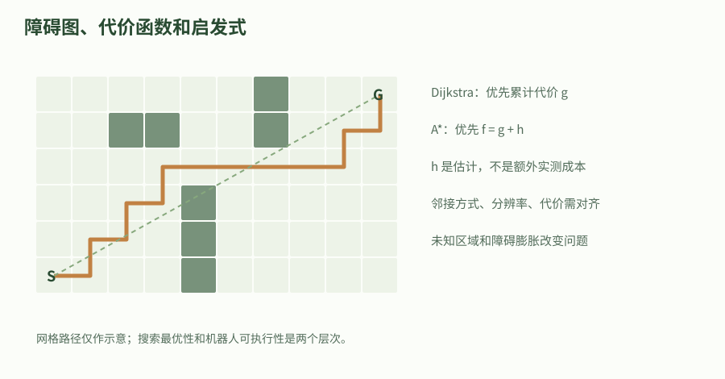

虚线是理想距离直觉，橙线是绕障示意路径，未把这条绘制路径标为算法最优输出。真实最优性要以相同图、非负代价和启发条件核查；机器人还需要运动学与碰撞约束。

### 手算一个必须绕行的栅格问题

实验使用七列五行栅格，起点在左下角、目标在右下角。第三列以后的中间墙从底部延伸到第四行，只在最上面一行留下通道。机器人必须先向上走四步，跨越六列，再向下四步，所以任何满足四邻接规则的路径至少十四步。分辨率每格零点一米时，长度是一点四米。

不考虑墙的曼哈顿估计只有六步，它低估剩余代价而不高估，因而仍是合法启发式。A* 与 Dijkstra 都应得到十四步，只是展开顺序可能不同。把上方最后一个缺口也堵住，左右区域在图中完全断开；程序穷尽后返回 None。上层应取消本次执行或等待环境变化，不能把上次成功路径当成新一次规划结果继续使用。

实验中的机器人是没有半径的点，每个障碍格表示不可进入的状态，因此路径有效只针对这个离散模型。要变成真实小车，必须说明障碍单元覆盖的几何区域、机器人足印、定位误差和栅格离散裕量。单纯把这段 A* 的点路径发给底盘，会越过教学模型与真实几何之间尚未证明的边界。

### 足印、膨胀与车辆运动学如何改变可行性

圆形机器人的配置障碍可理解为用机器人半径向外扩张障碍；非圆形机器人随朝向转动，通常不能只用一个固定半径准确表达全部几何。保守外接圆能减少漏碰，却可能错误关闭本可通过的狭窄通道。Nav2 的足印与代价层帮助表达不同层次的约束，但代价图变亮并不是接触动力学或安全制动已经被证明。

差速底盘可在一定条件下原地转向，阿克曼车辆却受转弯半径和倒车策略影响。把纯位置网格的折线交给车辆可能产生不可实现的直角拐弯。带朝向的 Hybrid A* 或状态格方法把运动原语纳入搜索，原语仍需要与底盘真实转向能力、分辨率和碰撞检测保持一致。规划状态更丰富通常带来更高计算与参数维护成本。

动态障碍要求考虑机器人和障碍到达同一区域的时间。静态图上的无碰撞位置序列，不保证执行时无碰撞；控制器需根据最新观测修正或重新规划。对高速运动，还要核对感知延迟与停车能力。增大膨胀半径无法代替全部时间约束，降低局部控制速度也不能自动修正错误地图坐标或过期障碍。

### 采样规划、优化与 API 的选择条件

机械臂高维构型空间中，逐维密集建网格很快变得昂贵。PRM 为多次查询建立路网，RRT 类方法扩展搜索树；RRTConnect 常用于较快寻找可行连接，带星号的渐近最优方法则有额外条件和逐渐改善代价的目标。渐近性质描述采样增长的极限行为，不承诺在一次固定时间预算内找到全局最优解。

轨迹优化从初始轨迹出发调整状态与控制，以代价、平滑和约束构造数值问题。它能表达丰富约束，但初值、非凸障碍和局部极小值仍需处理。全局搜索提供初始拓扑路线、局部优化改进细节，是常见组合方式；这并不意味着两者简单串联后就有全局正确性保证。应对接口中的坐标、采样时间及约束容差逐一验收。

Nav2 的规划器插件面向移动机器人路径服务，MoveIt 的规划管线面向关节空间与规划场景，OMPL 提供更通用的算法构件。它们可以围绕同一个起终目标工作，却不是可随意互换的同签名函数。比较 API 时要列出状态表示、碰撞模型、是否考虑动力学、失败状态、超时和取消机制，而不是只比较函数名是否包含 plan。

### 验证最优路径，同时证明模型没有承诺什么

独立运行下面程序，检查 A* 与零启发式搜索得到相同十四步，路径没有进入障碍，每段只移动一个相邻格，封路后返回无解。每个断言对应一项可观察的性质，而不是单纯检查程序能打印结果。之后可记录展开数比较启发式效果，但不要由一个小地图给出某种算法固定加速倍数。

若扩展八邻接，需要定义斜走代价和是否允许从两个接触障碍之间切角。若增加风险代价，启发式仍须与总目标同单位并保持有效下界。若允许负边，当前算法的条件就不成立。改变任意一项合同后，先重做小图的手算与反例，再放到大地图中调性能。

项目验收至少包含两种失败：目标被占据和通道断开；还应测试规划超时、取消后旧结果到达以及地图更新。成功路径保存所用地图版本与起点时间，执行前重新确认这些前提仍成立。当前离线实验只验证图搜索，真实足印、移动障碍、ROS Action 和机器人执行仍需后续项目环节分别检查。

#### applied_planning_lab.py

代码类型：complete

```python

def planning_lab():
    """在四邻接、单位正代价、点机器人模型中比较 A* 与 Dijkstra。"""
    import heapq

    width, height, resolution_m = 7, 5, 0.1
    start, goal = (0,0), (6,0)
    walls = {(3,y) for y in range(4)}  # 顶部 y=4 留一个通道。

    def search(obstacles, use_heuristic):
        # g 的单位是格数；启发式是到目标的曼哈顿格数，与四邻接模型一致。
        def heuristic(p):
            return abs(p[0]-goal[0])+abs(p[1]-goal[1]) if use_heuristic else 0
        if start in obstacles or goal in obstacles:
            return None
        heap = [(heuristic(start),0,start)]
        distance, previous = {start:0}, {}
        while heap:
            _, g, current = heapq.heappop(heap)
            if g != distance.get(current):
                continue  # 跳过已被更短路径取代的旧队列项。
            if current == goal:
                path = [goal]
                while path[-1] != start:
                    path.append(previous[path[-1]])
                return list(reversed(path))
            for dx,dy in ((1,0),(-1,0),(0,1),(0,-1)):
                nxt = current[0]+dx, current[1]+dy
                if not (0 <= nxt[0] < width and 0 <= nxt[1] < height):
                    continue
                if nxt in obstacles:
                    continue
                new_g = g+1
                if new_g < distance.get(nxt,float("inf")):
                    distance[nxt], previous[nxt] = new_g,current
                    heapq.heappush(heap,(new_g+heuristic(nxt),new_g,nxt))
        return None  # 队列耗尽是明确的无路结果，不能继续执行旧路径。

    path_a = search(walls,True)
    path_d = search(walls,False)
    assert path_a is not None and path_d is not None
    assert len(path_a)-1 == len(path_d)-1 == 14
    assert all(p not in walls for p in path_a)
    assert all(abs(a[0]-b[0])+abs(a[1]-b[1]) == 1 for a,b in zip(path_a,path_a[1:]))
    assert search(walls | {(3,4)},True) is None
    result = {"最优步数": len(path_a)-1, "路径长度_m": (len(path_a)-1)*resolution_m,
              "封闭通道结果": "无路"}
    print("网格搜索", result)
    return result

if __name__ == "__main__":
    planning_lab()


```

完整独立文件，仅用 Python 标准库；含输入单位、断言和模型边界。可另存后执行；工程中的合并入口为 examples/theory_labs/applied_labs.py。

### 从网格最短路过渡到 NavFn 势场路径

教学四邻域实验按离散步数检查最短路。NavFn 先把 ROS 代价值映射为内部成本，使用 Dijkstra 或 A* 传播势场，再由梯度提取折线路径。位姿点数受到提取步长和插值影响，不能直接当作格数或势场成本。

官方直线插件教学示例展示了 pluginlib 注册和统一 createPlan 入口，具体实现只插值。相同接口可以返回不同质量的路径，检查要依据插件实现、代价值和失败合同。本台架实际加载 GridBased 对应 NavFn，关闭 A* 与未知区通行，目标容差设为 0 m。

同样的起点和目标，实测路径由 4.55 m 变为 4.93 m。沿每段最多 0.025 m 采中心线，另调用 IsPathValid 检查剩余离散位姿。两项证据均用于当前静态图，车辆动力学、连续扫掠和安全间距要由后续验证负责。

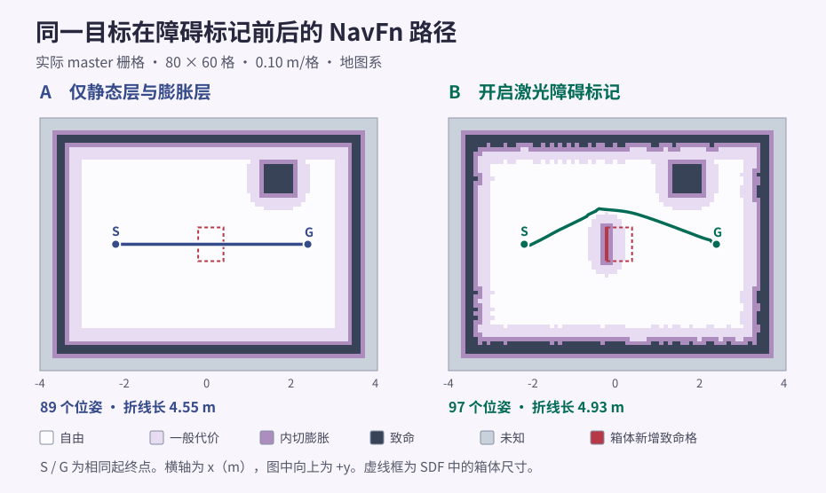

两幅底图来自真实 GetCostmap 主图，路径来自两个实际 ComputePathToPose 回执。箱体虚线是 SDF 几何，红格是扫描新增的可见面。两图比例相同。

### 把全局路径转成差速车前视控制量

ROS2 教程的车式纯追踪用轴距和转向角描述同一转弯几何。对平面差速车，把前视点转到基座坐标系，设其坐标为 x、y，曲率 `κ = 2y / (x² + y²)`，单位为 1/m。分母趋近零时实际实现使用边界检查。

差速运动用 `ω = vκ`，角速度为 rad/s，线速度为 m/s。RPP 会按配置裁剪前视距离并用曲率、障碍代价和趋近目标的速度限制重新决定 v，还根据局部代价图检查有限投影轨迹。

固定版 RPP 的路径处理与 AgroSenseBot 自带的前视和碰撞实现都可以在章末打开。实际导航测试使用 Nav2 安装版的 RPP，农业工程另按其路径、外形和插件配置检验。

本次 Gazebo 到达路线实测 4.95 m，期间发布了 14 条规划。全局几何提供跟踪参考，控制器和平滑器通过反馈决定每次速度，最终路线应以世界采样复核。

### 绕墙最短路径的可证明下界

7×5 网格中，墙只在最上行留缺口；分辨率为 0.1 m。

1. 按四邻接计算必须上行四步、横移六步、下行四步。

2. 用曼哈顿启发式运行 A*，再用零启发式运行 Dijkstra。

3. 逐段检查路径和障碍约束，确认均为十四步。

4. 关闭最后缺口，验证返回无路且不复用旧路径。

验收：得到 1.4 m 的点模型最短路径；未因此证明实体机器人可以通过。

### 深入练习 1

为什么障碍存在时曼哈顿启发式仍可以小于真实路径？

参考答案：它忽略障碍形成下界，不高估正是可采纳启发式要求。

### 深入练习 2

点机器人路径为什么不能直接用于长车？

参考答案：机器人足印、朝向和转弯半径可能使图中的位置连接不可实现。

### 深入练习 3

未在一秒内找到采样规划解能说明无解吗？

参考答案：不能。有限时间未找到只说明本次搜索失败或超时，不是穷尽整个连续空间。

### 深入练习 4

为什么路径点数增加不能直接证明全局规划代价增加？

参考答案：点数取决于输出采样、插值和路径提取。应分别计算折线长度、对照代价地图并理解插件内部的势场成本。

### 深入练习 5

前视点位于基座 (0.4, 0.2) m，若 v=0.30 m/s，差速车该有多大角速度？

参考答案：曲率为 2×0.2/(0.4²+0.2²)=2 1/m，角速度为 0.60 rad/s。实际控制还会按速度和碰撞检查调整。

### 基础验证流程

#### 运行本章离线实验

从 ros2-learning-hub 目录执行。它只计算本章的教学模型，不启动 ROS、仿真器或硬件；断言失败时停止并核对输入和单位。

```bash

# 输入固定在脚本中；--case 选择本章实验。
python3 examples/theory_labs/applied_labs.py --case planning

```

### 预期结果

- A* 与 Dijkstra 都得到十四步

- 对应点路径长度 1.4 m

- 堵住通道后明确返回无路

### 常见问题

- 为八邻接直接沿用不匹配启发式

- 只检测路径顶点而忽略连续边碰撞

- 把有限时间采样失败等同于数学无解

### 练习

为什么障碍存在时曼哈顿启发式仍可以小于真实路径？

#### 参考答案

它忽略障碍形成下界，不高估正是可采纳启发式要求。

### 验证范围

Python 标准库网格实验已实测。在本机 Jazzy Nav2 1.3.13、Harmonic 8.15.0、ros_gz_bridge 1.0.24 的固定激光台架实测。运行 MapServer、AMCL、全局代价地图和 NavFn。SLAM 建图、完整 NavigateToPose 行为树、控制器、运动底盘和硬件待分别验证。

### 依据

- [Nav2 Jazzy：框架、launch 与示例实现](https://github.com/ros-navigation/navigation2/tree/jazzy)

- [Nav2 Jazzy：代价地图与足印实现](https://github.com/ros-navigation/navigation2/tree/94d1c2a345dda6ff637e6a72c9101d927ee99f19/nav2_costmap_2d)

- [OMPL：规划器分类与适用范围](https://ompl.kavrakilab.org/planners.html)

- [Robotics_Tutorial：工程、SLAM 与规控范围对照](https://github.com/Michael-Jetson/Robotics_Tutorial/tree/7cb9e3d423196062c59dd346aae16285d962fb7c)

- [NavFn 的势场传播与路径提取](https://github.com/ros-navigation/navigation2/blob/94d1c2a345dda6ff637e6a72c9101d927ee99f19/nav2_navfn_planner/src/navfn_planner.cpp)

- [直线规划插件教学与注册](https://github.com/ros-navigation/navigation2_tutorials/blob/f3bd892a60d3fb91560ecb726bf922eb9bcbc858/nav2_straightline_planner/src/straight_line_planner.cpp)

- [主代价图字节和 GetCostmap 回执](https://github.com/ros-navigation/navigation2/blob/94d1c2a345dda6ff637e6a72c9101d927ee99f19/nav2_costmap_2d/src/costmap_2d_publisher.cpp)

- [调节型纯追踪的前视、曲率和碰撞投影](https://github.com/ros-navigation/navigation2/blob/94d1c2a345dda6ff637e6a72c9101d927ee99f19/nav2_regulated_pure_pursuit_controller/src/regulated_pure_pursuit_controller.cpp)

- [ROS2 教程的导航树、纯追踪与恢复](https://github.com/zsc/ros2_tutorial/blob/ae6703d73947442c5705350e88970b77089ab15a/chapter12.md)

- [AgroSenseBot 对前视和碰撞检查的工程实现](https://github.com/AIRLab-POLIMI/AgroSenseBot/blob/4ad700b090b9f3ddb8513c7519938bd7f0974709/asb_regulated_pure_pursuit_controller/src/path_handler.cpp)

## 44. 最优控制：从 Bellman 递推到 LQR 与 MPC

用可手推的标量系统推导有限时域 LQR，再说明约束、非线性和实时执行如何将问题扩展到 MPC。

### 学习目标

- 完整推导有限时域 Riccati 递推

- 验证值函数与累计代价一致

- 区分无约束最优反馈、限幅与约束 MPC

### 先修

math-linear；math-control；math-optimization

### 概念

完整推导有限时域 Riccati 递推

验证值函数与累计代价一致

区分无约束最优反馈、限幅与约束 MPC

### 把目标写成有单位和边界的控制问题

最优控制在满足系统动力学和约束的前提下选择一段控制序列。先定义状态、控制、采样周期、初始条件和终止目标，再谈求解器。位置误差以米计、速度以米每秒计时，直接平方相加没有自然的量纲意义；可以用有单位的权重，也可以先按参考尺度归一化。本章选择归一化，使权重和总代价都可按无量纲数解释。

实验状态 x 是位置误差除以一米，控制 u 是速度指令除以一米每秒。采样周期零点一秒、理想速度执行器且区间内速度保持不变时，离散模型的系数为 a 等于一、b 等于零点一。这不是带惯性、时延、饱和的真实底盘完整模型，而是用来隔离动态规划结构的标量教学系统。

有限时域问题需要给定剩余步数与末端惩罚。相同位置误差在离终点还有二十步和只剩一步时，最优动作通常不同，因此反馈增益可以随时间变化。无穷时域定常反馈是另一类问题，需要稳定化等条件。不要把某个有限步示例收敛的现象直接推广为任意初值、任意约束下的全局稳定。

#### 有限时域标量控制问题

$$
x_{k+1}=a x_k+b u_k,\quad J=\sum_{k=0}^{N-1}(q x_k^2+r u_k^2)+p_N x_N^2
$$

先确定初值 x0，选择 N 个控制使累计误差与控制代价最小。要求 r>0、q≥0、末端权重非负。本章按位置和速度参考尺度归一化，a=1、b=0.1。

- `x_k`：位置误差除以 1 m；单位／维度：无量纲

- `u_k`：速度除以 1 m/s；单位／维度：无量纲

- `a,b`：离散动力学系数；单位／维度：无量纲

- `q,r,p_N`：状态、输入与末端权重；单位／维度：无量纲

- `N`：时域长度；单位／维度：步

### Bellman 思想把长问题缩成当前一步

假设从下一时刻开始的最优剩余代价已知，那么当前只需选择一步输入，兼顾本步代价和下一状态的最优代价。这是动态规划的核心分解。它不要求贪心地最小化当前误差；若只看当前一步，可能完全忽略为将来状态做准备的重要控制。价值函数保存的正是这种未来影响。

对线性动力学和二次代价，可以尝试把剩余价值写成 p_k 乘状态平方。代入下一状态后，当前要最小化一个关于 u 的二次函数。只要输入二次项系数为正，就能求导得到唯一最优输入。多维版本用矩阵代替标量，并以线性方程求解代替显式求逆，但结构保持相同。

求解顺序先从末端往前递推增益，再从给定初值往后执行。把这两个方向混为一谈，容易把当前权重或下一时刻权重的下标写反。实现时用长度为 N 加一的价值数组和长度为 N 的增益数组，有助于明确最后一次输入与末端状态之间的区别。实验随后用独立的直接累计代价检验递推是否一致。

### 逐步推导最优反馈与 Riccati 系数

设下一时刻的价值是 p 乘下一状态平方，展开得到输入平方项系数 r 加 b 平方乘 p，交叉项为二倍 a b p x u，常数项为 q x 平方加 a 平方 p x 平方。对 u 求导，令二倍输入平方系数乘 u 加交叉项导数等于零，就得到负反馈形式。

将最优输入代回展开式，得到当前价值系数为 q 加 a 平方 p，再减去 a b p 的平方除以 r 加 b 平方 p。正的输入权重保证分母严格为正。这个消去过程也可用配方法理解：输入偏离最优值越远，会增加一个正的平方项，因此求得的是该一步问题的全局最小值。

以 q 为一、r 为零点一、末端权重为五、时域二十步计算，初始误差两米时，第一个理想速度指令约为负五点四零三米每秒。这个大指令恰好说明无约束模型的局限：数学最优不等于底盘可执行。若实际最大速度只有零点六米每秒，必须重新表达约束，而不是把超过限制的结果当作正常命令。

#### 标量最优反馈

$$
K_k=\frac{abp_{k+1}}{r+b^2p_{k+1}},\quad u_k^*=-K_kx_k
$$

展开 qx²+ru²+p_next(ax+bu)²，对 u 求导并置零。分母 r+b²p_next>0，故唯一最小值成立。

- `K_k`：第 k 步归一化反馈增益；单位／维度：无量纲

- `p_{k+1}`：下一步最优价值系数；单位／维度：无量纲

- `u_k^*`：归一化最优输入；单位／维度：无量纲

#### 标量 Riccati 向后递推

$$
p_k=q+a^2p_{k+1}-\frac{(abp_{k+1})^2}{r+b^2p_{k+1}}
$$

把最优输入代回二次式，读取 x² 的系数；从已知 p_N 向前倒序计算到 p_0。该推导针对无输入和状态约束的线性二次问题。

- `p_k`：本步最优价值系数；单位／维度：无量纲

- `q,r,a,b`：上一节定义的权重与动力学系数；单位／维度：无量纲


示意轨迹没有替代具体模型或求解器结果。实际系统需检查约束可行性、终端条件、采样周期、求解上界和失败后的控制策略。

### 为什么简单限幅不是约束最优控制

给无约束 LQR 的输出加限幅，可以保护命令范围，但一般不再解原来的约束最优问题。早期输入受限后，后续预测轨迹、误差分布和可达终态都会改变，而原增益是在允许任意输入的模型上推导的。即使某些标量特殊情况限幅表现良好，也不能据此推广到多变量耦合状态与障碍约束。

MPC 在每个时刻用最新状态求解有限时域优化，只执行首个输入，然后滚动时域重新求解。输入、状态、碰撞或接触条件可以直接放进约束。线性动力学加二次目标与线性约束常形成凸二次规划，非线性模型则可能需要迭代线性化、逐次二次规划或其他方法。具体解法的局部收敛、可行性和稳定性条件应分别讨论。

软约束通过松弛变量允许付出代价后少量违反某些要求，适合处理部分性能目标，却不代表物理硬约束可任意放宽。终端代价、终端集合、可行初值与扰动假设会影响递归可行性和稳定性结论。仅凭滚动求解四个字，不能推出实际系统必然保持可行，更不能忽略求解失败时的备用策略。

### 模型复杂度和实时执行必须一起设计

MPC 是否满足截止期取决于状态维数、约束、预测长度、求解精度、导数计算、热启动和计算平台。全身模型的求解并非普遍不可能实时，简化模型也并非自动足够快。合理做法是在目标平台和真实问题规模下记录求解耗时分布、最长耗时、残差和可行性，而不是引用一个跨平台通用的频率或加速倍数。

在线系统可以让优化器较低频运行，控制器在较高频查询带时间标识的反馈策略。这需要说明策略适用的状态和时域，超过有效期时如何处理；多线程共享策略还要保证读到完整一致的快照。热启动能够减少迭代，但当目标或接触模式突变时，旧解可能不再适合，需要重新检查可行性。

任务执行层应区分求解未完成、数值失败、不可行和解已过时。截止期到达后继续等待一个无效的最优解，可能比及时使用有边界的备用控制更差。备用策略本身也需要合适的动力学与安全条件，不能笼统规定所有机器人都输出零力矩。实验阶段先在仿真验证失效路径，再讨论真实执行。

### 用值函数恒等式核对实现而非只看曲线

运行下面程序会从终端向后递推二十个反馈增益，再从初始误差两米正向模拟。直接累计的最优代价约为十四点八零六三，而全程零输入的代价为一百。更强的检查是直接累计结果应等于 p0 乘初始状态平方，误差在浮点容差内；这个恒等式能够抓住时序、末端项或权重使用错误。

建议先把时域改为一步，手算反馈和代价，再恢复二十步。提高输入权重通常会抑制大输入，但要看与状态尺度和时域一起变化的结果；不要脱离单位只说某个权重必须设成固定数值。加入输入限幅后，原值函数恒等式不再适用，应分别报告裁剪策略的实际代价和约束是否满足。

这份代码验证标量离散 LQR 的推导和数值实现，没有调用真实二次规划器，也没有运行 Nav2、OCS2 或机械臂 MPC。把模型扩展到真实系统时，应先验证离散化、观测状态与输入单位，再逐步引入约束和时延。实验通过是一条局部而明确的理论实践证据，不是完整控制系统验收。

#### applied_optimal_control_lab.py

代码类型：complete

```python

def optimal_control_lab():
    """有限时域标量 LQR；验证 Riccati 值函数与直接累计代价一致。"""
    from math import isclose

    # 输入：x 为位置/1 m，u 为速度/(1 m/s)，均无量纲；b=采样周期 0.1 s。
    a, b, q, r, terminal, horizon = 1.0, 0.1, 1.0, 0.1, 5.0, 20
    assert r > 0 and q >= 0 and terminal >= 0
    p = [0.0]*(horizon+1)
    gains = [0.0]*horizon
    p[horizon] = terminal
    # 顺序一：从终点向起点回推，与随后正向运行的顺序相反。
    for k in range(horizon-1,-1,-1):
        denominator = r+b*b*p[k+1]
        gains[k] = a*b*p[k+1]/denominator
        p[k] = q+a*a*p[k+1]-(a*b*p[k+1])**2/denominator
        assert p[k] >= 0
    # 顺序二：只在无约束模型里使用精确最优反馈，不把裁剪输入称为约束最优解。
    x, x0, total = 2.0, 2.0, 0.0
    first_u = None
    for k,gain in enumerate(gains):
        u = -gain*x
        first_u = u if k == 0 else first_u
        total += q*x*x+r*u*u
        x = a*x+b*u
    total += terminal*x*x
    assert isclose(total,p[0]*x0*x0,rel_tol=1e-12)
    zero_input_cost = (horizon*q+terminal)*x0*x0
    assert total < zero_input_cost and abs(x) < abs(x0)
    result = {"初始最优速度_m_s": first_u, "末端位置_m": x,
              "最优代价": total, "零输入代价": zero_input_cost}
    print("有限时域 LQR", result)
    return result

if __name__ == "__main__":
    optimal_control_lab()


```

完整独立文件，仅用 Python 标准库；含输入单位、断言和模型边界。可另存后执行；工程中的合并入口为 examples/theory_labs/applied_labs.py。

### 解释一个数学最优但超过执行器能力的速度

理想位置积分器初始误差 2 m，采样 0.1 s，时域二十步。

1. 按 1 m、1 m/s 归一化状态和输入。

2. 从终端权重五向后递推 Riccati 系数。

3. 正向执行无约束反馈，核对总目标等于 p0×x0²。

4. 观察初始输入约 -5.403 m/s，并提出真实系统的输入约束。

验收：验证最优解的计算，同时识别无约束假设与真实限速之间的缺口。

### 深入练习 1

为什么输入权重必须为正？

参考答案：它保证本章标量一步二次问题的输入曲率为正、分母非零，从而得到唯一最小值。

### 深入练习 2

给 LQR 输出限幅后仍是约束最优解吗？

参考答案：一般不是。饱和改变未来可达轨迹，而原反馈未对这些约束重新优化。

### 深入练习 3

全身 MPC 不能实时是普遍结论吗？

参考答案：不是。应结合模型规模、约束、算法、精度和硬件实测截止期满足情况。

### 基础验证流程

#### 运行本章离线实验

从 ros2-learning-hub 目录执行。它只计算本章的教学模型，不启动 ROS、仿真器或硬件；断言失败时停止并核对输入和单位。

```bash

# 输入固定在脚本中；--case 选择本章实验。
python3 examples/theory_labs/applied_labs.py --case optimal-control

```

### 预期结果

- 值函数与直接累计目标一致

- 最优代价约 14.8063，零输入代价 100

- 初始无约束速度约 -5.4031 m/s

### 常见问题

- 位置和速度平方直接相加而无尺度说明

- 把限幅反馈称为已求解约束 MPC

- 只报告平均求解时间而不报告截止期失败

### 练习

为什么输入权重必须为正？

#### 参考答案

它保证本章标量一步二次问题的输入曲率为正、分母非零，从而得到唯一最小值。

### 验证范围

已执行 Python 标准库离线数值实验及断言；官方文档与本地固定提交源码已核对。ROS 编译、节点互通、仿真与真实硬件本轮均未运行。

### 依据

- [MIT Underactuated Robotics：离散 LQR 与 Riccati 递推](https://underactuated.mit.edu/lqr.html)

- [OCS2：最优控制、MPC 与 MRT 接口](https://leggedrobotics.github.io/ocs2/)

- [Robotics_Tutorial：工程、SLAM 与规控范围对照](https://github.com/Michael-Jetson/Robotics_Tutorial/tree/7cb9e3d423196062c59dd346aae16285d962fb7c)

## 45. Nav2：从给定目标到可解释的导航行为

导航系统将目标、定位、地图、传感器和底盘控制组合起来。学习重点是能解释机器人为什么停下、为什么绕路，以及哪个服务器或输入条件导致失败。

### 学习目标

- 跑通官方仿真导航

- 区分规划器、控制器与 costmap

- 利用 lifecycle 和 action 反馈排查失败

### 先修

SLAM 或已知地图定位；tf2；差速控制；action

### 概念

全局规划器生成路径，局部控制器依据路径与局部环境产生速度，代价地图提供障碍与通行代价。

footprint 应覆盖机器人真实外形；圆形半径近似适合的对象有限。

导航 lifecycle 节点未 active、定位未初始化或 TF 不连通时，发布目标也不会得到正常运动。

### 把导航拆成可观察的能力链

一个导航目标进入系统后，定位提供机器人当前姿态，全局规划器选择通路，局部控制器生成速度，底盘执行命令，传感器不断更新障碍信息。Nav2 将这些能力分成服务器，并用行为树组织调用与恢复。地图只是其中一种环境信息，不能代替实时传感器或正确的机器人模型。

理解每一层的输入输出，比只记住某个 launch 名更有迁移价值。规划器通常输出路径，控制器输出车体速度，底盘输出关节运动与里程计。若路径正常但机器人不动，应向控制和底盘层追踪；若没有路径，先检查定位、地图和规划请求，不必先修改电机参数。

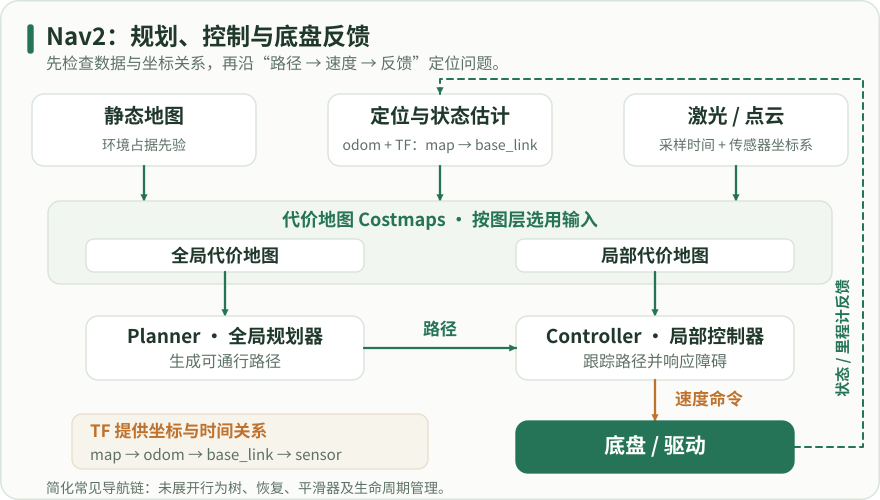

自上而下读地图、定位/状态估计和传感器对代价地图的支撑，再沿规划器输出路径、控制器输出速度、底盘执行的链路读。虚线反馈经里程计与状态估计返回坐标链；map→odom 的全局定位与 odom→base_link 的局部运动各有责任来源。各 costmap 按图层选择地图和观测，并非必定使用全部输入；行为树、恢复、平滑器和生命周期未展开。

### 明确地图、代价地图与外形的区别

静态地图记录环境占据情况，costmap 在此基础上或局部传感器基础上构建通行代价。障碍层处理观察到的障碍，膨胀层为靠近障碍的区域增加代价。膨胀半径不等于机器人真实外形；footprint 描述机器人接触地面的几何范围，两者分别影响可行性与路径偏好。

长方形履带底盘转弯时扫过的区域大于中心点路径。用过小圆形半径近似会让规划看似能通过，实际车角却碰撞。应先确定模型尺寸与 footprint，再调路径平滑度、控制速度和膨胀代价。把速度降得很低不能弥补错误的碰撞几何。

### 建立导航必须满足的接口合同

定位和地图相关消息通常处于 map 坐标，局部运动使用 odom，底盘是 base_link，传感器必须通过 TF 连通。时间统一后，传感器消息才能正确落入代价地图。话题名称之外，还要核对 LaserScan 或 PointCloud2 类型、QoS、频率及障碍有效时间。

导航服务器采用生命周期管理，进程存在不等于已经 active。地图、定位或 TF 尚未准备好时，生命周期或行为树可能持续等待。速度输出的类型也要与下游驱动匹配，当前系统可能使用 Twist 或 TwistStamped；应实际查看，而不是用不同年代教程的默认值推断。

Nav2 障碍层对 LaserScan 和 PointCloud2 分别使用 TF 消息过滤。先在仿真章验证实际 scan 的 QoS、采样时戳和 laser_link 到基座的变换，再核对代价地图实际配置的目标帧。远处无回波可能为无穷值，标记、清除、inf_is_valid 与距离参数分别检查。这里的传感器实测范围止于消费合同，代价地图输出与导航任务另验。


先沿正向箭头 configure、activate 进入 active；反向箭头 deactivate、cleanup 回到可重新配置的状态。unconfigured、inactive、active 都可经 shutdown 到 finalized，终结后没有返回箭头。只展示成功转换，省略中间状态、失败返回和错误处理；节点状态也不自动停止所有普通回调。

### 从官方集成仿真建立基线

在已正确安装系统 Jazzy 的 Ubuntu24.04 上安装 navigation2 和 nav2_bringup，并使用其集成示例。它包含机器人、仿真和 RViz 的常用组合，便于先验证一条已组织好的链路。此处命令是读者运行说明，本次没有执行安装或导航。下载依赖需要网络，教材正文与解释可离线阅读。

Jazzy 使用现代 Gazebo；若仿真资源缺失，安装对应 nav2-minimal-tb 系列包后再启动，不应改去使用 Iron 的 Gazebo Classic 包。启动完成后等待地图和 RViz 加载，观察节点状态。没有图形环境时需要相应无 GUI 配置，不能仅把窗口打不开等同导航失败。

#### 安装并启动 Jazzy 集成实验

代码类型：commands

```bash

# 【中文教学注释】 安装并启动 Jazzy 集成实验
# 本例作用：若缺少仿真资源，核对 ros-jazzy-nav2-minimal-tb 系列包。该 launch 是常驻进程。
# 输入输出：输入为地图、定位、TF、传感器与导航目标；输出为 Nav2 状态、规划和控制行为。
# 执行顺序与边界：先验证环境和定位，再送目标；生命周期激活不等于定位已可信。集成仿真依赖单独准备，本文检查不会自动完成真实机器人验收。
# 在当前shell加载/opt/ros/jazzy/setup.bash；它影响本终端的包索引/库路径，另一个终端必须单独加载。
source /opt/ros/jazzy/setup.bash
# 安装本段明确列出的系统/ROS依赖；-y自动接受软件包确认，发行版前缀须与目标环境一致。
sudo apt install ros-jazzy-navigation2 ros-jazzy-nav2-bringup
# 解析指定launch描述并启动其动作；key:=value为启动参数覆盖。节点发现、TF、控制器和生命周期就绪仍需另行检查。
ros2 launch nav2_bringup tb3_simulation_launch.py headless:=False

```

若缺少仿真资源，核对 ros-jazzy-nav2-minimal-tb 系列包。该 launch 是常驻进程。

输入输出：输入为地图、定位、TF、传感器与导航目标；输出为 Nav2 状态、规划和控制行为。
执行顺序与边界：先验证环境和定位，再送目标；生命周期激活不等于定位已可信。集成仿真依赖单独准备，本文检查不会自动完成真实机器人验收。

### 先定位，再下发一个明确目标

在 RViz 中使用 2D Pose Estimate，把初始位置放到与模拟机器人相符的地图位置，并拖动箭头设置朝向。定位尚不确定时，直接发送很远目标会同时引入多个变量。先选附近自由区域，观察粒子分布、全局路径、局部轨迹和速度命令，确认方向正确后再增加距离。

设置初始姿态不是永久锁定机器人位置，而是给定位器一个起始分布。若粒子或扫描与地图不匹配，应重新核对地图、frame、时间和初始朝向。不要用反复点击目标掩盖定位尚未成立的事实；目标取消、失败和成功都应该有可观察的 action 结果。

#### 检查系统状态

代码类型：commands

```bash

# 【中文教学注释】 检查系统状态
# 本例作用：有命名空间时替换为实际路径。把检查结果与 RViz 现象一起记录。
# 输入输出：输入为地图、定位、TF、传感器与导航目标；输出为 Nav2 状态、规划和控制行为。
# 执行顺序与边界：先验证环境和定位，再送目标；生命周期激活不等于定位已可信。集成仿真依赖单独准备，本文检查不会自动完成真实机器人验收。
# 查找支持生命周期服务的节点，普通节点不会因此获得受控启动语义。
ros2 lifecycle nodes
# 读取节点当前生命周期状态；后续转换必须从合法前置状态执行。
ros2 lifecycle get /controller_server
# 查询可见Action接口，-t附上类型；不要把动作目标接纳与最终完成混作同一状态。
ros2 action list -t
# 查询实际消息类型与发布/订阅端点；--verbose显示QoS等证据，先查类型再选择发送消息结构。
ros2 topic info /cmd_vel --verbose

```

有命名空间时替换为实际路径。把检查结果与 RViz 现象一起记录。

输入输出：输入为地图、定位、TF、传感器与导航目标；输出为 Nav2 状态、规划和控制行为。
执行顺序与边界：先验证环境和定位，再送目标；生命周期激活不等于定位已可信。集成仿真依赖单独准备，本文检查不会自动完成真实机器人验收。

### 把调整限制在一个可解释变量上

首先固定地图、机器人外形和传感器合同，再调整速度与加速度范围，之后才比较规划器或控制器插件。每次使用同一组起终点和障碍场景，记录成功率、时间、最小障碍距离以及速度平滑程度。只看某一次走得更快，很容易把偶然定位差异误认为参数改进。

控制频率提高会增加计算负担，并不必然改善跟踪。传感器更新太慢、TF 延迟或底盘响应慢时，局部控制器仍然面对陈旧状态。查看整个链路的采样、计算与执行频率，确认瓶颈在哪里，再决定要优化算法、减少数据量还是更改硬件接口。

### 按失败阶段定位原因

目标被拒绝时检查 action 服务与生命周期；规划失败时检查目标是否在自由空间、地图连通和规划器约束；控制失败时检查局部障碍、进度判据、速度限制和底盘反馈；恢复失败时检查行为树是否允许当前恢复动作。错误发生的阶段决定优先检查对象。

导航成功的最低标准包括：action 报告成功，最终位置和朝向在设定容差内，过程没有违反定义好的外形和速度约束，停止后没有继续执行过期命令。加入临时障碍、取消和传感器失效实验，才能了解系统在正常路径之外如何表现。仿真验收仍不替代实机测试。

### 从先验图像到可逐格核对的占据地图

脚本将四面墙和一根非对称柱投到 80 × 60 格，分辨率 0.10 m/格，原点为 (-4.0 / -3.0) m。箱体只存在于 Gazebo 场景。PGM 首行对应最高 y，OccupancyGrid 首行对应最低 y，发布后以柱的位置核对行翻转。

MapServer 实际输出 3215 个空闲格、529 个占据格和 1056 个未知格。trinary 模式按 YAML 的分辨率、原点、阈值和 negate 解释像素，图像灰度与 ROS 占据值需要分别读。

先查生命周期状态，再查 GetMap 与话题。配置成功时服务已发现，未激活的回应仍是空图。激活后发布端可靠且瞬态本地，两种晚加入订阅都与提供端匹配，但只有请求瞬态本地的订阅得到历史地图。

SLAM 章另把实际建图生成的 PGM/YAML 交给新 MapServer，验证 13426 格一致。此节 80 × 60 图来自固定房间的先验几何，后续 NavFn 对照仍使用该输入。迁移到实测地图时重新核对地图边界、初始位姿与代价地图各层。

#### 地图节点状态、晚加入订阅和加载回执

| 操作 | 本次实际输出 | 判断 |
| --- | --- | --- |
| 配置后查 GetMap | 0 格 | 等到 active 再读取有效图 |
| 激活后晚加入 | 瞬态本地收到 4800 格，易失订阅收到 0 条 | 提供端与请求端匹配仍需区分历史样本 |
| 空路径 / 缺 YAML / 缺图像 | 1 / 3 / 2 | 三次均再次查到旧地图 |
| 重新加载同一 YAML | 结果 0，易失订阅收到 1 条 | 同一栅格，新发布时戳 |

占据图逐格核对，障碍、空闲和未知均在地图帧下验证。回执失败时以另一次 GetMap 判断旧图状态。

### 让同一个规划目标绕过新增障碍

用固定激光收到 361 束，中心距离 1.9501 m。全局代价地图的静态层接地图，障碍层按扫描采样时戳查 TF。此处关闭射线清除，仅对比标记。全局图用 0.10 m/格、0.18 m 圆半径和 0.38 m 膨胀范围。

GetCostmap 返回 master 原始字节。0 为空闲，253 为内切膨胀格，254 为致命，255 为未知。可视化 OccupancyGrid 把这些值重新编码。Jazzy 固定实现的服务把地图时刻字段填为响应时钟读数，用扫描 Header 查真正的采集时刻。

将内部节点的 obstacle_layer.enabled 从 false 改为 true。除参数回执外，还要从主图读出箱体附近 8 个新增致命格。激光只看见箱体的可见面，图中的完整虚线框来自世界几何。然后用同一起终点验旧路径和重算路径。

#### 同一起终点与两份实际全局代价图

| 代价地图 | 路径 | 采样与服务结果 |
| --- | --- | --- |
| 静态层与膨胀层 | 89 点，4.55 m | 原路径 IsPathValid 为真 |
| 启用激光标记 | 用同一条旧路径检查 | 中心线采到 1 个箱体新增致命格，IsPathValid 为假 |
| 启用激光标记 | 重算 97 点，4.93 m | IsPathValid 为真，中心线采样无 253/254/255 格 |

实际从同一 TF 样本固定起点，目标 x / y 为 2.35 / 0.00 m。折线每最多 0.025 m 采一格。


两幅底图来自真实 GetCostmap 主图，路径来自两个实际 ComputePathToPose 回执。箱体虚线是 SDF 几何，红格是扫描新增的可见面。两图比例相同。

### 把已保存的 SLAM 地图接入真实导航执行

前面的固定台架将地图、扫描与规划分段验收。本次从同一房间的 learned.yaml 加载已保存地图，接入具有关节、地面接触和实时激光的 Gazebo 差速车。AMCL 使用地图系近参考初值，发布 map 到 odom，轮速积分另供 odom 到 base_link。

地图和定位就绪后再激活规划、平滑、控制、恢复行为与导航器。全局代价图用先验栅格，局部滚动图从实时扫描标记障碍。此固定版本在嵌套代价地图中解析明确指定的相对话题，驱动按实际节点名重映射到父命名空间，并从图上核对订阅。

首轮误将全局地图入口留在子命名空间。导航器仍接受目标，最后报规划超时 207，收到 15 次恢复计数和约 0.35 m 的世界位移，期间没有实际规划路径。修复后先等完整栅格、局部障碍标记和导航器的共同 TF 时间窗再发目标。

安装版默认树把规划和跟踪放进可流水推进的序列，规划由 1 Hz 装饰器节流。上游产生的新路径可更新正在执行的 FollowPath。恢复分支按错误类型选择清图、旋转、等待和后退等动作。

#### 启动检查与实际连接的代价图输入

| 阶段 | 观测 | 通过条件 |
| --- | --- | --- |
| MapServer | 13426 格 | 重载前一轮 PGM/YAML，与原始占据数组逐格一致 |
| 全局代价图 | 13426 格，map 系 | 内嵌节点订阅本实验的 map |
| 局部代价图 | 3600 格，odom 系 | 内嵌节点订阅本实验的 scan，已有扫描标记 |
| 导航器的 TF 启动窗 | 0.100 s 重叠 | 实际监听端已发现，启动后的 map → odom 与 odom → base_link 在相同时刻可查 |
| 速度链 | cmd_vel → velocity_smoother → cmd_vel_smoothed | 单一平滑器发布，桥与旁路监听分别接收 |

Action 服务发现只是启动的一步。通过话题、坐标系与时间窗后才送入实际目标。

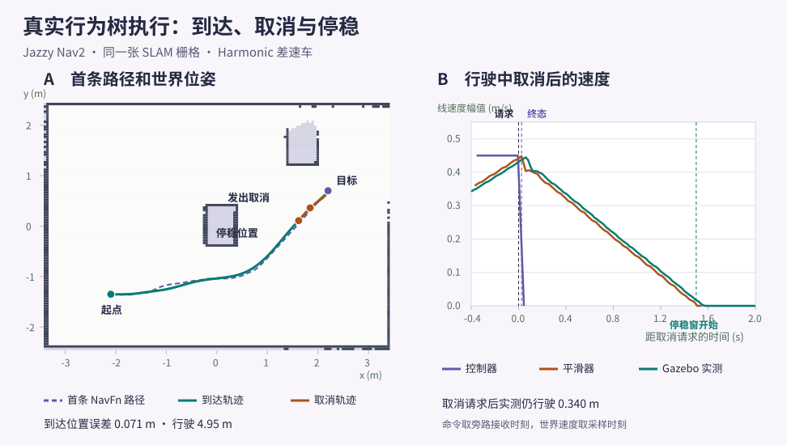

左图底图为实际重载的 SLAM 栅格，线段来自首条 NavFn Path 与 Gazebo 世界位姿。右图用同一仿真时基对照控制器、平滑器和世界速度，停稳按连续采样判据。

### 同时验收动作成功、终点误差与停稳

首条规划绕开中心箱体。到达阶段实际观察 14 条规划和 1394 条上层反馈，独立世界位姿测得路线 4.95 m。规划路径、车辆轨迹和停车位置分别记录。

目标检查器根据局部坐标中的估计位姿和配置容差判定到达。行为树终态、控制器置零和车轮稳定有不同触发点。验收先等实际终态，再分别比对两级速度与世界位姿。

世界坐标的中心净距只在观测到的参考点上计算。局部控制器自身使用代价图足迹检查。若更改机器人外形、地图或采样频率，需重新评估运动几何与停稳。

#### 成功回执与停稳后的世界坐标

| 场景 | 成功规划路径条数 | 实际行驶（m） | 停稳位置误差（m） | 停稳偏航误差（rad） |
| --- | --- | --- | --- | --- |
| 正常到达 | 14 | 4.952 | 0.071 | 0.026 |
| 切回有效控制器后到达 | 9 | 1.371 | 0.128 | 0.113 |

正常到达路线采样点的最小基座中心净距为 0.554 m。误差来自世界位姿，净距按房间盒形几何计算。

### 运动接口的共同合同：单位、坐标、时间与终止

| 接口 | 输入输出 | 单位与坐标 | 验收边界 |
| --- | --- | --- | --- |
| Twist / TwistStamped | 线速度、角速度；带时间戳版本另有 header | 线速度 m/s，角速度 rad/s；frame_id 必须与控制端合同一致 | 增加 header 不会自动变换速度坐标或补偿数据年龄。核对实际话题类型，不直接假设所有 Jazzy 配置相同。 |
| NavigateToPose | 带坐标系与时间戳的目标位姿，返回结果/状态 | 位置 m；姿态单位四元数；常见全局 frame 为 map，但以系统配置为准 | 目标被接受、规划成功、控制结束和底盘停止分别检查。 |
| JointTrajectory | joint_names 与逐点位置/速度/加速度/时刻 | 旋转关节 rad，移动关节 m；速度和加速度相应每秒、每秒平方 | 关节顺序、数组长度、时间单调性、限位、碰撞与执行端接口都要核对。 |
| 规划结果 | 候选路径或轨迹 | 模型坐标、时间参数化和控制周期明确 | 路径无碰撞不等于轨迹可执行；执行前还需新鲜场景、可达性、速度/加速度和控制器检查。 |

仅在仿真或离线模型中验证不会自动证明真实设备安全。教材工程先从可观察的低速仿真与数值检查开始，具体实机状态以设备接口为准。

### 生命周期：回调返回、请求应答、状态与资源

| 阶段 | 回调/协议 | 需要查询的证据 | 本轮范围 |
| --- | --- | --- | --- |
| configure | SUCCESS→inactive；FAILURE→unconfigured | GetState、候选资源释放与可再次配置 | 假资源完整往返和配置失败后重试；不打开设备。 |
| activate | SUCCESS→active；FAILURE→inactive | 发布者is_activated、资源快照与新消息 | 失败保留已配置资源，再激活成功。 |
| ERROR/受控异常 | 进入errorprocessing并调用on_error | 原始转换应答与最终恢复状态分别查 | on_error SUCCESS恢复unconfigured，原ChangeState仍可能false。 |
| on_error | SUCCESS→unconfigured；FAILURE/ERROR→finalized | GetTransitionGraph、回调事件和清理结果 | 标准异常转换路径按本机实现实测；不推广任意崩溃。 |
| LifecyclePublisher | is_activated控制发送 | 有限窗口内新序号、发布者状态 | 普通timer与普通诊断发布仍可运行，业务工作需显式门控。 |
| shutdown/finalized | 生命周期终结，不等于ROS Context已关闭 | 同实例可用转换、资源与普通接口 | 本例finalized后仍有普通诊断，直至进程退出。 |

成功返回、最终状态、消息与资源是不同证据；状态标签不会自动处理任意文件、线程或设备。

本轮没有穷尽cleanup/shutdown各失败返回、未知原生异常、跨节点管理器或硬件状态。

### Nav2 地图、定位与规划接口

| 接口 | 输入 | 回执与检查 | 边界 |
| --- | --- | --- | --- |
| GetMap / LoadMap | 活动 MapServer 与地图 YAML | GetMap 的 OccupancyGrid，LoadMap 的 result 及后续地图消息 | 检查分辨率、原点和实际栅格。失败回执里的 map 不用作新地图 |
| SetInitialPose | map 系 PoseWithCovarianceStamped | 响应体为空，以 AMCL 位姿和 TF 验收 | 坐标、时间与协方差含义分别核对 |
| GetCostmap | 全局代价地图服务 | master 图的尺寸、原点、分辨率与 uint8 字节 | 不要用占据图 0 到 100 的标度解释 253 到 255 |
| ComputePathToPose | 起点策略、目标帧、planner_id | 接受、终态、error_code 和 Path 分开读取 | 规划成功后另验控制与执行 |
| IsPathValid | 同一全局帧的 Path | 看当前代价图上的剩余路径 | 半径模式以离散位姿检查，连续足印与运动约束需另查 |

### 真实导航执行中的回执、路径与反馈

| 接口 | 数据与单位 | 观察结果 | 边界 |
| --- | --- | --- | --- |
| NavigateToPose | 地图 PoseStamped，位置 m、偏航 rad | 目标响应、反馈、动作状态、error_code | 默认树由空 behavior_tree 字段选用 |
| ComputePathToPose | 起终点和 planner_id | 实际 Path，例中越界码 204 | 路径本身无法表达已行驶或已停 |
| FollowPath | Path、controller_id 与检查器 ID | 控制终态，例中无效控制器码 101 | 反馈 speed 源自计算的速度指令 |
| 取消目标 | 当前目标 UUID | CancelGoal 响应与对应终态 | 用车体和关节观测验收停车 |
| BehaviorTreeLog | 发布批次与内部事件各有时钟字段 | 节点 ID、旧状态与新状态 | 两层时钟分别解释 |
| 控制与平滑速度 | Twist，线 m/s、角 rad/s | 原始命令、平滑输出 | 实际车体与轮速另用同一仿真时基对照 |

本台架控制与桥接都显式选择 Twist，迁移其他版本时以各端实际消息类型为准。

### 路径已经画出，机器人却不动

全局路径正常，局部控制器 active，但底盘状态保持零。

1. 查看 /cmd_vel 是否有发布以及真实消息类型。

2. 查看下游驱动的订阅类型和重映射。

3. 发现上游 TwistStamped 与驱动 Twist 不匹配。

4. 通过明确的适配或正确配置统一接口，再验证命令超时与停止。

验收：问题在控制接口合同，重新调规划器不会解决。

### 深入练习 1

footprint 与 inflation radius 是同一个量吗？

参考答案：不是。footprint 表达机器人几何，膨胀层表达靠近障碍的代价区域，两者不能互相替代。

### 深入练习 2

为什么先设置初始姿态再导航？

参考答案：定位器需要建立地图中的姿态估计，否则 TF 和代价地图无法可靠支持规划与控制。

### 深入练习 3

路径存在但不动先查哪里？

参考答案：先查局部控制输出、消息类型、重映射、控制器状态和底盘反馈，而非立即修改全局规划参数。

### 深入练习 4

激光 echo 有数据，代价地图仍无障碍，如何沿链路排查？

参考答案：查障碍层订阅的实际话题与数据类型，再按 Header.stamp 检查目标帧 TF，最后检查标记范围、清除和无穷距离规则。

### 深入练习 5

两个晚加入订阅都已匹配，为何只有一个收到旧地图？

参考答案：瞬态本地允许取活动发布者保留的旧样本。易失订阅匹配后只等后续发布。本例重载同一地图验证了易失订阅可以收到新数据。

### 深入练习 6

加载路径为空、YAML 缺失、图像缺失时怎样定位？

参考答案：这次分别得到 1、3、2。按错误对应检查输入、YAML 和图像，再独立查询 GetMap 核实旧图状态。

### 深入练习 7

收到障碍层开关的成功回执后，还要怎样确认可规划？

参考答案：先查同一场景主图是否出现新代价值，再比较相同起终点的旧路径检查和新规划回执。

### 深入练习 8

动作服务已可调用，为什么还要验证代价地图和 TF 后再发目标？

参考答案：服务就绪证明目标通道已发现。用有效栅格、实际订阅和两条动态边的共同时间窗检查执行输入，才能排除本实验的规划超时与初始位姿失败。

### 深入练习 9

全局图和局部图为什么使用不同帧？

参考答案：全局图对齐已保存地图并服务整段路径。局部滚动图在 odom 中保持短程运动连续，由扫描更新附近障碍。通过带时戳的 map 到 odom 将两者接起来。

### 基础验证流程

#### 准备官方 Jazzy 仿真依赖

在已安装 ROS Jazzy 和配置软件源后安装 Nav2。

输入输出：输入为地图、定位、TF、传感器与导航目标；输出为 Nav2 状态、规划和控制行为。
执行顺序与边界：先验证环境和定位，再送目标；生命周期激活不等于定位已可信。集成仿真依赖单独准备，本文检查不会自动完成真实机器人验收。

```bash

# 【中文教学注释】 准备官方 Jazzy 仿真依赖
# 本例作用：在已安装 ROS Jazzy 和配置软件源后安装 Nav2。
# 输入输出：输入为地图、定位、TF、传感器与导航目标；输出为 Nav2 状态、规划和控制行为。
# 执行顺序与边界：先验证环境和定位，再送目标；生命周期激活不等于定位已可信。集成仿真依赖单独准备，本文检查不会自动完成真实机器人验收。
# 安装本段明确列出的系统/ROS依赖；-y自动接受软件包确认，发行版前缀须与目标环境一致。
sudo apt install ros-jazzy-navigation2 ros-jazzy-nav2-bringup

```

#### 启动集成示例

该示例依赖 nav2_bringup 的仿真资源，缺失时按官方 Quickstart 安装 nav2-minimal-tb 系列包。

输入输出：输入为地图、定位、TF、传感器与导航目标；输出为 Nav2 状态、规划和控制行为。
执行顺序与边界：先验证环境和定位，再送目标；生命周期激活不等于定位已可信。集成仿真依赖单独准备，本文检查不会自动完成真实机器人验收。

```bash

# 【中文教学注释】 启动集成示例
# 本例作用：该示例依赖 nav2_bringup 的仿真资源，缺失时按官方 Quickstart 安装 nav2-minimal-tb 系列包。
# 输入输出：输入为地图、定位、TF、传感器与导航目标；输出为 Nav2 状态、规划和控制行为。
# 执行顺序与边界：先验证环境和定位，再送目标；生命周期激活不等于定位已可信。集成仿真依赖单独准备，本文检查不会自动完成真实机器人验收。
# 解析指定launch描述并启动其动作；key:=value为启动参数覆盖。节点发现、TF、控制器和生命周期就绪仍需另行检查。
ros2 launch nav2_bringup tb3_simulation_launch.py headless:=False

```

#### 建立定位再发送目标

在 RViz 使用 2D Pose Estimate 设置初始位置与朝向，再发送导航目标；观察全局路径、局部路径和代价地图。

#### 检查失败发生在哪一层

先看 lifecycle 状态，再看 action 类型和反馈，最后查传感器与 TF。

输入输出：输入为地图、定位、TF、传感器与导航目标；输出为 Nav2 状态、规划和控制行为。
执行顺序与边界：先验证环境和定位，再送目标；生命周期激活不等于定位已可信。集成仿真依赖单独准备，本文检查不会自动完成真实机器人验收。

```bash

# 【中文教学注释】 检查失败发生在哪一层
# 本例作用：先看 lifecycle 状态，再看 action 类型和反馈，最后查传感器与 TF。
# 输入输出：输入为地图、定位、TF、传感器与导航目标；输出为 Nav2 状态、规划和控制行为。
# 执行顺序与边界：先验证环境和定位，再送目标；生命周期激活不等于定位已可信。集成仿真依赖单独准备，本文检查不会自动完成真实机器人验收。
# 查找支持生命周期服务的节点，普通节点不会因此获得受控启动语义。
ros2 lifecycle nodes
# 读取节点当前生命周期状态；后续转换必须从合法前置状态执行。
ros2 lifecycle get /controller_server
# 查询可见Action接口，-t附上类型；不要把动作目标接纳与最终完成混作同一状态。
ros2 action list -t
# 查询实际消息类型与发布/订阅端点；--verbose显示QoS等证据，先查类型再选择发送消息结构。
ros2 topic info /cmd_vel --verbose

```

### 预期结果

- 机器人在模拟环境中到达可通行的目标，并报告导航结果。

- 在路径被阻挡时能观察到重新规划或恢复，而不只看到停止。

### 常见问题

- Jazzy 选择现代 Gazebo；不要从同页 Iron 标签复制 Classic 安装命令。

- 地图坐标与初始位姿不一致会让粒子滤波定位失败。

- 改快控制频率不能解决错误 footprint、TF 延迟或速度接口不匹配。

### 练习

设计三个失败场景：目标在障碍中、激光丢失、局部路径被挡住，分别记录 action 结果、日志和 costmap 变化。

#### 参考答案

障碍中的目标通常在规划或目标可达性阶段失败；激光丢失要观察 costmap 数据有效性与传感器超时；临时阻挡主要观察局部控制、重规划和恢复。具体结果以当前插件和参数为准。

每个场景记录 action 的终态、错误日志、TF 连通性和代价地图截图/数据。能找到首次异常的组件，比记住单一错误码更重要。

### 验证范围

先前固定激光台架独立核对 MapServer、AMCL、主代价图和 NavFn。本机 Jazzy Nav2 1.3.13、Harmonic 8.15.0、ros_gz_bridge 1.0.24 实测。主试验域 223，实际解压示例和地图后在域 224 重跑。范围为静态房间的单机器人仿真。本轮安装树实际执行到达、取消、两种失败和恢复到达。动态障碍、实机与跨版本待验。

### 依据

- [Nav2 仿真快速开始](https://docs.nav2.org/jazzy/getting_started/quickstart/quickstart/)

- [Nav2 首次机器人接入指南](https://docs.nav2.org/jazzy/configuration_and_development/first_time_robot_setup_guide/)

- [Nav2 参数与插件配置](https://docs.nav2.org/jazzy/configuration_and_development/configuration_guide/)

- [Nav2 障碍层的消息与 TF 门控](https://github.com/ros-navigation/navigation2/blob/94d1c2a345dda6ff637e6a72c9101d927ee99f19/nav2_costmap_2d/plugins/obstacle_layer.cpp)

- [LaserScan 与 PointCloud2 二进制合同](https://github.com/ros2/common_interfaces/blob/a941f14bb318d8d904505ed935ccbb97f24a70a4/sensor_msgs/msg/LaserScan.msg)

- [占据栅格的布局、元数据与读取服务](https://github.com/ros2/common_interfaces/blob/a941f14bb318d8d904505ed935ccbb97f24a70a4/nav_msgs/msg/OccupancyGrid.msg)

- [MapServer 的图像装载与错误分类](https://github.com/ros-navigation/navigation2/blob/94d1c2a345dda6ff637e6a72c9101d927ee99f19/nav2_map_server/src/map_io.cpp)

- [地图生命周期与保留发布](https://github.com/ros-navigation/navigation2/blob/94d1c2a345dda6ff637e6a72c9101d927ee99f19/nav2_map_server/src/map_server/map_server.cpp)

- [静态层、父命名空间和全局代价地图](https://github.com/ros-navigation/navigation2/blob/94d1c2a345dda6ff637e6a72c9101d927ee99f19/nav2_costmap_2d/plugins/static_layer.cpp)

- [主代价图字节和 GetCostmap 回执](https://github.com/ros-navigation/navigation2/blob/94d1c2a345dda6ff637e6a72c9101d927ee99f19/nav2_costmap_2d/src/costmap_2d_publisher.cpp)

- [规划服务器的起点、异常和路径检查](https://github.com/ros-navigation/navigation2/blob/94d1c2a345dda6ff637e6a72c9101d927ee99f19/nav2_planner/src/planner_server.cpp)

- [导航生态的分层排错路线](https://github.com/Michael-Jetson/Robotics_Tutorial/blob/7cb9e3d423196062c59dd346aae16285d962fb7c/02_C%2B%2B%E5%9F%BA%E7%A1%80%E4%B8%8E%E8%BF%9B%E9%98%B6/50_ROS2%E5%B7%A5%E7%A8%8B%E5%8C%96/30_SLAM%E5%AF%BC%E8%88%AA%E4%B8%8E%E4%BB%BF%E7%9C%9F%E7%94%9F%E6%80%81.md)

- [栅格保存服务和真实回执](https://github.com/SteveMacenski/slam_toolbox/blob/f84dad92a6579aeff4fe0c2590bbc74d3348e5af/src/map_saver.cpp)

- [Nav2 MapSaver 的命令、阈值与地图原点](https://github.com/ros-navigation/navigation2/blob/94d1c2a345dda6ff637e6a72c9101d927ee99f19/nav2_map_server/src/map_saver/main_cli.cpp)

- [位姿图与扫描数据的二进制保存](https://github.com/SteveMacenski/slam_toolbox/blob/f84dad92a6579aeff4fe0c2590bbc74d3348e5af/include/slam_toolbox/serialization.hpp)

- [默认导航行为树的重规划与分级恢复](https://github.com/ros-navigation/navigation2/blob/94d1c2a345dda6ff637e6a72c9101d927ee99f19/nav2_bt_navigator/behavior_trees/navigate_to_pose_w_replanning_and_recovery.xml)

- [导航启动文件、命名空间与生命周期](https://github.com/ros-navigation/navigation2/blob/94d1c2a345dda6ff637e6a72c9101d927ee99f19/nav2_bringup/launch/navigation_launch.py)

- [行为树执行、终态与事件时间](https://github.com/ros-navigation/navigation2/blob/94d1c2a345dda6ff637e6a72c9101d927ee99f19/nav2_behavior_tree/include/nav2_behavior_tree/bt_action_server_impl.hpp)

- [速度平滑器的闭环反馈与限速](https://github.com/ros-navigation/navigation2/blob/94d1c2a345dda6ff637e6a72c9101d927ee99f19/nav2_velocity_smoother/src/velocity_smoother.cpp)

## 46. 导航任务编排：行为树与 Python Commander

导航服务器解决一次导航能力，任务层则决定下一步做什么、何时取消、失败后如何处理。先通过 Python Commander 编排简单流程，再深入行为树，把两层职责分清。

### 学习目标

- 用 Commander 发送目标并读取结果

- 理解行为树 tick、条件和恢复

- 避免阻塞式任务逻辑吞掉取消请求

### 先修

Nav2 仿真；Python；action 状态与取消

### 概念

行为树不是简单的顺序脚本；运行节点会跨 tick 保持状态，需要清晰处理成功、失败和运行中。

Simple Commander 封装常见导航 action，但调用前仍需 Nav2 服务 active 和有效定位。

任务成功要读取明确结果，不能因为 isTaskComplete 返回 true 就视为到达。

### 任务层与导航层分别负责什么

一次 NavigateToPose 负责一个导航目标，巡检程序还要决定访问顺序、业务期限、失败记录和是否继续下一点。任务层不应重复实现局部避障；导航层也不知道路点的业务意义。每次任务都以唯一 UUID 关联请求、反馈、取消和终态，旧目标的迟到事件不能覆盖当前任务。

Simple Commander 用 BasicNavigator 封装常见动作，适合学习任务编排；原生 ActionClient 暴露目标 future、反馈与结果，适合精确管理协议阶段。固定 Jazzy 的 goToPose、cancelTask 与 waitUntilNav2Active 含内部等待，不能靠它们返回之后的 deadline 检查给内部等待加期限。waitUntilNav2Active 还可能发布保存的初始位姿；下方客户端选择原生异步 API，初始化定位由用户预先完成。


自上而下读地图、定位/状态估计和传感器对代价地图的支撑，再沿规划器输出路径、控制器输出速度、底盘执行的链路读。虚线反馈经里程计与状态估计返回坐标链；map→odom 的全局定位与 odom→base_link 的局部运动各有责任来源。各 costmap 按图层选择地图和观测，并非必定使用全部输入；行为树、恢复、平滑器和生命周期未展开。

### 区分接受、运行、取消和结束

动作请求经历发送、接受或拒绝、执行、可选取消及终态。send_goal_async 的 Future 完成表示收到目标应答，handle.accepted 表示接受，不代表到达；get_result_async 的应答 status 才是该目标结果。反馈可能暂时没有，也不是完成证明。应答超时必须保留 unknown，不能把它编造成 rejected 或 succeeded。

目标应答超时不能当作拒绝。请求可能已被服务端接受，客户端保留发送前生成的 UUID，记录 goal_response=unknown，并用公开 CancelGoal 服务按这个 UUID 请求有界取消。非零 UUID 配零时间戳只指向本目标；不得用零 UUID 加零时间戳无意取消所有任务。ERROR_NONE 且 goals_canceling 包含本 UUID 才说明取消受理，仍须等结果或精确 UUID 的终态状态。UNKNOWN_GOAL_ID 可能是目标尚未登记，有限重试结束后若无终态仍为 unknown，禁止直接重发目标。

有 goal handle 时，get_result_async 返回的应答包含 status 以及 Nav2 error_code/error_msg；仅在 Future.done 后读取，不同步阻塞。客户端同时监听精确 UUID 的状态，以便目标应答丢失时仍能看到软件终态。来自状态话题的终态不包含完整错误详情，日志明确标注 terminal_source=status_topic 和 nav2_result_available=false。取消请求、取消受理、软件 canceled、进程退出与物理停车是不同证据；summary 始终标记 hardware_stop_verified=false，仍须独立检查速度测量与停止链。


时间向下：客户端先发目标并得到接受响应，再异步请求最终结果；运行中可收到多次反馈。橙色表示取消请求及获准响应，获准后仍需等待服务端停止并返回 CANCELED 结果。本例省略目标拒绝和 SUCCEEDED、ABORTED 等其它终态。

### 目标消息的坐标和时钟合同

目标 PoseStamped 的 frame_id 默认是 map，x/y 单位米，yaw 单位弧度并绕右手系正 Z 轴。平面姿态使用 z=sin(yaw/2)、w=cos(yaw/2)，其余四元数分量为零，构成单位四元数。改变 frame 字符串不会转换坐标；命名空间也不会自动更改 TF frame。数值有限只是必要检查，还要由用户确认目标位于匹配地图的自由空间。

初始定位告诉定位器机器人在哪里，导航目标告诉任务希望到哪里。运行本客户端前，用户必须在 RViz 2D Pose Estimate 等界面明确设置初始位姿并观察扫描/地图对齐；客户端没有 --start 参数，不创建 initialpose 发布器。启用 --sim-time 时，客户端有限等待正的 /clock；收到过正时间仍不保证以后一直推进，导航期限因此独立采用 monotonic。

### 完整单目标任务脚本

将下面完整源码保存为 examples/navigation/bounded_navigation.py，需要 Ubuntu24.04/ROS2 Jazzy、rclpy 与 nav2_msgs，并在运行前完成上一节的地图、定位、TF、时钟和生命周期检查。它只提交一个目标，不启动导航服务、不发布初始位姿、不自动重发。CLI 形式为 --goal X米 Y米 YAW弧度；默认 --frame map，命名空间动作可用 --action-name /robot1/navigate_to_pose。

本例把时钟接入、Action 服务发现、目标应答、导航执行、取消应答和最终终态分成六个窗口。默认分别是五、十、五、六十、三和五个单调秒；启用 --sim-time 时才使用时钟等待窗口。--timeout 从客户端观察到接受之后计时，取消阶段的发现、应答和有限重试共用 --cancel-timeout，不会因重试重置。spin_once 的有限 timeout 只约束空闲等待，不能抢占回调；普通操作系统调度与阻塞日志仍会增加耗时，因此这是协议软期限。

所有目标数值须有限，教学保护上限为位置绝对值一百万米、朝向绝对值一百万弧度；这只拦截明显单位错误，不代表地图边界。期限参数须为大于零、不超过一天的有限秒数。默认示范命令为 python3 examples/navigation/bounded_navigation.py --goal 1.0 0.5 0.0 --sim-time，必须用当前地图确认的目标替换数值；--help 显示全部窗口。

首次 Ctrl+C/SIGTERM 请求有界取消并继续等终态，第二次结束等待并报告未确认状态。取消、超时与成功可能竞争，代码保留实际终态；超时/中断/异常后才观察到 succeeded 时退出码为6，不能当期限内业务成功。退出码0只表示正常导航阶段观察到 succeeded，2表示拒绝，3表示 aborted，4表示 canceled，5表示启动/协议未知。任何返回都不证明物理停车。

#### bounded_navigation.py

代码类型：complete

```python

#!/usr/bin/env python3
"""ROS 2 Jazzy / Nav2 的有界单目标教学客户端，只用于已检查的仿真。

输入：--goal X Y YAW，X/Y 为 --frame 中的米，YAW 为绕 +Z 轴的弧度。
输出：逐行 JSON 协议事件和一条 summary；软件结果不证明物理机器人已停车。
前提：用户先在 RViz 等界面明确设置初始定位，并检查 TF、地图、生命周期与时钟。
本程序不发布 initialpose、不启动 Nav2、不验证目标位于地图自由空间，也不重发目标。
所有等待都由 monotonic 经过时间限制；这是普通操作系统上的软期限，并非硬实时保证。
"""

import argparse
import json
import math
import signal
import sys
import time
import uuid


def positive_seconds(text):
    """解析秒：拒绝 NaN、无穷、零、负数与超过一天的教学配置。"""
    value = float(text)
    if not math.isfinite(value) or not 0.0 < value <= 86400.0:
        raise argparse.ArgumentTypeError('期限须是 (0, 86400] 内的有限秒数')
    return value


def parse_args(argv=None):
    parser = argparse.ArgumentParser(description=__doc__)
    parser.add_argument('--goal', nargs=3, type=float, required=True,
                        metavar=('X_M', 'Y_M', 'YAW_RAD'))
    parser.add_argument('--frame', default='map', help='目标参考系，默认 map')
    parser.add_argument('--action-name', default='/navigate_to_pose',
                        help='绝对 Action 名；命名空间示例 /robot1/navigate_to_pose')
    parser.add_argument('--sim-time', action='store_true', help='使用 /clock ROS 仿真时间戳')
    parser.add_argument('--clock-timeout', type=positive_seconds, default=5.0,
                        help='等待正的仿真时间上限，单调秒；默认 5')
    parser.add_argument('--server-timeout', type=positive_seconds, default=10.0,
                        help='发现 Action 服务端上限，单调秒；默认 10')
    parser.add_argument('--goal-response-timeout', type=positive_seconds, default=5.0,
                        help='提交后等待目标接受/拒绝应答上限，单调秒；默认 5')
    parser.add_argument('--timeout', type=positive_seconds, default=60.0,
                        help='观察到目标接受后导航期限，单调秒；默认 60')
    parser.add_argument('--cancel-timeout', type=positive_seconds, default=3.0,
                        help='取消服务发现及所有取消应答/重试的合计上限，单调秒；默认 3')
    parser.add_argument('--result-timeout', type=positive_seconds, default=5.0,
                        help='取消阶段后等待结果或终态状态的上限，单调秒；默认 5')
    args = parser.parse_args(argv)
    if not all(math.isfinite(v) for v in args.goal):
        parser.error('目标位置和朝向必须是有限数值，不能为 NaN 或无穷')
    # 这个宽松上限只拦截明显量纲/输入错误，不表示地图范围或导航安全边界。
    if any(abs(v) > 1.0e6 for v in args.goal):
        parser.error('教学输入要求 |X|、|Y|≤10^6 米，|YAW|≤10^6 弧度；请先核对单位')
    if not args.frame or args.frame.startswith('/') or any(c.isspace() for c in args.frame):
        parser.error('TF frame 必须非空、无空白且不以 / 开头，例如 map 或 robot1/map')
    if not args.action_name.startswith('/') or args.action_name.endswith('/'):
        parser.error('action-name 必须是无结尾 / 的绝对名称')
    return args


def main(argv=None):
    args = parse_args(argv)
    # 延迟导入让普通 Python 环境仍可查看 --help；实际通信需要 source Jazzy。
    import rclpy
    from action_msgs.msg import GoalStatus, GoalStatusArray
    from action_msgs.srv import CancelGoal
    from nav2_msgs.action import NavigateToPose
    from rclpy.action import ActionClient
    from rclpy.context import Context
    from rclpy.executors import SingleThreadedExecutor
    from rclpy.node import Node
    from rclpy.parameter import Parameter
    from rclpy.qos import qos_profile_action_status_default
    from rclpy.signals import SignalHandlerOptions
    from rclpy.validate_full_topic_name import validate_full_topic_name
    from unique_identifier_msgs.msg import UUID

    validate_full_topic_name(args.action_name)
    terminal_names = {
        GoalStatus.STATUS_SUCCEEDED: 'succeeded',
        GoalStatus.STATUS_CANCELED: 'canceled',
        GoalStatus.STATUS_ABORTED: 'aborted',
    }
    # 默认 rclpy SIGINT 会关闭上下文，来不及进行取消协议；改成只记录退出意图。
    # 首次 Ctrl+C 请求有界取消，第二次 Ctrl+C 立即退出等待并报告可能仍在执行。
    stop = {'requested': False, 'force': False}

    def request_stop(signum, _frame):
        if stop['requested']:
            stop['force'] = True
        stop['requested'] = True

    class BoundedNavigation(Node):
        def __init__(self, context):
            super().__init__('bounded_navigation', context=context,
                             parameter_overrides=[Parameter('use_sim_time', value=args.sim_time)])
            self.started = time.monotonic()
            self.goal_uuid = UUID(uuid=list(uuid.uuid4().bytes))  # 本次唯一且非零；发送前就保存。
            self.goal_hex = bytes(self.goal_uuid.uuid).hex()
            self.action = ActionClient(self, NavigateToPose, args.action_name)
            # 公共标准取消服务：无 goal handle 时也能按已保存 UUID 请求取消。
            # 非零 UUID + 零时间戳表示只取消该 UUID，绝不发送“取消所有目标”。
            self.cancel_client = self.create_client(CancelGoal, args.action_name + '/_action/cancel_goal')
            self.status_sub = self.create_subscription(
                GoalStatusArray, args.action_name + '/_action/status', self.on_status,
                qos_profile_action_status_default)
            self.send_future = None
            self.result_future = None
            self.goal_handle = None
            self.response = 'not_sent'
            self.goal_may_exist = False
            self.result_response = None
            self.observed_status = None
            self.cancel_state = 'not_requested'
            self.cancel_attempts = 0
            self.last_feedback = float('-inf')
            self.trigger = 'not_started'

        def emit(self, event, **fields):
            # 每条事件带 UUID 和单调经过秒；节点 ROS 时间只用于消息时间戳。
            print(json.dumps(dict(event=event, goal_uuid=self.goal_hex,
                                  elapsed_s=round(time.monotonic() - self.started, 3), **fields),
                             ensure_ascii=False, allow_nan=False), flush=True)

        def on_status(self, message):
            for item in message.status_list:
                # 只观察自己的目标，忽略历史任务与其他客户端的状态。
                if bytes(item.goal_info.goal_id.uuid) == bytes(self.goal_uuid.uuid):
                    if item.status in terminal_names:
                        self.observed_status = item.status

        def on_feedback(self, message):
            if bytes(message.goal_id.uuid) != bytes(self.goal_uuid.uuid):
                return
            now = time.monotonic()
            if now - self.last_feedback >= 1.0:
                self.last_feedback = now
                distance = float(message.feedback.distance_remaining)
                # 无效反馈只记为空，不能令 JSON NaN 或反馈异常中断取消监督。
                self.emit('feedback', distance_remaining_m=distance if math.isfinite(distance) else None)

        def observe_futures(self):
            # 不调用 Future.result() 等待：仅在 done 后读取，执行器推进发生在 poll 中。
            if self.send_future is not None and self.send_future.done():
                future, self.send_future = self.send_future, None
                try:
                    handle = future.result()
                    if handle is None:
                        raise RuntimeError('目标应答没有 goal handle')
                    self.goal_handle = handle
                    self.response = 'accepted' if handle.accepted else 'rejected'
                    self.emit('goal_response', state=self.response)
                    if handle.accepted:
                        self.result_future = handle.get_result_async()
                    else:
                        self.goal_may_exist = False
                except Exception as exc:
                    self.response = 'unknown'
                    self.emit('goal_response_error', detail=str(exc))
            if self.result_future is not None and self.result_future.done():
                future, self.result_future = self.result_future, None
                try:
                    response = future.result()
                    if response is None:
                        raise RuntimeError('结果应答为空')
                    self.result_response = response
                    self.emit('result_response', status=int(response.status),
                              error_code=int(response.result.error_code),
                              error_msg=response.result.error_msg)
                except Exception as exc:
                    self.emit('result_error', detail=str(exc))

        def terminal(self):
            # GetResult 提供终态和 Nav2 错误详情；status 只证明软件终态，不含完整结果。
            if self.result_response is not None and self.result_response.status in terminal_names:
                return self.result_response.status, 'get_result'
            if self.observed_status in terminal_names:
                return self.observed_status, 'status_topic'
            return None, 'unconfirmed'

        def poll(self, executor, predicate, deadline, stop_early=True):
            """逐次有限 spin；deadline 是绝对 monotonic 秒，不受 /clock 暂停影响。"""
            while True:
                self.observe_futures()
                if predicate():
                    return 'done'
                if stop['force'] or not self.context.ok():
                    return 'interrupted'
                if stop_early and stop['requested']:
                    return 'interrupted'
                remaining_s = deadline - time.monotonic()
                if remaining_s <= 0.0:
                    return 'timeout'
                # 本节点没有长耗时回调。spin_once 的参数限制空闲等待，不抢占回调。
                executor.spin_once(timeout_sec=min(0.05, remaining_s))

        def cancel_and_wait(self, executor):
            self.cancel_state = 'unconfirmed'
            cancel_deadline = time.monotonic() + args.cancel_timeout
            cancel_future = None
            retry_at = time.monotonic()
            self.emit('cancel_phase', timeout_s=args.cancel_timeout)
            while self.context.ok() and not stop['force'] and time.monotonic() < cancel_deadline:
                self.observe_futures()  # 仍接收迟到的接受应答，并取得正常结果 future。
                if self.response == 'rejected' or self.terminal()[0] is not None:
                    if self.cancel_attempts == 0:
                        self.cancel_state = 'not_needed_rejected_or_terminal'
                    break
                now = time.monotonic()
                if cancel_future is None and now >= retry_at and self.cancel_client.service_is_ready():
                    request = CancelGoal.Request()
                    request.goal_info.goal_id = self.goal_uuid
                    # stamp 默认 sec=0/nanosec=0；不要填当前时间扩大到其他旧任务。
                    cancel_future = self.cancel_client.call_async(request)
                    self.cancel_attempts += 1
                    self.emit('cancel_sent', attempt=self.cancel_attempts)
                if cancel_future is not None and cancel_future.done():
                    try:
                        response = cancel_future.result()
                        if response is None:
                            raise RuntimeError('取消应答为空')
                        own = any(bytes(g.goal_id.uuid) == bytes(self.goal_uuid.uuid)
                                  for g in response.goals_canceling)
                        self.emit('cancel_response', return_code=int(response.return_code),
                                  own_goal_canceling=own)
                        if response.return_code == CancelGoal.Response.ERROR_NONE and own:
                            self.cancel_state = 'accepted_not_terminal'
                            break
                        if response.return_code == CancelGoal.Response.ERROR_UNKNOWN_GOAL_ID:
                            # 接受应答丢失时，目标可能尚未注册；只在同一个取消总期限内重试。
                            self.cancel_state = 'unknown_goal_id'
                            cancel_future = None
                            retry_at = now + 0.1
                        else:
                            self.cancel_state = ('already_terminal_unconfirmed'
                                                 if response.return_code == CancelGoal.Response.ERROR_GOAL_TERMINATED
                                                 else 'rejected_or_invalid')
                            break
                    except Exception as exc:
                        self.cancel_state = 'response_error'
                        self.emit('cancel_error', detail=str(exc))
                        break
                executor.spin_once(timeout_sec=min(0.05, max(0.0, cancel_deadline - time.monotonic())))
            # 清理本地 service pending 登记，不等于撤销服务端工作或停止机器人。
            if cancel_future is not None and not cancel_future.done():
                self.cancel_client.remove_pending_request(cancel_future)
                self.cancel_state = 'response_timeout'
            elif self.cancel_state == 'unconfirmed':
                self.cancel_state = 'service_unavailable_or_interrupted'
            self.emit('terminal_wait', timeout_s=args.result_timeout,
                      cancel_state=self.cancel_state)
            self.poll(executor,
                      lambda: self.terminal()[0] is not None or self.response == 'rejected',
                      time.monotonic() + args.result_timeout, stop_early=False)

        def execute(self, executor):
            self.emit('preflight', frame=args.frame, goal_m_m_rad=args.goal,
                      use_sim_time=args.sim_time,
                      initial_pose='用户应在运行前设置；本客户端不发布 initialpose')
            if args.sim_time:
                self.trigger = 'clock_wait'
                reason = self.poll(executor, lambda: self.get_clock().now().nanoseconds > 0,
                                   time.monotonic() + args.clock_timeout)
                if reason != 'done':
                    self.trigger = 'clock_' + reason
                    return self.finish()
            self.trigger = 'server_wait'
            reason = self.poll(executor, self.action.server_is_ready,
                               time.monotonic() + args.server_timeout)
            if reason != 'done':
                self.trigger = 'server_' + reason
                return self.finish()
            if stop['requested']:
                self.trigger = 'interrupted_before_send'
                return self.finish()
            goal = NavigateToPose.Goal()
            goal.pose.header.frame_id = args.frame
            goal.pose.header.stamp = self.get_clock().now().to_msg()
            goal.pose.pose.position.x, goal.pose.pose.position.y = args.goal[:2]
            yaw_rad = math.remainder(args.goal[2], 2.0 * math.pi)
            goal.pose.pose.orientation.z = math.sin(yaw_rad / 2.0)
            goal.pose.pose.orientation.w = math.cos(yaw_rad / 2.0)
            # x/y 姿态分量默认零，sin²+cos²=1；不把 yaw 直接写进 quaternion.z。
            goal.behavior_tree = ''  # 采用当前服务端配置的默认 BT，不跨版本指定 XML。
            self.response = 'unknown'
            self.goal_may_exist = True  # 即便发送过程异常，也不能假定远端没收到。
            self.send_future = self.action.send_goal_async(
                goal, feedback_callback=self.on_feedback, goal_uuid=self.goal_uuid)
            self.emit('goal_sent')
            self.trigger = 'goal_response_wait'
            reason = self.poll(executor, lambda: self.response in ('accepted', 'rejected'),
                               time.monotonic() + args.goal_response_timeout)
            if self.response == 'rejected':
                self.trigger = 'goal_rejected'
                return self.finish()
            if reason != 'done':
                self.trigger = 'goal_response_' + reason
                self.emit('acceptance_unknown', reason=self.trigger,
                          detail='服务端可能已接受；按已知 UUID 有界请求取消，禁止自动重发目标')
            else:
                self.trigger = 'navigation_wait'
                reason = self.poll(executor, lambda: self.terminal()[0] is not None,
                                   time.monotonic() + args.timeout)
                if reason == 'done':
                    self.trigger = 'navigation_terminal'
                    return self.finish()
                self.trigger = 'navigation_' + reason
            self.cancel_and_wait(executor)
            return self.finish()

        def finish(self):
            self.observe_futures()
            status, source = self.terminal()
            name = terminal_names.get(status, 'unknown')
            self.emit('summary', trigger=self.trigger, goal_response=self.response,
                      terminal=name, terminal_source=source, cancel_state=self.cancel_state,
                      cancel_attempts=self.cancel_attempts,
                      nav2_result_available=self.result_response is not None,
                      hardware_stop_verified=False)
            # 非零表示上层不能按“导航成功”继续业务；unknown 特别禁止直接重发。
            if self.response == 'rejected':
                return 2
            if name == 'succeeded' and self.trigger != 'navigation_terminal':
                # 取消/超时与成功可能竞争；记录真实终态，但不冒充期限内业务成功。
                return 6
            return {'succeeded': 0, 'aborted': 3, 'canceled': 4}.get(name, 5)

    context = Context()
    node = executor = None
    previous_handlers = {}
    try:
        rclpy.init(args=[], context=context, signal_handler_options=SignalHandlerOptions.NO)
        node = BoundedNavigation(context)
        executor = SingleThreadedExecutor(context=context)
        executor.add_node(node)
        for signum in (signal.SIGINT, signal.SIGTERM):
            previous_handlers[signum] = signal.signal(signum, request_stop)
        try:
            return node.execute(executor)
        except Exception as exc:
            node.trigger = 'client_exception'
            node.emit('client_error', detail=str(exc))
            if node.goal_may_exist and node.terminal()[0] is None:
                try:
                    node.cancel_and_wait(executor)
                except Exception as cancel_exc:
                    node.emit('cancel_path_error', detail=str(cancel_exc))
            return node.finish()
    finally:
        # 本例单线程、回调短，不启动后台任务。取消不靠销毁对象完成。
        if executor is not None:
            if node is not None:
                executor.remove_node(node)
            executor.shutdown(timeout_sec=0.0)
        if node is not None:
            node.action.destroy()
            node.destroy_node()
        if context.ok():
            rclpy.shutdown(context=context)
        for signum, handler in previous_handlers.items():
            signal.signal(signum, handler)


if __name__ == '__main__':
    sys.exit(main())


```

完整 ROS 依赖单文件应用，保存为 examples/navigation/bounded_navigation.py；运行需要已准备好的 Jazzy/rclpy/nav2_msgs 环境及正确的导航服务，标准库实验与本文件分开验证。输入 --goal X米 Y米 YAW弧度，初始定位必须预先由用户明确完成；没有 --start，也不发布 initialpose。所有协议阶段使用 monotonic 软期限，日志分开报告目标应答、取消应答和软件终态。示例：python3 examples/navigation/bounded_navigation.py --goal 1.0 0.5 0.0 --sim-time；数值必须换成当前地图确认的自由目标。完整 CLI 和可复现的隔离协议实验见 examples/navigation/README.md。

### 将一次任务扩展为可审计巡检

扩展巡检时，按路点记录唯一 UUID、坐标、提交/接受时刻、取消请求/应答、终态来源及错误详情。必须等上一目标得到可解释终态再按业务规则进入下一点。unknown 需要独立监督核对旧目标是否仍在运行，不能直接重新发送同一业务目标；否则两个远端任务可能竞争。重试次数和整体业务期限都要有上限。

导航 succeeded 后可能还要验证停稳、采图或读表。这些是独立业务阶段，软件状态与实际测量分别记录；巡检日志不能把失败点算成已到达。中断后只凭持久化的完整状态决定恢复位置，不能因为客户端上次已经退出就假定远端停止或不可重复动作尚未执行。

### 行为树描述一次导航内部的决策

行为树通过周期性 tick 评估条件与动作。节点可返回成功、失败或运行中，控制节点决定执行哪些子节点。恢复节点可以在规划或控制失败后调用清理代价地图、等待或其他策略，再重试主流程。它与普通顺序脚本最大的区别是运行中状态和重新评估机制。

修改 BT XML 时从安装版本提供的树复制到自己的配置包，保持插件类型和端口定义一致。新增一个条件后，先画出成功与失败两条路径，再运行场景。Rolling 文档里的新插件不一定已发布到 Jazzy，因此不能仅凭节点名字看起来合理就插入 XML。本章不提供脱离插件版本的伪完整行为树。

### 验证业务期限和异常路径

先在隔离假服务端验证协议路径，再在匹配的 Jazzy 仿真中验证导航。当前假服务端已覆盖十二类：服务不存在、成功、拒绝、失败、导航超时取消、迟到接受、目标无应答、取消无应答、取消无终态、暂停正值 clock、Ctrl+C、clock 缺失。服务器发现和执行期限均由客户端 monotonic 记录；没有 Nav2、Gazebo 或硬件参与，不能将协议通过写成已完成导航验收。

完整仿真仍需测试自由目标、不可达目标、移动中取消和封路恢复，并同时记录地图/参数版本、初始位姿、目标、Action 日志、TF、clock、速度命令和速度测量。取消受理与实际减速的延迟分别统计。回调中不加入阻塞图像计算或网络请求，以免推迟反馈和取消；任务逻辑耗时业务应另设受控异步阶段。

### 从 ComputePathToPose 定位规划失败阶段

路径规划动作返回 Path、规划时长和错误码。use_start=false 时从全局代价地图的 TF 取当前基座，true 时用请求的 start。起终点须能变到全局帧。实测同时保留目标接受与最后状态，空路径按对应错误码解释。

Jazzy 快照的 BasicNavigator.getPath 给调用者 Path 或 None。需要把 TF 失败、规划器未配置、目标越界和无可行路径分开记录时，直接调用动作并保留完整结果以及规划服务器日志。

本轮成功规划的 planning_time 为 0 仿真纳秒。规划器用节点时钟计算，两个读数可能落在同一个仿真时刻。等待期限仍用单调时间，耗时基准需另行测量。

#### 实际规划动作的接受与业务终态

| 请求 | 接受回执 | 终态 | 结果码 | 位姿数 |
| --- | --- | --- | --- | --- |
| 真实 TF 起点 | 接受 | SUCCEEDED | 0 · NONE | 89 |
| 柱内目标 | 接受 | ABORTED | 206 · GOAL_OCCUPIED | 0 |
| 地图外目标 | 接受 | ABORTED | 204 · GOAL_OUTSIDE_MAP | 0 |
| 墙外未知格 | 接受 | ABORTED | 208 · NO_VALID_PATH | 0 |
| 不存在的插件 ID | 接受 | ABORTED | 201 · INVALID_PLANNER | 0 |
| 不存在的目标坐标系 | 接受 | ABORTED | 202 · TF_ERROR | 0 |

动作协议接受与规划可行性分开。五类故障记录错误码和日志。本机该版回执的 error_msg 为空。

### 按目标 UUID 核对上层、下级和取消回执

发送标准 NavigateToPose 目标，behavior_tree 字段留空以使用安装版默认树。记录目标响应、持续反馈、取消响应和最终业务结果。上层有自己的目标 UUID，规划器和控制器的子目标也各自有独立 UUID。

取消试验先通过世界位姿确认车辆平移，再按当前目标 UUID 发送取消。上层终态在请求后约 0.025 s 收到。下级 FollowPath 的最后终态也是 CANCELED。停止证据来自后续轮反馈与世界位姿。

越界目标在规划阶段返回 204，无效控制器在成功规划后由 FollowPath 返回 101。恢复有效控制器 ID 后，同一地图系目标可重新到达。目标是否被接受、动作状态和业务码需要分别记录。

本章的通用有界客户端只依赖公开动作协议。台架为诊断订阅子动作状态主题，从真实 UUID 读取最近一次终态的详细结果。行为树事件的发布批次和内部时间分别保留。

#### 上层动作与下级动作的实测终态

| 场景 | 目标响应 | 上层终态 | 上层业务码 | 下级终态与业务码 |
| --- | --- | --- | --- | --- |
| 正常到达 | 接受 | SUCCEEDED | 0 | compute_path_to_pose SUCCEEDED / 0；follow_path SUCCEEDED / 0 |
| 途中取消 | 接受 | CANCELED | 0 | compute_path_to_pose SUCCEEDED / 0；follow_path CANCELED / 0 |
| 越界目标 | 接受 | ABORTED | 204 | compute_path_to_pose ABORTED / 204 |
| 无效控制器 | 接受 | ABORTED | 101 | compute_path_to_pose SUCCEEDED / 0；follow_path ABORTED / 101 |
| 恢复控制器后到达 | 接受 | SUCCEEDED | 0 | compute_path_to_pose SUCCEEDED / 0；follow_path SUCCEEDED / 0 |

下级最近终态按状态消息中的 UUID 读取结果。两次失败先接受目标，随后在不同阶段中止。


左图底图为实际重载的 SLAM 栅格，线段来自首条 NavFn Path 与 Gazebo 世界位姿。右图用同一仿真时基对照控制器、平滑器和世界速度，停稳按连续采样判据。

### 结合恢复条件解释同为 ABORTED 的结果

ROS2 教程第 12 章先用规划、跟踪和恢复把流程分层。固定 Jazzy 默认树中的条件会按黑板错误码判断是否值得恢复。越界目标和无效控制器在本次直接中止，未产生非零底盘命令。

另一次启动反例中，两张代价图已收到，导航器自己的 TF 历史尚缺共同时间。目标先被接受，随后因初始位姿不可用而中止，业务码为 0，行为树尚未进入规划与跟踪。此时查看顶层状态、节点日志和事件数。

向可靠、瞬态本地的 controller_selector 发布错误 ID 可以受控复现实验。再发布有效的 FollowPath 后新目标恢复。此路径只操作隔离仿真内的选择器。实际部署将选择权限与业务取消权限分开。

### Action API：目标接受、反馈、取消与终态

| 阶段 | C++ / rclcpp_action | Python / rclpy.action | 必须检查的状态 |
| --- | --- | --- | --- |
| 客户端实体 | `rclcpp_action::create_client<ActionT>` | `ActionClient(node, ActionT, name)` | 先确认 action 类型与名称，等待服务端出现；目标、反馈和结果是不同类型结构。 |
| 发送目标 | `async_send_goal(goal, options)` | `send_goal_async(goal, feedback_callback=...)` | 发送完成得到 goal handle，必须判断目标是否被接受；接受不表示目标已完成。 |
| 最终结果 | 结果回调或 `async_get_result(goal_handle)` | `goal_handle.get_result_async()` | 同时检查 SUCCEEDED、ABORTED、CANCELED 等状态与 result 字段，不仅检查 Future 是否完成。 |
| 请求取消 | `async_cancel_goal(goal_handle)` | `goal_handle.cancel_goal_async()` | 取消应答只表示请求处理情况；继续等待最终结果，并核查执行端停止或进入安全状态。 |
| 反馈 | 通过发送选项设置 feedback_callback | 通过 send_goal_async 的 feedback_callback | 反馈可能多次出现，频率不构成控制周期保证；进度、位置、速度等字段单位按 action 合同解释。 |
| 拒绝目标 | GoalResponse::REJECT | GoalResponse.REJECT | accepted=false表示未接纳；不存在本次目标的已执行Result，不能把拒绝包装成ABORTED。 |
| 服务端终态 | succeed/canceled/abort(result) | succeed/canceled/abort后返回Result | 终态status与Count.completed分别验收；Count没有原因字段，本轮故障原因由服务端独立日志记录。 |

服务端需要在可取消点检查取消请求并正确进入终态。客户端停止等待、进程退出或取消请求被接受，都不能单独证明机器人已经停止。

第3轮Count实验覆盖忙碌拒绝、结束后恢复及显式故障ABORTED；只用Python探针检查两种服务端，不代表已验证C++客户端或硬件停车。

### Nav2 地图、定位与规划接口

| 接口 | 输入 | 回执与检查 | 边界 |
| --- | --- | --- | --- |
| GetMap / LoadMap | 活动 MapServer 与地图 YAML | GetMap 的 OccupancyGrid，LoadMap 的 result 及后续地图消息 | 检查分辨率、原点和实际栅格。失败回执里的 map 不用作新地图 |
| SetInitialPose | map 系 PoseWithCovarianceStamped | 响应体为空，以 AMCL 位姿和 TF 验收 | 坐标、时间与协方差含义分别核对 |
| GetCostmap | 全局代价地图服务 | master 图的尺寸、原点、分辨率与 uint8 字节 | 不要用占据图 0 到 100 的标度解释 253 到 255 |
| ComputePathToPose | 起点策略、目标帧、planner_id | 接受、终态、error_code 和 Path 分开读取 | 规划成功后另验控制与执行 |
| IsPathValid | 同一全局帧的 Path | 看当前代价图上的剩余路径 | 半径模式以离散位姿检查，连续足印与运动约束需另查 |

### 真实导航执行中的回执、路径与反馈

| 接口 | 数据与单位 | 观察结果 | 边界 |
| --- | --- | --- | --- |
| NavigateToPose | 地图 PoseStamped，位置 m、偏航 rad | 目标响应、反馈、动作状态、error_code | 默认树由空 behavior_tree 字段选用 |
| ComputePathToPose | 起终点和 planner_id | 实际 Path，例中越界码 204 | 路径本身无法表达已行驶或已停 |
| FollowPath | Path、controller_id 与检查器 ID | 控制终态，例中无效控制器码 101 | 反馈 speed 源自计算的速度指令 |
| 取消目标 | 当前目标 UUID | CancelGoal 响应与对应终态 | 用车体和关节观测验收停车 |
| BehaviorTreeLog | 发布批次与内部事件各有时钟字段 | 节点 ID、旧状态与新状态 | 两层时钟分别解释 |
| 控制与平滑速度 | Twist，线 m/s、角 rad/s | 原始命令、平滑输出 | 实际车体与轮速另用同一仿真时基对照 |

本台架控制与桥接都显式选择 Twist，迁移其他版本时以各端实际消息类型为准。

### 三点巡检的状态记录

第二个路点被临时障碍堵住，但第三点仍可能可达。

1. 逐点执行并记录结果，而非同时覆盖当前目标。

2. 第二点超过期限后请求取消并等待确认。

3. 根据业务规则记录跳过原因或退出，不把失败计为完成。

4. 仅在规则允许时继续第三点，并单独记录其结果。

验收：能够恢复和解释任务过程，导航层与业务层各自的失败清晰可见。

### 深入练习 1

isTaskComplete 为真代表成功吗？

参考答案：不代表，必须读取最终结果区分成功、失败和取消。

### 深入练习 2

为什么目标执行超时用 monotonic 时钟？

参考答案：它适合计算经过时间，不受系统时间调整影响；是否使用真实时间或仿真时间作为业务期限应明确选择。

### 深入练习 3

行为树与巡检脚本为何不是重复实现？

参考答案：行为树通常组织一次导航中的规划、控制与恢复，巡检脚本组织业务路点和结果规则，层次不同。

### 深入练习 4

同样是零个路径点，目标在柱内和目标在未知区有何区别？

参考答案：本机严格容差配置下，柱内是 206，禁止走未知区时该目标为 208。结合代价图和动作错误码区分判据。

### 深入练习 5

取消服务返回 0 后，哪几项证据分别对应协议和车辆？

参考答案：核对 goals_canceling 的 UUID、上层 CANCELED、对应下级终态。然后核对平滑后速度、轮速和世界位姿在停稳窗口的变化。

### 深入练习 6

业务码为 0 时，怎样区分成功、取消和初始化失败？

参考答案：读动作状态，再看业务码、最早执行事件与日志。实测成功与取消都可报 0，启动 TF 不可用也出现过 ABORTED 与 0。

### 深入练习 7

越界与无效控制器如何从子动作诊断？

参考答案：越界的 ComputePathToPose 为 ABORTED / 204。无效 ID 已取得路径，FollowPath 为 ABORTED / 101。分别核对地图边界和已配置控制器名称。

### 基础验证流程

#### 先检查生命周期、定位与动作接口

用户先在匹配的仿真地图中明确设置初始定位，核对 TF 和时钟；客户端只发送导航目标，不再接受 --start 或发布 initialpose。命令只证明接口/状态可见，还要观察定位是否收敛。

```bash

# 每个终端加载同一个 Jazzy 环境后逐项核对。
ros2 lifecycle get /amcl
ros2 lifecycle get /bt_navigator
ros2 action list -t
ros2 action info /navigate_to_pose
# 持续观察 TF 后用 Ctrl+C 结束；不要修改时间戳掩盖错误。
ros2 run tf2_ros tf2_echo map base_link

```

#### 保存公开异步 API 的完整单目标客户端

把正文完整源码保存为 examples/navigation/bounded_navigation.py；运行 --help 检查六个期限窗口。源码通过 UUID 关联目标、取消与终态，不调用 waitUntilNav2Active/goToPose/cancelTask，也不隐式初始化定位。

```bash

# 这里只显示帮助，不发目标，也不需要正在运行的服务器。
python3 examples/navigation/bounded_navigation.py --help

```

#### 用当前地图自由目标运行并核对每个阶段

以下示例数值必须换成自己确认的自由目标，位置米、yaw弧度。--sim-time 与服务器保持一致；--timeout 限制接受后的导航，其他窗口分别限制启动、目标应答、取消应答和终态。unknown 禁止直接重发；任何终态均不等于停车证据。

```bash

# 从 ros2-learning-hub 目录运行，先 source 同一个 Jazzy 环境。
source /opt/ros/jazzy/setup.bash
# 运行前已在 RViz 设置初始定位，核对 TF、时钟及生命周期。
# 下面数值仅示范参数格式，必须替换成自己确认的 map 自由目标。
python3 examples/navigation/bounded_navigation.py --goal 1.0 0.5 0.0 --sim-time --clock-timeout 5 --server-timeout 10 --goal-response-timeout 5 --timeout 60 --cancel-timeout 3 --result-timeout 5

```

#### 再修改行为树

复制安装包中与当前版本匹配的 BT XML 到自己的配置包，每次只调整一个恢复行为或规划条件，保留原始版本用于对照。

### 预期结果

- 每个目标有唯一 UUID，接受/拒绝/unknown、取消应答与终态分别记录。

- 各协议等待使用独立 monotonic 软期限；缺失应答不会被外层无限等待掩盖。

- 隔离假服务端十二类协议断言已完成；完整 Nav2/Gazebo 与硬件停车仍未验证。

### 常见问题

- 把目标应答超时当拒绝而直接重发，造成旧任务可能仍在执行。

- 取消应答成功却没有核对本 UUID 与最终终态；更不能把进程返回当停车。

- 调用含内部无界等待的高层 API 后才检查 deadline。

- 客户端与 RViz 重复隐式设置初始位姿，或把 frame 标签改动误当坐标转换。

- 使用其他发行版 BT 插件/XML，或在回调内加入长阻塞操作。

### 练习

实现三个路点巡检：每个点记录到达结果与耗时，超过任务期限就取消；将应用任务层与 Nav2 内部 BT 的职责画成两层流程。

#### 参考答案

任务层按路点构造带 map frame 和时间戳的 PoseStamped，调用导航后持续检查反馈、超时与取消；任务完成后读取明确结果，再决定是否进入下一点。

应用层负责巡检顺序与业务期限，Nav2 BT 负责一次导航中的规划、跟踪与恢复。取消请求发出后还要等待确认并记录结果，不能立刻假定机器人已停止。

### 验证范围

有界客户端仍有独立假服务端验证。实际行为树与下级动作：本机 Jazzy Nav2 1.3.13、Harmonic 8.15.0、ros_gz_bridge 1.0.24 实测。主试验域 223，实际解压示例和地图后在域 224 重跑。范围为静态房间的单机器人仿真。本轮验证五个任务分支和停稳。多目标调度、抢占及硬件待验。

### 依据

- [Nav2 Simple Commander Python API](https://docs.nav2.org/jazzy/configuration_and_development/simple_commander_api/simple_commander_api/)

- [Nav2 参数与插件配置](https://docs.nav2.org/jazzy/configuration_and_development/configuration_guide/)

- [Nav2 仿真快速开始](https://docs.nav2.org/jazzy/getting_started/quickstart/quickstart/)

- [规划服务器的起点、异常和路径检查](https://github.com/ros-navigation/navigation2/blob/94d1c2a345dda6ff637e6a72c9101d927ee99f19/nav2_planner/src/planner_server.cpp)

- [BasicNavigator 的规划快捷入口](https://github.com/ros-navigation/navigation2/blob/94d1c2a345dda6ff637e6a72c9101d927ee99f19/nav2_simple_commander/nav2_simple_commander/robot_navigator.py)

- [NavFn 的势场传播与路径提取](https://github.com/ros-navigation/navigation2/blob/94d1c2a345dda6ff637e6a72c9101d927ee99f19/nav2_navfn_planner/src/navfn_planner.cpp)

- [NavigateToPose、子动作与事件消息字段](https://github.com/ros-navigation/navigation2/blob/94d1c2a345dda6ff637e6a72c9101d927ee99f19/nav2_msgs/action/NavigateToPose.action)

- [动作状态与按 UUID 取消](https://github.com/ros2/rcl_interfaces/blob/7aa3caf43377ea6ad615bc1040832e2c7566bfbe/action_msgs/msg/GoalStatus.msg)

- [控制器选择与恢复条件](https://github.com/ros-navigation/navigation2/blob/94d1c2a345dda6ff637e6a72c9101d927ee99f19/nav2_behavior_tree/plugins/action/controller_selector_node.cpp)

- [规划与跟踪 Action 节点及取消路径](https://github.com/ros-navigation/navigation2/blob/94d1c2a345dda6ff637e6a72c9101d927ee99f19/nav2_behavior_tree/include/nav2_behavior_tree/bt_action_node.hpp)

- [ROS2 教程的导航树、纯追踪与恢复](https://github.com/zsc/ros2_tutorial/blob/ae6703d73947442c5705350e88970b77089ab15a/chapter12.md)

## 47. 项目：差速机器人从定位到可取消导航

沿环境、时钟、TF、地图、传感器、Action 和执行反馈逐层搭建 Nav2 仿真项目，保留失败路径和可重放证据。

### 学习目标

- 运行前建立地图与 TF 发布责任表

- 用 RViz、Simple Commander 和原生 Action 理解同一导航接口

- 以终态、停车距离和重放数据验收任务

### 先修

eco-diff-drive-tracks；eco-state-estimation；theory-planning

### 概念

运行前建立地图与 TF 发布责任表

用 RViz、Simple Commander 和原生 Action 理解同一导航接口

以终态、停车距离和重放数据验收任务

### 项目范围、环境与不混用版本的准备链

本项目以 Ubuntu 二十四点零四、ROS 2 Jazzy、现代 Gazebo 与 Nav2 的默认教学仿真为主线。目标是能在静态地图中定位，发出一个导航目标，观察进度，并在超时或失败时得到可解释终态。它不要求本轮驾驶真实底盘，也不把下载源码视为已经安装依赖。首次准备软件通常需要联网；环境准备好后，教材正文和离线数值实验不依赖外网。

下方给出二进制准备路径，先查看安装版本暴露的 launch 参数，再启动默认 sandbox 场景。工作区同时有 navigation2 的 Jazzy 快照与其他项目 main 快照，学习时不要把全部目录无选择地丢进同一个 colcon 工作区。需要改 Nav2 源码时，只复制选中的 Jazzy 仓库和其实际需要的依赖，在独立覆盖层构建，并记录上游提交和包版本。

默认仿真的世界、机器人和导航地图必须成套使用。若替换世界但保留另一张地图，定位会以不相符的几何进行匹配，表现可能像控制器调参错误。启动日志、包路径、地图文件与参数文件的真实来源都应记录。使用 ros2 pkg prefix 可以发现误加载了旧覆盖层，避免文件明明改过而节点仍读取另一套安装目录。

#### 导航环境与仿真启动

代码类型：commands

```bash

# 适用：已安装 Ubuntu 24.04 / ROS 2 Jazzy 的学习机；首次准备依赖需要联网。
# 仅安装教学仿真所需软件，不连接真实底盘。
sudo apt update
sudo apt install ros-jazzy-navigation2 ros-jazzy-nav2-bringup ros-jazzy-nav2-minimal-tb3-sim ros-jazzy-ros-gz
# 每个终端均加载同一 ROS 发行版；不要同时 source Humble 工作区。
source /opt/ros/jazzy/setup.bash
# 先确认本机二进制版本提供的参数，再启动固定的默认 sandbox 场景。
ros2 launch nav2_bringup tb3_simulation_launch.py --show-args
ros2 launch nav2_bringup tb3_simulation_launch.py headless:=False use_sim_time:=True

```

这些是供准备好学习机后执行的命令，本轮没有安装或启动仿真；先读 --show-args 输出确认本机版本。

### 先画发布责任表，再检查时钟与 TF

把链路写成 map 到 odom、odom 到 base_link、base_link 到传感器。定位或建图负责第一段，轮式里程计或融合负责第二段，机器人描述与关节状态负责车体内部关系。每条边只有一个明确发布者；若底盘与 EKF 同时发布 odom 到 base_link，应关闭其中一个 TF 发布而保留必要测量话题。

仿真中检查 clock 的数值确实推进，传感器、定位、导航和任务客户端均采用同一仿真时钟。查看 TF 连通只是第一步，还需在扫描的采样时刻能查询相应变换。为了消除报错而把所有传感器时间戳改成当前时间，会隐藏延迟并扭曲运动中几何，不能作为通用修复。仿真暂停与重置也是时间合同的一部分。

再检查 scan、odom 的类型、坐标标签、频率与数值。里程计的位置、速度和协方差要有合理量级，四元数应合法。机器人静止时扫描几何应稳定，低速移动时里程计与激光观察的变化方向应一致。此时不急于调规划器，先证明输入链的单位、时间与坐标正确。

先复现控制框架章的差速台架，确认轮反馈和原始里程计更新，局部 EKF 只发布 odom → base_footprint，RSP 负责 base_footprint → base_link。它只完成局部合同，地图定位仍须另提供 map → odom。

接真实 Nav2 配置前，逐模块核 odom_topic、global_frame 和 robot_base_frame。固定 Jazzy 默认参数中，BT 导航器用 map、base_link 和 /odom，局部代价地图用 odom，模块未必共用完全相同的参数写法。若采用本例命名空间，须让订阅目标和 TF 入口匹配实际 EKF，并核查启动后的有效参数。

#### 观察与记录输入链

代码类型：commands

```bash

# 在另一个已 source Jazzy 的终端执行。每条观察命令可用 Ctrl+C 结束。
# 输出应分别证明仿真时钟、扫描与里程计在更新，而不只是话题名称存在。
ros2 topic echo /clock --once
ros2 topic hz /scan
ros2 topic hz /odom
# map→odom 通常由定位发布，odom→base_link 由里程计或融合发布。
ros2 run tf2_ros tf2_echo map base_link
# 先检查实际 Action 名称和生命周期，再发送任何目标。
ros2 action list -t
ros2 lifecycle get /bt_navigator
# 保存必要输入与输出，供故障重放；静态 TF 的晚加入策略也要核对。
ros2 bag record -o nav_session /scan /odom /tf /tf_static /clock /cmd_vel

```

按正文顺序逐条执行；持续观察命令需要主动结束。频率是测量结果，不能预先宣称本机达到固定数值。

### 地图、初始位姿与足印形成定位合同

地图文件不仅是一张图片，还包含分辨率、原点、占据与空闲解释等元数据。换地图时同时核对这些参数，不要仅复制图片而遗漏 YAML。默认 sandbox 的模型与地图需要匹配，机器人生成位置也应与初始定位相符。若不知道真实初始位姿，应先在 RViz 使用二维位姿估计工具给出合理初值和朝向，再观察定位收敛。

导航前在 RViz 将固定坐标设为 map，显示扫描、机器人足印、全局和局部代价地图。选择一个与障碍留有余量的自由区域作为目标，记下它在 map 中的坐标。不能把教材里的固定数值当作任意地图都安全的目标。目标坐标参考系与目标方向均须明确，姿态为零角度时四元数 w 是一，而不是所有分量为零。

足印应覆盖真实仿真机器人占据区域，并考虑定位与感知误差。膨胀层通常形成离障碍的代价偏好，控制器仍要依据自身模型检查轨迹与足印。若局部代价地图的窗口太小或障碍数据过期，规划图看起来有通道也不代表控制可执行。先保守低速验证，再用记录的证据调整参数。


虚线是理想距离直觉，橙线是绕障示意路径，未把这条绘制路径标为算法最优输出。真实最优性要以相同图、非负代价和启发条件核查；机器人还需要运动学与碰撞约束。

### 同一导航目标的三种入口与 API 差异

RViz Nav2 Goal 适合人工确认自由目标；Simple Commander 以 BasicNavigator 简化任务编排；原生 rclpy/rclcpp ActionClient 暴露目标应答、反馈、结果和取消过程。三种入口都要满足地图、定位、TF、时钟及生命周期合同。高层封装降低样板代码，但不会自动保证定位正确或严格限制全部等待。

本地 Jazzy 源码的 goToPose 含无限服务器发现循环及无 timeout 的目标应答等待，cancelTask 也内部等待取消应答；在调用之后检查 deadline+5 无法约束它们。waitUntilNav2Active(localizer=amcl) 还会在尚未处理 AMCL 回调时发布保存的初始位姿，不是纯等待。下方替代客户端不调用这三个方法，不创建 initialpose 发布器；初始定位由用户先在 RViz 等界面明确设置。

本例把时钟接入、Action 服务发现、目标应答、导航执行、取消应答和最终终态分成六个窗口。默认分别是五、十、五、六十、三和五个单调秒；启用 --sim-time 时才使用时钟等待窗口。--timeout 从客户端观察到接受之后计时，取消阶段的发现、应答和有限重试共用 --cancel-timeout，不会因重试重置。spin_once 的有限 timeout 只约束空闲等待，不能抢占回调；普通操作系统调度与阻塞日志仍会增加耗时，因此这是协议软期限。

目标应答超时不能当作拒绝。请求可能已被服务端接受，客户端保留发送前生成的 UUID，记录 goal_response=unknown，并用公开 CancelGoal 服务按这个 UUID 请求有界取消。非零 UUID 配零时间戳只指向本目标；不得用零 UUID 加零时间戳无意取消所有任务。ERROR_NONE 且 goals_canceling 包含本 UUID 才说明取消受理，仍须等结果或精确 UUID 的终态状态。UNKNOWN_GOAL_ID 可能是目标尚未登记，有限重试结束后若无终态仍为 unknown，禁止直接重发目标。

有 goal handle 时，get_result_async 返回的应答包含 status 以及 Nav2 error_code/error_msg；仅在 Future.done 后读取，不同步阻塞。客户端同时监听精确 UUID 的状态，以便目标应答丢失时仍能看到软件终态。来自状态话题的终态不包含完整错误详情，日志明确标注 terminal_source=status_topic 和 nav2_result_available=false。取消请求、取消受理、软件 canceled、进程退出与物理停车是不同证据；summary 始终标记 hardware_stop_verified=false，仍须独立检查速度测量与停止链。

保存完整源码为 examples/navigation/bounded_navigation.py，运行 python3 examples/navigation/bounded_navigation.py --goal X Y YAW --sim-time，其中 X/Y 为 map 中米、YAW 为弧度，须取当前地图已确认的自由目标。--frame 与 --action-name 可显式匹配命名空间。首次 Ctrl+C 请求取消，第二次停止等待仍不证明远端停止；晚到成功在超时/中断路径中以非零退出码6标记，不冒充业务按时成功。

#### bounded_navigation.py

代码类型：complete

```python

#!/usr/bin/env python3
"""ROS 2 Jazzy / Nav2 的有界单目标教学客户端，只用于已检查的仿真。

输入：--goal X Y YAW，X/Y 为 --frame 中的米，YAW 为绕 +Z 轴的弧度。
输出：逐行 JSON 协议事件和一条 summary；软件结果不证明物理机器人已停车。
前提：用户先在 RViz 等界面明确设置初始定位，并检查 TF、地图、生命周期与时钟。
本程序不发布 initialpose、不启动 Nav2、不验证目标位于地图自由空间，也不重发目标。
所有等待都由 monotonic 经过时间限制；这是普通操作系统上的软期限，并非硬实时保证。
"""

import argparse
import json
import math
import signal
import sys
import time
import uuid


def positive_seconds(text):
    """解析秒：拒绝 NaN、无穷、零、负数与超过一天的教学配置。"""
    value = float(text)
    if not math.isfinite(value) or not 0.0 < value <= 86400.0:
        raise argparse.ArgumentTypeError('期限须是 (0, 86400] 内的有限秒数')
    return value


def parse_args(argv=None):
    parser = argparse.ArgumentParser(description=__doc__)
    parser.add_argument('--goal', nargs=3, type=float, required=True,
                        metavar=('X_M', 'Y_M', 'YAW_RAD'))
    parser.add_argument('--frame', default='map', help='目标参考系，默认 map')
    parser.add_argument('--action-name', default='/navigate_to_pose',
                        help='绝对 Action 名；命名空间示例 /robot1/navigate_to_pose')
    parser.add_argument('--sim-time', action='store_true', help='使用 /clock ROS 仿真时间戳')
    parser.add_argument('--clock-timeout', type=positive_seconds, default=5.0,
                        help='等待正的仿真时间上限，单调秒；默认 5')
    parser.add_argument('--server-timeout', type=positive_seconds, default=10.0,
                        help='发现 Action 服务端上限，单调秒；默认 10')
    parser.add_argument('--goal-response-timeout', type=positive_seconds, default=5.0,
                        help='提交后等待目标接受/拒绝应答上限，单调秒；默认 5')
    parser.add_argument('--timeout', type=positive_seconds, default=60.0,
                        help='观察到目标接受后导航期限，单调秒；默认 60')
    parser.add_argument('--cancel-timeout', type=positive_seconds, default=3.0,
                        help='取消服务发现及所有取消应答/重试的合计上限，单调秒；默认 3')
    parser.add_argument('--result-timeout', type=positive_seconds, default=5.0,
                        help='取消阶段后等待结果或终态状态的上限，单调秒；默认 5')
    args = parser.parse_args(argv)
    if not all(math.isfinite(v) for v in args.goal):
        parser.error('目标位置和朝向必须是有限数值，不能为 NaN 或无穷')
    # 这个宽松上限只拦截明显量纲/输入错误，不表示地图范围或导航安全边界。
    if any(abs(v) > 1.0e6 for v in args.goal):
        parser.error('教学输入要求 |X|、|Y|≤10^6 米，|YAW|≤10^6 弧度；请先核对单位')
    if not args.frame or args.frame.startswith('/') or any(c.isspace() for c in args.frame):
        parser.error('TF frame 必须非空、无空白且不以 / 开头，例如 map 或 robot1/map')
    if not args.action_name.startswith('/') or args.action_name.endswith('/'):
        parser.error('action-name 必须是无结尾 / 的绝对名称')
    return args


def main(argv=None):
    args = parse_args(argv)
    # 延迟导入让普通 Python 环境仍可查看 --help；实际通信需要 source Jazzy。
    import rclpy
    from action_msgs.msg import GoalStatus, GoalStatusArray
    from action_msgs.srv import CancelGoal
    from nav2_msgs.action import NavigateToPose
    from rclpy.action import ActionClient
    from rclpy.context import Context
    from rclpy.executors import SingleThreadedExecutor
    from rclpy.node import Node
    from rclpy.parameter import Parameter
    from rclpy.qos import qos_profile_action_status_default
    from rclpy.signals import SignalHandlerOptions
    from rclpy.validate_full_topic_name import validate_full_topic_name
    from unique_identifier_msgs.msg import UUID

    validate_full_topic_name(args.action_name)
    terminal_names = {
        GoalStatus.STATUS_SUCCEEDED: 'succeeded',
        GoalStatus.STATUS_CANCELED: 'canceled',
        GoalStatus.STATUS_ABORTED: 'aborted',
    }
    # 默认 rclpy SIGINT 会关闭上下文，来不及进行取消协议；改成只记录退出意图。
    # 首次 Ctrl+C 请求有界取消，第二次 Ctrl+C 立即退出等待并报告可能仍在执行。
    stop = {'requested': False, 'force': False}

    def request_stop(signum, _frame):
        if stop['requested']:
            stop['force'] = True
        stop['requested'] = True

    class BoundedNavigation(Node):
        def __init__(self, context):
            super().__init__('bounded_navigation', context=context,
                             parameter_overrides=[Parameter('use_sim_time', value=args.sim_time)])
            self.started = time.monotonic()
            self.goal_uuid = UUID(uuid=list(uuid.uuid4().bytes))  # 本次唯一且非零；发送前就保存。
            self.goal_hex = bytes(self.goal_uuid.uuid).hex()
            self.action = ActionClient(self, NavigateToPose, args.action_name)
            # 公共标准取消服务：无 goal handle 时也能按已保存 UUID 请求取消。
            # 非零 UUID + 零时间戳表示只取消该 UUID，绝不发送“取消所有目标”。
            self.cancel_client = self.create_client(CancelGoal, args.action_name + '/_action/cancel_goal')
            self.status_sub = self.create_subscription(
                GoalStatusArray, args.action_name + '/_action/status', self.on_status,
                qos_profile_action_status_default)
            self.send_future = None
            self.result_future = None
            self.goal_handle = None
            self.response = 'not_sent'
            self.goal_may_exist = False
            self.result_response = None
            self.observed_status = None
            self.cancel_state = 'not_requested'
            self.cancel_attempts = 0
            self.last_feedback = float('-inf')
            self.trigger = 'not_started'

        def emit(self, event, **fields):
            # 每条事件带 UUID 和单调经过秒；节点 ROS 时间只用于消息时间戳。
            print(json.dumps(dict(event=event, goal_uuid=self.goal_hex,
                                  elapsed_s=round(time.monotonic() - self.started, 3), **fields),
                             ensure_ascii=False, allow_nan=False), flush=True)

        def on_status(self, message):
            for item in message.status_list:
                # 只观察自己的目标，忽略历史任务与其他客户端的状态。
                if bytes(item.goal_info.goal_id.uuid) == bytes(self.goal_uuid.uuid):
                    if item.status in terminal_names:
                        self.observed_status = item.status

        def on_feedback(self, message):
            if bytes(message.goal_id.uuid) != bytes(self.goal_uuid.uuid):
                return
            now = time.monotonic()
            if now - self.last_feedback >= 1.0:
                self.last_feedback = now
                distance = float(message.feedback.distance_remaining)
                # 无效反馈只记为空，不能令 JSON NaN 或反馈异常中断取消监督。
                self.emit('feedback', distance_remaining_m=distance if math.isfinite(distance) else None)

        def observe_futures(self):
            # 不调用 Future.result() 等待：仅在 done 后读取，执行器推进发生在 poll 中。
            if self.send_future is not None and self.send_future.done():
                future, self.send_future = self.send_future, None
                try:
                    handle = future.result()
                    if handle is None:
                        raise RuntimeError('目标应答没有 goal handle')
                    self.goal_handle = handle
                    self.response = 'accepted' if handle.accepted else 'rejected'
                    self.emit('goal_response', state=self.response)
                    if handle.accepted:
                        self.result_future = handle.get_result_async()
                    else:
                        self.goal_may_exist = False
                except Exception as exc:
                    self.response = 'unknown'
                    self.emit('goal_response_error', detail=str(exc))
            if self.result_future is not None and self.result_future.done():
                future, self.result_future = self.result_future, None
                try:
                    response = future.result()
                    if response is None:
                        raise RuntimeError('结果应答为空')
                    self.result_response = response
                    self.emit('result_response', status=int(response.status),
                              error_code=int(response.result.error_code),
                              error_msg=response.result.error_msg)
                except Exception as exc:
                    self.emit('result_error', detail=str(exc))

        def terminal(self):
            # GetResult 提供终态和 Nav2 错误详情；status 只证明软件终态，不含完整结果。
            if self.result_response is not None and self.result_response.status in terminal_names:
                return self.result_response.status, 'get_result'
            if self.observed_status in terminal_names:
                return self.observed_status, 'status_topic'
            return None, 'unconfirmed'

        def poll(self, executor, predicate, deadline, stop_early=True):
            """逐次有限 spin；deadline 是绝对 monotonic 秒，不受 /clock 暂停影响。"""
            while True:
                self.observe_futures()
                if predicate():
                    return 'done'
                if stop['force'] or not self.context.ok():
                    return 'interrupted'
                if stop_early and stop['requested']:
                    return 'interrupted'
                remaining_s = deadline - time.monotonic()
                if remaining_s <= 0.0:
                    return 'timeout'
                # 本节点没有长耗时回调。spin_once 的参数限制空闲等待，不抢占回调。
                executor.spin_once(timeout_sec=min(0.05, remaining_s))

        def cancel_and_wait(self, executor):
            self.cancel_state = 'unconfirmed'
            cancel_deadline = time.monotonic() + args.cancel_timeout
            cancel_future = None
            retry_at = time.monotonic()
            self.emit('cancel_phase', timeout_s=args.cancel_timeout)
            while self.context.ok() and not stop['force'] and time.monotonic() < cancel_deadline:
                self.observe_futures()  # 仍接收迟到的接受应答，并取得正常结果 future。
                if self.response == 'rejected' or self.terminal()[0] is not None:
                    if self.cancel_attempts == 0:
                        self.cancel_state = 'not_needed_rejected_or_terminal'
                    break
                now = time.monotonic()
                if cancel_future is None and now >= retry_at and self.cancel_client.service_is_ready():
                    request = CancelGoal.Request()
                    request.goal_info.goal_id = self.goal_uuid
                    # stamp 默认 sec=0/nanosec=0；不要填当前时间扩大到其他旧任务。
                    cancel_future = self.cancel_client.call_async(request)
                    self.cancel_attempts += 1
                    self.emit('cancel_sent', attempt=self.cancel_attempts)
                if cancel_future is not None and cancel_future.done():
                    try:
                        response = cancel_future.result()
                        if response is None:
                            raise RuntimeError('取消应答为空')
                        own = any(bytes(g.goal_id.uuid) == bytes(self.goal_uuid.uuid)
                                  for g in response.goals_canceling)
                        self.emit('cancel_response', return_code=int(response.return_code),
                                  own_goal_canceling=own)
                        if response.return_code == CancelGoal.Response.ERROR_NONE and own:
                            self.cancel_state = 'accepted_not_terminal'
                            break
                        if response.return_code == CancelGoal.Response.ERROR_UNKNOWN_GOAL_ID:
                            # 接受应答丢失时，目标可能尚未注册；只在同一个取消总期限内重试。
                            self.cancel_state = 'unknown_goal_id'
                            cancel_future = None
                            retry_at = now + 0.1
                        else:
                            self.cancel_state = ('already_terminal_unconfirmed'
                                                 if response.return_code == CancelGoal.Response.ERROR_GOAL_TERMINATED
                                                 else 'rejected_or_invalid')
                            break
                    except Exception as exc:
                        self.cancel_state = 'response_error'
                        self.emit('cancel_error', detail=str(exc))
                        break
                executor.spin_once(timeout_sec=min(0.05, max(0.0, cancel_deadline - time.monotonic())))
            # 清理本地 service pending 登记，不等于撤销服务端工作或停止机器人。
            if cancel_future is not None and not cancel_future.done():
                self.cancel_client.remove_pending_request(cancel_future)
                self.cancel_state = 'response_timeout'
            elif self.cancel_state == 'unconfirmed':
                self.cancel_state = 'service_unavailable_or_interrupted'
            self.emit('terminal_wait', timeout_s=args.result_timeout,
                      cancel_state=self.cancel_state)
            self.poll(executor,
                      lambda: self.terminal()[0] is not None or self.response == 'rejected',
                      time.monotonic() + args.result_timeout, stop_early=False)

        def execute(self, executor):
            self.emit('preflight', frame=args.frame, goal_m_m_rad=args.goal,
                      use_sim_time=args.sim_time,
                      initial_pose='用户应在运行前设置；本客户端不发布 initialpose')
            if args.sim_time:
                self.trigger = 'clock_wait'
                reason = self.poll(executor, lambda: self.get_clock().now().nanoseconds > 0,
                                   time.monotonic() + args.clock_timeout)
                if reason != 'done':
                    self.trigger = 'clock_' + reason
                    return self.finish()
            self.trigger = 'server_wait'
            reason = self.poll(executor, self.action.server_is_ready,
                               time.monotonic() + args.server_timeout)
            if reason != 'done':
                self.trigger = 'server_' + reason
                return self.finish()
            if stop['requested']:
                self.trigger = 'interrupted_before_send'
                return self.finish()
            goal = NavigateToPose.Goal()
            goal.pose.header.frame_id = args.frame
            goal.pose.header.stamp = self.get_clock().now().to_msg()
            goal.pose.pose.position.x, goal.pose.pose.position.y = args.goal[:2]
            yaw_rad = math.remainder(args.goal[2], 2.0 * math.pi)
            goal.pose.pose.orientation.z = math.sin(yaw_rad / 2.0)
            goal.pose.pose.orientation.w = math.cos(yaw_rad / 2.0)
            # x/y 姿态分量默认零，sin²+cos²=1；不把 yaw 直接写进 quaternion.z。
            goal.behavior_tree = ''  # 采用当前服务端配置的默认 BT，不跨版本指定 XML。
            self.response = 'unknown'
            self.goal_may_exist = True  # 即便发送过程异常，也不能假定远端没收到。
            self.send_future = self.action.send_goal_async(
                goal, feedback_callback=self.on_feedback, goal_uuid=self.goal_uuid)
            self.emit('goal_sent')
            self.trigger = 'goal_response_wait'
            reason = self.poll(executor, lambda: self.response in ('accepted', 'rejected'),
                               time.monotonic() + args.goal_response_timeout)
            if self.response == 'rejected':
                self.trigger = 'goal_rejected'
                return self.finish()
            if reason != 'done':
                self.trigger = 'goal_response_' + reason
                self.emit('acceptance_unknown', reason=self.trigger,
                          detail='服务端可能已接受；按已知 UUID 有界请求取消，禁止自动重发目标')
            else:
                self.trigger = 'navigation_wait'
                reason = self.poll(executor, lambda: self.terminal()[0] is not None,
                                   time.monotonic() + args.timeout)
                if reason == 'done':
                    self.trigger = 'navigation_terminal'
                    return self.finish()
                self.trigger = 'navigation_' + reason
            self.cancel_and_wait(executor)
            return self.finish()

        def finish(self):
            self.observe_futures()
            status, source = self.terminal()
            name = terminal_names.get(status, 'unknown')
            self.emit('summary', trigger=self.trigger, goal_response=self.response,
                      terminal=name, terminal_source=source, cancel_state=self.cancel_state,
                      cancel_attempts=self.cancel_attempts,
                      nav2_result_available=self.result_response is not None,
                      hardware_stop_verified=False)
            # 非零表示上层不能按“导航成功”继续业务；unknown 特别禁止直接重发。
            if self.response == 'rejected':
                return 2
            if name == 'succeeded' and self.trigger != 'navigation_terminal':
                # 取消/超时与成功可能竞争；记录真实终态，但不冒充期限内业务成功。
                return 6
            return {'succeeded': 0, 'aborted': 3, 'canceled': 4}.get(name, 5)

    context = Context()
    node = executor = None
    previous_handlers = {}
    try:
        rclpy.init(args=[], context=context, signal_handler_options=SignalHandlerOptions.NO)
        node = BoundedNavigation(context)
        executor = SingleThreadedExecutor(context=context)
        executor.add_node(node)
        for signum in (signal.SIGINT, signal.SIGTERM):
            previous_handlers[signum] = signal.signal(signum, request_stop)
        try:
            return node.execute(executor)
        except Exception as exc:
            node.trigger = 'client_exception'
            node.emit('client_error', detail=str(exc))
            if node.goal_may_exist and node.terminal()[0] is None:
                try:
                    node.cancel_and_wait(executor)
                except Exception as cancel_exc:
                    node.emit('cancel_path_error', detail=str(cancel_exc))
            return node.finish()
    finally:
        # 本例单线程、回调短，不启动后台任务。取消不靠销毁对象完成。
        if executor is not None:
            if node is not None:
                executor.remove_node(node)
            executor.shutdown(timeout_sec=0.0)
        if node is not None:
            node.action.destroy()
            node.destroy_node()
        if context.ok():
            rclpy.shutdown(context=context)
        for signum, handler in previous_handlers.items():
            signal.signal(signum, handler)


if __name__ == '__main__':
    sys.exit(main())


```

完整 ROS 依赖单文件应用，保存为 examples/navigation/bounded_navigation.py；运行需要已准备好的 Jazzy/rclpy/nav2_msgs 环境及正确的导航服务，标准库实验与本文件分开验证。输入 --goal X米 Y米 YAW弧度，初始定位必须预先由用户明确完成；没有 --start，也不发布 initialpose。所有协议阶段使用 monotonic 软期限，日志分开报告目标应答、取消应答和软件终态。示例：python3 examples/navigation/bounded_navigation.py --goal 1.0 0.5 0.0 --sim-time；数值必须换成当前地图确认的自由目标。完整 CLI 和可复现的隔离协议实验见 examples/navigation/README.md。

### 任务状态机必须处理取消、失败和旧结果

为每个目标在发送前生成唯一 UUID，至少区分等待服务器、等待应答、接受或拒绝、执行、请求取消和终态。目标应答超时为 unknown，因为服务端可能已经接受；记录 UUID 后按单目标取消协议处理。新任务不能复用旧 UUID；旧目标迟到结果不能覆盖新目标。

成功、取消和失败分别触发业务后续；unknown 需要独立监督先确认远端旧任务状态，不能无条件重发。取消响应表示取消请求被受理或拒绝，终态消息表示软件状态；二者都不能代替速度测量。仿真时间可以暂停或重置，外层业务期限使用 monotonic，消息仍保留正确 ROS 时间戳。

本章标准库实验故意生成旧任务成功、当前任务取消、当前任务再次成功三条事件，只接受当前任务首个终态，验证幂等规则。新增假服务端实验另行验证实际 ROS Action 协议中的应答和超时，不替代导航栈或物理控制验证。两层记录均有范围，不能把规则实验的成功推断成真正导航或硬件已经运行。

### 由速度和延迟推导停车距离的检查下界

在收到停车意图到实际减速开始之间，机器人仍会运动一段反应距离。若假设这段时间速度恒定，随后以固定有效减速度制动，则总停车距离是速度乘延迟，再加速度平方除以两倍减速度。速度零点六米每秒、延迟零点二秒、减速度零点八米每二次方秒时，反应距离零点一二米，制动距离零点二二五米，总计零点三四五米。

真实情况还包括坡度、轮滑、载荷、控制饱和和传感器盲区，因此这个理想算例不能当成经过认证的安全距离。它的作用是检查参数量级：速度翻倍时反应项翻倍而制动项变成四倍，不能用同一个离障碍阈值覆盖所有速度。控制频率、QoS 或膨胀参数的修改，也应回到延迟链重新解释。

验收时应记录从障碍被测得、控制器生成减速命令到里程计速度下降的实际时间。仅观察 cmd_vel 归零不证明机器人已经静止。将命令与 odom、接触或其他速度测量对应起来，分别给出命令响应和物理停止证据。仿真可以帮助重复构造场景，但真实底盘仍需要独立测试。

#### 延迟加恒减速停车距离

$$
d_{stop}=v\tau+\frac{v^2}{2a}
$$

先积分延迟期间的恒速位移 v×tau，再由速度平方关系求恒减速制动距离。要求 v≥0、tau≥0、有效减速度 a>0；忽略坡度、滑移和额外扰动，仅用于量级验算。

- `d_{stop}`：理想总停车距离；单位／维度：m

- `v`：开始反应时的前进速度；单位／维度：m/s

- `\tau`：感知到有效减速开始的延迟；单位／维度：s

- `a`：有效减速度正值；单位／维度：m/s²

### 从单目标扩展到可重放的导航验收

完整导航仿真按固定顺序覆盖自由目标成功、障碍目标拒绝或失败、运动中取消、封路重规划或失败。每类保存初始位姿、目标、地图与参数版本、接受/取消/终态、耗时和 bag；重放时明确录制源和实时源，避免两套 scan/odom 污染同一计算图。若结果未知，先核对旧目标状态和监督停止流程再决定是否重试。

扩展建图时独立配置 SLAM，避免与定位节点重复发布全局变换；保存图数据及栅格地图各自用途。记录 map→odom、odom→base_link 的单一发布责任、时间戳和 clock 行为，避免把建图与定位切换缩减为替换一个节点名。停车算例只是恒速反应加恒减速模型，实际运动与停止须另测。

本轮已运行标准库停车/终态规则实验，以及独立域、仅本机假 Action 服务端的十二类协议断言，包括迟到接受、取消无应答、取消无终态、暂停 clock 与 Ctrl+C。没有启动 Nav2、Gazebo、地图定位或真实底盘；安装命令、完整导航、bag 重放及物理停止仍为待执行步骤。假服务端复现代码和逐阶段参数见 examples/navigation/README.md；不能引用本章预计现象冒充这些工程步骤的实测日志。

#### applied_navigation_lab.py

代码类型：complete

```python

def navigation_lab():
    """计算延迟加恒减速停车距离，并检查导航任务结果的幂等处理。"""
    import math

    # 输入：车速 m/s，感知到制动的延迟 s，有效减速度正值 m/s²。
    speed_m_s,latency_s,deceleration_m_s2 = 0.6,0.2,0.8
    assert speed_m_s >= 0 and latency_s >= 0 and deceleration_m_s2 > 0
    reaction_m = speed_m_s*latency_s
    brake_m = speed_m_s**2/(2*deceleration_m_s2)
    stop_m = reaction_m+brake_m
    assert math.isclose(stop_m,0.345)
    assert stop_m < 2*speed_m_s*latency_s+(2*speed_m_s)**2/(2*deceleration_m_s2)
    # 输入事件可能重复；只接受当前任务的首个终态，旧任务回调不能覆盖新任务。
    active_goal, terminal = "goal-B", None
    events = [("goal-A","SUCCEEDED"),("goal-B","CANCELED"),("goal-B","SUCCEEDED")]
    for goal_id,status in events:
        if goal_id == active_goal and terminal is None:
            terminal = status
    assert terminal == "CANCELED"
    result = {"反应距离_m": reaction_m, "制动距离_m": brake_m,
              "理想停车总距离_m": stop_m, "当前任务唯一终态": terminal}
    print("导航任务合同", result)
    return result

if __name__ == "__main__":
    navigation_lab()


```

完整独立文件，仅用 Python 标准库；含输入单位、断言和模型边界。可另存后执行；工程中的合并入口为 examples/theory_labs/applied_labs.py。

### 可解压复跑的分段导航台架

先在隔离台架完成地图、定位与全局规划。启动顺序由实际服务、消息和 TF 判定。地图配置后激活，再激活 AMCL 并给出 map 系初值，最后激活 PlannerServer。关闭时逐个停用和清理，保留各状态回执。

Linorobot2 的工程配置中 AMCL 用 base_footprint，导航器与全局代价地图用 base_link。复用工程配置前先查两个基座之间的 TF。外层启动把 map 路径传入 Nav2，固定版定位启动将其赋给 yaml_filename。外层的 initial_pose_* 参数仍需对照被包含文件及 AMCL 实际生效参数。

台架把实际地图、扫描和命名空间内的规划器连在一起，主试验用域 229，从原创示例包解压后用域 230 重跑。两次分别记录 12 次生命周期切换、实际规划终态和五个直接进程的退出。运行源码和配置按报告指纹核对。

#### 运行本地 Nav2 固定激光台架

代码类型：commands

```bash

# 从 ros2-learning-hub 运行。先加载 Jazzy 与本机已安装的 Nav2、Harmonic 和桥。
source /opt/ros/jazzy/setup.bash
# 229 是示例的本机 DDS 域，改为当前空闲的 1..232。输入是同目录 SDF 和 YAML。
# 输出为 /tmp 中的新地图、原始代价值、路径和报告。脚本不发送速度。
python3 examples/nav2_labs/validate_nav2.py --domain-id 229
# 解压源码 ZIP 后从 atlas_examples 运行时去掉 examples/。
# 本机使用 NVIDIA EGL 时，加 --egl-vendor-json /usr/share/glvnd/egl_vendor.d/10_nvidia.json。

```


#### validate_nav2.py

代码类型：complete

```python

#!/usr/bin/env python3
"""以固定 Gazebo 激光验证 Jazzy 地图、AMCL 与 NavFn 规划链。

输入为同目录 SDF、桥映射和 Nav2 参数。距离用 m，角度用 rad，观测期限用单调秒。
输出为独立临时目录内的 PGM/YAML、原始代价值、路径坐标、ROS 回执和日志。
依次启动仿真时钟与激光、地图、定位和规划。没有启动控制器，也不发送速度命令。
"""
from __future__ import annotations

import argparse
from collections import Counter, deque
from dataclasses import dataclass
import json
import math
import os
from pathlib import Path
import resource
import subprocess
import sys
import tempfile
import time
import traceback
import xml.etree.ElementTree as ET

HERE = Path(__file__).resolve().parent
EXAMPLES = HERE.parent
sys.path.insert(0, str(EXAMPLES))
from gazebo_labs.validate_sensors import Lab, ns, sha, stamp

LETHAL, INSCRIBED, UNKNOWN = 254, 253, 255


@dataclass(frozen=True)
class Grid:
    width: int
    height: int
    resolution: float
    x: float
    y: float

    def center(self, index):
        """输入为从地图下边缘开始的行主序下标，返回栅格中心的世界坐标 (m)。"""
        return (self.x + (index % self.width + 0.5) * self.resolution,
                self.y + (index // self.width + 0.5) * self.resolution)

    def index(self, x, y):
        column = math.floor((x - self.x) / self.resolution)
        row = math.floor((y - self.y) / self.resolution)
        if not (0 <= column < self.width and 0 <= row < self.height):
            raise ValueError(f"地图外坐标 {(x, y)} m")
        return row * self.width + column


def build_map(output):
    """由 SDF 的四堵墙与非对称柱生成先验地图，保留墙外未知区域。"""
    models = {model.attrib["name"]: model for model in ET.parse(HERE / "nav_room.sdf").findall("world/model")}

    def box(name):
        model = models[name]
        pose = tuple(map(float, model.findtext("pose").split()))
        size = tuple(map(float, model.findtext("link/collision/geometry/box/size").split()))
        visual = tuple(map(float, model.findtext("link/visual/geometry/box/size").split()))
        assert pose[3:] == (0.0, 0.0, 0.0) and size == visual and min(size) > 0.0
        return pose[:3], size

    walls = {name: box(name) for name in ("map_west", "map_east", "map_south", "map_north")}
    pillar = box("map_pillar")
    obstacle = box("observation_box")
    rig = tuple(map(float, models["scan_rig"].findtext("pose").split()))
    assert rig[3:] == (0.0, 0.0, 0.0)
    grid = Grid(80, 60, 0.10, -4.0, -3.0)
    west, east = (walls[name][0][0] for name in ("map_west", "map_east"))
    south, north = (walls[name][0][1] for name in ("map_south", "map_north"))
    geometry = [*walls.values(), pillar]
    values = []
    for index in range(grid.width * grid.height):
        x, y = grid.center(index)
        occupied = any(abs(x - pos[0]) <= size[0] / 2 + 1e-9 and abs(y - pos[1]) <= size[1] / 2 + 1e-9
                       for pos, size in geometry)
        values.append(100 if occupied else 0 if west < x < east and south < y < north else -1)

    # OccupancyGrid 的首行在 y 最小处，PGM 的首行在图像最上方。先反转行，再写灰度字节。
    palette = {100: 0, 0: 254, -1: 127}
    pixels = bytes(palette[value] for row in range(grid.height - 1, -1, -1)
                   for value in values[row * grid.width:(row + 1) * grid.width])
    pgm = output / "room.pgm"
    pgm.write_bytes(f"P5\n{grid.width} {grid.height}\n255\n".encode() + pixels)
    yaml = output / "room.yaml"
    yaml.write_text(f"image: {pgm.name}\nmode: trinary\nresolution: {grid.resolution}\n"
                    f"origin: [{grid.x}, {grid.y}, 0.0]\nnegate: 0\noccupied_thresh: 0.65\nfree_thresh: 0.196\n")
    return yaml, grid, values, dict(pillar=pillar, obstacle=obstacle, rig=rig[:3])


def path_cells(points, grid, step=0.025):
    """沿折线每最多 0.025 m 采一次栅格，包含端点；用于对比中心线与代价值。"""
    cells = {grid.index(*point) for point in points}
    length = 0.0
    for (ax, ay), (bx, by) in zip(points, points[1:]):
        segment = math.hypot(bx - ax, by - ay)
        length += segment
        count = max(1, math.ceil(segment / step))
        cells.update(grid.index(ax + (bx - ax) * i / count, ay + (by - ay) * i / count) for i in range(1, count))
    return cells, length


class NavigationLab(Lab):
    def call(self, service, topic, request=None, seconds=5.0):
        client = self.node.create_client(service, topic)
        try:
            self.wait(client.service_is_ready, f"服务未就绪：{topic}", seconds)
            future = client.call_async(request if request is not None else service.Request())
            self.wait(future.done, f"服务无回应：{topic}", seconds)
            return future.result()
        finally:
            self.node.destroy_client(client)

    def state(self, name):
        from lifecycle_msgs.srv import GetState

        return self.call(GetState, name + "/get_state").current_state.label

    def transition(self, name, transition, expected):
        from lifecycle_msgs.srv import ChangeState

        request = ChangeState.Request()
        request.transition.id = transition
        reply = self.call(ChangeState, name + "/change_state", request, seconds=9.0)
        state = self.state(name)
        self.report["lifecycle"].append(dict(node=name, transition=transition, success=reply.success, state=state))
        assert reply.success and state == expected, (name, transition, state)

    def start_nav(self, package, node, *extra):
        from ament_index_python.packages import get_package_prefix

        binary = Path(get_package_prefix(package)) / "lib" / package / node
        self.start(node, [str(binary), "--ros-args", "-r", "__ns:=" + self.namespace,
                          "--params-file", str(HERE / "nav2.yaml"), *extra])
        assert self.state(node) == "unconfigured"

    def test_map(self, yaml, grid, expected, positions):
        from lifecycle_msgs.msg import Transition
        from nav2_msgs.srv import LoadMap
        from nav_msgs.msg import OccupancyGrid
        from nav_msgs.srv import GetMap
        from rclpy.qos import DurabilityPolicy, QoSProfile

        self.start_nav("nav2_map_server", "map_server", "-p", "yaml_filename:=" + str(yaml))
        self.transition("map_server", Transition.TRANSITION_CONFIGURE, "inactive")
        before = self.call(GetMap, "map_server/map").map
        assert before.info.width == 0 and len(before.data) == 0
        self.transition("map_server", Transition.TRANSITION_ACTIVATE, "active")

        # 两个订阅者均在激活之后创建，区别是是否请求瞬态本地保留的旧样本。
        retained, volatile = deque(maxlen=8), deque(maxlen=8)
        self.node.create_subscription(OccupancyGrid, "map", lambda msg: retained.append(msg),
                                      QoSProfile(depth=1, durability=DurabilityPolicy.TRANSIENT_LOCAL))
        late = self.node.create_subscription(OccupancyGrid, "map", lambda msg: volatile.append(msg), 1)
        self.wait(lambda: retained and late.get_publisher_count() == 1, "晚加入地图端点未就绪")
        self.observe(0.35)
        assert not volatile
        original = retained[-1]
        info = original.info
        assert original.header.frame_id == "map" and stamp(original) > 0
        assert (info.width, info.height) == (grid.width, grid.height)
        assert math.isclose(info.resolution, grid.resolution, abs_tol=1e-7)
        assert (info.origin.position.x, info.origin.position.y, info.origin.orientation.w) == (grid.x, grid.y, 1.0)
        assert list(original.data) == expected
        assert self.call(GetMap, "map_server/map").map == original
        pillar = positions["pillar"][0][:2]
        probes = [(*positions["rig"][:2], 0), (*pillar, 100), (pillar[0], -pillar[1], 0), (0.0, 0.0, 0), (3.85, 2.85, -1)]
        for x, y, value in probes:
            assert original.data[grid.index(x, y)] == value

        # 三种失败逐个对照 GetMap，避免把错误响应中的默认 map 当作新地图。
        no_image = self.output / "missing-image.yaml"
        no_image.write_text(yaml.read_text().replace("image: room.pgm", "image: nonexistent.pgm"))
        failures = []
        for case, value, code in (
            ("empty-url", "", LoadMap.Response.RESULT_MAP_DOES_NOT_EXIST),
            ("missing-yaml", str(self.output / "nonexistent.yaml"), LoadMap.Response.RESULT_INVALID_MAP_METADATA),
            ("missing-image", str(no_image), LoadMap.Response.RESULT_INVALID_MAP_DATA),
        ):
            reply = self.call(LoadMap, "map_server/load_map", LoadMap.Request(map_url=value))
            unchanged = self.call(GetMap, "map_server/map").map == original
            failures.append(dict(case=case, code=reply.result, unchanged=unchanged))
            assert reply.result == code and unchanged, failures[-1]
        self.observe(0.20)
        assert not volatile
        reply = self.call(LoadMap, "map_server/load_map", LoadMap.Request(map_url=str(yaml)))
        assert reply.result == LoadMap.Response.RESULT_SUCCESS
        assert list(reply.map.data) == expected and stamp(reply.map) > stamp(original)
        self.wait(lambda: volatile and volatile[-1] == reply.map, "易失订阅未收到后续成功发布")
        self.report["map"] = dict(frame=original.header.frame_id, size=[grid.width, grid.height],
                                  originM=[grid.x, grid.y], resolutionM=info.resolution,
                                  cells=dict(Counter(expected)), probes=probes, checkedCells=len(expected),
                                  inactiveCells=len(before.data), lateTransientLocal=True, lateVolatileBeforeReload=0,
                                  volatileAfterReload=len(volatile), failedLoads=failures, reloadCode=reply.result,
                                  mapStampNs=stamp(original), reloadedStampNs=stamp(reply.map),
                                  files={name: sha(self.output / name) for name in ("room.pgm", "room.yaml")})

    def localize(self, buffer, positions, scans):
        from geometry_msgs.msg import PoseWithCovarianceStamped
        from lifecycle_msgs.msg import Transition
        from nav2_msgs.srv import SetInitialPose
        from rclpy.time import Time
        from std_srvs.srv import Empty

        poses = deque(maxlen=32)
        self.node.create_subscription(PoseWithCovarianceStamped, "amcl_pose", lambda msg: poses.append(msg), 10)
        self.start_nav("nav2_amcl", "amcl")
        self.transition("amcl", Transition.TRANSITION_CONFIGURE, "inactive")
        self.transition("amcl", Transition.TRANSITION_ACTIVATE, "active")
        self.wait(lambda: any(info.node_name == "amcl" for info in self.node.get_subscriptions_info_by_topic(
            self.namespace + "/scan")), "AMCL 未订阅实际扫描")
        x, y = positions["rig"][:2]

        def send_initial(frame):
            request = SetInitialPose.Request()
            request.pose.header.frame_id = frame
            request.pose.header.stamp = self.node.get_clock().now().to_msg()
            request.pose.pose.pose.position.x, request.pose.pose.pose.position.y = x, y
            request.pose.pose.pose.orientation.w = 1.0
            # x/y 为 m²、偏航为 rad²。较小协方差表达已知台架位置，并非全局重定位。
            for index in (0, 7, 35):
                request.pose.pose.covariance[index] = 0.0025
            self.call(SetInitialPose, "set_initial_pose", request)

        wrong_window_start = stamp(scans[-1])
        send_initial("odom")
        self.wait(lambda: stamp(scans[-1]) >= wrong_window_start + 300_000_000, "错误坐标帧窗口内无新扫描")
        assert not poses and not buffer.can_transform("map", "base_link", Time())
        wrong_window_end = stamp(scans[-1])
        send_initial("map")
        self.wait(lambda: poses and buffer.can_transform("map", "base_link", Time()), "AMCL 未输出地图位姿和 TF", 9.0)
        update_start = stamp(poses[-1])
        self.call(Empty, "request_nomotion_update")
        self.wait(lambda: stamp(poses[-1]) > update_start, "无运动更新后未收到新位姿")
        pose = poses[-1]
        state = pose.pose.pose
        q = state.orientation
        yaw = math.atan2(2 * (q.w * q.z + q.x * q.y), 1 - 2 * (q.y * q.y + q.z * q.z))
        error = math.hypot(state.position.x - x, state.position.y - y)
        assert pose.header.frame_id == "map" and error < 0.15 and abs(yaw) < 0.20
        assert abs(math.sqrt(q.x**2 + q.y**2 + q.z**2 + q.w**2) - 1.0) < 1e-6
        self.wait(lambda: buffer.can_transform("map", "laser_link", Time.from_msg(scans[-2].header.stamp)),
                  "按真实扫描时刻查不到 map 到激光的 TF")
        sampled_scan = scans[-2]
        at_scan = buffer.lookup_transform("map", "laser_link", Time.from_msg(sampled_scan.header.stamp))
        latest = buffer.lookup_transform("map", "base_link", Time())
        parents = {topic: [info.node_name for info in self.node.get_publishers_info_by_topic(topic)]
                   for topic in ("/tf", "/tf_static")}
        assert parents == {"/tf": ["amcl"], "/tf_static": ["nav_probe"]}, parents
        self.report["amcl"] = dict(wrongFrame="odom", wrongFrameServiceReplied=True, wrongFramePoseSamples=0,
                                   wrongFrameMapToBase=False, wrongFrameScanWindowS=(wrong_window_end - wrong_window_start) / 1e9,
                                   validFrame="map", initialM=[x, y], covarianceDiag=[0.0025] * 3,
                                   positionM=[state.position.x, state.position.y], yawRad=yaw, errorM=error,
                                   initialUpdateStampNs=update_start, noMotionUpdateStampNs=stamp(pose),
                                   transformStampNs=stamp(latest), scanLookupStampNs=stamp(sampled_scan),
                                   laserOriginAtScanM=[at_scan.transform.translation.x, at_scan.transform.translation.y,
                                                       at_scan.transform.translation.z], tfPublishers=parents)
        return latest

    def plan(self, grid, positions, localized):
        from action_msgs.msg import GoalStatus
        from geometry_msgs.msg import PoseStamped
        from lifecycle_msgs.msg import Transition
        from nav2_msgs.action import ComputePathToPose
        from nav2_msgs.srv import GetCostmap, IsPathValid
        from rcl_interfaces.srv import GetParameters, SetParameters
        from rclpy.action import ActionClient
        from rclpy.parameter import Parameter

        # 内部节点还有一层命名空间。用限定节点名的 remap 让两条输入接回台架所在命名空间。
        remaps = [part for topic in ("map", "scan") for part in ("-r", f"global_costmap:{topic}:={self.namespace}/{topic}")]
        self.start_nav("nav2_planner", "planner_server", *remaps)
        self.transition("planner_server", Transition.TRANSITION_CONFIGURE, "inactive")
        self.transition("planner_server", Transition.TRANSITION_ACTIVATE, "active")
        costmap_ns = "global_costmap"
        input_topics = {key: self.namespace + "/" + key for key in ("map", "scan")}
        for topic in input_topics.values():
            self.wait(lambda: any(info.node_name == "global_costmap" and info.node_namespace == self.namespace + "/" + costmap_ns
                                  for info in self.node.get_subscriptions_info_by_topic(topic)), f"代价地图未订阅 {topic}")

        def snapshot():
            message = self.call(GetCostmap, costmap_ns + "/get_costmap").map
            meta = message.metadata
            return message, Grid(meta.size_x, meta.size_y, meta.resolution, meta.origin.position.x, meta.origin.position.y)

        pillar = positions["pillar"][0][:2]
        obstacle, size = positions["obstacle"]
        goal_xy = (2.35, 0.0)
        outside_unknown = (3.85, 2.85)
        static, actual_grid = snapshot()
        assert (actual_grid.width, actual_grid.height) == (grid.width, grid.height)
        assert (actual_grid.x, actual_grid.y) == (grid.x, grid.y)
        assert math.isclose(actual_grid.resolution, grid.resolution, abs_tol=1e-7)
        assert static.header.frame_id == "map" and static.metadata.layer == "master"
        assert static.data[actual_grid.index(*pillar)] == LETHAL
        assert static.data[actual_grid.index(*outside_unknown)] == UNKNOWN
        assert static.data[actual_grid.index(*obstacle[:2])] == 0

        action = ActionClient(self.node, ComputePathToPose, "compute_path_to_pose")
        self.wait(action.server_is_ready, "ComputePathToPose 未就绪")
        self.report["actions"] = {}
        start_xy = (localized.transform.translation.x, localized.transform.translation.y)

        def pose(xy, frame):
            message = PoseStamped()
            message.header.frame_id = frame
            message.header.stamp = self.node.get_clock().now().to_msg()
            message.pose.position.x, message.pose.position.y = xy
            message.pose.orientation.w = 1.0
            return message

        def compute(case, xy, code=0, use_start=True, plugin="GridBased", frame="map"):
            request = ComputePathToPose.Goal(goal=pose(xy, frame), planner_id=plugin, use_start=use_start)
            if use_start:
                request.start = pose(start_xy, "map")
            future = action.send_goal_async(request)
            self.wait(future.done, f"规划目标无接受回执：{case}")
            handle = future.result()
            assert handle.accepted, case
            terminal = handle.get_result_async()
            self.wait(terminal.done, f"规划目标无终态：{case}")
            result = terminal.result()
            path = result.result.path
            points = [(item.pose.position.x, item.pose.position.y) for item in path.poses]
            cells, length = path_cells(points, actual_grid)
            self.report["actions"][case] = dict(goalM=xy, goalFrame=frame, plugin=plugin, useStart=use_start,
                                                explicitStartM=start_xy if use_start else None, accepted=True,
                                                status=result.status, code=result.result.error_code, error=result.result.error_msg,
                                                pathFrame=path.header.frame_id, planningNs=ns(result.result.planning_time),
                                                pathStampNs=stamp(path), poseCount=len(points), pointsM=points, lengthM=length)
            assert result.result.error_code == code, (case, result.status, result.result.error_code, result.result.error_msg)
            if code == 0:
                assert result.status == GoalStatus.STATUS_SUCCEEDED and path.header.frame_id == "map"
                assert len(points) > 2 and math.dist(points[0], start_xy) < 0.20 and math.dist(points[-1], xy) < 0.08
            else:
                assert result.status == GoalStatus.STATUS_ABORTED and not points
            return path, cells

        def is_valid(path):
            return self.call(IsPathValid, "is_path_valid", IsPathValid.Request(path=path)).is_valid

        compute("from-tf", goal_xy, use_start=False)
        before_path, before_cells = compute("static", goal_xy)
        before_valid = is_valid(before_path)
        assert before_valid
        result = ComputePathToPose.Result
        compute("occupied", pillar, result.GOAL_OCCUPIED)
        compute("outside", (4.60, 0.0), result.GOAL_OUTSIDE_MAP)
        compute("unknown", outside_unknown, result.NO_VALID_PATH)
        compute("bad-planner", goal_xy, result.INVALID_PLANNER, plugin="NotConfigured")
        compute("bad-frame", goal_xy, result.TF_ERROR, frame="missing_goal_frame")

        # 参数回执、代价改变、同一起终点的新路径是三个独立检查。
        param_name = "obstacle_layer.enabled"
        param_ns = costmap_ns + "/global_costmap"
        request = GetParameters.Request(names=[param_name])
        assert not self.call(GetParameters, param_ns + "/get_parameters", request).values[0].bool_value
        enabled = Parameter(param_name, value=True).to_parameter_msg()
        reply = self.call(SetParameters, param_ns + "/set_parameters", SetParameters.Request(parameters=[enabled]))
        assert reply.results[0].successful
        assert self.call(GetParameters, param_ns + "/get_parameters", request).values[0].bool_value

        def new_marks(message):
            result = set()
            for i, value in enumerate(message.data):
                if value == LETHAL and static.data[i] != LETHAL:
                    x, y = actual_grid.center(i)
                    # 包围盒外加 0.15 m，允许栅格化和固定台架 AMCL 的小残差。
                    if abs(x - obstacle[0]) < size[0] / 2 + 0.15 and abs(y - obstacle[1]) < size[1] / 2 + 0.15:
                        result.add(i)
            return result

        end = time.monotonic() + 5.0
        while True:
            marked, updated_grid = snapshot()
            assert updated_grid == actual_grid
            added = new_marks(marked)
            if added:
                break
            if time.monotonic() >= end:
                raise TimeoutError("参数生效后未见运行期障碍的致命代价值")
            self.observe(0.10)
        # 给静止场景的代价地图再一个更新窗口，然后以读到的主图做验算。
        self.observe(0.30)
        marked, updated_grid = snapshot()
        assert updated_grid == actual_grid
        added = new_marks(marked)
        old_valid = is_valid(before_path)
        after_path, after_cells = compute("marked", goal_xy)
        new_valid = is_valid(after_path)
        hits = sorted(before_cells & added)
        after_lethal = sorted(i for i in after_cells if marked.data[i] in (LETHAL, INSCRIBED, UNKNOWN))
        assert hits and not old_valid and new_valid and not after_lethal, (hits, old_valid, new_valid, after_lethal)
        assert self.report["actions"]["marked"]["lengthM"] > self.report["actions"]["static"]["lengthM"]
        self.report["costmap"] = dict(frame=static.header.frame_id, layer=static.metadata.layer, inputs=input_topics,
                                      service=self.namespace + "/" + costmap_ns + "/get_costmap",
                                      originM=[actual_grid.x, actual_grid.y], resolutionM=actual_grid.resolution,
                                      size=[actual_grid.width, actual_grid.height], goalM=goal_xy, frozenStartM=start_xy,
                                      obstacleCenterM=obstacle[:2], obstacleSizeM=size[:2], addedLethalCellIndices=sorted(added),
                                      oldPathNewLethalCellIndices=hits, detourRejectedCells=after_lethal,
                                      isPathValid=dict(static=before_valid, oldAfterMarking=old_valid, detour=new_valid),
                                      sampledStepM=0.025, snapshots={})
        for label, message in (("static", static), ("marked", marked)):
            file = self.output / (label + ".raw")
            file.write_bytes(bytes(message.data))
            self.report["costmap"]["snapshots"][label] = dict(file=file.name, sha256=sha(file),
                valueCounts=dict(Counter(message.data)), sampleStampNs=stamp(message))
        action.destroy()

    def run(self, egl_vendor):
        from ament_index_python.packages import get_package_prefix
        from geometry_msgs.msg import TransformStamped
        from lifecycle_msgs.msg import Transition
        import rclpy
        from rclpy.context import Context
        from rclpy.executors import SingleThreadedExecutor
        from rclpy.node import Node
        from rclpy.parameter import Parameter
        from rclpy.qos import qos_profile_sensor_data
        from rclpy.signals import SignalHandlerOptions
        from sensor_msgs.msg import LaserScan
        from tf2_ros import Buffer, StaticTransformBroadcaster, TransformListener

        yaml, grid, truth, positions = build_map(self.output)
        self.report["geometry"] = positions
        self.report["versions"]["gzSim"] = subprocess.check_output(["gz", "sim", "--version"], text=True, timeout=5).splitlines()[0]
        for package in ("ros_gz_bridge", "nav2_map_server", "nav2_amcl", "nav2_planner", "nav2_costmap_2d", "nav2_navfn_planner", "nav2_msgs", "rclpy"):
            manifest = Path(get_package_prefix(package)) / "share" / package / "package.xml"
            self.report["versions"][package] = ET.parse(manifest).findtext("version")
        render_env = dict(os.environ)
        if egl_vendor:
            render_env["__EGL_VENDOR_LIBRARY_FILENAMES"] = str(egl_vendor.resolve())
            render_env.pop("LIBGL_ALWAYS_SOFTWARE", None)
        self.report["eglVendor"] = render_env.get("__EGL_VENDOR_LIBRARY_FILENAMES")
        self.start("gazebo", ["gz", "sim", "-s", "-r", "--headless-rendering", "-v", "4", str(HERE / "nav_room.sdf")], render_env)
        bridge = Path(get_package_prefix("ros_gz_bridge")) / "lib/ros_gz_bridge/parameter_bridge"
        self.start("bridge", [str(bridge), "--ros-args", "-r", "__ns:=" + self.namespace, "-r", "__node:=nav_bridge",
                              "-p", "config_file:=" + str(HERE / "bridge.yaml"), "-p", "override_timestamps_with_wall_time:=false"])
        self.context = Context()
        rclpy.init(context=self.context, signal_handler_options=SignalHandlerOptions.NO)
        self.executor = SingleThreadedExecutor(context=self.context)
        self.node = Node("nav_probe", namespace=self.namespace, context=self.context,
                         parameter_overrides=[Parameter("use_sim_time", value=True)])
        self.executor.add_node(self.node)
        scans = deque(maxlen=80)
        self.node.create_subscription(LaserScan, "scan", lambda msg: scans.append(msg), qos_profile_sensor_data)
        buffer = Buffer()
        listener = TransformListener(buffer, self.node, spin_thread=False)
        broadcaster = StaticTransformBroadcaster(self.node)
        transforms = []
        # 在本台架中 odom 只定义为固定的车体局部原点。map→odom 由 AMCL 独自输出。
        for parent, child, z in (("odom", "base_link", 0.0), ("base_link", "laser_link", positions["rig"][2])):
            transform = TransformStamped()
            transform.header.frame_id, transform.child_frame_id = parent, child
            transform.transform.translation.z, transform.transform.rotation.w = z, 1.0
            transforms.append(transform)
        broadcaster.sendTransform(transforms)
        self.wait(lambda: len(scans) >= 3 and self.node.get_clock().now().nanoseconds > 0, "未收到 Gazebo 时钟与三帧实际扫描", 16.0)
        scan = scans[-1]
        assert scan.header.frame_id == "laser_link" and len(scan.ranges) == 361 and stamp(scan) > stamp(scans[-2])
        obstacle, size = positions["obstacle"]
        expected = obstacle[0] - size[0] / 2 - positions["rig"][0]
        assert math.isclose(scan.ranges[180], expected, abs_tol=0.03)
        assert abs(scan.angle_min + scan.angle_increment * 180) < 1e-5
        clocks = self.node.get_publishers_info_by_topic("/clock")
        endpoints = self.node.get_publishers_info_by_topic(self.namespace + "/scan")
        assert [endpoint.node_name for endpoint in clocks] == ["nav_bridge"]
        assert len(endpoints) == 1 and endpoints[0].node_name == "nav_bridge"
        assert endpoints[0].qos_profile.reliability.name == "BEST_EFFORT"
        self.report["scan"] = dict(frame=scan.header.frame_id, stampNs=stamp(scan), beams=len(scan.ranges),
                                   finiteRanges=sum(map(math.isfinite, scan.ranges)), centerRangeM=scan.ranges[180],
                                   expectedRangeM=expected, frameStepS=(stamp(scan) - stamp(scans[-2])) / 1e9,
                                   clockPublishers=[endpoint.node_name for endpoint in clocks], reliability="BEST_EFFORT")
        self.test_map(yaml, grid, truth, positions)
        localized = self.localize(buffer, positions, scans)
        self.plan(grid, positions, localized)
        for name in ("planner_server", "amcl", "map_server"):
            self.transition(name, Transition.TRANSITION_DEACTIVATE, "inactive")
            self.transition(name, Transition.TRANSITION_CLEANUP, "unconfigured")
        listener.unregister()


def main():
    parser = argparse.ArgumentParser(description=__doc__, formatter_class=argparse.RawDescriptionHelpFormatter)
    parser.add_argument("--domain-id", type=int, default=229, help="空闲的本机 DDS 域，范围 1..232")
    parser.add_argument("--egl-vendor-json", type=Path, help="为本次 Gazebo 进程选择可用的 EGL vendor")
    parser.add_argument("--report", type=Path, help="将报告另写到尚不存在的文件")
    args = parser.parse_args()
    if not 1 <= args.domain_id <= 232 or args.report and args.report.exists() or args.egl_vendor_json and not args.egl_vendor_json.is_file():
        parser.error("请检查 DDS 域、报告路径和 EGL vendor 文件")
    if os.environ.get("ROS_DISTRO") != "jazzy":
        raise SystemExit("请先加载 ROS 2 Jazzy。")
    output = Path(tempfile.mkdtemp(prefix="ros2-nav2-lab-"))
    (output / "fuel").mkdir()
    suffix = output.name.rsplit("-", 1)[-1]
    # DDS 与 Gazebo Transport 分别隔离。只读本地几何，路径和日志写临时目录。
    for key in ("ROS_LOCALHOST_ONLY", "ROS_STATIC_PEERS", "ROS_DISCOVERY_SERVER", "FASTDDS_DEFAULT_PROFILES_FILE",
                "FASTRTPS_DEFAULT_PROFILES_FILE", "GZ_RELAY"):
        os.environ.pop(key, None)
    os.environ.update(ROS_DOMAIN_ID=str(args.domain_id), ROS_AUTOMATIC_DISCOVERY_RANGE="LOCALHOST",
                      RMW_IMPLEMENTATION="rmw_fastrtps_cpp", SKIP_DEFAULT_XML="1",
                      ROS_LOG_DIR=str(output / "ros-log"), ROS_HOME=str(output / "ros-home"),
                      GZ_PARTITION="hub_nav_" + suffix, GZ_IP="127.0.0.1",
                      GZ_FUEL_CACHE_PATH=str(output / "fuel"), MESA_SHADER_CACHE_DISABLE="true")
    resource.setrlimit(resource.RLIMIT_CORE, (0, 0))
    files = [*(HERE / name for name in ("validate_nav2.py", "nav_room.sdf", "bridge.yaml", "nav2.yaml")),
             EXAMPLES / "gazebo_labs/validate_sensors.py"]
    report = dict(passed=False, domainId=args.domain_id, discovery="LOCALHOST", output=str(output),
                  namespace="/navlab_" + suffix, gazeboPartition=os.environ["GZ_PARTITION"], versions={},
                  sourceHashes={path.relative_to(EXAMPLES).as_posix(): sha(path) for path in files}, lifecycle=[], processes=[])
    lab = NavigationLab(output, report)
    lab.namespace = report["namespace"]
    lab.deadline = time.monotonic() + 75.0
    try:
        lab.run(args.egl_vendor_json)
    except (Exception, KeyboardInterrupt):
        report["error"] = traceback.format_exc()
        print(report["error"], end="")
    finally:
        lab.close()
    report["passed"] = ("error" not in report and len(report["processes"]) == 5 and
                        all(p["returnCode"] == 0 and p["pidGone"] and p["signals"] == ["SIGINT"] for p in report["processes"]))
    data = json.dumps(report, ensure_ascii=False, indent=2, allow_nan=False) + "\n"
    (output / "report.json").write_text(data)
    if args.report:
        with args.report.open("x") as target:
            target.write(data)
    print(json.dumps(dict(passed=report["passed"], report=str(output / "report.json")), ensure_ascii=False))
    return 0 if report["passed"] else 1


if __name__ == "__main__":
    raise SystemExit(main())


```

完整驱动依次等待真实扫描、地图、定位与规划。复用同包 gazebo_labs 的进程管理辅助，退出时回收自身节点。

#### nav2.yaml

代码类型：complete

```yaml

# 三个真实生命周期节点和规划服务器内部的全局代价地图。
# 顺序为地图 configure/activate、AMCL、初始位姿和 TF、最后规划服务器。
/**/map_server:
  ros__parameters:
    use_sim_time: true
    topic_name: map
    frame_id: map
    # yaml_filename 由驱动传入生成的绝对路径，图像路径相对地图 YAML。

/**/amcl:
  ros__parameters:
    use_sim_time: true
    global_frame_id: map
    odom_frame_id: odom
    base_frame_id: base_link
    scan_topic: scan
    set_initial_pose: false
    tf_broadcast: true
    # 单位为 s，未来时间戳余量用于 TF 消费，不代替实测里程计。
    transform_tolerance: 0.25
    laser_model_type: likelihood_field
    robot_model_type: nav2_amcl::DifferentialMotionModel
    max_beams: 60
    min_particles: 300
    max_particles: 700
    update_min_d: 0.10
    update_min_a: 0.10
    resample_interval: 1
    save_pose_rate: -1.0

/**/planner_server:
  ros__parameters:
    use_sim_time: true
    planner_plugins: [GridBased]
    GridBased:
      plugin: nav2_navfn_planner::NavfnPlanner
      use_astar: false
      allow_unknown: false
      # 0 m 是严格的目标检查。该实验不会借附近可达栅格放宽障碍目标。
      tolerance: 0.0

/**/global_costmap:
  ros__parameters:
    use_sim_time: true
    global_frame: map
    robot_base_frame: base_link
    resolution: 0.10
    robot_radius: 0.18
    update_frequency: 10.0
    publish_frequency: 5.0
    transform_tolerance: 0.25
    track_unknown_space: true
    always_send_full_costmap: true
    plugins: [static_layer, obstacle_layer, inflation_layer]
    static_layer:
      plugin: nav2_costmap_2d::StaticLayer
      map_topic: map
      map_subscribe_transient_local: true
    obstacle_layer:
      plugin: nav2_costmap_2d::ObstacleLayer
      # 首次规划保留静态图，随后只打开此参数比较同一目标。
      enabled: false
      observation_sources: lidar
      lidar:
        data_type: LaserScan
        topic: scan
        marking: true
        clearing: false
        obstacle_min_range: 0.10
        obstacle_max_range: 7.0
        # 台架激光在 base_link 上方 0.30 m。高度范围也是米。
        min_obstacle_height: 0.0
        max_obstacle_height: 1.0
    inflation_layer:
      plugin: nav2_costmap_2d::InflationLayer
      inflation_radius: 0.38
      cost_scaling_factor: 5.0


```

三个生命周期节点与内部全局代价地图。距离用米、频率用 Hz。仅改障碍层 enabled 做两次路径对照。

#### bridge.yaml

代码类型：complete

```yaml

# 从单一 Gazebo 世界转发仿真时间。所有测试节点处于独立 DDS 域。
- ros_topic_name: /clock
  gz_topic_name: /world/hub_nav_room/clock
  ros_type_name: rosgraph_msgs/msg/Clock
  gz_type_name: gz.msgs.Clock
  direction: GZ_TO_ROS
  qos_profile: CLOCK

# 扫描的角度 rad、距离 m。ROS 侧 scan 相对于本次命名空间，采集时戳保持不变。
# frame_id 仅用于标签，验证程序另发布 base_link 到 laser_link 的 0.30 m 安装平移。
- ros_topic_name: scan
  gz_topic_name: /hub_nav/scan
  ros_type_name: sensor_msgs/msg/LaserScan
  gz_type_name: gz.msgs.LaserScan
  direction: GZ_TO_ROS
  qos_profile: SENSOR_DATA
  frame_id: laser_link


```

将专属世界时钟与激光单向转入独立 DDS 域。Header 保持模拟时钟，TF 单独提供。

#### nav_room.sdf

代码类型：complete

```xml

<?xml version="1.0"?>
<!-- 运行输入为本地轴对齐几何，输出为 Gazebo 钟与二维激光。长度 m、角度 rad、频率 Hz。 -->
<!-- map_ 前缀的模型进入先验栅格。observation_box 只供实际扫描观测，属于运行期障碍。 -->
<sdf version="1.9">
  <world name="hub_nav_room">
    <physics name="lab_step" type="ignored">
      <max_step_size>0.005</max_step_size><real_time_factor>1.0</real_time_factor>
    </physics>
    <plugin filename="gz-sim-physics-system" name="gz::sim::systems::Physics"/>
    <plugin filename="gz-sim-sensors-system" name="gz::sim::systems::Sensors">
      <render_engine>ogre2</render_engine>
    </plugin>
    <!-- GPU 激光读取渲染几何。每个 visual 与 collision 保持同尺寸。 -->
    <model name="map_west">
      <static>true</static><pose>-3.5 0 0.5 0 0 0</pose>
      <link name="wall">
        <visual name="appearance"><geometry><box><size>0.20 5.20 1.0</size></box></geometry></visual>
        <collision name="shape"><geometry><box><size>0.20 5.20 1.0</size></box></geometry></collision>
      </link>
    </model>
    <model name="map_east">
      <static>true</static><pose>3.5 0 0.5 0 0 0</pose>
      <link name="wall">
        <visual name="appearance"><geometry><box><size>0.20 5.20 1.0</size></box></geometry></visual>
        <collision name="shape"><geometry><box><size>0.20 5.20 1.0</size></box></geometry></collision>
      </link>
    </model>
    <model name="map_north">
      <static>true</static><pose>0 2.5 0.5 0 0 0</pose>
      <link name="wall">
        <visual name="appearance"><geometry><box><size>7.20 0.20 1.0</size></box></geometry></visual>
        <collision name="shape"><geometry><box><size>7.20 0.20 1.0</size></box></geometry></collision>
      </link>
    </model>
    <model name="map_south">
      <static>true</static><pose>0 -2.5 0.5 0 0 0</pose>
      <link name="wall">
        <visual name="appearance"><geometry><box><size>7.20 0.20 1.0</size></box></geometry></visual>
        <collision name="shape"><geometry><box><size>7.20 0.20 1.0</size></box></geometry></collision>
      </link>
    </model>
    <!-- 非对称柱用于检查图像行方向，也提供额外的匹配几何。 -->
    <model name="map_pillar">
      <static>true</static><pose>1.65 1.55 0.5 0 0 0</pose>
      <link name="pillar">
        <visual name="appearance"><geometry><box><size>0.60 0.70 1.0</size></box></geometry></visual>
        <collision name="shape"><geometry><box><size>0.60 0.70 1.0</size></box></geometry></collision>
      </link>
    </model>
    <model name="observation_box">
      <static>true</static><pose>0.05 0 0.5 0 0 0</pose>
      <link name="box">
        <visual name="appearance"><geometry><box><size>0.60 0.80 1.0</size></box></geometry></visual>
        <collision name="shape"><geometry><box><size>0.60 0.80 1.0</size></box></geometry></collision>
      </link>
    </model>
    <model name="scan_rig">
      <static>true</static><pose>-2.20 0 0.30 0 0 0</pose>
      <link name="laser">
        <!-- 固定在已知起点，X 前向。361 束覆盖一周，索引 180 为正前。 -->
        <sensor name="room_scan" type="gpu_lidar">
          <topic>/hub_nav/scan</topic><update_rate>10</update_rate><always_on>true</always_on>
          <lidar>
            <scan><horizontal>
              <samples>361</samples><resolution>1</resolution>
              <min_angle>-3.141592653589793</min_angle><max_angle>3.141592653589793</max_angle>
            </horizontal></scan>
            <range><min>0.10</min><max>8.0</max><resolution>0.01</resolution></range>
          </lidar>
        </sensor>
      </link>
    </model>
  </world>
</sdf>


```

固定几何，单位米和弧度。map_ 模型组成先验图，observation_box 仅供运行期激光看到。

### 复跑采集、建图和图恢复，再接导航层

在完整教材目录加载本机 Jazzy 环境，运行 `python3 examples/slam_labs/validate_slam.py --domain-id 231`。解压原创工程后从 atlas_examples 运行 `python3 slam_labs/validate_slam.py --domain-id 232`。域号是隔离示例，执行时选本机未使用的域。需要无窗口 Ogre2 EGL、SLAM Toolbox 与 Nav2 MapServer。

脚本复用同包 nav2_labs 的房间和服务辅助以及 gazebo_labs 的有界等待。它生成临时目录保存原始扫描、图和报告。Gazebo 默认时钟用于采集，回放时钟和实际算法节点同属隔离空间。回放提供 odom 到 base_link，静态发布安装边，SLAM 提供 map 到 odom。

Linorobot2 建图入口包含 online_async_launch.py 和 Nav2 navigation_launch.py。此台架使用同步节点和明确的分段生命周期。迁移时核对 sim 对 use_sim_time 的传递、基座与激光帧、scan 的实际话题、局部 TF 发布者和互斥的全局定位入口。

分开备份原始轨迹、PGM/YAML 与位姿图对。前两类便于重放与导航地图，位姿图供继续建图和图定位。先证明重载后地图坐标和格值，再以同一地图合同接入规划、控制和行为树。

#### slam_labs/validate_slam.py

代码类型：complete

```python

#!/usr/bin/env python3
"""运行 Gazebo 扫描采集、Jazzy SLAM 建图、栅格重载和位姿图恢复。

输入为同包世界、采集路线及桥接和 SLAM 参数。输出为 /tmp 中的原始扫描、
实际栅格、PGM/YAML、位姿图对、日志及 JSON。坐标用 m/rad，消息戳用仿真 ns，
等待上界用单调秒。采集和回放分别用时钟；回放 odom 加入确定的教学偏差。
"""
from __future__ import annotations

import argparse
from collections import Counter, deque
import hashlib
import json
import math
import os
from pathlib import Path
import resource
import subprocess
import sys
import tempfile
import time
import traceback
import xml.etree.ElementTree as ET

HERE = Path(__file__).resolve().parent
EXAMPLES = HERE.parent
sys.path.insert(0, str(EXAMPLES))
from nav2_labs.validate_nav2 import Grid, NavigationLab, sha
from scan_run import capture, route, stamp, yaw, yaw_error

NANO = 10**9
TF_ALLOWANCE_NS = 200_000_000


def grid_bytes(message):
    """将 ROS 有符号占据值按原位压成字节，未知格 -1 保存为 255。"""
    return bytes(value & 0xff for value in message.data)


def grid_info(message):
    info = message.info
    return Grid(info.width, info.height, info.resolution, info.origin.position.x, info.origin.position.y)


def summarize_grid(message):
    grid = grid_info(message)
    values = grid_bytes(message)
    assert message.header.frame_id == "map" and len(values) == grid.width * grid.height > 0
    assert set(values) <= {0, 100, 255}
    assert math.isclose(grid.resolution, 0.05, abs_tol=1e-7)
    assert math.isclose(message.info.origin.orientation.w, 1.0, abs_tol=1e-9)
    return dict(frame="map", stampNs=stamp(message), size=[grid.width, grid.height],
                originM=[grid.x, grid.y], resolutionM=grid.resolution,
                cells={str(-1 if value == 255 else value): count for value, count in Counter(values).items()},
                dataSha256=hashlib.sha256(values).hexdigest())


def compare_grids(left, right):
    """比较尺寸、分辨率、原点和同索引占据值，不把新消息头算作数据差异。"""
    a, b = grid_info(left), grid_info(right)
    assert (a.width, a.height) == (b.width, b.height), (a, b)
    assert math.isclose(a.resolution, b.resolution, abs_tol=1e-7)
    shift = math.hypot(a.x - b.x, a.y - b.y)
    assert shift < 0.01 * a.resolution, shift
    changed = sum(x != y for x, y in zip(left.data, right.data, strict=True))
    return dict(cells=len(left.data), changedCells=changed, originDeltaM=shift)


def graph_snapshot(message):
    """使用 SLAM 发布的 MarkerArray，节点按 ID 排序，线列表两个点代表一条约束。"""
    nodes = sorted((m.id, m.pose.position.x, m.pose.position.y, bool(m.color.g > 0.5))
                   for m in message.markers if m.ns == "slam_toolbox" and m.action == 0)
    edges = {}
    for marker in message.markers:
        if marker.ns == "slam_toolbox_edges" and marker.action == 0:
            assert len(marker.points) % 2 == 0
            edges[marker.id] = len(marker.points) // 2
    return dict(nodes=len(nodes), mappingNodes=sum(not localized for _, _, _, localized in nodes),
                localizationNodes=sum(localized for _, _, _, localized in nodes),
                mappingEdges=edges.get(0, 0), localizationEdges=edges.get(1, 0), positionsM=nodes)


class MappingLab(NavigationLab):
    def start_ros(self, package, executable, name, *extra):
        from ament_index_python.packages import get_package_prefix

        binary = Path(get_package_prefix(package)) / "lib" / package / executable
        self.start(name, [str(binary), "--ros-args", "-r", "__ns:=" + self.namespace, "-r", "__node:=" + name,
                          "-r", "/clock:=" + self.namespace + "/replay_clock", *extra])
        assert self.state(name) == "unconfigured"
        self.wait(lambda: any(info.node_name == name for info in self.node.get_subscriptions_info_by_topic(
            self.namespace + "/replay_clock")), f"{name} 尚未接入回放钟")
        if self.play_ns:
            self.set_clock(self.play_ns + 5_000_000)

    def activate(self, name):
        from lifecycle_msgs.msg import Transition

        self.transition(name, Transition.TRANSITION_CONFIGURE, "inactive")
        self.transition(name, Transition.TRANSITION_ACTIVATE, "active")

    def retire(self, name):
        from lifecycle_msgs.msg import Transition

        self.transition(name, Transition.TRANSITION_DEACTIVATE, "inactive")
        self.transition(name, Transition.TRANSITION_CLEANUP, "unconfigured")

    @staticmethod
    def time_msg(nanoseconds):
        from builtin_interfaces.msg import Time

        return Time(sec=nanoseconds // NANO, nanosec=nanoseconds % NANO)

    def set_clock(self, nanoseconds):
        from rosgraph_msgs.msg import Clock

        assert nanoseconds > self.play_ns, (nanoseconds, self.play_ns)
        self.play_ns = nanoseconds
        self.clock_pub.publish(Clock(clock=self.time_msg(nanoseconds)))

    def emit(self, sample, expected, offset_ns=0, frame="laser_link"):
        """先供钟和按时戳的局部 TF，再发布一条真实扫描。正例以对应 Pose 作为处理确认。"""
        from geometry_msgs.msg import TransformStamped
        from rclpy.time import Time
        from sensor_msgs.msg import LaserScan

        when = sample["stampNs"] + offset_ns
        self.set_clock(when)
        x, y, theta = sample["truth"]
        # 只给局部里程计的 x 和偏航加入已知漂移。Gazebo 参考坐标单独保存。
        x += 0.014 * sample["distanceM"]
        theta += 0.002 * sample["distanceM"]
        tf = TransformStamped()
        tf.header.frame_id, tf.child_frame_id = "odom", "base_link"
        tf.header.stamp = self.time_msg(when)
        tf.transform.translation.x, tf.transform.translation.y = x, y
        tf.transform.rotation.z, tf.transform.rotation.w = math.sin(theta / 2), math.cos(theta / 2)
        self.odom_tf.sendTransform(tf)
        self.wait(lambda: self.buffer.can_transform("odom", "laser_link", Time.from_msg(tf.header.stamp)),
                  "回放激光在采集时戳的局部 TF 尚未就绪")
        scan = LaserScan()
        scan.header.frame_id, scan.header.stamp = frame, tf.header.stamp
        scan.angle_min, scan.angle_max, scan.angle_increment = sample["angleMin"], sample["angleMax"], sample["angleIncrement"]
        scan.range_min, scan.range_max = sample["rangeMin"], sample["rangeMax"]
        scan.time_increment, scan.scan_time, scan.ranges = sample["timeIncrement"], sample["scanTime"], sample["ranges"]
        self.scan_pub.publish(scan)

        def received():
            return next((pose for pose in reversed(self.poses) if stamp(pose) == when), None)

        row = dict(sample=sample["index"], captureNs=sample["stampNs"], replayNs=when, frame=frame,
                   truth=sample["truth"], odom=[x, y, theta], acceptedPose=False)
        if expected:
            self.wait(received, f"第 {sample['index']} 帧未产生 SLAM 位姿", seconds=4.0)
            msg = received()
            pose = msg.pose.pose
            position = [pose.position.x, pose.position.y, yaw(pose.orientation)]
            assert msg.header.frame_id == "map" and all(map(math.isfinite, position))
            row.update(acceptedPose=True, estimated=position,
                       positionErrorM=math.dist(position[:2], sample["truth"][:2]),
                       yawErrorRad=yaw_error(position[2], sample["truth"][2]))
        else:
            self.observe(0.12)
            assert received() is None, row
        return row

    def require_map(self, expected_stamp):
        from nav_msgs.srv import GetMap

        # scan_header 会先于建图线程改变。处理回执之后再等一次地图发布，避免使用早一轮的栅格。
        self.maps.clear()
        self.wait(lambda: self.maps and self.maps[-1].info.width > 0 and stamp(self.maps[-1]) == expected_stamp,
                  "没有收到当前扫描对应的地图", seconds=7.0)
        result = self.call(GetMap, "slam_toolbox/dynamic_map").map
        assert stamp(result) == expected_stamp and grid_bytes(result) == grid_bytes(self.maps[-1])
        return result

    def start_mapper(self, name, localization=False):
        executable = "localization_slam_toolbox_node" if localization else "sync_slam_toolbox_node"
        args = ["--params-file", str(HERE / "slam.yaml")]
        if localization:
            args.extend(["-p", "mode:=localization", "-p", "use_map_saver:=false"])
        self.start_ros("slam_toolbox", executable, name, *args)
        self.maps.clear()
        self.graphs.clear()
        self.activate(name)
        self.wait(lambda: self.scan_pub.get_subscription_count() == 1, "SLAM 实际扫描订阅未就绪")
        self.wait(lambda: [info.node_name for info in self.node.get_publishers_info_by_topic(self.namespace + "/map")] == [name],
                  "地图发布者未切换为本阶段节点")

    def verify_graph(self, nodes, require_mapping=True):
        self.wait(lambda: self.graphs and graph_snapshot(self.graphs[-1])["nodes"] >= nodes,
                  "未收到预期的实际位姿图节点", seconds=6.0)
        graph = graph_snapshot(self.graphs[-1])
        assert graph["nodes"] == nodes, graph
        assert graph["mappingEdges"] >= graph["mappingNodes"] - 1, graph
        if require_mapping:
            assert graph["mappingNodes"] == nodes and graph["localizationNodes"] == 0, graph
        return graph

    def inspect_geometry(self, learned):
        grid = grid_info(learned)
        free = [(-2.1, -1.35), (2.3, -1.35), (2.3, 1.05), (-2.1, 1.05)]
        observed = [[x, y, learned.data[grid.index(x, y)]] for x, y in free]
        assert all(value == 0 for _, _, value in observed), observed
        occupied = [grid.center(i) for i, value in enumerate(learned.data) if value == 100]
        checks = [("西墙内侧", -3.40, 0.0), ("北墙内侧", 0.0, 2.40), ("中央箱体前缘", -0.25, 0.0),
                  ("非对称柱南侧", 1.65, 1.20)]
        distances = [[label, x, y, min(math.hypot(x - a, y - b) for a, b in occupied)] for label, x, y in checks]
        assert max(row[-1] for row in distances) < 0.20, distances
        return dict(freeProbes=observed, nearestOccupiedM=distances)

    def save_and_reload_map(self, learned):
        from nav_msgs.srv import GetMap
        from slam_toolbox.srv import SaveMap, SerializePoseGraph

        prefix = self.output / "learned"
        save_request = SaveMap.Request()
        save_request.name.data = str(prefix)
        raster_result = self.call(SaveMap, "slam_toolbox/save_map", save_request, seconds=12.0).result
        assert raster_result == SaveMap.Response.RESULT_SUCCESS, raster_result
        graph_result = self.call(SerializePoseGraph, "slam_toolbox/serialize_map", SerializePoseGraph.Request(filename=str(prefix))).result
        assert graph_result == SerializePoseGraph.Response.RESULT_SUCCESS, graph_result
        paths = [prefix.with_suffix(ext) for ext in (".pgm", ".yaml", ".posegraph", ".data")]
        occupancy = self.output / "learned.occupancy"
        occupancy.write_bytes(grid_bytes(learned))
        assert all(path.is_file() and path.stat().st_size > 0 for path in paths)
        self.retire("mapper")

        # 新 MapServer 只得到地图 YAML，不接原来的 SLAM 节点或位姿图。
        self.start_ros("nav2_map_server", "map_server", "map_server", "-p", "use_sim_time:=true", "-p",
                       "yaml_filename:=" + str(prefix.with_suffix(".yaml")))
        self.activate("map_server")
        reloaded = self.call(GetMap, "map_server/map").map
        comparison = compare_grids(learned, reloaded)
        assert comparison["changedCells"] == 0, comparison
        self.retire("map_server")
        self.report["artifacts"] = dict(rasterServiceCode=raster_result, graphServiceCode=graph_result,
                                        mapServer=summarize_grid(reloaded), rasterCompared=comparison,
                                        files={path.name: dict(bytes=path.stat().st_size, sha256=sha(path))
                                               for path in (*paths, occupancy)})
        return prefix

    def restore_graph(self, prefix, learned, original_nodes, held_out):
        from nav_msgs.srv import GetMap
        from slam_toolbox.srv import DeserializePoseGraph, SerializePoseGraph
        from std_srvs.srv import Empty

        self.start_mapper("mapper_restored")
        get = lambda: self.call(GetMap, "slam_toolbox/dynamic_map").map
        assert get().info.width == 0

        def restore(path, mode, pose=None):
            request = DeserializePoseGraph.Request(filename=str(path), match_type=mode)
            if pose:
                request.initial_pose.x, request.initial_pose.y, request.initial_pose.theta = pose
            return self.call(DeserializePoseGraph, "slam_toolbox/deserialize_map", request, seconds=9.0)

        mode = DeserializePoseGraph.Request
        missing = restore(self.output / "missing_graph", mode.START_AT_FIRST_NODE)
        assert missing.get_fields_and_field_types() == {} and get().info.width == 0
        wrong_mode = restore(prefix, mode.LOCALIZE_AT_POSE, held_out[0]["truth"])
        assert wrong_mode.get_fields_and_field_types() == {} and get().info.width == 0
        reply = restore(prefix, mode.START_AT_FIRST_NODE)
        assert reply.get_fields_and_field_types() == {}
        self.wait(lambda: self.maps and self.maps[-1].info.width > 0, "新同步节点未由位姿图恢复地图", seconds=7.0)
        restored = get()
        comparison = compare_grids(learned, restored)
        assert comparison["changedCells"] == 0, comparison
        graph = self.verify_graph(original_nodes)
        # 同一进程尚未回放扫描。先固定恢复结果，再提供第一节点附近及新位置的扫描。
        continuation = [self.emit(row, i == 0 or i >= 4) for i, row in enumerate(held_out)]
        additions = sum(row["acceptedPose"] for row in continuation)
        continued_graph = self.verify_graph(original_nodes + additions)
        continued_map = self.require_map(continuation[-1]["replayNs"])
        continued_prefix = self.output / "continued"
        code = self.call(SerializePoseGraph, "slam_toolbox/serialize_map", SerializePoseGraph.Request(filename=str(continued_prefix))).result
        assert code == SerializePoseGraph.Response.RESULT_SUCCESS
        assert all(sha(prefix.with_suffix(ext)) != sha(continued_prefix.with_suffix(ext)) for ext in (".posegraph", ".data"))
        self.retire("mapper_restored")
        self.report["restore"] = dict(missingPrefixResponseFields=0, missingPrefixMapCells=0, wrongModeResponseFields=0,
                                      wrongModeMapCells=0, responseFields=0, matchType=mode.START_AT_FIRST_NODE,
                                      beforeReplayMap=summarize_grid(restored), compared=comparison, graph=graph,
                                      continuation=continuation, continuedMap=summarize_grid(continued_map),
                                      continuedGraph=continued_graph, continuationSaveCode=code)

        # 定位进程加载原始图。使用指定地图姿态，扫描戳整体加偏移以保持本次回放时间单调。
        self.start_mapper("localizer", localization=True)
        loc_reply = restore(prefix, mode.LOCALIZE_AT_POSE, held_out[0]["truth"])
        assert loc_reply.get_fields_and_field_types() == {}
        self.wait(lambda: self.maps and self.maps[-1].info.width > 0, "定位节点未恢复原始栅格", seconds=7.0)
        localization_map = get()
        local_comp = compare_grids(learned, localization_map)
        assert local_comp["changedCells"] == 0, local_comp
        shift = 60 * NANO
        localized = [self.emit(row, i == 0 or i >= 4, offset_ns=shift) for i, row in enumerate(held_out)]
        errors = [row["positionErrorM"] for row in localized if row["acceptedPose"]]
        assert max(errors) < 0.18, errors
        after_map = self.require_map(localized[-1]["replayNs"])
        local_count = sum(row["acceptedPose"] for row in localized)
        rolling = self.verify_graph(original_nodes + local_count, require_mapping=False)
        assert rolling["mappingNodes"] == original_nodes and rolling["localizationNodes"] == local_count
        changed = compare_grids(localization_map, after_map)
        transitions = Counter(f"{before}→{after}" for before, after in zip(localization_map.data, after_map.data, strict=True)
                              if before != after)
        assert changed["changedCells"] == sum(transitions.values())
        # 清理短期定位缓冲后重新接图。以栅格内容和标记节点对照，而不是只看空服务回执。
        self.call(Empty, "slam_toolbox/clear_localization_buffer")
        self.graphs.clear()
        cleared = self.verify_graph(original_nodes)
        cleared_map = self.require_map(localized[-1]["replayNs"])
        cleared_comp = compare_grids(learned, cleared_map)
        assert cleared_comp["changedCells"] == 0, cleared_comp
        original_files = self.report["artifacts"]["files"]
        assert all(sha(self.output / name) == original_files[name]["sha256"] for name in ("learned.posegraph", "learned.data"))
        self.retire("localizer")
        self.report["localization"] = dict(matchType=mode.LOCALIZE_AT_POSE, replayShiftNs=shift,
                                           mapBefore=summarize_grid(localization_map), loadedMapCompared=local_comp,
                                           mapWithBuffer=summarize_grid(after_map), rollingMapCompared=changed,
                                           rollingCellTransitions=dict(transitions), rollingGraph=rolling,
                                           mapAfterClear=summarize_grid(cleared_map), clearedMapCompared=cleared_comp,
                                           clearedGraph=cleared, originalGraphFilesIntact=True,
                                           poseResults=localized, maxPositionErrorM=max(errors))

    def run(self, egl_vendor):
        from ament_index_python.packages import get_package_prefix
        from geometry_msgs.msg import PoseWithCovarianceStamped, TransformStamped
        from nav_msgs.msg import OccupancyGrid
        import rclpy
        from rclpy.context import Context
        from rclpy.executors import SingleThreadedExecutor
        from rclpy.node import Node
        from rclpy.parameter import Parameter
        from rclpy.qos import DurabilityPolicy, QoSProfile, qos_profile_sensor_data
        from rclpy.signals import SignalHandlerOptions
        from rclpy.time import Time
        from rosgraph_msgs.msg import Clock
        from sensor_msgs.msg import LaserScan
        from slam_toolbox.srv import SaveMap
        from tf2_msgs.msg import TFMessage
        from tf2_ros import Buffer, StaticTransformBroadcaster, TransformBroadcaster, TransformListener
        from visualization_msgs.msg import MarkerArray

        versions = self.report["versions"]
        versions["gazebo"] = subprocess.check_output(["gz", "sim", "--version"], text=True, timeout=5).splitlines()[0]
        for name in ("ros_gz_bridge", "slam_toolbox", "nav2_map_server", "rclpy"):
            versions[name] = ET.parse(Path(get_package_prefix(name)) / "share" / name / "package.xml").findtext("version")
        self.context = Context()
        rclpy.init(context=self.context, signal_handler_options=SignalHandlerOptions.NO)
        self.executor = SingleThreadedExecutor(context=self.context)
        self.node = Node("slam_probe", namespace=self.namespace, context=self.context,
                         parameter_overrides=[Parameter("use_sim_time", value=True)])
        self.executor.add_node(self.node)
        mapping, held_out = route()
        samples, scene, boxes, height = capture(self, egl_vendor, mapping + held_out)
        total = 0.0
        last = samples[0]
        for sample in samples:
            total += math.dist(last["truth"][:2], sample["truth"][:2])
            sample["distanceM"] = total
            last = sample
        samples_file = self.output / "trajectory.json"
        samples_file.write_text(json.dumps(dict(mappingSamples=len(mapping), geometryBoxesM=boxes, lidarHeightM=height,
                                               samples=samples), ensure_ascii=False, allow_nan=False) + "\n")
        capture_end = self.node.get_clock().now().nanoseconds
        self.report["capture"] = dict(sceneSha256=sha(scene), sampleFile=samples_file.name, sampleSha256=sha(samples_file),
                                      samples=len(samples), mappingSamples=len(mapping), heldOutSamples=len(held_out),
                                      raysPerSample=len(samples[0]["ranges"]), captureEndNs=capture_end,
                                      exactPosePairs=sum(not row["poseDeltaNs"] for row in samples),
                                      maxPairDeltaNs=max(abs(row["poseDeltaNs"]) for row in samples),
                                      maxRangeP95ErrorM=max(row["rangeP95ErrorM"] for row in samples),
                                      traveledM=samples[len(mapping)-1]["distanceM"], lidarHeightM=height)

        self.play_ns = 0
        self.clock_pub = self.node.create_publisher(Clock, "replay_clock", qos_profile_sensor_data)
        self.scan_pub = self.node.create_publisher(LaserScan, "scan", qos_profile_sensor_data)
        self.poses, self.maps, self.graphs, transforms = deque(maxlen=128), deque(maxlen=16), deque(maxlen=32), deque(maxlen=800)
        self.node.create_subscription(PoseWithCovarianceStamped, "pose", lambda msg: self.poses.append(msg), 10)
        self.node.create_subscription(OccupancyGrid, "map", lambda msg: self.maps.append(msg),
                                      QoSProfile(depth=1, durability=DurabilityPolicy.TRANSIENT_LOCAL))
        self.node.create_subscription(MarkerArray, "slam_toolbox/graph_visualization", lambda msg: self.graphs.append(msg), 10)
        self.node.create_subscription(TFMessage, "/tf", lambda msg: transforms.extend(msg.transforms), 100)
        self.buffer = Buffer()
        listener = TransformListener(self.buffer, self.node, spin_thread=False)
        self.odom_tf = TransformBroadcaster(self.node)
        extrinsics = StaticTransformBroadcaster(self.node)
        laser = TransformStamped()
        laser.header.frame_id, laser.child_frame_id = "base_link", "laser_link"
        laser.transform.translation.z, laser.transform.rotation.w = height, 1.0
        extrinsics.sendTransform(laser)

        self.start_mapper("mapper")
        early = SaveMap.Request()
        early.name.data = str(self.output / "too_early")
        empty_save = self.call(SaveMap, "slam_toolbox/save_map", early).result
        assert empty_save == SaveMap.Response.RESULT_NO_MAP_RECEIEVD
        assert not (self.output / "too_early.yaml").exists()
        invalid = self.emit(samples[0], False, offset_ns=-50_000_000, frame="unlinked_laser")
        assert not self.poses and not self.maps
        observed = [self.emit(samples[0], True)]
        initial_map = self.require_map(observed[0]["replayNs"])
        observed.extend(self.emit(row, i >= 4) for i, row in enumerate(samples[1:len(mapping)], 1))
        last = observed[-1]
        learned = self.require_map(last["replayNs"])
        geometry = self.inspect_geometry(learned)
        accepted = sum(row["acceptedPose"] for row in observed)
        graph = self.verify_graph(accepted)
        assert accepted >= 30 and last["positionErrorM"] < 0.20 and last["yawErrorRad"] < 0.15, last
        expected_tf_stamp = last["replayNs"] + TF_ALLOWANCE_NS
        self.wait(lambda: any(tf.header.frame_id == "map" and tf.child_frame_id == "odom" and
                              stamp(tf) == expected_tf_stamp for tf in transforms), "未收到对应扫描的 SLAM 全局 TF")
        when = Time.from_msg(self.time_msg(last["replayNs"]))
        self.wait(lambda: self.buffer.can_transform("map", "laser_link", when), "按扫描时刻未查到 map 到激光")
        frame = self.buffer.lookup_transform("map", "laser_link", when)
        assert abs(frame.transform.translation.z - height) < 1e-6
        assert self.node.get_clock().now().nanoseconds == capture_end
        self.report["mapping"] = dict(saveBeforeMapCode=empty_save, badFrame=invalid, poses=observed,
                                      acceptedPoses=accepted, initialMap=summarize_grid(initial_map),
                                      learnedMap=summarize_grid(learned), geometryChecks=geometry, graph=graph,
                                      transformStampNs=expected_tf_stamp, lookupStampNs=last["replayNs"],
                                      mapToLaserZ=frame.transform.translation.z, captureClockStayedNs=capture_end)
        prefix = self.save_and_reload_map(learned)
        self.restore_graph(prefix, learned, accepted, samples[len(mapping):])
        assert self.node.get_clock().now().nanoseconds == capture_end
        listener.unregister()


def main():
    parser = argparse.ArgumentParser(description=__doc__, formatter_class=argparse.RawDescriptionHelpFormatter)
    parser.add_argument("--domain-id", type=int, default=231, help="未占用的本机 DDS 域，范围 1..232")
    parser.add_argument("--egl-vendor-json", type=Path, help="仅为本次 Gazebo 选择可用 EGL vendor")
    parser.add_argument("--report", type=Path, help="将报告另写到尚不存在的文件")
    args = parser.parse_args()
    if not 1 <= args.domain_id <= 232 or args.report and args.report.exists() or args.egl_vendor_json and not args.egl_vendor_json.is_file():
        parser.error("请检查 DDS 域、报告路径和 EGL vendor 文件")
    if os.environ.get("ROS_DISTRO") != "jazzy":
        raise SystemExit("请先加载 ROS 2 Jazzy。")
    output = Path(tempfile.mkdtemp(prefix="ros2-slam-lab-"))
    (output / "fuel").mkdir()
    suffix = output.name.rsplit("-", 1)[-1]
    for key in ("ROS_LOCALHOST_ONLY", "ROS_STATIC_PEERS", "ROS_DISCOVERY_SERVER", "FASTDDS_DEFAULT_PROFILES_FILE",
                "FASTRTPS_DEFAULT_PROFILES_FILE", "GZ_RELAY"):
        os.environ.pop(key, None)
    os.environ.update(ROS_DOMAIN_ID=str(args.domain_id), ROS_AUTOMATIC_DISCOVERY_RANGE="LOCALHOST",
                      RMW_IMPLEMENTATION="rmw_fastrtps_cpp", SKIP_DEFAULT_XML="1", ROS_HOME=str(output / "ros-home"),
                      ROS_LOG_DIR=str(output / "ros-log"), GZ_PARTITION="hub_slam_" + suffix, GZ_IP="127.0.0.1",
                      GZ_FUEL_CACHE_PATH=str(output / "fuel"), MESA_SHADER_CACHE_DISABLE="true")
    resource.setrlimit(resource.RLIMIT_CORE, (0, 0))
    files = [*("slam_labs/" + file for file in ("validate_slam.py", "scan_run.py", "slam.yaml", "bridge.yaml")),
             "nav2_labs/nav_room.sdf", "nav2_labs/validate_nav2.py", "gazebo_labs/validate_sensors.py"]
    report = dict(passed=False, domainId=args.domain_id, discovery="LOCALHOST", output=str(output),
                  namespace="/slamlab_" + suffix, gazeboPartition=os.environ["GZ_PARTITION"], versions={}, lifecycle=[],
                  sourceHashes={name: sha(EXAMPLES / name) for name in files}, processes=[])
    lab = MappingLab(output, report)
    lab.namespace = report["namespace"]
    lab.deadline = time.monotonic() + 130.0
    try:
        lab.run(args.egl_vendor_json)
    except (Exception, KeyboardInterrupt):
        report["error"] = traceback.format_exc()
        print(report["error"], end="")
    finally:
        lab.close()
    report["passed"] = ("error" not in report and len(report["processes"]) == 6 and
                        all(p["returnCode"] == 0 and p["pidGone"] and p["signals"] == ["SIGINT"] for p in report["processes"]))
    result = json.dumps(report, ensure_ascii=False, indent=2, allow_nan=False) + "\n"
    (output / "report.json").write_text(result)
    if args.report:
        with args.report.open("x") as target:
            target.write(result)
    print(json.dumps(dict(passed=report["passed"], report=str(output / "report.json")), ensure_ascii=False))
    return 0 if report["passed"] else 1


if __name__ == "__main__":
    raise SystemExit(main())


```


#### slam_labs/scan_run.py

代码类型：complete

```python

#!/usr/bin/env python3
"""从实际 Harmonic 采集可重复的移动扫描。

输入为同包 Nav2 台架房间与本文件路线。x/y/z 用 m，偏航用 rad，戳用仿真 ns。
每步先请求 Gazebo 改位姿，再推进固定仿真步数，按 Header 配激光与世界位姿。
输出为实际扫描帧、独立参考位姿与几何校验。固定装置离散移位，不模拟行驶或滚动快门。
"""
from __future__ import annotations

from bisect import bisect_left
from collections import deque
import math
import os
from pathlib import Path
import statistics
import subprocess
import xml.etree.ElementTree as ET

HERE = Path(__file__).resolve().parent
SCENE = HERE.parent / "nav2_labs/nav_room.sdf"
WORLD = "/world/hub_mapping_room"
STEP_NS = 5_000_000
CAPTURE_STEPS = 80


def stamp(message):
    time = message.header.stamp
    return time.sec * 10**9 + time.nanosec


def yaw(quaternion):
    q = quaternion
    return math.atan2(2 * (q.w * q.z + q.x * q.y), 1 - 2 * (q.y * q.y + q.z * q.z))


def yaw_error(a, b):
    return abs(math.atan2(math.sin(a - b), math.cos(a - b)))


def route():
    """返回分段移动和留出的恢复路线。主路线闭合位置，步距不超过 0.40 m。"""
    first = (-2.10, -1.35, 0.0)
    mapping = [first] * 4  # 首帧建图，其余三帧给启动计数和无位移对照。
    for x, y, angle in ((2.30, -1.35, 0.0), (2.30, 1.05, math.pi / 2),
                        (-2.10, 1.05, math.pi), (-2.10, -1.35, -math.pi / 2)):
        ax, ay, _ = mapping[-1]
        count = math.ceil(math.hypot(x - ax, y - ay) / 0.40)
        mapping.extend((ax + (x - ax) * i / count, ay + (y - ay) * i / count, angle) for i in range(1, count + 1))
    # 先回第一节点附近，再提供三个未在上面作为建图输入的扫描位置。
    held_out = [first] * 4 + [(first[0] + distance, first[1], 0.0) for distance in (0.32, 0.64, 0.96)]
    return mapping, held_out


def prepare_scene(output):
    """复用房间几何并增加移动命令及世界位姿观测，原始 SDF 保持独立。"""
    tree = ET.parse(SCENE)
    world = tree.find("world")
    world.set("name", WORLD.rsplit("/", 1)[1])
    ET.SubElement(world, "plugin", filename="gz-sim-user-commands-system", name="gz::sim::systems::UserCommands")
    rig = world.find("model[@name='scan_rig']")
    rig.find("link/sensor/topic").text = "/hub_mapping/scan"
    plugin = ET.SubElement(rig, "plugin", filename="gz-sim-odometry-publisher-system", name="gz::sim::systems::OdometryPublisher")
    for key, value in {"odom_frame": "gazebo_world", "robot_base_frame": "gazebo_rig", "odom_publish_frequency": "50",
                       "odom_topic": "/hub_mapping/ground_pose", "dimensions": "3"}.items():
        ET.SubElement(plugin, key).text = value
    scene = output / "mapping_room.sdf"
    tree.write(scene, encoding="utf-8", xml_declaration=True)
    boxes = []
    for model in world.findall("model"):
        if model is rig:
            continue
        x, y, _, roll, pitch, angle = map(float, model.findtext("pose").split())
        assert roll == pitch == angle == 0.0
        sx, sy, _ = map(float, model.findtext("link/visual/geometry/box/size").split())
        boxes.append((x - sx / 2, x + sx / 2, y - sy / 2, y + sy / 2))
    height = float(rig.findtext("pose").split()[2])
    return scene, boxes, height


def wall_distance(x, y, angle, boxes):
    """在已知场景中求平面射线与轴对齐盒的最近正交点，单位 m。"""
    dx, dy = math.cos(angle), math.sin(angle)
    intersections = []
    for x0, x1, y0, y1 in boxes:
        if abs(dx) > 1e-10:
            for edge in (x0, x1):
                d = (edge - x) / dx
                if d > 0 and y0 - 1e-9 <= y + dy * d <= y1 + 1e-9:
                    intersections.append(d)
        if abs(dy) > 1e-10:
            for edge in (y0, y1):
                d = (edge - y) / dy
                if d > 0 and x0 - 1e-9 <= x + dx * d <= x1 + 1e-9:
                    intersections.append(d)
    return min(intersections)


def capture(lab, egl_vendor, waypoints):
    from ament_index_python.packages import get_package_prefix
    from nav_msgs.msg import Odometry
    from ros_gz_interfaces.msg import Entity
    from ros_gz_interfaces.srv import ControlWorld, SetEntityPose
    from rclpy.qos import qos_profile_sensor_data
    from sensor_msgs.msg import LaserScan

    scene, boxes, height = prepare_scene(lab.output)
    subprocess.run(["gz", "sdf", "-k", str(scene)], check=True, timeout=5, stdout=subprocess.PIPE, text=True)
    render = dict(os.environ)
    if egl_vendor:
        render["__EGL_VENDOR_LIBRARY_FILENAMES"] = str(egl_vendor.resolve())
        render.pop("LIBGL_ALWAYS_SOFTWARE", None)
    lab.start("gazebo", ["gz", "sim", "-s", "--headless-rendering", "-v", "4", str(scene)], render)
    for _ in range(8):
        lab.assert_live()
        services = subprocess.check_output(["gz", "service", "-l"], text=True, timeout=3).splitlines()
        if all(WORLD + "/" + service in services for service in ("control", "set_pose")):
            break
    else:
        raise RuntimeError("未发现本次 Gazebo 世界的控制与移位服务")
    bridge = Path(get_package_prefix("ros_gz_bridge")) / "lib/ros_gz_bridge/parameter_bridge"
    service_specs = (WORLD + "/control@ros_gz_interfaces/srv/ControlWorld@gz.msgs.WorldControl@gz.msgs.Boolean",
                     WORLD + "/set_pose@ros_gz_interfaces/srv/SetEntityPose@gz.msgs.Pose@gz.msgs.Boolean")
    lab.start("bridge", [str(bridge), *service_specs, "--ros-args", "-r", "__ns:=" + lab.namespace,
                         "-r", "__node:=mapping_capture_bridge", "-p", "config_file:=" + str(HERE / "bridge.yaml"),
                         "-p", "override_timestamps_with_wall_time:=false"])
    scans, poses = deque(maxlen=80), deque(maxlen=240)
    laser = lab.node.create_subscription(LaserScan, "capture_scan", lambda msg: scans.append(msg), qos_profile_sensor_data)
    truth = lab.node.create_subscription(Odometry, "capture_pose", lambda msg: poses.append(msg), qos_profile_sensor_data)
    lab.wait(lambda: laser.get_publisher_count() == 1 and truth.get_publisher_count() == 1, "采集端点未配对")
    clock = lab.node.get_clock()
    assert clock.now().nanoseconds == 0
    samples = []
    for index, (x, y, angle) in enumerate(waypoints):
        before = clock.now().nanoseconds
        move = SetEntityPose.Request()
        move.entity.name, move.entity.type = "scan_rig", Entity.MODEL
        move.pose.position.x, move.pose.position.y, move.pose.position.z = x, y, height
        move.pose.orientation.z, move.pose.orientation.w = math.sin(angle / 2), math.cos(angle / 2)
        assert lab.call(SetEntityPose, WORLD + "/set_pose", move).success
        advance = ControlWorld.Request()
        advance.world_control.pause = True
        advance.world_control.multi_step = CAPTURE_STEPS
        assert lab.call(ControlWorld, WORLD + "/control", advance).success
        end = before + CAPTURE_STEPS * STEP_NS
        # 只从后半段的稳定窗口取样，避免把排队中的旧图像或旧位姿用于当前步。
        late = before + CAPTURE_STEPS * STEP_NS // 2
        lab.wait(lambda: clock.now().nanoseconds >= end and scans and stamp(scans[-1]) >= late and
                 poses and stamp(poses[-1]) >= late, f"第 {index} 个采集窗没有时钟、激光与位姿", seconds=6.0)
        lab.observe(0.04)
        assert clock.now().nanoseconds == end, (index, before, end, clock.now().nanoseconds)
        scan = next(msg for msg in reversed(scans) if late <= stamp(msg) <= end)
        pose_candidates = sorted((stamp(msg), i, msg) for i, msg in enumerate(poses) if late <= stamp(msg) <= end)
        pose_stamps = [entry[0] for entry in pose_candidates]
        slot = bisect_left(pose_stamps, stamp(scan))
        closest = min(pose_candidates[max(0, slot - 1):slot + 1], key=lambda entry: abs(entry[0] - stamp(scan)))
        pose = closest[2].pose.pose
        reference = (pose.position.x, pose.position.y, yaw(pose.orientation))
        delta = closest[0] - stamp(scan)
        assert abs(delta) <= 21_000_000, (index, delta)
        assert closest[2].header.frame_id == "gazebo_world" and closest[2].child_frame_id == "gazebo_rig"
        assert math.dist(reference[:2], (x, y)) < 0.02 and abs(pose.position.z - height) < 0.02 and yaw_error(reference[2], angle) < 0.02, (index, reference, (x, y, angle))
        assert scan.header.frame_id == "laser_link" and len(scan.ranges) == 361 and all(map(math.isfinite, scan.ranges))
        errors = sorted(abs(value - wall_distance(*reference[:2], reference[2] + scan.angle_min + i * scan.angle_increment, boxes))
                        for i, value in enumerate(scan.ranges))
        assert statistics.median(errors) < 0.02 and errors[math.floor(0.95 * len(errors))] < 0.04, (index, errors[-10:])
        samples.append(dict(index=index, stampNs=stamp(scan), poseStampNs=closest[0], poseDeltaNs=delta,
                            controlWindowNs=[before, end], commanded=[x, y, angle], truth=list(reference),
                            rangeMedianErrorM=statistics.median(errors), rangeP95ErrorM=errors[math.floor(0.95 * len(errors))],
                            angleMin=scan.angle_min, angleMax=scan.angle_max, angleIncrement=scan.angle_increment,
                            rangeMin=scan.range_min, rangeMax=scan.range_max, timeIncrement=scan.time_increment,
                            scanTime=scan.scan_time, ranges=list(scan.ranges)))
    assert all(b["stampNs"] > a["stampNs"] for a, b in zip(samples, samples[1:]))
    return samples, scene, boxes, height


```


#### slam_labs/slam.yaml

代码类型：complete

```yaml

# 此配置用于本机隔离的同步建图。定位进程在命令行另设 mode 与 use_map_saver。
# /clock 在进程启动时重映射到回放钟。scan 是命名空间内的回放入口。
/**:
  ros__parameters:
    use_sim_time: true
    use_lifecycle_manager: false
    mode: mapping
    solver_plugin: solver_plugins::CeresSolver
    ceres_linear_solver: SPARSE_NORMAL_CHOLESKY
    ceres_preconditioner: SCHUR_JACOBI
    ceres_trust_strategy: LEVENBERG_MARQUARDT
    ceres_loss_function: None
    odom_frame: odom
    map_frame: map
    base_frame: base_link
    scan_topic: scan
    map_name: map
    use_map_saver: true
    enable_interactive_mode: false
    # 时间为 s，分辨率和量程为 m，角度为 rad。采集窗为 0.40 s。
    transform_publish_period: 0.05
    map_update_interval: 0.20
    resolution: 0.05
    min_laser_range: 0.10
    max_laser_range: 8.0
    minimum_time_interval: 0.10
    transform_timeout: 0.20
    tf_buffer_duration: 30.0
    restamp_tf: false
    scan_queue_size: 20
    throttle_scans: 1
    minimum_travel_distance: 0.15
    minimum_travel_heading: 0.12
    check_min_dist_and_heading_precisely: true
    use_scan_matching: true
    use_scan_barycenter: true
    scan_buffer_size: 10
    scan_buffer_maximum_scan_distance: 8.0
    link_scan_maximum_distance: 1.5
    do_loop_closing: true
    loop_search_maximum_distance: 1.2
    loop_match_minimum_chain_size: 6
    loop_match_maximum_variance_coarse: 3.0
    loop_match_minimum_response_coarse: 0.35
    loop_match_minimum_response_fine: 0.45


```


#### slam_labs/bridge.yaml

代码类型：complete

```yaml

# Gazebo 采集钟保留在 /clock。SLAM 回放有自己隔离的 ROS 时钟，另由驱动发布。
- ros_topic_name: /clock
  gz_topic_name: /world/hub_mapping_room/clock
  ros_type_name: rosgraph_msgs/msg/Clock
  gz_type_name: gz.msgs.Clock
  direction: GZ_TO_ROS
  qos_profile: CLOCK

# 原始扫描与 Gazebo 位姿分两条话题进入 ROS，按采集时戳配对。
# LaserScan 距离用 m，角度用 rad。frame_id 只改标签，回放另提供真实安装关系。
- ros_topic_name: capture_scan
  gz_topic_name: /hub_mapping/scan
  ros_type_name: sensor_msgs/msg/LaserScan
  gz_type_name: gz.msgs.LaserScan
  direction: GZ_TO_ROS
  qos_profile: SENSOR_DATA
  frame_id: laser_link

# Gazebo 从世界位姿给出参考坐标。此流只用于采集对照，未直接接入 SLAM 的 odom TF。
- ros_topic_name: capture_pose
  gz_topic_name: /hub_mapping/ground_pose
  ros_type_name: nav_msgs/msg/Odometry
  gz_type_name: gz.msgs.Odometry
  direction: GZ_TO_ROS
  qos_profile: SENSOR_DATA


```


### 复跑已保存地图上的导航与停车

在教材目录加载 Jazzy，运行 `python3 examples/nav2_execution/validate_execution.py --map-yaml validation-evidence/slam-mapping-captures/learned.yaml --domain-id 223`。从下载区分别解压原创示例和验证记录时，脚本路径改为 nav2_execution/validate_execution.py，地图指向实际解压目录。环境和 EGL 参数见工程说明。

启动时先通过真实消息确认时钟、激光、关节与里程计，再配置导航。两次运行分别核对七份运行源码和三个地图输入。报告带已安装的默认行为树指纹，XML 与固定源码一致。

Linorobot2 的控制器配置使用旋转包装器组合 RPP。本实验直接加载 RPP，并观察原始速度与闭环平滑后的速度。移植到项目时逐项核对包装层、坐标基座、Twist 类型、滤波和停稳验收。

所有等待都以单调墙钟设置上界，取仿真时戳做行为对照。停用顺序让控制器先于平滑器退出。读取生命周期状态超时时可再读一次，修改状态及发送目标不自动重复。

#### nav2_execution/validate_execution.py

代码类型：complete

```python

#!/usr/bin/env python3
"""在本机隔离仿真中运行完整 NavigateToPose 行为树与差速底盘反馈链。

输入为上一轮同场景的地图 YAML、PGM 和可选的原始占据数组，以及本目录的 SDF 和配置。
输出为临时目录内的世界、实测轨迹、两级速度、轮反馈、行为树事件、Action 回执与日志。
时间戳为 ns，位姿用 m 与 rad。等待使用单调墙钟，停稳判据使用实际仿真样本。
"""
from __future__ import annotations

import argparse
import json
import math
import os
from pathlib import Path
import resource
import subprocess
import sys
import tempfile
import time
import traceback
import xml.etree.ElementTree as ET

HERE = Path(__file__).resolve().parent
EXAMPLES = HERE.parent
sys.path.insert(0, str(EXAMPLES))
from nav2_labs.validate_nav2 import Grid, NavigationLab, ns, sha, stamp

NANO = 1_000_000_000
POSITION_TOLERANCE_M = 0.27
STILL_LINEAR_MPS = 0.018
STILL_ANGULAR_RADPS = 0.055
STILL_WINDOW_NS = 500_000_000
WHEEL_NAMES = ("left_wheel_joint", "right_wheel_joint")


def yaw(q):
    return math.atan2(2.0 * (q.w * q.z + q.x * q.y), 1.0 - 2.0 * (q.y * q.y + q.z * q.z))


def yaw_error(a, b):
    return abs(math.atan2(math.sin(a - b), math.cos(a - b)))


def prepare_scene(output):
    """取固定台架的六个盒形障碍，换成双驱动轮车辆并添加地面。原始 SDF 只读。"""
    source = ET.parse(EXAMPLES / "nav2_labs/nav_room.sdf")
    world = source.find("world")
    world.set("name", "hub_navigation_execution")
    world.remove(world.find("model[@name='scan_rig']"))
    boxes = []
    for model in world.findall("model"):
        x, y, _, roll, pitch, angle = map(float, model.findtext("pose").split())
        assert roll == pitch == angle == 0.0
        sx, sy, _ = map(float, model.findtext("link/collision/geometry/box/size").split())
        boxes.append([x - sx / 2, x + sx / 2, y - sy / 2, y + sy / 2])
    world.append(ET.fromstring("""
      <model name="floor"><static>true</static><link name="floor_link">
        <collision name="surface"><geometry><plane><normal>0 0 1</normal><size>20 20</size></plane></geometry></collision>
        <visual name="surface"><geometry><plane><normal>0 0 1</normal><size>20 20</size></plane></geometry></visual>
      </link></model>"""))
    mobile = ET.parse(HERE / "mobile_base.sdf").find("model")
    world.append(mobile)
    scene = output / "navigation_room.sdf"
    source.write(scene, encoding="utf-8", xml_declaration=True)
    start = tuple(map(float, mobile.findtext("pose").split()))
    mount = tuple(map(float, mobile.findtext("link/sensor/pose").split()))
    # 安装 TF 在 ROS 发布。这个模型的传感器方向与基座一致。
    assert start[3:5] == (0.0, 0.0) and mount[3:] == (0.0, 0.0, 0.0)
    return scene, boxes, (start[0], start[1], start[5]), mount[:3]


def map_input(path):
    """将输入限制为本地 PGM/YAML。可选原始栅格用于逐格比对。"""
    import yaml

    info = yaml.safe_load(path.read_text())
    image = (path.parent / info["image"]).resolve(strict=True)
    if image.parent != path.parent or image.suffix.lower() != ".pgm" or info["mode"] != "trinary":
        raise ValueError("本实验需要同一目录中的 Trinary 地图 YAML 和 PGM。")
    if len(info["origin"]) != 3 or info["origin"][2] != 0:
        raise ValueError("本实验使用与房间轴向对齐的地图。")
    raw = path.with_suffix(".occupancy")
    files = {file.name: sha(file) for file in (path, image)}
    if raw.is_file():
        files[raw.name] = sha(raw)
    return info, files, raw.read_bytes() if raw.is_file() else None


def clearance(point, boxes):
    """返回机器人参考点到最近轴对齐碰撞盒的平面距离，单位 m。"""
    x, y = point
    return min(math.hypot(max(x0 - x, x - x1, 0.0), max(y0 - y, y - y1, 0.0))
               for x0, x1, y0, y1 in boxes)


def xy(row):
    return row["xM"], row["yM"]


def length(points):
    return sum(math.dist(a, b) for a, b in zip(points, points[1:]))


def command_is_zero(row):
    return abs(row["linearMps"]) <= 1e-7 and abs(row["angularRadps"]) <= 1e-7


def still(row):
    return math.hypot(row["vxMps"], row["vyMps"]) <= STILL_LINEAR_MPS and abs(row["wRadps"]) <= STILL_ANGULAR_RADPS


class ExecutionLab(NavigationLab):
    def __init__(self, output, report):
        super().__init__(output, report)
        self.namespace = report["namespace"]
        self.deadline = time.monotonic() + 125.0
        self.trace = {name: [] for name in (
            "scans", "truth", "odometry", "wheels", "controller", "smoothed", "plans", "status", "bt", "feedback", "tf",
        )}
        self.wall_start = time.monotonic_ns()
        self.last_status = {}
        self.costmaps = {}
        self.active = []

    def now(self):
        return self.node.get_clock().now().nanoseconds

    def state(self, name):
        """发现后仍可能错过首个回执。仅在读取状态超时时再读一次。"""
        try:
            return super().state(name)
        except TimeoutError as error:
            self.report.setdefault("stateReadRetries", []).append(dict(node=name, reason=str(error)))
            return super().state(name)

    def activate_node(self, package, name, *extra):
        from ament_index_python.packages import get_package_prefix
        from lifecycle_msgs.msg import Transition

        binary = Path(get_package_prefix(package)) / "lib" / package / name
        self.start(name, [str(binary), "--ros-args", "-r", "__ns:=" + self.namespace,
                          "--params-file", str(HERE / "navigation.yaml"), *extra])
        assert self.state(name) == "unconfigured"
        self.transition(name, Transition.TRANSITION_CONFIGURE, "inactive")
        self.transition(name, Transition.TRANSITION_ACTIVATE, "active")
        self.active.append(name)

    def stop_nodes(self):
        from lifecycle_msgs.msg import Transition

        for name in reversed(self.active):
            self.transition(name, Transition.TRANSITION_DEACTIVATE, "inactive")
            self.transition(name, Transition.TRANSITION_CLEANUP, "unconfigured")

    def watch(self):
        """订阅旁路观测。速度消息没有 Header，另记接收时的 ROS 钟与单调墙钟。"""
        from action_msgs.msg import GoalStatusArray
        from geometry_msgs.msg import Twist
        from nav2_msgs.msg import BehaviorTreeLog, Costmap
        from nav_msgs.msg import Odometry, Path as RosPath
        from rclpy.qos import DurabilityPolicy, QoSProfile, qos_profile_sensor_data
        from sensor_msgs.msg import JointState, LaserScan
        from tf2_msgs.msg import TFMessage

        def odom(name, msg):
            pose, twist = msg.pose.pose, msg.twist.twist
            values = [pose.position.x, pose.position.y, pose.position.z, yaw(pose.orientation),
                      twist.linear.x, twist.linear.y, twist.angular.z]
            assert all(map(math.isfinite, values)), name
            self.trace[name].append(dict(zip(
                ("xM", "yM", "zM", "yawRad", "vxMps", "vyMps", "wRadps"), values,
            ), stampNs=stamp(msg), frame=msg.header.frame_id, childFrame=msg.child_frame_id))

        def wheel(msg):
            rows = self.trace["wheels"]
            when = stamp(msg)
            # Gazebo 物理步频为 200 Hz。原始观测按 20 ms 采样，保持测量时戳。
            if rows and when < rows[-1]["stampNs"] + 20_000_000:
                return
            names = [name.rsplit("::", 1)[-1] for name in msg.name]
            rates = [msg.velocity[names.index(name)] for name in WHEEL_NAMES]
            assert all(map(math.isfinite, rates))
            rows.append(dict(stampNs=when, leftRadps=rates[0], rightRadps=rates[1]))

        def scan(msg):
            center = float(msg.ranges[len(msg.ranges) // 2])
            self.trace["scans"].append(dict(stampNs=stamp(msg), frame=msg.header.frame_id,
                beams=len(msg.ranges), centerRangeM=center if math.isfinite(center) else None))

        def command(name, msg):
            assert math.isfinite(msg.linear.x) and math.isfinite(msg.angular.z)
            self.trace[name].append(dict(receivedRosNs=self.now(), receivedWallNs=time.monotonic_ns() - self.wall_start,
                                          linearMps=msg.linear.x, angularRadps=msg.angular.z))

        def plan(msg):
            points = [[item.pose.position.x, item.pose.position.y] for item in msg.poses]
            if points:
                self.trace["plans"].append(dict(stampNs=stamp(msg), receivedRosNs=self.now(),
                                                 frame=msg.header.frame_id, pointsM=points))

        def status(action, msg):
            for item in msg.status_list:
                identifier = bytes(item.goal_info.goal_id.uuid).hex()
                key = (action, identifier)
                if self.last_status.get(key) != item.status:
                    self.last_status[key] = item.status
                    self.trace["status"].append(dict(action=action, uuid=identifier, status=item.status,
                        goalStampNs=ns(item.goal_info.stamp), receivedRosNs=self.now()))

        def bt(msg):
            for event in msg.event_log:
                self.trace["bt"].append(dict(publishedRosNs=ns(msg.timestamp), eventInternalNs=ns(event.timestamp),
                    name=event.node_name, uid=event.uid, previous=event.previous_status, current=event.current_status))

        def transforms(msg):
            for tf in msg.transforms:
                edge = (tf.header.frame_id, tf.child_frame_id)
                if edge in (("map", "odom"), ("odom", "base_link")):
                    self.trace["tf"].append(dict(parent=edge[0], child=edge[1], stampNs=stamp(tf), receivedRosNs=self.now()))

        self.node.create_subscription(LaserScan, "scan", scan, qos_profile_sensor_data)
        self.node.create_subscription(Odometry, "odom", lambda msg: odom("odometry", msg), qos_profile_sensor_data)
        self.node.create_subscription(Odometry, "world_pose", lambda msg: odom("truth", msg), qos_profile_sensor_data)
        self.node.create_subscription(JointState, "wheel_joints", wheel, qos_profile_sensor_data)
        self.node.create_subscription(Twist, "cmd_vel", lambda msg: command("controller", msg), 20)
        self.node.create_subscription(Twist, "cmd_vel_smoothed", lambda msg: command("smoothed", msg), 20)
        self.node.create_subscription(RosPath, "plan", plan, 10)
        self.node.create_subscription(BehaviorTreeLog, "behavior_tree_log", bt, 30)
        self.node.create_subscription(TFMessage, "/tf", transforms, 50)
        for name in ("global_costmap", "local_costmap"):
            self.node.create_subscription(Costmap, name + "/costmap_raw",
                lambda msg, name=name: self.costmaps.update({name: msg}), 10)
        history = QoSProfile(depth=1, durability=DurabilityPolicy.TRANSIENT_LOCAL)
        for action in ("navigate_to_pose", "compute_path_to_pose", "follow_path"):
            self.node.create_subscription(GoalStatusArray, action + "/_action/status",
                lambda msg, action=action: status(action, msg), history)

    def pose(self, target, covariance=None):
        from geometry_msgs.msg import PoseStamped, PoseWithCovarianceStamped

        msg = PoseWithCovarianceStamped() if covariance is not None else PoseStamped()
        msg.header.stamp = self.node.get_clock().now().to_msg()
        msg.header.frame_id = "map"
        p = msg.pose.pose if covariance is not None else msg.pose
        p.position.x, p.position.y = target[:2]
        p.orientation.z, p.orientation.w = math.sin(target[2] / 2.0), math.cos(target[2] / 2.0)
        if covariance is not None:
            for index in (0, 7, 35):
                msg.pose.covariance[index] = covariance
        return msg

    def start_location(self, yaml_path, start):
        from nav2_msgs.srv import SetInitialPose
        from nav_msgs.srv import GetMap
        from rclpy.time import Time

        info, files, expected = map_input(yaml_path)
        self.activate_node("nav2_map_server", "map_server", "-p", "yaml_filename:=" + str(yaml_path))
        current = self.call(GetMap, "map_server/map").map
        width, height = current.info.width, current.info.height
        position = current.info.origin.position
        raw = bytes(value & 0xff for value in current.data)
        self.grid = Grid(width, height, current.info.resolution, position.x, position.y)
        assert width > 0 and height > 0 and current.header.frame_id == "map"
        assert math.isclose(self.grid.resolution, info["resolution"], abs_tol=1e-7)
        assert math.dist((position.x, position.y), info["origin"][:2]) < 1e-8
        assert len(raw) == width * height and (expected is None or expected == raw)
        assert raw[self.grid.index(*start[:2])] == 0
        observed = self.output / "map.occupancy"
        observed.write_bytes(raw)
        self.report["map"] = dict(files=files, size=[width, height], resolutionM=self.grid.resolution,
            originM=[position.x, position.y], receivedBytes=len(raw), dataSha256=sha(observed), comparedRaw=expected is not None)

        self.activate_node("nav2_amcl", "amcl")
        # 近参考位姿供初始化，方差 0.0025 m² / rad²。AMCL 独自发布 map → odom。
        self.call(SetInitialPose, "set_initial_pose", SetInitialPose.Request(pose=self.pose(start, 0.0025)))
        self.wait(lambda: self.buffer.can_transform("map", "base_link", Time()), "AMCL 未产生全局 TF", seconds=12.0)
        t = self.buffer.lookup_transform("map", "base_link", Time()).transform.translation
        error = math.dist((t.x, t.y), start[:2])
        assert error < 0.17, error
        self.report["initialPose"] = dict(expectedM=list(start[:2]), tfM=[t.x,t.y], positionErrorM=error)

    def await_navigation_frames(self):
        """晚启动导航器时，等两条动态边在采样时戳上形成可查询的共同区间。"""
        from rclpy.time import Time

        self.wait(lambda: any(e.node_name == "bt_navigator" and e.node_namespace == self.namespace
            for e in self.node.get_subscriptions_info_by_topic("/tf")), "导航器的 TF 监听端尚未发现")
        offset = len(self.trace["tf"])

        def overlapping():
            current = self.trace["tf"][offset:]
            stamps = {parent: sorted({row["stampNs"] for row in current if row["parent"] == parent})
                      for parent in ("map", "odom")}
            if any(len(values) < 4 for values in stamps.values()):
                return None
            start = max(values[0] for values in stamps.values())
            end = min(values[-1] for values in stamps.values())
            if end - start < 100_000_000 or not self.buffer.can_transform("map", "base_link", Time(nanoseconds=end)):
                return None
            return dict(mapToOdomNs=[stamps["map"][0], stamps["map"][-1]],
                odomToBaseNs=[stamps["odom"][0], stamps["odom"][-1]], sharedRangeNs=[start, end])

        self.wait(overlapping, "导航器启动后的两条 TF 未形成共同时间窗", seconds=8.0)
        self.report["navigationTfWarmup"] = overlapping()

    def ready_motion(self, before_ns, start):
        """只有独立世界位姿显示已有平移才取消，排除原地旋转。"""
        row = self.trace["truth"][-1]
        return (row["stampNs"] > before_ns and math.dist(xy(row), xy(start)) >= 0.42
                and math.hypot(row["vxMps"], row["vyMps"]) > 0.12)

    def quiet_tail(self, after_ns):
        """选取结束之后连续符合阈值的世界位姿。返回按测量时间排序的后缀。"""
        tail = []
        for row in reversed(self.trace["truth"]):
            if row["stampNs"] < after_ns or not still(row):
                break
            tail.append(row)
        return list(reversed(tail))

    def nested(self, statuses):
        """从最近的终态 UUID 查询下级动作缓存的实际业务结果，只读且不发送目标。"""
        from nav2_msgs.action import ComputePathToPose, FollowPath
        from unique_identifier_msgs.msg import UUID

        types = {"compute_path_to_pose": ComputePathToPose, "follow_path": FollowPath}
        terminals = {}
        for event in statuses:
            if event["action"] in types and event["status"] in (4, 5, 6):
                terminals[event["action"]] = event
        results = []
        for action, event in terminals.items():
            identifier = event["uuid"]
            srv = types[action].Impl.GetResultService
            reply = self.call(srv, action + "/_action/get_result",
                srv.Request(goal_id=UUID(uuid=list(bytes.fromhex(identifier)))), seconds=3.0)
            assert reply.status == event["status"]
            results.append(dict(action=action, uuid=identifier, status=reply.status,
                                errorCode=reply.result.error_code, errorMessage=reply.result.error_msg))
        return results

    def drive_goal(self, label, target, *, cancel=False):
        from nav2_msgs.action import NavigateToPose

        stage = dict(goalM=list(target[:2]), goalYawRad=target[2], sentRosNs=self.now(), accepted=False)
        self.report["scenarios"][label] = stage
        starts = {name: len(rows) for name, rows in self.trace.items()}
        origin = self.trace["truth"][-1]

        def feedback(message):
            f = message.feedback
            position = f.current_pose.pose.position
            self.trace["feedback"].append(dict(scenario=label, uuid=bytes(message.goal_id.uuid).hex(),
                receivedRosNs=self.now(), poseStampNs=stamp(f.current_pose), frame=f.current_pose.header.frame_id,
                xM=position.x, yM=position.y, yawRad=yaw(f.current_pose.pose.orientation),
                distanceRemainingM=f.distance_remaining, navigationNs=ns(f.navigation_time),
                estimatedRemainingNs=ns(f.estimated_time_remaining), recoveries=f.number_of_recoveries))

        request = NavigateToPose.Goal(pose=self.pose(target))
        future = self.action.send_goal_async(request, feedback_callback=feedback)
        self.wait(future.done, label + " 无目标响应")
        handle = future.result()
        stage.update(accepted=handle.accepted, uuid=bytes(handle.goal_id.uuid).hex())
        assert handle.accepted, label
        result_future = handle.get_result_async()
        if cancel:
            self.wait(lambda: result_future.done() or self.ready_motion(stage["sentRosNs"], origin),
                      "取消前没有可辨认的真实平移", seconds=20.0)
            assert not result_future.done()
            stage["cancelRequestedRosNs"] = self.now()
            stage["cancelPoseM"] = list(xy(self.trace["truth"][-1]))
            reply = handle.cancel_goal_async()
            self.wait(reply.done, "无取消服务响应")
            value = reply.result()
            uuids = [bytes(info.goal_id.uuid).hex() for info in value.goals_canceling]
            stage.update(cancelAckRosNs=self.now(), cancelCode=value.return_code, cancelingIds=uuids)
            assert value.return_code == 0 and uuids == [stage["uuid"]]
        self.wait(result_future.done, label + " 无动作终态", seconds=42.0)
        result = result_future.result()
        stage.update(resultRosNs=self.now(), status=result.status, errorCode=result.result.error_code,
                     errorMessage=result.result.error_msg)
        print(label, result.status, result.result.error_code, flush=True)

        def physically_settled():
            tail = self.quiet_tail(stage["resultRosNs"])
            return len(tail) > 2 and tail[-1]["stampNs"] - tail[0]["stampNs"] >= STILL_WINDOW_NS

        self.wait(physically_settled, label + " 未在有限观测窗内停稳", seconds=5.0)
        window = self.quiet_tail(stage["resultRosNs"])
        last = window[-1]
        stage["windowEndRosNs"] = last["stampNs"]
        stage["truthStop"] = dict(stillFromNs=window[0]["stampNs"], stillUntilNs=last["stampNs"],
            samples=len(window), maxLinearMps=max(math.hypot(p["vxMps"], p["vyMps"]) for p in window),
            maxAngularRadps=max(abs(p["wRadps"]) for p in window))
        stage["endM"], stage["endYawRad"] = list(xy(last)), last["yawRad"]
        stage["positionErrorM"], stage["yawErrorRad"] = math.dist(xy(last), target[:2]), yaw_error(last["yawRad"], target[2])
        path = [xy(origin), *(xy(row) for row in self.trace["truth"][starts["truth"]:])]
        stage.update(worldTravelM=length(path), displacementM=math.dist(xy(origin), xy(last)),
                     minimumCenterClearanceM=min(clearance(p, self.boxes) for p in path))

        for stream in ("controller", "smoothed"):
            rows = self.trace[stream][starts[stream]:]
            moving = [index for index, row in enumerate(rows) if not command_is_zero(row)]
            last_active = moving[-1] if moving else -1
            zero = next((row["receivedRosNs"] for row in rows[last_active + 1:] if command_is_zero(row)), None)
            stage[stream] = dict(samples=len(rows), nonzero=len(moving), firstZeroAfterMotionNs=zero,
                maxLinearMps=max((abs(row["linearMps"]) for row in rows), default=0.0),
                maxAngularRadps=max((abs(row["angularRadps"]) for row in rows), default=0.0))

        wheel_rows = [row for row in self.trace["wheels"][starts["wheels"]:] if row["stampNs"] >= window[0]["stampNs"]]
        assert wheel_rows, label
        stage["wheelStopMaxRadps"] = max(max(abs(row["leftRadps"]), abs(row["rightRadps"])) for row in wheel_rows)
        assert stage["wheelStopMaxRadps"] < 0.20, stage["wheelStopMaxRadps"]
        stage["feedbackSamples"] = len(self.trace["feedback"][starts["feedback"]:])
        stage["recoveries"] = max((row["recoveries"] for row in self.trace["feedback"][starts["feedback"]:]), default=0)
        stage["btTransitions"] = len(self.trace["bt"][starts["bt"]:])
        stage["plans"] = len(self.trace["plans"][starts["plans"]:])
        stage["nestedResults"] = self.nested(self.trace["status"][starts["status"]:])
        if cancel:
            stage["travelAfterCancelM"] = length([tuple(stage["cancelPoseM"]), *(xy(row) for row in
                self.trace["truth"][starts["truth"]:] if row["stampNs"] >= stage["cancelRequestedRosNs"])])
        return stage

    def run(self, args):
        from ament_index_python.packages import get_package_prefix, get_package_share_directory
        from geometry_msgs.msg import TransformStamped
        from nav2_msgs.action import NavigateToPose
        import rclpy
        from rclpy.action import ActionClient
        from rclpy.context import Context
        from rclpy.executors import SingleThreadedExecutor
        from rclpy.node import Node
        from rclpy.parameter import Parameter
        from rclpy.qos import DurabilityPolicy, QoSProfile
        from rclpy.signals import SignalHandlerOptions
        from rclpy.time import Time
        from std_msgs.msg import String
        from tf2_ros import Buffer, StaticTransformBroadcaster, TransformListener

        scene, self.boxes, start, mount = prepare_scene(self.output)
        self.report["scene"] = dict(file=scene.name, sha256=sha(scene), boxBoundsM=self.boxes, sensorOffsetM=mount)
        packages = ("ros_gz_bridge", "nav2_map_server", "nav2_amcl", "nav2_planner", "nav2_navfn_planner",
                    "nav2_controller", "nav2_regulated_pure_pursuit_controller", "nav2_velocity_smoother",
                    "nav2_behaviors", "nav2_bt_navigator", "nav2_msgs", "rclpy")
        versions = self.report["versions"]
        versions["gazebo"] = subprocess.check_output(["gz", "sim", "--version"], text=True, timeout=5).splitlines()[0]
        for package in packages:
            versions[package] = ET.parse(Path(get_package_share_directory(package)) / "package.xml").findtext("version")
        tree = Path(get_package_share_directory("nav2_bt_navigator")) / "behavior_trees/navigate_to_pose_w_replanning_and_recovery.xml"
        self.report["behaviorTree"] = dict(file=tree.name, installedSha256=sha(tree), usesDefaultGoalField=True)

        render_env = dict(os.environ)
        if args.egl_vendor_json:
            render_env["__EGL_VENDOR_LIBRARY_FILENAMES"] = str(args.egl_vendor_json.resolve())
            render_env.pop("LIBGL_ALWAYS_SOFTWARE", None)
        self.start("gazebo", ["gz", "sim", "-s", "-r", "--headless-rendering", "-v", "3", str(scene)], render_env)
        bridge = Path(get_package_prefix("ros_gz_bridge")) / "lib/ros_gz_bridge/parameter_bridge"
        self.start("bridge", [str(bridge), "--ros-args", "-r", "__ns:=" + self.namespace, "-r", "__node:=execution_bridge",
                              "-p", "config_file:=" + str(HERE / "bridge.yaml"), "-p", "override_timestamps_with_wall_time:=false"])

        self.context = Context()
        rclpy.init(context=self.context, signal_handler_options=SignalHandlerOptions.NO)
        self.executor = SingleThreadedExecutor(context=self.context)
        self.node = Node("execution_probe", namespace=self.namespace, context=self.context,
                         parameter_overrides=[Parameter("use_sim_time", value=True)])
        self.executor.add_node(self.node)
        self.watch()
        self.buffer = Buffer()
        listener = TransformListener(self.buffer, self.node, spin_thread=False)
        mount_tf = TransformStamped()
        mount_tf.header.frame_id, mount_tf.child_frame_id = "base_link", "laser_link"
        mount_tf.transform.translation.x, mount_tf.transform.translation.y, mount_tf.transform.translation.z = mount
        mount_tf.transform.rotation.w = 1.0
        broadcaster = StaticTransformBroadcaster(self.node)
        broadcaster.sendTransform(mount_tf)
        self.wait(lambda: self.now() > 0 and all(len(self.trace[k]) >= 3 for k in ("scans", "truth", "wheels", "odometry"))
                  and self.buffer.can_transform("odom", "laser_link", Time()),
                  "Gazebo 时钟、扫描、世界位姿、轮速或动态 TF 未就绪", seconds=18.0)
        origin = self.trace["truth"][-1]
        assert origin["frame"] == "gazebo_world" and math.dist(xy(origin), start[:2]) < 0.03
        assert self.trace["odometry"][-1]["frame"] == "odom" and self.trace["odometry"][-1]["childFrame"] == "base_link"
        assert self.trace["scans"][-1]["frame"] == "laser_link" and self.trace["scans"][-1]["beams"] == 361
        clock = self.node.get_publishers_info_by_topic("/clock")
        assert [endpoint.node_name for endpoint in clock] == ["execution_bridge"]

        self.start_location(args.map_yaml, start)
        # 两个代价地图在各自子命名空间。覆盖相对话题时，将它们明确接到父空间的实际输入。
        self.activate_node("nav2_planner", "planner_server", "-r", f"global_costmap:map:={self.namespace}/map")
        # 让平滑器先就绪，关闭时则让它晚于控制器停用，保留速度传播通道。
        self.activate_node("nav2_velocity_smoother", "velocity_smoother")
        self.activate_node("nav2_controller", "controller_server", "-r", f"local_costmap:scan:={self.namespace}/scan")
        self.activate_node("nav2_behaviors", "behavior_server")
        self.activate_node("nav2_bt_navigator", "bt_navigator", "-p", "default_nav_to_pose_bt_xml:=" + str(tree))
        self.action = ActionClient(self.node, NavigateToPose, "navigate_to_pose")
        self.wait(self.action.server_is_ready, "NavigateToPose 服务不可用")
        # 行为树可接受目标不表示代价地图已得到输入。等待实际新样本后才下发任务。
        def costmaps_ready():
            global_map = self.costmaps.get("global_costmap")
            local_map = self.costmaps.get("local_costmap")
            return (global_map is not None and local_map is not None
                    and len(global_map.data) == self.grid.width * self.grid.height
                    and any(value == 254 for value in local_map.data))

        self.wait(costmaps_ready, "尚未收到有效的全局图与扫描标记的局部图", seconds=10.0)
        self.await_navigation_frames()
        smooth_topic = self.namespace + "/cmd_vel_smoothed"
        self.wait(lambda: self.node.count_subscribers(smooth_topic) == 2, "仿真桥未匹配平滑器输出")
        self.report["endpointRoles"] = dict(clock=["execution_bridge"],
            controllerTopicPublishers=sorted(e.node_name for e in self.node.get_publishers_info_by_topic(self.namespace + "/cmd_vel")),
            smootherPublishers=[e.node_name for e in self.node.get_publishers_info_by_topic(smooth_topic)],
            simulatorCommandSubscribers=sorted(e.node_name for e in self.node.get_subscriptions_info_by_topic(smooth_topic)))
        for name, topic in (("global_costmap", "map"), ("local_costmap", "scan")):
            matches = sorted((e.node_name, e.node_namespace) for e in
                self.node.get_subscriptions_info_by_topic(self.namespace + "/" + topic))
            assert (name, self.namespace + "/" + name) in matches, matches
            self.report["endpointRoles"][name] = dict(topic=self.namespace + "/" + topic,
                receivedCells=len(self.costmaps[name].data), frame=self.costmaps[name].header.frame_id)
        assert self.report["endpointRoles"]["smootherPublishers"] == ["velocity_smoother"]
        assert self.report["endpointRoles"]["simulatorCommandSubscribers"] == ["execution_bridge", "execution_probe"]

        successful = self.drive_goal("arrival", (2.20, 0.70, 0.0))
        assert (successful["status"], successful["errorCode"]) == (4, 0), successful
        assert successful["positionErrorM"] < POSITION_TOLERANCE_M and successful["yawErrorRad"] < 0.28, successful
        assert successful["worldTravelM"] > 4.0 and successful["plans"] >= 2 and successful["feedbackSamples"] >= 10
        assert successful["minimumCenterClearanceM"] > 0.24, successful
        assert any(row["action"] == "follow_path" and row["status"] == 4 for row in successful["nestedResults"])

        canceled = self.drive_goal("cancel", (-2.15, -1.15, math.pi), cancel=True)
        assert canceled["status"] == 5 and canceled["positionErrorM"] > 0.70, canceled
        assert canceled["displacementM"] > 0.32 and canceled["travelAfterCancelM"] < 0.42, canceled
        assert any(row["action"] == "follow_path" and row["status"] == 5 for row in canceled["nestedResults"]), canceled
        for stage in (successful, canceled):
            for name in ("controller", "smoothed"):
                assert stage[name]["nonzero"] >= 5 and stage[name]["firstZeroAfterMotionNs"] is not None, (name, stage)

        outside = self.drive_goal("outside_map", (5.0, 0.0, 0.0))
        assert (outside["status"], outside["errorCode"]) == (6, 204), outside
        assert [(row["action"], row["errorCode"]) for row in outside["nestedResults"]] == [("compute_path_to_pose", 204)]
        assert outside["smoothed"]["nonzero"] == 0 and outside["displacementM"] < 0.035, outside

        # 用实际 ControllerSelector 话题注入一个不存在的 ID。默认行为树保持原样。
        selector = self.node.create_publisher(String, "controller_selector",
            QoSProfile(depth=1, durability=DurabilityPolicy.TRANSIENT_LOCAL))
        self.wait(lambda: selector.get_subscription_count() > 0, "未匹配行为树的 ControllerSelector")
        selector.publish(String(data="unknown_controller_for_lab"))
        self.observe(0.2)
        recovered_goal = (1.85, -1.35, 0.0)
        invalid = self.drive_goal("invalid_controller", recovered_goal)
        assert (invalid["status"], invalid["errorCode"]) == (6, 101), invalid
        assert any(row["action"] == "follow_path" and row["errorCode"] == 101 for row in invalid["nestedResults"])
        assert invalid["smoothed"]["nonzero"] == 0 and invalid["displacementM"] < 0.035, invalid

        selector.publish(String(data="FollowPath"))
        self.observe(0.2)
        recovered = self.drive_goal("restored_controller", recovered_goal)
        assert (recovered["status"], recovered["errorCode"]) == (4, 0), recovered
        assert recovered["positionErrorM"] < POSITION_TOLERANCE_M and recovered["worldTravelM"] > 0.45, recovered

        self.report["limits"] = dict(positionToleranceM=POSITION_TOLERANCE_M,
            stillLinearMps=STILL_LINEAR_MPS, stillAngularRadps=STILL_ANGULAR_RADPS, stillWindowNs=STILL_WINDOW_NS)
        self.report["traceCounts"] = {name: len(rows) for name, rows in self.trace.items()}
        self.stop_nodes()
        listener.unregister()
        self.action.destroy()


def main():
    parser = argparse.ArgumentParser(description=__doc__, formatter_class=argparse.RawDescriptionHelpFormatter)
    parser.add_argument("--map-yaml", required=True, type=Path, help="同一房间的 learned.yaml，旁边保留 learned.pgm")
    parser.add_argument("--domain-id", type=int, default=218, help="未使用的本机 DDS 域，1..232")
    parser.add_argument("--egl-vendor-json", type=Path, help="Gazebo Ogre2 EGL 驱动文件")
    parser.add_argument("--report", type=Path, help="将报告另写到尚不存在的文件")
    args = parser.parse_args()
    args.map_yaml = args.map_yaml.resolve()
    if (not args.map_yaml.is_file() or not 1 <= args.domain_id <= 232
            or args.egl_vendor_json and not args.egl_vendor_json.is_file()
            or args.report and args.report.exists()):
        parser.error("请检查地图文件、DDS 域、EGL 驱动和报告路径。")
    if os.environ.get("ROS_DISTRO") != "jazzy":
        raise SystemExit("请先加载本机 ROS 2 Jazzy。")

    output = Path(tempfile.mkdtemp(prefix="ros2-nav-execution-"))
    print(f"实验记录目录 {output}", flush=True)
    suffix = output.name.rsplit("-", 1)[-1]
    for key in ("ROS_LOCALHOST_ONLY", "ROS_STATIC_PEERS", "ROS_DISCOVERY_SERVER", "FASTDDS_DEFAULT_PROFILES_FILE",
                "FASTRTPS_DEFAULT_PROFILES_FILE", "GZ_RELAY"):
        os.environ.pop(key, None)
    os.environ.update(ROS_DOMAIN_ID=str(args.domain_id), ROS_AUTOMATIC_DISCOVERY_RANGE="LOCALHOST",
                      RMW_IMPLEMENTATION="rmw_fastrtps_cpp", SKIP_DEFAULT_XML="1",
                      ROS_LOG_DIR=str(output / "ros-log"), ROS_HOME=str(output / "ros-home"),
                      GZ_PARTITION="hub_execute_" + suffix, GZ_IP="127.0.0.1",
                      GZ_FUEL_CACHE_PATH=str(output / "fuel"), MESA_SHADER_CACHE_DISABLE="true")
    (output / "fuel").mkdir()
    resource.setrlimit(resource.RLIMIT_CORE, (0, 0))
    files = [*(HERE / name for name in ("validate_execution.py", "mobile_base.sdf", "bridge.yaml", "navigation.yaml")),
             *(EXAMPLES / name for name in ("nav2_labs/nav_room.sdf", "nav2_labs/validate_nav2.py", "gazebo_labs/validate_sensors.py"))]
    report = dict(passed=False, output=str(output), domainId=args.domain_id, discovery="LOCALHOST",
        namespace="/navexec_" + suffix, gazeboPartition=os.environ["GZ_PARTITION"], versions={}, scenarios={}, lifecycle=[],
        processes=[], sourceHashes={path.relative_to(EXAMPLES).as_posix(): sha(path) for path in files})
    lab = ExecutionLab(output, report)
    try:
        lab.run(args)
    except (Exception, KeyboardInterrupt):
        report["error"] = traceback.format_exc()
        print(report["error"], end="")
    finally:
        lab.close()
    trace = output / "telemetry.json"
    trace.write_text(json.dumps(lab.trace, ensure_ascii=False, separators=(",", ":"), allow_nan=False) + "\n")
    report["telemetry"] = dict(file=trace.name, sha256=sha(trace))
    report["passed"] = ("error" not in report and len(report["processes"]) == 9 and len(report["lifecycle"]) == 28
        and all(p["returnCode"] == 0 and p["pidGone"] and p["signals"] == ["SIGINT"] for p in report["processes"]))
    data = json.dumps(report, ensure_ascii=False, indent=2, allow_nan=False) + "\n"
    (output / "report.json").write_text(data)
    if args.report:
        with args.report.open("x") as file:
            file.write(data)
    print(json.dumps(dict(passed=report["passed"], report=str(output / "report.json")), ensure_ascii=False))
    return 0 if report["passed"] else 1


if __name__ == "__main__":
    raise SystemExit(main())


```


#### nav2_execution/mobile_base.sdf

代码类型：complete

```xml

<?xml version="1.0"?>
<!-- 原创双轮小车。坐标以 m、rad 表示，质量 kg，惯量 kg·m²。
     base_link 位于轮轴中点，X 前、Y 左、Z 上。以旧台架的同一房间和地图为输入。
     DiffDrive 消费底盘速度，发布轮速积分里程计与动态 TF。世界位姿由另一系统测量。 -->
<sdf version="1.9">
  <model name="nav_cart">
    <pose>-2.10 -1.35 0.091 0 0 0</pose>
    <link name="base_link">
      <!-- 质心偏后，落在双驱动轮与后随动球组成的支撑三角形内。 -->
      <inertial>
        <pose>-0.052 0 0.038 0 0 0</pose><mass>3.2</mass>
        <inertia><ixx>0.023</ixx><iyy>0.042</iyy><izz>0.054</izz></inertia>
      </inertial>
      <collision name="body">
        <pose>-0.026 0 0.043 0 0 0</pose><geometry><box><size>0.34 0.26 0.09</size></box></geometry>
      </collision>
      <visual name="body">
        <pose>-0.026 0 0.043 0 0 0</pose><geometry><box><size>0.34 0.26 0.09</size></box></geometry>
        <material><ambient>0.36 0.44 0.68 1</ambient><diffuse>0.36 0.44 0.68 1</diffuse></material>
      </visual>
      <!-- 平面扫描高于车体，距轮轴中心 0.21 m。ROS 静态安装 TF 使用同一数值。 -->
      <sensor name="navigation_scan" type="gpu_lidar">
        <pose>0 0 0.21 0 0 0</pose>
        <topic>/hub_execute/scan</topic><update_rate>10</update_rate><always_on>true</always_on>
        <lidar>
          <scan><horizontal><samples>361</samples><resolution>1</resolution>
            <min_angle>-3.141592653589793</min_angle><max_angle>3.141592653589793</max_angle>
          </horizontal></scan>
          <range><min>0.10</min><max>8.0</max><resolution>0.01</resolution></range>
        </lidar>
      </sensor>
    </link>
    <link name="left_wheel">
      <pose>0 0.16 0 0 0 0</pose>
      <inertial><mass>0.25</mass><inertia><ixx>0.00054</ixx><iyy>0.00101</iyy><izz>0.00054</izz></inertia></inertial>
      <collision name="tire">
        <pose>0 0 0 1.5707963267948966 0 0</pose>
        <geometry><cylinder><radius>0.09</radius><length>0.040</length></cylinder></geometry>
        <surface><friction><ode><mu>1.1</mu><mu2>1.1</mu2></ode></friction></surface>
      </collision>
      <visual name="tire">
        <pose>0 0 0 1.5707963267948966 0 0</pose>
        <geometry><cylinder><radius>0.09</radius><length>0.040</length></cylinder></geometry>
      </visual>
    </link>
    <link name="right_wheel">
      <pose>0 -0.16 0 0 0 0</pose>
      <inertial><mass>0.25</mass><inertia><ixx>0.00054</ixx><iyy>0.00101</iyy><izz>0.00054</izz></inertia></inertial>
      <collision name="tire">
        <pose>0 0 0 1.5707963267948966 0 0</pose>
        <geometry><cylinder><radius>0.09</radius><length>0.040</length></cylinder></geometry>
        <surface><friction><ode><mu>1.1</mu><mu2>1.1</mu2></ode></friction></surface>
      </collision>
      <visual name="tire">
        <pose>0 0 0 1.5707963267948966 0 0</pose>
        <geometry><cylinder><radius>0.09</radius><length>0.040</length></cylinder></geometry>
      </visual>
    </link>
    <link name="caster">
      <!-- 半径 0.034 m，对应离地约 1 mm 的起始间隙。物理引擎随后使底盘落稳。 -->
      <pose>-0.19 0 -0.056 0 0 0</pose>
      <inertial><mass>0.11</mass><inertia><ixx>0.000051</ixx><iyy>0.000051</iyy><izz>0.000051</izz></inertia></inertial>
      <collision name="ball"><geometry><sphere><radius>0.034</radius></sphere></geometry>
        <surface><friction><ode><mu>0.32</mu><mu2>0.32</mu2></ode></friction></surface>
      </collision>
      <visual name="ball"><geometry><sphere><radius>0.034</radius></sphere></geometry></visual>
    </link>
    <!-- 轮轴与圆柱轴平行。两驱动轮共用 +Y 轴，正向轮速推进车体 +X。 -->
    <joint name="left_wheel_joint" type="revolute">
      <parent>base_link</parent><child>left_wheel</child>
      <axis><xyz>0 1 0</xyz><limit><lower>-1e16</lower><upper>1e16</upper></limit></axis>
    </joint>
    <joint name="right_wheel_joint" type="revolute">
      <parent>base_link</parent><child>right_wheel</child>
      <axis><xyz>0 1 0</xyz><limit><lower>-1e16</lower><upper>1e16</upper></limit></axis>
    </joint>
    <joint name="caster_joint" type="ball"><parent>base_link</parent><child>caster</child></joint>
    <plugin filename="gz-sim-diff-drive-system" name="gz::sim::systems::DiffDrive">
      <left_joint>left_wheel_joint</left_joint><right_joint>right_wheel_joint</right_joint>
      <wheel_separation>0.32</wheel_separation><wheel_radius>0.09</wheel_radius>
      <topic>/hub_execute/cmd</topic>
      <odom_topic>/hub_execute/wheel_odom</odom_topic><tf_topic>/hub_execute/wheel_tf</tf_topic>
      <frame_id>odom</frame_id><child_frame_id>base_link</child_frame_id><odom_publish_frequency>50</odom_publish_frequency>
    </plugin>
    <plugin filename="gz-sim-odometry-publisher-system" name="gz::sim::systems::OdometryPublisher">
      <odom_frame>gazebo_world</odom_frame><robot_base_frame>gazebo_cart</robot_base_frame>
      <odom_topic>/hub_execute/world_pose</odom_topic><odom_publish_frequency>50</odom_publish_frequency>
      <dimensions>3</dimensions>
    </plugin>
    <plugin filename="gz-sim-joint-state-publisher-system" name="gz::sim::systems::JointStatePublisher">
      <topic>/hub_execute/joints</topic><joint_name>left_wheel_joint</joint_name><joint_name>right_wheel_joint</joint_name>
    </plugin>
  </model>
</sdf>


```


#### nav2_execution/navigation.yaml

代码类型：complete

```yaml

# Jazzy 仿真导航：地图与 AMCL 先启动，规划、控制、恢复、平滑就绪后才启用行为树。
# 下面长度以 m，线/角速度以 m/s 与 rad/s，常规超时以 s；行为树超时参数明确为 ms。
/**/map_server:
  ros__parameters:
    use_sim_time: true
    frame_id: map
    topic_name: map

/**/amcl:
  ros__parameters:
    use_sim_time: true
    global_frame_id: map
    odom_frame_id: odom
    base_frame_id: base_link
    scan_topic: scan
    set_initial_pose: false
    tf_broadcast: true
    transform_tolerance: 0.32
    laser_model_type: likelihood_field
    robot_model_type: nav2_amcl::DifferentialMotionModel
    max_beams: 60
    min_particles: 450
    max_particles: 800
    update_min_d: 0.08
    update_min_a: 0.08
    resample_interval: 1
    save_pose_rate: -1.0

/**/planner_server:
  ros__parameters:
    use_sim_time: true
    planner_plugins: [GridBased]
    GridBased:
      plugin: nav2_navfn_planner::NavfnPlanner
      use_astar: false
      allow_unknown: false
      tolerance: 0.0

/**/global_costmap:
  ros__parameters:
    use_sim_time: true
    global_frame: map
    robot_base_frame: base_link
    resolution: 0.05
    robot_radius: 0.24
    update_frequency: 5.0
    publish_frequency: 3.0
    transform_tolerance: 0.30
    track_unknown_space: true
    always_send_full_costmap: true
    plugins: [static_layer, inflation_layer]
    static_layer:
      plugin: nav2_costmap_2d::StaticLayer
      map_topic: map
      map_subscribe_transient_local: true
    inflation_layer:
      plugin: nav2_costmap_2d::InflationLayer
      inflation_radius: 0.48
      cost_scaling_factor: 5.0

/**/local_costmap:
  ros__parameters:
    use_sim_time: true
    global_frame: odom
    robot_base_frame: base_link
    rolling_window: true
    width: 3
    height: 3
    resolution: 0.05
    robot_radius: 0.24
    update_frequency: 10.0
    publish_frequency: 5.0
    transform_tolerance: 0.30
    always_send_full_costmap: true
    plugins: [obstacle_layer, inflation_layer]
    obstacle_layer:
      plugin: nav2_costmap_2d::ObstacleLayer
      observation_sources: lidar
      lidar:
        data_type: LaserScan
        topic: scan
        marking: true
        clearing: true
        obstacle_min_range: 0.10
        obstacle_max_range: 4.0
        raytrace_max_range: 4.5
        max_obstacle_height: 0.8
    inflation_layer:
      plugin: nav2_costmap_2d::InflationLayer
      inflation_radius: 0.48
      cost_scaling_factor: 5.0

/**/controller_server:
  ros__parameters:
    use_sim_time: true
    enable_stamped_cmd_vel: false
    controller_frequency: 20.0
    min_x_velocity_threshold: 0.001
    min_y_velocity_threshold: 0.001
    min_theta_velocity_threshold: 0.001
    odom_topic: odom
    failure_tolerance: 0.3
    progress_checker_plugins: [progress_checker]
    goal_checker_plugins: [goal_checker]
    controller_plugins: [FollowPath]
    progress_checker:
      plugin: nav2_controller::SimpleProgressChecker
      required_movement_radius: 0.16
      # 允许低速原地转向后再产生平移，独立于目标完成的距离与偏航检查。
      movement_time_allowance: 12.0
    goal_checker:
      plugin: nav2_controller::SimpleGoalChecker
      stateful: true
      xy_goal_tolerance: 0.17
      yaw_goal_tolerance: 0.18
    FollowPath:
      plugin: nav2_regulated_pure_pursuit_controller::RegulatedPurePursuitController
      desired_linear_vel: 0.45
      lookahead_dist: 0.46
      min_lookahead_dist: 0.30
      max_lookahead_dist: 0.65
      lookahead_time: 1.25
      use_velocity_scaled_lookahead_dist: true
      use_rotate_to_heading: true
      # 首跑 0.85 rad/s 时，终态后平滑器的减速仍会积累偏航。保留独立停稳误差判据。
      rotate_to_heading_angular_vel: 0.45
      rotate_to_heading_min_angle: 0.55
      max_angular_accel: 2.0
      use_collision_detection: true
      max_allowed_time_to_collision_up_to_carrot: 1.0
      use_regulated_linear_velocity_scaling: true
      use_cost_regulated_linear_velocity_scaling: true
      regulated_linear_scaling_min_radius: 0.60
      regulated_linear_scaling_min_speed: 0.16
      cost_scaling_dist: 0.40
      inflation_cost_scaling_factor: 5.0
      min_approach_linear_velocity: 0.08
      approach_velocity_scaling_dist: 0.55
      transform_tolerance: 0.25

/**/behavior_server:
  ros__parameters:
    use_sim_time: true
    enable_stamped_cmd_vel: false
    global_frame: map
    local_frame: odom
    robot_base_frame: base_link
    transform_tolerance: 0.30
    cycle_frequency: 10.0
    local_costmap_topic: local_costmap/costmap_raw
    local_footprint_topic: local_costmap/published_footprint
    global_costmap_topic: global_costmap/costmap_raw
    global_footprint_topic: global_costmap/published_footprint
    behavior_plugins: [spin, backup, wait]
    spin:
      plugin: nav2_behaviors::Spin
    backup:
      plugin: nav2_behaviors::BackUp
    wait:
      plugin: nav2_behaviors::Wait

/**/velocity_smoother:
  ros__parameters:
    use_sim_time: true
    enable_stamped_cmd_vel: false
    smoothing_frequency: 30.0
    feedback: CLOSED_LOOP
    odom_topic: odom
    odom_duration: 0.10
    scale_velocities: false
    # 差速底盘 y 速度固定为零。超时以节点 ROS 时钟计，验收等待以单调墙钟计。
    max_velocity: [0.50, 0.0, 1.2]
    min_velocity: [-0.20, 0.0, -1.2]
    max_accel: [0.70, 0.0, 2.0]
    max_decel: [-0.90, 0.0, -2.2]
    deadband_velocity: [0.008, 0.0, 0.012]
    velocity_timeout: 0.4

/**/bt_navigator:
  ros__parameters:
    use_sim_time: true
    global_frame: map
    robot_base_frame: base_link
    odom_topic: odom
    transform_tolerance: 0.30
    bt_loop_duration: 10
    default_server_timeout: 90
    wait_for_service_timeout: 4000
    navigators: [navigate_to_pose]
    navigate_to_pose:
      plugin: nav2_bt_navigator::NavigateToPoseNavigator


```


#### nav2_execution/bridge.yaml

代码类型：complete

```yaml

# 世界钟是本次域中的唯一 ROS 仿真时钟。输出不覆盖原始 Header。
- {ros_topic_name: /clock, gz_topic_name: /world/hub_navigation_execution/clock, ros_type_name: rosgraph_msgs/msg/Clock, gz_type_name: gz.msgs.Clock, direction: GZ_TO_ROS, qos_profile: CLOCK}
# 传感器帧由桥标记。真实安装边由驱动根据 SDF 在 TF 中发布。
- {ros_topic_name: scan, gz_topic_name: /hub_execute/scan, ros_type_name: sensor_msgs/msg/LaserScan, gz_type_name: gz.msgs.LaserScan, direction: GZ_TO_ROS, qos_profile: SENSOR_DATA, frame_id: laser_link}
# 轮速积分的里程计给控制器与速度平滑器，另从同源桥接动态 odom → base_link。
- {ros_topic_name: odom, gz_topic_name: /hub_execute/wheel_odom, ros_type_name: nav_msgs/msg/Odometry, gz_type_name: gz.msgs.Odometry, direction: GZ_TO_ROS}
- {ros_topic_name: /tf, gz_topic_name: /hub_execute/wheel_tf, ros_type_name: tf2_msgs/msg/TFMessage, gz_type_name: gz.msgs.Pose_V, direction: GZ_TO_ROS}
# 下列两路仅用于独立验收。world_pose 为世界参考，joints 提供实际关节角与速度。
- {ros_topic_name: world_pose, gz_topic_name: /hub_execute/world_pose, ros_type_name: nav_msgs/msg/Odometry, gz_type_name: gz.msgs.Odometry, direction: GZ_TO_ROS, qos_profile: SENSOR_DATA}
- {ros_topic_name: wheel_joints, gz_topic_name: /hub_execute/joints, ros_type_name: sensor_msgs/msg/JointState, gz_type_name: gz.msgs.Model, direction: GZ_TO_ROS, qos_profile: SENSOR_DATA}
# Jazzy 此工程各速度端显式采用 Twist。只把平滑后的指令送入隔离 Gazebo。
- {ros_topic_name: cmd_vel_smoothed, gz_topic_name: /hub_execute/cmd, ros_type_name: geometry_msgs/msg/Twist, gz_type_name: gz.msgs.Twist, direction: ROS_TO_GZ}


```


### Action API：目标接受、反馈、取消与终态

| 阶段 | C++ / rclcpp_action | Python / rclpy.action | 必须检查的状态 |
| --- | --- | --- | --- |
| 客户端实体 | `rclcpp_action::create_client<ActionT>` | `ActionClient(node, ActionT, name)` | 先确认 action 类型与名称，等待服务端出现；目标、反馈和结果是不同类型结构。 |
| 发送目标 | `async_send_goal(goal, options)` | `send_goal_async(goal, feedback_callback=...)` | 发送完成得到 goal handle，必须判断目标是否被接受；接受不表示目标已完成。 |
| 最终结果 | 结果回调或 `async_get_result(goal_handle)` | `goal_handle.get_result_async()` | 同时检查 SUCCEEDED、ABORTED、CANCELED 等状态与 result 字段，不仅检查 Future 是否完成。 |
| 请求取消 | `async_cancel_goal(goal_handle)` | `goal_handle.cancel_goal_async()` | 取消应答只表示请求处理情况；继续等待最终结果，并核查执行端停止或进入安全状态。 |
| 反馈 | 通过发送选项设置 feedback_callback | 通过 send_goal_async 的 feedback_callback | 反馈可能多次出现，频率不构成控制周期保证；进度、位置、速度等字段单位按 action 合同解释。 |
| 拒绝目标 | GoalResponse::REJECT | GoalResponse.REJECT | accepted=false表示未接纳；不存在本次目标的已执行Result，不能把拒绝包装成ABORTED。 |
| 服务端终态 | succeed/canceled/abort(result) | succeed/canceled/abort后返回Result | 终态status与Count.completed分别验收；Count没有原因字段，本轮故障原因由服务端独立日志记录。 |

服务端需要在可取消点检查取消请求并正确进入终态。客户端停止等待、进程退出或取消请求被接受，都不能单独证明机器人已经停止。

第3轮Count实验覆盖忙碌拒绝、结束后恢复及显式故障ABORTED；只用Python探针检查两种服务端，不代表已验证C++客户端或硬件停车。

### 同一启动合同：Python、XML 与 YAML launch

| 能力 | Python | XML / YAML | 选择和边界 |
| --- | --- | --- | --- |
| 启动节点 | `launch_ros.actions.Node(...)` | 前端 node 标签/映射 | 同一目标需对齐 package、executable、name、namespace、parameters 和 remappings。语法相似不保证参数类型一致。 |
| 运行时参数 | DeclareLaunchArgument + LaunchConfiguration | arg + var substitution | LaunchConfiguration 是运行时替换对象，不能在生成描述时直接当作普通 bool 或路径字符串使用。 |
| 参数类型 | 必要时使用 ParameterValue(..., value_type=...) | 由前端和参数表示规则解析 | 'false' 字符串与布尔 false、整数与浮点数不同。用 ros2 param get 验证真实类型与值。 |
| 条件和组合 | 条件、IncludeLaunchDescription、事件动作 | 前端支持的条件、include 与 substitution | Python 适合复杂组合逻辑；声明式格式更直观。不能断言 XML/YAML 都不支持条件，也不能把任意 Python 逻辑直接逐字翻译。 |
| 打包安装 | 通过 install/data_files 安装到包 share/launch | 同样安装到包的 share/launch | ros2 launch 读取安装后的包资源；只在源码目录里有文件，不代表安装结果可找到它。 |

依赖、启动顺序、节点就绪与生命周期激活需要显式设计；launch 描述中的书写先后不能独自保证服务已经可用。

### tf2 API：目标坐标、源坐标、时刻与四元数

| 问题 | 接口概念 | 单位／约定 | 常见错误 |
| --- | --- | --- | --- |
| 查询变换 | lookupTransform / lookup_transform(target, source, time, ...) | 把 source 坐标表达的量变为 target 坐标表达；平移通常为 m | 目标与源顺序写反会取到逆变换。用一个已知点代入验证方向。 |
| 查询时刻 | 给定消息时间戳，或接口约定的 latest | 时间戳包含秒与纳秒；零时刻具有特殊含义时以 API 为准 | “最新”不是“恰好与传感器消息同一时刻”。动态变换要检查外推与时间同步。 |
| 变换消息 | PointStamped / PoseStamped / Vector3Stamped 等 | 点包含平移；方向向量只旋转；速度还需解释参考点和表达坐标 | 不能把所有三元素数组都当同一种几何量；相同维度不代表同一变换规则。 |
| ROS 四元数 | geometry_msgs/Quaternion 的字段 x, y, z, w | 无量纲；通常要求单位四元数，旋转角用 rad | 某些数学库采用 w,x,y,z，不能不检查顺序直接拷贝。也不能把欧拉角直接塞进四元数字段。 |
| 异常处理 | Lookup / Connectivity / Extrapolation 等异常 | timeout按具体API和构造时钟计算，不能自动当墙钟上界 | 异常后应跳过本次计算或进入降级流程，不能沿用未经标记的旧变换当当前观测。 |

TF 是时间相关的坐标关系。发布一个同名 frame 既不能修复真实标定，也不能替代外参、里程计和全局定位各自的责任。

固定Jazzy C++ Buffer::canTransform用构造clock_->now()推进期限；冻结ROS clock可能使等待不自然超时。Python同步can_transform用默认SYSTEM_TIME并sleep，不能当monotonic机制，也不能自行调度被阻塞执行器的TF回调。

业务单调截止需要非阻塞查询/有界队列等可继续推进的路径；外层deadline放在内部阻塞调用返回之后不能约束内部等待。

### 运动接口的共同合同：单位、坐标、时间与终止

| 接口 | 输入输出 | 单位与坐标 | 验收边界 |
| --- | --- | --- | --- |
| Twist / TwistStamped | 线速度、角速度；带时间戳版本另有 header | 线速度 m/s，角速度 rad/s；frame_id 必须与控制端合同一致 | 增加 header 不会自动变换速度坐标或补偿数据年龄。核对实际话题类型，不直接假设所有 Jazzy 配置相同。 |
| NavigateToPose | 带坐标系与时间戳的目标位姿，返回结果/状态 | 位置 m；姿态单位四元数；常见全局 frame 为 map，但以系统配置为准 | 目标被接受、规划成功、控制结束和底盘停止分别检查。 |
| JointTrajectory | joint_names 与逐点位置/速度/加速度/时刻 | 旋转关节 rad，移动关节 m；速度和加速度相应每秒、每秒平方 | 关节顺序、数组长度、时间单调性、限位、碰撞与执行端接口都要核对。 |
| 规划结果 | 候选路径或轨迹 | 模型坐标、时间参数化和控制周期明确 | 路径无碰撞不等于轨迹可执行；执行前还需新鲜场景、可达性、速度/加速度和控制器检查。 |

仅在仿真或离线模型中验证不会自动证明真实设备安全。教材工程先从可观察的低速仿真与数值检查开始，具体实机状态以设备接口为准。

### 录制、回放与可重复实验

| 操作 | 输入 | 输出 | 必须记录的条件 |
| --- | --- | --- | --- |
| ros2 bag record | 选定话题与可匹配的 QoS | 存储文件及 metadata | 记录的话题、消息类型、QoS、丢失情况和存储格式；进程存在不等于所有需要的数据都已录入。 |
| ros2 bag info | 已完成或可识别的 bag 目录 | 时长、数量、话题与格式信息 | 检查传感器、TF、目标与状态信息是否足够重现实验，而不只看总文件大小。 |
| ros2 bag play --clock | bag 消息与播放时钟选项 | 重新发布的消息和 /clock | 需要 ROS 时间的算法还要设置 use_sim_time；不要让实时节点和回放节点争夺同一输出责任。 |
| QoS 覆盖文件 | 按话题设置的匹配策略 | 播放器或录制器采用的显式 QoS | 覆盖要依据端点真实策略，不是遇到问题一律改成 reliable；发现、类型、时钟和回调调度仍要分别核查。 |
| Header.stamp / recv / send | 生产者消息时间字段、接收记录、RMW source记录 | 来源不同的整数ns | 本机普通record不解析Header；sim分支改recv为ROS clock。不同时间域不能直接相减称延迟。 |
| record --use-sim-time | 录制节点及正值/clock | 开始数据订阅、用ROS时间记录 | started要求当前值严格大于零；门前volatile数据不补录，历史缓存请求另按QoS核。 |
| SequentialWriter.write四参数 | topic、同一bytes、recv_ns、send_ns | 两个后端实际落盘 | 当前MCAP保留logTime/publishTime；SQLite只有接收timestamp。显式输入不是网络测量。 |
| SequentialReader.read_next | 已关闭bag与匹配存储插件/类型 | (topic, bytes, recv_ns) | 本机Python绑定不返回send；元数据数量、语义字段、实际bytes身份分别核。 |

重播相同消息不保证硬件、调度、随机数和外部服务相同；可重复性需要把这些条件一同控制或记录。

同版快照也可能有补丁差异；本轮实测CLI自然退出，不推广Player保活会话结束后的clock timer行为。

### Nav2 地图、定位与规划接口

| 接口 | 输入 | 回执与检查 | 边界 |
| --- | --- | --- | --- |
| GetMap / LoadMap | 活动 MapServer 与地图 YAML | GetMap 的 OccupancyGrid，LoadMap 的 result 及后续地图消息 | 检查分辨率、原点和实际栅格。失败回执里的 map 不用作新地图 |
| SetInitialPose | map 系 PoseWithCovarianceStamped | 响应体为空，以 AMCL 位姿和 TF 验收 | 坐标、时间与协方差含义分别核对 |
| GetCostmap | 全局代价地图服务 | master 图的尺寸、原点、分辨率与 uint8 字节 | 不要用占据图 0 到 100 的标度解释 253 到 255 |
| ComputePathToPose | 起点策略、目标帧、planner_id | 接受、终态、error_code 和 Path 分开读取 | 规划成功后另验控制与执行 |
| IsPathValid | 同一全局帧的 Path | 看当前代价图上的剩余路径 | 半径模式以离散位姿检查，连续足印与运动约束需另查 |

### SLAM Toolbox 的扫描、地图与位姿图接口

| 接口 | 输入与单位 | 实际输出或检查 | 边界 |
| --- | --- | --- | --- |
| LaserScan 与 TF | 距离 m，角度 rad，Header 为采集时刻 | 按扫描帧等目标 odom，再查基座运动 | 到达话题后仍可因缺 TF 或门限跳过 |
| map / dynamic_map | 订阅可靠瞬态本地地图，GetMap 为空请求 | OccupancyGrid 和地图元数据 | 固定实现读取缓存，空图与未发布要分开 |
| SaveMap | name 为栅格输出前缀 | PGM/YAML，result 0 为成功 | 首图前本次 result=1 |
| SerializePoseGraph | filename 为图文件前缀 | .posegraph + .data，result 0 为成功 | 两份文件一起备份，版本和来源随图记录 |
| DeserializePoseGraph | match_type 为 1、2 或 3，地图初值用 m、rad | 固定版响应无字段 | 本次同步恢复用 1，图定位用 3。2 由接口定义列出 |
| clear_localization_buffer | std_srvs/Empty | 短期图节点、边和栅格可重新观察 | 定位进程提供，回执无业务字段 |

命名空间用于 ROS 名称隔离。TF frame 字符串仍须按同一棵树规划。

### 真实导航执行中的回执、路径与反馈

| 接口 | 数据与单位 | 观察结果 | 边界 |
| --- | --- | --- | --- |
| NavigateToPose | 地图 PoseStamped，位置 m、偏航 rad | 目标响应、反馈、动作状态、error_code | 默认树由空 behavior_tree 字段选用 |
| ComputePathToPose | 起终点和 planner_id | 实际 Path，例中越界码 204 | 路径本身无法表达已行驶或已停 |
| FollowPath | Path、controller_id 与检查器 ID | 控制终态，例中无效控制器码 101 | 反馈 speed 源自计算的速度指令 |
| 取消目标 | 当前目标 UUID | CancelGoal 响应与对应终态 | 用车体和关节观测验收停车 |
| BehaviorTreeLog | 发布批次与内部事件各有时钟字段 | 节点 ID、旧状态与新状态 | 两层时钟分别解释 |
| 控制与平滑速度 | Twist，线 m/s、角 rad/s | 原始命令、平滑输出 | 实际车体与轮速另用同一仿真时基对照 |

本台架控制与桥接都显式选择 Twist，迁移其他版本时以各端实际消息类型为准。

### 从默认 sandbox 到一个有终态的单目标任务

使用 Jazzy Nav2 仿真，在默认地图中选定一个已确认的自由目标。

1. 准备依赖，查看 launch 参数，启动匹配的世界、模型和地图。

2. 检查 clock、scan、odom、TF 发布责任及导航生命周期。

3. 在 RViz 设定初始位姿并确认定位，再记录自由目标的 map 坐标。

4. 先用 RViz 发送，再用单文件客户端重复同一目标，比较反馈和终态。

5. 执行取消与封路场景，保存 bag 和参数版本，核对命令与实际速度下降。

验收：每个目标都有可追踪的接受、执行和终态记录；本轮未实际运行这些 ROS 场景。

### 深入练习 1

goToPose 返回后能立刻认为机器人到达吗？

参考答案：不能。请求发送或接受与最终结果是不同阶段，要持续处理反馈并检查任务终态。

### 深入练习 2

取消请求发出后为什么仍要观察 odom？

参考答案：取消过程和底盘制动都需要时间，命令终止不代表物理速度已经归零。

### 深入练习 3

为什么重放时不应保留另一套同名扫描源？

参考答案：两套来源会混入不同时间和场景数据，使复现输入不再确定并污染定位与代价地图。

### 深入练习 4

软件台架的 odom 到 base_footprint 已通过，可以据此下发地图导航目标吗？

参考答案：仍需建立 map 到 odom 的全局关系、验证地图和传感器、激活导航服务器，再验收目标与控制输出。局部链路通过只完成启动前的一项。

### 深入练习 5

先确定地图、扫描、TF 都有输出，为何还需检查代价地图订阅全名？

参考答案：PlannerServer 内的代价地图另有命名空间。相对名可能解析到它内部，实验用限定节点 remap 后再从 ROS 图检查订阅。

### 深入练习 6

如何让接手工程的同学分别重载地图、继续建图和回放原始观测？

参考答案：交接 PGM/YAML、成对位姿图和扫描轨迹三组文件。附 ROS 包版本、命名空间、帧、时钟和校验值。分别让 MapServer、新同步节点和回放脚本验证各自输入。

### 深入练习 7

怎样在换机后确认实跑仍使用同一地图和同一棵行为树？

参考答案：对照输入 PGM/YAML/占据数组、安装版 XML 和运行源码指纹。然后在本机独立域重新采样，核实地图、动作终态、坐标误差与停车边界。

### 基础验证流程

#### 运行本章离线实验

从 ros2-learning-hub 执行本条标准库实验，只计算停车模型与终态幂等规则。正文另外提供有界 ROS 单目标客户端及假服务端测试；其协议验证范围与本条数值结果独立，不意味着已运行 Nav2 或硬件。

```bash

# 输入固定在脚本中；--case 选择本章实验。
python3 examples/theory_labs/applied_labs.py --case navigation

```

### 预期结果

- 标准库停车距离为0.345 m，旧任务结果被忽略，当前任务只接受首个终态 CANCELED。

- 公开异步客户端按唯一 UUID 区分目标应答、取消受理、软件终态和 unknown。

- 假服务端十二类协议场景断言已完成；Nav2/Gazebo 与物理停车仍待按记录逐项验证。

### 常见问题

- 地图与世界不匹配，或多个节点发布同一 TF 子坐标系。

- 目标应答超时后假定目标未接受，随即重复发送。

- 以无 timeout 的高层等待配外层 deadline，误以为所有阶段有界。

- 取消受理、软件终态、cmd_vel 归零或客户端退出被当成物理停车。

- 用户已设置初始定位，客户端又隐式发布未初始化位姿。

### 练习

goToPose 返回后能立刻认为机器人到达吗？

#### 参考答案

不能。请求发送或接受与最终结果是不同阶段，要持续处理反馈并检查任务终态。

### 验证范围

固定图、SLAM 与假服务端协议均保留独立记录。本机 Jazzy Nav2 1.3.13、Harmonic 8.15.0、ros_gz_bridge 1.0.24 实测。主试验域 223，实际解压示例和地图后在域 224 重跑。范围为静态房间的单机器人仿真。已跑从地图与定位到导航器、控制器、平滑器和差速车反馈的完整链路。实物与跨版本执行待验。

### 依据

- [Nav2 首次机器人接入指南](https://docs.nav2.org/jazzy/configuration_and_development/first_time_robot_setup_guide/)

- [Nav2 Simple Commander Python API](https://docs.nav2.org/jazzy/configuration_and_development/simple_commander_api/simple_commander_api/)

- [Nav2 Jazzy：框架、launch 与示例实现](https://github.com/ros-navigation/navigation2/tree/jazzy)

- [Robotics_Tutorial：工程、SLAM 与规控范围对照](https://github.com/Michael-Jetson/Robotics_Tutorial/tree/7cb9e3d423196062c59dd346aae16285d962fb7c)

- [Nav2 默认帧与里程计入口](https://github.com/ros-navigation/navigation2/blob/94d1c2a345dda6ff637e6a72c9101d927ee99f19/nav2_bringup/params/nav2_params.yaml)

- [局部 EKF 的帧、测量和无测量预测](https://github.com/cra-ros-pkg/robot_localization/blob/fea7fc3dcad81c533121e4aa2fb1087a0565d8cc/doc/state_estimation_nodes.rst)

- [Linorobot2 的建图与导航配置](https://github.com/linorobot/linorobot2/blob/f6b0bd0350c4a9d6b815ef4bb5c701a1e5129711/linorobot2_navigation/launch/navigation.launch.py)

- [Nav2 Jazzy 的启动与定位配置入口](https://github.com/ros-navigation/navigation2/blob/94d1c2a345dda6ff637e6a72c9101d927ee99f19/nav2_bringup/launch/bringup_launch.py)

- [地图生命周期与保留发布](https://github.com/ros-navigation/navigation2/blob/94d1c2a345dda6ff637e6a72c9101d927ee99f19/nav2_map_server/src/map_server/map_server.cpp)

- [AMCL 的初始位姿、扫描更新和 TF](https://github.com/ros-navigation/navigation2/blob/94d1c2a345dda6ff637e6a72c9101d927ee99f19/nav2_amcl/src/amcl_node.cpp)

- [规划服务器的起点、异常和路径检查](https://github.com/ros-navigation/navigation2/blob/94d1c2a345dda6ff637e6a72c9101d927ee99f19/nav2_planner/src/planner_server.cpp)

- [Linorobot2 异步建图的启动与参数](https://github.com/linorobot/linorobot2/blob/f6b0bd0350c4a9d6b815ef4bb5c701a1e5129711/linorobot2_navigation/launch/slam.launch.py)

- [同步建图队列、异步入口与启动生命周期](https://github.com/SteveMacenski/slam_toolbox/blob/f84dad92a6579aeff4fe0c2590bbc74d3348e5af/src/slam_toolbox_sync.cpp)

- [位姿图与扫描数据的二进制保存](https://github.com/SteveMacenski/slam_toolbox/blob/f84dad92a6579aeff4fe0c2590bbc74d3348e5af/include/slam_toolbox/serialization.hpp)

- [导航启动文件、命名空间与生命周期](https://github.com/ros-navigation/navigation2/blob/94d1c2a345dda6ff637e6a72c9101d927ee99f19/nav2_bringup/launch/navigation_launch.py)

- [官方模板的差速模型与世界结构](https://github.com/gazebosim/ros_gz_project_template/blob/045e981d03aac1cc3712ab6bb086f52ea79aebf9/ros_gz_example_description/models/diff_drive/model.sdf)

- [Linorobot2 的旋转包装器与速度配置](https://github.com/linorobot/linorobot2/blob/f6b0bd0350c4a9d6b815ef4bb5c701a1e5129711/linorobot2_navigation/config/navigation.yaml)

- [AgroSenseBot 对前视和碰撞检查的工程实现](https://github.com/AIRLab-POLIMI/AgroSenseBot/blob/4ad700b090b9f3ddb8513c7519938bd7f0974709/asb_regulated_pure_pursuit_controller/src/path_handler.cpp)

## 48. MoveIt 2：规划场景、运动规划与轨迹执行

MoveIt 将机器人模型、关节状态、碰撞环境、运动学求解和轨迹执行接在一起。先在模拟或 mock 控制环境中完整走通“规划—检查—执行”，再接入真实机械臂控制器。

### 学习目标

- 区分 URDF、SRDF 与 MoveIt 配置

- 解释规划成功但执行失败的原因

- 对照 C++ MoveGroupInterface 与 Python moveit_py 的边界

### 先修

URDF/Xacro 与 TF；joint_states；action；ros2_control

### 概念

URDF 表达几何与关节；SRDF 增加规划组、末端执行器和语义关系。

规划场景包括机器人状态与环境碰撞对象；屏幕上看见物体不等于规划器已经把它当作障碍。

规划输出 JointTrajectory，执行仍依赖控制器及 FollowJointTrajectory 等接口。

### 把机械臂流程分成建模、规划与执行

MoveIt 根据机器人模型、当前关节状态、运动学求解器和环境碰撞信息计算运动路径，再交给执行接口完成。规划成功只说明找到了满足当前模型约束的候选轨迹，不证明真实机械臂已经执行，也不证明模型与现场完全一致。应在每个阶段留下可观察输出。

URDF 说明几何和关节，SRDF 说明规划组、末端执行器和语义，joint limits 限制可用范围，kinematics 配置选择求解器，controller 配置描述轨迹送到哪里。这些文件共同组成机器人配置，缺少任何一类都可能使“界面能打开”却无法完成规划或执行。

### 关节状态、坐标和控制接口必须一致

JointState 的名称、位置和时间戳定义当前机器人状态。规划场景若长期使用旧状态，生成的轨迹起点就可能与真实关节差距很大。关节角使用弧度，移动关节使用米，末端目标的 frame 必须能够变换到规划参考系。错误的工具安装变换会让目标在错误位置被解释。

轨迹执行常通过 FollowJointTrajectory action，控制器必须识别相同关节集合和名称。时间字段表示轨迹点相对开始时刻的到达时间，必须递增。速度与加速度若提供，也要与位置轨迹一致。MoveIt 控制器配置中的名称、action namespace 与 ros2_control 实际端点应一一对应。


这是交互模型默认姿态的静态几何图，仅验证运动学关系，不包含质量、碰撞、接触、驱动或ROS连接。交互版可在正文中调整视角和关节。

### 准备一个不连接真实机械臂的基线

本章选用官方示例机器人配置的 mock 或 fake 控制后端。先安装 Jazzy 的 MoveIt 与示例资源，确认当前环境只 source 同一发行版。下面给出 Panda 配置包的常见二进制入口；若目标软件源没有该包，应停下来核对发布版本，不能把 main 分支随意混入当前工作区。

启动后应在 RViz 看到机器人模型、规划组和交互标记。先选择已定义的命名姿态或小范围合法目标，使用 Plan 生成路径，再检查轨迹展示，最后在 mock 环境执行。运行任何 demo 前明确其控制后端，避免把同一套启动文件误接到已有真实控制器。命令未在本次任务运行。

#### 准备 Panda mock 演示

代码类型：commands

```bash

# 【中文教学注释】 准备 Panda mock 演示
# 本例作用：这是具名示例配置包的演示入口。运行前检查安装包中的 launch 默认使用的控制后端与当前 ROS 图。
# 输入输出：输入为机器人状态、规划场景和目标；输出为规划轨迹及执行端点信息。
# 执行顺序与边界：转动关节位置 rad、移动关节 m，time_from_start 为相对轨迹起点的时长；mock 轨迹可视化不能证明真实碰撞、力矩或急停功能已验证。
# 在当前shell加载/opt/ros/jazzy/setup.bash；它影响本终端的包索引/库路径，另一个终端必须单独加载。
source /opt/ros/jazzy/setup.bash
# 安装本段明确列出的系统/ROS依赖；-y自动接受软件包确认，发行版前缀须与目标环境一致。
sudo apt install ros-jazzy-moveit ros-jazzy-moveit-resources-panda-moveit-config
# 解析指定launch描述并启动其动作；key:=value为启动参数覆盖。节点发现、TF、控制器和生命周期就绪仍需另行检查。
ros2 launch moveit_resources_panda_moveit_config demo.launch.py ros2_control_hardware_type:=mock_components

```

这是具名示例配置包的演示入口。运行前检查安装包中的 launch 默认使用的控制后端与当前 ROS 图。

输入输出：输入为机器人状态、规划场景和目标；输出为规划轨迹及执行端点信息。
执行顺序与边界：转动关节位置 rad、移动关节 m，time_from_start 为相对轨迹起点的时长；mock 轨迹可视化不能证明真实碰撞、力矩或急停功能已验证。

### 用只读检查定位规划之前的问题

先确认 joint_states 正在更新，再确认机器人描述和语义配置已加载，最后检查所选 planning group 是否包含预期关节。RViz 显示模型只说明渲染拿到了部分信息，不代表 move_group 正在使用同一个完整参数集。尤其在多个命名空间中，参数和状态订阅路径可能不同。

在已有 MoveIt 配置中，分别记录规划参考 frame、末端 link、关节组和控制器 action 名称。任何代码示例都应把这些名称作为配置而不是默认猜测。Panda 示例里的组名不能直接用于 AUBO、UR 或自制机械臂，机械结构和控制关节数量也可能不同。

#### 检查输入与执行端点

代码类型：commands

```bash

# 【中文教学注释】 检查输入与执行端点
# 本例作用：根据实际命名空间调整路径。先保存输出再调参数，便于确认修改是否生效。
# 输入输出：输入为机器人状态、规划场景和目标；输出为规划轨迹及执行端点信息。
# 执行顺序与边界：转动关节位置 rad、移动关节 m，time_from_start 为相对轨迹起点的时长；mock 轨迹可视化不能证明真实碰撞、力矩或急停功能已验证。
# 临时创建订阅者观察消息；--once收到一条后退出，持续模式用Ctrl+C结束，其QoS也须匹配。
ros2 topic echo /joint_states --once
# 查询可见Action接口，-t附上类型；不要把动作目标接纳与最终完成混作同一状态。
ros2 action list -t
# 观察控制器是否unconfigured/inactive/active及其类型；加载成功不等于已激活并持有接口。
ros2 control list_controllers
# 列出指定节点已声明的参数；节点名需与实际命名空间和重命名后的名称对应。
ros2 param list /move_group

```

根据实际命名空间调整路径。先保存输出再调参数，便于确认修改是否生效。

输入输出：输入为机器人状态、规划场景和目标；输出为规划轨迹及执行端点信息。
执行顺序与边界：转动关节位置 rad、移动关节 m，time_from_start 为相对轨迹起点的时长；mock 轨迹可视化不能证明真实碰撞、力矩或急停功能已验证。

### 理解轨迹文件而不立即驱动硬件

下方是 JointTrajectory 数据概念示例，只有两关节和两个时间点，展示名称顺序、位置及时间的对应关系。它不是 Panda 的完整控制目标，也不应直接发往任意机械臂。真实轨迹必须满足所有受控关节的名字、限位、速度、加速度及控制器允许的起点误差。

使用轨迹前逐点检查时间递增，并根据相邻位置差和时间差估算平均速度。这不能代替完整动态验证，但能抓住秒与毫秒混淆、角度与弧度混淆以及关节顺序颠倒等明显错误。把数据结构看懂之后，再使用规划接口生成符合实际模型的轨迹。

#### trajectory.yaml：数据结构概念示例

代码类型：concept

```yaml

# 【中文教学注释】 trajectory.yaml：数据结构概念示例
# 本例作用：此数据只用于解释结构，不是任何真实机器人的可执行目标；不要直接发布到设备。
# 输入输出：输入为机器人状态、规划场景和目标；输出为规划轨迹及执行端点信息。
# 执行顺序与边界：转动关节位置 rad、移动关节 m，time_from_start 为相对轨迹起点的时长；mock 轨迹可视化不能证明真实碰撞、力矩或急停功能已验证。
# 轨迹位置数组的关节顺序契约；不能只检查数组长度而忽略名称对应。
joint_names: [joint_a, joint_b]
points:
  # 按joint_names相同顺序填写位置；转动关节rad、移动关节m，此数据片段不代表可直接执行的安全轨迹。
  - positions: [0.0, 0.0]
    # 轨迹起点之后的相对时长：sec秒、nanosec纳秒；点时间必须按执行接口要求递增。
    time_from_start: {sec: 1, nanosec: 0}
  - positions: [0.2, -0.1]
    time_from_start: {sec: 3, nanosec: 0}

```

此数据只用于解释结构，不是任何真实机器人的可执行目标；不要直接发布到设备。

输入输出：输入为机器人状态、规划场景和目标；输出为规划轨迹及执行端点信息。
执行顺序与边界：转动关节位置 rad、移动关节 m，time_from_start 为相对轨迹起点的时长；mock 轨迹可视化不能证明真实碰撞、力矩或急停功能已验证。

### 规划场景与可视标记并不等价

向 RViz 发布一个 Marker 只会让观察者看见物体，规划器不会因此把它当作障碍。碰撞对象必须进入 planning scene，带有正确几何、姿态和 frame。附着物还要指定附着 link 和允许接触关系，才能让抓着物体的机械臂按正确外形规划。

做一个对照实验：先在无障碍场景规划到固定目标，再通过规划场景接口或 RViz 场景工具加入障碍，保持起点和目标不变。预期路径绕开障碍或明确返回无解。如果轨迹完全穿过障碍，先查场景同步、对象 frame 和规划组，而不是先更换规划算法。

### C++、Python 与版本之间的边界

MoveGroupInterface 提供常见的 C++ 规划和执行入口，moveit_py 提供 Python 侧接口；它们共享机器人配置与规划系统，但调用形式和能力细节不必完全一致。ROS1 的 moveit_commander 不能当作 ROS2 moveit_py 的等价导入。教程中的 main 页面是 Rolling，Jazzy 应以实际安装 API 为准。

排错按阶段进行：当前状态超时查 joint_states 与时间；逆解失败查目标和运动学；规划失败查碰撞和约束；执行失败查控制器 action、关节名字和跟踪容差。最终记录规划成功率、规划时间、执行结果及末端误差。mock 验证只证明软件配置链路，不证明真实机构动态性能。

### 运动接口的共同合同：单位、坐标、时间与终止

| 接口 | 输入输出 | 单位与坐标 | 验收边界 |
| --- | --- | --- | --- |
| Twist / TwistStamped | 线速度、角速度；带时间戳版本另有 header | 线速度 m/s，角速度 rad/s；frame_id 必须与控制端合同一致 | 增加 header 不会自动变换速度坐标或补偿数据年龄。核对实际话题类型，不直接假设所有 Jazzy 配置相同。 |
| NavigateToPose | 带坐标系与时间戳的目标位姿，返回结果/状态 | 位置 m；姿态单位四元数；常见全局 frame 为 map，但以系统配置为准 | 目标被接受、规划成功、控制结束和底盘停止分别检查。 |
| JointTrajectory | joint_names 与逐点位置/速度/加速度/时刻 | 旋转关节 rad，移动关节 m；速度和加速度相应每秒、每秒平方 | 关节顺序、数组长度、时间单调性、限位、碰撞与执行端接口都要核对。 |
| 规划结果 | 候选路径或轨迹 | 模型坐标、时间参数化和控制周期明确 | 路径无碰撞不等于轨迹可执行；执行前还需新鲜场景、可达性、速度/加速度和控制器检查。 |

仅在仿真或离线模型中验证不会自动证明真实设备安全。教材工程先从可观察的低速仿真与数值检查开始，具体实机状态以设备接口为准。

### 规划成功但执行 action 不存在

RViz 可以显示规划轨迹，点击执行却失败。

1. 确认规划场景与当前状态有效。

2. 列出 action，发现配置指向的 FollowJointTrajectory 端点不存在。

3. 核对 ros2_control 控制器是否 active 以及实际 action namespace。

4. 修正 MoveIt 控制器映射，在 mock 环境再次执行并观察关节变化。

验收：修复的是执行集成，规划器本身不需要重新调参。

### 深入练习 1

Marker 能阻止 MoveIt 规划穿过物体吗？

参考答案：不能，必须把碰撞对象加入 planning scene；显示与规划是不同数据通道。

### 深入练习 2

关节名字正确但顺序错误有何影响？

参考答案：轨迹数值可能被对应到错误关节，导致规划或执行异常，必须按 joint_names 与每个数组逐项对应。

### 深入练习 3

Panda 的规划组名能直接用到其他机械臂吗？

参考答案：不能，规划组来自该机器人的 SRDF，必须核对实际配置和关节集合。

### 基础验证流程

#### 固定教程和源码版本

先阅读入门环境指导并锁定 Jazzy 的 MoveIt 软件包/源码。main 文档是 Rolling，必要时查 Jazzy 头文件和示例。

#### 用已配置好的机器人演示包启动

选择官方教程对应的 Panda 或自己的 MoveIt 配置包，先启用 mock/fake 后端。不要省略机器人描述、语义模型和控制配置。

#### 检查状态与执行接口

在 RViz 中规划到命名姿态前，确认关节状态持续更新以及控制 action 存在。

输入输出：输入为机器人状态、规划场景和目标；输出为规划轨迹及执行端点信息。
执行顺序与边界：转动关节位置 rad、移动关节 m，time_from_start 为相对轨迹起点的时长；mock 轨迹可视化不能证明真实碰撞、力矩或急停功能已验证。

```bash

# 【中文教学注释】 检查状态与执行接口
# 本例作用：在 RViz 中规划到命名姿态前，确认关节状态持续更新以及控制 action 存在。
# 输入输出：输入为机器人状态、规划场景和目标；输出为规划轨迹及执行端点信息。
# 执行顺序与边界：转动关节位置 rad、移动关节 m，time_from_start 为相对轨迹起点的时长；mock 轨迹可视化不能证明真实碰撞、力矩或急停功能已验证。
# 临时创建订阅者观察消息；--once收到一条后退出，持续模式用Ctrl+C结束，其QoS也须匹配。
ros2 topic echo /joint_states --once
# 查询可见Action接口，-t附上类型；不要把动作目标接纳与最终完成混作同一状态。
ros2 action list -t
# 观察控制器是否unconfigured/inactive/active及其类型；加载成功不等于已激活并持有接口。
ros2 control list_controllers

```

#### 加入一个碰撞物体再规划

比较无障碍与有障碍时的路径；确认 planning scene 收到对象，而不是仅在 RViz 添加了一个视觉 marker。

### 预期结果

- RViz 能显示有效机器人状态并规划到合法目标。

- 执行 action 返回的结果与模拟机器人关节变化一致。

### 常见问题

- 目标不可达、IK 无解、碰撞和控制器错误属于不同阶段，应分别查看错误码。

- Python moveit_py 与旧 ROS1 moveit_commander 不可混为同一套 API。

- moveit.picknik.ai/jazzy 并非本次可核实的文档入口，不能凭路径猜测存在。

### 练习

为同一机械臂任务分别记录规划时间、规划成功率和执行结果，故意加入碰撞物体验证场景同步。

#### 参考答案

规划时间从请求到返回轨迹计算，执行时间从发送控制 action 到结果返回；两者必须分开记录。规划成功但 controller action 不可用，属于执行集成失败。

加入碰撞物体后应确认 planning scene 中存在对象，并观察路径绕行或返回无解；仅向 RViz 发布 marker 不满足验收。

### 验证范围

资料与本地源码已核对；命令为读者练习说明，本次未安装、编译或运行 ROS 节点，未连接硬件。

### 依据

- [MoveIt 2 教程总览](https://moveit.picknik.ai/main/index.html)

- [MoveIt 2 入门环境](https://moveit.picknik.ai/main/doc/tutorials/getting_started/getting_started.html)

- [MoveIt 2 Jazzy 源码](https://github.com/moveit/moveit2/tree/jazzy)

- [joint_trajectory_controller](https://control.ros.org/jazzy/doc/ros2_controllers/joint_trajectory_controller/doc/userdoc.html)

## 49. 机械臂进阶：Servo 与 Task Constructor

离线轨迹规划、在线增量伺服和多阶段抓放解决不同问题。Servo 适合连续交互或视觉伺服，Task Constructor 把接近、抓取与放置拆成可组合阶段，二者都依赖准确模型和状态反馈。

### 学习目标

- 区分规划一次轨迹与持续发送增量命令

- 理解 Servo 的坐标、限速与碰撞约束

- 把抓放任务分成具有明确输入输出的阶段

### 先修

MoveIt 基础规划；控制器轨迹接口；碰撞模型与末端坐标系

### 概念

Servo 输入表达关节或末端增量运动，输出需要匹配下游控制器；消息坐标系错误会改变运动方向。

Servo 的软件碰撞/奇异性处理不替代驱动限制和硬件安全机制。

MTC 用阶段传播候选解，能分别解释抓取姿态生成、IK、接近和连接阶段的失败。

### 三种运动问题需要三种组织方式

预先规划一段轨迹适合明确起点、目标和碰撞环境；Servo 适合持续输入小增量并根据最新状态更新；多阶段抓放需要把接近、对准、夹持和搬运等步骤组织起来。选择方式取决于任务的信息变化和控制周期，而不是哪套 API 看起来更简短。

MoveIt Task Constructor 将复杂任务分为阶段，并在阶段间传递候选解。某个抓取姿态可能有逆解，却无法从当前状态接近；另一个姿态可能能接近，但夹持后无法抬升。分阶段表示有助于解释哪一项约束首先使任务失败，避免把所有失败都归结为“规划不好”。

### Servo 的输入输出与坐标合同

在线伺服常输入关节增量速度或末端笛卡尔速度，输出满足下游控制接口要求的关节命令。TwistStamped 的 frame_id 说明速度在哪个坐标中表达，同样的 x 方向在工具坐标和基座坐标中可能完全不同。时间戳和输入超时定义了命令何时仍然有效。

关节反馈必须足够及时，碰撞模型与场景需要持续一致。软件可以根据奇异性和碰撞距离缩放速度，但这些功能不等同硬件急停或认证安全控制。Rolling 文档中存在的命令类型、服务名和参数，不一定已经进入 Jazzy，接入时应先列出安装包真实接口。

### 用离线数值实验理解增量运动

在启动机器人之前，可先验证速度与周期的关系。若每秒希望关节转动零点二弧度，控制周期为十毫秒，则单周期位置增量为零点零零二弧度。若周期抖动，使用固定时间步积分会与真实时间产生差异；若队列积压，又会执行过时意图。

下面脚本用有界速度和显式时间步生成关节增量，并检查输出。它只是纯 Python 的数值模型，不调用 MoveIt，也不是完整 Servo 算法。通过这种小实验先理解限幅和时间，再观察真正 Servo 的输出，可以避免把单位错误误判为运动学或线程问题。

#### increment_check.py：完整离线实验

代码类型：complete

```python

# 【中文教学注释】 increment_check.py：完整离线实验
# 本例作用：输出应为约零点一弧度，因为请求速度被限幅。本次编写未执行该实验。
# 输入输出：输入为任务状态或 requested_velocity；输出为受限位置增量和任务成功/失败分支。
# 执行顺序与边界：离线积分中位置 rad、速度 rad/s、dt s；先限速再积分，只验证数值接口，不具备完整碰撞、抓持力或失效安全保证。
def step(position, requested_velocity, dt, velocity_limit):
    if dt <= 0 or velocity_limit <= 0:
        raise ValueError("positive dt and limit required")
    # 把请求角速度限于±velocity_limit(rad/s)，再用于位置积分；只做运动学限幅，没有力矩、加速度或碰撞约束。
    velocity = max(-velocity_limit, min(velocity_limit, requested_velocity))
    # 前向离散积分q_next=q+v×dt，q单位rad、dt单位s；本示例要求正周期与正速率上限。
    return position + velocity * dt

if __name__ == "__main__":
    q = 0.0
    for _ in range(100):
        q = step(q, 0.2, 0.01, 0.1)
    # 断言检验本例明确的数值/边界性质；失败立即暴露问题，不能用这里的合成样本证明所有输入或实机安全。
    assert abs(q - 0.1) < 1e-9
    print("position after one second:", q)

```

输出应为约零点一弧度，因为请求速度被限幅。本次编写未执行该实验。

输入输出：输入为任务状态或 requested_velocity；输出为受限位置增量和任务成功/失败分支。
执行顺序与边界：离线积分中位置 rad、速度 rad/s、dt s；先限速再积分，只验证数值接口，不具备完整碰撞、抓持力或失效安全保证。

### 在模拟中建立在线命令链

先完成上一章的模型、状态和 mock 控制器，再选择与 Jazzy 安装版本相符的 Servo launch 配置。启动后列出输入话题、命令类型选择服务、状态输出和控制器端点，把它们写入实验记录。先只观察系统是否准备好，不要立即连续发送多轴命令。

第一组运动仅在模拟中测试单轴小速度，检查方向和输出关节；第二组停止输入，检查命令超时；第三组将目标靠近模型限位或受控障碍，观察软件缩放或拒绝。每次保留明确的停止路径。参数文件至少说明 planning frame、末端 link、输入话题、输出类型和命令超时。

#### 运行前只读核查

代码类型：commands

```bash

# 【中文教学注释】 运行前只读核查
# 本例作用：这是接口调查命令，不会启动伺服或驱动机械臂。记录实际接口后再按本机版本配置测试。
# 输入输出：输入为任务状态或 requested_velocity；输出为受限位置增量和任务成功/失败分支。
# 执行顺序与边界：离线积分中位置 rad、速度 rad/s、dt s；先限速再积分，只验证数值接口，不具备完整碰撞、抓持力或失效安全保证。
# 查询当前叠加环境实际选中的包安装前缀，用于识别overlay覆盖或包未找到。
ros2 pkg prefix --share moveit_servo
# 列出可见话题；-t附带类型，不能从名字推断消息结构或物理单位。
ros2 topic list -t
# 检查可见服务及其类型；发现服务不代表请求必然在期限内完成。
ros2 service list -t
# 查询可见Action接口，-t附上类型；不要把动作目标接纳与最终完成混作同一状态。
ros2 action list -t
# 临时创建订阅者观察消息；--once收到一条后退出，持续模式用Ctrl+C结束，其QoS也须匹配。
ros2 topic echo /joint_states --once

```

这是接口调查命令，不会启动伺服或驱动机械臂。记录实际接口后再按本机版本配置测试。

输入输出：输入为任务状态或 requested_velocity；输出为受限位置增量和任务成功/失败分支。
执行顺序与边界：离线积分中位置 rad、速度 rad/s、dt s；先限速再积分，只验证数值接口，不具备完整碰撞、抓持力或失效安全保证。

### 把抓放分解成具有后置条件的阶段

一个自足任务至少包括获取当前状态、打开夹爪、移动到预抓取位姿、接近、闭合、确认抓取、抬升、转移、放置和释放。每一步都要有可检查的成功条件。夹爪 action 完成只证明控制动作结束，不证明物体真的被抓住，业务上可能还需要力、触觉或视觉反馈。

MTC 阶段可以生成候选状态、向前或向后传播运动、连接两个可行片段。阶段顺序不应只按照自然语言排列，还要考虑需要哪些前置状态与碰撞允许关系。夹持后应把物体附着到正确 link，放置后再解除附着，否则规划场景与真实搬运状态会逐渐脱离。

#### 任务状态表：完整概念示例

代码类型：concept

```text

PREGRASP -> APPROACH -> CLOSE -> VERIFY -> LIFT -> TRANSFER -> PLACE -> OPEN
APPROACH 失败：退回已知预抓取状态
VERIFY 失败：不抬升，重新观察或释放
TRANSFER 失败：保持已验证夹持，重新规划或进入人工处理
OPEN 成功：确认释放，解除场景中的附着对象

```

这是业务状态设计，不是可直接执行的 MTC 源码；每个阶段的真实 API 与机器人配置相关。

输入输出：输入为任务状态或 requested_velocity；输出为受限位置增量和任务成功/失败分支。
执行顺序与边界：离线积分中位置 rad、速度 rad/s、dt s；先限速再积分，只验证数值接口，不具备完整碰撞、抓持力或失效安全保证。
这是概念/数据表达，保留原文以避免插入非法语法；请结合正文解释，不能直接当成完整可执行工程。

### 让感知更新与运动决策协调

视觉给出的物体位姿可能抖动或延迟，不能把每帧检测直接作为无限速度的新目标。先将检测变换到规划参考系，确认时间、置信度和目标身份，再决定是否更新目标。目标已经被夹持后，其状态模型也应改变，不能继续把原始桌面检测当作唯一真值。

接近阶段可用小范围 Servo 修正，长距离绕障则通常需要规划。两者交接时明确谁拥有控制接口，避免两个命令源同时有效。切换应有停止、确认和接管条件；只是暂停某个 Python 循环，不一定释放底层控制资源或清空已经排队的命令。

### 以失败注入验证完整任务

在模拟中分别设置不可达抓取姿态、碰撞阻挡、反馈停止、目标丢失和夹持失败。每种情况都应在正确阶段失败并进入定义好的恢复。若所有失败都统一重启整个系统，说明任务状态还不够明确，也不利于保护已经握持的物体。

记录阶段耗时、候选数量、首个失败原因和最终业务结果，才能比较策略。性能指标不能只包括抓取成功次数，还应包括错误抓取、恢复成功和物体损伤等与任务相关的结果。本章的离线与模拟设计没有验证任何真实机械臂安全性能。

### 夹爪闭合但物体未被抓住

闭合 action 返回成功，视觉仍看到物体在桌面。

1. 将 action 成功解释为夹爪动作完成。

2. 进入 VERIFY 阶段检查物体或夹持反馈。

3. 验证失败时保持机械臂在已知接近状态，不执行抬升。

4. 释放或重新观察后再生成候选抓取。

验收：控制协议成功与业务抓取成功被明确区分。

### 深入练习 1

Servo 输入 frame 错误会造成什么？

参考答案：同样数值会沿错误坐标轴解释，运动方向与操作者意图不一致，必须核对参考系。

### 深入练习 2

为什么抓放要有 VERIFY 阶段？

参考答案：夹爪动作完成不等于物体被可靠夹持，需要独立反馈确认业务条件。

### 深入练习 3

规划与 Servo 切换只停一个上层循环够吗？

参考答案：不一定。需要处理控制权、队列、超时和接管状态，避免两个命令源同时作用。

### 基础验证流程

#### 先核对 Jazzy 支持的接口

以 moveit2 的 jazzy 分支确认 Servo 的消息、服务和参数；Rolling 教程中出现的新命令类型只作为扩展阅读。

输入输出：输入为任务状态或 requested_velocity；输出为受限位置增量和任务成功/失败分支。
执行顺序与边界：离线积分中位置 rad、速度 rad/s、dt s；先限速再积分，只验证数值接口，不具备完整碰撞、抓持力或失效安全保证。

```bash

# 【中文教学注释】 先核对 Jazzy 支持的接口
# 本例作用：以 moveit2 的 jazzy 分支确认 Servo 的消息、服务和参数；Rolling 教程中出现的新命令类型只作为扩展阅读。
# 输入输出：输入为任务状态或 requested_velocity；输出为受限位置增量和任务成功/失败分支。
# 执行顺序与边界：离线积分中位置 rad、速度 rad/s、dt s；先限速再积分，只验证数值接口，不具备完整碰撞、抓持力或失效安全保证。
# 查询当前叠加环境实际选中的包安装前缀，用于识别overlay覆盖或包未找到。
ros2 pkg prefix --share moveit_servo
# 检查可见服务及其类型；发现服务不代表请求必然在期限内完成。
ros2 service list -t
# 列出可见话题；-t附带类型，不能从名字推断消息结构或物理单位。
ros2 topic list -t

```

#### 先运行模拟示例

按所选版本的 Servo 演示启动完整模型与控制器，确保 joint_states 及时且坐标链连通。

#### 从单轴小增量开始

只在模拟中检查关节方向、末端 frame 与停止行为；逐步增加复杂度，记录指令超时后的输出。

#### 按阶段调试抓放

将 MTC 任务拆成当前状态、打开夹爪、接近、生成抓取、闭合、抬升、转移、放置；失败时检查第一个无解阶段。

### 预期结果

- 能解释同一目标为何适合规划、Servo 或多阶段任务。

- 模拟中停止输入后不会持续沿旧命令运动。

### 常见问题

- Rolling Servo 教程中的服务名和输入支持不能未经核对用于 Jazzy。

- 末端速度在工具坐标系与世界坐标系中含义不同。

- 夹爪闭合成功只说明执行接口完成，不自动证明物体被可靠抓取。

### 练习

设计一个模拟抓放流程，为每个阶段列出成功条件、失败恢复以及需要的传感器反馈；说明哪一步可以使用 Servo。

#### 参考答案

至少拆成接近、对准、闭合夹爪、确认抓取、抬升、转移、放置与释放。每阶段分别定义位置、力/触觉或视觉确认及失败恢复。

近距离连续对准可用 Servo，远距离绕障碍移动可用轨迹规划，多阶段候选解组织可用 MTC；最终选择取决于传感器和控制接口，不是 API 名称。

### 验证范围

资料与本地源码已核对；命令为读者练习说明，本次未安装、编译或运行 ROS 节点，未连接硬件。

### 依据

- [MoveIt Servo 教程](https://moveit.picknik.ai/main/doc/examples/realtime_servo/realtime_servo_tutorial.html)

- [MoveIt Task Constructor 抓放教程](https://moveit.picknik.ai/main/doc/tutorials/pick_and_place_with_moveit_task_constructor/pick_and_place_with_moveit_task_constructor.html)

- [MoveIt 2 Jazzy 源码](https://github.com/moveit/moveit2/tree/jazzy)

## 50. 项目：机械臂从规划场景到轨迹执行合同

用 Panda 模拟硬件建立模型、关节状态、场景、规划和执行的完整证据链，比较 C++、Python 与任务级 API，推导可验证的时间参数化。

### 学习目标

- 搭建模型、状态、场景和控制器一致的 MoveIt 项目

- 理解仅规划与实际执行之间的接口和容差差异

- 推导单关节五次轨迹并验证端点、速度和加速度

### 先修

math-kinematics；math-dynamics；eco-moveit-planning；theory-planning

### 概念

搭建模型、状态、场景和控制器一致的 MoveIt 项目

理解仅规划与实际执行之间的接口和容差差异

推导单关节五次轨迹并验证端点、速度和加速度

### 用固定模型建立可重复的项目边界

本项目使用 Jazzy 与 Panda 教学资源配置，首先运行模拟硬件演示，再建立一个只规划而不执行的 C++ 客户端。目标是证明模型、起点、场景和规划接口一致，然后在明确的模拟控制器中验证执行反馈。工作区下载的 MoveIt 教程 main 分支当前示例可能使用另一种机器人，因此不能直接混用其中的规划组名、末端链接和关节目标。

本地 Panda SRDF 定义了 panda_arm 规划组和 ready 等命名状态，机器人基座为 panda_link0。资源包本身是用于教学与测试的配置，不应把它当作连接真实 Panda 机器人的完整驱动。首次准备依赖需要联网；进入实验后，源文件、配置和讲解均可保存在本地。需要修改源码时建立独立工作区，不覆盖下载的上游快照。

下方给出二进制环境路径。先查看 launch 参数并确认模拟硬件，再启动演示；若本机包版本与本地源码不同，以安装文件和版本记录解释差异，而不是把缺失参数当成任意节点故障。整个项目要求同一 ROS 发行版、模型文件和控制器配置相互配套，禁止在已有旧覆盖层的终端里直接叠加另一套环境。

#### 机械臂教学环境与演示启动

代码类型：commands

```bash

# 适用：Ubuntu 24.04 / ROS 2 Jazzy；首次安装依赖需要联网。
# Panda resources 是教学/测试配置，本章只用模拟硬件，不连接真实机械臂。
sudo apt update
sudo apt install ros-jazzy-moveit ros-jazzy-moveit-resources-panda-moveit-config ros-jazzy-ros2-controllers
source /opt/ros/jazzy/setup.bash
# 先确认本机配置提供哪些参数、是否使用 mock/fake 硬件，再启动演示。
ros2 launch moveit_resources_panda_moveit_config demo.launch.py --show-args
ros2 launch moveit_resources_panda_moveit_config demo.launch.py


```

这些命令尚未在本轮运行。只有确认配置使用 mock/fake 硬件后才继续教学演示，不能切换成真实硬件驱动。

### 模型、关节状态和 TF 先于规划器

URDF 描述链接、关节和几何，SRDF 描述规划组、末端及部分自碰撞配置，运动学配置决定求解器选择，关节限制约束允许的位置、速度与加速度。相同 joint 名必须在描述、状态消息和控制器之间一致；消息数组次序不应靠猜测，应用应按 joint_names 映射对应数据。模型中存在关节，不代表状态消息已经持续覆盖它。

robot_state_publisher 使用关节状态更新 TF，MoveIt 的当前状态监控器也依赖新鲜且完整的关节数据。RViz 能画出机器人可能只是采用默认值或早先状态；规划前必须确认当前状态的时间戳、所有受控关节以及世界到基座关系。若开始执行时机械臂实际姿态与规划起点不同，即使路径本身无碰撞也可能被执行层拒绝。

先将基座固定关系与所有运动关节责任写清，确认 TF 连通且没有重复发布。再检查关节上下限和命名状态是否符合该模型。这里采用 Panda 的 panda_arm 与 ready；若换 Kinova 或其他模型，必须同时更换规划组、末端、姿态目标和控制器清单，不能只改机器人显示名称。

### 规划场景与物体附着是任务状态

Planning Scene 包含机器人状态、环境碰撞物和允许碰撞关系。场景监控器把关节、TF 和环境更新汇集起来，规划器使用其中某个一致状态计算路径。添加一个障碍物的请求已经发送，不代表负责规划的场景已经收到并应用；在开始依赖该障碍的规划前，应观察对应场景状态或等待服务返回的应用结果。

抓取任务至少需要表达物体从环境变成机器人附着体的转换。抓取前，物体作为环境障碍；抓取完成后，附着在正确链接上，允许的接触链接应尽量明确；放下后再恢复环境物体。只是把物体从地图里删除，会让规划器忘记机械臂正携带它，从而允许带着物体穿过桌面。

允许碰撞矩阵、膨胀几何与传感器占据更新必须服务于清楚的物理假设。为消除一次规划失败而大面积关闭碰撞检查，会改变整个问题。先用一个已知尺寸的箱体测试加入、规划绕行、附着和解除附着，再增加视觉感知。把每次场景更改和任务阶段关联，可在失败后恢复正确状态，而不是依赖手工清空环境。


这是交互模型默认姿态的静态几何图，仅验证运动学关系，不包含质量、碰撞、接触、驱动或ROS连接。交互版可在正文中调整视角和关节。

### 同一规划功能的 C++、Python 与任务级接口

C++ MoveGroupInterface 经 ROS 接口与 move_group 协作，适合在现有规划服务之上发送关节或位姿目标；MoveItPy 提供 Python 规划组件与场景操作，配置与对象寿命需要按其接口组织；Task Constructor 则把生成候选、求解逆运动学、连接和抓取等步骤表达成阶段。它们都能参与机械臂任务，但并不是只换语言的同一段调用。

命名关节目标具有明确关节配置，位姿目标通常需要逆运动学，笛卡尔路径强调末端的局部几何运动，约束规划还会对沿途姿态或关节范围施加要求。逆运动学可行不等于整条路径无碰撞；笛卡尔路径只返回部分完成比例时，应明确是否接受，不能把非零比例直接当成任务成功。

下面 C++ 文件选择 named target，只调用 plan，输出轨迹点数并处理失败码；它不调用 move 或 execute。客户端显式加载与演示相同的模型参数，并用独立执行器线程推进回调。算法调用中等待结果时，仍有线程处理 ROS 事件，避免把服务等待和回调推进放在同一阻塞路径上。它是教学工程文件，本轮未编译。

#### src/plan_ready.cpp

代码类型：snippet

```cpp

// plan_ready.cpp：依赖已运行的 Panda MoveIt 教学演示，只规划，不执行。
// 输入：当前 /joint_states、机器人模型以及 SRDF 中 panda_arm/ready 定义。
// 输出：规划成功/失败和轨迹点数。关节角单位 rad；两个缩放参数无量纲。
#include <exception>
#include <stdexcept>
#include <memory>
#include <thread>
#include <rclcpp/rclcpp.hpp>
#include <moveit/move_group_interface/move_group_interface.hpp>

int main(int argc, char ** argv)
{
  rclcpp::init(argc, argv);
  auto node = std::make_shared<rclcpp::Node>(
    "plan_ready", rclcpp::NodeOptions().automatically_declare_parameters_from_overrides(true));
  rclcpp::executors::SingleThreadedExecutor executor;
  executor.add_node(node);
  // MoveGroupInterface 的等待需要 ROS 回调推进，所以在独立线程 spin。
  // 先确保 move_group 与关节状态已通过本章检查；此例没有完整生产超时封装。
  std::thread spinner([&executor]() {executor.spin();});
  int status = 0;
  try {
    moveit::planning_interface::MoveGroupInterface group(node, "panda_arm");
    group.setPlanningTime(5.0);               // 秒：单次规划预算，不是执行时限。
    group.setMaxVelocityScalingFactor(0.1);   // 关节最大速度的比例，范围 0~1。
    group.setMaxAccelerationScalingFactor(0.1); // 最大加速度比例，同样无量纲。
    group.setStartStateToCurrentState();      // 先取最新状态，避免复用旧起点。
    if (!group.setNamedTarget("ready")) {
      throw std::runtime_error("SRDF 中缺少 ready 命名目标");
    }
    moveit::planning_interface::MoveGroupInterface::Plan plan;
    const auto result = group.plan(plan);    // 请求规划；没有 group.move()/execute()。
    if (result == moveit::core::MoveItErrorCode::SUCCESS) {
      RCLCPP_INFO(node->get_logger(), "仅规划成功：%zu 个关节轨迹点",
        plan.trajectory_.joint_trajectory.points.size());
    } else {
      RCLCPP_ERROR(node->get_logger(), "规划失败，错误码 %d", result.val);
      status = 1;
    }
  } catch (const std::exception & error) {
    RCLCPP_ERROR(node->get_logger(), "项目错误：%s", error.what());
    status = 1;
  }
  // 按依赖顺序停止回调、等待线程退出，再关闭 ROS；线程不越过节点寿命。
  executor.cancel();
  spinner.join();
  rclcpp::shutdown();
  return status;
}


```

配合以下 package.xml、CMakeLists.txt 和 launch 文件构成 atlas_plan_demo；只做规划，无轨迹执行调用。

### 把工程文件、依赖与启动次序写完整

建立新的 colcon 工作区，在 src 下创建 atlas_plan_demo 目录。将下列包描述和构建文件放到包根目录，C++ 文件放入 src 子目录，启动文件放入 launch 子目录。CMake 把可执行文件安装到包名对应的目录，并安装 launch 资源；只保存源文件却没有安装规则，会导致编译完成后 ros2 run 或 ros2 launch 仍找不到目标。

启动次序是先运行 Panda mock 演示，确认关节状态、move_group 与模拟控制器，再在另一个加载了相同基础环境和本工程覆盖层的终端启动客户端。客户端的 URDF、SRDF 和运动学参数由 MoveItConfigsBuilder 显式传入，避免依赖不明确的远程参数读取或当前工作目录。五秒规划预算用于本次求解，不是机械臂执行时间上限。

若 ready 恰好就是当前状态，规划可能产生很短的静止路径，这仍可用于证明接口连通，但不能展示避障能力。要做运动案例，应在 mock 演示中先设定另一个合法起点，确认实际关节状态已更新，再请求回到 ready。不要在未确认模型和关节限位前任意填入关节角。

#### package.xml

代码类型：snippet

```xml

<?xml version="1.0"?>
<!-- package.xml：构建依赖与运行依赖分别声明，供 colcon/rosdep 使用。 -->
<package format="3">
  <name>atlas_plan_demo</name>
  <version>0.1.0</version>
  <description>中文注释的 Panda 教学规划客户端，仅规划不执行。</description>
  <maintainer email="learner@example.invalid">学习者</maintainer>
  <license>Apache-2.0</license>
  <buildtool_depend>ament_cmake</buildtool_depend>
  <depend>rclcpp</depend>
  <depend>moveit_ros_planning_interface</depend>
  <exec_depend>launch_ros</exec_depend>
  <exec_depend>moveit_configs_utils</exec_depend>
  <exec_depend>moveit_resources_panda_moveit_config</exec_depend>
  <export><build_type>ament_cmake</build_type></export>
</package>


```

在 atlas_plan_demo 包根目录保存；原创示例按本教材 Apache-2.0，第三方依赖仍遵守各自许可。

#### CMakeLists.txt

代码类型：snippet

```cmake

# CMakeLists.txt：先发现依赖，再建立目标，最后安装二进制和 launch 文件。
cmake_minimum_required(VERSION 3.8)
project(atlas_plan_demo)
find_package(ament_cmake REQUIRED)
find_package(rclcpp REQUIRED)
find_package(moveit_ros_planning_interface REQUIRED)
add_executable(plan_ready src/plan_ready.cpp)
target_compile_features(plan_ready PUBLIC cxx_std_17)
ament_target_dependencies(plan_ready rclcpp moveit_ros_planning_interface)
# ros2 run 从 lib/包名 查找可执行文件；不是直接运行 src 里的源码。
install(TARGETS plan_ready DESTINATION lib/${PROJECT_NAME})
install(DIRECTORY launch DESTINATION share/${PROJECT_NAME})
ament_package()


```

构建输入为 src/plan_ready.cpp，输出安装后的 plan_ready 可执行文件与启动资源。

#### launch/plan_ready.launch.py

代码类型：snippet

```python

# launch/plan_ready.launch.py：给客户端显式传入与 move_group 一致的机器人配置。
# 输入：已安装 Panda 资源包的 URDF/SRDF/运动学文件；输出：plan_ready 节点。
from launch import LaunchDescription
from launch_ros.actions import Node
from moveit_configs_utils import MoveItConfigsBuilder


def generate_launch_description():
    config = (MoveItConfigsBuilder(
        "moveit_resources_panda", package_name="moveit_resources_panda_moveit_config")
        .robot_description(file_path="config/panda.urdf.xacro")
        .robot_description_semantic(file_path="config/panda.srdf")
        .robot_description_kinematics(file_path="config/kinematics.yaml")
        .to_moveit_configs())
    # 只启动客户端；已有 demo 负责 move_group、状态发布和模拟控制器。
    return LaunchDescription([Node(
        package="atlas_plan_demo", executable="plan_ready", output="screen",
        parameters=[config.robot_description, config.robot_description_semantic,
                    config.robot_description_kinematics])])


```

依赖 ROS launch 与 MoveIt 配置库的完整工程文件；不是标准库独立脚本。

#### 构建与运行教学客户端

代码类型：commands

```bash

# 在工作区 src/atlas_plan_demo 下按正文保存 package.xml、CMakeLists.txt、
# src/plan_ready.cpp 与 launch/plan_ready.launch.py；下面从工作区根目录执行。
source /opt/ros/jazzy/setup.bash
colcon build --packages-select atlas_plan_demo --symlink-install
source install/setup.bash
# 首个终端已启动 Panda mock demo；此命令只规划，不执行机械臂运动。
ros2 launch atlas_plan_demo plan_ready.launch.py
# 在独立观察终端确认实际控制器名与 Action，不要把规划成功当成执行成功。
ros2 control list_controllers
ros2 action list -t
ros2 topic echo /joint_states --once


```

源文件需按正文先保存到新工作区；本轮只核对结构和 API，未真实构建运行。

### 路径需要时间化后才成为可执行轨迹

几何路径给出关节构型如何变化，控制器还需要每个时刻的位置、速度和加速度。对单关节静止到静止的示例，令归一化时间从零变化到一，选择十倍三次项减十五倍四次项加六倍五次项。这个多项式在两端的位置符合目标，速度和加速度均为零；它是一种可手算的轨迹，不应被称为一般路径的时间最优算法。

对该特定曲线求导，最大归一化速度为一点八七五，最大归一化加速度绝对值为十除以根号三。按关节角差与持续时间缩放后，可以反推满足给定速度和加速度限制的时间下界。角差一点二弧度、速度限制零点六弧度每秒、加速度限制一弧度每二次方秒时，速度条件要求三点七五秒，且满足加速度条件。

MoveIt 的时间参数化与后续平滑工具承担更一般的路径处理，速度和加速度缩放参数按配置上限取比例。某些方法会重采样或改变路径细节，因此仍需按模型检查碰撞与约束；端点速度为零也不表示 jerk 在拼接处为零。增加时间通常能降低速度和加速度，但不能修复几何碰撞、错误关节名或不可达目标。

#### 单关节静止到静止五次轨迹

$$
q(t)=q_0+\Delta q\,(10s^3-15s^4+6s^5),\quad s=t/T
$$

将六个端点条件：两端位置、速度和加速度代入五次多项式求系数。s 无量纲，T>0；适用于本章单段关节插值，不包含碰撞与力矩证明。

- `q,q_0,\Delta q`：关节角、初始角与角差；单位／维度：rad

- `s`：归一化时间；单位／维度：无量纲

- `t,T`：当前时间与总时长；单位／维度：s

#### 该五次曲线的时间限制

$$
T\ge\max\left(\frac{1.875|\Delta q|}{v_{max}},\sqrt{\frac{(10/\sqrt{3})|\Delta q|}{a_{max}}}\right)
$$

先对多项式求一、二阶时间导数，使用其解析极值，再分别解速度和加速度不等式，取较大时长。本例算得 T=3.75 s；常数只适用于这条曲线。

- `T`：轨迹总时长；单位／维度：s

- `v_{max}`：关节速度绝对上限；单位／维度：rad/s

- `a_{max}`：关节加速度绝对上限；单位／维度：rad/s²

- `\Delta q`：关节角差；单位／维度：rad

### 规划成功、执行接受与物理到达分别验收

规划成功只说明在所用场景和起点条件下找到符合规划器要求的轨迹。执行层还要匹配关节名、控制器 Action、起点容差、时间戳与轨迹时间。控制器接受后也可能由于路径或目标容差失败。MoveGroupInterface 的目标容差与 FollowJointTrajectory 控制器的执行容差处于不同层次，不能只改其中一个就假定另一层也改变。

先在模拟硬件中使用 RViz 的 Plan 检查路径，再选择 Plan and Execute 观察模拟关节反馈。随后加入场景箱体，验证绕行；更新起点或取消执行，检查旧规划是否被拒绝或需要重新规划。任务完成要观察实际 joint_states 或控制器反馈接近目标，并收到终态，不能只看到显示动画就认定控制链已经完成。

对于抓放扩展，还要验证夹爪反馈、物体附着状态以及失败后场景恢复。规划环境中夹爪闭合与物体已抓稳是不同事件；mock 硬件不会自动提供真实抓取接触证据。因此本章模拟项目最多验证接口和任务顺序，真实操作还需要驱动、标定、限位和接触感知的独立验证。

### 用数值实验检验时序，再记录工程证据

下方标准库实验计算三点七五秒的单关节轨迹，检查起终点位置、两端零速度与零加速度，并采样核对全程速度和加速度不超限。解析极值给出连续曲线的界，采样断言帮助发现实现错误，两者作用不同。只在稀疏采样点观察不超限，不能一般性地证明任意插值曲线的连续时间上界。

工程记录应保存模型和 SRDF 版本、场景对象、起点关节值、规划参数、返回码、轨迹时间与执行反馈。测试至少包括可达目标、不可达目标、碰撞目标和起点状态过旧。每次改变模型或规划组，都重新检查这些基础场景，避免把硬编码在另一台机器人上的目标继续当作有效测试。

当前已运行的是本章单关节离线实验，C++ 包、MoveIt mock 演示和真实机械臂都未运行。完整工程文件帮助读者在准备好的环境中执行和审查，但文本中给出的预期现象不能作为已获得的日志。完成 ROS 构建与模拟执行后，应另行补充实际包版本、命令、返回状态和失败记录。

#### applied_manipulation_lab.py

代码类型：complete

```python

def manipulation_lab():
    """验证单关节静止到静止五次轨迹的端点与全程速度、加速度上界。"""
    import math

    # 输入：关节角差 rad，速度限制 rad/s，加速度限制 rad/s²。
    q0,q1,v_limit,a_limit = 0.0,1.2,0.6,1.0
    delta = q1-q0
    # s(tau)=10tau³-15tau⁴+6tau⁵；其导数极值可解析求得。
    # 常数 1.875 与 10/sqrt(3) 是该特定五次曲线的极值，不适用于任意轨迹。
    duration_s = max(1.875*abs(delta)/v_limit,
                     math.sqrt((10/math.sqrt(3))*abs(delta)/a_limit))

    def sample(t_s):
        tau = t_s/duration_s
        assert 0.0 <= tau <= 1.0
        s = 10*tau**3-15*tau**4+6*tau**5
        sd = 30*tau**2-60*tau**3+30*tau**4
        sdd = 60*tau-180*tau**2+120*tau**3
        return q0+delta*s,delta*sd/duration_s,delta*sdd/duration_s**2

    assert sample(0.0) == (q0,0.0,0.0)
    end = sample(duration_s)
    assert math.isclose(end[0],q1) and abs(end[1])+abs(end[2]) < 1e-12
    values = [sample(duration_s*i/1000) for i in range(1001)]
    assert max(abs(v[1]) for v in values) <= v_limit+1e-12
    assert max(abs(v[2]) for v in values) <= a_limit+1e-12
    # 端点速度/加速度为零并不表示 jerk 也为零，更不证明多关节路径无碰撞。
    result = {"轨迹时间_s": duration_s, "最大采样速度_rad_s": max(abs(v[1]) for v in values),
              "最大采样加速度_rad_s2": max(abs(v[2]) for v in values)}
    print("机械臂时间参数化", result)
    return result

if __name__ == "__main__":
    manipulation_lab()


```

完整独立文件，仅用 Python 标准库；含输入单位、断言和模型边界。可另存后执行；工程中的合并入口为 examples/theory_labs/applied_labs.py。

### Action API：目标接受、反馈、取消与终态

| 阶段 | C++ / rclcpp_action | Python / rclpy.action | 必须检查的状态 |
| --- | --- | --- | --- |
| 客户端实体 | `rclcpp_action::create_client<ActionT>` | `ActionClient(node, ActionT, name)` | 先确认 action 类型与名称，等待服务端出现；目标、反馈和结果是不同类型结构。 |
| 发送目标 | `async_send_goal(goal, options)` | `send_goal_async(goal, feedback_callback=...)` | 发送完成得到 goal handle，必须判断目标是否被接受；接受不表示目标已完成。 |
| 最终结果 | 结果回调或 `async_get_result(goal_handle)` | `goal_handle.get_result_async()` | 同时检查 SUCCEEDED、ABORTED、CANCELED 等状态与 result 字段，不仅检查 Future 是否完成。 |
| 请求取消 | `async_cancel_goal(goal_handle)` | `goal_handle.cancel_goal_async()` | 取消应答只表示请求处理情况；继续等待最终结果，并核查执行端停止或进入安全状态。 |
| 反馈 | 通过发送选项设置 feedback_callback | 通过 send_goal_async 的 feedback_callback | 反馈可能多次出现，频率不构成控制周期保证；进度、位置、速度等字段单位按 action 合同解释。 |
| 拒绝目标 | GoalResponse::REJECT | GoalResponse.REJECT | accepted=false表示未接纳；不存在本次目标的已执行Result，不能把拒绝包装成ABORTED。 |
| 服务端终态 | succeed/canceled/abort(result) | succeed/canceled/abort后返回Result | 终态status与Count.completed分别验收；Count没有原因字段，本轮故障原因由服务端独立日志记录。 |

服务端需要在可取消点检查取消请求并正确进入终态。客户端停止等待、进程退出或取消请求被接受，都不能单独证明机器人已经停止。

第3轮Count实验覆盖忙碌拒绝、结束后恢复及显式故障ABORTED；只用Python探针检查两种服务端，不代表已验证C++客户端或硬件停车。

### 运动接口的共同合同：单位、坐标、时间与终止

| 接口 | 输入输出 | 单位与坐标 | 验收边界 |
| --- | --- | --- | --- |
| Twist / TwistStamped | 线速度、角速度；带时间戳版本另有 header | 线速度 m/s，角速度 rad/s；frame_id 必须与控制端合同一致 | 增加 header 不会自动变换速度坐标或补偿数据年龄。核对实际话题类型，不直接假设所有 Jazzy 配置相同。 |
| NavigateToPose | 带坐标系与时间戳的目标位姿，返回结果/状态 | 位置 m；姿态单位四元数；常见全局 frame 为 map，但以系统配置为准 | 目标被接受、规划成功、控制结束和底盘停止分别检查。 |
| JointTrajectory | joint_names 与逐点位置/速度/加速度/时刻 | 旋转关节 rad，移动关节 m；速度和加速度相应每秒、每秒平方 | 关节顺序、数组长度、时间单调性、限位、碰撞与执行端接口都要核对。 |
| 规划结果 | 候选路径或轨迹 | 模型坐标、时间参数化和控制周期明确 | 路径无碰撞不等于轨迹可执行；执行前还需新鲜场景、可达性、速度/加速度和控制器检查。 |

仅在仿真或离线模型中验证不会自动证明真实设备安全。教材工程先从可观察的低速仿真与数值检查开始，具体实机状态以设备接口为准。

### 从 Panda 模型到仅规划客户端，再到模拟执行验收

准备 Jazzy MoveIt 教学环境，使用 Panda mock 配置验证一条规划与执行链。

1. 查看本机 launch 参数，确认 mock 硬件并启动演示。

2. 检查 panda_arm、ready、joint_states 与 world→panda_link0 关系。

3. 按包目录保存四个工程文件，构建并启动只规划客户端。

4. 在 RViz 检查路径和碰撞场景，再在 mock 模式下观察执行反馈。

5. 运行五次轨迹实验，核对角差 1.2 rad 时 T=3.75 s 及速度/加速度界。

6. 记录规划与控制器各自的终态，不把显示动画当成真实抓取证据。

验收：建立可审查的模型→场景→规划→控制器反馈链；本轮仅离线时间参数化实验已运行。

### 深入练习 1

规划器返回成功是否说明机械臂已经运动完成？

参考答案：不说明。它只返回规划结果，仍需执行请求、控制器接受和实际反馈终态。

### 深入练习 2

为什么抓取后不能只把物体从场景删除？

参考答案：规划器会忘记机器人携带的体积；应将物体附着到正确链接并限定允许接触链接。

### 深入练习 3

五次曲线两端零加速度意味着 jerk 也为零吗？

参考答案：不意味着。该曲线端点 jerk 一般非零，拼接和驱动要求需另行处理。

### 基础验证流程

#### 运行本章离线实验

从 ros2-learning-hub 目录执行。它只计算本章的教学模型，不启动 ROS、仿真器或硬件；断言失败时停止并核对输入和单位。

```bash

# 输入固定在脚本中；--case 选择本章实验。
python3 examples/theory_labs/applied_labs.py --case manipulation

```

### 预期结果

- 单关节轨迹时长 3.75 s

- 采样最大速度 0.6 rad/s

- 采样最大加速度约 0.49267 rad/s²

### 常见问题

- 混用 main 教程机器人的规划组和 Panda 模型

- 场景更新请求发送即认定服务器已应用

- 用规划容差替代执行控制器容差

### 练习

规划器返回成功是否说明机械臂已经运动完成？

#### 参考答案

不说明。它只返回规划结果，仍需执行请求、控制器接受和实际反馈终态。

### 验证范围

已执行 Python 标准库离线数值实验及断言；官方文档与本地固定提交源码已核对。ROS 编译、节点互通、仿真与真实硬件本轮均未运行。

### 依据

- [MoveIt 2：规划场景与用户接口](https://moveit.picknik.ai/main/doc/concepts/planning_scene_monitor.html)

- [MoveIt 2：时间参数化与平滑](https://moveit.picknik.ai/main/doc/examples/time_parameterization/time_parameterization_tutorial.html)

- [MoveIt Resources：Panda 教学与测试配置](https://github.com/moveit/moveit_resources/tree/e1657c128ea61621777a041e3783c9c7c93db4ca)

- [OMPL：规划器分类与适用范围](https://ompl.kavrakilab.org/planners.html)

- [Robotics_Tutorial：工程、SLAM 与规控范围对照](https://github.com/Michael-Jetson/Robotics_Tutorial/tree/7cb9e3d423196062c59dd346aae16285d962fb7c)

## 51. micro-ROS：把微控制器纳入 ROS 图

micro-ROS 在资源受限设备上实现 ROS 2 客户端能力，通过 Agent 与较大计算机上的 ROS 系统连接。先用主机示例理解会话，再讨论板卡、实时性和静态内存。

### 学习目标

- 解释 client、transport、Agent 的分工

- 保持固件与 Agent 的接口版本一致

- 区分执行器逻辑与底层 RTOS 调度

### 先修

C 语言；发布订阅；串口或 UDP 基础

### 概念

Agent 建立通信桥，但微控制器的控制逻辑与故障响应仍需自身设计。

动态长度消息需要预先规划内存；桌面端随手创建容器的写法不适合直接搬到小内存设备。

ROS 发行版、板卡工具链与 micro-ROS 分支共同决定兼容性。

### client、传输和 Agent 各做一层工作

micro-ROS 把 ROS 2 客户端能力带到资源受限设备。微控制器上的应用建立节点、发布者和订阅者，通过选定传输与主机 Agent 建立会话，Agent 再与较完整的 ROS 系统交互。它不是把桌面 Linux 全部搬到 MCU，也不会让任意板卡自动拥有足够内存和算力。

把这三层分开有助于排错：固件负责本地逻辑与设备采样，传输负责串口或网络字节，Agent 负责会话与图连接。Agent 启动成功只是主机端准备好，客户端尚未连接时 ROS 图里可能没有预期节点。必须同时观察会话日志和消息数据。

### 资源约束影响程序结构

桌面程序可以频繁创建字符串、向量和动态消息，MCU 往往需要预先规划容量和生命周期。包含可变长度字段的消息尤其要明确分配策略。队列、执行器句柄、传输缓存与应用栈都占内存，不能只按一个消息结构体的大小估算需求。

rclc executor 决定回调和定时器如何被调度，但底层 RTOS、驱动中断和控制任务仍有自己的时序。一个 ROS 回调处理过久可能拖延其他事件。需要硬实时的电机环通常应在设备本地明确组织，通信回调只更新有界目标或状态，不应让网络抖动直接决定控制周期。

### 先完成主机上的 Agent 与通信实验

选择 Linux 主机实验可以先理解会话，而不涉及刷写或损坏硬件。Jazzy 路线使用 micro_ros_setup 的 jazzy 分支，在独立工作区安装依赖并构建工具，再构建 Agent。下面步骤未在本次执行，下载和编译需要网络及工具链，正文解释可离线阅读。

micro-ROS 网站已经迁移，部分入门正文仍以 Humble 为例，因此不能照抄旧容器标签。工具分支、Agent 和客户端类型支持应属于一致版本集合。若构建失败，记录实际提交和依赖错误，不要通过混入其他发行版的 setup 脚本尝试解决。

只有 Agent 无法完成通信实验，还要创建并构建实际客户端。这里选择同一 Linux 主机的 host 目标，不涉及刷写板卡；在已构建 micro_ros_setup、且仍处于工作空间根目录时，先建立 host 客户端工作区并构建，再接着执行原有 Agent 的创建和构建步骤。旧站教程展示 Humble 命令，当前本地 Jazzy setup 的 host 配置对应 Jazzy demos；仍需以实际提交、依赖和构建日志验证，不能因为配置存在就标记已运行。

#### 完整准备顺序：工具、host 客户端、Agent

代码类型：commands

```bash

# 输入：已准备好的 ROS 2 Jazzy 与联网软件源；输出：同一工作区中的工具、Linux客户端与Agent。
# 这不是板卡固件烧写流程；本节命令按本地官方host教程与Jazzy配置核对，本轮未构建。
source /opt/ros/jazzy/setup.bash
# 工作区必须独立，目录没有物理单位；已有工作区不要重复克隆同名源码目录。
mkdir -p "$HOME/microros_learning_ws/src"
cd "$HOME/microros_learning_ws"
git clone -b jazzy https://github.com/micro-ROS/micro_ros_setup.git src/micro_ros_setup
rosdep update
rosdep install --from-paths src --ignore-src --rosdistro jazzy -y
# 第一步仅构建setup工具，随后加载它提供的ros2 run入口。
colcon build --symlink-install
source install/local_setup.bash
# 第二步创建并构建Linux host客户端；host目标不需要板卡交叉编译/刷写步骤。
ros2 run micro_ros_setup create_firmware_ws.sh host
ros2 run micro_ros_setup build_firmware.sh
source install/local_setup.bash
# 第三步创建并构建Agent。必须与客户端使用一致的发行版、类型和传输合同。
ros2 run micro_ros_setup create_agent_ws.sh
ros2 run micro_ros_setup build_agent.sh
source install/local_setup.bash

```

三个构建阶段具有依赖顺序：先使 setup 命令可见，再构建客户端和 Agent。host 目标在 Linux 上运行 micro-ROS 应用，用于先验证通信；不构成任何 MCU、串口设备或实时控制验证。已存在源码目录时从对应阶段续作，不能重复覆盖。

### UDP 与串口使用不同连接合同

UDP 客户端必须知道 Agent 所在主机地址和端口，双方要有网络路由；串口客户端和 Agent 则需要设备路径、波特率及访问权限一致。把 UDP 端口写正确不能解决串口权限，选择正确传输后再观察对应层的证据。防火墙和容器网络也会影响 UDP 会话。

下面分别展示两种 Agent 入口，一次实验只选择一种。设备路径必须换成真实枚举结果，不应随意对所有设备放开权限。Agent 详细日志用于观察会话建立、实体创建和断线，稳定运行后可降低日志量。启动 Agent 不会自行产生传感器节点，仍需要匹配客户端。

运行时使用独立终端：A 启动 UDP Agent；B、C 分别启动一个 ping_pong 客户端；D 用普通桌面 RMW 检查 ROS 图与话题。XRCE 客户端需要在自己的终端选择 rmw_microxrcedds；不能把这个环境变量不加区分地复制给 Agent 或观察终端。示例 host 配置使用与 Agent 对应的 UDP 通道，默认本机 Agent 端口为 8888；改成跨机时必须同时核对客户端实际构建的地址与传输配置。

#### UDP Agent

代码类型：commands

```bash

# 【中文教学注释】 UDP Agent
# 本例作用：客户端需配置此主机地址与端口；这是常驻服务。
# 输入输出：输入为匹配版本的 Agent/MCU 传输以及离线看门狗请求；输出为 ROS 端点或受限目标。
# 执行顺序与边界：UDP 端口为整数，串口波特率为 bit/s；看门狗时间 s、限速 m/s。Agent 连接不代表 MCU 控制循环安全，失联处理应在设备端独立实现。
# 从已安装包micro_ros_agent启动micro_ros_agent；此进程通常持续运行，另用新终端执行观察命令，Ctrl+C结束。 传输端口/设备和波特率需与MCU固件一致；成功连接不是设备端控制安全证明。
ros2 run micro_ros_agent micro_ros_agent udp4 --port 8888 -v6

```

客户端需配置此主机地址与端口；这是常驻服务。

输入输出：输入为匹配版本的 Agent/MCU 传输以及离线看门狗请求；输出为 ROS 端点或受限目标。
执行顺序与边界：UDP 端口为整数，串口波特率为 bit/s；看门狗时间 s、限速 m/s。Agent 连接不代表 MCU 控制循环安全，失联处理应在设备端独立实现。

#### 串口 Agent：替换实际设备路径

代码类型：commands

```bash

# 【中文教学注释】 串口 Agent：替换实际设备路径
# 本例作用：仅在固件使用同一串口传输和波特率时使用。
# 输入输出：输入为匹配版本的 Agent/MCU 传输以及离线看门狗请求；输出为 ROS 端点或受限目标。
# 执行顺序与边界：UDP 端口为整数，串口波特率为 bit/s；看门狗时间 s、限速 m/s。Agent 连接不代表 MCU 控制循环安全，失联处理应在设备端独立实现。
# 从已安装包micro_ros_agent启动micro_ros_agent；此进程通常持续运行，另用新终端执行观察命令，Ctrl+C结束。 传输端口/设备和波特率需与MCU固件一致；成功连接不是设备端控制安全证明。
ros2 run micro_ros_agent micro_ros_agent serial --dev /dev/ttyACM0 -b 115200 -v6

```

仅在固件使用同一串口传输和波特率时使用。

输入输出：输入为匹配版本的 Agent/MCU 传输以及离线看门狗请求；输出为 ROS 端点或受限目标。
执行顺序与边界：UDP 端口为整数，串口波特率为 bit/s；看门狗时间 s、限速 m/s。Agent 连接不代表 MCU 控制循环安全，失联处理应在设备端独立实现。

#### 终端B、C：分别运行一个Linux客户端

代码类型：commands

```bash

# 先在终端A按上文运行UDP Agent，端口8888是UDP端口号，不是频率。
# 以下在终端B执行；终端C另开一窗，重复同一组命令，以观察两个客户端互相ping/pong。
cd "$HOME/microros_learning_ws"
source /opt/ros/jazzy/setup.bash
source install/local_setup.bash
# 只为这个客户端进程选择XRCE适配；客户端通过Agent接入桌面ROS数据空间。
export RMW_IMPLEMENTATION=rmw_microxrcedds
ros2 run micro_ros_demos_rclc ping_pong

```

预期 Agent 日志出现会话与实体创建，两个客户端输出 ping/pong 序号。单个客户端未看到其他节点返回 pong 不能立即判断传输失败；要结合客户端数量、Agent 日志和普通 ROS 观察终端核查。此步骤尚未在本机运行。

#### 终端D：普通ROS观察终端

代码类型：commands

```bash

# 此终端只观察桌面ROS图，不作为XRCE客户端，不接触任何电机或板卡。
source /opt/ros/jazzy/setup.bash
# 明确选择已安装的桌面DDS后端；与Agent所在ROS_DOMAIN_ID保持一致。
export RMW_IMPLEMENTATION=rmw_fastrtps_cpp
ros2 daemon stop
ros2 node list
ros2 topic list -t
# 找到实际ping/pong话题后再使用ros2 topic echo，不能凭猜测固定话题名称。

```

区分工具链可见、XRCE会话成立、ROS实体出现和业务数据交换四层证据。真实硬件还需单独验证重连、新鲜度、急停与驱动状态，本主机实验不能替代这些检查。

### 定义一条可完整验证的电机通信合同

以底盘为例，上位机发送目标车体速度，MCU 更新本地控制目标并周期性读取编码器，返回里程计或轮速。应明确每项量的单位、正方向、频率、最大消息年龄和失联动作。上下位机都需要知道命令何时过期，而不是只依赖 DDS 已收到一条消息。

自定义消息需要在双方构建相同接口。仅在主机安装一个新的 msg 包，不会自动改变已经烧录的固件。改变字段顺序、类型或数组长度后应重新生成并编译客户端与 Agent 相关支持，保存接口版本。名称相同但类型定义不同也可能无法通信。

### 先用离线状态机验证失联逻辑

下面程序模拟命令新鲜度判断，不调用 ROS、不写电机，也不代表完整固件。它使用单调经过时间，避免系统时钟调整造成超时判断混乱。程序表达一条清楚规则：只有已收到命令且年龄在阈值内，才允许目标进入控制层。

真实固件还需结合使能、急停、驱动故障和通信状态。恢复连接后是否自动恢复旧目标要明确设计，通常不应把断线前的陈旧命令重新当作新命令。通过断线、重连和重新启动的顺序测试，能暴露仅正常运行时看不出来的状态错误。

#### watchdog_model.py：完整离线状态模型

代码类型：complete

```python

# 【中文教学注释】 watchdog_model.py：完整离线状态模型
# 本例作用：完整标准库离线看门狗文件，包含正常限幅、NaN/Inf、未来戳及严格超时边界断言。本轮实际运行对应实验及tests/test_watchdog_model.py；未连接ROS、MCU或硬件。可选velocity_limit采用m/s，timeout采用s，两个上限必须为有限正数。
# 输入输出：输入为匹配版本的 Agent/MCU 传输以及离线看门狗请求；输出为 ROS 端点或受限目标。
# 执行顺序与边界：UDP 端口为整数，串口波特率为 bit/s；看门狗时间 s、限速 m/s。Agent 连接不代表 MCU 控制循环安全，失联处理应在设备端独立实现。
"""纯标准库看门狗模型：拒绝非有限/无效输入，输出合法目标或模型拒绝值0。

输入：同一单调时基下、相对实验起点的非负秒值 now/received_at；
      请求速度 requested（m/s）、正超时 timeout（s）、正限速 velocity_limit（m/s）。
输出：[-velocity_limit, velocity_limit] 内的有限速度（m/s）；无效输入统一返回0.0。
顺序：类型与有限性检查 → 时长/限速有效性 → 时间先后与年龄 → 限幅。
边界：received_at=None、NaN、Inf、非法类型、未来戳、过期值均拒绝。
这只是离线数值模型；返回0不证明消息已发送、电机已制动或真实机器人已停稳。
"""

import math


def _finite_number(value):
    """只接收可表示为有限实数的int/float；拒绝bool和隐式字符串转换。"""
    # bool虽是int子类，却不是本模型认可的时间/速度输入。
    if isinstance(value, bool) or not isinstance(value, (int, float)):
        return False
    try:
        return math.isfinite(value)
    except (TypeError, ValueError, OverflowError):
        # 特别大的Python整数转换为浮点时也可能溢出，应按拒绝处理而非崩溃。
        return False


# 输入now/received_at为同一单调时基的非负秒值，请求/限速为m/s；先验证所有数值有限、timeout/限速为正，再拒绝缺失、未来或过期时间，最后限幅（默认±0.2m/s）。返回0仅是离线拒绝值。
def accepted_target(now, received_at, requested, timeout=0.3, velocity_limit=0.2):
    """返回新鲜请求的限幅速度，否则返回模型拒绝值0.0。

    received_at与now必须取自同一单调时钟，并转换为相对实验起点的秒值。
    age==timeout在本模型中仍接受；浮点边界按实际比较结果处理，设备侧可选
    整数tick/纳秒表示来避免小数秒的舍入歧义，但应另行设计时钟回绕策略。
    """
    values = (now, received_at, requested, timeout, velocity_limit)
    if not all(_finite_number(value) for value in values):
        return 0.0
    # 本模型规定相对起点的非负时间、严格正的有效期和限速。
    if now < 0.0 or received_at < 0.0 or timeout <= 0.0 or velocity_limit <= 0.0:
        return 0.0
    # 先比较先后，不能把未来时间戳当成“比新鲜更好”的数据。
    if received_at > now:
        return 0.0
    age = now - received_at
    # 即使各时间值有限，仍显式核对差值，避免后续替换数值类型时漏掉溢出。
    if not _finite_number(age) or age > timeout:
        return 0.0
    # 仅在所有验证通过后限幅，防止min/max对NaN的比较语义产生意外正速度。
    return max(-velocity_limit, min(velocity_limit, requested))


def run_checks():
    """运行不连接ROS或硬件的真实边界断言。"""
    # 断言检验本例明确的数值/边界性质；失败立即暴露问题，不能用这里的合成样本证明所有输入或实机安全。
    assert accepted_target(1.0, None, 0.1) == 0.0
    assert accepted_target(1.1, 1.0, 0.1) == 0.1
    assert accepted_target(1.5, 1.0, 0.1) == 0.0
    assert accepted_target(1.1, 1.0, 0.8) == 0.2
    assert accepted_target(1.1, 1.0, -0.8) == -0.2
    # 这里用二进制可精确表达的0.5s测试包含上边界，再测试紧邻的过期值。
    assert accepted_target(1.5, 1.0, 0.1, timeout=0.5) == 0.1
    assert accepted_target(math.nextafter(1.5, math.inf), 1.0, 0.1, timeout=0.5) == 0.0
    assert accepted_target(1.0, 1.1, 0.1) == 0.0
    assert accepted_target(1.1, 1.0, 0.1, timeout=0.0) == 0.0
    assert accepted_target(1.1, 1.0, 0.1, velocity_limit=-0.2) == 0.0
    for invalid in (float("nan"), float("inf"), float("-inf")):
        assert accepted_target(1.1, 1.0, invalid) == 0.0
        assert accepted_target(invalid, 1.0, 0.1) == 0.0
        assert accepted_target(1.1, invalid, 0.1) == 0.0
        assert accepted_target(1.1, 1.0, 0.1, timeout=invalid) == 0.0
        assert accepted_target(1.1, 1.0, 0.1, velocity_limit=invalid) == 0.0
    print("离线看门狗模型有限性、时间边界及限幅断言通过；未验证硬件停车。")


if __name__ == "__main__":
    run_checks()


```

完整标准库离线看门狗文件，包含正常限幅、NaN/Inf、未来戳及严格超时边界断言。本轮实际运行对应实验及tests/test_watchdog_model.py；未连接ROS、MCU或硬件。可选velocity_limit采用m/s，timeout采用s，两个上限必须为有限正数。

输入输出：输入为匹配版本的 Agent/MCU 传输以及离线看门狗请求；输出为 ROS 端点或受限目标。
执行顺序与边界：UDP 端口为整数，串口波特率为 bit/s；看门狗时间 s、限速 m/s。Agent 连接不代表 MCU 控制循环安全，失联处理应在设备端独立实现。
修复看门狗非有限输入漏检：now/received_at/requested/timeout/velocity_limit先做数值类型与有限性验证，拒绝负时间、非正阈值、缺失/未来/过期戳；合法输入仍按默认±0.2m/s限幅。0只表示模型拒绝，不证明硬件已停车。

### 按重启和失效矩阵完成验收

至少测试客户端先启动、Agent 先启动、客户端重启、Agent 重启和传输断开。每个场景记录会话是否恢复、ROS 实体是否重新出现、命令是否保持过期、状态是否被正确标记。节点重新可见不代表所有业务状态已经恢复。

参考本地 Linorobot2 固件时，先核对板卡、PlatformIO 环境、传输、接口与上位机分支。它提供工程组织参考，不意味着任何电机驱动和编码器都能直接使用相同参数。验收结果应写清实际硬件与软件版本，本章没有对任何板卡刷写或实机行为作运行证明。

### Agent 正常运行却没有 MCU 话题

主机进程没有退出，但 ros2 topic list 看不到预期编码器数据。

1. 查看 Agent 是否真正建立客户端会话。

2. 核对固件使用 UDP 还是串口以及地址或设备配置。

3. 会话建立后检查实体创建和接口类型支持。

4. 最后查看固件采样任务是否发布，并验证断线停止规则。

验收：从会话层逐步定位，不把空 ROS 图直接归因于 QoS。

### 深入练习 1

Agent 启动成功等于 MCU 已连接吗？

参考答案：不等于，需要会话、实体创建日志以及实际数据证明。

### 深入练习 2

改了自定义 msg 只重编主机够吗？

参考答案：不够，客户端和相关类型支持也要保持一致，固件需重新生成和构建。

### 深入练习 3

通信回调能代替硬实时电机环吗？

参考答案：不能自动代替。网络和调度抖动需要与本地控制周期隔离，并设计明确的目标更新与超时机制。

### 基础验证流程

#### 从迁移后的官方文档进入

新版站点为 micro.vulcanexus.org；Linux 教程正文仍使用 Humble，应将其作为流程说明并核查 Jazzy 分支。

#### 先在主机验证工具链

在独立工作区构建 Jazzy 的 micro_ros_setup 或按维护者提供的发行包准备 Agent。先运行 Linux ping/pong，再选择具体板卡。

#### 启动匹配传输的 Agent

以下示例仅启动 UDP Agent，不刷写设备。微控制器端必须配置相同主机地址和端口。

输入输出：输入为匹配版本的 Agent/MCU 传输以及离线看门狗请求；输出为 ROS 端点或受限目标。
执行顺序与边界：UDP 端口为整数，串口波特率为 bit/s；看门狗时间 s、限速 m/s。Agent 连接不代表 MCU 控制循环安全，失联处理应在设备端独立实现。

```bash

# 【中文教学注释】 启动匹配传输的 Agent
# 本例作用：以下示例仅启动 UDP Agent，不刷写设备。微控制器端必须配置相同主机地址和端口。
# 输入输出：输入为匹配版本的 Agent/MCU 传输以及离线看门狗请求；输出为 ROS 端点或受限目标。
# 执行顺序与边界：UDP 端口为整数，串口波特率为 bit/s；看门狗时间 s、限速 m/s。Agent 连接不代表 MCU 控制循环安全，失联处理应在设备端独立实现。
# 从已安装包micro_ros_agent启动micro_ros_agent；此进程通常持续运行，另用新终端执行观察命令，Ctrl+C结束。 传输端口/设备和波特率需与MCU固件一致；成功连接不是设备端控制安全证明。
ros2 run micro_ros_agent micro_ros_agent udp4 --port 8888

```

#### 验证会话与图发现

连接客户端后先观察 Agent 会话日志，再检查节点和话题；自定义消息必须在双方生成一致的类型支持。

输入输出：输入为匹配版本的 Agent/MCU 传输以及离线看门狗请求；输出为 ROS 端点或受限目标。
执行顺序与边界：UDP 端口为整数，串口波特率为 bit/s；看门狗时间 s、限速 m/s。Agent 连接不代表 MCU 控制循环安全，失联处理应在设备端独立实现。

```bash

# 【中文教学注释】 验证会话与图发现
# 本例作用：连接客户端后先观察 Agent 会话日志，再检查节点和话题；自定义消息必须在双方生成一致的类型支持。
# 输入输出：输入为匹配版本的 Agent/MCU 传输以及离线看门狗请求；输出为 ROS 端点或受限目标。
# 执行顺序与边界：UDP 端口为整数，串口波特率为 bit/s；看门狗时间 s、限速 m/s。Agent 连接不代表 MCU 控制循环安全，失联处理应在设备端独立实现。
# 列出本发现域中可见节点；节点存在不证明其回调、生命周期或业务状态正常。
ros2 node list
# 列出可见话题；-t附带类型，不能从名字推断消息结构或物理单位。
ros2 topic list -t

```

### 预期结果

- 客户端会话建立后，主机 ROS 图能发现预期实体。

- 重启客户端或断开传输时，系统按设计恢复或报告故障。

### 常见问题

- 串口设备权限与波特率问题不同于 ROS QoS 问题，应逐层检查。

- Agent 能启动不代表固件已经连接；需要会话日志与话题证据。

- micro-ROS 不自动提供安全认证或硬实时控制保证。

### 练习

用 Linorobot2 硬件参考，列出上位机与 MCU 的消息、频率、单位、时间源以及失联停止条件。

#### 参考答案

上位机通常发送车体速度，MCU 采集编码器与 IMU 并执行底层控制，经 micro-ROS Agent 向 ROS 图发布。每项消息记录单位、频率、时间源与传输方式。

验收至少包含客户端重启、Agent 重启和传输断开三种情形。失联停止应由靠近执行机构的逻辑保证，不能依赖网页或上位机继续运行。

### 验证范围

资料与本地源码已核对；命令为读者练习说明，本次未安装、编译或运行 ROS 节点，未连接硬件。

### 依据

- [micro-ROS 官方新站](https://micro.vulcanexus.org/)

- [micro-ROS Linux 首个应用](https://micro.vulcanexus.org/docs/tutorials/core/first_application_linux/)

- [micro_ros_setup Jazzy](https://github.com/micro-ROS/micro_ros_setup/tree/jazzy)

- [micro-ROS Agent Jazzy](https://github.com/micro-ROS/micro-ROS-Agent/tree/jazzy)

- [linorobot2_hardware 本地固定提交](https://github.com/linorobot/linorobot2_hardware/tree/fbbbb922f4bd778e23268210b7bd7a6ac4c75d83)

## 52. 多机器人：命名、隔离与 Open-RMF 任务协调

两台机器人一起运行时，问题首先是身份、坐标和数据隔离，然后才是任务分配。Open-RMF 在更高层协调车队与设施，而每台机器人的定位和避障仍需要可靠运行。

### 学习目标

- 为机器人建立一致命名方案

- 区分 ROS_DOMAIN_ID 隔离与命名空间

- 理解车队适配器和交通协商的职责

### 先修

命名空间与 remap；Nav2；tf2；网络发现

### 概念

命名空间改变 ROS 资源名，但不会自动重写消息中的 frame_id；这两种命名要一同设计。

同一域中允许共享地图与任务信息，也要避免 /cmd_vel、/tf 等资源碰撞。

RMF 的 fleet adapter 把车队状态和任务接口接到协调系统；它不是统一替代所有机器人驱动。

### 从两台机器人的身份开始设计

单机器人常使用全局 /cmd_vel、/scan 和 /odom，多机器人直接复制后就可能互相覆盖。第一步不是分配复杂任务，而是为每台机器人定义唯一身份，并让节点、话题、服务和 action 在可预测的命名空间下运行。共享资源应显式列出，不能让它们恰好因为名字相同而混在一起。

命名空间解决 ROS 图资源名的组织，frame_id 是消息内部字符串，通常不会自动跟着改变。两台机器人若都发布 odom 到 base_link，即使命令话题已经隔离，TF 仍可能冲突。身份方案应同时覆盖图名称、TF 名称、设备标识、地图关系和日志目录。

### 先做完整的双 turtlesim 隔离实验

本章用桌面包中的 turtlesim 建立最小实验，不需要两台实体底盘。分别启动两个窗口，给它们不同命名空间，再把键盘控制节点放入其中一个命名空间。预期只有目标窗口中的海龟响应。这个实验只验证图名称隔离，不包含 TF、网络延迟或真实避障。

每个常驻命令在独立终端运行，并 source 同一 Jazzy 环境。终端必须有图形显示支持，键盘控制终端保持焦点。下面命令未在本次执行，读者应先列出真实话题，再验证控制只作用于预期实例。

#### 两个模拟机器人

代码类型：commands

```bash

# 【中文教学注释】 两个模拟机器人
# 本例作用：三个常驻进程分别运行。相对话题会被展开到对应命名空间。
# 输入输出：输入为命名空间/域配置或资源占用请求；输出为隔离后的图和占用许可。
# 执行顺序与边界：资源名/机器人名为离散标识；示例字典只有单进程顺序语义，没有分布式原子性、租约或故障恢复，命名空间也不是网络隔离或权限控制。
# 从已安装包turtlesim启动turtlesim_node；此进程通常持续运行，另用新终端执行观察命令，Ctrl+C结束。
ros2 run turtlesim turtlesim_node --ros-args -r __ns:=/robot1
# 另一个终端：
ros2 run turtlesim turtlesim_node --ros-args -r __ns:=/robot2
# 第三个终端，只控制 robot1：
# 从已安装包turtlesim启动turtle_teleop_key；此进程通常持续运行，另用新终端执行观察命令，Ctrl+C结束。
ros2 run turtlesim turtle_teleop_key --ros-args -r __ns:=/robot1

```

三个常驻进程分别运行。相对话题会被展开到对应命名空间。

输入输出：输入为命名空间/域配置或资源占用请求；输出为隔离后的图和占用许可。
执行顺序与边界：资源名/机器人名为离散标识；示例字典只有单进程顺序语义，没有分布式原子性、租约或故障恢复，命名空间也不是网络隔离或权限控制。

#### 检查隔离结果

代码类型：commands

```bash

# 【中文教学注释】 检查隔离结果
# 本例作用：比较两条命令话题的发布和订阅端点，验证没有意外串线。
# 输入输出：输入为命名空间/域配置或资源占用请求；输出为隔离后的图和占用许可。
# 执行顺序与边界：资源名/机器人名为离散标识；示例字典只有单进程顺序语义，没有分布式原子性、租约或故障恢复，命名空间也不是网络隔离或权限控制。
# 列出本发现域中可见节点；节点存在不证明其回调、生命周期或业务状态正常。
ros2 node list
# 查询实际消息类型与发布/订阅端点；--verbose显示QoS等证据，先查类型再选择发送消息结构。
ros2 topic info /robot1/turtle1/cmd_vel --verbose
ros2 topic info /robot2/turtle1/cmd_vel --verbose

```

比较两条命令话题的发布和订阅端点，验证没有意外串线。

输入输出：输入为命名空间/域配置或资源占用请求；输出为隔离后的图和占用许可。
执行顺序与边界：资源名/机器人名为离散标识；示例字典只有单进程顺序语义，没有分布式原子性、租约或故障恢复，命名空间也不是网络隔离或权限控制。

### 命名空间和域隔离解决不同问题

同一 ROS_DOMAIN_ID 中的机器人可以发现并共享数据，命名空间用来组织各自资源。不同域通常互相不直接发现，可以作为逻辑分组，但不等于身份认证或访问授权。跨域通信需要明确的桥接或其他架构，不能只把域号改回相同就宣称已经完成安全设计。

多机器人既需要共享全局任务，又可能需要隔离高带宽传感器。应按带宽、失联行为和权限定义哪些信息跨边界传递。例如共享低频状态和任务结果，而原始相机留在本机处理。桥接还需要时间戳和来源身份，避免调度器误把旧状态当作当前状态。

### 规划共享坐标与每台机器人的局部坐标

一种常见设计使用共享 map，再为每台机器人保留独立 odom 和 base frame。定位器提供 map 到该机器人 odom，局部估计提供机器人 odom 到 base。传感器 frame 继续带上该机器人的身份前缀。另一种设计让机器人使用不同地图，再通过经过定义的地图变换连接，复杂度更高。

共享 /tf 话题本身并不危险，关键是 frame 名是否唯一和关系是否一致。反过来，把 /tf 重映射为不同话题，也不自动解决上层算法如何同时查询各机器人坐标的问题。选择方案时应明确消费者需要哪棵树、在哪里获得它，以及多地图时如何处理漂移和全局修正。

### Open-RMF 协调的是车队与设施

机器人本机导航负责局部定位、路径跟踪和避障，Open-RMF 在更高层组织任务、车队和设施交通。fleet adapter 把某种机器人或厂商车队的状态、任务和完成反馈翻译给协调系统。门、电梯等设施也需要适配接口，不能仅在地图上画一个图标就认为可以被调度。

交通计划反映预期占用，不等于所有机器人都会绝对按计划执行。适配器应持续报告实际位置、剩余任务和异常，协调层才能调整。先把单台机器人任务的成功、失败、取消和重连做可靠，再接到车队层；否则车队调度只会放大已有不确定性。

### 用离线资源模型理解共享通道

下方是完整的教学资源预约程序：两台机器人申请同一个窄门，只有当前持有者释放后下一台才能进入。它不是 Open-RMF 的实现，也没有解决路径规划、死锁或分布式一致性；它用最少代码表达资源所有权为什么必须显式存在。

真实系统还需要租约、超时、持有者失联、取消和恢复策略。如果机器人失联时立即释放资源，但实际机器人仍停在门内，另一台就可能被派往已占用区域。因此“软件任务结束”和“物理资源已空闲”应有独立的确认条件。

#### reservation_model.py

代码类型：complete

```python

# 【中文教学注释】 reservation_model.py
# 本例作用：纯 Python 概念实验，未在本次执行；不能作为真实交通安全控制器。
# 输入输出：输入为命名空间/域配置或资源占用请求；输出为隔离后的图和占用许可。
# 执行顺序与边界：资源名/机器人名为离散标识；示例字典只有单进程顺序语义，没有分布式原子性、租约或故障恢复，命名空间也不是网络隔离或权限控制。
owners = {}

# 单进程内检查离散资源归属；同一所有者重复请求可成功，不同机器人不能同时持有同一资源。
def acquire(resource, robot):
    current = owners.get(resource)
    if current is None or current == robot:
        owners[resource] = robot
        return True
    return False

# 只允许当前所有者释放资源；此字典没有分布式锁、租约或进程崩溃恢复功能。
def release(resource, robot):
    if owners.get(resource) != robot:
        raise ValueError("only owner may release")
    del owners[resource]

# 断言检验本例明确的数值/边界性质；失败立即暴露问题，不能用这里的合成样本证明所有输入或实机安全。
assert acquire("door_a", "robot1")
assert not acquire("door_a", "robot2")
release("door_a", "robot1")
assert acquire("door_a", "robot2")
print("reservation model checks passed")

```

纯 Python 概念实验，未在本次执行；不能作为真实交通安全控制器。

输入输出：输入为命名空间/域配置或资源占用请求；输出为隔离后的图和占用许可。
执行顺序与边界：资源名/机器人名为离散标识；示例字典只有单进程顺序语义，没有分布式原子性、租约或故障恢复，命名空间也不是网络隔离或权限控制。

### 验收多机器人系统的异常路径

在正常任务之外，模拟一台机器人离线、一个门不可用、地图版本不一致和任务被取消。检查其他机器人是否仍可运行，调度器是否显示明确原因，以及旧任务是否会在重连后意外恢复。给每台机器人保留独立日志与数据标识，才能追踪跨系统事件顺序。

最低验收包括命令不串线、状态有唯一来源、TF 不冲突、任务结果可追踪、共享资源有明确释放条件。多机器人数量增加后再测带宽与发现开销，而不是仅复制更多节点观察是否启动。相同配置在两台成功，不保证在几十台和无线网络中仍有相同性能。

### 两台底盘使用同名 frame 导致显示跳动

命令已经放进 robot1 和 robot2 命名空间，但 RViz 中底盘位置来回跳。

1. 检查 /tf，发现两台都声明 child frame 为 base_link。

2. 为 frame 设计独立名称并修改模型、驱动和导航配置。

3. 保留清楚的共享 map 关系。

4. 再验证话题命名空间和消息内部 frame 同时正确。

验收：图资源隔离与坐标身份隔离同时成立。

### 深入练习 1

命名空间会自动改 frame_id 吗？

参考答案：通常不会，消息内部坐标名称必须由模型或节点参数显式配置。

### 深入练习 2

机器人掉线就能立即释放门资源吗？

参考答案：不能简单这样做，机器人可能仍占用物理通道，需要定义额外确认和恢复策略。

### 深入练习 3

Open-RMF 能替代本机 Nav2 吗？

参考答案：不能直接替代。它协调车队和设施，本机仍需要可靠定位、运动与避障能力。

### 基础验证流程

#### 先在仿真中复制两台机器人

使用 robot1、robot2 两个命名空间，并记录每台机器人 TF frame 的完整名字。

#### 检查资源是否串线

查看各自节点、话题与 action；向 robot1 发出任务时，robot2 的控制接口不应收到该命令。

输入输出：输入为命名空间/域配置或资源占用请求；输出为隔离后的图和占用许可。
执行顺序与边界：资源名/机器人名为离散标识；示例字典只有单进程顺序语义，没有分布式原子性、租约或故障恢复，命名空间也不是网络隔离或权限控制。

```bash

# 【中文教学注释】 检查资源是否串线
# 本例作用：查看各自节点、话题与 action；向 robot1 发出任务时，robot2 的控制接口不应收到该命令。
# 输入输出：输入为命名空间/域配置或资源占用请求；输出为隔离后的图和占用许可。
# 执行顺序与边界：资源名/机器人名为离散标识；示例字典只有单进程顺序语义，没有分布式原子性、租约或故障恢复，命名空间也不是网络隔离或权限控制。
# 列出本发现域中可见节点；节点存在不证明其回调、生命周期或业务状态正常。
ros2 node list
# 列出可见话题；-t附带类型，不能从名字推断消息结构或物理单位。
ros2 topic list -t
# 查询可见Action接口，-t附上类型；不要把动作目标接纳与最终完成混作同一状态。
ros2 action list -t

```

#### 加入共享设施与任务层

阅读 Open-RMF 主仓库对应发行版的依赖清单，再选一个已维护的 rmf_demos 场景学习门、电梯和车队适配。

#### 定义恢复和观测

模拟一个机器人离线、门不可用或任务被取消，明确任务层与机器人层各自报告什么状态。

### 预期结果

- 两台机器人的传感器、TF 与命令互不串线。

- 协调层能观察任务进展及失联，而不是只依赖网页上的位置动画。

### 常见问题

- 共享 /tf 不等于 frame 名可以重复。

- ROS_DOMAIN_ID 不同通常无法直接发现彼此，需要明确的桥接或跨域设计。

- RMF 交通计划与机器人局部避障是不同层次，不能只实现其中之一。

### 练习

画出两台底盘、一扇门和一个调度器的数据图，标出私有资源、共享资源和每类故障的负责组件。

#### 参考答案

robot1、robot2 的命令、传感器与局部 TF 身份应独立；地图或调度任务可以共享，但共享规则要明确。消息内 frame_id 需显式命名，不能只靠 ROS namespace。

门状态由设施适配器负责，车队任务由调度/适配层负责，机器人避障与执行由本机负责。离线或取消时各层应有可观察结果。

### 验证范围

资料与本地源码已核对；命令为读者练习说明，本次未安装、编译或运行 ROS 节点，未连接硬件。

### 依据

- [Open-RMF 主仓库](https://github.com/open-rmf/rmf)

- [Open-RMF 演示工程](https://github.com/open-rmf/rmf_demos)

- [Nav2 首次机器人接入指南](https://docs.nav2.org/jazzy/configuration_and_development/first_time_robot_setup_guide/)

## 53. 通信与安全：DDS、Zenoh、发现和权限边界

分布式 ROS 系统的排错应从网络连通、发现、类型、QoS 到应用逻辑逐层推进。更换 RMW 是一次通信架构选择，安全身份与访问控制也必须独立于域号配置。

### 学习目标

- 理解 DDS 与 Zenoh 的发现差别

- 避免 CLI daemon 残留造成错误观察

- 知道域隔离与身份授权的区别

### 先修

QoS；网络与端口基础；环境变量

### 概念

DDS 实现共享标准接口，但其发现、传输与调优配置不同；上游 latest 文档也可能超出 Jazzy 包版本。

rmw_zenoh 默认配置依赖路由器进行发现；直接套用 DDS 多播经验可能看不到节点。

SROS2 基于密钥库、身份和权限策略；ROS_DOMAIN_ID 只用于逻辑分组，不是认证。

### 按照发现、数据和应用三层理解通信

两个节点不能互通时，先判断是否发现彼此，再判断消息类型与 QoS 是否兼容，最后检查应用是否正确处理数据。网络连通测试只能证明部分传输路径，不保证 ROS 发现和数据流成立。节点列表为空也可能是本地 CLI daemon 使用了不同 RMW，而不是远端程序根本没有启动。

RMW 将 ROS 上层接口连接到底层通信实现。Fast DDS、Cyclone DDS 与 Zenoh 的发现和配置机制不同，应用消息不变并不代表网络部署方式完全相同。更换实现应当是可记录、可回退的实验，所有参与进程和观察工具的环境都要一致。

### 先建立可重复的双机基线

记录每台主机的 ROS 发行版、RMW、域号、网卡、容器或虚拟机网络模式和时间同步方式。先用低速小消息证明发布订阅互通，再增加到目标数据量。一次只改变一个因素，否则无法解释是中间件、网络接口还是 QoS 改善了结果。

在真实网络中，发现可能依赖多播或显式服务器，数据传输还受路由、防火墙、MTU 和无线质量影响。不要为排错无限放开所有端口；应从当前实现的配置与观测得到具体需求。检查消息年龄和丢帧比仅看节点能够出现更接近应用实际要求。

#### 记录环境并重启观察工具

代码类型：commands

```bash

# 【中文教学注释】 记录环境并重启观察工具
# 本例作用：daemon 停止只影响 CLI 发现缓存；不需要强杀所有 ROS 进程。
# 输入输出：输入为 RMW、路由器和 DDS 身份权限配置；输出为连接、发现与受限通信证据。
# 执行顺序与边界：Zenoh 与 DDS-Security 是不同机制；做本章 SROS2 实验前必须显式切回受支持 DDS 后端，不能沿用 rmw_zenoh_cpp 后只设置 ROS_SECURITY_*。
# 读取当前文件、摘要或环境证据，不改变ROS业务状态；核对实际路径和输出，不把示例占位值当成本机事实。
printenv ROS_DISTRO RMW_IMPLEMENTATION ROS_DOMAIN_ID
# 停止CLI后台发现缓存，后续查询会按当前环境重建；这不会关闭正在运行的业务节点。
ros2 daemon stop
# 输出当前ROS环境和中间件诊断基线，保留版本信息以便复现实验。
ros2 doctor --report

```

daemon 停止只影响 CLI 发现缓存；不需要强杀所有 ROS 进程。

输入输出：输入为 RMW、路由器和 DDS 身份权限配置；输出为连接、发现与受限通信证据。
执行顺序与边界：Zenoh 与 DDS-Security 是不同机制；做本章 SROS2 实验前必须显式切回受支持 DDS 后端，不能沿用 rmw_zenoh_cpp 后只设置 ROS_SECURITY_*。

### 用明确环境比较 DDS 实现

以 Cyclone DDS 为例，先安装对应 Jazzy RMW 包，再在所有实验终端选择同一实现。一个终端运行 talker，另一个运行 listener。最好使用新的终端，避免此前安全配置、域号和发现参数残留。环境变量只对之后启动的进程生效，不会改变已经运行的节点。

上游 latest 文档可能描述比 Jazzy 系统库更高的版本，网络配置字段需要按安装版本核对。比较时固定消息大小、频率、网络和 CPU 负载，报告发现时间、吞吐、延迟分布与恢复行为，不能只凭单次平均频率给某实现下普遍结论。

#### 各实验终端使用相同设置

代码类型：commands

```bash

# 【中文教学注释】 各实验终端使用相同设置
# 本例作用：另一个同样设置的终端运行 demo_nodes_cpp listener。需预先安装 ros-jazzy-rmw-cyclonedds-cpp。
# 输入输出：输入为 RMW、路由器和 DDS 身份权限配置；输出为连接、发现与受限通信证据。
# 执行顺序与边界：Zenoh 与 DDS-Security 是不同机制；做本章 SROS2 实验前必须显式切回受支持 DDS 后端，不能沿用 rmw_zenoh_cpp 后只设置 ROS_SECURITY_*。
# 在当前shell加载/opt/ros/jazzy/setup.bash；它影响本终端的包索引/库路径，另一个终端必须单独加载。
source /opt/ros/jazzy/setup.bash
# 设置RMW_IMPLEMENTATION。指定本进程使用的通信后端；设置后需重启相关节点/daemon，DDS-Security实验须明确选受支持DDS实现。
export RMW_IMPLEMENTATION=rmw_cyclonedds_cpp
# 设置ROS_DOMAIN_ID。Domain ID是无量纲发现域编号；相关端点需一致，它不是认证或网络加密。
export ROS_DOMAIN_ID=42
# 停止CLI后台发现缓存，后续查询会按当前环境重建；这不会关闭正在运行的业务节点。
ros2 daemon stop
# 从已安装包demo_nodes_cpp启动talker；此进程通常持续运行，另用新终端执行观察命令，Ctrl+C结束。
ros2 run demo_nodes_cpp talker

```

另一个同样设置的终端运行 demo_nodes_cpp listener。需预先安装 ros-jazzy-rmw-cyclonedds-cpp。

输入输出：输入为 RMW、路由器和 DDS 身份权限配置；输出为连接、发现与受限通信证据。
执行顺序与边界：Zenoh 与 DDS-Security 是不同机制；做本章 SROS2 实验前必须显式切回受支持 DDS 后端，不能沿用 rmw_zenoh_cpp 后只设置 ROS_SECURITY_*。

### Zenoh 需要理解路由器和默认发现

Jazzy 的 rmw_zenoh 默认配置与常见 DDS 多播发现不同，节点通常借助路由器获得发现信息。没有路由器时直接运行两个普通 demo，可能看起来像 ROS 发布订阅坏了，实际是部署前提缺失。跨主机时还需要按选定版本显式配置路由器连接，不应假定默认配置已经跨所有网卡开放。

实验先限制在单机：运行路由器，再让 talker 和 listener 使用 rmw_zenoh_cpp，确认图和数据都成立。之后再增加第二台主机并记录连接配置。切换实现前停掉旧 demo 和 daemon，避免不同通信图混在一次观察里。本章命令未实际运行。

#### 终端一启动路由器

代码类型：commands

```bash

# 【中文教学注释】 终端一启动路由器
# 本例作用：需要 ros-jazzy-rmw-zenoh-cpp。
# 输入输出：输入为 RMW、路由器和 DDS 身份权限配置；输出为连接、发现与受限通信证据。
# 执行顺序与边界：Zenoh 与 DDS-Security 是不同机制；做本章 SROS2 实验前必须显式切回受支持 DDS 后端，不能沿用 rmw_zenoh_cpp 后只设置 ROS_SECURITY_*。
# 从已安装包rmw_zenoh_cpp启动rmw_zenohd；此进程通常持续运行，另用新终端执行观察命令，Ctrl+C结束。 Zenoh路由器独立存活，配置与DDS-Security身份机制分别验证。
ros2 run rmw_zenoh_cpp rmw_zenohd

```

需要 ros-jazzy-rmw-zenoh-cpp。

输入输出：输入为 RMW、路由器和 DDS 身份权限配置；输出为连接、发现与受限通信证据。
执行顺序与边界：Zenoh 与 DDS-Security 是不同机制；做本章 SROS2 实验前必须显式切回受支持 DDS 后端，不能沿用 rmw_zenoh_cpp 后只设置 ROS_SECURITY_*。

#### 其他终端运行应用

代码类型：commands

```bash

# 【中文教学注释】 其他终端运行应用
# 本例作用：另一个相同环境运行 listener；跨主机另需路由器连接配置。
# 输入输出：输入为 RMW、路由器和 DDS 身份权限配置；输出为连接、发现与受限通信证据。
# 执行顺序与边界：Zenoh 与 DDS-Security 是不同机制；做本章 SROS2 实验前必须显式切回受支持 DDS 后端，不能沿用 rmw_zenoh_cpp 后只设置 ROS_SECURITY_*。
# 设置RMW_IMPLEMENTATION。指定本进程使用的通信后端；设置后需重启相关节点/daemon，DDS-Security实验须明确选受支持DDS实现。
export RMW_IMPLEMENTATION=rmw_zenoh_cpp
# 停止CLI后台发现缓存，后续查询会按当前环境重建；这不会关闭正在运行的业务节点。
ros2 daemon stop
# 从已安装包demo_nodes_cpp启动talker；此进程通常持续运行，另用新终端执行观察命令，Ctrl+C结束。
ros2 run demo_nodes_cpp talker

```

另一个相同环境运行 listener；跨主机另需路由器连接配置。

输入输出：输入为 RMW、路由器和 DDS 身份权限配置；输出为连接、发现与受限通信证据。
执行顺序与边界：Zenoh 与 DDS-Security 是不同机制；做本章 SROS2 实验前必须显式切回受支持 DDS 后端，不能沿用 rmw_zenoh_cpp 后只设置 ROS_SECURITY_*。

### 域号不是身份，命名空间不是权限

ROS_DOMAIN_ID 用于逻辑分组，命名空间用于资源组织，二者都不证明发送者是谁。SROS2 提供创建密钥库、身份和 enclave 的工具，底层安全能力还取决于 RMW 与构建支持。安全设计需要明确谁可以发布哪些话题、调用哪些服务，而不是只把话题名改得难猜。

下面先建立两个测试 enclave。它验证身份材料的生成与强制启用流程，不代表已经完成最小权限策略。默认生成的权限可能较宽，真实项目还要按通信合同制定和验证策略。私钥只保存在授权环境，不能随教材、日志或源码仓库一起发布。

#### 在新的练习目录创建测试身份

代码类型：commands

```bash

# 【中文教学注释】 在新的练习目录创建测试身份
# 本例作用：这些命令创建本地测试文件；目录应是新的教学目录。
# 输入输出：输入为 RMW、路由器和 DDS 身份权限配置；输出为连接、发现与受限通信证据。
# 执行顺序与边界：Zenoh 与 DDS-Security 是不同机制；做本章 SROS2 实验前必须显式切回受支持 DDS 后端，不能沿用 rmw_zenoh_cpp 后只设置 ROS_SECURITY_*。
# 仅在独立实验目录创建密钥库和CA材料；不要覆盖既有生产密钥库或把私钥上传。
ros2 security create_keystore learning_keystore
# 在指定密钥库为给定enclave生成身份材料；运行时路径与权限签名必须匹配。
ros2 security create_enclave learning_keystore /learning/talker
ros2 security create_enclave learning_keystore /learning/listener

```

这些命令创建本地测试文件；目录应是新的教学目录。

输入输出：输入为 RMW、路由器和 DDS 身份权限配置；输出为连接、发现与受限通信证据。
执行顺序与边界：Zenoh 与 DDS-Security 是不同机制；做本章 SROS2 实验前必须显式切回受支持 DDS 后端，不能沿用 rmw_zenoh_cpp 后只设置 ROS_SECURITY_*。

#### 各安全实验终端选择同一密钥库

代码类型：commands

```bash

# 【中文教学注释】 各安全实验终端选择同一密钥库
# 本例作用：另一个终端配置同一路径后，用 /learning/listener 启动 listener。使用支持所需安全能力的相同 RMW。
# 输入输出：输入为 RMW、路由器和 DDS 身份权限配置；输出为连接、发现与受限通信证据。
# 执行顺序与边界：Zenoh 与 DDS-Security 是不同机制；做本章 SROS2 实验前必须显式切回受支持 DDS 后端，不能沿用 rmw_zenoh_cpp 后只设置 ROS_SECURITY_*。
# 退出上一段Zenoh应用；先确认已安装所选DDS后端，再重启本段节点。
# 设置RMW_IMPLEMENTATION。指定本进程使用的通信后端；设置后需重启相关节点/daemon，DDS-Security实验须明确选受支持DDS实现。
export RMW_IMPLEMENTATION=rmw_fastrtps_cpp
# 停止CLI后台发现缓存，后续查询会按当前环境重建；这不会关闭正在运行的业务节点。
ros2 daemon stop
# 设置ROS_SECURITY_KEYSTORE。选择本实验密钥库目录；路径应在每个实际运行终端解析正确，私钥不应复制到公共学习包。
export ROS_SECURITY_KEYSTORE="$(pwd)/learning_keystore"
# 设置ROS_SECURITY_ENABLE。请求启用对应后端支持的ROS安全机制；只设置变量不代表身份/签名/权限已配齐。
export ROS_SECURITY_ENABLE=true
# 设置ROS_SECURITY_STRATEGY。Enforce使缺少安全材料时显式失败；不能用空身份悄悄回退未保护通信来证明实验成功。
export ROS_SECURITY_STRATEGY=Enforce
# 从已安装包demo_nodes_cpp启动talker；此进程通常持续运行，另用新终端执行观察命令，Ctrl+C结束。
ros2 run demo_nodes_cpp talker --ros-args --enclave /learning/talker

```

另一个终端配置同一路径后，用 /learning/listener 启动 listener。使用支持所需安全能力的相同 RMW。

输入输出：输入为 RMW、路由器和 DDS 身份权限配置；输出为连接、发现与受限通信证据。
执行顺序与边界：Zenoh 与 DDS-Security 是不同机制；做本章 SROS2 实验前必须显式切回受支持 DDS 后端，不能沿用 rmw_zenoh_cpp 后只设置 ROS_SECURITY_*。
修复后端混用：SROS2/DDS-Security实验前显式切回Fast DDS并重启发现daemon；此前Zenoh路由/会话的安全性需按Zenoh配置单独验证。

### 正向成功与反向拒绝都要验证

一个安全实验不能只证明合法节点可通信，还应证明缺失身份、错误身份或未授权端点被拒绝。先在隔离教学环境中使用不存在的 enclave 检查 Enforce 是否阻止启动或通信，再为具体话题制定最小权限并测试允许与拒绝。拒绝日志应能区分身份材料缺失和授权不匹配。

加密和授权也不能替代应用的数据校验。合法节点可能发送超范围速度、过旧时间戳或错误 frame，接收端仍需执行接口合同检查。浏览器桥和远程控制界面同样需要认证、授权和连接范围，不能因为机器人网络在局域网就默认所有访问都可信。

### 形成可复现的网络与权限验收

验收记录至少包含软件版本、环境变量、发现配置、网络拓扑、消息大小与频率、延迟分位数、丢帧和断线恢复时间。安全部分记录策略版本和测试主体，不记录私钥内容。若中间件切换使发现改善但数据延迟变差，应如实解释取舍。

故障顺序建议从主机网络、进程环境、发现、类型、QoS、时间和应用逐层排除。避免在不知道根因时同时更换 RMW、关闭安全、扩大队列并改用最新代码。一次受控实验得到的可解释证据，比偶然恢复通信更适合作为后续部署基础。

### 换了 RMW 后节点列表仍异常

talker 与 listener 正常收发，但 CLI 的节点列表不符合预期。

1. 记录应用和 CLI 的 RMW 环境。

2. 发现旧 daemon 在更换实现之前启动。

3. 停止 daemon，并在相同环境重新运行观察命令。

4. 确认数据通路与观察通路的实现一致。

验收：修复观察环境残留，而非误改正在正常工作的应用。

### 深入练习 1

域号相同意味着对端可信么？

参考答案：不意味着，域号只是逻辑分组，身份和授权需要独立机制。

### 深入练习 2

环境变量会改变已经运行的节点吗？

参考答案：不会，通常只影响之后启动的进程，需要明确重启相关实验进程。

### 深入练习 3

合法节点收到授权后还需要校验速度范围吗？

参考答案：需要。授权解决谁可通信，应用合同解决数据是否有效、及时和在允许范围内。

### 基础验证流程

#### 记录两端通信环境

先核对发行版、RMW、domain、网络接口和系统时间，再查看 QoS；每次实验只改一层。

输入输出：输入为 RMW、路由器和 DDS 身份权限配置；输出为连接、发现与受限通信证据。
执行顺序与边界：Zenoh 与 DDS-Security 是不同机制；做本章 SROS2 实验前必须显式切回受支持 DDS 后端，不能沿用 rmw_zenoh_cpp 后只设置 ROS_SECURITY_*。

```bash

# 【中文教学注释】 记录两端通信环境
# 本例作用：先核对发行版、RMW、domain、网络接口和系统时间，再查看 QoS；每次实验只改一层。
# 输入输出：输入为 RMW、路由器和 DDS 身份权限配置；输出为连接、发现与受限通信证据。
# 执行顺序与边界：Zenoh 与 DDS-Security 是不同机制；做本章 SROS2 实验前必须显式切回受支持 DDS 后端，不能沿用 rmw_zenoh_cpp 后只设置 ROS_SECURITY_*。
# 读取当前文件、摘要或环境证据，不改变ROS业务状态；核对实际路径和输出，不把示例占位值当成本机事实。
printenv ROS_DISTRO RMW_IMPLEMENTATION ROS_DOMAIN_ID

```

#### 在独立终端比较 RMW

安装目标 RMW 后停止旧 daemon，再在所有参与进程中选择一致的实现。不要强杀所有 ROS 进程。

输入输出：输入为 RMW、路由器和 DDS 身份权限配置；输出为连接、发现与受限通信证据。
执行顺序与边界：Zenoh 与 DDS-Security 是不同机制；做本章 SROS2 实验前必须显式切回受支持 DDS 后端，不能沿用 rmw_zenoh_cpp 后只设置 ROS_SECURITY_*。

```bash

# 【中文教学注释】 在独立终端比较 RMW
# 本例作用：安装目标 RMW 后停止旧 daemon，再在所有参与进程中选择一致的实现。不要强杀所有 ROS 进程。
# 输入输出：输入为 RMW、路由器和 DDS 身份权限配置；输出为连接、发现与受限通信证据。
# 执行顺序与边界：Zenoh 与 DDS-Security 是不同机制；做本章 SROS2 实验前必须显式切回受支持 DDS 后端，不能沿用 rmw_zenoh_cpp 后只设置 ROS_SECURITY_*。
# 停止CLI后台发现缓存，后续查询会按当前环境重建；这不会关闭正在运行的业务节点。
ros2 daemon stop
# 设置RMW_IMPLEMENTATION。指定本进程使用的通信后端；设置后需重启相关节点/daemon，DDS-Security实验须明确选受支持DDS实现。
export RMW_IMPLEMENTATION=rmw_cyclonedds_cpp

```

#### 测试 Zenoh 路由器方案

已安装 Jazzy rmw_zenoh_cpp 后，在终端一运行路由器；终端二、三设置 RMW_IMPLEMENTATION=rmw_zenoh_cpp 后分别运行 demo talker/listener。

输入输出：输入为 RMW、路由器和 DDS 身份权限配置；输出为连接、发现与受限通信证据。
执行顺序与边界：Zenoh 与 DDS-Security 是不同机制；做本章 SROS2 实验前必须显式切回受支持 DDS 后端，不能沿用 rmw_zenoh_cpp 后只设置 ROS_SECURITY_*。

```bash

# 【中文教学注释】 测试 Zenoh 路由器方案
# 本例作用：已安装 Jazzy rmw_zenoh_cpp 后，在终端一运行路由器；终端二、三设置 RMW_IMPLEMENTATION=rmw_zenoh_cpp 后分别运行 demo talker/listener。
# 输入输出：输入为 RMW、路由器和 DDS 身份权限配置；输出为连接、发现与受限通信证据。
# 执行顺序与边界：Zenoh 与 DDS-Security 是不同机制；做本章 SROS2 实验前必须显式切回受支持 DDS 后端，不能沿用 rmw_zenoh_cpp 后只设置 ROS_SECURITY_*。
# 从已安装包rmw_zenoh_cpp启动rmw_zenohd；此进程通常持续运行，另用新终端执行观察命令，Ctrl+C结束。 Zenoh路由器独立存活，配置与DDS-Security身份机制分别验证。
ros2 run rmw_zenoh_cpp rmw_zenohd

```

#### 学习安全身份配置

在临时练习目录建立独立密钥库与 enclave，按 SROS2 Jazzy 教程配置启用和强制策略；不要提交私钥。

输入输出：输入为 RMW、路由器和 DDS 身份权限配置；输出为连接、发现与受限通信证据。
执行顺序与边界：Zenoh 与 DDS-Security 是不同机制；做本章 SROS2 实验前必须显式切回受支持 DDS 后端，不能沿用 rmw_zenoh_cpp 后只设置 ROS_SECURITY_*。

```bash

# 【中文教学注释】 学习安全身份配置
# 本例作用：在临时练习目录建立独立密钥库与 enclave，按 SROS2 Jazzy 教程配置启用和强制策略；不要提交私钥。
# 输入输出：输入为 RMW、路由器和 DDS 身份权限配置；输出为连接、发现与受限通信证据。
# 执行顺序与边界：Zenoh 与 DDS-Security 是不同机制；做本章 SROS2 实验前必须显式切回受支持 DDS 后端，不能沿用 rmw_zenoh_cpp 后只设置 ROS_SECURITY_*。
# 仅在独立实验目录创建密钥库和CA材料；不要覆盖既有生产密钥库或把私钥上传。
ros2 security create_keystore demo_keystore
# 在指定密钥库为给定enclave生成身份材料；运行时路径与权限签名必须匹配。
ros2 security create_enclave demo_keystore /learning/talker

```

### 预期结果

- 同一套发布订阅能在选定通信实现下稳定互通，错误能定位到具体层。

- 启用安全后，允许和拒绝的通信都能用明确测试观察。

### 常见问题

- RMW 改变后旧 daemon 可能仍使用原实现，先停止并重启观察工具。

- 不同机器域号相同不保证网络可发现，路由、防火墙和容器网络仍会影响通信。

- 不要把命名空间、域号或未加密 WebSocket 当作访问控制。

### 练习

为双机传感器传输制作检查表：发现、吞吐、延迟、断线恢复和权限拒绝各设计一个实验，并保存版本及配置。

#### 参考答案

先用小消息证明发现和互通，再测目标数据量下的吞吐/P95 延迟与丢帧；断开链路后测恢复时间。保留 domain、RMW、网络接口与版本。

权限测试应同时证明允许的通信成功、未授权的通信被拒绝。仅设置不同 ROS_DOMAIN_ID 或隐藏话题不能替代身份与授权测试。

### 验证范围

资料与本地源码已核对；命令为读者练习说明，本次未安装、编译或运行 ROS 节点，未连接硬件。

### 依据

- [Fast DDS 维护者文档](https://fast-dds.docs.eprosima.com/en/latest/)

- [Cyclone DDS 维护者文档](https://cyclonedds.io/docs/cyclonedds/latest/)

- [rmw_zenoh Jazzy](https://github.com/ros2/rmw_zenoh/tree/jazzy)

- [SROS2 Jazzy](https://github.com/ros2/sros2/tree/jazzy)

- [rosbridge_suite ROS 2](https://github.com/RobotWebTools/rosbridge_suite/tree/ros2)

## 54. GPU 感知与 AI 仿真：Isaac ROS、Isaac Sim 的接入边界

GPU 加速和高保真仿真能扩展感知与数据能力，但应放在稳定的数据契约之上。先完成普通 ROS 输入输出，再核对供应商平台矩阵，最后引入容器、推理和仿真桥。

### 学习目标

- 区分 Isaac ROS 软件管线与 Isaac Sim 仿真器

- 核对 GPU/驱动/容器/ROS 的兼容关系

- 用端到端指标评价加速收益

### 先修

图像与点云管线；ROS 时间和 TF；Linux 容器基础

### 概念

Isaac ROS 侧重加速感知与机器人软件包，Isaac Sim 侧重仿真、传感器和场景，两者可以结合但不是同一个产品。

GPU 算子耗时降低不代表端到端响应更快；拷贝、队列、同步和序列化可能成为新瓶颈。

仿真中的相机帧率、时钟与物理步长会改变数据分布，训练或测试时应记录这些设置。

### 先区分加速管线与高保真模拟器

Isaac ROS 提供以 GPU 加速感知和机器人计算为重点的软件组件，Isaac Sim 提供物理、场景、传感器和 ROS 桥接等仿真能力。它们可以结合，但不是同一个程序，也不要求所有 ROS 学习都从 GPU 开始。普通 ROS 数据管线建立稳定后，再引入加速更容易解释收益与失败。

供应商产品以自己的版本矩阵发布，支持的 GPU、驱动、JetPack、操作系统、容器和 ROS 版本会变化。不能因为电脑有 CUDA 就认定所有组件兼容，也不能把 latest 文档视为 Jazzy 的固定契约。项目应记录确切镜像或软件版本，把环境本身作为实验条件。

### 定义算法替换前后必须相同的合同

比较普通和加速实现时，保持输入消息类型、编码、尺寸、时间戳、frame 和输出语义一致。图像去畸变输出的内参应对应新图像，检测输出的类别和坐标含义应可比较，深度结果单位不能因为后端变化而改变。否则看到的差异可能来自不同问题定义而非实现性能。

某些优化通过共享 GPU 内存或特殊传输减少复制，这会改变节点组合、内存生命周期和调试方式。它仍需要在与普通 ROS 模块交界处提供明确数据契约。使用加速传输不意味着消息天然无延迟，队列、同步和设备调度仍可能决定端到端表现。

### 用离线时间模型看清瓶颈

端到端响应包含采样等待、传输、排队、复制、计算和输出发布。GPU 核函数更快，但如果新增两次大图复制和批处理等待，总延迟可能反而更高。吞吐量表示单位时间处理多少帧，延迟表示某一帧多久到达结果，这两个指标不能互相替代。

下面程序使用人工给定的时间分量，展示为什么只报告计算时间会得出错误结论。它不是硬件 benchmark，也没有推断任何具体 GPU 的性能。真正实验应从同一时钟域或可靠时间同步中测量各阶段，记录中位数和高分位，而不是只记录最好的一帧。

#### latency_model.py：完整离线分析实验

代码类型：complete

```python

# 【中文教学注释】 latency_model.py：完整离线分析实验
# 本例作用：数值是教学假设；程序未在本次执行。GPU 计算项更小，但排队波动会增加尾部延迟。
# 输入输出：输入为假设的 CPU/GPU 各环节时延或 ROS 感知数据；输出为中位数和尾部分位数。
# 执行顺序与边界：合成时延单位 ms，q 无量纲且应在 [0,1]；数组必须非空。GPU 计算快不保证端到端尾延迟低，结果不是硬件测速。
# 分位数输入需非空，q在[0,1]；本例使用线性插值，不能与另一段nearest-rank实现混为同一统计定义。
def percentile(values, q):
    values = sorted(values)
    position = (len(values) - 1) * q
    lower = int(position)
    upper = min(lower + 1, len(values) - 1)
    weight = position - lower
    return values[lower] * (1 - weight) + values[upper] * weight

cpu_ms = [2 + 12 + x for x in [1, 2, 1, 3, 2]]
gpu_ms = [4 + 3 + 4 + x for x in [1, 2, 8, 12, 20]]
for name, samples in [("cpu", cpu_ms), ("gpu", gpu_ms)]:
    print(name, "median", percentile(samples, 0.5), "p95", percentile(samples, 0.95))

```

数值是教学假设；程序未在本次执行。GPU 计算项更小，但排队波动会增加尾部延迟。

输入输出：输入为假设的 CPU/GPU 各环节时延或 ROS 感知数据；输出为中位数和尾部分位数。
执行顺序与边界：合成时延单位 ms，q 无量纲且应在 [0,1]；数组必须非空。GPU 计算快不保证端到端尾延迟低，结果不是硬件测速。

### 建立可以复现的输入基线

先用普通 ROS 相机或已知 bag 固定输入，记录分辨率、帧率、编码、标定和场景。把基线算法输出保存下来，定义可比较的误差指标，例如像素差、检测精确率或深度误差。没有质量约束时，用更低分辨率、更小模型获得的速度提升不能直接称为同一算法的加速。

运行前记录 CPU、内存、GPU、驱动和电源模式。Jetson 等平台的散热和功耗模式会改变频率，长时间负载可能与刚启动时不同。测试应包含预热和稳定运行区间，并说明初始化模型加载是否计入响应时间。对于实际机器人，启动时间和失败恢复也可能是关键指标。

#### ROS 数据基线检查

代码类型：commands

```bash

# 【中文教学注释】 ROS 数据基线检查
# 本例作用：替换为实际存在的话题；录制与观察可能增加负载，需记录其影响。
# 输入输出：输入为假设的 CPU/GPU 各环节时延或 ROS 感知数据；输出为中位数和尾部分位数。
# 执行顺序与边界：合成时延单位 ms，q 无量纲且应在 [0,1]；数组必须非空。GPU 计算快不保证端到端尾延迟低，结果不是硬件测速。
# 查询实际消息类型与发布/订阅端点；--verbose显示QoS等证据，先查类型再选择发送消息结构。
ros2 topic info /camera/image_raw --verbose
# 用观察者的到达间隔估算接收频率Hz；它不是发布端硬实时周期或网络全部负载的证明。
ros2 topic hz /camera/image_raw
# 估算此观察端接收的序列化流量；结果受采样、编码、丢包与观察者性能影响。
ros2 topic bw /camera/image_raw
# 录制指定话题到新目录；先确保消息/TF/QoS完整，-o目录应尚不存在，Ctrl+C后再检查关闭后的元数据。
ros2 bag record -s mcap -o perception_baseline /camera/image_raw /camera/camera_info /tf /tf_static

```

替换为实际存在的话题；录制与观察可能增加负载，需记录其影响。

输入输出：输入为假设的 CPU/GPU 各环节时延或 ROS 感知数据；输出为中位数和尾部分位数。
执行顺序与边界：合成时延单位 ms，q 无量纲且应在 [0,1]；数组必须非空。GPU 计算快不保证端到端尾延迟低，结果不是硬件测速。

### 让模拟器桥接满足相同时间与坐标约定

Isaac Sim 中的相机、关节和机器人状态通过 ROS 2 bridge 接入应用。桥接后的消息仍需正确 frame、采样时间、编码和频率。模拟器的世界坐标约定与 ROS 机器人约定可能存在转换，导入 URDF 后也要检查关节轴与单位，而不是只看模型尺寸似乎正常。

选择模拟时钟后，下游节点统一使用 use_sim_time，且只有一个 /clock 来源。传感器更新率、物理步长和渲染帧率并非必然相同，快放仿真可能让处理节点积压。先用一个传感器和一个简单消费节点验证，再增加神经网络、多个机器人或复杂场景。

### 把模拟数据与真实数据差异列为实验因素

高保真画面不保证传感器统计与真实设备一致。镜头畸变、曝光、噪声、滚动快门、深度无效值和时间偏差都可能影响算法。用于训练或评估时，应记录场景、光照、材质、随机种子和传感器设置，并使用独立真实数据检查迁移差异。

域随机化是一种改变训练条件的方法，不会自动证明覆盖了真实环境。若算法在模拟中成功、实机失败，先比较输入合同和数据分布，再判断是否需要模型调整。切换到更复杂模拟器不能替代对真实错误的测量。

### 交付一份有边界的性能结论

报告应同时给出吞吐、端到端中位和高分位延迟、资源占用、输出质量、启动时间与版本组合。说明输入数据、测试时长和失效条件，避免把某台设备上的单次结果推广成所有 ROS 系统的普遍结论。若加速只改善吞吐而未改善控制响应，也应如实标明。

排错时，导入错误查环境与二进制依赖，节点无数据查传输和 QoS，延迟增长查队列与复制，结果偏差查编码、标定和模型输入，运行一段时间后变慢查温度与资源泄漏。前沿组件仍应遵守这些基础系统方法。本章没有安装供应商环境或声称完成真实 GPU 性能测试。

### GPU 算子更快但机器人响应更慢

推理从十二毫秒降为三毫秒，但输出偶尔晚到数十毫秒。

1. 分开记录复制、排队、推理和发布耗时。

2. 发现批处理等待和输出复制形成长尾。

3. 在质量和吞吐约束下调整批量与传输边界。

4. 使用相同 bag 重测端到端高分位延迟。

验收：以机器人需要的响应指标判断收益，而非只比较单个算子的耗时。

### 深入练习 1

吞吐高是否一定延迟低？

参考答案：不一定，批处理可提高吞吐却增加单帧等待，必须分别测量。

### 深入练习 2

模拟器画面逼真是否证明实机效果？

参考答案：不证明，真实传感器分布、标定、时间和噪声可能不同，需要独立验证。

### 深入练习 3

如何公平比较普通与加速实现？

参考答案：固定输入数据、质量要求、分辨率、算法参数和环境，测量完整链路并报告版本和资源条件。

### 基础验证流程

#### 从计算平台矩阵开始

记录目标硬件、驱动、JetPack 或 x86 系统、容器镜像与 ROS 发行版。只使用维护者声明支持的组合。

#### 先验证普通 ROS 数据链

通过 bag 或真实传感器建立输入基线，记录帧率、带宽、端到端延迟和输出质量。

输入输出：输入为假设的 CPU/GPU 各环节时延或 ROS 感知数据；输出为中位数和尾部分位数。
执行顺序与边界：合成时延单位 ms，q 无量纲且应在 [0,1]；数组必须非空。GPU 计算快不保证端到端尾延迟低，结果不是硬件测速。

```bash

# 【中文教学注释】 先验证普通 ROS 数据链
# 本例作用：通过 bag 或真实传感器建立输入基线，记录帧率、带宽、端到端延迟和输出质量。
# 输入输出：输入为假设的 CPU/GPU 各环节时延或 ROS 感知数据；输出为中位数和尾部分位数。
# 执行顺序与边界：合成时延单位 ms，q 无量纲且应在 [0,1]；数组必须非空。GPU 计算快不保证端到端尾延迟低，结果不是硬件测速。
# 用观察者的到达间隔估算接收频率Hz；它不是发布端硬实时周期或网络全部负载的证明。
ros2 topic hz /camera/image_raw
# 估算此观察端接收的序列化流量；结果受采样、编码、丢包与观察者性能影响。
ros2 topic bw /camera/image_raw

```

#### 在仿真桥两侧检查同一个消息

Isaac Sim 启用 ROS 2 bridge 后，核对图像编码、TF、/clock 与 use_sim_time。官方当前文档推荐 Humble/Jazzy，但具体版本仍需固定。

#### 再替换为加速组件

保持输入数据集不变，用相同任务指标比较 CPU/GPU 方案，明确启动耗时、显存、吞吐与延迟之间的取舍。

### 预期结果

- 能记录并复现完整软硬件版本组合。

- 加速方案的收益由同一数据集上的端到端测量支持。

### 常见问题

- 供应商 latest 文档会变化，不应把当日教程当作长期兼容保证。

- 显卡可用不等于驱动、容器或特定 Isaac 包兼容。

- 在模拟器中表现良好不能直接证明真实传感器分布和硬件时序正确。

### 练习

选择图像去畸变或深度处理任务，写一份普通 ROS 与加速实现的对照实验，至少报告吞吐、P95 延迟、资源占用与输出差异。

#### 参考答案

固定输入 bag、图像尺寸、算法参数和输出质量标准，分别测 CPU/GPU 路径的吞吐、端到端 P95 延迟、CPU、内存、GPU/显存及启动耗时。

若 GPU 算子更快但端到端延迟更高，应查数据复制、批处理等待和队列。报告具体兼容矩阵与不支持的环境，避免泛化为所有设备都更快。

### 验证范围

资料与本地源码已核对；命令为读者练习说明，本次未安装、编译或运行 ROS 节点，未连接硬件。

### 依据

- [NVIDIA Isaac ROS](https://nvidia-isaac-ros.github.io/)

- [Isaac ROS 计算平台配置](https://nvidia-isaac-ros.github.io/getting_started/compute/index.html)

- [Isaac Sim ROS 2 教程](https://docs.isaacsim.omniverse.nvidia.com/latest/ros2_tutorials/index.html)

- [image_pipeline Jazzy 源码](https://github.com/ros-perception/image_pipeline/tree/jazzy)

## 55. 足式机器人：接触约束、ZMP 与捕获点

从浮动基座与单边接触出发，推导线性倒立摆和捕获点，明确支撑区域、摩擦、可达性与控制稳定性之间的边界。

### 学习目标

- 说明单边接触与摩擦约束的作用

- 推导 LIPM 和捕获点的简化条件

- 用反例解释 ZMP 在支撑多边形内不是任意系统的稳定保证

### 先修

math-dynamics；math-control；theory-optimal-control

### 概念

说明单边接触与摩擦约束的作用

推导 LIPM 和捕获点的简化条件

用反例解释 ZMP 在支撑多边形内不是任意系统的稳定保证

### 脚接触地面时，多了约束也多了未知力

足式机器人有可在空间移动的浮动基座，以及由电机驱动的关节。脚与地面接触时，地面对机器人施加接触力；失去接触后，这些力必须消失。模型需要同时描述运动与接触模式，不能仅把足端位置当成普通位置目标。脚在地面上不移动是接触约束成立的结果，不是控制器在任何摩擦条件下都能强制做到的事情。

单边接触表示地面能推而不能通过普通接触无限拉住脚。法向力必须非负，切向力受到摩擦限制。若需要的切向力超过摩擦能力，就算几何上脚的位置仍画在地面上，实际也可能滑动。有限足底还对压力中心和力矩有边界；电机力矩、关节范围与足端可达区域会进一步缩小真正可执行的运动集合。

步态规划给出哪些脚在何时支撑，摆动轨迹给出离地脚如何运动，反馈控制负责在扰动和建模误差下执行。接触切换会改变可用约束和受力分配，冲击可能使速度发生快速变化，因此不能在切换点无条件沿用连续平滑模型。教学首先隔离固定接触和简化质心模型，再逐步加入这些复杂性。

### 从受力矩平衡得到线性倒立摆

假设地面水平、质心高度固定、竖直加速度为零，且绕质心的角动量变化可以忽略。将整机的主要平动行为简化为质量集中在质心的点，并用地面压力作用点描述合力矩。水平方向的惯性力与重力关于该点平衡，可得到质心水平位置减去高度除以重力加速度再乘水平加速度，等于零力矩点的位置。

整理后得到质心加速度等于重力除以高度乘质心与零力矩点的水平距离。这里零力矩点比质心更靠左时，模型会向右加速，体现倒立摆的不稳定趋势，而不是普通悬挂摆的自动回中。高度零点八米、重力九点八一米每二次方秒时，固有系数的平方根约为每秒三点五零二。

这个模型没有描述整条腿的姿态、摆动腿惯性和关节力矩，也假定接触能够产生所需合力。高度变化、明显角动量调节、非水平多接触和外部推力会改变关系。使用模型前须检验前提，不能为了保持一个简单公式而忽略真实机器人已经发生的接触滑动或质心竖直运动。

#### 一维线性倒立摆关系

$$
z=c-\frac{h}{g}\ddot c,\quad \ddot c=\omega^2(c-z),\quad \omega=\sqrt{g/h}
$$

由平地固定高度、忽略质心角动量变化的力矩平衡得到。先得 mg(c-z)=mh×水平加速度，再约去质量并整理。这里的 z 是水平 ZMP 位置，不是高度坐标。

- `c`：质心水平位置；单位／维度：m

- `z`：地面零力矩点水平位置；单位／维度：m

- `h`：固定质心高度；单位／维度：m

- `g`：重力加速度正值；单位／维度：m/s²

- `\omega`：倒立摆增长速率；单位／维度：s⁻¹

### 支撑多边形与可行受力不能脱离条件

在足底共面、单边受力及足够摩擦等简化条件下，压力作用点与接触几何的凸包存在直接关系。常见支撑多边形是对这一几何关系的表达；它并不同时检查摩擦余量、足端力矩、关节驱动能力和未来状态。非共面接触或有限摩擦条件下，完整可行支撑区域还可能依赖质心和受力模型，不能机械地把所有接触点投到平面再取凸包。

即使当前零力矩点处于支撑区域内，也只能在相应模型条件下说明某些瞬时接触受力条件可能满足。机器人可能以较大速度朝支撑边缘运动，没有足够的控制范围在不迈步的情况下停止。稳定性是轨迹与反馈系统的性质，还涉及未来可行性，而不是只检查某一帧几何点是否落在多边形中。

因此要把三个问题分开：当前接触合力是否可实现，给定状态能否在当前支撑下恢复，采用的反馈是否能在扰动下持续满足约束。第一项可由接触力和力矩条件检查，第二项需要速度和可达性，第三项需要闭环分析和实验。以某一个 ZMP 图形正常就宣布整机稳定，会把这些不同层次混在一起。

### 捕获点把速度带入能否停下的问题

在一维固定高度模型中，定义捕获点为质心位置加水平速度除以倒立摆增长速率。对它求导，再代入质心加速度关系，可以得到捕获点的导数等于增长速率乘捕获点与零力矩点的距离。若零力矩点固定在捕获点处，发散分量被消去，质心会以指数方式趋近该点。

取质心位置零点零三米、初速度零点三五米每秒、高度零点八米，捕获点约为零点一三零米。假设允许的支撑区间只有正负零点一米，则当前支撑无法在该模型中把零力矩点放到捕获点。即使一直将零力矩点设为区间中央零米，半秒后质心水平位置仍会增长到约零点三六八米。这构成了仅看 ZMP 在区域内仍会失衡的简化反例。

把初速度降低为零点一米每秒，捕获点约为零点零五八六米，处于假设支撑区间内。选择该点作为固定零力矩点后，一秒的速度降到约零点零零三米每秒。这个结论只针对当前固定高度、无扰动、可实现合力的模型；真实机器人还要检查足底压力、关节限位、力矩和接触反馈，捕获点可达也不是完整安全保证。

#### 捕获点及其动力学

$$
\xi=c+\dot c/\omega,\quad \dot\xi=\omega(\xi-z)
$$

先对 c+速度/omega 求导，再代入加速度=omega²(c-z)，得到该一阶关系。若将 z 恒定选为初始 xi，发散分量为零；还必须检查该 z 是否处于可实现接触区域。

- `\xi`：一维捕获点；单位／维度：m

- `\dot c`：质心水平速度；单位／维度：m/s

- `\dot\xi`：捕获点变化率；单位／维度：m/s

- `\omega`：固定高度增长速率；单位／维度：s⁻¹

- `z`：受约束的 ZMP 位置；单位／维度：m

#### 固定 ZMP 的精确解

$$
c(t)=z+(c_0-z)\cosh(\omega t)+\frac{v_0}{\omega}\sinh(\omega t)
$$

解二阶常系数方程，并用初始位置与速度确定系数；可直接代入 t=0 核对两条初值。离线程序用精确解避免把积分步长误差误认成稳定性性质。

- `c_0,v_0`：初始水平位置与速度；单位／维度：m、m/s

- `t`：从初始时刻起的时间；单位／维度：s

- `z`：恒定零力矩点；单位／维度：m

### 从简化控制到 MPC、WBC 与 ROS 接口

MPC 可以预测质心、接触力或更完整的全身状态，并根据接触序列优化未来运动；WBC 根据任务优先级与动力学约束分配关节命令。两者通常处在不同抽象层，优化器输出的力或期望状态需要通过明确接口交给执行控制。不能把质心加速度直接作为关节力矩，也不能把一个高层速度目标当作已经满足接触约束的结果。

同样的足端任务可以用位置控制、阻抗控制或带约束的逆动力学实现，但输入输出不同。位置控制依赖底层伺服，阻抗控制显式描述位置和力的关系，逆动力学还需要模型、状态与受力信息。选择实现时，应比较测量质量、驱动器接口和失效行为，不能用同一个参数文件假定它们具有相同物理含义。

关于实时性，应测量特定模型、时域、约束数量和目标平台。全身 MPC 并不是普遍无法实时，简化模型也不能自动满足截止期。ROS 常负责传感器接入、参数和可视化，严格周期控制链需要另行分析调度与数据交接。异步优化和高频执行器之间必须携带策略时间、接触模式与失效状态，防止消费过期策略。

### 用反例和捕获实验检验模型边界

下面程序先验证零力矩点确实在假设支撑区间内，再验证较快初速度下的捕获点与半秒后质心越界。随后降低速度并选取可达捕获点，检查速度衰减和捕获点守恒。两组结果使用同一个模型，区别来自初始状态与可用控制范围，因此能清楚说明为什么只检查一个几何点不够。

建议把质心高度从零点八米改为一点二米，先预测增长速率和捕获点如何变化，再运行。降低增长速率意味着相同速度对应更大的速度除以增长速率项；高质心并不因为增长慢就自动更容易捕获。再改变支撑宽度，可以看出可达区域如何影响无需迈步的恢复能力。

实验没有摩擦锥求解、落脚点选择或关节电机模型。下一阶段应在仿真中逐步加入接触力限制、状态估计延迟和执行器饱和，并以可重放扰动测试恢复策略。本章的通过记录只对应八十厘米固定高度的一维计算，不表示某台四足或人形机器人已经获得平衡能力。

#### applied_legged_lab.py

代码类型：complete

```python

def legged_lab():
    """LIPM 精确解：展示 ZMP 在支撑区内仍不足以保证无需迈步地停止。"""
    import math

    # 输入：平地、恒质心高度、无角动量变化、无外扰的一维简化模型。
    # c、z、h 单位 m；v 单位 m/s；g 单位 m/s²；omega 单位 s^-1。
    h, g, c0, v0, z, half_support = 0.8, 9.81, 0.03, 0.35, 0.0, 0.10
    omega = math.sqrt(g/h)
    capture = c0+v0/omega

    def exact(t_s, initial_v, zmp):
        c = zmp+(c0-zmp)*math.cosh(omega*t_s)+initial_v/omega*math.sinh(omega*t_s)
        v = omega*(c0-zmp)*math.sinh(omega*t_s)+initial_v*math.cosh(omega*t_s)
        return c,v

    c_half,v_half = exact(0.5,v0,z)
    assert -half_support <= z <= half_support
    assert capture > half_support and c_half > half_support
    # 对较小的初速度，选择可达捕获点作为恒定 ZMP，可消除发散分量。
    slow_v = 0.10
    feasible_capture = c0+slow_v/omega
    assert abs(feasible_capture) < half_support
    c_slow,v_slow = exact(1.0,slow_v,feasible_capture)
    assert abs(v_slow) < slow_v
    assert math.isclose(c_slow+v_slow/omega,feasible_capture,abs_tol=1e-12)
    result = {"快运动捕获点_m": capture, "固定ZMP半秒后质心_m": c_half,
              "慢运动捕获点_m": feasible_capture, "慢运动一秒后速度_m_s": v_slow}
    print("足式简化模型", result)
    return result

if __name__ == "__main__":
    legged_lab()


```

完整独立文件，仅用 Python 标准库；含输入单位、断言和模型边界。可另存后执行；工程中的合并入口为 examples/theory_labs/applied_labs.py。

### ZMP 合格但无法原地捕获的状态

质心高 0.8 m、位置 0.03 m、速度 0.35 m/s；支撑区间为 ±0.1 m。

1. 计算 omega=sqrt(9.81/0.8)。

2. 得到捕获点约 0.12995 m，超出当前支撑。

3. 保持 ZMP=0，代入精确解得到半秒后质心约 0.36816 m。

4. 将初速度降至 0.1 m/s，以可达捕获点作为 ZMP，验证速度衰减。

验收：当前 ZMP 在区域内不等于未来运动可在当前支撑下稳定停止。

### 深入练习 1

支撑多边形内的 ZMP 能保证所有足式机器人稳定吗？

参考答案：不能。还需明确接触、摩擦、角动量、驱动约束和未来状态等前提；瞬时几何条件不是任意闭环稳定性定理。

### 深入练习 2

捕获点在支撑区外一定意味着机器人必然摔倒吗？

参考答案：本章只说明该固定高度、当前支撑、无需迈步模型不能用其捕获策略停止；迈步、角动量等其他策略可能改变可行集合。

### 深入练习 3

为什么实验使用精确解？

参考答案：它能隔离简化模型的发散性质，避免将数值积分误差误认为控制效果。

### 基础验证流程

#### 运行本章离线实验

从 ros2-learning-hub 目录执行。它只计算本章的教学模型，不启动 ROS、仿真器或硬件；断言失败时停止并核对输入和单位。

```bash

# 输入固定在脚本中；--case 选择本章实验。
python3 examples/theory_labs/applied_labs.py --case legged

```

### 预期结果

- 较快初速度捕获点约 0.12995 m，超出支撑

- 固定 ZMP=0 时半秒后质心约 0.36816 m

- 较慢初速度在可达捕获点控制下速度衰减

### 常见问题

- 将支撑多边形判据推广到任意接触和动力学

- 把捕获点可达当成完整驱动可行性

- 不区分质心控制输出与关节命令

### 练习

支撑多边形内的 ZMP 能保证所有足式机器人稳定吗？

#### 参考答案

不能。还需明确接触、摩擦、角动量、驱动约束和未来状态等前提；瞬时几何条件不是任意闭环稳定性定理。

### 验证范围

已执行 Python 标准库离线数值实验及断言；官方文档与本地固定提交源码已核对。ROS 编译、节点互通、仿真与真实硬件本轮均未运行。

### 依据

- [Caron、Pham、Nakamura：摩擦约束下的 ZMP 支撑区域](https://scaron.info/publications/tro-2016.html)

- [OCS2：最优控制、MPC 与 MRT 接口](https://leggedrobotics.github.io/ocs2/)

- [Robotics_Tutorial：工程、SLAM 与规控范围对照](https://github.com/Michael-Jetson/Robotics_Tutorial/tree/7cb9e3d423196062c59dd346aae16285d962fb7c)

## 56. 无人机与 ROS 2：坐标、推力和 Offboard 合同

先把 ENU/NED、FLU/FRD 与时间单位对齐，再理解四旋翼简化动力学及 PX4 Offboard 的消息、模式与失效链。

### 学习目标

- 正确转换世界系和机体系向量

- 区分牛顿推力与归一化控制量

- 按版本、消息、时钟和反馈顺序理解 PX4 集成

### 先修

math-rigid；math-dynamics；qos

### 概念

正确转换世界系和机体系向量

区分牛顿推力与归一化控制量

按版本、消息、时钟和反馈顺序理解 PX4 集成

### 无人机集成要同时核对三套合同

ROS 节点与飞控之间首先有数据合同：消息定义、字段单位、时间戳和坐标约定必须匹配；其次有控制合同：位置、速度、姿态、角速度或执行器目标属于不同控制层；最后有模式合同：飞控是否接受外部目标、是否有有效估计、是否允许解锁以及何时触发失效处理。话题能够发现，只证明中间通信层的一部分已经连通。

当前工作区保存的是 px4_ros_com 与 px4_msgs 的 main 固定快照，而不是已经验证的一整套飞行环境。PX4 官方 main 文档目前分别给出 Ubuntu 24.04/Jazzy 和 Ubuntu 22.04/Humble 的说明，不能继续把官方支持范围笼统写成只有 Humble；同时也不能由官方提供说明推断本机 main 快照已在 Jazzy 编译或仿真通过。

准备集成记录时，应同时锁定飞控固件版本、px4_msgs 消息定义、通信 Agent、ROS 发行版与仿真器版本。相同话题名不保证不同消息版本具有一致布局。若采用消息翻译机制，应把翻译节点的版本与字段语义也写入清单。先在固定环境中建立只读状态接收，再逐步验证外部控制状态，能更清楚地定位失败层次。

### 世界坐标与机体坐标分别转换

常见 ROS 世界坐标使用东、北、上三个轴，PX4 的局部位置通常使用北、东、下。对位置或速度向量，转换可写成交换前两个分量并把第三个分量取反；但要保证两侧原点相同。若两个系统的世界原点或朝向还有偏移，必须先建立那部分完整刚体关系，而不是仅执行轴交换。

机体坐标是另一层约定。ROS 常用前、左、上，PX4 常用前、右、下，因此机体系向量要保持前向、反转左右和上下。把世界系的轴交换直接套到机体系上会得到错误结果。每个变量名应带参考系，位置和方向都以其消息定义为准，避免同一个三元组在多个函数中被重复转换。

姿态描述的是两个坐标系之间的关系，因此同时改变世界系与机体系时，需要在旋转矩阵的左右分别复合对应变换。不能照抄位置向量的三个分量操作来改四元数，也不能随意交换四元数标量部分的位置。计算后应检查旋转保持向量长度、正交性、行列式和已知朝向案例，再决定编码为消息所需的四元数顺序。

#### 共同原点下的 ENU 到 NED 向量转换

$$
p_{NED}=\begin{bmatrix}0&1&0\\1&0&0\\0&0&-1\end{bmatrix}p_{ENU}
$$

输入 (1,2,3) m 对应 NED (2,1,-3) m；该矩阵自逆且保持长度。这里不包含原点平移，不能替代任意两个世界坐标系的完整标定。

- `p_{ENU},p_{NED}`：同一位移在两种轴约定下的分量；单位／维度：m

#### 机体系 FLU 到 FRD

$$
v_{FRD}=\operatorname{diag}(1,-1,-1)v_{FLU}
$$

保持前向，反转左右与上下轴。速度、力等向量可按同样轴变换，但物理单位保持原样；姿态四元数需要复合两个参考系变换。

- `v_{FLU},v_{FRD}`：同一机体速度在两种坐标约定下的分量；单位／维度：m/s

### 用悬停受力澄清推力的物理含义

理想四旋翼水平悬停时，向上的总推力与重力相抵消。质量一点五千克、重力九点八一米每二次方秒时，总推力为十四点七一五牛顿；四个旋翼均匀分担时，每个约三点六七九牛顿。质量不是重量，推力不是电机转速，归一化控制量也不是牛顿，计算结果必须经过对应驱动或飞控控制接口解释。

在机体向上轴为正的 FLU 表达中，理想推力可沿正 z 轴；在向下为正的 FRD 表达中，对应方向的分量会为负。飞控消息可能采用归一化推力并附带有效范围和符号约定，不能把本章计算的牛顿值直接填入字段。旋翼转速到推力还与桨叶、电机、电池和空气环境有关，需要模型或标定。

倾斜姿态会把总推力分配到水平和竖直方向；维持同样高度通常需要更大的总推力余量。外部位置控制节点若直接指定推力，就绕过了部分飞控闭环，需要承担更多姿态和动力学责任。学习阶段先理解位置或速度设定点如何被下层控制消费，能避免把多层控制 API 误当成仅有消息类型不同的等价写法。

#### 理想四旋翼平动模型

$$
m\ddot p_{ENU}=R_{ENU,FLU}\begin{bmatrix}0\\0\\T\end{bmatrix}-mg\begin{bmatrix}0\\0\\1\end{bmatrix}
$$

忽略空气阻力等外力；旋转矩阵把 FLU 中向上总推力变换到 ENU。水平静止时旋转为单位、加速度为零，得到 T=mg。真实推力消息的归一化映射不由此公式提供。

- `m`：飞行器质量；单位／维度：kg

- `p_{ENU}`：世界位置；单位／维度：m

- `T`：沿机体 FLU 上轴的总推力正值；单位／维度：N

- `R_{ENU,FLU}`：从 FLU 到 ENU 的旋转；单位／维度：无量纲

- `g`：重力加速度正值；单位／维度：m/s²

### Offboard 是持续通信和状态反馈合同

Offboard 模式不仅需要发送一个目标，还需要持续的外部控制存活信息与正确的控制层标志。官方示例使用定时器发布 OffboardControlMode 并配合 TrajectorySetpoint，模式切换与解锁请求是另外的命令。收到命令发送日志不代表飞控已经接受，必须检查确认和实际模式状态。不同控制层启用的字段和需要的估计条件，也应按所选固件版本核对。

文档描述控制存活流低于约两赫兹时可能退出 Offboard；这只是飞控监控条件的一部分，不是推荐把所有控制任务都设为两赫兹。设计频率还需考虑控制带宽、链路抖动和丢包，并留出余量。定时器在正常负载下的名义周期，也不证明消息总能按时到达飞控，失效行为要在固定仿真环境中单独测试。

原始上游示例包含自动模式请求和解锁逻辑，因此不能把直接运行示例当成纯只读演示。本章不提供向真实飞行器自动解锁的运行步骤。学习时先读代码和状态机，确认通信方向、字段有效性与拒绝原因；进入 SITL 实验后仍要明确预期模式、恢复路径和终止条件，而不是在失效时不断重发同一命令。

### 消息时间、QoS 与 API 选择顺序

ROS 时间常用秒与纳秒组合，而飞控消息中的时间字段可能以微秒整数计。纳秒转微秒需要除以一千，但仅换单位不能消除两个时钟的原点偏移。Agent 时间同步、仿真时钟与系统时钟必须形成一致方案，不能一部分节点随 Gazebo 暂停，另一部分继续用墙钟产生不断推进的设定点时间。

接收飞控状态时，要核对发布者的可靠性、持久性与历史设置；默认 QoS 不一定与传感器状态流兼容。没有消息时先检查接口类型、匹配关系和实际时间，而不是立即修改控制器增益。无效或未启用的设定点字段也应按协议处理，零值往往代表真实的零目标，不自动等于忽略该轴。

同一位置目标可以通过较高层任务接口、ROS 2 Offboard 设定点或更低层控制接口实现，但它们承担的闭环职责不同。选择 ROS 2 原生消息有利于与感知和规划图衔接；选择更高层任务接口可减少自主管理控制流的工作；选择底层姿态或推力接口则需要更完整的控制知识。比较时先列责任边界，再比较 API 调用次数。

### 离线坐标验证和仿真前验收链

下面程序只检查坐标轴变换的可逆性、长度保持和理想悬停受力。输出 ENU 的一、二、三米对应 NED 的二、一、负三米，并计算四个旋翼的理想推力。断言不会连接飞控，也不创建 ROS 发布者，因此可以在没有 ROS 和仿真器的电脑上独立运行。

准备后续 SITL 时，应按固定版本依次验证：状态流可读、消息定义匹配、时间单位与原点一致、坐标基准案例正确、控制标志与设定点字段一致、模式请求有可观察反馈。最后再检查链路中断和外部控制流停止时的实际行为。把这些步骤分开记录，能够判断失败来自通信、状态估计还是控制模式。

当前章节完成了离线公式和源码核对，没有启动 PX4 固件、通信 Agent 或无人机仿真。官方文档支持 Jazzy 并不改变这一验证边界；本机环境是否可运行还取决于消息版本、依赖与实际构建结果。保留这个界限，才能让读者清楚哪些数值现在可重复，哪些集成步骤需要在准备好环境后执行。

#### applied_aerial_lab.py

代码类型：complete

```python

def aerial_lab():
    """检查 ENU/NED、FLU/FRD 的向量变换与理想四旋翼悬停推力。"""
    import math

    def enu_to_ned(v):
        # 输入/输出都是同一种物理量；位置用 m，速度用 m/s，不能混用。
        east,north,up = v
        return north,east,-up

    def flu_to_frd(v):
        forward,left,up = v
        return forward,-left,-up

    vector_enu_m = (1.0,2.0,3.0)
    vector_ned_m = enu_to_ned(vector_enu_m)
    assert vector_ned_m == (2.0,1.0,-3.0)
    assert enu_to_ned(vector_ned_m) == vector_enu_m
    assert flu_to_frd(flu_to_frd(vector_enu_m)) == vector_enu_m
    assert math.isclose(sum(v*v for v in vector_enu_m),sum(v*v for v in vector_ned_m))
    # 理想水平悬停：总推力为 mg；此处 N 不能直接写入归一化推力消息。
    mass_kg,g_m_s2 = 1.5,9.81
    total_thrust_n = mass_kg*g_m_s2
    thrust_per_rotor_n = total_thrust_n/4
    assert math.isclose(4*thrust_per_rotor_n/mass_kg-g_m_s2,0.0,abs_tol=1e-12)
    result = {"ENU位置_m": vector_enu_m, "NED位置_m": vector_ned_m,
              "总悬停推力_N": total_thrust_n, "每旋翼推力_N": thrust_per_rotor_n}
    print("无人机坐标与推力", result)
    return result

if __name__ == "__main__":
    aerial_lab()


```

完整独立文件，仅用 Python 标准库；含输入单位、断言和模型边界。可另存后执行；工程中的合并入口为 examples/theory_labs/applied_labs.py。

### 先证明坐标轴与悬停单位一致

规划节点输出 ENU 位置 (1,2,3) m，飞控侧使用 NED；飞行器质量 1.5 kg。

1. 在共同原点条件下，转换得到 NED (2,1,-3) m。

2. 再次应用自逆转换，检查恢复原向量且长度不变。

3. 用 T=mg 得到总推力 14.715 N，再除以四。

4. 区分该物理推力与飞控归一化字段；不发送解锁或控制命令。

验收：验证向量与单位合同，而没有把离线计算冒充飞控集成通过。

### 深入练习 1

只交换位置向量前两项就能转换姿态吗？

参考答案：不能。姿态是两个坐标系之间的关系，需要同时复合世界与机体坐标变换后再按四元数约定编码。

### 深入练习 2

微秒时间戳正确就说明时钟同步了吗？

参考答案：不说明。换单位不能修正不同时间原点、偏移或仿真暂停差异。

### 深入练习 3

官方现在提供 Jazzy 说明意味着本地 main 快照已验证吗？

参考答案：不意味着。仍须锁定固件、消息和依赖，并真实构建、运行固定 SITL 场景。

### 基础验证流程

#### 运行本章离线实验

从 ros2-learning-hub 目录执行。它只计算本章的教学模型，不启动 ROS、仿真器或硬件；断言失败时停止并核对输入和单位。

```bash

# 输入固定在脚本中；--case 选择本章实验。
python3 examples/theory_labs/applied_labs.py --case aerial

```

### 预期结果

- ENU (1,2,3) m 转成 NED (2,1,-3) m

- 坐标往返恢复原值且长度不变

- 理想总悬停推力 14.715 N，每旋翼 3.67875 N

### 常见问题

- 对位置、机体向量和四元数使用同一分量交换规则

- 将牛顿直接填入归一化推力消息

- 只看命令已发送而不检查飞控反馈

### 练习

只交换位置向量前两项就能转换姿态吗？

#### 参考答案

不能。姿态是两个坐标系之间的关系，需要同时复合世界与机体坐标变换后再按四元数约定编码。

### 验证范围

已执行 Python 标准库离线数值实验及断言；官方文档与本地固定提交源码已核对。ROS 编译、节点互通、仿真与真实硬件本轮均未运行。

### 依据

- [PX4 ROS 2 User Guide：版本、消息与坐标合同](https://docs.px4.io/main/en/ros2/user_guide)

- [PX4 Offboard：存活信息、模式与设定点](https://docs.px4.io/main/en/ros2/offboard_control)

- [Robotics_Tutorial：工程、SLAM 与规控范围对照](https://github.com/Michael-Jetson/Robotics_Tutorial/tree/7cb9e3d423196062c59dd346aae16285d962fb7c)

## 57. 强化学习与 Sim2Real：从策略实验到 ROS 2 接口

把强化学习拆成环境、策略、训练和部署四部分，先用可解释的参数搜索理解闭环，再讨论如何把训练结果接到机器人。

### 学习目标

- 定义观测、动作、奖励和回合边界

- 区分训练循环与 ROS 2 在线控制循环

- 建立仿真到实机的接口检查与评估步骤

### 先修

已理解 ROS 2 话题、Action、时间戳与日志；Python 3；本章离线实验仅依赖标准库

### 概念

把强化学习拆成环境、策略、训练和部署四部分，先用可解释的参数搜索理解闭环，再讨论如何把训练结果接到机器人。

### 把机器人任务写成可检查的接口

设想一台小车停在目标位置。环境保存位置与速度，策略读取观测并选择加速度或速度目标，环境推进一段时间后返回新观测和奖励。这里最容易遗漏的是动作的物理意义：同样的数值 0.5 可以表示米每秒、弧度、归一化电流或者无量纲网络输出。先把单位、维度、排列顺序和采样周期写进接口表，再选择学习算法。

观测应是部署时能获得的量。仿真器能直接提供真实速度和接触力，并不代表实机有相同传感器。若训练使用了实机没有的量，要设计估计器，或把它仅用于训练时的辅助信息。部署可见的策略输入与训练时帮助优化的额外信息应分别列出，否则仿真成功也无法构造在线输入。

### 奖励、终止与时间截断分别表达什么

本章的原创实验用位置误差平方惩罚偏离目标，同时用控制量平方限制过大动作。奖励是优化目标的一种表达，既不是安全证明，也不保证学到人期待的行为。观察每个奖励分量与实际轨迹，比只看总回报更容易发现漏洞。例如只奖励前进距离时，机器人可能忽略姿态和停止要求。

Gymnasium 的 step 接口返回下一观测、奖励、terminated、truncated 和 info。任务成功或失败可构成终止，外部时间上限可构成截断；两者都需要重置回合，但价值估计处理并不总相同。reset 返回观测与附加信息。旧教程的单一 done 标志不能机械替换训练目标中的终止掩码。这个区别影响算法更新，不只是变量命名。

### 完整实验：对一个小策略做参数搜索

下面文件从零实现一维质点、固定时间积分和一个反馈策略。它不依赖学习框架；训练在这里指比较候选增益，并选择训练种子上的平均回报最高者。用这一小实验可以完整观察环境、候选策略、训练集和留出评估之间的数据流，随后再把搜索器换成适合任务的强化学习算法。

position 是相对目标的误差，velocity 是速度，force 被限幅到正负一。每轮动作先更新速度，再更新位置；改变质量会改变相同动作下的响应。脚本先用五个初始状态选择增益，再用十个不同种子、三种质量评估。输出同时保留回报和最终误差，避免仅看一个指标作判断。

#### rl_gain_search.py

代码类型：complete

```python

# 【中文教学注释】 rl_gain_search.py
# 本例作用：完整、可运行的原创参数搜索实验。不是 PPO、SAC 或 Isaac Lab 的实现，也不代表任何机器人性能结果。
# 输入输出：输入为候选增益、随机种子和教学动力学参数；输出为训练收益、选定增益和留出条件结果。
# 执行顺序与边界：模型约定位置 m、速度 m/s、质量 kg、积分步长 0.05 s；力限制 ±1 N。奖励是选定标度的教学目标，不是物理能量，也未连接机器人。
"""A tiny policy-search experiment; standard library only, no robot connection."""
import json
import random

# 按seed建立独立随机初值，以0.05s步长积分给定增益/质量的教学模型，返回累计收益与终态绝对位置误差。
def rollout(gain, seed, mass=1.0, steps=120):
    # 使用本次rollout独立随机种子，避免候选之间不受控地共享随机状态；训练种子与留出种子分开。
    rng = random.Random(seed)
    position, velocity = rng.uniform(-2.0, 2.0), 0.0
    reward = 0.0
    for _ in range(steps):
        # PD型教学策略按位置/速度反馈产生力，限幅±1N；gain对应位置反馈，0.8为所选速度反馈系数，未包含真实执行器与接触约束。
        force = max(-1.0, min(1.0, -gain * position - 0.8 * velocity))
        # 按显式离散更新速度：force/mass为m/s²，加上所选线性阻尼后乘0.05s；mass必须为正，当前实验使用预设正质量。
        velocity += (force / mass - 0.1 * velocity) * 0.05
        # 用更新后的速度积分位置，步长0.05s；这是所选离散教学模型，不能当作连续动力学的精确解。
        position += velocity * 0.05
        # 累积位置误差与控制幅度的加权惩罚；权重含人为尺度选择，不把两项当作同一物理能量。
        reward -= position ** 2 + 0.01 * force ** 2
    return reward, abs(position)

# 对给定seed集合复用相同增益评估；seed集合必须非空，留出种子和质量改变用于检查过拟合。
def evaluate(gain, seeds, mass=1.0):
    results = [rollout(gain, seed, mass) for seed in seeds]
    return {"gain": gain, "mass": mass,
            "mean_return": sum(x[0] for x in results) / len(results),
            "mean_final_error": sum(x[1] for x in results) / len(results)}

# 程序入口按本章顺序组织资源；本例仅在 __main__ 下运行，import 时不应启动节点或连接硬件。
def main():
    candidates = [evaluate(g, range(5)) for g in (0.0, 0.25, 0.5, 1.0, 2.0)]
    best = max(candidates, key=lambda item: item["mean_return"])["gain"]
    print(json.dumps({"training": candidates, "selected_gain": best,
                      "held_out": [evaluate(best, range(100, 110), mass)
                                   for mass in (0.7, 1.0, 1.5)]}, indent=2))

if __name__ == "__main__":
    main()


```

完整、可运行的原创参数搜索实验。不是 PPO、SAC 或 Isaac Lab 的实现，也不代表任何机器人性能结果。

输入输出：输入为候选增益、随机种子和教学动力学参数；输出为训练收益、选定增益和留出条件结果。
执行顺序与边界：模型约定位置 m、速度 m/s、质量 kg、积分步长 0.05 s；力限制 ±1 N。奖励是选定标度的教学目标，不是物理能量，也未连接机器人。

### 将策略装进 ROS 2 节点之前先固定时序

实际部署可拆成观测收集、模型推理、输出适配三个节点或组件。观测收集检查时间戳并按训练顺序拼接数据；推理输出原始动作；适配层执行反归一化、限幅和接口转换。关节命令可进入合适的 ros2_control 控制器，移动速度可进入底盘命令入口。接口选择取决于任务的控制量，不能仅因为某个话题名字熟悉就直接连接。

训练环境的 step 常常同步推进仿真，ROS 2 回调却由数据到达驱动。定时推理时必须说明取最近一帧还是一组同步观测，以及数据超过多久视为过期。慢推理线程不能无限堆积历史请求，否则控制输出虽然不断产生，实际对应的却是几秒前的世界。记录观测时间、推理起止和命令时间，才能分辨感知延迟和模型延迟。

### 从仿真到真实环境需要验证哪些差异

先在相同仿真中重放导出的策略，再换一个物理配置验证鲁棒性，最后才进入受约束的硬件测试。质量、摩擦、延迟、噪声、执行器响应与相机外观都可能形成差异。域随机化的作用是覆盖合理变化范围；范围必须有测量依据，盲目扩大所有噪声可能让训练任务失去意义。

Isaac Lab 提供机器人学习环境与训练工作流，但其版本、仿真后端和导出接口独立演进。将项目使用的版本和模型文件摘要与 ROS 2 工作空间一起记录。不要把网页 main 分支的新示例直接套进旧安装环境。离线教材能完整解释连接方法；大型仿真器、模型权重和训练数据仍需要单独准备，不能由一份 HTML 替代。

### 建立可重复的评估与故障实验

固定测试场景集，分别统计成功率、碰撞或越界事件、到达时间、控制变化和推理延迟。把训练时见过的场景与未见过的场景分开，保留失败轨迹。小样本中的一次成功只能说明这一回合完成，不能推断泛化能力。先比较简单反馈策略，才能判断新模型究竟改善了什么。

故障实验可以从断开一类观测、加入延迟、交换关节顺序开始，在纯仿真或离线回放中验证拒绝与恢复逻辑。系统应能指出输入违反了哪条合同，并停止接纳过期策略输出。把模型的平均效果和控制系统的失效处理分别验收，二者不能互相代替。

### 独立训练种子与评估种子

比较反馈增益在不同质量下的表现，理解训练成绩与泛化评估的差别。

1. 运行完整脚本，保存 selected_gain 与三组 held_out 指标。

2. 把候选增益限制为 0，比较平均回报和最终误差。

3. 保持训练种子不变，将质量改为 0.3 与 3.0；记录是否仍能接近目标。

4. 写出若将 force 换成 TwistStamped 速度命令，需要改变哪些模型、单位和接口。

验收：得到可复查的数值表，并明确这个实验只验证一维模型中的策略搜索流程。

### 深入练习 1

为什么不能把仿真器提供的所有状态直接作为部署观测？

参考答案：部署时必须能通过传感器或估计器构造同样的输入。无法获取的真实状态会造成训练与部署接口不一致。

### 深入练习 2

回报提高而最终位置误差变大可能意味着什么？

参考答案：总奖励含有多个时间步和多个分量。策略可能更快减少早期误差，却在结束时仍有偏差；应检查轨迹、奖励分量和任务验收指标。

### 深入练习 3

ROS 2 推理变慢时，增加队列长度能解决吗？

参考答案：通常只会保留更多过期观测。需要设定数据新鲜度、丢弃过期请求、测量耗时，并调整模型或频率；控制层另有超时处理。

### 基础验证流程

#### 运行本章完整离线实验

在随教材提供的 examples 目录执行。程序不连接机器人，也不调用云端服务。

输入输出：输入为候选增益、随机种子和教学动力学参数；输出为训练收益、选定增益和留出条件结果。
执行顺序与边界：模型约定位置 m、速度 m/s、质量 kg、积分步长 0.05 s；力限制 ±1 N。奖励是选定标度的教学目标，不是物理能量，也未连接机器人。

```bash

# 【中文教学注释】 运行本章完整离线实验
# 本例作用：在随教材提供的 examples 目录执行。程序不连接机器人，也不调用云端服务。
# 输入输出：输入为候选增益、随机种子和教学动力学参数；输出为训练收益、选定增益和留出条件结果。
# 执行顺序与边界：模型约定位置 m、速度 m/s、质量 kg、积分步长 0.05 s；力限制 ±1 N。奖励是选定标度的教学目标，不是物理能量，也未连接机器人。
# 用当前Python解释器运行指定本地脚本；脚本参数/输出路径按本段约定，ROS脚本还需source与包依赖，标准库实验不连接硬件。
python3 offline_labs/rl_gain_search.py

```

### 预期结果

- 输出五个候选策略、选定增益和三组留出评估。

- 所有计算在本地完成，不创建 ROS 节点。

### 常见问题

- 把算法演示的成功当成真实机器人已通过验收。

- 训练与部署的单位、时间、关节顺序或归一化不一致。

### 练习

写出本章模块的输入、输出、时间约束，以及失败时系统如何恢复。

#### 参考答案

输入应包含明确类型、单位、参考系、时间戳与版本；输出应有范围和有效期。超时、无效数值与未知任务必须形成可观察的失败状态，交给已经验证的控制或任务层处理；不能继续沿用过期输出。用一次正常输入和一次故障注入证明这条链路。

### 验证范围

本章附带的 Python 标准库实验在本机执行；未训练大型模型、未连接外部模型服务、未部署到真实机器人。

### 依据

- [Gymnasium 环境 API](https://gymnasium.farama.org/api/env/)

- [Isaac Lab 官方文档](https://isaac-sim.github.io/IsaacLab/main/index.html)

## 58. 语言模型与具身任务：结构化计划、技能与反馈

把自然语言转换成可以验证、执行和取消的任务计划。使用明确的技能合同连接 Nav2、MoveIt 与感知模块。

### 学习目标

- 设计模型输出与机器人技能之间的边界

- 验证任务参数并管理异步执行状态

- 以失败场景评价任务规划系统

### 先修

已理解 ROS 2 话题、Action、时间戳与日志；Python 3；本章离线实验仅依赖标准库

### 概念

把自然语言转换成可以验证、执行和取消的任务计划。使用明确的技能合同连接 Nav2、MoveIt 与感知模块。

### 自然语言、世界状态和动作技能各负责什么

一句“去桌旁看看杯子”隐含了地点、物体、观察方法和结束条件。语言模型可以协助分解任务，但系统仍需要真实地图中的地点、来自感知的物体观测和可执行的机器人技能。把这三层混在同一段提示词中，往往很难判断失败发生在理解、定位还是执行。

先定义一个小世界：只有 desk 和 dock 两个地点，只有 navigate 与 inspect 两个技能。模型的职责是选择技能和参数；地点对应的地图坐标由应用配置提供。机器人姿态、物体置信度和观测时间属于运行状态，应随着执行更新，不能把几分钟前的文字描述当成当前环境。

### 两种写法：生成程序与生成结构化任务

Code as Policies 研究了将语言指令组织为调用机器人接口的程序；RAI 提供将模型工具与 ROS 2 集成的框架。它们展示了不同的系统组织方式。学习时应区分研究方法与自己机器人上已经验证的能力，不能根据演示视频推断任何型号都能直接使用。

本章采用结构化任务列表作为教学入口。相比自由程序，有限技能名和参数字段更容易定义完整的验收规则，也便于记录和回放。需要复杂条件时，可以把任务编译到状态机或行为树，由已有执行器处理重试与取消。这里的选择是本教材的工程设计示例，并不是声称所有任务都应使用同一种表示。

### 完整实验：对计划做结构与语义检查

完整脚本验证步骤数量、技能名称、字段集合、地点和超时。它有意只打印 DRY_RUN，没有连接 ROS 2。先验证一个正常计划，再输入未知技能与不存在的地点，观察 REJECTED。这样可以在没有模型账号、网络或机器人的情况下理解“候选计划”到“允许执行的计划”的转换。

JSON 能解析只说明语法正确，不能说明地点存在或技能可用。检查时还要拒绝额外字段、非有限数值和超出预算的时间。对实际项目，应把合同扩展为任务类型定义与参数校验函数，并让每个版本的技能库声明自己支持哪些合同。错误信息应保留字段与原因，方便定位生成或配置问题。

#### plan_contract.py

代码类型：complete

```python

# 【中文教学注释】 plan_contract.py
# 本例作用：完整离线计划校验器；只预览任务，不执行模型生成的代码，不启动机器人。
# 输入输出：输入为 JSON 任务提案和地点/技能白名单；输出为 DRY_RUN 或拒绝原因。
# 执行顺序与边界：计划限 1..8 步，timeout 为有限秒值且 0<值≤120；先做结构和字段验证，再演示计划，不执行 shell、ROS 或真实动作。
"""Validate a task proposal and print a dry-run; never executes ROS commands."""
import json
import math

# 地点ID映射到预先认可的map位姿；x/y为m、yaw为rad，模型生成的任意坐标不直接获得执行授权。
PLACES = {"desk": (1.0, 0.5, 0.0), "dock": (0.0, 0.0, 0.0)}

# 先校验类型、字段集合与数值边界，再返回计划/参数验证结果；通过校验不表示环境或动作执行一定成功。
def validate(raw):
    # 把 JSON 文本解析为数据，不执行其中内容；解析成功后仍必须校验类型、字段、白名单和数值范围。
    plan = json.loads(raw)
    if not isinstance(plan, list) or not 1 <= len(plan) <= 8:
        raise ValueError("plan must contain 1..8 steps")
    for step in plan:
        if not isinstance(step, dict):
            raise ValueError("step must be an object")
        skill = step.get("skill")
        # 白名单明确每种技能的完整允许字段集合，不能把自然语言或额外shell字段直接转换为可执行动作。
        allowed = {"navigate": {"skill", "place", "timeout"},
                   "inspect": {"skill", "object", "timeout"}}
        if not isinstance(skill, str) or skill not in allowed or set(step) != allowed[skill]:
            raise ValueError("unknown skill or unexpected fields")
        timeout = step["timeout"]
        # 显式拒绝bool、NaN、Inf及越界时长；Python中bool是int子类，因此这里检查具体type而非宽泛isinstance。
        if type(timeout) not in (int, float) or not math.isfinite(timeout) or not 0 < timeout <= 120:
            raise ValueError("invalid timeout")
        if skill == "navigate" and (not isinstance(step["place"], str) or step["place"] not in PLACES):
            raise ValueError("unknown place")
        if skill == "inspect" and step["object"] not in ("cup", "marker"):
            raise ValueError("unsupported object")
    return plan

# 程序入口按本章顺序组织资源；本例仅在 __main__ 下运行，import 时不应启动节点或连接硬件。
def main():
    sample = '[{"skill":"navigate","place":"desk","timeout":60},{"skill":"inspect","object":"cup","timeout":10}]'
    for index, step in enumerate(validate(sample), 1):
        print("DRY_RUN", index, step)
    for bad in ('[{"skill":"shell","command":"anything","timeout":10}]',
                '[{"skill":"navigate","place":"unknown","timeout":60}]'):
        try:
            validate(bad)
        except ValueError as error:
            print("REJECTED", error)
        else:
            raise AssertionError("invalid plan accepted")

if __name__ == "__main__":
    main()


```

完整离线计划校验器；只预览任务，不执行模型生成的代码，不启动机器人。

输入输出：输入为 JSON 任务提案和地点/技能白名单；输出为 DRY_RUN 或拒绝原因。
执行顺序与边界：计划限 1..8 步，timeout 为有限秒值且 0<值≤120；先做结构和字段验证，再演示计划，不执行 shell、ROS 或真实动作。

### 把技能连接到 ROS 2 Action 状态机

navigate 技能可以封装 Nav2 的导航 Action：确认服务器可用，构造带 map 参考系与时间戳的目标，发送后保存 goal handle，订阅反馈并等待最终结果。任务层需要分别处理目标被拒绝、执行失败、超时和取消；发送请求成功并不等于到达目标。inspect 可以是感知请求，也可以是一个需要多步观察的 Action，取决于持续时间和反馈需求。

连续步骤只在前一步达到明确成功条件后推进。例如导航成功后还要确认相机观测是新鲜的，再读取杯子检测结果。失败时可选择重试、回退到观察点或返回需要人工处理的状态；具体策略由任务需求决定。不要让语言模型反复生成同一个无效动作而没有次数上限和状态记录。

### 使用世界模型，避免用聊天历史代替状态

世界模型可以很小：地点表、机器人当前姿态、物体列表、技能可用性和当前任务状态。每条观测包含来源与时间，物体坐标包含参考系。若检测结果在 camera_link，需要在对应观测时间转换到 map 或机器人基座坐标后才能交给运动模块。没有转换证据时，应请求重新观察，而不是填一个看似合理的坐标。

提示词提供任务目标和工具说明，运行状态由程序构建。日志分别保存用户指令、候选计划、校验结果、实际技能调用与结果。这种分离让你能够不重新调用模型就重放执行流程，也能比较同一任务的不同模型输出。日志中不应保存访问令牌；这是部署记录设计的一部分。

### 如何评价完整任务而不仅是生成质量

建立包含正常任务、未知地点、不可见物体、导航失败和取消请求的小测试集。分别统计计划合法率、技能执行成功率、端到端完成率以及恢复所用时间。生成文字流畅不代表计划有用，计划合法也不代表环境允许执行。把每一层的失败分开，才能知道应该改提示、感知还是控制。

离线阶段可用固定 JSON 计划和模拟 Action 结果完成所有状态转换测试；再接入真实模型时，只替换候选计划来源。最后才把经过验证的技能适配到仿真或硬件。对于云端模型，还需处理网络中断和调用超时，使任务层保持有界等待；已运行的控制循环不应依赖持续联网聊天。

### 桌旁观察任务的离线验收

让系统把“到桌旁观察杯子”转换成两步任务，并证明未知动作不会进入执行阶段。

1. 运行校验器，确认两条 DRY_RUN 和两条 REJECTED。

2. 将 desk 改为 dock，观察目标仅来自地点白名单。

3. 将 timeout 改为负数，确认校验失败。

4. 纸面模拟 Nav2 返回 ABORTED，写出第二步是否执行及最终任务状态。

验收：掌握计划合同与执行状态机的边界；无需在线模型就能验证核心流程。

### 深入练习 1

为何不能把“计划合法”作为“任务成功”？

参考答案：合法只说明满足输入合同。服务器可能拒绝，路线可能被阻挡，物体可能不存在，必须观察实际执行结果。

### 深入练习 2

目标地点应该由模型自由生成坐标吗？

参考答案：教学实现从已知地点表解析坐标。若允许自由坐标，仍需验证参考系、范围、可达性和观测依据，并由运动规划模块检查。

### 深入练习 3

任务取消后应该只停止生成下一条计划吗？

参考答案：还需取消已发送的活动 goal，等待取消响应和终态，并执行该技能定义的停止或恢复流程。只停止规划不会自动停止当前动作。

### 基础验证流程

#### 运行本章完整离线实验

在随教材提供的 examples 目录执行。程序不连接机器人，也不调用云端服务。

输入输出：输入为 JSON 任务提案和地点/技能白名单；输出为 DRY_RUN 或拒绝原因。
执行顺序与边界：计划限 1..8 步，timeout 为有限秒值且 0<值≤120；先做结构和字段验证，再演示计划，不执行 shell、ROS 或真实动作。

```bash

# 【中文教学注释】 运行本章完整离线实验
# 本例作用：在随教材提供的 examples 目录执行。程序不连接机器人，也不调用云端服务。
# 输入输出：输入为 JSON 任务提案和地点/技能白名单；输出为 DRY_RUN 或拒绝原因。
# 执行顺序与边界：计划限 1..8 步，timeout 为有限秒值且 0<值≤120；先做结构和字段验证，再演示计划，不执行 shell、ROS 或真实动作。
# 用当前Python解释器运行指定本地脚本；脚本参数/输出路径按本段约定，ROS脚本还需source与包依赖，标准库实验不连接硬件。
python3 offline_labs/plan_contract.py

```

### 预期结果

- 正常任务输出 DRY_RUN；未知技能与地点输出 REJECTED。

- 程序结束后没有 ROS 节点或后台任务。

### 常见问题

- 把算法演示的成功当成真实机器人已通过验收。

- 训练与部署的单位、时间、关节顺序或归一化不一致。

### 练习

写出本章模块的输入、输出、时间约束，以及失败时系统如何恢复。

#### 参考答案

输入应包含明确类型、单位、参考系、时间戳与版本；输出应有范围和有效期。超时、无效数值与未知任务必须形成可观察的失败状态，交给已经验证的控制或任务层处理；不能继续沿用过期输出。用一次正常输入和一次故障注入证明这条链路。

### 验证范围

本章附带的 Python 标准库实验在本机执行；未训练大型模型、未连接外部模型服务、未部署到真实机器人。

### 依据

- [RAI 维护者仓库](https://github.com/RobotecAI/rai)

- [Code as Policies 作者项目页](https://code-as-policies.github.io/)

## 59. 模仿学习与神经策略：数据、动作块与部署适配

沿着示范数据、训练样本、动作预测与控制执行理解模仿学习，比较逐步回归、ACT 与 Diffusion Policy 的输出方式。

### 学习目标

- 把机器人示范转换成带版本的数据合同

- 理解动作块、预测窗口与执行窗口

- 验证神经策略输出进入控制器前的必要条件

### 先修

已理解 ROS 2 话题、Action、时间戳与日志；Python 3；本章离线实验仅依赖标准库

### 概念

沿着示范数据、训练样本、动作预测与控制执行理解模仿学习，比较逐步回归、ACT 与 Diffusion Policy 的输出方式。

### 先定义示范到底记录了什么

模仿学习从示范中学习观测到动作的映射。记录相机画面和关节值并不足以自动形成训练数据：还需要明确关节值是测得状态还是下发目标，以及动作在画面采集前后哪个时刻生效。一个示范回合应保存时间戳、关节顺序、单位、控制模式、相机标定和任务结果。

数据处理先对齐时钟，再按选定频率采样。异步传感器可使用近邻或插值，但必须记录容许的时间误差。关节角通常可以在合理条件下插值，离散抓手开关不能随意平均成半个动作。保留原始记录和转换配置，避免之后只能得到一份无法追溯的训练数组。

### 三种策略写法的联系与区别

简单行为克隆可以把当前观测映射成下一步动作，用监督误差拟合示范。它易于建立基线，但部署时小误差可能把系统带到训练数据很少覆盖的状态。增加更多同类静态画面并不一定解决这个问题；包含恢复过程的示范和针对失败场景的数据更有解释力。

ACT 使用动作分块，预测一段未来动作；Diffusion Policy 使用条件去噪过程生成动作序列，并采用滚动执行思路。理解二者时先比较输入历史长度、预测长度、实际执行长度和重新规划频率。这些长度影响延迟与反馈响应，不能仅按论文中的网络名称选择控制周期。算法细节和训练依赖仍需固定对应实现版本。

### 归一化、数据划分与坐标合同

训练集计算出的均值和尺度是模型的一部分，应随权重一起保存。推理阶段使用同一组统计量，输出反归一化后才具有物理单位。绝对关节角、关节角增量和末端位姿增量不是同一种动作表示；同维度数组也可能表达完全不同的控制意图。部署前写出每个维度的名称和含义。

训练与验证应按回合、场景或采集批次划分，避免相邻帧分别进入两边造成成绩虚高。视觉任务还应检查同一背景、同一物体实例是否跨越划分边界。测试集用于最后的固定评估，不应在每次观察失败后继续调参并仍称其为未见数据。教材的小实验不训练网络，而是验证预测结果进入控制系统时的合同。

### 完整实验：预测动作的时间与数值门控

下面文件约定六个关节位置目标，单位为弧度，并检查维度、有限数值、数据年龄和每步最大变化。脚本演示接受新鲜输出、拒绝过期输出和拒绝 NaN。它的作用是把接口假设变成可运行的规则；正负一的关节范围仅用于数学示例，实际机器人必须从自身模型和控制需求确定。

返回 None 表示这次预测不能使用。调用方应进入已经设计并验证的保持、停止或其他恢复模式；对于不同控制器，这些行为并不相同。把关节位置命令全部写成零可能造成大幅运动，因此不能将零数组作为通用停止方案。限幅本身也不是碰撞检查，仍需要规划场景与控制层约束。

#### policy_gate.py

代码类型：complete

```python

# 【中文教学注释】 policy_gate.py
# 本例作用：完整标准库实验。以六关节位置目标演示合同检查；不是机器人控制器，也不是安全认证组件。
# 输入输出：输入为6关节位置候选、上一目标、数据年龄和控制周期；输出为限幅/限速位置或 None。
# 执行顺序与边界：关节位置 rad、年龄/dt s、limit rad/s；拒绝非有限数，数据年龄上限0.1s。None 需调用者选择已验证停止/保持策略，限幅并不保证无碰撞。
"""Demonstrate timestamp/dimension/finite/rate checks for a six-joint policy."""
import math

# 输入6关节位置(rad)、上一目标(rad)、年龄(s)、dt(s)和速率上限(rad/s)；返回位置列表或陈旧数据标记None。
def gate(candidate, previous, age_seconds, dt, limit=0.5):
    # These are position targets in radians, not torques or velocities.
    if len(candidate) != 6 or len(previous) != 6:
        raise ValueError("expected six joints in the agreed order")
    if not all(math.isfinite(x) for x in (*candidate, *previous, age_seconds, dt, limit)):
        raise ValueError("non-finite input")
    if dt <= 0 or limit <= 0:
        raise ValueError("invalid control interval or rate limit")
    if age_seconds < 0 or age_seconds > 0.1:
        # 明确向调用者表示数据过期；调用者应进入已验证的停止/保持流程，不能把None当成零力矩。
        return None  # Caller must select its independently verified stop/hold mode.
    output = []
    for target, last in zip(candidate, previous):
        # 先把候选位置限制到[-1,1]rad；这是教学位置范围，不能替代实际每个关节的硬限位或碰撞检查。
        bounded = max(-1.0, min(1.0, target))
        # 把单步位置变化限制为±limit×dt(rad)，保持输出维度和既定关节顺序；限速不保证轨迹连续加速度或安全避障。
        output.append(last + max(-limit * dt, min(limit * dt, bounded - last)))
    return output

# 程序入口按本章顺序组织资源；本例仅在 __main__ 下运行，import 时不应启动节点或连接硬件。
def main():
    print("ACCEPTED", gate([0.5] * 6, [0.0] * 6, 0.02, 0.02))
    print("STALE", gate([0.5] * 6, [0.0] * 6, 0.3, 0.02))
    try:
        gate([float("nan")] * 6, [0.0] * 6, 0.02, 0.02)
    except ValueError as error:
        print("REJECTED", error)

if __name__ == "__main__":
    main()


```

完整标准库实验。以六关节位置目标演示合同检查；不是机器人控制器，也不是安全认证组件。

输入输出：输入为6关节位置候选、上一目标、数据年龄和控制周期；输出为限幅/限速位置或 None。
执行顺序与边界：关节位置 rad、年龄/dt s、limit rad/s；拒绝非有限数，数据年龄上限0.1s。None 需调用者选择已验证停止/保持策略，限幅并不保证无碰撞。

### 动作块如何接入在线执行

假设模型预测二十步未来动作，只执行前四步后重新观测，可以减少一次预测误差累积过长的问题。推理线程与控制线程之间用明确的序列号和时间戳交换动作块。新块到达时，应说明替换剩余动作还是平滑衔接；旧块用完而新块未到时，应进入定义好的超时行为。

对 ROS 2，可将已验证的关节轨迹交给合适的轨迹控制器，或者由专用适配节点按约定频率产生目标。控制器所需的关节名、轨迹时间和当前状态必须一致。推理节点的平均耗时还不够，要统计尾部延迟与连续超时；多摄像头预处理、GPU同步和日志写入都可能影响这条链路。

### 从离线误差走向任务验收

离线损失用于发现拟合问题，任务验收还需检查成功率、恢复能力、动作平滑度和耗时。先用录包回放验证输入处理和模型输出，再在仿真中验证闭环，最后逐步接入硬件。每一步保存模型摘要、归一化统计、控制频率和测试场景，才能解释不同结果来自模型还是部署配置。

当同一场景存在多种合理动作时，简单平均可能生成无效的中间动作。这解释了学习动作分布的动机，但生成式模型同样可能产生无效输出。不要省略接口校验和反馈执行。针对失败回合，先检查示范覆盖、时间对齐和动作定义，再决定是否更换模型结构。

### 验证六关节策略输出合同

在不加载模型和不连接机械臂的情况下，检查三种预测结果的处理。

1. 运行脚本，确认 ACCEPTED 六个值均为 0.01。

2. 确认过期输入得到 STALE None，非有限值被拒绝。

3. 将控制周期改为 0.01，预测每步最大变化后再运行。

4. 为真实机械臂写出六个关节名、实际限位和停用策略，但先不接硬件。

验收：理解策略输出与控制器输入之间还需要时间、数值和语义适配。

### 深入练习 1

为什么离线损失很低但机器人仍可能失败？

参考答案：部署状态可能偏离示范分布，传感器时间或动作含义也可能不一致。还可能存在推理延迟、未覆盖场景和控制执行误差。

### 深入练习 2

预测二十步是否必须全部执行？

参考答案：不必。预测窗口与执行窗口可以不同，滚动观测和重新预测允许只执行前一部分；实际长度应通过闭环评估选择。

### 深入练习 3

为什么训练数据不能简单按相邻帧随机分割？

参考答案：连续帧高度相似，可能把同一示范的信息泄漏到验证集。按回合或场景分割更能评价未见条件下的表现。

### 基础验证流程

#### 运行本章完整离线实验

在随教材提供的 examples 目录执行。程序不连接机器人，也不调用云端服务。

输入输出：输入为6关节位置候选、上一目标、数据年龄和控制周期；输出为限幅/限速位置或 None。
执行顺序与边界：关节位置 rad、年龄/dt s、limit rad/s；拒绝非有限数，数据年龄上限0.1s。None 需调用者选择已验证停止/保持策略，限幅并不保证无碰撞。

```bash

# 【中文教学注释】 运行本章完整离线实验
# 本例作用：在随教材提供的 examples 目录执行。程序不连接机器人，也不调用云端服务。
# 输入输出：输入为6关节位置候选、上一目标、数据年龄和控制周期；输出为限幅/限速位置或 None。
# 执行顺序与边界：关节位置 rad、年龄/dt s、limit rad/s；拒绝非有限数，数据年龄上限0.1s。None 需调用者选择已验证停止/保持策略，限幅并不保证无碰撞。
# 用当前Python解释器运行指定本地脚本；脚本参数/输出路径按本段约定，ROS脚本还需source与包依赖，标准库实验不连接硬件。
python3 offline_labs/policy_gate.py

```

### 预期结果

- 新鲜预测被限速为每关节 0.01 弧度的变化。

- 过期或非有限输入不会被当作可用命令。

### 常见问题

- 把算法演示的成功当成真实机器人已通过验收。

- 训练与部署的单位、时间、关节顺序或归一化不一致。

### 练习

写出本章模块的输入、输出、时间约束，以及失败时系统如何恢复。

#### 参考答案

输入应包含明确类型、单位、参考系、时间戳与版本；输出应有范围和有效期。超时、无效数值与未知任务必须形成可观察的失败状态，交给已经验证的控制或任务层处理；不能继续沿用过期输出。用一次正常输入和一次故障注入证明这条链路。

### 验证范围

本章附带的 Python 标准库实验在本机执行；未训练大型模型、未连接外部模型服务、未部署到真实机器人。

### 依据

- [ACT 作者实现](https://github.com/tonyzhaozh/act)

- [Diffusion Policy 作者项目页](https://diffusion-policy.cs.columbia.edu/)

## 60. 云端与边缘：机器人数据集、模型版本与交付闭环

把录包、标注、训练、评估和部署组织成可追溯的数据流程。边缘设备负责有时限的执行，云端或工作站承担可异步完成的任务。

### 学习目标

- 设计原始数据到模型发布的版本链

- 用离线清单验证数据是否变化

- 建立边缘模型切换、断网与回滚的验收流程

### 先修

已理解 ROS 2 话题、Action、时间戳与日志；Python 3；本章离线实验仅依赖标准库

### 概念

把录包、标注、训练、评估和部署组织成可追溯的数据流程。边缘设备负责有时限的执行，云端或工作站承担可异步完成的任务。

### 按时限划分边缘和远端职责

机器人上的控制循环需要在确定时间内得到结果，数据清洗和模型训练通常可以延后完成。先给每项工作标注延迟预算、带宽需求、离线要求和失败影响，再决定放在哪台机器。云端是可选部署位置，本章实验完全在本地进行；同样的方法也适用于实验室服务器和移动硬盘。

把原始传感器数据持续传到远端不一定必要。可以先在边缘记录完整回合与关键指标，再按任务选择上传数据。网络中断时，正在执行的机器人任务应依照本地策略处理；远端服务不可用不应让控制线程无限等待。模型更新是独立管理流程，不应在每次推理时下载权重。

### 从 rosbag 记录到训练样本的五层关系

第一层保存原始录包与设备信息，第二层保存时间同步和标定参数，第三层保存清洗及标注结果，第四层保存训练划分与转换程序，第五层保存权重、评估和部署配置。每一层指向输入版本。只保留最终权重，无法回答模型为什么在某台机器人上表现不同。

对相机数据，标定分辨率、裁剪和图像编码会影响输入；对关节数据，名称、单位和控制模式会影响动作含义。将这些合同写进数据集元信息，并在转换程序入口验证。新的标定不能悄悄覆盖旧数据的解释，应形成新的转换版本。rosbag 是原始记录容器，不等同于已经清洗好的训练集。

### 完整实验：给数据目录生成确定性清单

下面程序逐个读取文件，计算 SHA-256 摘要，记录相对路径和字节数。相同内容产生相同清单，修改一行后对应摘要变化。它用分块读取避免一次把大文件装进内存；不修改数据目录。实验输出应放到输入目录之外，否则下一次会把上一次生成的清单也纳入输入。

摘要说明字节内容是否一致，不证明数据正确、标签可靠或来源可信。采集设备、场景、许可和标注规范还需要元信息。符号链接在本实验中被拒绝，因为它可能把目录外数据引入版本范围；真实项目应明确选择跟随、固化还是禁止链接，而不是无意中改变数据边界。

#### dataset_manifest.py

代码类型：complete

```python

# 【中文教学注释】 dataset_manifest.py
# 本例作用：完整只读目录清单工具。输出写到标准输出，由调用者决定保存位置。
# 输入输出：输入为只读数据目录；输出为相对路径、字节数与 SHA256 的确定性 JSON 清单。
# 执行顺序与边界：按路径排序并分块哈希，不修改原数据；软链接必须有独立策略。摘要证明字节一致性，不证明标签、校准或训练划分正确。
"""Create a deterministic manifest on stdout. Input data is never modified."""
import hashlib
import json
import sys
from pathlib import Path

# 只读扫描真实数据目录，输出按路径排序的文件条目；大小单位为字节，遇软链接按本示例策略拒绝。
def manifest(root):
    root = Path(root).resolve(strict=True)
    if not root.is_dir():
        raise ValueError("dataset root must be a directory")
    files = []
    for path in sorted(root.rglob("*")):
        # 本实验拒绝软链接，以免扫描越过数据集边界；需要链接时必须先定义明确的数据归属策略。
        if path.is_symlink():
            raise ValueError("symbolic links require an explicit data policy")
        if not path.is_file():
            continue
        # 建立 SHA256 摘要器，随后逐块更新；摘要只验证字节内容一致，不提供数据语义或标注正确性证明。
        digest = hashlib.sha256()
        with path.open("rb") as stream:
            for block in iter(lambda: stream.read(1024 * 1024), b""):
                # 按读取顺序累计原始字节摘要；不把路径或文本编码替代文件实际字节。
                digest.update(block)
        files.append({"path": path.relative_to(root).as_posix(),
                      "bytes": path.stat().st_size, "sha256": digest.hexdigest()})
    return {"schema": 1, "files": files}

if __name__ == "__main__":
    if len(sys.argv) != 2:
        raise SystemExit("usage: python3 dataset_manifest.py DATA_DIRECTORY")
    print(json.dumps(manifest(sys.argv[1]), ensure_ascii=False, indent=2))


```

完整只读目录清单工具。输出写到标准输出，由调用者决定保存位置。

输入输出：输入为只读数据目录；输出为相对路径、字节数与 SHA256 的确定性 JSON 清单。
执行顺序与边界：按路径排序并分块哈希，不修改原数据；软链接必须有独立策略。摘要证明字节一致性，不证明标签、校准或训练划分正确。

### 把数据处理步骤组织成可重跑的流水线

可以先用普通脚本组织 extract、validate、split、train 和 evaluate，每一步声明输入文件、参数和输出。DVC 等工具可进一步跟踪数据依赖与流水线，帮助判断输入变化后哪些步骤需要重跑。工具不能替代语义合同：即使缓存命中，也仍需知道训练划分是否正确、评估是否使用了相同配置。

固定随机种子有助于比较实验，但并不保证所有硬件与并行算子产生逐位相同结果。发布记录应同时保存环境、代码提交、数据清单、参数和指标容许范围。先复现一份小样本流水线，再扩展到大数据，通常更容易区分依赖问题和算法问题。

### 模型发布与 ROS 2 部署配置要一起验收

一个模型发布单元至少包括权重、输入输出定义、归一化统计、依赖版本、评估摘要和启动参数。边缘节点加载时先检查合同，再执行本地预热或固定样本推理，确认维度和数值范围，最后进入可用状态。生命周期节点可以表达配置、激活和停用过程，但切换策略仍需要应用自己定义。

保留一个经过验证的旧版本，更新失败时回到已知状态。切换时应明确处理进行中的任务、旧模型的输出队列和新模型的时间基准。仅替换磁盘上的文件并不能让已加载的进程自动采用新权重；反过来，强行重启进程也不等于完成了任务级交接。

### 用证据闭合采集、训练与部署循环

部署日志应能关联模型版本与具体回合，记录成功、失败、输入异常和延迟。回收失败样本时保留场景上下文，避免只挑选容易成功的数据继续训练。用固定评估集比较新旧版本，并另建新场景集观察泛化；这样才能解释改进是来自模型还是测试条件变化。

最后做三个可观察实验：断网时本地读取仍正常，数据文件变化时清单能发现，模型合同不匹配时启动被拒绝。它们分别覆盖网络、数据和接口边界。把实验结果与发布记录一起保存，使另一位开发者能够从记录重建同样的输入并验证结论。

### 可复查的数据清单

为一个小型模拟数据目录生成清单，证明修改数据会改变摘要。

1. 在临时目录创建 raw 子目录和一份 CSV，使用本章命令生成清单到 raw 之外。

2. 不修改输入再次生成并比较，结果应完全相同。

3. 向 CSV 增加一行，再生成清单，观察 bytes 和 sha256 改变。

4. 把清单、转换参数和模型版本关联到一份发布记录。

验收：得到可复现的数据身份记录，并理解哈希校验与数据质量评价的区别。

### 深入练习 1

为何权重文件不能单独构成可交付模型？

参考答案：还需要输入输出合同、归一化统计、依赖与部署配置，以及可复查的评估。否则无法确定同一权重是否接收了相同含义的数据。

### 深入练习 2

哈希相同是否表示标签一定正确？

参考答案：不表示。哈希比较字节一致性，标签质量、采集条件和任务适用性需要另外检查。

### 深入练习 3

边缘设备断网后应该如何处理远端任务？

参考答案：按照预先定义的超时与恢复流程处理远端请求，并保留本地有时限的控制能力。重连后再同步有版本的数据，避免阻塞控制回调。

### 基础验证流程

#### 运行本章完整离线实验

在随教材提供的 examples 目录执行。程序不连接机器人，也不调用云端服务。

输入输出：输入为只读数据目录；输出为相对路径、字节数与 SHA256 的确定性 JSON 清单。
执行顺序与边界：按路径排序并分块哈希，不修改原数据；软链接必须有独立策略。摘要证明字节一致性，不证明标签、校准或训练划分正确。

```bash

# 【中文教学注释】 运行本章完整离线实验
# 本例作用：在随教材提供的 examples 目录执行。程序不连接机器人，也不调用云端服务。
# 输入输出：输入为只读数据目录；输出为相对路径、字节数与 SHA256 的确定性 JSON 清单。
# 执行顺序与边界：按路径排序并分块哈希，不修改原数据；软链接必须有独立策略。摘要证明字节一致性，不证明标签、校准或训练划分正确。
# 为当前实验保存本行明确的路径/版本变量；使用前检查展开值，后续命令只引用该实验变量，不修改用户HOME等系统变量。
workdir=$(mktemp -d)
# 创建本段所需目录；相对路径以当前工作目录为基准，-p只容忍目录已存在，不验证其已有内容是否适合覆盖。
mkdir "$workdir/raw"
# 输出本段明确文本；若带>则写入/覆盖目标文件，字符串中的转义和引号必须按原样保留。
printf "t,q\n0,0.1\n" > "$workdir/raw/sample.csv"
# 用当前Python解释器运行指定本地脚本；脚本参数/输出路径按本段约定，ROS脚本还需source与包依赖，标准库实验不连接硬件。
python3 offline_labs/dataset_manifest.py "$workdir/raw" > "$workdir/manifest.json"
# 读取当前文件、摘要或环境证据，不改变ROS业务状态；核对实际路径和输出，不把示例占位值当成本机事实。
cat "$workdir/manifest.json"

```

### 预期结果

- 清单包含 sample.csv 的相对路径、长度和 SHA-256。

- 相同输入可生成相同清单；输入目录内容不会被修改。

### 常见问题

- 把算法演示的成功当成真实机器人已通过验收。

- 训练与部署的单位、时间、关节顺序或归一化不一致。

### 练习

写出本章模块的输入、输出、时间约束，以及失败时系统如何恢复。

#### 参考答案

输入应包含明确类型、单位、参考系、时间戳与版本；输出应有范围和有效期。超时、无效数值与未知任务必须形成可观察的失败状态，交给已经验证的控制或任务层处理；不能继续沿用过期输出。用一次正常输入和一次故障注入证明这条链路。

### 验证范围

本章附带的 Python 标准库实验在本机执行；未训练大型模型、未连接外部模型服务、未部署到真实机器人。

### 依据

- [DVC 数据流水线文档](https://doc.dvc.org/user-guide/pipelines)

## 不同写法对照

### 相同发布行为：rclcpp 与 rclpy

同一 std_msgs/String 话题如何用两种语言发布？

#### C++ / rclcpp

核心片段；需完整节点类、头文件、main、依赖及安装目标

输入输出：输入为定时触发或收到的 String 消息；输出为带序号的消息及接收日志，序号无量纲。
执行顺序与边界：初始化→创建并持有节点/端点→spin 分发回调→清理；历史深度 10 不是 10 Hz，定时周期以秒或毫秒单独指定。
队列10是历史深度（条），不是10Hz。C++ create_wall_timer按墙钟/稳态时长，rclpy create_timer默认用节点时钟；use_sim_time启用后两者计时行为不必等价，均需要执行器调度。

```cpp

// 【中文教学注释】 C++ / rclcpp
// 本例作用：核心片段；需完整节点类、头文件、main、依赖及安装目标
// 输入输出：输入为定时触发或收到的 String 消息；输出为带序号的消息及接收日志，序号无量纲。
// 执行顺序与边界：初始化→创建并持有节点/端点→spin 分发回调→清理；历史深度 10 不是 10 Hz，定时周期以秒或毫秒单独指定。
// Node 派生类的方法内；publisher_ 为持久成员
// 创建指定模板消息类型和话题的发布端；整数10是KeepLast历史条数，不是频率。发布者必须作为成员或其他长寿命对象保留。
publisher_ = create_publisher<std_msgs::msg::String>("telemetry", 10);
std_msgs::msg::String message;
message.data = "robot ready";
// 提交当前消息给发布端；日志/返回不提供订阅者业务处理确认，端到端行为还取决于QoS、网络和对端执行器。
publisher_->publish(message);

```

#### Python / rclpy

核心片段；需导入 String、完整节点、main 和 console_scripts

输入输出：输入为定时触发或收到的 String 消息；输出为带序号的消息及接收日志，序号无量纲。
执行顺序与边界：初始化→创建并持有节点/端点→spin 分发回调→清理；历史深度 10 不是 10 Hz，定时周期以秒或毫秒单独指定。
队列10是历史深度（条），不是10Hz。C++ create_wall_timer按墙钟/稳态时长，rclpy create_timer默认用节点时钟；use_sim_time启用后两者计时行为不必等价，均需要执行器调度。

```python

# 【中文教学注释】 Python / rclpy
# 本例作用：核心片段；需导入 String、完整节点、main 和 console_scripts
# 输入输出：输入为定时触发或收到的 String 消息；输出为带序号的消息及接收日志，序号无量纲。
# 执行顺序与边界：初始化→创建并持有节点/端点→spin 分发回调→清理；历史深度 10 不是 10 Hz，定时周期以秒或毫秒单独指定。
# Node 派生类的方法内；self.publisher 持久保存对象
# 创建指定消息类型和话题的发布端并持久保存；整数 QoS 是 KeepLast 历史深度，不是 Hz，真正发送由 publish 调用决定。
self.publisher = self.create_publisher(String, "telemetry", 10)
message = String()
message.data = "robot ready"
# 提交已填好的消息给 ROS 发布端；这不是业务处理完成确认，端到端接收仍取决于发现、类型、QoS 和执行器。
self.publisher.publish(message)

```

两端接口类型和解析后的话题名必须相同。

10 表示 KeepLast 队列深度，不是 10 Hz。周期发布需另建 timer。

不把语言选择直接等同于实时性保证。

队列10是历史深度（条），不是10Hz。C++ create_wall_timer按墙钟/稳态时长，rclpy create_timer默认用节点时钟；use_sim_time启用后两者计时行为不必等价，均需要执行器调度。

- [C++ 发布者与订阅者](https://docs.ros.org/en/jazzy/Tutorials/Beginner-Client-Libraries/Writing-A-Simple-Cpp-Publisher-And-Subscriber.html)

- [Python 发布者与订阅者](https://docs.ros.org/en/jazzy/Tutorials/Beginner-Client-Libraries/Writing-A-Simple-Py-Publisher-And-Subscriber.html)

### 回调的不同写法：lambda、绑定成员方法、Python 方法

改变回调写法时，通信逻辑是否改变？

#### C++ lambda

类方法内核心片段；subscription_ 需为成员

输入输出：输入为定时触发或收到的 String 消息；输出为带序号的消息及接收日志，序号无量纲。
执行顺序与边界：初始化→创建并持有节点/端点→spin 分发回调→清理；历史深度 10 不是 10 Hz，定时周期以秒或毫秒单独指定。
lambda捕获this和绑定成员方法都不延长节点寿命，也不自动提供线程安全；Python绑定方法持有self的引用，但仍须显式销毁ROS资源。

```cpp

// 【中文教学注释】 C++ lambda
// 本例作用：类方法内核心片段；subscription_ 需为成员
// 输入输出：输入为定时触发或收到的 String 消息；输出为带序号的消息及接收日志，序号无量纲。
// 执行顺序与边界：初始化→创建并持有节点/端点→spin 分发回调→清理；历史深度 10 不是 10 Hz，定时周期以秒或毫秒单独指定。
// 将消息类型、话题、QoS和回调绑定，保存订阅句柄；回调运行线程由执行器/回调组决定，不由lambda写法决定。
subscription_ = create_subscription<std_msgs::msg::String>(
  "telemetry", 10,
  // 持久共享句柄维持ROS对象/目标的寿命；智能指针只管理生存期，不自动解决多线程数据竞争。
  [this](std_msgs::msg::String::ConstSharedPtr message) {
    // 记录当前状态/错误供实验核对；printf格式必须匹配传入类型，日志不等于对端已收到数据。
    RCLCPP_INFO(get_logger(), "%s", message->data.c_str());
  });

```

#### C++ 成员函数

核心片段；需定义 TelemetryNode::on_message 并包含 functional

输入输出：输入为定时触发或收到的 String 消息；输出为带序号的消息及接收日志，序号无量纲。
执行顺序与边界：初始化→创建并持有节点/端点→spin 分发回调→清理；历史深度 10 不是 10 Hz，定时周期以秒或毫秒单独指定。
lambda捕获this和绑定成员方法都不延长节点寿命，也不自动提供线程安全；Python绑定方法持有self的引用，但仍须显式销毁ROS资源。

```cpp

// 【中文教学注释】 C++ 成员函数
// 本例作用：核心片段；需定义 TelemetryNode::on_message 并包含 functional
// 输入输出：输入为定时触发或收到的 String 消息；输出为带序号的消息及接收日志，序号无量纲。
// 执行顺序与边界：初始化→创建并持有节点/端点→spin 分发回调→清理；历史深度 10 不是 10 Hz，定时周期以秒或毫秒单独指定。
// 将消息类型、话题、QoS和回调绑定，保存订阅句柄；回调运行线程由执行器/回调组决定，不由lambda写法决定。
subscription_ = create_subscription<std_msgs::msg::String>(
  "telemetry", 10,
  // 将this与成员回调绑定，_1映射到收到的消息；this捕获不延长节点寿命，需保证回调不会在析构后运行。
  std::bind(&TelemetryNode::on_message, this, std::placeholders::_1));
// on_message 的签名：
// void on_message(std_msgs::msg::String::ConstSharedPtr message);

```

#### Python 绑定方法

片段；构造函数语句与类方法需放在对应位置

输入输出：输入为定时触发或收到的 String 消息；输出为带序号的消息及接收日志，序号无量纲。
执行顺序与边界：初始化→创建并持有节点/端点→spin 分发回调→清理；历史深度 10 不是 10 Hz，定时周期以秒或毫秒单独指定。
lambda捕获this和绑定成员方法都不延长节点寿命，也不自动提供线程安全；Python绑定方法持有self的引用，但仍须显式销毁ROS资源。

```python

# 【中文教学注释】 Python 绑定方法
# 本例作用：片段；构造函数语句与类方法需放在对应位置
# 输入输出：输入为定时触发或收到的 String 消息；输出为带序号的消息及接收日志，序号无量纲。
# 执行顺序与边界：初始化→创建并持有节点/端点→spin 分发回调→清理；历史深度 10 不是 10 Hz，定时周期以秒或毫秒单独指定。
# 绑定消息类型、话题、回调和 QoS，并持有订阅对象；/开头的名称是绝对话题，回调由执行器调度。
self.subscription = self.create_subscription(
    String, "telemetry", self.on_message, 10)

def on_message(self, message):
    # 输出可观测日志用于核对状态；日志成功写出不等于对端收到消息或任务执行成功。
    self.get_logger().info(message.data)

```

三种写法都由 executor 调度；不改变 QoS 或数据类型。

C++ 捕获 this 时必须保证对象在回调期间存活。

lambda捕获this和绑定成员方法都不延长节点寿命，也不自动提供线程安全；Python绑定方法持有self的引用，但仍须显式销毁ROS资源。

- [ros2/examples · jazzy](https://github.com/ros2/examples/tree/jazzy)

- [C++ 发布者与订阅者](https://docs.ros.org/en/jazzy/Tutorials/Beginner-Client-Libraries/Writing-A-Simple-Cpp-Publisher-And-Subscriber.html)

- [Python 发布者与订阅者](https://docs.ros.org/en/jazzy/Tutorials/Beginner-Client-Libraries/Writing-A-Simple-Py-Publisher-And-Subscriber.html)

### 服务：C++ Future 与 Python Future

发送请求后如何继续处理其他事件？

#### C++ 异步客户端

核心片段；client_ 已 create_client 且服务可用；节点持续 spin

输入输出：输入为 AddTwoInts 请求中的两个小整数；输出为 sum 响应和成功/失败退出码，无物理单位。
执行顺序与边界：先发现服务再发请求；Future 返回不等于响应已完成，等待超时不会撤销服务端已经发生的业务副作用。
两者Future都是异步完成对象，执行器须持续运行；响应回调需要处理异常、超时和请求并发上限，超时不会自动撤销远端副作用。

```cpp

// 【中文教学注释】 C++ 异步客户端
// 本例作用：核心片段；client_ 已 create_client 且服务可用；节点持续 spin
// 输入输出：输入为 AddTwoInts 请求中的两个小整数；输出为 sum 响应和成功/失败退出码，无物理单位。
// 执行顺序与边界：先发现服务再发请求；Future 返回不等于响应已完成，等待超时不会撤销服务端已经发生的业务副作用。
auto request = std::make_shared<example_interfaces::srv::AddTwoInts::Request>();
request->a = 4;
request->b = 8;
// 异步发送请求并返回Future或注册完成回调；执行器必须继续推进，超时仅影响本地等待，不撤销远端副作用。
client_->async_send_request(request,
  [this](rclcpp::Client<example_interfaces::srv::AddTwoInts>::SharedFuture result) {
    // 只在Future已完成时读取响应；get可能抛出异常，不能把其视为无错误、无阻塞的任意时刻查询。
    RCLCPP_INFO(get_logger(), "sum=%ld", result.get()->sum);
  });

```

#### Python 异步客户端

核心片段；client 已创建，需导入接口并持续 spin

输入输出：输入为 AddTwoInts 请求中的两个小整数；输出为 sum 响应和成功/失败退出码，无物理单位。
执行顺序与边界：先发现服务再发请求；Future 返回不等于响应已完成，等待超时不会撤销服务端已经发生的业务副作用。
两者Future都是异步完成对象，执行器须持续运行；响应回调需要处理异常、超时和请求并发上限，超时不会自动撤销远端副作用。

```python

# 【中文教学注释】 Python 异步客户端
# 本例作用：核心片段；client 已创建，需导入接口并持续 spin
# 输入输出：输入为 AddTwoInts 请求中的两个小整数；输出为 sum 响应和成功/失败退出码，无物理单位。
# 执行顺序与边界：先发现服务再发请求；Future 返回不等于响应已完成，等待超时不会撤销服务端已经发生的业务副作用。
request = AddTwoInts.Request()
request.a, request.b = 4, 8
# 提交请求并立即返回 Future；仍需执行器处理响应，保存 Future 才能关联完成、异常与超时。
future = self.client.call_async(request)
# 注册 Future 完成回调；这不保证开启新线程，完成回调应检查异常且尽快返回。
future.add_done_callback(self.on_response)

# 另定义类方法，并为异常/超时添加处理
# 这是响应完成回调；结果读取仍需异常处理，不在此回调再次同步spin等待同一执行器。
def on_response(self, future):
    # 提取已经完成的异步结果；可能抛出传输/服务异常，不能把未完成 Future 的结果当作有效 Response。
    self.get_logger().info(f"sum={future.result().sum}")

```

需要服务发现等待、超时和异常处理；此对照仅展示请求与结果 API。

Python 的同步 call() 不是 C++ 的直接对应物；官方建议优先 call_async。

两者Future都是异步完成对象，执行器须持续运行；响应回调需要处理异常、超时和请求并发上限，超时不会自动撤销远端副作用。

- [C++ 服务与客户端](https://docs.ros.org/en/jazzy/Tutorials/Beginner-Client-Libraries/Writing-A-Simple-Cpp-Service-And-Client.html)

- [Python 服务与客户端](https://docs.ros.org/en/jazzy/Tutorials/Beginner-Client-Libraries/Writing-A-Simple-Py-Service-And-Client.html)

- [同步与异步服务调用](https://docs.ros.org/en/jazzy/How-To-Guides/Sync-Vs-Async.html)

### 动作：两种语言的同一状态机

Goal、Feedback 和 Result 在 C++/Python 中怎样对应？

#### C++ / rclcpp_action

API 对照清单；不是可执行源码

输入输出：输入为 Count 目标 target 或取消请求；输出为 current 反馈、completed 结果及终态，计数无量纲。
执行顺序与边界：服务端接受 1..20 且同一时刻只运行一个目标；每步约 0.5 秒。取消请求被接受与任务已取消是两个事件，共享 busy 状态按线程模型保护。
API顺序：创建端点→接纳目标→执行并发反馈→成功/取消/失败终态→获取结果。目标响应Future和最终结果Future分别处理；取消还需服务端主动协作。此表是API索引，不可直接作为源文件执行。
目标接纳、反馈、取消响应、最终结果是不同阶段；最终CANCELED由服务端协作设置，不能把cancel请求已发送当成任务已停。

```text

创建服务端：rclcpp_action::create_server<ActionT>(...)
处理目标：handle_goal → ACCEPT_AND_EXECUTE / REJECT
反馈：goal_handle->publish_feedback(feedback)
成功：goal_handle->succeed(result)
取消：goal_handle->is_canceling() → canceled(result)
客户端：async_send_goal → async_get_result

```

#### Python / rclpy.action

API 对照清单；不是可执行源码

输入输出：输入为 Count 目标 target 或取消请求；输出为 current 反馈、completed 结果及终态，计数无量纲。
执行顺序与边界：服务端接受 1..20 且同一时刻只运行一个目标；每步约 0.5 秒。取消请求被接受与任务已取消是两个事件，共享 busy 状态按线程模型保护。
目标接纳、反馈、取消响应、最终结果是不同阶段；最终CANCELED由服务端协作设置，不能把cancel请求已发送当成任务已停。

```text

# 【中文教学注释】 Python / rclpy.action
# 本例作用：API 对照清单；不是可执行源码
# 输入输出：输入为 Count 目标 target 或取消请求；输出为 current 反馈、completed 结果及终态，计数无量纲。
# 执行顺序与边界：服务端接受 1..20 且同一时刻只运行一个目标；每步约 0.5 秒。取消请求被接受与任务已取消是两个事件，共享 busy 状态按线程模型保护。
创建服务端：ActionServer(node, ActionT, name, execute_callback, ...)
处理目标：goal_callback → GoalResponse.ACCEPT / REJECT
反馈：goal_handle.publish_feedback(feedback)
成功：goal_handle.succeed(); return result
取消：goal_handle.is_cancel_requested → canceled(); return result
客户端：send_goal_async → get_result_async

```

两端可共用同一 .action。

接受目标、完成执行和收到结果是不同阶段。

取消回调、可取消执行循环和 executor 配置需要配套设计。

目标接纳、反馈、取消响应、最终结果是不同阶段；最终CANCELED由服务端协作设置，不能把cancel请求已发送当成任务已停。

- [C++ 动作服务端与客户端](https://docs.ros.org/en/jazzy/Tutorials/Intermediate/Writing-an-Action-Server-Client/Cpp.html)

- [Python 动作服务端与客户端](https://docs.ros.org/en/jazzy/Tutorials/Intermediate/Writing-an-Action-Server-Client/Py.html)

- [创建 action 接口](https://docs.ros.org/en/jazzy/Tutorials/Intermediate/Creating-an-Action.html)

### 相同参数：命令行、参数 YAML、Python launch

运行配置放在哪一层更合适？

#### CLI

可直接运行，需图形环境及 turtlesim

输入输出：输入为启动覆盖值或动态参数请求；输出为 gain/enabled 的验证结果和 configured_value。
执行顺序与边界：gain 为有限无量纲 double，范围 [0,2]；先验证启动值，再注册动态验证器。回调通过后才应提交配置，参数回调不能阻塞执行器。
CLI值推断、YAML原生类型、launch显式值需与声明类型一致；参数选择器匹配实际节点名，后续覆盖顺序和动态校验也需要核对。

```bash

# 【中文教学注释】 CLI
# 本例作用：可直接运行，需图形环境及 turtlesim
# 输入输出：输入为启动覆盖值或动态参数请求；输出为 gain/enabled 的验证结果和 configured_value。
# 执行顺序与边界：gain 为有限无量纲 double，范围 [0,2]；先验证启动值，再注册动态验证器。回调通过后才应提交配置，参数回调不能阻塞执行器。
# 从已安装包turtlesim启动turtlesim_node；此进程通常持续运行，另用新终端执行观察命令，Ctrl+C结束。
ros2 run turtlesim turtlesim_node --ros-args -r __node:=sim -p background_r:=160

```

#### 参数文件

保存为 colors.yaml 后使用 --params-file colors.yaml；节点名设为 sim

输入输出：输入为启动覆盖值或动态参数请求；输出为 gain/enabled 的验证结果和 configured_value。
执行顺序与边界：gain 为有限无量纲 double，范围 [0,2]；先验证启动值，再注册动态验证器。回调通过后才应提交配置，参数回调不能阻塞执行器。
CLI值推断、YAML原生类型、launch显式值需与声明类型一致；参数选择器匹配实际节点名，后续覆盖顺序和动态校验也需要核对。

```yaml

# 【中文教学注释】 参数文件
# 本例作用：保存为 colors.yaml 后使用 --params-file colors.yaml；节点名设为 sim
# 输入输出：输入为启动覆盖值或动态参数请求；输出为 gain/enabled 的验证结果和 configured_value。
# 执行顺序与边界：gain 为有限无量纲 double，范围 [0,2]；先验证启动值，再注册动态验证器。回调通过后才应提交配置，参数回调不能阻塞执行器。
sim:
  # ROS参数文件的固定层级名；其父节点名/通配选择器必须匹配实际启动名称。
  ros__parameters:
    # turtlesim颜色分量是0..255整数、无量纲；本参数不控制机器人速度。
    background_r: 160
    # 绿色通道0..255、无量纲；参数选择器应匹配重命名后的sim节点。
    background_g: 80
    # 蓝色通道0..255、无量纲；颜色与实际控制接口分别验证。
    background_b: 40

```

#### Python launch 中的参数

LaunchDescription 中的单个动作片段；需 Node 导入

输入输出：输入为启动覆盖值或动态参数请求；输出为 gain/enabled 的验证结果和 configured_value。
执行顺序与边界：gain 为有限无量纲 double，范围 [0,2]；先验证启动值，再注册动态验证器。回调通过后才应提交配置，参数回调不能阻塞执行器。
CLI值推断、YAML原生类型、launch显式值需与声明类型一致；参数选择器匹配实际节点名，后续覆盖顺序和动态校验也需要核对。

```python

# 【中文教学注释】 Python launch 中的参数
# 本例作用：LaunchDescription 中的单个动作片段；需 Node 导入
# 输入输出：输入为启动覆盖值或动态参数请求；输出为 gain/enabled 的验证结果和 configured_value。
# 执行顺序与边界：gain 为有限无量纲 double，范围 [0,2]；先验证启动值，再注册动态验证器。回调通过后才应提交配置，参数回调不能阻塞执行器。
Node(
    package="turtlesim", executable="turtlesim_node", name="sim",
    parameters=[{"background_r": 160, "background_g": 80, "background_b": 40}],
)

```

参数文件 YAML 和 launch YAML 是两种格式。

节点名、命名空间、参数类型都影响配置是否生效。

CLI值推断、YAML原生类型、launch显式值需与声明类型一致；参数选择器匹配实际节点名，后续覆盖顺序和动态校验也需要核对。

- [C++ 参数节点](https://docs.ros.org/en/jazzy/Tutorials/Beginner-Client-Libraries/Using-Parameters-In-A-Class-CPP.html)

- [Python 参数节点](https://docs.ros.org/en/jazzy/Tutorials/Beginner-Client-Libraries/Using-Parameters-In-A-Class-Python.html)

- [Python / XML / YAML launch 对照](https://docs.ros.org/en/jazzy/How-To-Guides/Launch-file-different-formats.html)

### 等价系统：Python / XML / YAML launch

启动同一命名空间下的 talker 并重映射话题，三种写法如何对应？

#### Python

完整最小 launch 文件；保存为 telemetry.launch.py 后 ros2 launch ./telemetry.launch.py

输入输出：输入为 launch 参数、包内文件路径和 YAML 配置；输出为具有指定命名空间、重映射和参数的节点进程。
执行顺序与边界：launch 描述在启动阶段解释，动作书写顺序不等于应用已就绪；相对话题继承命名空间，参数文件顶层节点名必须匹配实际节点。
三种写法建立相同节点/名称映射的意图；Python可编程性和前端替换能力并非完全等价，动作顺序不表示应用已就绪。

```python

# 【中文教学注释】 Python
# 本例作用：完整最小 launch 文件；保存为 telemetry.launch.py 后 ros2 launch ./telemetry.launch.py
# 输入输出：输入为 launch 参数、包内文件路径和 YAML 配置；输出为具有指定命名空间、重映射和参数的节点进程。
# 执行顺序与边界：launch 描述在启动阶段解释，动作书写顺序不等于应用已就绪；相对话题继承命名空间，参数文件顶层节点名必须匹配实际节点。
from launch import LaunchDescription
from launch_ros.actions import Node

# launch 系统调用此工厂获取动作描述；函数本身不是节点的执行回调，参数替换可延后求值。
def generate_launch_description():
    # 返回 launch 动作集合，由启动系统执行；列表顺序不能作为节点发现/生命周期就绪屏障。
    return LaunchDescription([
        # 这是launch的Node启动动作：package/executable定位已安装入口，name/namespace决定ROS名称，parameters与remappings在启动阶段配置；不等于rclpy运行期Node对象。
        Node(package="demo_nodes_cpp", executable="talker",
             namespace="robot1", name="talker", output="screen",
             # 在启动时改名连接端点；元组是(原名,新名)，相对名称受namespace影响，不改变类型/单位。
             remappings=[("chatter", "telemetry")])
    ])

```

#### XML

完整最小 launch 文件；保存为 telemetry.launch.xml

输入输出：输入为 launch 参数、包内文件路径和 YAML 配置；输出为具有指定命名空间、重映射和参数的节点进程。
执行顺序与边界：launch 描述在启动阶段解释，动作书写顺序不等于应用已就绪；相对话题继承命名空间，参数文件顶层节点名必须匹配实际节点。
三种写法建立相同节点/名称映射的意图；Python可编程性和前端替换能力并非完全等价，动作顺序不表示应用已就绪。

```xml

<!-- 【中文教学注释】 XML -->
<!-- 本例作用：完整最小 launch 文件；保存为 telemetry.launch.xml -->
<!-- 输入输出：输入为 launch 参数、包内文件路径和 YAML 配置；输出为具有指定命名空间、重映射和参数的节点进程。 -->
<!-- 执行顺序与边界：launch 描述在启动阶段解释，动作书写顺序不等于应用已就绪；相对话题继承命名空间，参数文件顶层节点名必须匹配实际节点。 -->
<launch>
  <!-- 声明待启动节点的包、可执行入口和名称；属性可分多行，启动动作顺序不是应用就绪屏障。 -->
  <node pkg="demo_nodes_cpp" exec="talker"
        namespace="robot1" name="talker" output="screen">
    <!-- 重映射ROS名称，不改变消息类型、物理单位或坐标系。 -->
    <remap from="chatter" to="telemetry"/>
  </node>
</launch>

```

#### YAML

完整最小 launch 文件；保存为 telemetry.launch.yaml

输入输出：输入为 launch 参数、包内文件路径和 YAML 配置；输出为具有指定命名空间、重映射和参数的节点进程。
执行顺序与边界：launch 描述在启动阶段解释，动作书写顺序不等于应用已就绪；相对话题继承命名空间，参数文件顶层节点名必须匹配实际节点。
三种写法建立相同节点/名称映射的意图；Python可编程性和前端替换能力并非完全等价，动作顺序不表示应用已就绪。

```yaml

# 【中文教学注释】 YAML
# 本例作用：完整最小 launch 文件；保存为 telemetry.launch.yaml
# 输入输出：输入为 launch 参数、包内文件路径和 YAML 配置；输出为具有指定命名空间、重映射和参数的节点进程。
# 执行顺序与边界：launch 描述在启动阶段解释，动作书写顺序不等于应用已就绪；相对话题继承命名空间，参数文件顶层节点名必须匹配实际节点。
launch:
  # 创建节点启动动作；pkg/exec/name等为前端语法，不是任意ROS参数。
  - node:
      pkg: demo_nodes_cpp
      exec: talker
      # 相对节点/话题名称在此命名空间下解析；绝对话题名不会因此自动加前缀。
      namespace: robot1
      name: talker
      output: screen
      # 启动前重映射名称；只改变连接名称，不转换消息类型、单位或坐标系。
      remap:
        - from: chatter
          to: telemetry

```

三者都发布 /robot1/telemetry；每次只运行一种避免重复节点名。

Python launch 并不要求所启动的节点也是 Python。

本组可直接启动，但本研究未实际运行 ROS；依赖 demo_nodes_cpp 和对应 launch 前端。

三种写法建立相同节点/名称映射的意图；Python可编程性和前端替换能力并非完全等价，动作顺序不表示应用已就绪。

- [Python / XML / YAML launch 对照](https://docs.ros.org/en/jazzy/How-To-Guides/Launch-file-different-formats.html)

- [官方 YAML launch 源文件](https://raw.githubusercontent.com/ros2/ros2_documentation/jazzy/source/How-To-Guides/launch/different_formats_launch.yaml)

- [官方 Python launch 源文件](https://raw.githubusercontent.com/ros2/ros2_documentation/jazzy/source/How-To-Guides/launch/different_formats_launch.py)

### 执行器：单线程与多线程的对应写法

有多个就绪回调时，谁决定能否并发？

#### C++ 单线程

main 中核心片段；node 已创建且 rclcpp 已初始化

输入输出：输入为定时事件、异步服务 Future 和单调时钟；输出为轮询得到的响应或超时日志。
执行顺序与边界：0.2 秒回调只推进状态，不同步阻塞等待服务；2 秒超时用单调时钟，移除待处理请求不取消远端业务，多线程仍受回调组与 Python GIL 约束。
线程数只是可用工作线程数；默认互斥回调组可能仍串行，Python GIL限制CPU密集回调并行，不能仅换执行器就解决死锁或数据竞争。

```cpp

// 【中文教学注释】 C++ 单线程
// 本例作用：main 中核心片段；node 已创建且 rclcpp 已初始化
// 输入输出：输入为定时事件、异步服务 Future 和单调时钟；输出为轮询得到的响应或超时日志。
// 执行顺序与边界：0.2 秒回调只推进状态，不同步阻塞等待服务；2 秒超时用单调时钟，移除待处理请求不取消远端业务，多线程仍受回调组与 Python GIL 约束。
// 单线程执行器一次执行一个回调；长时间阻塞会同时延迟本节点的其他事件。
rclcpp::executors::SingleThreadedExecutor executor;
// 将已创建且尚未被其他执行器持有的节点加入执行器；执行器随后才可调度它的回调。
executor.add_node(node);
// 进入事件循环，直到上下文关闭/取消；此调用阻塞，不会自动执行写在它后面的清理代码。
executor.spin();

```

#### C++ 多线程

main 中核心片段；需配套 callback groups

输入输出：输入为定时事件、异步服务 Future 和单调时钟；输出为轮询得到的响应或超时日志。
执行顺序与边界：0.2 秒回调只推进状态，不同步阻塞等待服务；2 秒超时用单调时钟，移除待处理请求不取消远端业务，多线程仍受回调组与 Python GIL 约束。
线程数只是可用工作线程数；默认互斥回调组可能仍串行，Python GIL限制CPU密集回调并行，不能仅换执行器就解决死锁或数据竞争。

```cpp

// 【中文教学注释】 C++ 多线程
// 本例作用：main 中核心片段；需配套 callback groups
// 输入输出：输入为定时事件、异步服务 Future 和单调时钟；输出为轮询得到的响应或超时日志。
// 执行顺序与边界：0.2 秒回调只推进状态，不同步阻塞等待服务；2 秒超时用单调时钟，移除待处理请求不取消远端业务，多线程仍受回调组与 Python GIL 约束。
// 多线程执行器提供工作线程；两个线程不保证默认互斥回调组并行，不能因此忽略共享对象生命周期和锁。
rclcpp::executors::MultiThreadedExecutor executor(
    rclcpp::ExecutorOptions(), 2);
// 将已创建且尚未被其他执行器持有的节点加入执行器；执行器随后才可调度它的回调。
executor.add_node(node);
// 进入事件循环，直到上下文关闭/取消；此调用阻塞，不会自动执行写在它后面的清理代码。
executor.spin();

```

#### Python 多线程

main 中核心片段；需初始化、回调组与清理代码

输入输出：输入为定时事件、异步服务 Future 和单调时钟；输出为轮询得到的响应或超时日志。
执行顺序与边界：0.2 秒回调只推进状态，不同步阻塞等待服务；2 秒超时用单调时钟，移除待处理请求不取消远端业务，多线程仍受回调组与 Python GIL 约束。
线程数只是可用工作线程数；默认互斥回调组可能仍串行，Python GIL限制CPU密集回调并行，不能仅换执行器就解决死锁或数据竞争。

```python

# 【中文教学注释】 Python 多线程
# 本例作用：main 中核心片段；需初始化、回调组与清理代码
# 输入输出：输入为定时事件、异步服务 Future 和单调时钟；输出为轮询得到的响应或超时日志。
# 执行顺序与边界：0.2 秒回调只推进状态，不同步阻塞等待服务；2 秒超时用单调时钟，移除待处理请求不取消远端业务，多线程仍受回调组与 Python GIL 约束。
from rclpy.executors import MultiThreadedExecutor
# 创建给定 num_threads 的执行器工作线程；并发还受回调组、共享状态锁以及 Python GIL 影响。
executor = MultiThreadedExecutor(num_threads=2)
executor.add_node(node)
# 进入执行器事件循环，定时器、订阅、服务和 Future 回调在这里才被推进；通常阻塞到中断或上下文关闭。
executor.spin()

```

默认互斥组中的回调不会因为使用多线程执行器自动并发。

Reentrant 并不替代线程安全设计。

线程数只是可用工作线程数；默认互斥回调组可能仍串行，Python GIL限制CPU密集回调并行，不能仅换执行器就解决死锁或数据竞争。

- [执行器概念](https://docs.ros.org/en/jazzy/Concepts/Intermediate/About-Executors.html)

- [回调组及死锁规避](https://docs.ros.org/en/jazzy/How-To-Guides/Using-callback-groups.html)

### 部署：独立节点与 C++ 组件容器

同样的节点功能怎样选择进程边界？

#### 独立进程

可直接运行；各自为独立进程

输入输出：输入为已安装组件插件、容器和 NodeOptions；输出为已装入同一进程的节点与话题。
执行顺序与边界：C++ 组件由容器持有，无独立 main；注册插件、导出库、安装、加载缺一不可。进程内通信要求相应选项，组件故障仍可影响同一容器。
组件共享进程地址空间和故障边界；进程内通信需显式选项与相容类型，容器名称/组件ID是运行时证据而非永久固定值。

```bash

# 【中文教学注释】 独立进程
# 本例作用：可直接运行；各自为独立进程
# 输入输出：输入为已安装组件插件、容器和 NodeOptions；输出为已装入同一进程的节点与话题。
# 执行顺序与边界：C++ 组件由容器持有，无独立 main；注册插件、导出库、安装、加载缺一不可。进程内通信要求相应选项，组件故障仍可影响同一容器。
# 两个终端分别运行
# 从已安装包demo_nodes_cpp启动talker；此进程通常持续运行，另用新终端执行观察命令，Ctrl+C结束。
ros2 run demo_nodes_cpp talker
# 从已安装包demo_nodes_cpp启动listener；此进程通常持续运行，另用新终端执行观察命令，Ctrl+C结束。
ros2 run demo_nodes_cpp listener

```

#### 组件容器

可直接运行；需官方 composition 包

输入输出：输入为已安装组件插件、容器和 NodeOptions；输出为已装入同一进程的节点与话题。
执行顺序与边界：C++ 组件由容器持有，无独立 main；注册插件、导出库、安装、加载缺一不可。进程内通信要求相应选项，组件故障仍可影响同一容器。
组件共享进程地址空间和故障边界；进程内通信需显式选项与相容类型，容器名称/组件ID是运行时证据而非永久固定值。

```bash

# 【中文教学注释】 组件容器
# 本例作用：可直接运行；需官方 composition 包
# 输入输出：输入为已安装组件插件、容器和 NodeOptions；输出为已装入同一进程的节点与话题。
# 执行顺序与边界：C++ 组件由容器持有，无独立 main；注册插件、导出库、安装、加载缺一不可。进程内通信要求相应选项，组件故障仍可影响同一容器。
# 终端 A
# 从已安装包rclcpp_components启动component_container；此进程通常持续运行，另用新终端执行观察命令，Ctrl+C结束。
ros2 run rclcpp_components component_container
# 终端 B
# 把指定包/插件装入已有容器，返回运行时组件ID；同进程共享故障边界，类型名须与注册名相同。
ros2 component load /ComponentManager composition composition::Talker
ros2 component load /ComponentManager composition composition::Listener

```

这里对照相同话题功能的两种官方示例部署；不是声称二者是同一可执行文件。

Python 多节点 executor 不等于 rclcpp_components 动态共享库加载。

是否获得零拷贝收益需要单独验证。

组件共享进程地址空间和故障边界；进程内通信需显式选项与相容类型，容器名称/组件ID是运行时证据而非永久固定值。

- [在一个进程里组合节点](https://docs.ros.org/en/jazzy/Tutorials/Intermediate/Composition.html)

- [把 C++ 节点写成组件](https://docs.ros.org/en/jazzy/Tutorials/Intermediate/Writing-a-Composable-Node.html)

- [ros2/demos · jazzy](https://github.com/ros2/demos/tree/jazzy)

### 构建：ament_cmake 与 ament_python

ROS 包如何把源码变成可被 ros2 run 找到的入口？

#### C++ 包

在工作空间 src 运行，生成 CMake 包骨架

输入输出：输入是 src 中的包清单、源码和构建配置；输出先是 install 产物，随后才是节点进程的日志。
执行顺序与边界：先加载 Jazzy underlay，再构建并 source overlay；包名、安装目标与 console_scripts 必须一致，单个源码文件不能替代整个包。
两种包仍共同依赖package.xml、依赖解析、安装规则和source环境；CMake目标与Python console_scripts入口必须与ros2 run使用的名称一致。

```bash

# 【中文教学注释】 C++ 包
# 本例作用：在工作空间 src 运行，生成 CMake 包骨架
# 输入输出：输入是 src 中的包清单、源码和构建配置；输出先是 install 产物，随后才是节点进程的日志。
# 执行顺序与边界：先加载 Jazzy underlay，再构建并 source overlay；包名、安装目标与 console_scripts 必须一致，单个源码文件不能替代整个包。
# 在当前目录创建包骨架；--build-type决定ament构建类型，--dependencies只登记依赖，仍需写源码与安装规则。
ros2 pkg create --build-type ament_cmake --license Apache-2.0 --node-name hello learning_cpp --dependencies rclcpp

```

#### Python 包

在工作空间 src 运行，生成 Python 包骨架

输入输出：输入是 src 中的包清单、源码和构建配置；输出先是 install 产物，随后才是节点进程的日志。
执行顺序与边界：先加载 Jazzy underlay，再构建并 source overlay；包名、安装目标与 console_scripts 必须一致，单个源码文件不能替代整个包。
两种包仍共同依赖package.xml、依赖解析、安装规则和source环境；CMake目标与Python console_scripts入口必须与ros2 run使用的名称一致。

```bash

# 【中文教学注释】 Python 包
# 本例作用：在工作空间 src 运行，生成 Python 包骨架
# 输入输出：输入是 src 中的包清单、源码和构建配置；输出先是 install 产物，随后才是节点进程的日志。
# 执行顺序与边界：先加载 Jazzy underlay，再构建并 source overlay；包名、安装目标与 console_scripts 必须一致，单个源码文件不能替代整个包。
# 在当前目录创建包骨架；--build-type决定ament构建类型，--dependencies只登记依赖，仍需写源码与安装规则。
ros2 pkg create --build-type ament_python --license Apache-2.0 --node-name hello learning_py --dependencies rclpy

```

#### 共同构建入口

两种包可位于同一工作空间

输入输出：输入是 src 中的包清单、源码和构建配置；输出先是 install 产物，随后才是节点进程的日志。
执行顺序与边界：先加载 Jazzy underlay，再构建并 source overlay；包名、安装目标与 console_scripts 必须一致，单个源码文件不能替代整个包。
两种包仍共同依赖package.xml、依赖解析、安装规则和source环境；CMake目标与Python console_scripts入口必须与ros2 run使用的名称一致。

```bash

# 【中文教学注释】 共同构建入口
# 本例作用：两种包可位于同一工作空间
# 输入输出：输入是 src 中的包清单、源码和构建配置；输出先是 install 产物，随后才是节点进程的日志。
# 执行顺序与边界：先加载 Jazzy underlay，再构建并 source overlay；包名、安装目标与 console_scripts 必须一致，单个源码文件不能替代整个包。
# 切换到紧随其后的路径，后续相对文件操作由此解析；目录不存在应停止并修正，不继续在错误目录操作。
cd ~/ros2_learning_ws
# 按package.xml解析目标发行版依赖；--ignore-src跳过src已提供包，源码已下载不等于系统依赖已离线备齐。
rosdep install --from-paths src --ignore-src --rosdistro jazzy -y
# 从工作空间根按依赖拓扑构建；--packages-select只选指定包，--packages-up-to连同所需上游包，构建后必须source安装环境。
colcon build --symlink-install
# 在当前shell加载install/setup.bash；它影响本终端的包索引/库路径，另一个终端必须单独加载。
source install/setup.bash

```

CMake 需要安装可执行目标；Python 需要正确的 entry_points 和 setup.cfg。

接口包与使用它的节点包可采用不同构建类型。

两种包仍共同依赖package.xml、依赖解析、安装规则和source环境；CMake目标与Python console_scripts入口必须与ros2 run使用的名称一致。

- [创建 CMake 或 Python 包](https://docs.ros.org/en/jazzy/Tutorials/Beginner-Client-Libraries/Creating-Your-First-ROS2-Package.html)

- [ament_cmake 用户指南](https://docs.ros.org/en/jazzy/How-To-Guides/Ament-CMake-Documentation.html)

- [colcon 快速开始](https://colcon.readthedocs.io/en/released/user/quick-start.html)

- [自定义 msg 和 srv](https://docs.ros.org/en/jazzy/Tutorials/Beginner-Client-Libraries/Custom-ROS2-Interfaces.html)

### QoS：便捷配置与显式配置

如何在 C++ 和 Python 表达传感器数据订阅？

#### C++ SensorDataQoS

Node 方法内片段；需已有 callback 和持久 subscription_

输入输出：输入为发布/订阅 QoS 策略和消息；输出为端点匹配结果或晚加入者收到的缓存状态。
执行顺序与边界：depth 是历史条数；reliable/best_effort 与 transient_local/volatile 有请求-提供兼容约束。发布一次后仍须保留端点，缓存并不等于磁盘永久保存。
SensorDataQoS与Python预设强调相同策略意图，具体默认字段仍应按所用版本核对；BestEffort不能满足Reliable请求，深度不是频率。

```cpp

// 【中文教学注释】 C++ SensorDataQoS
// 本例作用：Node 方法内片段；需已有 callback 和持久 subscription_
// 输入输出：输入为发布/订阅 QoS 策略和消息；输出为端点匹配结果或晚加入者收到的缓存状态。
// 执行顺序与边界：depth 是历史条数；reliable/best_effort 与 transient_local/volatile 有请求-提供兼容约束。发布一次后仍须保留端点，缓存并不等于磁盘永久保存。
// 将消息类型、话题、QoS和回调绑定，保存订阅句柄；回调运行线程由执行器/回调组决定，不由lambda写法决定。
subscription_ = create_subscription<sensor_msgs::msg::LaserScan>(
    "scan", rclcpp::SensorDataQoS(), callback);

```

#### Python 预定义配置

Node 方法内片段；需导入 LaserScan 和定义 on_scan

输入输出：输入为发布/订阅 QoS 策略和消息；输出为端点匹配结果或晚加入者收到的缓存状态。
执行顺序与边界：depth 是历史条数；reliable/best_effort 与 transient_local/volatile 有请求-提供兼容约束。发布一次后仍须保留端点，缓存并不等于磁盘永久保存。
SensorDataQoS与Python预设强调相同策略意图，具体默认字段仍应按所用版本核对；BestEffort不能满足Reliable请求，深度不是频率。

```python

# 【中文教学注释】 Python 预定义配置
# 本例作用：Node 方法内片段；需导入 LaserScan 和定义 on_scan
# 输入输出：输入为发布/订阅 QoS 策略和消息；输出为端点匹配结果或晚加入者收到的缓存状态。
# 执行顺序与边界：depth 是历史条数；reliable/best_effort 与 transient_local/volatile 有请求-提供兼容约束。发布一次后仍须保留端点，缓存并不等于磁盘永久保存。
# 使用传感器 QoS 预设；关键是低积压和 best-effort 语义，双方仍需检查具体策略。
from rclpy.qos import qos_profile_sensor_data
# 绑定消息类型、话题、回调和 QoS，并持有订阅对象；/开头的名称是绝对话题，回调由执行器调度。
self.subscription = self.create_subscription(
    LaserScan, "scan", self.on_scan, qos_profile_sensor_data)

```

#### Python 显式指定

核心片段；展示主要传感器 QoS 策略，其他字段使用默认值

输入输出：输入为发布/订阅 QoS 策略和消息；输出为端点匹配结果或晚加入者收到的缓存状态。
执行顺序与边界：depth 是历史条数；reliable/best_effort 与 transient_local/volatile 有请求-提供兼容约束。发布一次后仍须保留端点，缓存并不等于磁盘永久保存。
SensorDataQoS与Python预设强调相同策略意图，具体默认字段仍应按所用版本核对；BestEffort不能满足Reliable请求，深度不是频率。

```python

# 【中文教学注释】 Python 显式指定
# 本例作用：核心片段；展示主要传感器 QoS 策略，其他字段使用默认值
# 输入输出：输入为发布/订阅 QoS 策略和消息；输出为端点匹配结果或晚加入者收到的缓存状态。
# 执行顺序与边界：depth 是历史条数；reliable/best_effort 与 transient_local/volatile 有请求-提供兼容约束。发布一次后仍须保留端点，缓存并不等于磁盘永久保存。
from rclpy.qos import QoSProfile, ReliabilityPolicy, DurabilityPolicy
# 构造 QoS：depth 是样本条数；可靠性和持久性须与对端兼容，缓存深度不决定发布频率。
qos = QoSProfile(depth=5,
    # 允许丢样而不要求可靠重传，常用于实时传感器；reliable 请求端不能依赖仅 best_effort 提供端满足其要求。
    reliability=ReliabilityPolicy.BEST_EFFORT,
    durability=DurabilityPolicy.VOLATILE)

```

不要只比较 depth；reliability 与 durability 会影响匹配。

显式设置片段只说明关键字段，预定义配置的完整值以当前 Jazzy API 为准。

SensorDataQoS与Python预设强调相同策略意图，具体默认字段仍应按所用版本核对；BestEffort不能满足Reliable请求，深度不是频率。

- [QoS 策略与兼容性](https://docs.ros.org/en/jazzy/Concepts/Intermediate/About-Quality-of-Service-Settings.html)

- [rclcpp · jazzy](https://github.com/ros2/rclcpp/tree/jazzy)

- [rclpy · jazzy](https://github.com/ros2/rclpy/tree/jazzy)

### 底盘速度：Twist 与 TwistStamped

同样表示车体速度，为什么有的驱动接收Twist，有的控制器需要带时间戳的消息？

#### BUNKER 示例 · Twist

仅在独立仿真或已确认的演示接口使用。先检查话题类型；这是零速度消息，不启动硬件。

输入输出：输入为底盘线速度/偏航角速度和轮几何；输出为左右轮命令、反馈及里程计。
执行顺序与边界：车速 m/s、偏航 rad/s、轮半径/轮距 m、关节速度 rad/s；先确认 Twist 或 TwistStamped，超时停车依赖控制器与硬件实现。
Twist和TwistStamped是不同接口契约；线速度m/s、角速度rad/s，增加header不会自动校准时钟或转换坐标，零速度消息也不能替代设备端急停验收。

```bash

# 【中文教学注释】 BUNKER 示例 · Twist
# 本例作用：仅在独立仿真或已确认的演示接口使用。先检查话题类型；这是零速度消息，不启动硬件。
# 输入输出：输入为底盘线速度/偏航角速度和轮几何；输出为左右轮命令、反馈及里程计。
# 执行顺序与边界：车速 m/s、偏航 rad/s、轮半径/轮距 m、关节速度 rad/s；先确认 Twist 或 TwistStamped，超时停车依赖控制器与硬件实现。
# 查询实际消息类型与发布/订阅端点；--verbose显示QoS等证据，先查类型再选择发送消息结构。
ros2 topic info /cmd_vel --verbose
# 按指定接口序列化消息并发布；--once只发一条，--rate单位Hz。Twist线速度m/s、角速度rad/s，不能把不同类型强行互发。
ros2 topic pub --once /cmd_vel geometry_msgs/msg/Twist \
  "{linear: {x: 0.0}, angular: {z: 0.0}}"

```

#### DiffBot Jazzy · TwistStamped

当前example_2将控制器输入重映射至/cmd_vel；header:auto为发布时间填入时钟值。

输入输出：输入为底盘线速度/偏航角速度和轮几何；输出为左右轮命令、反馈及里程计。
执行顺序与边界：车速 m/s、偏航 rad/s、轮半径/轮距 m、关节速度 rad/s；先确认 Twist 或 TwistStamped，超时停车依赖控制器与硬件实现。
Twist和TwistStamped是不同接口契约；线速度m/s、角速度rad/s，增加header不会自动校准时钟或转换坐标，零速度消息也不能替代设备端急停验收。

```bash

# 【中文教学注释】 DiffBot Jazzy · TwistStamped
# 本例作用：当前example_2将控制器输入重映射至/cmd_vel；header:auto为发布时间填入时钟值。
# 输入输出：输入为底盘线速度/偏航角速度和轮几何；输出为左右轮命令、反馈及里程计。
# 执行顺序与边界：车速 m/s、偏航 rad/s、轮半径/轮距 m、关节速度 rad/s；先确认 Twist 或 TwistStamped，超时停车依赖控制器与硬件实现。
# 查询实际消息类型与发布/订阅端点；--verbose显示QoS等证据，先查类型再选择发送消息结构。
ros2 topic info /cmd_vel --verbose
# 按指定接口序列化消息并发布；--once只发一条，--rate单位Hz。Twist线速度m/s、角速度rad/s，不能把不同类型强行互发。
ros2 topic pub --once /cmd_vel geometry_msgs/msg/TwistStamped \
  "{header: auto, twist: {linear: {x: 0.0}, angular: {z: 0.0}}}"

```

话题同名不代表类型相同；重映射也不转换类型。

TwistStamped增加header，速度数值位于twist内部。

命令新鲜度、发布频率和超时策略由驱动或控制器共同定义。不要用过期时间戳反复发送。

这里的零速度命令不能替代真实设备的独立停止机制。

Twist和TwistStamped是不同接口契约；线速度m/s、角速度rad/s，增加header不会自动校准时钟或转换坐标，零速度消息也不能替代设备端急停验收。

- [diff_drive_controller 参数与接口](https://control.ros.org/jazzy/doc/ros2_controllers/diff_drive_controller/doc/userdoc.html)

- [DiffBot 差速底盘官方示例](https://control.ros.org/jazzy/doc/ros2_control_demos/example_2/doc/userdoc.html)

- [bunker_ros2 本地固定提交](https://github.com/agilexrobotics/bunker_ros2/tree/f24f722b245eb1d2572c47d091fc847d9fd68cf4)

### 模型描述：URDF 与 Xacro

重复的机器人结构，如何从手写XML变成可复用的参数和宏？

#### URDF · 直接描述

robot元素内的局部片段；完整模型还需要父子link与其他关节。

输入输出：输入为 URDF/Xacro、关节状态和 RViz 固定坐标系；输出为展开后的模型与可视化。
执行顺序与边界：几何尺寸 m、rpy 为 rad；先展开宏再检查 URDF，visual/collision/inertial 职责不同，此最小显示模型没有完整动力学和控制能力。
xyz使用m，rpy使用rad；Xacro只做建模文本生成，展开成功仍需检查TF树、碰撞与惯性，不将宏参数化当成运动学或物理验证。

```xml

<!-- 【中文教学注释】 URDF · 直接描述 -->
<!-- 本例作用：robot元素内的局部片段；完整模型还需要父子link与其他关节。 -->
<!-- 输入输出：输入为 URDF/Xacro、关节状态和 RViz 固定坐标系；输出为展开后的模型与可视化。 -->
<!-- 执行顺序与边界：几何尺寸 m、rpy 为 rad；先展开宏再检查 URDF，visual/collision/inertial 职责不同，此最小显示模型没有完整动力学和控制能力。 -->
<!-- 定义父/子link间关节；fixed表示固定安装关系，不从joint_states读取自由度。 -->
<joint name="laser_joint" type="fixed">
  <!-- 声明此关节的父link；整个URDF应形成无环树，不能让同一子link有多个父关系。 -->
  <parent link="base_link"/>
  <!-- 声明关节的子link；其位姿由父link及origin/关节变量共同确定。 -->
  <child link="laser"/>
  <!-- xyz平移单位m，rpy旋转单位rad；这是相对父元素的姿态，不是世界坐标的任意标注。 -->
  <origin xyz="0.2 0 0.15" rpy="0 0 0"/>
</joint>

```

#### Xacro · 参数化描述

放在声明xmlns:xacro的robot元素中；先经xacro展开再交给URDF读取者。

输入输出：输入为 URDF/Xacro、关节状态和 RViz 固定坐标系；输出为展开后的模型与可视化。
执行顺序与边界：几何尺寸 m、rpy 为 rad；先展开宏再检查 URDF，visual/collision/inertial 职责不同，此最小显示模型没有完整动力学和控制能力。
xyz使用m，rpy使用rad；Xacro只做建模文本生成，展开成功仍需检查TF树、碰撞与惯性，不将宏参数化当成运动学或物理验证。

```xml

<!-- 【中文教学注释】 Xacro · 参数化描述 -->
<!-- 本例作用：放在声明xmlns:xacro的robot元素中；先经xacro展开再交给URDF读取者。 -->
<!-- 输入输出：输入为 URDF/Xacro、关节状态和 RViz 固定坐标系；输出为展开后的模型与可视化。 -->
<!-- 执行顺序与边界：几何尺寸 m、rpy 为 rad；先展开宏再检查 URDF，visual/collision/inertial 职责不同，此最小显示模型没有完整动力学和控制能力。 -->
<!-- 定义Xacro宏参数供后续表达式替换；必须声明xmlns:xacro并先展开，再作为URDF读取。 -->
<xacro:property name="laser_height" value="0.15"/>
<!-- 定义父/子link间关节；fixed表示固定安装关系，不从joint_states读取自由度。 -->
<joint name="laser_joint" type="fixed">
  <!-- 声明此关节的父link；整个URDF应形成无环树，不能让同一子link有多个父关系。 -->
  <parent link="base_link"/>
  <!-- 声明关节的子link；其位姿由父link及origin/关节变量共同确定。 -->
  <child link="laser"/>
  <!-- xyz平移单位m，rpy旋转单位rad；这是相对父元素的姿态，不是世界坐标的任意标注。 -->
  <origin xyz="0.2 0 ${laser_height}" rpy="0 0 0"/>
</joint>

```

Xacro是生成URDF的宏处理工具，不是另一种物理仿真器。

先运行 xacro robot.urdf.xacro > /tmp/robot.urdf，再检查最终结构；不要只检查源模板。

ros2_control标签、惯性、碰撞与视觉是不同层面的描述，不能相互替代。

xyz使用m，rpy使用rad；Xacro只做建模文本生成，展开成功仍需检查TF树、碰撞与惯性，不将宏参数化当成运动学或物理验证。

- [URDF 官方教程源码](https://github.com/ros/urdf_tutorial/tree/ros2)

- [Xacro 项目](https://github.com/ros/xacro)

- [robot_state_publisher 源码](https://github.com/ros/robot_state_publisher/tree/jazzy)

## 综合项目

### 两种语言，一个通信图

用随站点提供的完整工程，在C++和Python之间交换消息，并比较三种launch格式。

1. 下载并解压教学工程，在独立目录构建atlas_cpp与atlas_py。

2. 启动C++发布者和Python订阅者，观察ATLAS_MESSAGE；再交换语言。

3. 用Python/XML/YAML launch启动同一组节点，每次只使用一种。

4. 修改命名空间或QoS，预测现象后再用CLI检查。

```bash

# 在解压后的 atlas_examples 目录
source /opt/ros/jazzy/setup.bash
colcon build --symlink-install
source install/setup.bash
ros2 launch atlas_cpp demo.launch.py

```

完整工程包含package.xml、CMakeLists、setup.py、节点与三种launch文件。下载包README说明构建与验证范围。

### 把车体速度接到左右轮

以Jazzy官方DiffBot为起点，读懂read→update→write，再对照履带平台的真实接口。

1. 在独立工作空间按官方example_2说明构建并启动DiffBot。

2. 确认控制器active、关节名称和命令接口一致。

3. 核对/cmd_vel为TwistStamped，观察joint_states与里程计。

4. 识别open_loop与模拟硬件，写出替换为真实反馈所需的工作。

```bash

# 启动已经构建的官方示例
ros2 launch ros2_control_demo_example_2 diffbot.launch.py
# 另一个已source的终端
ros2 control list_controllers
ros2 control list_hardware_interfaces
ros2 topic info /cmd_vel --verbose

```

官方演示硬件使用软件数值，并未连接底盘。open_loop里程计的变化不证明编码器反馈正常。

### 建图、定位，再去一个目标点

将激光、TF、状态估计与Nav2组合起来，逐层解释导航失败发生在哪里。

1. 按Nav2 Jazzy quickstart搭建匹配的仿真依赖。

2. 证明scan有效、时钟一致，map→odom→base_link→laser链完整。

3. 完成建图与保存，再用保存地图定位。

4. 发送导航Action，记录规划、控制、取消和恢复的结果。

```bash

# 在已启动的匹配导航系统旁逐层检查
ros2 topic info /scan --verbose
ros2 run tf2_ros tf2_echo map base_link
ros2 action list -t
ros2 lifecycle nodes

```

导航参数应由机器人尺寸、传感器与动力学决定；先用官方仿真基线，再替换自己的模型。

### 从目标位姿到可执行轨迹

先在规划场景中理解碰撞和约束，再连接轨迹控制器，最后组合多步任务。

1. 为选定机械臂确认URDF、SRDF、关节限位和规划组。

2. 在RViz中检查起始状态与障碍物，执行一次仅规划。

3. 检查FollowJointTrajectory动作与控制器映射后，在仿真中执行。

4. 加入抓取接近、夹爪动作和撤离步骤，并测试失败分支。

```bash

# 在已启动的MoveIt演示系统中检查
ros2 topic echo /joint_states --once
ros2 action list -t
ros2 control list_controllers

```

MoveIt main站点可能是Rolling。Jazzy工程必须核对对应源码与依赖版本，示例机器人名字不能直接替换为自己的硬件。

### 让微控制器和第二台机器人加入系统

从一个低频传感器话题开始，逐步建立Agent、命名空间、断线恢复和任务边界。

1. 先明确板卡、RTOS、内存、传输和micro-ROS分支。

2. 只接入一个传感器发布者，确认类型、时间戳与丢包行为。

3. 引入robot1和robot2命名空间，逐条核对TF frame_id，不依靠命名空间自动改消息。

4. 测试Agent或网络断开时的状态处理，再研究Open-RMF的车队适配。

```bash

# Agent与设备按所选板卡官方流程启动后
ros2 node list
ros2 topic list -t
ros2 topic info /robot1/sensor --verbose
# /robot1/sensor 是规划接口示例，替换为实际话题名

```

固件、Agent与消息定义需要匹配。DDS域隔离不是权限控制；本项目路线不包含实机烧录或车队调度验证。

## 完整教学工程文件

### LICENSE

```text


                                 Apache License
                           Version 2.0, January 2004
                        http://www.apache.org/licenses/

   TERMS AND CONDITIONS FOR USE, REPRODUCTION, AND DISTRIBUTION

   1. Definitions.

      "License" shall mean the terms and conditions for use, reproduction,
      and distribution as defined by Sections 1 through 9 of this document.

      "Licensor" shall mean the copyright owner or entity authorized by
      the copyright owner that is granting the License.

      "Legal Entity" shall mean the union of the acting entity and all
      other entities that control, are controlled by, or are under common
      control with that entity. For the purposes of this definition,
      "control" means (i) the power, direct or indirect, to cause the
      direction or management of such entity, whether by contract or
      otherwise, or (ii) ownership of fifty percent (50%) or more of the
      outstanding shares, or (iii) beneficial ownership of such entity.

      "You" (or "Your") shall mean an individual or Legal Entity
      exercising permissions granted by this License.

      "Source" form shall mean the preferred form for making modifications,
      including but not limited to software source code, documentation
      source, and configuration files.

      "Object" form shall mean any form resulting from mechanical
      transformation or translation of a Source form, including but
      not limited to compiled object code, generated documentation,
      and conversions to other media types.

      "Work" shall mean the work of authorship, whether in Source or
      Object form, made available under the License, as indicated by a
      copyright notice that is included in or attached to the work
      (an example is provided in the Appendix below).

      "Derivative Works" shall mean any work, whether in Source or Object
      form, that is based on (or derived from) the Work and for which the
      editorial revisions, annotations, elaborations, or other modifications
      represent, as a whole, an original work of authorship. For the purposes
      of this License, Derivative Works shall not include works that remain
      separable from, or merely link (or bind by name) to the interfaces of,
      the Work and Derivative Works thereof.

      "Contribution" shall mean any work of authorship, including
      the original version of the Work and any modifications or additions
      to that Work or Derivative Works thereof, that is intentionally
      submitted to Licensor for inclusion in the Work by the copyright owner
      or by an individual or Legal Entity authorized to submit on behalf of
      the copyright owner. For the purposes of this definition, "submitted"
      means any form of electronic, verbal, or written communication sent
      to the Licensor or its representatives, including but not limited to
      communication on electronic mailing lists, source code control systems,
      and issue tracking systems that are managed by, or on behalf of, the
      Licensor for the purpose of discussing and improving the Work, but
      excluding communication that is conspicuously marked or otherwise
      designated in writing by the copyright owner as "Not a Contribution."

      "Contributor" shall mean Licensor and any individual or Legal Entity
      on behalf of whom a Contribution has been received by Licensor and
      subsequently incorporated within the Work.

   2. Grant of Copyright License. Subject to the terms and conditions of
      this License, each Contributor hereby grants to You a perpetual,
      worldwide, non-exclusive, no-charge, royalty-free, irrevocable
      copyright license to reproduce, prepare Derivative Works of,
      publicly display, publicly perform, sublicense, and distribute the
      Work and such Derivative Works in Source or Object form.

   3. Grant of Patent License. Subject to the terms and conditions of
      this License, each Contributor hereby grants to You a perpetual,
      worldwide, non-exclusive, no-charge, royalty-free, irrevocable
      (except as stated in this section) patent license to make, have made,
      use, offer to sell, sell, import, and otherwise transfer the Work,
      where such license applies only to those patent claims licensable
      by such Contributor that are necessarily infringed by their
      Contribution(s) alone or by combination of their Contribution(s)
      with the Work to which such Contribution(s) was submitted. If You
      institute patent litigation against any entity (including a
      cross-claim or counterclaim in a lawsuit) alleging that the Work
      or a Contribution incorporated within the Work constitutes direct
      or contributory patent infringement, then any patent licenses
      granted to You under this License for that Work shall terminate
      as of the date such litigation is filed.

   4. Redistribution. You may reproduce and distribute copies of the
      Work or Derivative Works thereof in any medium, with or without
      modifications, and in Source or Object form, provided that You
      meet the following conditions:

      (a) You must give any other recipients of the Work or
          Derivative Works a copy of this License; and

      (b) You must cause any modified files to carry prominent notices
          stating that You changed the files; and

      (c) You must retain, in the Source form of any Derivative Works
          that You distribute, all copyright, patent, trademark, and
          attribution notices from the Source form of the Work,
          excluding those notices that do not pertain to any part of
          the Derivative Works; and

      (d) If the Work includes a "NOTICE" text file as part of its
          distribution, then any Derivative Works that You distribute must
          include a readable copy of the attribution notices contained
          within such NOTICE file, excluding those notices that do not
          pertain to any part of the Derivative Works, in at least one
          of the following places: within a NOTICE text file distributed
          as part of the Derivative Works; within the Source form or
          documentation, if provided along with the Derivative Works; or,
          within a display generated by the Derivative Works, if and
          wherever such third-party notices normally appear. The contents
          of the NOTICE file are for informational purposes only and
          do not modify the License. You may add Your own attribution
          notices within Derivative Works that You distribute, alongside
          or as an addendum to the NOTICE text from the Work, provided
          that such additional attribution notices cannot be construed
          as modifying the License.

      You may add Your own copyright statement to Your modifications and
      may provide additional or different license terms and conditions
      for use, reproduction, or distribution of Your modifications, or
      for any such Derivative Works as a whole, provided Your use,
      reproduction, and distribution of the Work otherwise complies with
      the conditions stated in this License.

   5. Submission of Contributions. Unless You explicitly state otherwise,
      any Contribution intentionally submitted for inclusion in the Work
      by You to the Licensor shall be under the terms and conditions of
      this License, without any additional terms or conditions.
      Notwithstanding the above, nothing herein shall supersede or modify
      the terms of any separate license agreement you may have executed
      with Licensor regarding such Contributions.

   6. Trademarks. This License does not grant permission to use the trade
      names, trademarks, service marks, or product names of the Licensor,
      except as required for reasonable and customary use in describing the
      origin of the Work and reproducing the content of the NOTICE file.

   7. Disclaimer of Warranty. Unless required by applicable law or
      agreed to in writing, Licensor provides the Work (and each
      Contributor provides its Contributions) on an "AS IS" BASIS,
      WITHOUT WARRANTIES OR CONDITIONS OF ANY KIND, either express or
      implied, including, without limitation, any warranties or conditions
      of TITLE, NON-INFRINGEMENT, MERCHANTABILITY, or FITNESS FOR A
      PARTICULAR PURPOSE. You are solely responsible for determining the
      appropriateness of using or redistributing the Work and assume any
      risks associated with Your exercise of permissions under this License.

   8. Limitation of Liability. In no event and under no legal theory,
      whether in tort (including negligence), contract, or otherwise,
      unless required by applicable law (such as deliberate and grossly
      negligent acts) or agreed to in writing, shall any Contributor be
      liable to You for damages, including any direct, indirect, special,
      incidental, or consequential damages of any character arising as a
      result of this License or out of the use or inability to use the
      Work (including but not limited to damages for loss of goodwill,
      work stoppage, computer failure or malfunction, or any and all
      other commercial damages or losses), even if such Contributor
      has been advised of the possibility of such damages.

   9. Accepting Warranty or Additional Liability. While redistributing
      the Work or Derivative Works thereof, You may choose to offer,
      and charge a fee for, acceptance of support, warranty, indemnity,
      or other liability obligations and/or rights consistent with this
      License. However, in accepting such obligations, You may act only
      on Your own behalf and on Your sole responsibility, not on behalf
      of any other Contributor, and only if You agree to indemnify,
      defend, and hold each Contributor harmless for any liability
      incurred by, or claims asserted against, such Contributor by reason
      of your accepting any such warranty or additional liability.

   END OF TERMS AND CONDITIONS

   APPENDIX: How to apply the Apache License to your work.

      To apply the Apache License to your work, attach the following
      boilerplate notice, with the fields enclosed by brackets "[]"
      replaced with your own identifying information. (Don't include
      the brackets!)  The text should be enclosed in the appropriate
      comment syntax for the file format. We also recommend that a
      file or class name and description of purpose be included on the
      same "printed page" as the copyright notice for easier
      identification within third-party archives.

   Copyright [yyyy] [name of copyright owner]

   Licensed under the Apache License, Version 2.0 (the "License");
   you may not use this file except in compliance with the License.
   You may obtain a copy of the License at

       http://www.apache.org/licenses/LICENSE-2.0

   Unless required by applicable law or agreed to in writing, software
   distributed under the License is distributed on an "AS IS" BASIS,
   WITHOUT WARRANTIES OR CONDITIONS OF ANY KIND, either express or implied.
   See the License for the specific language governing permissions and
   limitations under the License.


```

### README.md

````markdown

# ROS 2 学习图谱 · 完整通信工程

目标环境：Ubuntu 24.04 / ROS 2 Jazzy。包含 `atlas_cpp` 与 `atlas_py`，各有一个发布者、订阅者、加法服务端与异步客户端，以及等价的 Python / XML / YAML launch 文件。所有消息都是教学字符串；没有设备或电机控制接口。

## 构建

在独立目录解压 `atlas_examples.zip`，进入其中的 `atlas_examples/`：

```bash
source /opt/ros/jazzy/setup.bash
# 尚未安装这些依赖时：
sudo apt install python3-colcon-common-extensions ros-jazzy-rclcpp ros-jazzy-rclpy \
  ros-jazzy-std-msgs ros-jazzy-launch-ros ros-jazzy-launch-xml ros-jazzy-launch-yaml
sudo apt install ros-jazzy-example-interfaces
# 本节只构建src下的通信两包；附加动作/组件实验在各自目录单独构建。
colcon build --base-paths src --symlink-install
source install/setup.bash
```

## 实验一：C++ 发布，Python 订阅

每个终端都先加载 Jazzy 和刚构建的 `install/setup.bash`。为了不与其他练习混淆，可在每个终端设置同一个独立域与本机发现范围：

```bash
export ROS_DOMAIN_ID=197
export ROS_AUTOMATIC_DISCOVERY_RANGE=LOCALHOST
```

终端 A：

```bash
ros2 run atlas_cpp talker --ros-args -r __ns:=/atlas
```

终端 B：

```bash
ros2 run atlas_py listener --ros-args -r __ns:=/atlas
```

每 250ms 发布一条 `ATLAS_MESSAGE cpp N`，订阅者显示 `RECEIVED ATLAS_MESSAGE ...`。两端 Ctrl+C 退出。Domain ID 不是安全权限控制。

## 实验二：交换语言

把 A 改为 `ros2 run atlas_py talker --ros-args -r __ns:=/atlas`，B 改为 `ros2 run atlas_cpp listener --ros-args -r __ns:=/atlas`。观察消息后检查 `ros2 topic info /atlas/chatter --verbose`。所有发布/订阅对象都保持为节点成员，避免生命周期结束。

## 实验三：三种启动文件

每次只启动其中一种；Ctrl+C 退出再换下一种：

```bash
ros2 launch atlas_cpp demo.launch.py
ros2 launch atlas_cpp demo.launch.xml
ros2 launch atlas_cpp demo.launch.yaml
```

三者都启动 `/atlas/talker`（C++）和 `/atlas/listener`（Python），使用 `/atlas/chatter`。启动文件的语言不限制节点实现语言。

## 实验四：跨语言服务与异步响应

沿用两个终端的相同 Domain ID 与环境。终端 A：

```bash
ros2 run atlas_cpp add_server --ros-args -r __ns:=/atlas
```

终端 B：

```bash
ros2 run atlas_py add_client --ros-args -r __ns:=/atlas
```

客户端请求 7+5，输出 `SUM=12` 后退出。服务端继续等待请求。退出服务端，再把它换成 `atlas_py add_server`、客户端换成 `atlas_cpp add_client`，验证相同类型和接口可跨语言使用。每次只运行一个同名服务端。

客户端先等待服务发现，随后发送异步请求并调度执行器等待 Future，两阶段分别设置 5 秒超时。这里的等待在主程序中，不位于互斥回调组的回调内部。关闭服务端再运行客户端，应在超时后返回错误，而非永远等待。请求使用小整数；生产接口还需定义允许范围和失败响应。

## 练习

1. 改变发布周期，分别说明 timer 周期和 QoS 队列深度的作用。
2. 只改变一端命名空间，预测结果再检查端点。
3. 让发布者用 best effort、订阅者用 reliable，解释为何可发现但收不到。
4. 把 CLI 的命名空间配置移入三种 launch，验证完整话题名相同。

本工程为原创教学代码，参考 ROS 官方 Jazzy examples 的客户端库用法，使用 Apache-2.0 许可。构建和通信验证状态见随包 `VALIDATION.md`；网站其他示例片段不因此视为已执行。

## 四个无需 ROS 环境的离线实验

`offline_labs/` 下的程序只需 Python 3 标准库。分别对应教材的强化学习、语言模型任务规划、模仿学习与数据流程章节：

```bash
python3 offline_labs/rl_gain_search.py
python3 offline_labs/plan_contract.py
python3 offline_labs/policy_gate.py
python3 offline_labs/dataset_manifest.py /path/to/your/data
```

最后一个命令只读指定目录并输出清单；保存清单时请放在输入目录之外。详细原理、预期输出与练习答案已包含在离线教材中。

## 看门狗、数学与机器人应用实验

`offline_labs/watchdog_model.py` 是第五个基础离线模型，检查速度有限性、时间戳、过期与限幅；返回零不证明实际电机已停车。

```bash
python3 offline_labs/watchdog_model.py
# 以下每个入口运行八个相互独立的标准库实验。
python3 theory_labs/math_labs.py
python3 theory_labs/applied_labs.py
```

数学实验包括线性代数、刚体、概率、估计、优化、运动学、动力学、控制；应用包括工程预算、位姿图、搜索、LQR、足式、无人机坐标、导航合同和机械臂轨迹。输入单位、前提、预期数值与边界见源码和 `theory_labs/` 内两个核查说明。

`navigation/bounded_navigation.py` 是需要 Jazzy、rclpy 和 nav2_msgs 的完整单目标客户端。每个协议阶段使用单调软期限。准备、CLI、终态语义和 12 类隔离假服务端实验见 `navigation/README.md`。真实规划分段由下方台架覆盖，完整导航和实机另行验收。

`nav2_labs/` 用 Gazebo 的固定激光接入真实 MapServer、AMCL 和 NavFn。输入配置和运行脚本见 [固定激光台架](nav2_labs/README.md)。检查占据图、晚加入 QoS、定位初值、实时标记、同目标重规划和故障码。台架没有新增 ROS 包，首次通信构建的范围仍是 `src`。

`slam_labs/` 采集 Gazebo 在不同位姿的真实激光，以隔离回放钟和已知里程计偏差运行 SLAM Toolbox。实验保存占据栅格与位姿图，在新进程分别恢复，并核对短期定位缓冲对栅格的影响。参见 [运动扫描与位姿图实验](slam_labs/README.md)。

`runtime_labs/` 保存QoS、时钟、tf2、异步轮询，以及慢消费者、执行器/Future、参数三阶段和服务迟到响应实验。它们使用真实Jazzy API与合成数据，输入、单位、报告路径、清理及未覆盖分支见 `runtime_labs/README.md`；不能用这些软件实验推断硬件行为。

`action_labs/` 是独立Count故障扩展包及原/扩展服务端验收，复用另行构建的基础Count接口；`component_labs/` 是独立组件包与三容器对照。两者按各自README构建到专属安装前缀。上面的通信命令限定src，防止把需要额外接口的附加实验一起扫描进首次通信构建。

`lifecycle_labs/` 提供真实生命周期API与软件假资源；`testing_labs/` 提供完整gtest/pytest/launch_testing注册包和受控失败变体，分别按README构建。`testing_policy/` 保留旧四测试的基线与修订整数纳秒策略，区分测试通过和合同覆盖。`deployment_labs/` 只读审计显式安装前缀，并另测宿主直接exec信号；复制安装副本和Docker未运行。实验新报告另存/tmp，避免覆盖教材绑定证据。

`bag_labs/` 用标准合成消息完成真实CLI录制、关闭读回与暂停就绪后的筛选回放；另有不启动DDS的SQLite/MCAP字段探针。它不是新增ROS包，不改变首次构建的两包范围。按目录README准备rosbag2及两个存储插件，运行结果写独立/tmp；真实采集、GUI、性能、压缩/恢复及父中断注入未覆盖。

`model_labs/` 提供一个完整learning_description资源包、Xacro/URDF/launch、数值自检与无GUI TF driver。普通复制安装后异目录启动，默认/覆盖尺寸、固定边晚加入、位置状态/非法长度/合法velocity-only及光学单位点分别检查。目录现在共7个ROS包，首次构建仍仅扫描src两包；新增包按自身README准备依赖。没有RViz、动力学、真实相机或硬件验收。

只下载`atlas_examples.zip`时，解压后进入`atlas_examples/`，实验路径从该工程根目录计算。例如模型完整验收直接用`python3 model_labs/validate_model.py`；其README里的`python3 examples/model_labs/...`写法对应完整教材工作区，从独立工程运行时去掉开头`examples/`。模型driver用自身文件位置查找描述包，不要求下载目录改名为examples。

## Nav2 行为树与差速车闭环

`nav2_execution/` 读取前一轮 SLAM 的 PGM/YAML，在同一房间运行 Gazebo 差速车、NavFn、RPP、闭环速度平滑与安装版默认行为树。它保存到达、途中取消、两个失败分支和恢复有效控制器后的实际动作及世界位姿。地图输入来自验证记录，目录关系和复现步骤见 [台架说明](nav2_execution/README.md)。


````

### VALIDATION.md

````markdown

# 示例验证记录

日期：2026-11-07（本轮重新构建并运行）。环境：Ubuntu 24.04、ROS 2 Jazzy、Python 3.12、系统 C++ 编译器。只使用本机教学节点，没有连接或控制真实机器人。

已完成：

1. `atlas_cpp` 与 `atlas_py` 经 colcon 构建并安装，构建日志无编译错误。
2. C++ 发布 / Python 订阅，接收 `ATLAS_MESSAGE`。
3. Python 发布 / C++ 订阅，接收 `ATLAS_MESSAGE`。
4. C++ 服务端 / Python 客户端，返回 `SUM=12`。
5. Python 服务端 / C++ 客户端，返回 `SUM=12`。
6. Python、XML、YAML launch 均经 Jazzy 解析器加载，各产生两个节点动作。此项验证解析和结构，未声称三套 launch 全部进行了长时间运行。
7. 四个基础标准库实验、看门狗边界及16个数学/应用实验通过，范围见网站工程的 `VALIDATION.md`。

集成测试使用 `ROS_DOMAIN_ID=197`、`ROS_AUTOMATIC_DISCOVERY_RANGE=LOCALHOST`，在测试结束时关闭其创建的进程。复现时在网站工程根目录执行：

```bash
source /opt/ros/jazzy/setup.bash
colcon --log-base /tmp/ros2-atlas-build/log build \
  --base-paths examples/src --build-base /tmp/ros2-atlas-build/build \
  --install-base /tmp/ros2-atlas-build/install --merge-install --symlink-install
source /tmp/ros2-atlas-build/install/setup.bash
ATLAS_INSTALL_PREFIX=/tmp/ros2-atlas-build/install /usr/bin/python3 tests/test_examples.py
```

这组结果只覆盖随包通信工程。正文中其他生态命令、硬件配置、网络配置、仿真、学习框架与模型不因此视为在本机全部运行过；各章另有适用环境和验证说明。

新增导航客户端的12类假服务端协议验证另见 `navigation/README.md`，不纳入此通信5项计数。

`nav2_labs/` 的独立台架实际运行 Jazzy MapServer、AMCL、PlannerServer 与 Harmonic 固定激光。先验地图逐格核对，路径对照覆盖障碍层切换和五类规划错误。复现及边界见 [固定激光台架](nav2_labs/README.md)。完整导航行为树、控制和机器人运动需要另行验证。

`slam_labs/` 另行实测运动位置的仿真激光、SLAM Toolbox 建图、栅格重载、位姿图恢复、续建及定位缓冲。原始扫描、地图与图文件按相应报告绑定，见 [SLAM 复现说明](slam_labs/README.md)。

## 真实 Nav2 导航执行

本机 Jazzy Nav2 1.3.13、Harmonic 8.15.0 与 ros_gz_bridge 1.0.24 在隔离域 223 实测。MapServer 重载前一轮地图并核 13,426 个格。真实默认行为树完成到达、途中取消、越界 204、无效控制器 101 及切回有效控制器后恢复到达。两级速度置零、世界采样的停稳与轮速分别记录。复跑源码包与报告指纹见教材验证记录。实际轮地接触由仿真引擎计算，真实硬件另有验收范围。


````

### action_labs/README.md

````markdown

# Count 忙碌、取消、失败与恢复实验

本目录增加独立 `learning_count_fault_lab` 包和验收脚本。原 `foundation-examples/` 的 Count 接口、C++/Python 服务端保持原样。接口仍是 `learning_count_interfaces/action/Count`：目标 `target`、反馈 `current` 和结果 `completed` 都是无量纲整数，Result 没有 `reason` 字段。

验收脚本分十组主场景：原 C++/Python 各验证忙碌时合法目标拒绝、首目标取消后恢复、首目标正常完成后恢复，以及 0/21 非法边界拒绝；扩展 C++/Python 各验证默认故障关闭、显式故障后的 `ABORTED` 与短目标恢复。每个 accepted 目标保存独立 UUID、反馈、状态话题和 GetResult.status/completed；拒绝目标不调用 GetResult。

## 准备、构建与复现

前提是 Jazzy 已安装，且基础章的 `learning_count_interfaces` 与原 `learning_action_cpp` 已构建。以下复用当前机器的 `/tmp/ros2-hub-validation/foundation/install`；换机必须替换成实际基础安装前缀，源码存在不等于已生成接口 Python/C++ 类型支持。

```bash
# 从ros2-learning-hub目录执行。--help无需ROS或已构建产物。
python3 examples/action_labs/verify_count_actions.py --help
source /opt/ros/jazzy/setup.bash
source /tmp/ros2-hub-validation/foundation/install/setup.bash
# 只构建新增包到专属/tmp目录，然后依次运行十组实验。
python3 examples/action_labs/verify_count_actions.py --build \
  --foundation-prefix /tmp/ros2-hub-validation/foundation/install \
  --build-root /tmp/ros2-hub-count-action-lab \
  --domain-id 227 --case-timeout 25 --total-timeout 180 \
  --output /tmp/count-action-rerun.json
# 独立验证父进程Ctrl+C能清理自建worker/server；它不新增取消业务场景。
python3 examples/action_labs/verify_interrupt_cleanup.py \
  --foundation-prefix /tmp/ros2-hub-validation/foundation/install \
  --fault-prefix /tmp/ros2-hub-count-action-lab/install \
  --report /tmp/count-action-rerun.json --domain-id 227
```

`--build` 内部实际执行：

```bash
colcon --log-base /tmp/ros2-hub-count-action-lab/log build \
  --base-paths examples/action_labs/learning_count_fault_lab \
  --build-base /tmp/ros2-hub-count-action-lab/build \
  --install-base /tmp/ros2-hub-count-action-lab/install \
  --merge-install --symlink-install --packages-select learning_count_fault_lab
```

单独运行扩展服务端时，每终端加载相同基础与本例覆盖层，并显式选择实验域。以下运行的是计数任务，不是机器人控制：

```bash
source /opt/ros/jazzy/setup.bash
source /tmp/ros2-hub-validation/foundation/install/setup.bash
source /tmp/ros2-hub-count-action-lab/install/setup.bash
export ROS_DOMAIN_ID=227
export ROS_AUTOMATIC_DISCOVERY_RANGE=LOCALHOST
export RMW_IMPLEMENTATION=rmw_fastrtps_cpp
# 默认abort_after=0，不注入故障；step_seconds默认0.15秒。
ros2 run learning_count_fault_lab count_fault_cpp
# 或在另一个实验命名空间运行Python版本，显式在第6步反馈后注入故障。
ros2 run learning_count_fault_lab count_fault_py --ros-args \
  -r __ns:=/manual_count_fault -p abort_after:=6 -p step_seconds:=0.2
```

一个 `ament_cmake` 包同时安装 C++ 可执行文件和完整 Python 脚本。Python 入口通过 CMake `install(PROGRAMS)` 安装为 `count_fault_py`；这里没有宣称它使用 `ament_python` 的 `console_scripts`。`Count` 接口从基础安装查找，不在本目录重复生成。

## 故障与并发合同

- 合法 `target` 为 1..20。每次只接受一个目标，忙碌时另一个合法目标拒绝。原 C++ 和扩展 C++ 使用单线程回调；扩展 Python 与原 Python 使用可重入组/多线程，并通过锁保护 busy。
- `abort_after` 只能为整数 0..20，0 关闭故障。`step_seconds` 必须是 `[0.02,2]` 内有限 DOUBLE 秒数。参数只在启动时读取，扩展服务端不提供运行时参数服务。
- 故障启用为 N 后，第 N 步完成、发布 `current=N` 反馈，再调用 abort，结果必须是 `ABORTED` 且 `completed=N`。故障检查先于同一步成功，因此 `target=N` 也失败；`target<N` 先达到成功，可用来验证 busy 释放。
- 扩展服务端用 `COUNT_LAB_EVENT` 日志独立记录原因和已接受目标 UUID。Python 的公开 `goal_callback` 只得到 Goal，没有 UUID，因此拒绝日志的 UUID 为 null；脚本用独立命名空间内唯一的第二目标和顺序关联，不能伪造服务端提供了 UUID。接受后公开 handle 提供 UUID，ABORTED 原因日志可精确关联。
- 原服务端没有结构化原因日志。对其忙碌拒绝，证据是首目标已有反馈、结果尚未完成、第二目标合法且 `accepted=false`，以及原源码中的 busy 条件；报告明确它是受控条件推断，没有凭空增加结果原因字段。
- Python扩展的取消接纳回调没有可靠进度快照，接纳日志的 `completed=null` 表示此时未知，真正步数由反馈/最终Result提供。本轮取消业务实测只覆盖原两种服务端，扩展取消路径不能被算入已通过主场景。

## 接受、取消与结果分别验证

ROS 2 GoalStatus 没有 REJECTED 枚举。拒绝是 SendGoal 应答的 `accepted=false`，此时没有本次已执行的结果；不能用 `completed=0` 假装一次执行失败。对未知 UUID 强行查询得到 UNKNOWN/默认结构，也不能把默认值当业务完成证据。本脚本对拒绝目标始终不请求 GetResult。

取消场景使用 12 步长目标，第一条反馈后发送第二个合法目标，确认被拒绝后才请求取消，给终态处理保留充分余量。取消应答必须包含同一 UUID，但仍独立等待 GetResult 的 `CANCELED` 和状态话题。这个受控中途取消通过，不证明所有竞态都以 CANCELED 结束：取消临近自然完成时，服务端可能最终为 SUCCEEDED 或 ABORTED。服务端在步边界检查取消，接受取消本身不会抢占正在执行的业务。

正常、取消或故障终态之后，脚本只发送一次新合法短目标，要求接受且成功；不使用循环重发掩盖 busy 释放缺陷。扩展故障场景的短目标为 2，小于故障阈值 6。

## 期限、日志与清理

客户端等待分别限制为服务器发现 8 秒、目标应答 4 秒、首反馈 4 秒、取消应答 3 秒、结果 12 秒和终态状态话题 2 秒，均按 monotonic 经过时间计算。`spin_once` 每次空闲等待最多 0.02 秒，不会抢占已执行回调。父进程每 worker 保护 25 秒，十组 worker 合计保护 180 秒；构建另有 100 秒上限。父级对worker组发送INT后最多等待5秒，之后TERM/KILL各等2秒；worker收到组INT后，先给同组server最多2秒完成首次信号清理，不能马上补发第二次INT。这些是普通系统的软期限，不是硬实时保证。

每个 worker 有独立命名空间和自己创建的进程组。正常清理服务端按 SIGINT→SIGTERM→SIGKILL 递进；父进程超时只终止该 worker 创建的组。它不停止 ROS daemon、不扫描/杀死其他节点。临时服务端日志嵌入报告后删除临时目录；专属构建产物保留供核查，不删除基础安装。

报告默认另存为 `/tmp/count-action-rerun.json`，保存完整命令、源码/CMake/package SHA、临时 ELF 与 Python 入口 SHA、每目标 UUID/反馈/状态/completed、取消应答、服务端日志、进程回收与教学摘要表。教材维护者显式用 `--output validation-evidence/count-action-current-validation.json` 保存绑定证据；读者练习应保留/tmp另存，避免覆盖本站报告。重新执行会保留前一轮结果作为 priorAttempts，不将失败静默变成通过。

独立中断检查等待真实首步反馈，再只对验收父进程发送SIGINT；它用Linux `/proc` 检查父进程、独立会话worker及其server均已回收，而不是由检查脚本替父进程清理后假装通过。它还要求worker没有向已获组INT的server重复发信号、server以0正常退出，且没有shutdown/join被KeyboardInterrupt打断的异常栈。其结果放在 `lifecycleValidation`，不把中断时未确认终态的目标计为成功或已取消。旧的重复INT记录保存在priorAttempts，不仅刷新源码指纹掩盖问题。

所有任务只计算整数。服务端返回、进程退出、取消应答或 Action 终态都不是机器人实际停车证明；本实验没有仿真、硬件、网络任意故障或完整控制系统验收。


````

### action_labs/learning_count_fault_lab/CMakeLists.txt

```cmake

# 本包独立构建；输入是本目录源码及已安装的 learning_count_interfaces。
# 输出为一个 C++ 可执行文件和一个 Python 脚本入口，不修改或重复生成 Count 接口。
cmake_minimum_required(VERSION 3.8)
project(learning_count_fault_lab)
set(CMAKE_CXX_STANDARD 17)
set(CMAKE_CXX_STANDARD_REQUIRED ON)
find_package(ament_cmake REQUIRED)
find_package(rclcpp REQUIRED)
find_package(rclcpp_action REQUIRED)
find_package(learning_count_interfaces REQUIRED)
add_executable(count_fault_cpp src/count_fault_server.cpp)
ament_target_dependencies(count_fault_cpp rclcpp rclcpp_action learning_count_interfaces)
install(TARGETS count_fault_cpp DESTINATION lib/${PROJECT_NAME})
# Python 是完整单文件，install(PROGRAMS) 设置安装入口执行权限；这里不伪装成 C++ 目标。
install(PROGRAMS scripts/count_fault_server.py
  DESTINATION lib/${PROJECT_NAME} RENAME count_fault_py)
ament_package()


```

### action_labs/learning_count_fault_lab/package.xml

```xml

<?xml version="1.0"?>
<!-- 新增原创教学扩展包。接口沿用已安装的 learning_count_interfaces，不改Result字段。 -->
<package format="3">
  <name>learning_count_fault_lab</name>
  <version>0.0.1</version>
  <description>Controlled Count action failure injection for isolated software tests</description>
  <maintainer email="learner@example.com">ROS 2 Learning Hub</maintainer>
  <license>Apache-2.0</license>
  <buildtool_depend>ament_cmake</buildtool_depend>
  <depend>rclcpp</depend>
  <depend>rclcpp_action</depend>
  <depend>learning_count_interfaces</depend>
  <exec_depend>rclpy</exec_depend>
  <export><build_type>ament_cmake</build_type></export>
</package>


```

### action_labs/learning_count_fault_lab/scripts/count_fault_server.py

```python

#!/usr/bin/env python3
"""Jazzy Count纯计数故障服务端，默认不故障，不连接硬件。

输入：Count.target无量纲整数1..20；启动参数abort_after为0..20步，0关闭故障；
step_seconds为[0.02,2]内有限秒数，默认0.15秒。N步反馈后触发ABORTED(completed=N)，
故障优先于恰好同一步的成功；target<N仍成功。Result依然只有completed，原因写独立UUID日志。
例如：count_fault_py --ros-args -p abort_after:=6 -p step_seconds:=0.15。
--help仅导入标准库；ROS参数与namespace remap原样交给rclpy。
"""
import argparse
import json
import math
import threading
import time


def main(argv=None):
    parser = argparse.ArgumentParser(description=__doc__)
    _args, ros_args = parser.parse_known_args(argv)  # --help在ROS导入之前退出。
    import rclpy
    from learning_count_interfaces.action import Count
    from rclpy.action import ActionServer, CancelResponse, GoalResponse
    from rclpy.callback_groups import ReentrantCallbackGroup
    from rclpy.executors import ExternalShutdownException, MultiThreadedExecutor
    from rclpy.node import Node

    class CountFaultServer(Node):
        def __init__(self):
            super().__init__('count_fault_py', start_parameter_services=False)
            self.abort_after = self.declare_parameter('abort_after', 0).value
            self.step_seconds = self.declare_parameter('step_seconds', 0.15).value
            if type(self.abort_after) is not int or not 0 <= self.abort_after <= 20:
                raise ValueError('abort_after必须是0..20的整数步数，0关闭故障')
            if (type(self.step_seconds) is not float or not math.isfinite(self.step_seconds)
                    or not 0.02 <= self.step_seconds <= 2.0):
                raise ValueError('step_seconds必须是[0.02,2]内有限DOUBLE秒数')
            self.lock = threading.Lock()
            self.log_lock = threading.Lock()
            self.busy = False
            self.group = ReentrantCallbackGroup()
            self.server = ActionServer(self, Count, 'count', self.execute,
                                       goal_callback=self.on_goal, cancel_callback=self.on_cancel,
                                       handle_accepted_callback=self.on_accepted,
                                       callback_group=self.group)
            self.emit('ready', None, 0, 0, 'configuration_loaded')

        def emit(self, event, goal_uuid, target, completed, reason):
            # 两个工作线程共用stdout；独立日志锁防止两条JSON交错，不与busy锁构成反向持锁。
            with self.log_lock:
                print('COUNT_LAB_EVENT ' + json.dumps(dict(
                    event=event, goal_uuid=goal_uuid, target=int(target),
                    completed=None if completed is None else int(completed),
                    reason=reason, abort_after=self.abort_after, step_seconds=self.step_seconds),
                    ensure_ascii=False, allow_nan=False), flush=True)

        @staticmethod
        def uuid(handle):
            return bytes(handle.goal_id.uuid).hex()

        def on_goal(self, goal):
            with self.lock:
                if not 1 <= goal.target <= 20:
                    # Python公开goal_callback只收到Goal，不提供请求UUID；不能编造UUID。
                    self.emit('goal_rejected', None, goal.target, 0, 'invalid_target_range')
                    return GoalResponse.REJECT
                if self.busy:
                    self.emit('goal_rejected', None, goal.target, 0, 'busy')
                    return GoalResponse.REJECT
                self.busy = True
            return GoalResponse.ACCEPT

        def on_accepted(self, handle):
            # 接受后公开handle才提供UUID；把执行交回ActionServer的执行任务。
            self.emit('goal_accepted', self.uuid(handle), handle.request.target, 0, 'accepted')
            handle.execute()

        def on_cancel(self, handle):
            # 该接纳回调不持有执行回调的可靠进度快照，不能以0冒充当前completed。
            # null表示此日志事件未提供进度；真正completed来自反馈及最终Result。
            self.emit('cancel_accepted', self.uuid(handle), handle.request.target, None,
                      'cancel_request_accepted_not_terminal')
            return CancelResponse.ACCEPT

        def execute(self, handle):
            result = Count.Result()
            goal_uuid, target = self.uuid(handle), handle.request.target
            try:
                for current in range(1, target + 1):
                    # 仅模拟软件耗时，秒为单调经过时间；不是设备控制周期或硬实时承诺。
                    time.sleep(self.step_seconds)
                    if not self.context.ok():
                        self.emit('shutdown_without_protocol_guarantee', goal_uuid, target,
                                  result.completed, 'context_shutdown')
                        return result
                    if handle.is_cancel_requested:
                        handle.canceled()
                        self.emit('CANCELED', goal_uuid, target, result.completed,
                                  'cancel_observed_at_step_boundary')
                        return result
                    result.completed = current
                    feedback = Count.Feedback()
                    feedback.current = current
                    handle.publish_feedback(feedback)
                    self.emit('feedback', goal_uuid, target, current, 'step_completed')
                    if self.abort_after > 0 and current >= self.abort_after:
                        # 常规Python执行模式：设置通用终态，再返回原Count.Result，不重复填新结果字段。
                        handle.abort()
                        self.emit('ABORTED', goal_uuid, target, result.completed,
                                  'configured_abort_after_step')
                        return result
                handle.succeed()
                self.emit('SUCCEEDED', goal_uuid, target, result.completed, 'target_reached')
                return result
            finally:
                # 所有返回路径都释放占用。锁只保护短更新，不跨sleep或网络等待。
                with self.lock:
                    self.busy = False
                self.emit('busy_released', goal_uuid, target, result.completed,
                          'slot_released_after_execution_exit')

    rclpy.init(args=ros_args)
    node = executor = None
    try:
        node = CountFaultServer()
        executor = MultiThreadedExecutor(num_threads=2)
        executor.add_node(node)
        try:
            executor.spin()
        except (KeyboardInterrupt, ExternalShutdownException):
            pass
    finally:
        if executor is not None:
            executor.shutdown(timeout_sec=3.0)
        if node is not None:
            node.server.destroy()
            node.destroy_node()
        if rclpy.ok():
            rclpy.shutdown()


if __name__ == '__main__':
    main()


```

### action_labs/learning_count_fault_lab/src/count_fault_server.cpp

```cpp

// 原创 Count 故障注入服务端，仅用于无物理副作用的隔离实验。
// 输入：target为无量纲整数1..20；abort_after为计数步数，0默认关闭；step_seconds单位秒。
// 输出：反馈current、结果completed和通用Action终态；原因只写COUNT_LAB_EVENT日志，不扩展Result。
// 执行顺序：单线程接纳→定时推进/检查取消→反馈→可选abort→正常success→释放busy。
#include <chrono>
#include <cmath>
#include <cstdint>
#include <iomanip>
#include <memory>
#include <sstream>
#include <stdexcept>
#include <string>
#include "rclcpp/rclcpp.hpp"
#include "rclcpp_action/rclcpp_action.hpp"
#include "learning_count_interfaces/action/count.hpp"

using Count = learning_count_interfaces::action::Count;
using GoalHandle = rclcpp_action::ServerGoalHandle<Count>;

std::string uuid_hex(const rclcpp_action::GoalUUID & id)
{
  std::ostringstream out;
  out << std::hex << std::setfill('0');
  for (auto byte : id) {out << std::setw(2) << static_cast<unsigned int>(byte);}
  return out.str();
}

class CountFaultServer : public rclcpp::Node
{
public:
  CountFaultServer()
  : Node("count_fault_cpp", rclcpp::NodeOptions().start_parameter_services(false))
  {
    // 参数只在启动时读取。0表示永不注入故障；禁止含糊的负数、过大步数或非有限周期。
    const auto configured = declare_parameter<std::int64_t>("abort_after", 0);
    step_seconds_ = declare_parameter<double>("step_seconds", 0.15);
    if (configured < 0 || configured > 20 || !std::isfinite(step_seconds_) ||
      step_seconds_ < 0.02 || step_seconds_ > 2.0)
    {
      throw std::invalid_argument("abort_after must be 0..20; step_seconds finite in [0.02,2]");
    }
    abort_after_ = static_cast<std::uint32_t>(configured);
    server_ = rclcpp_action::create_server<Count>(this, "count",
      [this](const rclcpp_action::GoalUUID & uuid, std::shared_ptr<const Count::Goal> goal) {
        if (goal->target < 1 || goal->target > 20) {
          emit("goal_rejected", uuid_hex(uuid), goal->target, 0, "invalid_target_range");
          return rclcpp_action::GoalResponse::REJECT;
        }
        if (busy_) {
          emit("goal_rejected", uuid_hex(uuid), goal->target, 0, "busy");
          return rclcpp_action::GoalResponse::REJECT;
        }
        busy_ = true;
        emit("goal_accepted", uuid_hex(uuid), goal->target, 0, "accepted");
        return rclcpp_action::GoalResponse::ACCEPT_AND_EXECUTE;
      },
      [this](const std::shared_ptr<GoalHandle> handle) {
        emit("cancel_accepted", uuid_hex(handle->get_goal_id()), handle->get_goal()->target,
          completed_, "cancel_request_accepted_not_terminal");
        return rclcpp_action::CancelResponse::ACCEPT;
      },
      [this](const std::shared_ptr<GoalHandle> handle) {
        active_ = handle;
        completed_ = 0;
      });
    const auto period = std::chrono::duration_cast<std::chrono::nanoseconds>(
      std::chrono::duration<double>(step_seconds_));
    timer_ = create_wall_timer(period, [this]() {tick();});
    emit("ready", "", 0, 0, "configuration_loaded");
  }

private:
  void emit(const std::string & event, const std::string & uuid, std::uint32_t target,
    std::uint32_t completed, const std::string & reason)
  {
    // 所有字符串为本例固定常量或十六进制UUID，没有任意输入字符串的JSON转义问题。
    std::ostringstream out;
    out << "{\"event\":\"" << event << "\",\"goal_uuid\":\"" << uuid <<
      "\",\"target\":" << target << ",\"completed\":" << completed <<
      ",\"reason\":\"" << reason << "\",\"abort_after\":" << abort_after_ <<
      ",\"step_seconds\":" << step_seconds_ << "}";
    RCLCPP_INFO(get_logger(), "COUNT_LAB_EVENT %s", out.str().c_str());
  }

  void finish(const std::string & state, const std::string & reason)
  {
    auto result = std::make_shared<Count::Result>();
    result->completed = completed_;
    const auto uuid = uuid_hex(active_->get_goal_id());
    const auto target = active_->get_goal()->target;
    if (state == "ABORTED") {active_->abort(result);}
    else if (state == "CANCELED") {active_->canceled(result);}
    else {active_->succeed(result);}
    emit(state, uuid, target, completed_, reason);
    active_.reset();
    busy_ = false;
    emit("busy_released", uuid, target, completed_, "slot_released_after_terminal");
  }

  void tick()
  {
    if (!active_) {return;}
    // 取消是任务在步边界观察到的状态。接受取消本身不等于已经CANCELED或硬件停车。
    if (active_->is_canceling()) {finish("CANCELED", "cancel_observed_at_step_boundary"); return;}
    ++completed_;
    auto feedback = std::make_shared<Count::Feedback>();
    feedback->current = completed_;
    active_->publish_feedback(feedback);
    emit("feedback", uuid_hex(active_->get_goal_id()), active_->get_goal()->target,
      completed_, "step_completed");
    // 第N步完成、发布反馈后再注入故障；target==N时故障优先于正常成功。
    // target<N会先成功，便于用后续短目标验证busy释放；默认N=0不会abort。
    if (abort_after_ > 0 && completed_ >= abort_after_) {
      finish("ABORTED", "configured_abort_after_step");
    } else if (completed_ >= active_->get_goal()->target) {
      finish("SUCCEEDED", "target_reached");
    }
  }

  // 当前main使用单线程执行器，回调串行访问这些字段；换成可重入并发需重新设计同步。
  bool busy_{false};
  std::uint32_t completed_{0}, abort_after_{0};
  double step_seconds_{0.15};
  std::shared_ptr<GoalHandle> active_;
  rclcpp_action::Server<Count>::SharedPtr server_;
  rclcpp::TimerBase::SharedPtr timer_;
};

int main(int argc, char ** argv)
{
  rclcpp::init(argc, argv);
  int code = 0;
  try {rclcpp::spin(std::make_shared<CountFaultServer>());}
  catch (const std::exception & error) {
    RCLCPP_ERROR(rclcpp::get_logger("count_fault_cpp"), "startup/runtime failure: %s", error.what());
    code = 2;
  }
  if (rclcpp::ok()) {rclcpp::shutdown();}
  return code;
}


```

### action_labs/verify_count_actions.py

```python

#!/usr/bin/env python3
"""原Count两语言服务端及独立故障扩展的隔离验收，不启动机器人或仿真。

输入：已source的Jazzy/基础安装、--foundation-prefix、独立--build-root；计数均无量纲。
输出：每例目标UUID、反馈、状态、completed、取消响应、服务端原始日志和SHA验证报告。
所有等待以monotonic秒计。父进程限制worker总时长，worker限制每次发现/应答/结果；
只清理自己创建的PID/进程组，不终止ROS daemon或其他节点。拒绝目标不请求GetResult。
--help只用标准库；--build只构建新learning_count_fault_lab，不构建/改动原基础10包。
"""
from __future__ import annotations

import argparse
from contextlib import contextmanager
from datetime import datetime, timezone
import hashlib
import json
import math
import os
from pathlib import Path
import platform
import shlex
import signal
import subprocess
import sys
import tempfile
import time
import traceback
import uuid

HERE = Path(__file__).resolve().parent
ROOT = HERE.parents[1]
MARKER = 'COUNT_WORKER_RESULT='
CASES = {
    f'{language}_{kind}_{scenario}': (language, kind, scenario)
    for language in ('cpp', 'py')
    for kind, scenarios in (
        ('original', ('busy_cancel_recovery', 'busy_complete_recovery', 'invalid_bounds')),
        ('extended', ('fault_disabled', 'abort_and_recovery')))
    for scenario in scenarios
}


def require(condition, description):
    """显式断言不受python -O影响，失败必须保留上下文，不能静默跳过或重发目标。"""
    if not condition:
        raise AssertionError(description)


def seconds(text):
    value = float(text)
    if not math.isfinite(value) or not 0.0 < value <= 600.0:
        raise argparse.ArgumentTypeError('期限必须是(0,600]内有限秒数')
    return value


def file_sha(path):
    return hashlib.sha256(Path(path).read_bytes()).hexdigest()


def environment(domain_id):
    env = dict(os.environ)
    env.update(ROS_DOMAIN_ID=str(domain_id), ROS_AUTOMATIC_DISCOVERY_RANGE='LOCALHOST',
               RMW_IMPLEMENTATION='rmw_fastrtps_cpp', PYTHONUNBUFFERED='1',
               PYTHONDONTWRITEBYTECODE='1', RCUTILS_COLORIZED_OUTPUT='0',
               RCUTILS_LOGGING_BUFFERED_STREAM='0')
    env.pop('ROS_STATIC_PEERS', None)
    env.pop('ROS_LOCALHOST_ONLY', None)
    return env


def server_events(text):
    events = []
    for line in text.splitlines():
        if 'COUNT_LAB_EVENT ' in line:
            try:
                events.append(json.loads(line.split('COUNT_LAB_EVENT ', 1)[1]))
            except ValueError as error:
                events.append(dict(event='unparsed_log', raw=line, parseError=str(error)))
    return events


def stop_own_group(process):
    """停止本程序start_new_session创建的组；处理清理期间再次Ctrl+C，保留原始输出。"""
    signals_sent = []
    for sig, wait_s in ((signal.SIGINT, 5.0), (signal.SIGTERM, 2.0), (signal.SIGKILL, 2.0)):
        signals_sent.append(sig.name)
        try:
            os.killpg(process.pid, sig)
        except ProcessLookupError:
            pass
        try:
            # worker收到组INT后要先等待server自己的首次INT清理，不能被父级2秒窗口抢先TERM。
            output, _ = process.communicate(timeout=wait_s)
            return output, signals_sent
        except (subprocess.TimeoutExpired, KeyboardInterrupt):
            # 每次等待仍有上限；第二次Ctrl+C不会跳过剩余的强制清理阶段。
            continue
    output, _ = process.communicate(timeout=1.0)
    return output, signals_sent


class Children:
    """server继承worker的进程组；父进程仍能在worker挂起时清理整组自建子进程。"""
    def __init__(self, directory, env):
        self.directory, self.env, self.items = Path(directory), env, []

    def start(self, command):
        path = self.directory / 'server.log'
        stream = path.open('w')
        process = subprocess.Popen(command, stdout=stream, stderr=stream, env=self.env)
        item = dict(command=command, path=path, stream=stream, process=process)
        self.items.append(item)
        return item

    @staticmethod
    def text(item):
        item['stream'].flush()
        return item['path'].read_text(errors='replace')

    def close(self, group_sigint_already_sent=False):
        records = []
        for item in reversed(self.items):
            process, signals = item['process'], []
            initial_wait_s = 0.0
            if group_sigint_already_sent and process.poll() is None:
                # 父driver的killpg已同时给worker和server发送INT。此时马上再send_signal(INT)
                # 会把一次Ctrl+C变成双INT，打断Python server正在进行的executor.shutdown/join。
                initial_wait_s = 2.0
                try:
                    process.wait(timeout=initial_wait_s)
                except subprocess.TimeoutExpired:
                    pass
            sequence = ((signal.SIGTERM, signal.SIGKILL) if group_sigint_already_sent else
                        (signal.SIGINT, signal.SIGTERM, signal.SIGKILL))
            for sig in sequence:
                if process.poll() is not None:
                    break
                try:
                    process.send_signal(sig)
                except ProcessLookupError:
                    pass
                signals.append(sig.name)
                try:
                    process.wait(timeout=2.0)
                except subprocess.TimeoutExpired:
                    pass
            log = self.text(item)
            records.append(dict(command=item['command'], pid=process.pid,
                                exitCode=process.poll(), signalsSent=signals,
                                priorGroupSigint=group_sigint_already_sent,
                                initialWaitForAlreadySignaledServer_s=initial_wait_s,
                                reaped=process.poll() is not None, log=log,
                                logSha256=hashlib.sha256(log.encode()).hexdigest(),
                                events=server_events(log)))
            item['stream'].close()
        return list(reversed(records))


@contextmanager
def probe(namespace, domain_id):
    """仅worker加载ROS。单线程客户端只做短回调，不在回调里同步等待缺失的协议事件。"""
    from action_msgs.msg import GoalStatus, GoalStatusArray
    from learning_count_interfaces.action import Count
    from rclpy.action import ActionClient
    from rclpy.context import Context
    from rclpy.executors import SingleThreadedExecutor
    from rclpy.node import Node
    from rclpy.qos import qos_profile_action_status_default
    from unique_identifier_msgs.msg import UUID

    names = {GoalStatus.STATUS_UNKNOWN: 'UNKNOWN', GoalStatus.STATUS_ACCEPTED: 'ACCEPTED',
             GoalStatus.STATUS_EXECUTING: 'EXECUTING', GoalStatus.STATUS_CANCELING: 'CANCELING',
             GoalStatus.STATUS_SUCCEEDED: 'SUCCEEDED', GoalStatus.STATUS_CANCELED: 'CANCELED',
             GoalStatus.STATUS_ABORTED: 'ABORTED'}
    require(set(Count.Result.get_fields_and_field_types()) == {'completed'}, 'Count.Result只应包含completed')
    context = Context()
    context.init(args=[], domain_id=domain_id, initialize_logging=False)
    node = executor = client = None

    class Probe:
        def __init__(self):
            self.start = time.monotonic()
            self.goals, self.handles, self.results = {}, {}, {}
            self.cleanup = {}

        def now(self):
            return round(time.monotonic() - self.start, 6)

        def feedback(self, message):
            key = bytes(message.goal_id.uuid).hex()
            if key in self.goals:
                self.goals[key]['feedback'].append(dict(current=int(message.feedback.current), at_s=self.now()))

        def status(self, message):
            for item in message.status_list:
                key = bytes(item.goal_info.goal_id.uuid).hex()
                if key in self.goals:
                    events = self.goals[key]['statusEvents']
                    if not events or events[-1]['code'] != item.status:
                        events.append(dict(code=int(item.status), name=names[item.status], at_s=self.now()))

        def wait(self, predicate, limit_s, description):
            deadline = time.monotonic() + limit_s
            while context.ok():
                if predicate():
                    return
                remaining = deadline - time.monotonic()
                require(remaining > 0.0, f'{description} 超过{limit_s}个单调秒')
                executor.spin_once(timeout_sec=min(0.02, remaining))
            raise RuntimeError(description + '期间Context关闭')

        def drain(self, duration_s=0.08):
            deadline = time.monotonic() + duration_s
            while context.ok() and time.monotonic() < deadline:
                executor.spin_once(timeout_sec=min(0.02, max(0.0, deadline - time.monotonic())))

        def send(self, target, label):
            # 在发送前保存非零UUID。每次只提交一次；不能用重试掩盖busy释放失败。
            goal_uuid = UUID(uuid=list(uuid.uuid4().bytes))
            key = bytes(goal_uuid.uuid).hex()
            record = dict(uuid=key, label=label, target=target, submittedAt_s=self.now(),
                          accepted=None, feedback=[], statusEvents=[], resultRequested=False,
                          result=None, terminalStatus=None, cancelResponse=None)
            self.goals[key] = record
            future = client.send_goal_async(Count.Goal(target=target), self.feedback, goal_uuid=goal_uuid)
            self.wait(future.done, 4.0, '目标应答')
            handle = future.result()
            require(handle is not None, '目标应答缺handle')
            record.update(accepted=bool(handle.accepted), responseAt_s=self.now())
            if handle.accepted:
                self.handles[key] = handle
                self.results[key] = handle.get_result_async()
                record['resultRequested'] = True
            return record

        def rejected(self, record):
            require(record['accepted'] is False, f'应拒绝目标：{record}')
            self.drain()
            require(not record['resultRequested'] and record['result'] is None, '拒绝不能伪造执行Result')
            require(not record['feedback'] and not record['statusEvents'], '拒绝目标不应出现执行反馈/GoalStatus')
            # ROS2没有REJECTED GoalStatus枚举；这里只记录SendGoal accepted=false。

        def first_feedback(self, record):
            self.wait(lambda: len(record['feedback']) >= 1, 4.0, '首条反馈')
            require(not self.results[record['uuid']].done(), '发送busy目标前首目标必须仍在执行')

        def cancel(self, record):
            future = self.handles[record['uuid']].cancel_goal_async()
            self.wait(future.done, 3.0, '取消应答')
            response = future.result()
            ids = [bytes(g.goal_id.uuid).hex() for g in response.goals_canceling]
            record['cancelResponse'] = dict(returnCode=int(response.return_code), goalsCanceling=ids,
                                            at_s=self.now())
            require(response.return_code == 0 and record['uuid'] in ids, '取消应答须明确包含本UUID')
            # 取消受理仍不是CANCELED。这个实验保留足够计数余量，再独立检查最终结果。

        def terminal(self, record, expected, completed=None):
            future = self.results[record['uuid']]
            self.wait(future.done, 12.0, '执行结果')
            response = future.result()
            require(response is not None, '结果Future没有响应')
            status = names[response.status]
            record.update(terminalStatus=status, terminalCode=int(response.status),
                          result=dict(completed=int(response.result.completed)), resultAt_s=self.now())
            require(status == expected, f'期望{expected}，实际{status}')
            if completed is not None:
                require(record['result']['completed'] == completed, f'completed应为{completed}')
            self.wait(lambda: any(e['name'] == status for e in record['statusEvents']), 2.0, '同UUID终态状态话题')
            self.drain()  # 让已排队反馈完成，再检查递增与最后一步。
            values = [e['current'] for e in record['feedback']]
            require(values == list(range(1, record['result']['completed'] + 1)), f'反馈与completed不符：{record}')

    obj = Probe()
    try:
        node = Node('count_action_probe', namespace=namespace, context=context,
                    enable_rosout=False, start_parameter_services=False)
        executor = SingleThreadedExecutor(context=context)
        executor.add_node(node)
        client = ActionClient(node, Count, 'count')
        node.create_subscription(GoalStatusArray, 'count/_action/status', obj.status,
                                 qos_profile_action_status_default)
        obj.wait(client.server_is_ready, 8.0, 'Action服务发现')
        yield obj
    finally:
        if client is not None:
            client.destroy()
        if executor is not None:
            if node is not None:
                executor.remove_node(node)
            executor.shutdown(timeout_sec=0.0)
        if node is not None:
            node.destroy_node()
        if context.ok():
            context.shutdown()
        obj.cleanup = dict(clientDestroyed=client is not None, nodeDestroyed=node is not None,
                           contextShutdown=not context.ok())


def worker(args):
    language, kind, scenario = CASES[args.worker]
    namespace = f'/count_lab_{os.getpid()}_{args.worker}'
    env = environment(args.domain_id)
    os.environ.update(env)  # 在任何ROS导入前固定本worker的发现环境。
    report = dict(id=args.worker, language=language, implementation=kind, scenario=scenario,
                  namespace=namespace, passed=False, goals=[], serverProcesses=[], error=None)
    probe_obj = None
    interrupted_in_worker = False
    with tempfile.TemporaryDirectory(prefix='count-action-') as directory:
        env['ROS_LOG_DIR'] = str(Path(directory) / 'ros-log')
        children = Children(directory, env)
        if kind == 'original':
            command = ([str(args.foundation_prefix / 'lib/learning_action_cpp/server')] if language == 'cpp'
                       else [sys.executable, str(ROOT / 'foundation-examples/lessons/actions/server.py')])
        else:
            name = 'count_fault_cpp' if language == 'cpp' else 'count_fault_py'
            command = [str(args.fault_prefix / 'lib/learning_count_fault_lab' / name)]
        command += ['--ros-args', '-r', f'__ns:={namespace}']
        if scenario == 'abort_and_recovery':
            command += ['-p', 'abort_after:=6', '-p', 'step_seconds:=0.2']
        server = children.start(command)
        try:
            with probe(namespace, args.domain_id) as p:
                probe_obj = p
                if scenario == 'invalid_bounds':
                    for target in (0, 21):
                        p.rejected(p.send(target, f'invalid_{target}'))
                elif scenario == 'fault_disabled':
                    first = p.send(8, 'default_fault_disabled')
                    require(first['accepted'], '默认无故障目标应接受')
                    p.terminal(first, 'SUCCEEDED', 8)
                    report['primaryUuid'] = first['uuid']
                else:
                    first_target = 12 if scenario == 'busy_cancel_recovery' else (4 if kind == 'original' else 10)
                    first = p.send(first_target, 'first_long')
                    require(first['accepted'], '首目标应接受')
                    p.first_feedback(first)
                    second = p.send(3, 'second_legal_while_busy')
                    p.rejected(second)
                    report['busySubmissionCondition'] = '首目标已有反馈、结果Future未完成；第二目标target=3合法'
                    if scenario == 'busy_cancel_recovery':
                        p.cancel(first)
                        p.terminal(first, 'CANCELED')
                        require(1 <= first['result']['completed'] < 12, '中途取消应只完成部分计数')
                    elif scenario == 'busy_complete_recovery':
                        p.terminal(first, 'SUCCEEDED', 4)
                    else:
                        p.terminal(first, 'ABORTED', 6)
                    recovery = p.send(2, 'recovery_once')
                    require(recovery['accepted'], '首目标终态后新合法目标应接受；不自动重试')
                    p.terminal(recovery, 'SUCCEEDED', 2)
                    report.update(primaryUuid=first['uuid'], busyRejectedUuid=second['uuid'],
                                  recoveryUuid=recovery['uuid'])

                # 只从服务端日志独立验证故障原因；绝不向只有completed的Result编造reason字段。
                events = server_events(children.text(server))
                if kind == 'extended':
                    if scenario == 'fault_disabled':
                        require(any(e['event'] == 'ready' and e['abort_after'] == 0 for e in events), '默认abort_after须为0')
                    else:
                        first_id = report['primaryUuid']
                        proof = [e for e in events if e['event'] == 'ABORTED' and e['goal_uuid'] == first_id]
                        require(len(proof) == 1 and proof[0]['completed'] == 6 and
                                proof[0]['reason'] == 'configured_abort_after_step', '缺少独立ABORTED原因日志')
                        require(any(e['event'] == 'goal_rejected' and e['target'] == 3 and e['reason'] == 'busy'
                                    for e in events), '缺少扩展服务端busy日志')
                        report['abortReasonLog'] = proof[0]
                        report['rejectionLogCorrelation'] = (
                            'C++公开goal回调含UUID，可精确关联' if language == 'cpp' else
                            'Python公开goal回调不含UUID；隔离命名空间内唯一target=3拒绝按顺序关联，日志UUID为null')
                else:
                    report['reasonBoundary'] = '原服务端没有结构化原因日志；busy由合法目标和已执行首目标的受控条件推断，Result无reason字段。'
                report['passed'] = True
        except (Exception, KeyboardInterrupt) as error:
            interrupted_in_worker = isinstance(error, KeyboardInterrupt)
            report.update(error=repr(error), traceback=traceback.format_exc())
        finally:
            if probe_obj is not None:
                report['goals'] = list(probe_obj.goals.values())
                report['probeCleanup'] = probe_obj.cleanup
            report['serverProcesses'] = children.close(group_sigint_already_sent=interrupted_in_worker)
            if not all(s['reaped'] for s in report['serverProcesses']):
                report.update(passed=False, error='未能清理本worker创建的服务端')
    print(MARKER + json.dumps(report, ensure_ascii=False, allow_nan=False), flush=True)
    return 0 if report['passed'] else 1


def sources():
    paths = sorted(p for p in HERE.rglob('*') if p.is_file() and p.suffix in ('.py', '.cpp', '.xml', '.txt', '.md'))
    paths += [ROOT / 'foundation-examples/lessons/actions/server.py',
              ROOT / 'foundation-examples/src/learning_action_cpp/src/server.cpp',
              ROOT / 'foundation-examples/src/learning_count_interfaces/action/Count.action']
    return [dict(path=p.relative_to(ROOT).as_posix(), sha256=file_sha(p)) for p in paths]


def teaching_table(cases):
    rows = []
    for case in cases:
        goals = {g['uuid']: g for g in case['goals']}
        first = goals.get(case.get('primaryUuid'))
        recovery = goals.get(case.get('recoveryUuid'))
        first_text = (f"{first['terminalStatus']} / {first['result']['completed']}" if first and first['result'] else '无执行Result')
        rejected = [str(g['target']) for g in goals.values() if g['accepted'] is False]
        rejection = ('target=' + '/'.join(rejected) + '；accepted=false（无Result）') if rejected else '本例未安排拒绝'
        restored = (f"{recovery['terminalStatus']} / {recovery['result']['completed']}" if recovery else '本例未安排恢复目标')
        rows.append([f"{case['language']} {case['implementation']} / {case['scenario']}",
                     first_text, rejection, restored])
    return dict(caption='实际隔离Count协议结果；completed无量纲，拒绝不是执行终态；不表示硬件停车。',
                columns=['实现/主场景', '首目标 status / completed', 'busy/非法拒绝', '后续恢复 status / completed'], rows=rows)


def main(argv=None):
    parser = argparse.ArgumentParser(description=__doc__)
    parser.add_argument('--foundation-prefix', type=Path,
                        default=Path(os.environ.get('FOUNDATION_INSTALL_PREFIX', ROOT / 'foundation-examples/install')))
    parser.add_argument('--build-root', type=Path, default=Path('/tmp/ros2-hub-count-action-lab'))
    parser.add_argument('--fault-prefix', type=Path, default=None)
    parser.add_argument('--build', action='store_true', help='只colcon构建新增包；要求已source基础接口安装')
    parser.add_argument('--domain-id', type=int, default=227)
    parser.add_argument('--case', action='append', choices=tuple(CASES), default=[])
    parser.add_argument('--case-timeout', type=seconds, default=25.0, help='每worker父进程保护秒数，默认25')
    parser.add_argument('--total-timeout', type=seconds, default=180.0, help='全部worker总保护秒数，默认180')
    parser.add_argument('--output', type=Path, default=Path('/tmp/count-action-rerun.json'),
                        help='报告另存路径，默认/tmp/count-action-rerun.json，不覆盖教材绑定证据')
    parser.add_argument('--worker', choices=tuple(CASES), help=argparse.SUPPRESS)
    args = parser.parse_args(argv)  # --help无需ROS、已构建接口或本机临时目录。
    if not 0 <= args.domain_id <= 232:
        parser.error('domain-id必须在0..232，选择无其他应用的独立域')
    args.foundation_prefix = args.foundation_prefix.resolve()
    args.build_root = args.build_root.resolve()
    args.fault_prefix = (args.fault_prefix or args.build_root / 'install').resolve()
    if args.worker:
        return worker(args)

    before = sources()
    report = dict(validatedAt=datetime.now(timezone.utc).isoformat(), passed=False,
                  sourceHashes=before, cases=[], build=None, teachingTables=[],
                  environment=dict(domainId=args.domain_id, discoveryRange='LOCALHOST', rmw='rmw_fastrtps_cpp'),
                  parentProtection=dict(caseTimeout_s=args.case_timeout, totalTimeout_s=args.total_timeout),
                  originalFoundationRebuilt=False, originalSourcesUnchanged=None)
    current_process = None
    try:
        if args.build:
            command = ['colcon', '--log-base', str(args.build_root / 'log'), 'build',
                       '--base-paths', str(HERE / 'learning_count_fault_lab'),
                       '--build-base', str(args.build_root / 'build'), '--install-base', str(args.fault_prefix),
                       '--merge-install', '--symlink-install', '--packages-select', 'learning_count_fault_lab']
            build = subprocess.run(command, cwd=ROOT, capture_output=True, text=True, timeout=100.0)
            report['build'] = dict(command=command, cwd=str(ROOT), exitCode=build.returncode,
                                   stdout=build.stdout, stderr=build.stderr)
            require(build.returncode == 0, '新增包构建失败：' + build.stdout + build.stderr)
        artifacts = [args.foundation_prefix / 'lib/learning_action_cpp/server',
                     ROOT / 'foundation-examples/lessons/actions/server.py',
                     args.fault_prefix / 'lib/learning_count_fault_lab/count_fault_cpp',
                     args.fault_prefix / 'lib/learning_count_fault_lab/count_fault_py', Path(sys.executable)]
        report['artifacts'] = [dict(path=str(p), sha256=file_sha(p), bytes=p.stat().st_size,
                                    kind='Python source/installed script' if p.suffix == '.py' or p.name == 'count_fault_py' else 'executable')
                               for p in artifacts]
        report['execution'] = dict(command=[sys.executable, *sys.argv], pythonVersion=platform.python_version(),
                                    foundationPrefix=str(args.foundation_prefix), faultPrefix=str(args.fault_prefix))
        versions = subprocess.run(['dpkg-query', '-W', 'ros-jazzy-rclpy', 'ros-jazzy-rclcpp',
                                   'ros-jazzy-rclcpp-action', 'ros-jazzy-action-msgs'], capture_output=True, text=True)
        report['packageVersions'] = dict(line.split('\t', 1) for line in versions.stdout.splitlines() if '\t' in line)
        started = time.monotonic()
        for name in args.case or CASES:
            remaining = args.total_timeout - (time.monotonic() - started)
            require(remaining > 0, '总保护期限到达')
            command = [sys.executable, str(Path(__file__).resolve()), '--worker', name,
                       '--foundation-prefix', str(args.foundation_prefix), '--fault-prefix', str(args.fault_prefix),
                       '--domain-id', str(args.domain_id)]
            process = subprocess.Popen(command, stdout=subprocess.PIPE, stderr=subprocess.STDOUT,
                                       text=True, env=environment(args.domain_id), start_new_session=True)
            current_process = process
            signals_sent = []
            protection_reason = None
            try:
                output, _ = process.communicate(timeout=min(args.case_timeout, remaining))
            except (subprocess.TimeoutExpired, KeyboardInterrupt) as error:
                protection_reason = ('parent_keyboard_interrupt' if isinstance(error, KeyboardInterrupt)
                                     else 'parent_worker_timeout')
                output, signals_sent = stop_own_group(process)
            matches = [line[len(MARKER):] for line in output.splitlines() if line.startswith(MARKER)]
            case = json.loads(matches[-1]) if matches else dict(id=name, passed=False, goals=[], error='worker没有完整结果')
            case['worker'] = dict(command=command, pid=process.pid, exitCode=process.returncode,
                                  parentSignals=signals_sent, reaped=process.poll() is not None,
                                  protectionReason=protection_reason,
                                  extraOutput='\n'.join(line for line in output.splitlines() if not line.startswith(MARKER)))
            if signals_sent:
                case.update(passed=False, error=f'{protection_reason}；不能作为业务终态')
            report['cases'].append(case)
            require(not signals_sent, f'{name}触发父进程保护({protection_reason})：{case}')
            print(f"{name}: {'通过' if case['passed'] and process.returncode == 0 else '失败'}", flush=True)
            require(case['passed'] and process.returncode == 0, f'{name}失败：{case.get("error")}')
            current_process = None
        report['passed'] = True
    except (Exception, KeyboardInterrupt) as error:
        report.update(error=repr(error), traceback=traceback.format_exc())
    finally:
        # 覆盖communicate以外的意外退出窗口；不能因父进程Ctrl+C留下独立会话的worker。
        if current_process is not None and current_process.poll() is None:
            output, signals_sent = stop_own_group(current_process)
            report['emergencyWorkerCleanup'] = dict(pid=current_process.pid,
                                                    signalsSent=signals_sent,
                                                    exitCode=current_process.poll(), output=output)
        report['originalSourcesUnchanged'] = all(file_sha(ROOT / item['path']) == item['sha256'] for item in before)
        report['teachingTables'] = [teaching_table(report['cases'])]
        report['summary'] = dict(mainCases=len(report['cases']), passedCases=sum(c['passed'] for c in report['cases']),
                                goals=sum(len(c['goals']) for c in report['cases']),
                                serverProcessesReaped=all(s['reaped'] for c in report['cases'] for s in c.get('serverProcesses', [])),
                                workersReaped=all(c['worker']['reaped'] for c in report['cases']))
        report['limits'] = [
            '所有Count目标、故障和恢复均为纯计数协议实验，没有机器人、仿真或物理停车验证。',
            'SendGoal拒绝只有accepted=false，没有REJECTED GoalStatus或执行Result。',
            '取消受理、最终状态和物理停止不同；中途取消场景保留足够目标余量，未泛化为取消竞态总会CANCELED。',
            'Result只有completed；扩展故障原因独立保存在UUID服务端日志，不是新增Result字段。',
            '源码与临时二进制SHA分别记录；原基础包复用已有安装，没有在本轮重编。',
            '本轮取消业务终态实测只针对原C++/Python服务端；扩展取消路径未加入十组主场景，不能当已验证。']
        report['teachingValidation'] = (
            f"本轮实际构建独立故障扩展包，执行{len(report['cases'])}组隔离Count协议场景。"
            '原C++/Python服务端保持原样；记录UUID、反馈、状态、completed、取消响应和清理。'
            '扩展故障默认关闭，显式abort_after=6时按独立服务端日志核对原因。'
            '只验证软件Action协议，不涉及仿真、硬件或物理停车；是否通过以各case及passed字段为准。')
        command = [sys.executable, 'examples/action_labs/verify_count_actions.py', '--build',
                   '--foundation-prefix', str(args.foundation_prefix), '--build-root', str(args.build_root),
                   '--fault-prefix', str(args.fault_prefix), '--domain-id', str(args.domain_id),
                   '--case-timeout', str(args.case_timeout), '--total-timeout', str(args.total_timeout),
                   '--output', '/tmp/count-action-rerun.json']
        for selected in args.case:
            command += ['--case', selected]
        report['teachingCommand'] = (
            '# 从ros2-learning-hub目录执行；基础接口及原C++server须已按基础章构建。\n'
            'source /opt/ros/jazzy/setup.bash\nsource ' + shlex.quote(str(args.foundation_prefix / 'setup.bash')) +
            '\n' + shlex.join(command))
        report['teachingCommandNote'] = (
            'build-root/fault-prefix为本例专属/tmp产物，foundation-prefix为已存在的基础安装；换机需先重建基础依赖并替换路径。'
            '内部发现/目标/取消/结果使用monotonic软期限，父进程另有限制；清理只针对自建PID/进程组。'
            '拒绝没有执行Result，取消受理不保证所有竞态最终CANCELED。')
        if args.output.exists():
            try:
                previous = json.loads(args.output.read_text())
                report['priorAttempts'] = previous.get('priorAttempts', []) + [
                    dict(validatedAt=previous.get('validatedAt'), passed=previous.get('passed'),
                         summary=previous.get('summary'), error=previous.get('error'),
                         cases=previous.get('cases'), sourceHashes=previous.get('sourceHashes'),
                         build=previous.get('build'), lifecycleValidation=previous.get('lifecycleValidation'),
                         lifecycleReviewNote=(
                             '旧生命周期检查只证明进程消失；原始记录保留。若父组INT与worker追加INT同时出现，'
                             '会打断server首次shutdown/join，不能当成正常单次INT关闭证据。'
                             if previous.get('lifecycleValidation') else None))]
            except (ValueError, OSError):
                report['priorAttempts'] = [{'note': '原输出不能解析；未将其作为通过证据'}]
        args.output.parent.mkdir(parents=True, exist_ok=True)
        args.output.write_text(json.dumps(report, ensure_ascii=False, indent=2, allow_nan=False) + '\n')
        print('报告：' + str(args.output), flush=True)
    return 0 if report['passed'] else 1


if __name__ == '__main__':
    sys.exit(main())


```

### action_labs/verify_interrupt_cleanup.py

```python

#!/usr/bin/env python3
"""Count验收父进程真实SIGINT清理检查；不把进程终止当成Action取消或硬件停车。

输入：已有十组协议报告、基础/扩展安装前缀。仅本程序创建driver→worker→server。
执行：等待扩展Python服务端实际发布第一步反馈，再只向driver发SIGINT，核对其清理子组。
输出：把独立lifecycleValidation加入指定报告；主场景表仍为十组，不新增取消业务覆盖声明。
本检查依赖Linux /proc，help只用标准库；没有导入ROS。所有等待为monotonic秒。
"""
import argparse
from datetime import datetime, timezone
import hashlib
import json
import os
from pathlib import Path
import signal
import subprocess
import sys
import tempfile
import time
import traceback

HERE = Path(__file__).resolve().parent
ROOT = HERE.parents[1]
CASE = 'py_extended_abort_and_recovery'


def require(condition, description):
    if not condition:
        raise AssertionError(description)


def exists(pid):
    # 保留僵尸也算未完成回收；检查要求/proc项真正消失，不只看状态不是running。
    return pid is not None and Path(f'/proc/{pid}').exists()


def children(pid):
    try:
        return [int(x) for x in Path(f'/proc/{pid}/task/{pid}/children').read_text().split()]
    except FileNotFoundError:
        return []


def commandline(pid):
    try:
        return Path(f'/proc/{pid}/cmdline').read_bytes().split(b'\0')
    except FileNotFoundError:
        return []


def parse_events(text):
    events = []
    for line in text.splitlines():
        if 'COUNT_LAB_EVENT ' in line:
            try:
                events.append(json.loads(line.split('COUNT_LAB_EVENT ', 1)[1]))
            except ValueError:
                pass  # 仍在写入的末行稍后重读；原始快照会保存在结果中。
    return events


def main(argv=None):
    parser = argparse.ArgumentParser(description=__doc__)
    parser.add_argument('--foundation-prefix', type=Path, required=True)
    parser.add_argument('--fault-prefix', type=Path, default=Path('/tmp/ros2-hub-count-action-lab/install'))
    parser.add_argument('--report', type=Path, default=Path('/tmp/count-action-rerun.json'),
                        help='已有通过的十组协议报告；读者应使用/tmp副本')
    parser.add_argument('--domain-id', type=int, default=227)
    args = parser.parse_args(argv)
    report = json.loads(args.report.read_text())
    require(report['passed'] and report['summary']['mainCases'] == 10, '先完成十组协议实验')
    for source in report['sourceHashes']:
        actual = hashlib.sha256((ROOT / source['path']).read_bytes()).hexdigest()
        require(actual == source['sha256'], '源码变化后必须先重跑主实验：' + source['path'])

    check = dict(id='parent_sigint_reaps_owned_worker_and_server', passed=False,
                 validatedAt=datetime.now(timezone.utc).isoformat(),
                 method='Linux/proc直接父子关系及server日志首步反馈；只向driver PID发送SIGINT',
                 driverPid=None, workerPid=None, serverPid=None, emergencySignals=[])
    driver = None
    with tempfile.TemporaryDirectory(prefix='count-interrupt-') as directory:
        temporary_report = Path(directory) / 'interrupted-driver-report.json'
        command = [sys.executable, str(HERE / 'verify_count_actions.py'),
                   '--foundation-prefix', str(args.foundation_prefix.resolve()),
                   '--fault-prefix', str(args.fault_prefix.resolve()), '--domain-id', str(args.domain_id),
                   '--case', CASE, '--case-timeout', '25', '--output', str(temporary_report)]
        check['driverCommand'] = command
        try:
            # driver有自己的组；它再创建独立会话worker。该结构复现真实Ctrl+C保护缺口。
            driver = subprocess.Popen(command, stdout=subprocess.PIPE, stderr=subprocess.STDOUT,
                                      text=True, start_new_session=True)
            check['driverPid'] = driver.pid
            deadline = time.monotonic() + 10.0
            snapshot = None
            while time.monotonic() < deadline:
                require(driver.poll() is None, 'driver在触发中断前已退出')
                for candidate in children(driver.pid):
                    if b'--worker' in commandline(candidate) and CASE.encode() in commandline(candidate):
                        check['workerPid'] = candidate
                worker_pid = check['workerPid']
                if worker_pid is not None:
                    for candidate in children(worker_pid):
                        if any(b'count_fault_py' in token for token in commandline(candidate)):
                            check['serverPid'] = candidate
                if check['serverPid'] is not None:
                    try:
                        log_path = Path(os.readlink(f"/proc/{check['serverPid']}/fd/1"))
                        snapshot = log_path.read_text(errors='replace')
                    except (FileNotFoundError, PermissionError):
                        snapshot = None
                    if snapshot:
                        events = parse_events(snapshot)
                        feedback = [e for e in events if e['event'] == 'feedback']
                        terminal = [e for e in events if e['event'] in ('ABORTED', 'CANCELED', 'SUCCEEDED')]
                        if feedback and not terminal:
                            check['firstFeedbackBeforeInterrupt'] = feedback[0]
                            check['serverLogBeforeInterrupt'] = snapshot
                            break
                time.sleep(0.02)
            else:
                raise AssertionError('十秒内未观察到真实执行中的首步反馈')
            require(all(exists(check[key]) for key in ('driverPid', 'workerPid', 'serverPid')),
                    '触发前driver/worker/server应同时存在')
            sent_at = time.monotonic()
            driver.send_signal(signal.SIGINT)  # 只向父driver发，不能由测试控制器代替它清理worker。
            output, _ = driver.communicate(timeout=14.0)
            check.update(driverExitCode=driver.returncode, driverOutput=output,
                         shutdownElapsed_s=round(time.monotonic() - sent_at, 6))
            require(driver.returncode != 0, '有意中断不能报告协议验收成功')
            interrupted = json.loads(temporary_report.read_text())
            check['interruptedDriverReport'] = interrupted
            require(not interrupted['passed'] and len(interrupted['cases']) == 1, '应保存未完成场景而非伪造成功')
            case = interrupted['cases'][0]
            require(case['worker']['protectionReason'] == 'parent_keyboard_interrupt', '未进入实际父SIGINT保护分支')
            require(case['worker']['parentSignals'] and case['worker']['reaped'], '缺少自建worker组清理证据')
            require(case['probeCleanup']['contextShutdown'], 'worker专属Context未关闭')
            require(all(s['reaped'] for s in case['serverProcesses']), 'worker未回收其server')
            require(len(case['serverProcesses']) == 1, '本场景应只有一个自建server')
            server = case['serverProcesses'][0]
            require(server['priorGroupSigint'], 'worker应识别server已收到同组SIGINT')
            require(not server['signalsSent'], '普通单次父INT不应被worker重复发送或立即升级')
            require(server['exitCode'] == 0, 'server首次SIGINT清理应正常退出')
            require('KeyboardInterrupt' not in server['log'] and 'Traceback' not in server['log'],
                    '不应有第二次INT打断shutdown/join的异常栈')
            check['singleSigintShutdown'] = dict(
                parentGroupSignals=case['worker']['parentSignals'],
                workerAdditionalSignals=server['signalsSent'],
                initialServerGrace_s=server['initialWaitForAlreadySignaledServer_s'],
                serverExitCode=server['exitCode'], serverShutdownTraceback=False)
            deadline = time.monotonic() + 3.0
            while time.monotonic() < deadline and any(exists(check[k]) for k in ('driverPid', 'workerPid', 'serverPid')):
                time.sleep(0.02)
            absence = {key: not exists(check[key]) for key in ('driverPid', 'workerPid', 'serverPid')}
            check['procEntriesAbsentAfterParentCleanup'] = absence
            require(all(absence.values()), '父保护返回后仍存在自建进程或僵尸')
            check['passed'] = True
        except (Exception, KeyboardInterrupt) as error:
            check.update(error=repr(error), traceback=traceback.format_exc())
        finally:
            # 仅失败时应急清理已记录的自建组。用到此退路不能冒充driver保护通过。
            for key in ('workerPid', 'driverPid'):
                pid = check[key]
                if exists(pid) or (key == 'workerPid' and exists(check['serverPid'])):
                    for sig in (signal.SIGINT, signal.SIGTERM, signal.SIGKILL):
                        try:
                            os.killpg(pid, sig)
                            check['emergencySignals'].append(dict(groupLeaderPid=pid, signal=sig.name))
                        except ProcessLookupError:
                            break
                        time.sleep(0.2)
                        if not exists(pid):
                            break
            if driver is not None and driver.poll() is None:
                driver.wait(timeout=3.0)
            if check['emergencySignals']:
                check['passed'] = False
    check['limits'] = [
        '这是进程生命周期/SIGINT清理验证，十组协议表仍保持原结果。',
        '中断时未证明目标获得任何业务终态，不把服务端退出当取消完成或硬件停车。',
        '扩展服务端取消路径没有作为业务成功/取消主场景实测；中途取消主场景只覆盖原两语言。']
    report['lifecycleValidation'] = check
    report['passed'] = report['passed'] and check['passed']
    args.report.write_text(json.dumps(report, ensure_ascii=False, indent=2, allow_nan=False) + '\n')
    print(json.dumps(dict(id=check['id'], passed=check['passed'],
                          workerPid=check['workerPid'], serverPid=check['serverPid'],
                          procEntriesAbsent=check.get('procEntriesAbsentAfterParentCleanup'),
                          emergencySignals=check['emergencySignals']), ensure_ascii=False))
    return 0 if check['passed'] else 1


if __name__ == '__main__':
    sys.exit(main())


```

### bag_labs/README.md

````markdown

# rosbag2：从录制到读回再到筛选回放

面向Ubuntu24.04 / ROS2 Jazzy。只产生合成软件数据，不接硬件；时间、序号、缓存与格式各自验收。实际结果以同次报告为准，不把本目录存在当作已经运行。

从教材目录运行：

```bash
# 输入：本机Jazzy、rclpy、geometry_msgs、rosgraph_msgs、rosbag2及两个存储插件。
# 输出：独立/tmp目录、关闭后的bag、日志与报告；不覆盖已有bag。
source /opt/ros/jazzy/setup.bash
# 外层INT与强制截止仅作最后防护；正常实验由单调软期限和有限输入结束。
timeout --signal=INT --kill-after=8s 100s python3 examples/bag_labs/record_replay_lab.py
```

脚本先记录SQLite系统时间正例、MCAP软件时间正例，再记录静态历史请求为volatile的反例。每组只发布6个合成位置与6个派生序号；静态String在录制器启动前只发布一次，发布者保持存活。正例预期6+6+1，volatile反例预期6+6+0。缺少历史缓存与消息格式损坏是不同故障。

`--use-sim-time`阶段先不发clock，再只发值为零的clock，最后推进10秒起的正值时钟。前三类测试数据分别使用100/101、200/201与0..5序号，读回能够检查门前数据是否被补录。Header从1000秒起，每序号增加10ms；软件记录时间从10秒起，每序号增加250ms。两者故意不同，均不是传感器实测。

每次主动停止录制器并关闭后，`inspect_bag.py`读回元数据、计数、记录时间、Header和载荷SHA，另实际运行bag info。随后销毁原发布者并确认话题发布端点为零。播放器从暂停开始，等端点和Resume服务就绪后再继续，避免用固定sleep冒充发现成功。

发布前和回放后比较全部Header/Point字段。另一次序列化可能产生不同CDR对齐padding，不能把SHA不同直接判成消息内容损坏；首次实验在这里暴露了夹具错误，历史保留。原bag载荷SHA用于标识实际记录字节；显式Writer把同一bytes写入两个存储时，才另外逐字节核对该输入。

SQLite包完整回放不加`--clock`：订阅者即使设use_sim_time，Header也不会自动变成它的ROS时钟。MCAP包只回放input并显式产生clock，核输入6条、派生输出0条、静态状态0条及唯一clock来源。保持旧派生输出不重放，才能让新的计算模块负责自己的输出；这里没有启动真实算法或宣称轨迹复现。

关闭的bag还可独立检查，路径用本次JSON中的bagDirectory替换：

```bash
# 输入：已停止录制的小型bag；输出：只读JSON，不启动ROS节点。
python3 examples/bag_labs/inspect_bag.py /tmp/本次实验/sim_mcap --storage mcap
# 显式写入相同载荷和不同recv/send时间，再核SQLite表与MCAP字段。
python3 examples/bag_labs/storage_fields.py
```

`storage_fields.py`把Header=7s、recv=10s、send=9s写入两种插件。SQLite按当前schema只保存接收timestamp，MCAP保存logTime与publishTime；普通Python `read_next`只返回topic、载荷与接收时间，不能据此宣称已读出发送时间。MCAP字段探针只解析本例noChunking单消息小文件，不是通用MCAP解析器或压缩/性能建议。时间差由输入指定，不是网络时延测量。

所有等待使用monotonic秒；消息时间为整数ns；合成point.x单位m，整数值另兼作无量纲序号。脚本限定独立域231、LOCALHOST和FastDDS，清理自己的节点与新建进程组，记录必要升级信号。域不是认证。父SIGINT与原生卡住分支须另外注入才能称为验证，常规退出证据不自动覆盖这些分支。

不覆盖真实相机/TF、吞吐、压缩、文件损坏恢复、多机校时、任意类型或硬件安全。来源按教材相关章节与独立审查记录列示，上游许可不受此目录影响。


````

### bag_labs/inspect_bag.py

```python

#!/usr/bin/env python3
"""只读检查已关闭的小型教学bag，不启动ROS节点或DDS。

输入：bag目录、显式mcap/sqlite3插件以及最多读取的消息数。
输出：JSON元数据、每条接收时间ns、载荷SHA及白名单消息字段。
顺序：解析帮助→打开Reader→检查大小/数量→读回→finally关闭。
边界：调用者先停止录制器；metadata存在本身不能证明写入已经停止。
      只解释本例三种标准类型，不动态导入任意bag声明的类型。
"""
from __future__ import annotations
import argparse
from collections import Counter
import hashlib
import json
from pathlib import Path


def read_closed_bag(directory: Path, storage: str, max_messages: int = 1000):
    """接收时间为存储记录的ns，不把Header、发送时间或墙上经过时间混用。"""
    import rosbag2_py
    from rclpy.serialization import deserialize_message
    from geometry_msgs.msg import PointStamped
    from std_msgs.msg import Int32, String

    directory = directory.resolve(strict=True)
    if storage not in ('mcap', 'sqlite3') or not 1 <= max_messages <= 10000:
        raise ValueError('只允许两个插件及1..10000条读取上限')
    if not (directory / 'metadata.yaml').is_file():
        raise ValueError('需要已关闭录制的metadata.yaml')
    # 限制本例输入大小；这不是通用大规模数据工具或不可信文件沙箱。
    if sum(p.stat().st_size for p in directory.iterdir() if p.is_file()) > 16 * 1024 * 1024:
        raise ValueError('教学探针只读取总量不超过16MiB的单目录bag')
    reader = rosbag2_py.SequentialReader()
    reader.open(rosbag2_py.StorageOptions(uri=str(directory), storage_id=storage),
                rosbag2_py.ConverterOptions('', ''))
    try:
        meta = reader.get_metadata()
        types = {t.name: t.type for t in reader.get_all_topics_and_types()}
        known = {'geometry_msgs/msg/PointStamped': PointStamped,
                 'std_msgs/msg/Int32': Int32, 'std_msgs/msg/String': String}
        records = []
        while reader.has_next():
            if len(records) >= max_messages:
                raise ValueError('实际消息超过读取上限；不将截断数据称为完整检查')
            topic, raw, received_ns = reader.read_next()
            item = dict(topic=topic, receivedNs=received_ns,
                        payloadSha256=hashlib.sha256(raw).hexdigest())
            if types[topic] not in known:
                raise ValueError('本例未解释的消息类型：' + types[topic])
            message = deserialize_message(raw, known[types[topic]])
            if isinstance(message, PointStamped):
                item.update(sequence=int(message.point.x), xM=message.point.x, yM=message.point.y, zM=message.point.z,
                            headerNs=message.header.stamp.sec * 10**9 + message.header.stamp.nanosec,
                            frameId=message.header.frame_id)
            else:
                item['data'] = message.data
            records.append(item)
        counts = Counter(r['topic'] for r in records)
        return dict(storageId=meta.storage_identifier, metadataCount=meta.message_count,
                    startNs=meta.starting_time.nanoseconds, durationNs=meta.duration.nanoseconds,
                    metadataTopics={t.topic_metadata.name: t.message_count for t in meta.topics_with_message_count},
                    files=list(meta.relative_file_paths), counts=dict(counts), records=records)
    finally:
        reader.close()


def main():
    parser = argparse.ArgumentParser(description=__doc__)
    parser.add_argument('directory', type=Path)
    parser.add_argument('--storage', choices=['mcap', 'sqlite3'], required=True)
    parser.add_argument('--max-messages', type=int, default=1000)
    options = parser.parse_args()  # --help不需要安装ROS Python模块。
    if not 1 <= options.max_messages <= 10000:
        parser.error('max-messages必须在1..10000')
    print(json.dumps(read_closed_bag(options.directory, options.storage, options.max_messages),
                     ensure_ascii=False, indent=2))


if __name__ == '__main__':
    main()


```

### bag_labs/mcap_no_chunk.yaml

```yaml

# 只给一个消息的存储字段探针使用，让标准库能够直接核对Message记录。
# noChunking关闭分块，不代表常规录制的推荐性能/压缩配置。
noChunking: true


```

### bag_labs/qos_transient.yaml

```yaml

# 仅覆盖合成静态状态。输入/派生话题继续采用其发布者的可靠、易失QoS。
# 晚加入录制器请求历史缓存，前提是仍存活的发布者提供transient_local。
/bag_lab/static:
  history: keep_last
  depth: 1
  reliability: reliable
  durability: transient_local


```

### bag_labs/qos_volatile.yaml

```yaml

# 受控反例：发布者仍是transient_local，但晚加入订阅只请求volatile。
# 策略可相容却不请求早先的历史样本；本例不会再次发布静态状态。
/bag_lab/static:
  history: keep_last
  depth: 1
  reliability: reliable
  durability: volatile


```

### bag_labs/record_replay_lab.py

```python

#!/usr/bin/env python3
"""有界rosbag2实测：真实CLI录制→关闭读回→停原源→暂停就绪→筛选回放。

输入：合成PointStamped/Int32/缓存String及软件Clock，不接任何设备。
输出：/tmp中新bag、日志、JSON；指定--report才能写工作区验证报告。
顺序：两种时钟/存储正例、缓存QoS反例、两种回放、显式存储字段探针。
单位：point.x为合成米且整数值兼作序号；Header/记录时间ns；等待期限用monotonic秒。
边界：6条有限输入和本机独立域，不能证明磁盘吞吐、多机、真实传感器同步或恢复。
      --help仅用标准库；ROS导入在解析之后。父中断有清理分支，但需单独注入才算验证。
"""
from __future__ import annotations
import argparse
from datetime import datetime, timezone
import hashlib
import json
import os
from pathlib import Path
import platform
import signal
import subprocess
import tempfile
import time
import traceback
import xml.etree.ElementTree as ET

HERE = Path(__file__).resolve().parent
HUB = HERE.parents[1]
INPUT, DERIVED, STATIC = '/bag_lab/input', '/bag_lab/derived', '/bag_lab/static'
TOPICS = (INPUT, DERIVED, STATIC)


def arguments():
    parser = argparse.ArgumentParser(description=__doc__, formatter_class=argparse.RawDescriptionHelpFormatter)
    parser.add_argument('--domain-id', type=int, default=231, help='本例专用域0..232，默认231')
    parser.add_argument('--report', type=Path, help='JSON报告；省略则写本次/tmp目录')
    parser.add_argument('--total-timeout-s', type=float, default=75.0, help='总软期限秒，范围30..180')
    options = parser.parse_args()
    if not 0 <= options.domain_id <= 232:parser.error('domain-id须在0..232')
    if not 30 <= options.total_timeout_s <= 180:parser.error('总软期限须在30..180秒')
    return options


class Experiment:
    """显式Context/Executor；只管理本实例创建的节点和进程组。"""
    def __init__(self, options, report, output):
        import rclpy
        from rclpy.context import Context
        from rclpy.executors import SingleThreadedExecutor
        from rclpy.signals import SignalHandlerOptions
        self.rclpy, self.report, self.output = rclpy, report, output
        self.deadline = time.monotonic() + options.total_timeout_s
        self.context = Context()
        # Python父进程保留KeyboardInterrupt；自建Context不隐式装全局ROS信号处理器。
        rclpy.init(context=self.context, signal_handler_options=SignalHandlerOptions.NO)
        self.executor = SingleThreadedExecutor(context=self.context)
        self.nodes, self.processes = [], []

    def node(self, name, simulation=False):
        from rclpy.node import Node
        from rclpy.parameter import Parameter
        node = Node(name, context=self.context,
                    parameter_overrides=[Parameter('use_sim_time', value=simulation)])
        self.executor.add_node(node)
        self.nodes.append(node)
        return node

    def destroy(self, node):
        self.executor.remove_node(node)
        node.destroy_node()
        self.nodes.remove(node)

    def pump(self, seconds):
        """外层只用单调时间，/clock零值或暂停不会冻结验收等待。"""
        until = time.monotonic() + seconds
        while time.monotonic() < until:
            if time.monotonic() >= self.deadline:raise TimeoutError('实验总软期限到达')
            # 防止临界时刻负数被解释为无限等待，所有spin均保持非负有界。
            self.executor.spin_once(timeout_sec=max(0.0, min(0.02, until - time.monotonic())))

    def wait(self, condition, label, seconds=8.0):
        until = min(self.deadline, time.monotonic() + seconds)
        while not condition():
            if time.monotonic() >= until:raise TimeoutError(label)
            self.pump(0.025)

    def start(self, name, argv):
        """直接argv，不经shell；输出落本例文件，不用PIPE造成缓冲阻塞。"""
        path = self.output / (name + '.log')
        stream = path.open('wb')
        process = subprocess.Popen(argv, stdout=stream, stderr=subprocess.STDOUT, start_new_session=True)
        item = dict(name=name, argv=argv, pid=process.pid, signals=[], logFile=str(path))
        self.processes.append((process, stream, item))
        self.report.setdefault('processes', []).append(item)
        return process

    def stop(self, process, graceful=True):
        """已有退出不补信号；先对本次独立进程组发一次INT，再有界升级并记录。"""
        _, stream, item = next(p for p in self.processes if p[0] is process)
        def send(sig):
            # poll与kill之间进程可能自然退出；该竞态不应跳过其余资源清理。
            try:
                os.killpg(process.pid, sig)
                item['signals'].append(signal.Signals(sig).name)
            except ProcessLookupError:
                item.setdefault('signalRaces', []).append(signal.Signals(sig).name)
        if process.poll() is None and graceful:
            send(signal.SIGINT)
        try:
            process.wait(timeout=5.0)
        except subprocess.TimeoutExpired:
            send(signal.SIGTERM)
            try:process.wait(timeout=2.0)
            except subprocess.TimeoutExpired:
                send(signal.SIGKILL)
                process.wait(timeout=2.0)
        stream.close()
        log = Path(item['logFile']).read_bytes()
        item.update(returnCode=process.returncode, logBytes=len(log), logSha256=hashlib.sha256(log).hexdigest(),
                    logTail=log[-16000:].decode(errors='replace'), pidGone=not Path('/proc', str(process.pid)).exists())
        if len(log) > 4 * 1024 * 1024:raise ValueError('日志超出教学大小上限')
        return process.returncode

    def close(self):
        for process, _, _ in self.processes:
            self.stop(process)
        for node in list(self.nodes):self.destroy(node)
        self.executor.shutdown(timeout_sec=2.0)
        if self.context.ok():self.context.shutdown()
        self.report['cleanup'] = dict(nodesRemaining=len(self.nodes), contextValid=self.context.ok(),
            processPidsGone=all(p[2].get('pidGone') for p in self.processes),
            escalatedSignals=[p[2]['name'] for p in self.processes if any(s != 'SIGINT' for s in p[2]['signals'])])
        assert self.report['cleanup']['processPidsGone'] and not self.context.ok()

    def record(self, name, storage, simulation, cached):
        from geometry_msgs.msg import PointStamped
        from std_msgs.msg import Int32, String
        from rosgraph_msgs.msg import Clock
        from rclpy.qos import QoSProfile, ReliabilityPolicy, DurabilityPolicy
        from inspect_bag import read_closed_bag

        source = self.node('bag_lab_source_' + name)
        reliable = QoSProfile(depth=20, reliability=ReliabilityPolicy.RELIABLE)
        transient = QoSProfile(depth=1, reliability=ReliabilityPolicy.RELIABLE,
                               durability=DurabilityPolicy.TRANSIENT_LOCAL)
        data_pub = source.create_publisher(PointStamped, INPUT, reliable)
        output_pub = source.create_publisher(Int32, DERIVED, reliable)
        static_pub = source.create_publisher(String, STATIC, transient)
        clock_pub = source.create_publisher(Clock, '/clock', reliable) if simulation else None
        # 在录制器存在之前只发布一次；仍持有发布者，transient缓存才有提供者。
        static_pub.publish(String(data='calibration:v1'))
        self.pump(0.12)
        target = self.output / name
        qos = HERE / ('qos_transient.yaml' if cached else 'qos_volatile.yaml')
        argv = ['ros2', 'bag', 'record', '--storage', storage, '--output', str(target),
                '--node-name', 'bag_lab_recorder', '--disable-keyboard-controls', '--max-cache-size', '0',
                '--qos-profile-overrides-path', str(qos)]
        if simulation:argv.append('--use-sim-time')
        argv += ['--topics', *TOPICS]
        process = self.start(name, argv)
        result = dict(name=name, storage=storage, useSimTime=simulation, requestCachedStatic=cached,
                      bagDirectory=str(target), beforeClock=[], expectedInputFields={})
        self.report.setdefault('recordings', []).append(result)

        def publish(sequence):
            # Header从1000秒开始，每序号增加10ms；与记录用的10秒软件钟故意不同。
            stamp_ns = 1000 * 10**9 + sequence * 10_000_000
            message = PointStamped()
            message.header.frame_id = 'synthetic_frame'
            message.header.stamp.sec, message.header.stamp.nanosec = divmod(stamp_ns, 10**9)
            message.point.x = float(sequence)
            data_pub.publish(message)
            output_pub.publish(Int32(data=sequence))
            # DDS序列化的对齐padding不具有消息字段语义；不另序列化后误比原始SHA。
            return dict(headerNs=stamp_ns, frameId=message.header.frame_id,
                        xM=message.point.x, yM=message.point.y, zM=message.point.z)

        def clock(ns):
            value = Clock()
            value.clock.sec, value.clock.nanosec = divmod(ns, 10**9)
            clock_pub.publish(value)

        if simulation:
            self.wait(lambda: clock_pub.get_subscription_count() >= 1, '录制器/clock订阅未发现')
            for stage, value, sentinels in [('no_clock', None, [100, 101]), ('zero_clock', 0, [200, 201])]:
                if value is not None:
                    for _ in range(4):clock(value);self.pump(0.03)
                for sequence in sentinels:publish(sequence);self.pump(0.10)
                counts = [p.get_subscription_count() for p in (data_pub, output_pub, static_pub)]
                result['beforeClock'].append(dict(stage=stage, sentSequences=sentinels, dataSubscriptions=counts))
                assert counts == [0, 0, 0], '正值clock前不应已建立数据订阅；按实际版本重查'
            # 只有正值才令ROS Clock.started成立；等待数据端点，而不只看一条日志。
            until = time.monotonic() + 8.0
            while min(p.get_subscription_count() for p in (data_pub, output_pub, static_pub)) < 1:
                if time.monotonic() >= until:raise TimeoutError('正值clock后数据端点未发现')
                clock(10 * 10**9)
                self.pump(0.05)
        else:
            self.wait(lambda: min(p.get_subscription_count() for p in (data_pub, output_pub, static_pub)) >= 1,
                      '普通录制数据端点未发现')
        for sequence in range(6):
            if simulation:
                for _ in range(3):clock(10 * 10**9 + sequence * 250_000_000);self.pump(0.025)
            result['expectedInputFields'][str(sequence)] = publish(sequence)
            self.pump(0.12)
        self.pump(0.30)
        assert process.poll() is None, '录制器在主动停止前意外退出'
        code = self.stop(process)
        assert code in (0, 130), f'录制关闭异常退出{code}'
        self.destroy(source)  # 回放前销毁原发布者；后续还核图上端点为零。
        bag = read_closed_bag(target, storage)
        result['readback'] = bag
        expected = {INPUT: 6, DERIVED: 6}
        if cached:expected[STATIC] = 1
        assert bag['counts'] == expected
        assert bag['metadataCount'] == len(bag['records']) == sum(expected.values())
        for topic in TOPICS:assert bag['metadataTopics'].get(topic, 0) == expected.get(topic, 0)
        assert [r['data'] for r in bag['records'] if r['topic'] == DERIVED] == list(range(6))
        assert [r['data'] for r in bag['records'] if r['topic'] == STATIC] == (['calibration:v1'] if cached else [])
        inputs = [r for r in bag['records'] if r['topic'] == INPUT]
        assert [r['sequence'] for r in inputs] == list(range(6))
        for item in inputs:
            assert all(item[key] == value for key, value in result['expectedInputFields'][str(item['sequence'])].items())
            assert item['receivedNs'] != item['headerNs']
            if simulation:assert item['receivedNs'] == 10 * 10**9 + item['sequence'] * 250_000_000
            else:assert item['receivedNs'] > 1_000_000_000 * 10**9
        # info是真实CLI运行；仅作元数据交叉检查，不把文字输出当载荷一致性证明。
        info = self.start(name + '_info', ['ros2', 'bag', 'info', str(target)])
        self.wait(lambda: info.poll() is not None, 'bag info未退出')
        assert self.stop(info, graceful=False) == 0
        result['passed'] = True
        return result

    def replay(self, recording, filtered, with_clock):
        from geometry_msgs.msg import PointStamped
        from std_msgs.msg import Int32, String
        from rosgraph_msgs.msg import Clock
        from rclpy.qos import QoSProfile, ReliabilityPolicy, DurabilityPolicy
        from rosbag2_interfaces.srv import Resume

        name = 'play_filtered_clock' if filtered else 'play_all_no_clock'
        observer = self.node('bag_lab_observer_' + name, simulation=True)
        self.wait(lambda: all(observer.count_publishers(t) == 0 for t in (*TOPICS, '/clock')),
                  '回放前仍存在原输入或clock发布者')
        received, clocks = {t: [] for t in TOPICS}, []
        def on_input(message):
            received[INPUT].append(dict(sequence=int(message.point.x),
                headerNs=message.header.stamp.sec * 10**9 + message.header.stamp.nanosec,
                frameId=message.header.frame_id, xM=message.point.x, yM=message.point.y, zM=message.point.z))
        reliable = QoSProfile(depth=20, reliability=ReliabilityPolicy.RELIABLE)
        transient = QoSProfile(depth=1, reliability=ReliabilityPolicy.RELIABLE, durability=DurabilityPolicy.TRANSIENT_LOCAL)
        subscriptions = {
            INPUT: observer.create_subscription(PointStamped, INPUT, on_input, reliable),
            DERIVED: observer.create_subscription(Int32, DERIVED, lambda m: received[DERIVED].append(m.data), reliable),
            STATIC: observer.create_subscription(String, STATIC, lambda m: received[STATIC].append(m.data), transient)}
        clock_qos = QoSProfile(depth=1, reliability=ReliabilityPolicy.BEST_EFFORT)
        clock_subscription = observer.create_subscription(Clock, '/clock',
            lambda m: clocks.append(m.clock.sec * 10**9 + m.clock.nanosec), clock_qos)
        assert observer.get_clock().now().nanoseconds == 0
        argv = ['ros2', 'bag', 'play', recording['bagDirectory'], '--start-paused',
                '--disable-keyboard-controls', '--qos-profile-overrides-path', str(HERE / 'qos_transient.yaml'),
                '--wait-for-all-acked', '1000']
        if with_clock:argv += ['--clock', '40', '--rate', '2.0']
        if filtered:argv += ['--topics', INPUT]
        process = self.start(name, argv)
        services = []
        def ready():
            nonlocal services
            services = [n for n, types in observer.get_service_names_and_types() if 'rosbag2_interfaces/srv/Resume' in types]
            selected = [INPUT] if filtered else list(TOPICS)
            return (len(services) == 1 and observer.count_publishers(INPUT) == 1
                    and all(subscriptions[t].get_publisher_count() == 1 for t in selected)
                    and (not with_clock or clock_subscription.get_publisher_count() == 1))
        self.wait(ready, '暂停播放器的端点或Resume服务未就绪')
        self.pump(0.25)
        assert all(not r for r in received.values()), '暂停期间不应已重发数据'
        endpoints = {t: observer.count_publishers(t) for t in (*TOPICS, '/clock')}
        assert endpoints[DERIVED] == (0 if filtered else 1)
        assert endpoints[STATIC] == (0 if filtered else 1)
        assert endpoints['/clock'] == (1 if with_clock else 0)
        matched = {t: subscriptions[t].get_publisher_count() for t in TOPICS}
        client = observer.create_client(Resume, services[0])
        self.wait(lambda: client.service_is_ready(), 'Resume客户端尚未发现服务')
        future = client.call_async(Resume.Request())
        self.wait(future.done, 'Resume应答未到')
        assert future.exception() is None
        self.wait(lambda: process.poll() is not None, '回放未自然结束', seconds=12.0)
        assert self.stop(process, graceful=False) == 0
        self.pump(0.25)
        assert [r['sequence'] for r in received[INPUT]] == list(range(6))
        assert received[DERIVED] == ([] if filtered else list(range(6)))
        assert received[STATIC] == ([] if filtered else ['calibration:v1'])
        for item in received[INPUT]:
            assert all(item[key] == value for key, value in recording['expectedInputFields'][str(item['sequence'])].items())
        now = observer.get_clock().now().nanoseconds
        if with_clock:
            assert clocks and 10 * 10**9 <= now < 12 * 10**9
        else:assert clocks == [] and now == 0, 'Header有时间不等于节点自动收到/clock'
        result = dict(name=name, filterInputOnly=filtered, generatedClock=with_clock, pausedDataCount=0,
                      publishers=endpoints, matchedSubscriptionsAtResume=matched,
                      received=received, clocksNs=clocks, observerRosTimeNs=now,
                      passed=True)
        self.report.setdefault('playbacks', []).append(result)
        self.destroy(observer)


def main():
    options = arguments()
    output = Path(tempfile.mkdtemp(prefix='ros2-bag-lab-'))
    report_path = options.report or output / 'report.json'
    # 仅更改本进程及其子进程的发现环境，不记录全部用户环境。
    os.environ.update(ROS_DOMAIN_ID=str(options.domain_id), ROS_AUTOMATIC_DISCOVERY_RANGE='LOCALHOST',
                      RMW_IMPLEMENTATION='rmw_fastrtps_cpp', ROS_LOG_DIR=str(output / 'ros-logs'))
    os.environ.pop('ROS_LOCALHOST_ONLY', None)
    report = dict(checkedAt=datetime.now(timezone.utc).isoformat(), passed=False, outputDirectory=str(output),
                  environment={k: os.environ[k] for k in ('ROS_DOMAIN_ID', 'ROS_AUTOMATIC_DISCOVERY_RANGE', 'RMW_IMPLEMENTATION')},
                  python=platform.python_version(), parameters=dict(inputCount=6, clockStepNs=250_000_000),
                  sourceHashes=[dict(path=p.relative_to(HUB).as_posix(), sha256=hashlib.sha256(p.read_bytes()).hexdigest())
                                for p in sorted(HERE.iterdir()) if p.is_file() and p.suffix in ('.py', '.yaml', '.md')],
                  limits=['本机有限合成输入，无真实采集、GUI海龟或完整仿真。',
                          '不是吞吐/压缩/磁盘恢复、网络校时、跨机或安全证明。',
                          '存储字段探针为显式Writer输入；send/source时间不是Header采样时间或已测网络时延。',
                          '父SIGINT/原生挂起清理分支尚未注入；常规子进程退出与节点清理另列。'])
    started, experiment, code = time.monotonic(), None, 1
    try:
        report['versions'] = {name: ET.parse(Path('/opt/ros/jazzy/share') / name / 'package.xml').findtext('version')
                              for name in ('rosbag2_transport', 'rosbag2_py', 'ros2bag', 'rosbag2_storage_mcap', 'rosbag2_storage_sqlite3', 'rclpy')}
        experiment = Experiment(options, report, output)
        normal = experiment.record('system_sqlite', 'sqlite3', False, True)
        simulation = experiment.record('sim_mcap', 'mcap', True, True)
        experiment.record('late_volatile_mcap', 'mcap', False, False)
        experiment.replay(normal, filtered=False, with_clock=False)
        experiment.replay(simulation, filtered=True, with_clock=True)
        from storage_fields import probe
        report['storageFields'] = probe(output / 'storage_fields')
        report['passed'], code = True, 0
    except KeyboardInterrupt:
        report['interrupted'], code = True, 130
    except Exception:
        report['error'] = traceback.format_exc()
    finally:
        if experiment:
            try:experiment.close()
            except Exception:
                report['cleanupError'] = traceback.format_exc()
                report['passed'], code = False, 1
        report['durationS'] = time.monotonic() - started
        if report_path.exists():
            old = json.loads(report_path.read_text())
            report['previousAttempts'] = old.get('previousAttempts', []) + [{k: v for k, v in old.items() if k != 'previousAttempts'}]
        report_path.parent.mkdir(parents=True, exist_ok=True)
        report_path.write_text(json.dumps(report, ensure_ascii=False, indent=2) + '\n')
    print(json.dumps(dict(passed=report['passed'], report=str(report_path), durationS=report['durationS'],
                         recordings=len(report.get('recordings', [])), playbacks=len(report.get('playbacks', [])))), flush=True)
    if report.get('error'):print(report['error'])
    return code


if __name__ == '__main__':
    raise SystemExit(main())


```

### bag_labs/storage_fields.py

```python

#!/usr/bin/env python3
"""写入两个单消息bag，区分Header、接收记录时间和发送记录时间。

输入：尚不存在的输出子目录；不启动DDS、不接设备。
输出：两个实际文件及其字段检查结果。时间均为整数ns。
这是显式四参数Writer的受控输入，不能冒充网络传输延迟测量。
MCAP解析器仅支持本例noChunking小文件；通用读取用inspect_bag.py。
"""
from __future__ import annotations
import argparse
from contextlib import closing
import hashlib
import json
from pathlib import Path
import sqlite3
import struct
import tempfile


def mcap_messages(file: Path):
    """按MCAP v0记录头读取无分块Message；不解压、不读取外部引用。"""
    if file.stat().st_size > 2 * 1024 * 1024:
        raise ValueError('只允许本例不超过2MiB的文件')
    raw = file.read_bytes()
    magic = b'\x89MCAP0\r\n'
    if not raw.startswith(magic) or not raw.endswith(magic):
        raise ValueError('不是预期MCAP v0文件')
    offset, messages = len(magic), []
    while offset < len(raw) - len(magic):
        if offset + 9 > len(raw) - len(magic):raise ValueError('记录头截断')
        opcode, length = struct.unpack_from('<BQ', raw, offset)
        offset += 9
        end = offset + length
        if end > len(raw) - len(magic):raise ValueError('记录长度越界')
        if opcode == 0x06:raise ValueError('本例不处理Chunk；检查noChunking配置')
        if opcode == 0x05:
            if length < 22:raise ValueError('Message记录不足22字节')
            channel, sequence, log_ns, publish_ns = struct.unpack_from('<HIQQ', raw, offset)
            messages.append(dict(channel=channel, sequence=sequence, logTimeNs=log_ns,
                                 publishTimeNs=publish_ns,
                                 payloadSha256=hashlib.sha256(raw[offset + 22:end]).hexdigest()))
        offset = end
    return messages


def probe(directory: Path):
    """两个插件使用同一序列化载荷，避免把不同消息当成格式差异。"""
    import rosbag2_py
    from geometry_msgs.msg import PointStamped
    from rclpy.serialization import serialize_message
    from inspect_bag import read_closed_bag
    # CLI也允许相对新目录；先转绝对路径，后续只读SQLite URI才有明确定义。
    directory = directory.resolve()
    directory.mkdir(parents=True, exist_ok=False)
    message = PointStamped()
    message.header.frame_id = 'synthetic_frame'
    message.header.stamp.sec = 7  # Header采样时间7s，故意不同于下面两个记录时间。
    message.point.x = 1.0  # 合成位置m，非设备测量。
    payload = serialize_message(message)
    recv_ns, send_ns = 10_000_000_000, 9_000_000_000
    result = dict(headerNs=7_000_000_000, explicitReceivedNs=recv_ns, explicitSentNs=send_ns,
                  payloadSha256=hashlib.sha256(payload).hexdigest(), storages={})
    for storage in ('sqlite3', 'mcap'):
        target = directory / storage
        options = rosbag2_py.StorageOptions(uri=str(target), storage_id=storage)
        if storage == 'mcap':
            options.storage_config_uri = str(Path(__file__).with_name('mcap_no_chunk.yaml'))
        writer = rosbag2_py.SequentialWriter()
        writer.open(options, rosbag2_py.ConverterOptions('', ''))
        try:
            writer.create_topic(rosbag2_py.TopicMetadata(0, '/bag_lab/input',
                                'geometry_msgs/msg/PointStamped', 'cdr'))
            writer.write('/bag_lab/input', payload, recv_ns, send_ns)
        finally:
            writer.close()  # 关闭后才读取metadata/文件；不靠析构时机刷新。
        readback = read_closed_bag(target, storage)
        assert readback['metadataCount'] == len(readback['records']) == 1
        item = readback['records'][0]
        assert item['receivedNs'] == recv_ns and item['headerNs'] == result['headerNs']
        assert item['payloadSha256'] == result['payloadSha256']
        data = dict(readback=readback)
        if storage == 'sqlite3':
            # URI只读模式，不修改数据库；当前messages表仅存一个timestamp。
            db = next(target.glob('*.db3'))
            with closing(sqlite3.connect(db.as_uri() + '?mode=ro', uri=True)) as connection:
                columns = [r[1] for r in connection.execute('PRAGMA table_info(messages)')]
                rows = list(connection.execute('SELECT timestamp,data FROM messages'))
            assert columns == ['id', 'topic_id', 'timestamp', 'data']
            assert len(rows) == 1 and rows[0][0] == recv_ns and rows[0][1] == payload
            data.update(columns=columns, storedTimestampNs=rows[0][0], hasSeparateSentColumn=False)
        else:
            messages = mcap_messages(next(target.glob('*.mcap')))
            assert len(messages) == 1
            assert messages[0]['logTimeNs'] == recv_ns and messages[0]['publishTimeNs'] == send_ns
            assert messages[0]['payloadSha256'] == result['payloadSha256']
            data['messages'] = messages
        result['storages'][storage] = data
    return result


def main():
    parser = argparse.ArgumentParser(description=__doc__)
    parser.add_argument('--output', type=Path, help='尚不存在的新目录；省略则在/tmp中新建')
    options = parser.parse_args()
    output = options.output or Path(tempfile.mkdtemp(prefix='ros2-bag-fields-')) / 'fields'
    if output.exists():parser.error('输出目录已存在，避免覆盖实验')
    print(json.dumps(probe(output), ensure_ascii=False, indent=2))


if __name__ == '__main__':
    main()


```

### component_labs/README.md

````markdown

# 原创组件参数与容器实验

本目录包含完整 `runtime_lab_components` C++ ROS 包与 `validate_components.py`。目标环境为 Ubuntu 24.04、ROS 2 Jazzy、系统 `/usr/bin/python3`。实验只处理教学数值与临时软件门闩，不连接设备，不启动 Gazebo 或其他仿真器。

`ConfigComponent` 接收 `const rclcpp::NodeOptions &` 并转交 `Node`。同一类既注册为共享库插件，又由 CMake 生成独立入口 `config_node`。它声明无量纲 `DOUBLE gain`，只接受有限值 `[0,2]`，以 0.2 m/s 为基值，每 0.1 秒向私有话题 `~/configured_velocity` 发布 `std_msgs/msg/Float64`。例如完整节点名 `/demo/config` 的输出话题是 `/demo/config/configured_velocity`，`gain=1.5` 对应 0.3 m/s。这是教学数据，不是底盘控制接口。

启动时，静态 double 声明先验证类型，再显式验证有限性和范围。动态 on-set 回调只返回接纳结果，不改 cache 或执行硬件副作用；timer 每次读取正式参数。因此拒绝更新后，参数值与后续输出都保持原配置。句柄保存在成员中，校验器不会因局部对象销毁而消失。

## 构建和完整验收

在 `ros2-learning-hub` 目录执行；依赖列在包内 `package.xml`，缺少时可在已初始化 rosdep 的环境安装。构建及安装产物都放 `/tmp`，不修改其他教学工作空间。

```bash
source /opt/ros/jazzy/setup.bash
# 仅缺少依赖时执行；本轮已有依赖，没有将安装命令算作已执行验证。
# rosdep install --from-paths examples/component_labs/runtime_lab_components --ignore-src --rosdistro jazzy -y
colcon --log-base /tmp/ros2-component-labs/log build \
  --base-paths examples/component_labs/runtime_lab_components \
  --build-base /tmp/ros2-component-labs/build \
  --install-base /tmp/ros2-component-labs/install --merge-install --symlink-install
source /tmp/ros2-component-labs/install/setup.bash
COMPONENT_LABS_INSTALL_PREFIX=/tmp/ros2-component-labs/install \
  timeout --signal=INT --kill-after=10s 180s \
  /usr/bin/python3 examples/component_labs/validate_components.py \
    --build-root /tmp/ros2-component-labs \
    --report /tmp/component-labs-local-result.json
```

driver 默认在独立域 225 使用 Fast DDS，仅 LOCALHOST 发现；清除旧 `ROS_LOCALHOST_ONLY` 和 `ROS_STATIC_PEERS`。每例使用唯一命名空间和私有临时目录，结束后只清理本例保存的 PID/进程组，不停止 ROS daemon 或用户节点。父进程中断后停止后续case、清理自建worker进程组并退出130。运行前需确认没有其他程序在该专用域发布同名实验端点。

`--install-prefix` 或 `COMPONENT_LABS_INSTALL_PREFIX` 可指定任意当前机器的新构建产物，默认路径跟随本目录，不依赖旧电脑。`--report /tmp/my-component-result.json` 可另存报告；`--case` 可选择五个主场景之一。未 source ROS 时仍可查看帮助：

```bash
/usr/bin/python3 -I examples/component_labs/validate_components.py --help
```

上面的复现命令把新报告保存到 `/tmp/component-labs-local-result.json`，不会覆盖教材按SHA绑定的 `validation-evidence/component-labs-current-validation.json`。报告保存每轮结果与历史、实际版本、源码 SHA、命令、服务响应、原始 JSON 事件及清理；`teachingTables` 只是这些实测记录的简表。编译输出和保留日志与运行行为分开记录。

## NodeOptions、参数与管理节点的三层边界

标准 `LoadNode` 中，`parameters` 是给组件的参数覆盖；`extra_arguments` 是标准 manager 显式识别的一小组装载选项，不是整个 `NodeOptions` 的序列化。

本实验核对并验证以下合同：

| 输入 | 作用对象及检查 |
| --- | --- |
| `LoadNode.parameters` 的 `gain=1.5` | Config 声明参数时采用覆盖值，输出 0.3 m/s |
| 默认没有 `forward_global_arguments` | 标准 manager 创建组件 options 时使用 `use_global_arguments(false)`；普通 NodeOptions 的默认值是另一个层次 |
| `forward_global_arguments=true` | 允许组件读取进程 Context 的全局 ROS CLI 参数；不是实时复制管理节点当前参数 |
| 全局 CLI `gain=1.8`、局部请求 `gain=1.5` | 局部 `LoadNode.parameters` 覆盖全局值；读取真实生效值与输出 |
| 管理节点的 gain 从 1.8 改成 1.2 | 已加载组件不自动变化；之后转发全局 CLI 的新组件仍采用 CLI 的 1.8 |
| `parameters` 中出现 `typo_gain` | Config 只声明 gain，未知覆盖不会自动变成已声明参数；用 ListParameters 缺席、GetParameters 实际返回及运行时 set 拒绝共同检查 |
| 未知 extra 中放 `automatically_declare_parameters_from_overrides=true` 和 `allow_undeclared_parameters=true` | 记录两个实际 options 仍为 false；标准 manager 忽略这些未知键，不能将它们当支持开关 |
| 已识别 extra `forward_global_arguments` 使用字符串 | manager 检查其 BOOL 类型并返回明确加载失败；已有有效组件不受影响 |

严格参数服务对未声明名称可能返回空 `values`；不能把 `get_parameter_or` 或 `allow_undeclared` 下的 `NOT_SET` fallback 机械套用到服务响应，更不能混查已声明和未知名后盲目按位置索引。这是 API 与策略区别，不是 C++、Python 必然不同。

driver 对非法 gain `3.0`、字符串和 NaN 分别检查构造加载失败、错误原因及已有组件列表不变。节点名和 `unique_id` 来自真实加载响应，不硬编码 ID，也不把失败时消耗的 ID 当作有效实例。

## 为什么另外提供 observable_manager

本机官方 `ComponentManager` 默认 NodeOptions 关闭管理参数服务和参数事件发布。官方容器依然声明 `thread_num` 并能读取启动 CLI 覆盖，但不能据此假定 `ros2 param get/set /ComponentManager ...` 服务默认存在。

`observable_manager` 直接使用同版本 `rclcpp_components::ComponentManager`，明确开启管理参数服务，另声明管理节点自己的 gain；根据 manager 的 `thread_num` 创建共享多线程执行器。验收通过真实 Get/Describe/SetParameters 检查：启动 `thread_num=2`、描述符 `read_only=true`、将它改为范围内的 1 也被拒绝且保留 2。管理 gain 与组件加载参数也在这个明确开启接口的 wrapper 上检查。这不冒充官方可执行默认暴露了管理参数服务。

## 官方三容器的调度时间线

`SlowComponent` 和 `HeartbeatComponent` 都使用默认互斥组，但属于不同节点。默认 20 ms 稳态 timer；slow 只执行一次，等私有临时目录中的释放标志，每 5 ms 检查一次，保护上限为 2 秒。该等待模拟 IO，不测量纯 CPU 加速。

driver 先确认 heartbeat timer 实际运行过，再启动 slow；看到 slow 的 start 事件后才启用 heartbeat，并保持约 0.35 秒门闩窗口。随后释放 slow，确认 heartbeat 能继续运行。单线程负例还检查首个 heartbeat 的 `TimerInfo.expected_call_time` 早于 slow 结束，证明 timer 已到期，不把尚未准备好的输入当成阻塞证据。

| 官方可执行 | 源码模型与本轮配置 |
| --- | --- |
| `component_container` | 所有组件共用单线程执行器，slow 期间 heartbeat 无法进入 |
| `component_container_mt --ros-args -p thread_num:=2` | 共用两个工作线程；两节点的默认互斥组不同，可观察 span 重叠 |
| `component_container_isolated` | 默认每组件专属单线程执行器；本轮没有传 `--use_multi_threaded_executor`，组件仍共享同一进程 |

不能把 mt 默认写成固定四线程：本机实现读取 manager 的 thread_num，默认值来自 hardware_concurrency。不能把 isolated 默认写成每组件多线程；显式非 ROS 参数 `--use_multi_threaded_executor` 才选择该分支，本轮没有运行它。

组件事件逐行输出 PID、Linux TID、steady-clock 纳秒、span start/end 和相关字段。它们由同一共享库短锁保护，避免事件行交错，锁内不做慢工作。driver 保留全部原始事件，按成对 span 计算真实交叠及最大业务并发，核对组件 PID 等于容器 PID。isolated 的线程分开不等于进程、地址空间或故障隔离；本实验不通过崩溃注入来证明任何隔离能力。

所有组件提供私有 `~/prepare_unload` Trigger 服务，在自身默认互斥组取消 timer；driver 收到响应后再调用 manager 卸载，并确认列表为空。这是受控资源停止路径，不证明任意外部线程或硬件资源都能安全卸载。

## 时间和验证边界

服务发现/响应的五秒软期限需要执行器持续推进；它不能抢占任意长原生调用。每例另有父进程三十秒期限，整个运行命令再用外层 timeout。日志或返回码本身不证明机器人停止。

本实验没有测试 isolated 的每组件多线程分支、任意 RMW、跨机通信、CPU 独占、进程崩溃隔离、零复制性能或硬件配置事务。原始固定 Jazzy 分支快照与本机 apt 包版本分开记录，不能只因分支名相同就称为同一版本。


````

### component_labs/runtime_lab_components/CMakeLists.txt

```cmake

# 输入：Jazzy依赖及两个原创C++文件；输出共享组件库、独立Config入口及可观察管理容器。
# 构建目录由colcon参数放到/tmp；这里不修改官方包或生成物。
cmake_minimum_required(VERSION 3.8)
project(runtime_lab_components)
find_package(ament_cmake REQUIRED)
find_package(rclcpp REQUIRED)
find_package(rclcpp_components REQUIRED)
find_package(rcl_interfaces REQUIRED)
find_package(std_msgs REQUIRED)
find_package(std_srvs REQUIRED)
add_library(runtime_components SHARED src/components.cpp)
target_compile_features(runtime_components PUBLIC cxx_std_17)
ament_target_dependencies(runtime_components rclcpp rclcpp_components rcl_interfaces std_msgs std_srvs)
# 同一Config类既可被容器装入，也可由生成的独立main入口创建；不是复制另一套算法。
rclcpp_components_register_node(runtime_components
  PLUGIN "runtime_lab_components::ConfigComponent" EXECUTABLE config_node)
rclcpp_components_register_nodes(runtime_components
  "runtime_lab_components::SlowComponent" "runtime_lab_components::HeartbeatComponent")
add_executable(observable_manager src/observable_manager.cpp)
target_compile_features(observable_manager PUBLIC cxx_std_17)
ament_target_dependencies(observable_manager rclcpp rclcpp_components)
install(TARGETS runtime_components observable_manager
  ARCHIVE DESTINATION lib LIBRARY DESTINATION lib RUNTIME DESTINATION lib/${PROJECT_NAME})
ament_package()


```

### component_labs/runtime_lab_components/LICENSE

```text


                                 Apache License
                           Version 2.0, January 2004
                        http://www.apache.org/licenses/

   TERMS AND CONDITIONS FOR USE, REPRODUCTION, AND DISTRIBUTION

   1. Definitions.

      "License" shall mean the terms and conditions for use, reproduction,
      and distribution as defined by Sections 1 through 9 of this document.

      "Licensor" shall mean the copyright owner or entity authorized by
      the copyright owner that is granting the License.

      "Legal Entity" shall mean the union of the acting entity and all
      other entities that control, are controlled by, or are under common
      control with that entity. For the purposes of this definition,
      "control" means (i) the power, direct or indirect, to cause the
      direction or management of such entity, whether by contract or
      otherwise, or (ii) ownership of fifty percent (50%) or more of the
      outstanding shares, or (iii) beneficial ownership of such entity.

      "You" (or "Your") shall mean an individual or Legal Entity
      exercising permissions granted by this License.

      "Source" form shall mean the preferred form for making modifications,
      including but not limited to software source code, documentation
      source, and configuration files.

      "Object" form shall mean any form resulting from mechanical
      transformation or translation of a Source form, including but
      not limited to compiled object code, generated documentation,
      and conversions to other media types.

      "Work" shall mean the work of authorship, whether in Source or
      Object form, made available under the License, as indicated by a
      copyright notice that is included in or attached to the work
      (an example is provided in the Appendix below).

      "Derivative Works" shall mean any work, whether in Source or Object
      form, that is based on (or derived from) the Work and for which the
      editorial revisions, annotations, elaborations, or other modifications
      represent, as a whole, an original work of authorship. For the purposes
      of this License, Derivative Works shall not include works that remain
      separable from, or merely link (or bind by name) to the interfaces of,
      the Work and Derivative Works thereof.

      "Contribution" shall mean any work of authorship, including
      the original version of the Work and any modifications or additions
      to that Work or Derivative Works thereof, that is intentionally
      submitted to Licensor for inclusion in the Work by the copyright owner
      or by an individual or Legal Entity authorized to submit on behalf of
      the copyright owner. For the purposes of this definition, "submitted"
      means any form of electronic, verbal, or written communication sent
      to the Licensor or its representatives, including but not limited to
      communication on electronic mailing lists, source code control systems,
      and issue tracking systems that are managed by, or on behalf of, the
      Licensor for the purpose of discussing and improving the Work, but
      excluding communication that is conspicuously marked or otherwise
      designated in writing by the copyright owner as "Not a Contribution."

      "Contributor" shall mean Licensor and any individual or Legal Entity
      on behalf of whom a Contribution has been received by Licensor and
      subsequently incorporated within the Work.

   2. Grant of Copyright License. Subject to the terms and conditions of
      this License, each Contributor hereby grants to You a perpetual,
      worldwide, non-exclusive, no-charge, royalty-free, irrevocable
      copyright license to reproduce, prepare Derivative Works of,
      publicly display, publicly perform, sublicense, and distribute the
      Work and such Derivative Works in Source or Object form.

   3. Grant of Patent License. Subject to the terms and conditions of
      this License, each Contributor hereby grants to You a perpetual,
      worldwide, non-exclusive, no-charge, royalty-free, irrevocable
      (except as stated in this section) patent license to make, have made,
      use, offer to sell, sell, import, and otherwise transfer the Work,
      where such license applies only to those patent claims licensable
      by such Contributor that are necessarily infringed by their
      Contribution(s) alone or by combination of their Contribution(s)
      with the Work to which such Contribution(s) was submitted. If You
      institute patent litigation against any entity (including a
      cross-claim or counterclaim in a lawsuit) alleging that the Work
      or a Contribution incorporated within the Work constitutes direct
      or contributory patent infringement, then any patent licenses
      granted to You under this License for that Work shall terminate
      as of the date such litigation is filed.

   4. Redistribution. You may reproduce and distribute copies of the
      Work or Derivative Works thereof in any medium, with or without
      modifications, and in Source or Object form, provided that You
      meet the following conditions:

      (a) You must give any other recipients of the Work or
          Derivative Works a copy of this License; and

      (b) You must cause any modified files to carry prominent notices
          stating that You changed the files; and

      (c) You must retain, in the Source form of any Derivative Works
          that You distribute, all copyright, patent, trademark, and
          attribution notices from the Source form of the Work,
          excluding those notices that do not pertain to any part of
          the Derivative Works; and

      (d) If the Work includes a "NOTICE" text file as part of its
          distribution, then any Derivative Works that You distribute must
          include a readable copy of the attribution notices contained
          within such NOTICE file, excluding those notices that do not
          pertain to any part of the Derivative Works, in at least one
          of the following places: within a NOTICE text file distributed
          as part of the Derivative Works; within the Source form or
          documentation, if provided along with the Derivative Works; or,
          within a display generated by the Derivative Works, if and
          wherever such third-party notices normally appear. The contents
          of the NOTICE file are for informational purposes only and
          do not modify the License. You may add Your own attribution
          notices within Derivative Works that You distribute, alongside
          or as an addendum to the NOTICE text from the Work, provided
          that such additional attribution notices cannot be construed
          as modifying the License.

      You may add Your own copyright statement to Your modifications and
      may provide additional or different license terms and conditions
      for use, reproduction, or distribution of Your modifications, or
      for any such Derivative Works as a whole, provided Your use,
      reproduction, and distribution of the Work otherwise complies with
      the conditions stated in this License.

   5. Submission of Contributions. Unless You explicitly state otherwise,
      any Contribution intentionally submitted for inclusion in the Work
      by You to the Licensor shall be under the terms and conditions of
      this License, without any additional terms or conditions.
      Notwithstanding the above, nothing herein shall supersede or modify
      the terms of any separate license agreement you may have executed
      with Licensor regarding such Contributions.

   6. Trademarks. This License does not grant permission to use the trade
      names, trademarks, service marks, or product names of the Licensor,
      except as required for reasonable and customary use in describing the
      origin of the Work and reproducing the content of the NOTICE file.

   7. Disclaimer of Warranty. Unless required by applicable law or
      agreed to in writing, Licensor provides the Work (and each
      Contributor provides its Contributions) on an "AS IS" BASIS,
      WITHOUT WARRANTIES OR CONDITIONS OF ANY KIND, either express or
      implied, including, without limitation, any warranties or conditions
      of TITLE, NON-INFRINGEMENT, MERCHANTABILITY, or FITNESS FOR A
      PARTICULAR PURPOSE. You are solely responsible for determining the
      appropriateness of using or redistributing the Work and assume any
      risks associated with Your exercise of permissions under this License.

   8. Limitation of Liability. In no event and under no legal theory,
      whether in tort (including negligence), contract, or otherwise,
      unless required by applicable law (such as deliberate and grossly
      negligent acts) or agreed to in writing, shall any Contributor be
      liable to You for damages, including any direct, indirect, special,
      incidental, or consequential damages of any character arising as a
      result of this License or out of the use or inability to use the
      Work (including but not limited to damages for loss of goodwill,
      work stoppage, computer failure or malfunction, or any and all
      other commercial damages or losses), even if such Contributor
      has been advised of the possibility of such damages.

   9. Accepting Warranty or Additional Liability. While redistributing
      the Work or Derivative Works thereof, You may choose to offer,
      and charge a fee for, acceptance of support, warranty, indemnity,
      or other liability obligations and/or rights consistent with this
      License. However, in accepting such obligations, You may act only
      on Your own behalf and on Your sole responsibility, not on behalf
      of any other Contributor, and only if You agree to indemnify,
      defend, and hold each Contributor harmless for any liability
      incurred by, or claims asserted against, such Contributor by reason
      of your accepting any such warranty or additional liability.

   END OF TERMS AND CONDITIONS

   APPENDIX: How to apply the Apache License to your work.

      To apply the Apache License to your work, attach the following
      boilerplate notice, with the fields enclosed by brackets "[]"
      replaced with your own identifying information. (Don't include
      the brackets!)  The text should be enclosed in the appropriate
      comment syntax for the file format. We also recommend that a
      file or class name and description of purpose be included on the
      same "printed page" as the copyright notice for easier
      identification within third-party archives.

   Copyright [yyyy] [name of copyright owner]

   Licensed under the Apache License, Version 2.0 (the "License");
   you may not use this file except in compliance with the License.
   You may obtain a copy of the License at

       http://www.apache.org/licenses/LICENSE-2.0

   Unless required by applicable law or agreed to in writing, software
   distributed under the License is distributed on an "AS IS" BASIS,
   WITHOUT WARRANTIES OR CONDITIONS OF ANY KIND, either express or implied.
   See the License for the specific language governing permissions and
   limitations under the License.


```

### component_labs/runtime_lab_components/package.xml

```xml

<?xml version="1.0"?>
<!-- 原创组件实验包：仅发布教学速度/事件，不接机器人。依赖声明不等于自动安装。 -->
<package format="3">
  <name>runtime_lab_components</name>
  <version>0.1.0</version>
  <description>原创 NodeOptions 参数与组件容器调度实验</description>
  <maintainer email="learner@example.com">ROS 2 Learning Hub</maintainer>
  <license>Apache-2.0</license>
  <buildtool_depend>ament_cmake</buildtool_depend>
  <depend>rclcpp</depend>
  <depend>rclcpp_components</depend>
  <depend>rcl_interfaces</depend>
  <depend>std_msgs</depend>
  <depend>std_srvs</depend>
  <exec_depend>composition_interfaces</exec_depend>
  <export><build_type>ament_cmake</build_type></export>
</package>


```

### component_labs/runtime_lab_components/src/components.cpp

```cpp

// 原创教学组件。输入为NodeOptions、参数与专属临时目录的软件门闩；不连接设备。
// Config输出Float64教学速度(m/s)；Slow/Heartbeat输出带PID/TID和稳态纳秒的JSON事件。
// 所有构造函数建立实体后返回，不在加载服务中等待硬件；prepare_unload在本组件
// 默认互斥组中取消timer，驱动收到响应后再请求管理容器卸载。
#include <atomic>
#include <chrono>
#include <cmath>
#include <cstdint>
#include <filesystem>
#include <iomanip>
#include <iostream>
#include <memory>
#include <mutex>
#include <sstream>
#include <stdexcept>
#include <string>
#include <thread>
#include <utility>
#include <vector>
#include <sys/syscall.h>
#include <unistd.h>
#include "rclcpp/rclcpp.hpp"
#include "rclcpp_components/register_node_macro.hpp"
#include "rcl_interfaces/msg/set_parameters_result.hpp"
#include "std_msgs/msg/float64.hpp"
#include "std_srvs/srv/trigger.hpp"

namespace runtime_lab_components {
namespace {
using Steady = std::chrono::steady_clock;
using Trigger = std_srvs::srv::Trigger;
std::mutex event_mutex;
std::atomic<std::uint64_t> span_sequence{0};

std::int64_t monotonic_ns() {
  return std::chrono::duration_cast<std::chrono::nanoseconds>(Steady::now().time_since_epoch()).count();
}
std::string quoted(const std::string & value) {
  // JSON字符串转义；节点名/目录不被直接拼成未转义JSON或shell命令。
  std::ostringstream out; out << '"';
  for (unsigned char c : value) {
    if (c == '"' || c == '\\') {out << '\\' << static_cast<char>(c);}
    else if (c < 0x20) {out << "\\u" << std::hex << std::setw(4) << std::setfill('0') << static_cast<int>(c) << std::dec;}
    else {out << static_cast<char>(c);}
  }
  out << '"'; return out.str();
}
std::string number(double value) {
  std::ostringstream out; out << std::setprecision(17) << value; return out.str();
}
void event(const std::string & role, const std::string & name, const std::string & kind,
           std::uint64_t span = 0,
           const std::vector<std::pair<std::string, std::string>> & fields = {}) {
  // 同一共享库内的短锁只防止JSON行交错；绝不在锁内等待门闩或执行慢工作。
  std::lock_guard<std::mutex> guard(event_mutex);
  std::cout << "COMPONENT_LAB_EVENT {\"role\":" << quoted(role)
    << ",\"node\":" << quoted(name) << ",\"event\":" << quoted(kind)
    << ",\"span\":" << span << ",\"pid\":" << ::getpid()
    << ",\"tid\":" << ::syscall(SYS_gettid) << ",\"monotonic_ns\":" << monotonic_ns();
  for (const auto & item : fields) {std::cout << ',' << quoted(item.first) << ':' << item.second;}
  std::cout << '}' << std::endl;
}
std::filesystem::path control_directory(rclcpp::Node & node) {
  const auto text = node.declare_parameter<std::string>("control_dir", "");
  const std::filesystem::path directory(text);
  if (!directory.is_absolute() || !std::filesystem::is_directory(directory)) {
    throw std::invalid_argument("control_dir must be an existing absolute private directory");
  }
  return directory;
}
bool flag(const std::filesystem::path & directory, const char * name) {
  return std::filesystem::exists(directory / name);
}
}  // namespace

class ConfigComponent : public rclcpp::Node {
public:
  explicit ConfigComponent(const rclcpp::NodeOptions & options)
  : Node("config_component", options) {
    // 必须把容器提供的options转交Node。静态double声明会先拒绝错误类型；
    // 然后显式检查启动值有限且在[0,2]，不能只对动态更新施加约束。
    const double initial = declare_parameter<double>("gain", 1.0);
    if (!valid(initial)) {throw std::invalid_argument("gain must be finite DOUBLE within [0,2]");}
    validator_ = add_on_set_parameters_callback([](const std::vector<rclcpp::Parameter> & values) {
      rcl_interfaces::msg::SetParametersResult result; result.successful = true;
      for (const auto & value : values) {
        if (value.get_name() == "gain" &&
            (value.get_type() != rclcpp::ParameterType::PARAMETER_DOUBLE || !valid(value.as_double()))) {
          result.successful = false; result.reason = "gain must be finite DOUBLE within [0,2]"; break;
        }
      }
      // 纯校验，不改应用cache/硬件；未知参数是否已声明由Node参数框架处理。
      return result;
    });
    publisher_ = create_publisher<std_msgs::msg::Float64>("~/configured_velocity", 10);
    timer_ = create_wall_timer(std::chrono::milliseconds(100), [this]() {
      std_msgs::msg::Float64 output;
      output.data = 0.2 * get_parameter("gain").as_double();  // 0.2m/s基值×无量纲gain。
      publisher_->publish(output);  // 教学测量输出，不是底盘命令或已停车证明。
    });
    prepare_ = create_service<Trigger>("~/prepare_unload",
      [this](const std::shared_ptr<Trigger::Request>, std::shared_ptr<Trigger::Response> response) {
        timer_->cancel(); response->success = true; response->message = "timer canceled before unload";
      });
    const auto & actual = get_node_options();
    event("config", get_fully_qualified_name(), "constructed", 0,
      {{"gain", number(initial)}, {"use_global_arguments", actual.use_global_arguments() ? "true" : "false"},
       {"use_intra_process_comms", actual.use_intra_process_comms() ? "true" : "false"},
       {"allow_undeclared_parameters", actual.allow_undeclared_parameters() ? "true" : "false"},
       {"automatically_declare_parameters_from_overrides", actual.automatically_declare_parameters_from_overrides() ? "true" : "false"}});
  }
  ~ConfigComponent() override {event("config", get_fully_qualified_name(), "destroyed");}
private:
  static bool valid(double value) {return std::isfinite(value) && value >= 0.0 && value <= 2.0;}
  rclcpp::node_interfaces::OnSetParametersCallbackHandle::SharedPtr validator_;
  rclcpp::Publisher<std_msgs::msg::Float64>::SharedPtr publisher_;
  rclcpp::TimerBase::SharedPtr timer_;
  rclcpp::Service<Trigger>::SharedPtr prepare_;
};

class SlowComponent : public rclcpp::Node {
public:
  explicit SlowComponent(const rclcpp::NodeOptions & options) : Node("slow_component", options) {
    directory_ = control_directory(*this);
    const double cap = declare_parameter<double>("cap_s", 2.0);
    if (!std::isfinite(cap) || cap < 0.5 || cap > 5.0) {throw std::invalid_argument("cap_s must be finite within [0.5,5] seconds");}
    cap_s_ = cap;
    timer_ = create_wall_timer(std::chrono::milliseconds(20), [this]() {
      if (fired_ || !flag(directory_, "start_slow")) {return;}
      fired_ = true;
      const auto span = ++span_sequence;
      event("slow", get_fully_qualified_name(), "start", span);
      const auto deadline = Steady::now() + std::chrono::duration<double>(cap_s_);
      // 私有/tmp文件只是跨进程软件门闩。sleep模拟等待IO，既不是计算基准，
      // 也不能被ROS取消请求抢占；每5ms检查释放、Context与有限保护期限。
      while (!flag(directory_, "release_slow") && rclcpp::ok(get_node_base_interface()->get_context()) && Steady::now() < deadline) {
        std::this_thread::sleep_for(std::chrono::milliseconds(5));
      }
      const bool released = flag(directory_, "release_slow");
      timer_->cancel();
      event("slow", get_fully_qualified_name(), "end", span, {{"released_by_driver", released ? "true" : "false"}});
    });
    prepare_ = create_service<Trigger>("~/prepare_unload",
      [this](const std::shared_ptr<Trigger::Request>, std::shared_ptr<Trigger::Response> response) {
        timer_->cancel(); response->success = true;
      });
    event("slow", get_fully_qualified_name(), "constructed");
  }
  ~SlowComponent() override {event("slow", get_fully_qualified_name(), "destroyed");}
private:
  std::filesystem::path directory_;
  double cap_s_{2.0};
  bool fired_{false};  // 仅在本节点默认互斥组内读写，不供外部线程直接修改。
  rclcpp::TimerBase::SharedPtr timer_;
  rclcpp::Service<Trigger>::SharedPtr prepare_;
};

class HeartbeatComponent : public rclcpp::Node {
public:
  explicit HeartbeatComponent(const rclcpp::NodeOptions & options) : Node("heartbeat_component", options) {
    directory_ = control_directory(*this);
    timer_ = create_wall_timer(std::chrono::milliseconds(20), [this](const rclcpp::TimerInfo & info) {
      if (!ready_recorded_) {
        ready_recorded_ = true;
        event("heartbeat", get_fully_qualified_name(), "timer_ready");
      }
      if (!flag(directory_, "heartbeat_enabled")) {return;}
      const auto span = ++span_sequence;
      event("heartbeat", get_fully_qualified_name(), "start", span,
        {{"expected_call_ns", std::to_string(info.expected_call_time.nanoseconds())},
         {"actual_call_ns", std::to_string(info.actual_call_time.nanoseconds())}});
      ++count_;
      event("heartbeat", get_fully_qualified_name(), "end", span, {{"count", std::to_string(count_)}});
    });
    prepare_ = create_service<Trigger>("~/prepare_unload",
      [this](const std::shared_ptr<Trigger::Request>, std::shared_ptr<Trigger::Response> response) {
        timer_->cancel(); response->success = true;
      });
    event("heartbeat", get_fully_qualified_name(), "constructed");
  }
  ~HeartbeatComponent() override {event("heartbeat", get_fully_qualified_name(), "destroyed");}
private:
  std::filesystem::path directory_;
  bool ready_recorded_{false};
  std::uint64_t count_{0};
  rclcpp::TimerBase::SharedPtr timer_;
  rclcpp::Service<Trigger>::SharedPtr prepare_;
};
}  // namespace runtime_lab_components

RCLCPP_COMPONENTS_REGISTER_NODE(runtime_lab_components::ConfigComponent)
RCLCPP_COMPONENTS_REGISTER_NODE(runtime_lab_components::SlowComponent)
RCLCPP_COMPONENTS_REGISTER_NODE(runtime_lab_components::HeartbeatComponent)


```

### component_labs/runtime_lab_components/src/observable_manager.cpp

```cpp

// 可观察管理容器：仍使用安装版本的ComponentManager与MultiThreadedExecutor。
// 与官方可执行默认不同：明确打开管理参数服务，并声明管理节点自己的gain。
// 目的是通过真实Get/Describe/SetParameters验证thread_num只读及参数作用对象；
// 三种官方容器调度验收不会用本程序冒充官方默认接口。
#include <iostream>
#include <memory>
#include <stdexcept>
#include <unistd.h>
#include "rclcpp/rclcpp.hpp"
#include "rclcpp_components/component_manager.hpp"

int main(int argc, char ** argv) {
  rclcpp::init(argc, argv);
  int exit_code = 0;
  try {
    rclcpp::NodeOptions options;
    options.start_parameter_services(true).start_parameter_event_publisher(true);
    // 管理类先声明其thread_num（只读范围来自官方类），随后本程序才创建执行器。
    auto manager = std::make_shared<rclcpp_components::ComponentManager>(
      std::weak_ptr<rclcpp::Executor>(), "observable_manager", options);
    const double manager_gain = manager->declare_parameter<double>("gain", 0.5);
    const auto thread_num = manager->get_parameter("thread_num").as_int();
    auto executor = std::make_shared<rclcpp::executors::MultiThreadedExecutor>(
      rclcpp::ExecutorOptions(), static_cast<std::size_t>(thread_num));
    manager->set_executor(executor);
    executor->add_node(manager);
    std::cout << "OBSERVABLE_MANAGER_READY {\"pid\":" << ::getpid()
      << ",\"thread_num\":" << thread_num << ",\"manager_gain\":" << manager_gain
      << ",\"management_parameter_services\":true}" << std::endl;
    executor->spin();
    executor->remove_node(manager);
  } catch (const std::exception & error) {
    std::cerr << "observable manager failed: " << error.what() << std::endl;
    exit_code = 1;
  }
  if (rclcpp::ok()) {rclcpp::shutdown();}
  return exit_code;
}


```

### component_labs/validate_components.py

```python

#!/usr/bin/env python3
"""真实Jazzy组件配置/容器调度验收；--help不依赖ROS。

先构建runtime_lab_components并source安装前缀，再运行：
  COMPONENT_LABS_INSTALL_PREFIX=/tmp/ros2-component-labs/install \
    timeout --signal=INT --kill-after=10s 180s /usr/bin/python3 validate_components.py \
      --report /tmp/component-labs-local-result.json

输入：原创Config组件、私有/tmp软件门闩和官方三个容器；不接设备或仿真。
输出：参数/加载响应、Float64速度(m/s)、PID/TID/monotonic纳秒/span及JSON证据。
每例独立worker进程组；服务等待是monotonic软期限，父进程另有总期限保护。
清理只使用本例保存的PID/进程组；先prepare_unload取消组件timer再按实际ID卸载。
官方容器管理参数服务默认关闭；readonly通过显式开启服务的observable_manager
验收，不把等待服务超时当拒绝证据。其他NodeOptions默认值不随extra任意键设置。
"""

from __future__ import annotations

import argparse
from datetime import datetime
import hashlib
import importlib.metadata
import json
import math
import os
from pathlib import Path
import platform
import signal
import subprocess
import sys
import tempfile
import time
import traceback
import xml.etree.ElementTree as ET
from zoneinfo import ZoneInfo

HERE=Path(__file__).resolve().parent
HUB=HERE.parents[1]
MARKER="COMPONENT_DRIVER_RESULT="
EVENT="COMPONENT_LAB_EVENT "
CASES=("standalone_config","component_parameters","container_single","container_mt","container_isolated")


def require(condition,message):
    if not condition:
        raise AssertionError(message)


def arguments():
    parser=argparse.ArgumentParser(description=__doc__,formatter_class=argparse.RawDescriptionHelpFormatter)
    parser.add_argument("--install-prefix",type=Path,default=Path(os.environ.get("COMPONENT_LABS_INSTALL_PREFIX",HERE/"install")))
    parser.add_argument("--build-root",type=Path,help="可选/tmp构建根目录，仅用于读取本轮colcon日志")
    parser.add_argument("--domain-id",type=int,default=225)
    parser.add_argument("--hold-s",type=float,default=0.35,help="slow开始后保持的软件门闩窗口，秒")
    parser.add_argument("--timeout-s",type=float,default=5.0,help="服务/消息/事件软等待，秒")
    parser.add_argument("--worker-timeout-s",type=float,default=30.0,help="父进程包住每例的期限")
    parser.add_argument("--case",choices=("all",*CASES),default="all")
    parser.add_argument("--report",type=Path,default=HUB/"validation-evidence/component-labs-current-validation.json")
    parser.add_argument("--worker",choices=CASES,help=argparse.SUPPRESS)
    result=parser.parse_args()
    for value in (result.hold_s,result.timeout_s,result.worker_timeout_s):
        if not math.isfinite(value) or value<=0:
            parser.error("所有时间须为有限正秒数")
    if not 0<=result.domain_id<=232 or not 0.15<=result.hold_s<=1.0:
        parser.error("域须位于0..232，hold-s须位于[0.15,1.0]，低于2秒回调保护上限")
    if result.worker_timeout_s<4*result.timeout_s+5:
        parser.error("worker期限至少覆盖4倍软等待及5秒清理余量")
    result.install_prefix=result.install_prefix.resolve()
    return result


def environment(options):
    env=dict(os.environ)
    env.pop("ROS_LOCALHOST_ONLY",None)
    env.pop("ROS_STATIC_PEERS",None)
    env.update(ROS_DOMAIN_ID=str(options.domain_id),ROS_AUTOMATIC_DISCOVERY_RANGE="LOCALHOST",
               RMW_IMPLEMENTATION="rmw_fastrtps_cpp",PYTHONUNBUFFERED="1",PYTHONDONTWRITEBYTECODE="1")
    return env


class Processes:
    """孩子继承worker进程组；父级超时时能整体清理，正常只给自有PID发信号。"""
    def __init__(self,directory):
        self.directory=Path(directory)
        self.items=[]

    def start(self,command,label):
        path=self.directory/f"{len(self.items):02d}-{label}.log"
        stream=path.open("w")
        process=subprocess.Popen(command,stdout=stream,stderr=stream,env=dict(os.environ))
        item={"command":command,"label":label,"process":process,"stream":stream,"path":path}
        self.items.append(item)
        return item

    @staticmethod
    def text(item):
        return item["path"].read_text(errors="replace")

    def events(self,item):
        parsed=[]
        for line in self.text(item).splitlines():
            if EVENT in line:
                parsed.append(json.loads(line.split(EVENT,1)[1]))
        return parsed

    def stop(self,item):
        process=item["process"]
        if process.poll() is None:
            try:process.send_signal(signal.SIGINT)
            except ProcessLookupError:pass
            try:
                process.wait(timeout=3)
            except subprocess.TimeoutExpired:
                try:process.kill()
                except ProcessLookupError:pass
                process.wait(timeout=3)

    def close(self):
        records=[]
        for item in reversed(self.items):
            error=None
            try:
                self.stop(item)
            except BaseException:
                error=traceback.format_exc()
            records.append({"label":item["label"],"command":item["command"],
                "pid":item["process"].pid,"exitCode":item["process"].poll(),
                "cleanupError":error,"log":self.text(item),"events":self.events(item)})
            item["stream"].close()
        return list(reversed(records))


class Probe:
    """同Context执行器有界推进；所有订阅回调只是追加小数值，不阻塞。"""
    def __init__(self,namespace,options):
        import rclpy
        from rclpy.context import Context
        from rclpy.executors import SingleThreadedExecutor
        from rclpy.node import Node
        self.rclpy=rclpy
        self.options=options
        self.context=Context()
        rclpy.init(args=[],context=self.context)
        self.node=Node("component_probe",namespace=namespace,context=self.context,enable_rosout=False)
        self.executor=SingleThreadedExecutor(context=self.context)
        self.executor.add_node(self.node)
        self.clients={}
        self.samples={}
        self.subscriptions=[]

    def until(self,predicate,message,timeout=None):
        end=time.monotonic()+(self.options.timeout_s if timeout is None else timeout)
        while not predicate() and time.monotonic()<end:
            self.executor.spin_once(timeout_sec=min(0.02,max(0,end-time.monotonic())))
        require(predicate(),message)

    def call(self,kind,name,request):
        key=(kind,name)
        if key not in self.clients:
            self.clients[key]=self.node.create_client(kind,name)
        client=self.clients[key]
        require(client.wait_for_service(timeout_sec=self.options.timeout_s),f"服务未发现：{name}")
        future=client.call_async(request)
        self.until(future.done,f"服务响应软期限到达：{name}")
        require(future.exception() is None,f"服务异常：{future.exception()}")
        return future.result()

    def get(self,node,names):
        from rcl_interfaces.srv import GetParameters
        return self.call(GetParameters,node+"/get_parameters",GetParameters.Request(names=names)).values

    def set(self,node,name,value):
        from rcl_interfaces.srv import SetParameters
        from rclpy.parameter import Parameter
        request=SetParameters.Request(parameters=[Parameter(name,value=value).to_parameter_msg()])
        return self.call(SetParameters,node+"/set_parameters",request).results[0]

    def output(self,node,expected):
        from std_msgs.msg import Float64
        if node not in self.samples:
            self.samples[node]=[]
            self.subscriptions.append(self.node.create_subscription(Float64,node+"/configured_velocity",
                lambda message,key=node:self.samples[key].append(message.data),10))
        self.samples[node].clear()
        self.until(lambda:any(math.isclose(v,expected,abs_tol=1e-12) for v in self.samples[node]),
                   f"{node}未观察到{expected}m/s")
        require(all(math.isfinite(v) for v in self.samples[node]),"发布结果含非有限数")
        return list(self.samples[node])

    def close(self):
        self.executor.remove_node(self.node)
        stopped=self.executor.shutdown(timeout_sec=1)
        self.node.destroy_node()
        if self.context.ok():
            self.rclpy.shutdown(context=self.context)
        return {"executorStopped":bool(stopped),"contextOkAfterCleanup":self.context.ok()}


def binary(options,name):
    path=options.install_prefix/"lib/runtime_lab_components"/name
    require(path.is_file() and os.access(path,os.X_OK),f"尚未构建安装：{path}")
    return str(path)


def start_container(options,processes,namespace,executable,observable=False):
    from ament_index_python.packages import get_package_prefix
    path=(binary(options,"observable_manager") if observable else
          str(Path(get_package_prefix("rclcpp_components"))/"lib/rclcpp_components"/executable))
    command=[path,"--ros-args","-r","__node:=manager","-r",f"__ns:={namespace}"]
    if executable=="component_container_mt" or observable:
        command.extend(["-p","thread_num:=2"])
    if observable:
        command.extend(["-p","gain:=1.8"])
    return processes.start(command,"container"),namespace+"/manager"


def component_call(probe,manager,operation,request):
    from composition_interfaces.srv import LoadNode,ListNodes,UnloadNode
    kind={"load":LoadNode,"list":ListNodes,"unload":UnloadNode}[operation]
    return probe.call(kind,manager+"/_container/"+{"load":"load_node","list":"list_nodes","unload":"unload_node"}[operation],request)


def load(probe,manager,plugin,name,namespace,parameters=None,extras=None):
    from composition_interfaces.srv import LoadNode
    from rclpy.parameter import Parameter
    request=LoadNode.Request(package_name="runtime_lab_components",
        plugin_name="runtime_lab_components::"+plugin,node_name=name,node_namespace=namespace,
        parameters=[Parameter(key,value=value).to_parameter_msg() for key,value in (parameters or {}).items()],
        extra_arguments=[Parameter(key,value=value).to_parameter_msg() for key,value in (extras or {}).items()])
    return component_call(probe,manager,"load",request)


def listed(probe,manager):
    from composition_interfaces.srv import ListNodes
    response=component_call(probe,manager,"list",ListNodes.Request())
    require(len(response.full_node_names)==len(response.unique_ids),"ListNodes名称/ID长度不符")
    return dict(zip(response.full_node_names,response.unique_ids))


def unload(probe,manager,name,uid):
    from composition_interfaces.srv import UnloadNode
    from std_srvs.srv import Trigger
    # 先在组件自身互斥组内取消timer，避免把任意运行中卸载包装成安全保证。
    ready=probe.call(Trigger,name+"/prepare_unload",Trigger.Request())
    require(ready.success,"组件未进入可卸载教学状态")
    response=component_call(probe,manager,"unload",UnloadNode.Request(unique_id=uid))
    require(response.success,f"卸载实际ID={uid}失败：{response.error_message}")
    return {"node":name,"id":uid,"prepared":ready.success,"unloaded":response.success}


def standalone(options,processes,probe,namespace,record):
    node=namespace+"/standalone"
    child=processes.start([binary(options,"config_node"),"--ros-args","-r","__node:=standalone",
        "-r",f"__ns:={namespace}","-p","gain:=1.5"],"standalone")
    initial=probe.get(node,["gain"])[0]
    require(initial.type==3 and initial.double_value==1.5,"独立入口gain覆盖不符")
    samples=probe.output(node,0.3)
    changes=[]
    expected_gain=1.5
    for label,value,accepted in [("valid",1.2,True),("too-large",3.0,False),("negative",-0.1,False),
                                 ("NaN",math.nan,False),("positive-Inf",math.inf,False),
                                 ("negative-Inf",-math.inf,False),("integer",1,False),("string","bad",False),
                                 ("lower-bound",0.0,True),("upper-bound",2.0,True),("restore",1.2,True)]:
        outcome=probe.set(node,"gain",value)
        require(outcome.successful==accepted,f"动态{label}接纳结果不符：{outcome}")
        if accepted:expected_gain=value
        gain=probe.get(node,["gain"])[0].double_value
        require(gain==expected_gain and math.isfinite(gain),f"动态{label}改变了应保存的值：{gain}")
        observed=probe.output(node,0.2*expected_gain) if accepted else None
        changes.append({"input":label,"accepted":outcome.successful,"reason":outcome.reason,
                        "storedGain":gain,"observedAfterAccepted":observed})
    final=probe.output(node,0.24)
    record.update(node=node,pid=child["process"].pid,initialGain=1.5,initialOutputMps=0.3,
                  observedInitial=samples,dynamic=changes,observedAfterDynamic=final)


def parameter_components(options,processes,probe,namespace,record):
    from rcl_interfaces.srv import DescribeParameters
    child,manager=start_container(options,processes,namespace,"observable",observable=True)
    manager_values=probe.get(manager,["gain","thread_num"])
    require(manager_values[0].double_value==1.8 and manager_values[1].integer_value==2,"管理参数启动覆盖不符")
    descriptor=probe.call(DescribeParameters,manager+"/describe_parameters",DescribeParameters.Request(names=["thread_num"])).descriptors[0]
    require(descriptor.read_only,"thread_num描述符必须只读")
    rejected=probe.set(manager,"thread_num",1)  # 1在合法范围内，排除“越界”作为拒绝原因。
    require(not rejected.successful and probe.get(manager,["thread_num"])[0].integer_value==2,"只读thread_num未被拒绝或值改变")
    configs=[]
    ids={}
    def good(label,params,extras,gain,unknown=False):
        response=load(probe,manager,"ConfigComponent",label,namespace+"/nodes",params,extras)
        require(response.success,f"有效组件{label}加载失败：{response.error_message}")
        values=probe.get(response.full_node_name,["gain"])
        require(len(values)==1 and values[0].type==3 and values[0].double_value==gain,"组件生效gain不符")
        unknown_values=[]
        if unknown:
            from rcl_interfaces.srv import ListParameters
            # 严格GetParameters遇未声明名会捕获异常并给空values；不能从
            # get_parameter_or/allow_undeclared的fallback推导逐项NOT_SET。
            unknown_values=probe.get(response.full_node_name,["typo_gain"])
            require(len(unknown_values)==0,"本版C++未知参数Get应返回空values")
            listing=probe.call(ListParameters,response.full_node_name+"/list_parameters",
                ListParameters.Request(prefixes=[],depth=0))
            require("typo_gain" not in listing.result.names,"未知覆盖不应自动成为已声明参数")
            dynamic_unknown=probe.set(response.full_node_name,"typo_gain",1.1)
            require(not dynamic_unknown.successful,"未声明参数动态设置应拒绝")
        else:
            dynamic_unknown=None
        observed=probe.output(response.full_node_name,0.2*gain)
        ids[response.full_node_name]=response.unique_id
        configs.append({"label":label,"node":response.full_node_name,"id":response.unique_id,
            "parameters":params,"extraArguments":extras,"gain":gain,"outputMps":0.2*gain,
            "observed":observed,"unknownGetValuesCount":len(unknown_values) if unknown else None,
            "unknownGetRepresentation":"empty values; C++ undeclared exception caught by service" if unknown else None,
            "dynamicUnknownAccepted":None if dynamic_unknown is None else dynamic_unknown.successful,
            "dynamicUnknownReason":None if dynamic_unknown is None else dynamic_unknown.reason})
        return response.full_node_name
    default=good("default_config",{}, {},1.0)
    local=good("local_config",{"gain":1.5},{"use_intra_process_comms":True},1.5)
    good("forward_config",{}, {"forward_global_arguments":True},1.8)
    good("forward_local",{"gain":1.5},{"forward_global_arguments":True},1.5)
    good("typo_config",{"typo_gain":1.9},{},1.0,unknown=True)
    good("unknown_extra",{"typo_gain":1.9},{"automatically_declare_parameters_from_overrides":True,
         "allow_undeclared_parameters":True},1.0,unknown=True)
    changed=probe.set(manager,"gain",1.2)
    require(changed.successful,"管理节点自身gain修改失败")
    require(probe.get(default,["gain"])[0].double_value==1.0 and probe.get(local,["gain"])[0].double_value==1.5,
            "管理节点gain不应自动传播到已有组件")
    # 转发的是Context全局CLI参数，不是管理参数服务当前值1.2。
    good("forward_after_manager_change",{}, {"forward_global_arguments":True},1.8)
    invalid=[]
    for label,value in [("out_of_range",3.0),("wrong_type","bad"),("nonfinite",math.nan)]:
        response=load(probe,manager,"ConfigComponent",label,namespace+"/nodes",{"gain":value})
        require(not response.success and bool(response.error_message),f"非法{label}未产生明确加载失败")
        current=listed(probe,manager)
        require(current==ids and child["process"].poll() is None,"失败构造后管理节点或已有组件受影响")
        invalid.append({"input":label,"loadSuccess":response.success,"error":response.error_message,
                        "existingListUnchanged":True})
    wrong_extra=load(probe,manager,"ConfigComponent","wrong_extra_type",namespace+"/nodes",
                     extras={"forward_global_arguments":"bad"})
    require(not wrong_extra.success and "boolean" in wrong_extra.error_message,
            "已识别extra的错误类型必须被明确拒绝")
    require(listed(probe,manager)==ids and child["process"].poll() is None,"错误extra影响已有组件")
    invalid.append({"input":"wrong_extra_type","source":"extra_arguments",
        "loadSuccess":wrong_extra.success,"error":wrong_extra.error_message,"existingListUnchanged":True})
    events=processes.events(child)
    constructs={e["node"]:e for e in events if e["role"]=="config" and e["event"]=="constructed"}
    for entry in configs:
        options_event=constructs[entry["node"]]
        require(not options_event["allow_undeclared_parameters"] and not options_event["automatically_declare_parameters_from_overrides"],
                "标准extra不应启用任意NodeOptions setter")
        require(options_event["use_global_arguments"]==entry["extraArguments"].get("forward_global_arguments",False),"forward选项未生效")
        entry["actualNodeOptions"]=options_event
    removed=[unload(probe,manager,name,uid) for name,uid in ids.items()]
    require(listed(probe,manager)=={},"卸载后列表不为空")
    record.update(manager=manager,managerPid=child["process"].pid,managerStartupGain=1.8,
        managerGainAfterChange=1.2,managementParameterServicesExplicitlyEnabled=True,
        threadNum={"startup":2,"readOnly":descriptor.read_only,"attemptedValue":1,
            "dynamicAccepted":rejected.successful,"reason":rejected.reason,
            "range":[{"from":r.from_value,"to":r.to_value} for r in descriptor.integer_range]},
        configurations=configs,invalidConstruction=invalid,unload=removed,listEmptyAfterUnload=True)


def scheduling(options,processes,probe,namespace,case,directory,record):
    name={"container_single":"component_container","container_mt":"component_container_mt",
          "container_isolated":"component_container_isolated"}[case]
    child,manager=start_container(options,processes,namespace,name)
    control=Path(directory)/"gates";control.mkdir()
    heartbeat=load(probe,manager,"HeartbeatComponent","heartbeat",namespace+"/nodes",{"control_dir":str(control)})
    slow=load(probe,manager,"SlowComponent","slow",namespace+"/nodes",{"control_dir":str(control),"cap_s":2.0})
    require(heartbeat.success and slow.success,"调度组件加载失败")
    probe.until(lambda:any(e["event"]=="timer_ready" for e in processes.events(child)),"heartbeat未先证明timer可运行")
    # 观察实际管理服务图；源码明确默认关闭，不能把参数服务等待超时当只读拒绝。
    services=probe.node.get_service_names_and_types_by_node("manager",namespace)
    parameter_services=[s for s,_ in services if any(s.endswith("/"+suffix) for suffix in ["get_parameters","set_parameters","describe_parameters"])]
    require(not parameter_services,"当前官方默认管理参数服务与预期不符，需报告而非假定")
    (control/"start_slow").touch()
    probe.until(lambda:any(e["role"]=="slow" and e["event"]=="start" for e in processes.events(child)),"slow未进入真实回调")
    begin=time.monotonic()
    (control/"heartbeat_enabled").touch()
    deadline=begin+options.hold_s
    while time.monotonic()<deadline:
        probe.executor.spin_once(timeout_sec=min(0.02,max(0,deadline-time.monotonic())))
    hold_elapsed=time.monotonic()-begin
    held_events=processes.events(child)
    require(not any(e["role"]=="slow" and e["event"]=="end" for e in held_events),"slow提前由保护上限释放")
    held_heartbeats=[e for e in held_events if e["role"]=="heartbeat" and e["event"]=="start"]
    if case=="container_single":
        require(not held_heartbeats,"单线程slow窗口中不应执行heartbeat")
    else:
        require(bool(held_heartbeats),"mt/isolated在受控窗口未观察到heartbeat重叠")
    (control/"release_slow").touch()
    probe.until(lambda:any(e["role"]=="slow" and e["event"]=="end" for e in processes.events(child)),"slow释放后未结束")
    probe.until(lambda:any(e["role"]=="heartbeat" and e["event"]=="end" for e in processes.events(child)),"heartbeat释放后未运行")
    removed=[unload(probe,manager,r.full_node_name,r.unique_id) for r in [heartbeat,slow]]
    require(listed(probe,manager)=={},"调度组件卸载后列表不为空")
    events=processes.events(child)
    spans={}
    for e in events:
        if e["event"] in ["start","end"]:
            spans.setdefault(e["span"],{})[e["event"]]=e
    require(all(set(s)=={"start","end"} for s in spans.values()),"时间线span不成对")
    slow_span=next(s for s in spans.values() if s["start"]["role"]=="slow")
    require(slow_span["end"]["released_by_driver"],"slow不是由驱动释放")
    hb_spans=[s for s in spans.values() if s["start"]["role"]=="heartbeat"]
    overlap=[s for s in hb_spans if s["start"]["monotonic_ns"]<slow_span["end"]["monotonic_ns"] and
             s["end"]["monotonic_ns"]>slow_span["start"]["monotonic_ns"]]
    require((len(overlap)==0)==(case=="container_single"),"span交叠与调度配置不符")
    pid=child["process"].pid
    require(all(e["pid"]==pid for e in events),"组件不是同一实际容器PID")
    hb_threads=sorted({s["start"]["tid"] for s in hb_spans})
    slow_tid=slow_span["start"]["tid"]
    if case=="container_single":
        require(hb_threads==[slow_tid],"单线程组件callback线程应相同")
        first=hb_spans[0]["start"]
        require(first["expected_call_ns"]<slow_span["end"]["monotonic_ns"],"负例缺少已到期timer证据")
    if case=="container_isolated":
        require(len(hb_threads)==1 and hb_threads[0]!=slow_tid,"isolated默认每组件ST专属线程未观察到")
    ordering=[]
    for s in spans.values():ordering.extend([(s["start"]["monotonic_ns"],1),(s["end"]["monotonic_ns"],-1)])
    active=maximum=0
    for _,delta in sorted(ordering,key=lambda x:(x[0],x[1])):
        active+=delta;maximum=max(maximum,active)
    require(maximum==(1 if case=="container_single" else 2),"业务回调最大并发不符")
    record.update(executable=name,pid=pid,manager=manager,defaultManagementParameterServices=False,
        observedManagerServices=services,threadNumStartupArgument=2 if case=="container_mt" else None,
        holdWindowRequestedS=options.hold_s,holdWindowActualS=hold_elapsed,
        slowDurationS=(slow_span["end"]["monotonic_ns"]-slow_span["start"]["monotonic_ns"])/1e9,
        slowTid=slow_tid,heartbeatTids=hb_threads,heartbeatCount=len(hb_spans),
        heartbeatDuringSlow=len(overlap),maxConcurrency=maximum,rawEvents=events,
        spans=list(spans.values()),unload=removed,listEmptyAfterUnload=True)


def versions():
    from ament_index_python.packages import get_package_share_directory
    values={"python":sys.version,"pythonExecutable":sys.executable,"platform":platform.platform(),
        "rosDistro":os.environ.get("ROS_DISTRO"),"rclpy":importlib.metadata.version("rclpy"),"packages":{}}
    for name in ["runtime_lab_components","rclcpp","rclcpp_components","composition_interfaces","rmw_fastrtps_cpp"]:
        values["packages"][name]=ET.parse(Path(get_package_share_directory(name))/"package.xml").getroot().findtext("version")
    return values


def worker(options):
    record={"case":options.worker,"passed":False,"pid":os.getpid()}
    began=time.monotonic()
    with tempfile.TemporaryDirectory(prefix="ros2-component-lab-") as directory:
        env=environment(options)
        os.environ.pop("ROS_LOCALHOST_ONLY",None);os.environ.pop("ROS_STATIC_PEERS",None)
        os.environ.update(env);os.environ["ROS_LOG_DIR"]=str(Path(directory)/"ros-logs")
        processes=Processes(directory);probe=None
        namespace=f"/component_lab/p{os.getpid()}/{options.worker}"
        try:
            record["versions"]=versions()
            probe=Probe(namespace,options)
            measurements={}
            if options.worker=="standalone_config":standalone(options,processes,probe,namespace,measurements)
            elif options.worker=="component_parameters":parameter_components(options,processes,probe,namespace,measurements)
            else:scheduling(options,processes,probe,namespace,options.worker,directory,measurements)
            record["measurements"]=measurements
            record["passed"]=True
        except BaseException:
            record["error"]=traceback.format_exc()
        finally:
            record["processes"]=processes.close()
            if probe is not None:record["probeCleanup"]=probe.close()
            if any(p["cleanupError"] or p["exitCode"] is None for p in record["processes"]):record["passed"]=False
    record["durationS"]=time.monotonic()-began
    print(MARKER+json.dumps(record,ensure_ascii=False,allow_nan=False),flush=True)
    return 0 if record["passed"] else 1


def run_worker(options,case):
    command=["/usr/bin/python3",str(Path(__file__).resolve()),"--worker",case,
        "--install-prefix",str(options.install_prefix),"--domain-id",str(options.domain_id),
        "--hold-s",str(options.hold_s),"--timeout-s",str(options.timeout_s),
        "--worker-timeout-s",str(options.worker_timeout_s)]
    p=subprocess.Popen(command,stdout=subprocess.PIPE,stderr=subprocess.PIPE,text=True,
        env=environment(options),start_new_session=True)
    error=None;started=time.monotonic();interrupted=False;fatal=False
    try:
        stdout,stderr=p.communicate(timeout=options.worker_timeout_s)
    except BaseException as exc:
        # KeyboardInterrupt及其它异常都先清理本例新进程组，再交给main停止或报告；
        # 不能让已start_new_session的worker在父driver退出后留在后台。
        error=repr(exc)
        interrupted=isinstance(exc,KeyboardInterrupt)
        fatal=not isinstance(exc,subprocess.TimeoutExpired)
        try:os.killpg(p.pid,signal.SIGINT)
        except ProcessLookupError:pass
        try:stdout,stderr=p.communicate(timeout=4)
        except subprocess.TimeoutExpired:
            try:os.killpg(p.pid,signal.SIGKILL)
            except ProcessLookupError:pass
            stdout,stderr=p.communicate(timeout=3)
    results=[line[len(MARKER):] for line in stdout.splitlines() if line.startswith(MARKER)]
    result=json.loads(results[-1]) if results else None
    return {"case":case,"command":command,"workerDeadlineS":options.worker_timeout_s,
        "exitCode":p.returncode,"outerError":error,"interrupted":interrupted,"fatalOuterError":fatal,
        "stdout":stdout,"stderr":stderr,
        "result":result,"durationS":time.monotonic()-started,
        "passed":p.returncode==0 and error is None and result is not None and result["passed"]}


def tables(results):
    by={r["case"]:r["result"]["measurements"] for r in results if r["passed"]}
    config=[];containers=[]
    if "standalone_config" in by:
        s=by["standalone_config"];config.append(["独立Config入口","CLI gain=1.5",s["initialGain"],s["initialOutputMps"],"真实Float64接收"])
        config.append(["独立动态校验","越界/NaN/±Inf/整数/字符串",1.2,0.24,"拒绝后保留合法值"])
        config.append(["gain两端点","依次设置0.0与2.0","0 / 2","0 / 0.4","接受并实际观察两端输出"])
    if "component_parameters" in by:
        p=by["component_parameters"]
        for c in p["configurations"]:
            config.append([c["label"],"LoadNode参数/extra见原始记录",c["gain"],c["outputMps"],
                           "typo未声明/动态拒绝" if c["dynamicUnknownAccepted"] is False else "加载/数值通过"])
        for bad in p["invalidConstruction"]:config.append([bad["input"],
            "非法extra类型" if bad.get("source")=="extra_arguments" else "非法gain构造",
            "未创建","无组件输出","加载拒绝，已有列表不变"])
    for case in ["container_single","container_mt","container_isolated"]:
        if case in by:
            c=by[case];containers.append([c["executable"],c["pid"],c["slowTid"],", ".join(map(str,c["heartbeatTids"])),
                c["heartbeatDuringSlow"],c["maxConcurrency"],"默认管理参数服务关闭；readonly另由observable_manager验收"])
    return [{"id":"config","columns":["场景","配置入口","生效gain","输出m/s","实际结果"],"rows":config,
             "caption":"同一Config类的独立入口与动态装载；数值来自真实参数服务和Float64接收。管理参数、Context全局CLI与LoadNode.parameters分开验证。"},
            {"id":"containers","columns":["官方容器","PID","slow线程ID","heartbeat线程ID","slow内heartbeat","最大业务并发","管理接口/只读作用范围"],
             "rows":containers,"caption":"官方三个容器同一软件门闩负载实测。isolated仍为同PID、默认每组件ST执行器；mt显式thread_num=2。只断言重叠，不保证精确频率。"}]


def main():
    options=arguments()
    if options.worker:return worker(options)
    def terminate_as_interrupt(signum,frame):
        raise KeyboardInterrupt(f"parent received signal {signum}")
    signal.signal(signal.SIGTERM,terminate_as_interrupt)
    began=time.monotonic();results=[]
    for case in (CASES if options.case=="all" else [options.case]):
        r=run_worker(options,case);results.append(r)
        print(case+": "+("PASS" if r["passed"] else "FAIL"),flush=True)
        if r["result"] and not r["passed"]:print(r["result"].get("error",""),file=sys.stderr)
        if r["interrupted"] or r["fatalOuterError"]:break
    sources=[{"path":str(p.relative_to(HUB)),"sha256":hashlib.sha256(p.read_bytes()).hexdigest()}
        for p in sorted(HERE.rglob("*")) if p.is_file() and (p.suffix in [".cpp",".py",".xml"] or p.name=="CMakeLists.txt")]
    report={"schemaVersion":1,"checkedAt":datetime.now(ZoneInfo("Asia/Shanghai")).isoformat(timespec="seconds"),
        "passed":all(r["passed"] for r in results),"interrupted":any(r["interrupted"] for r in results),
        "durationS":time.monotonic()-began,
        "parameters":{k:str(v) if isinstance(v,Path) else v for k,v in vars(options).items() if k not in ["worker","report"]},
        "environment":{"ROS_DOMAIN_ID":str(options.domain_id),"ROS_AUTOMATIC_DISCOVERY_RANGE":"LOCALHOST", "RMW_IMPLEMENTATION":"rmw_fastrtps_cpp","ROS_LOCALHOST_ONLY":"unset","ROS_STATIC_PEERS":"unset"},
        "results":results,"sourceHashes":sources,"teachingTables":tables(results),
        "scope":"真实原创C++组件、官方single/mt/isolated与显式开启管理参数服务的原创wrapper；本机软件实验，无仿真/硬件。",
        "limits":["标准容器默认关闭管理参数服务；readonly拒绝来自observable_manager真实Describe/Set接口，不能混称标准容器参数接口。",
            "mt本轮显式2线程，不把文档固定4线程写成默认；isolated默认每组件ST，本轮不测试--use_multi_threaded_executor分支。",
            "forward_global_arguments只控制Context全局ROS CLI；不会屏蔽已进入LoadNode.parameters的值。",
            "未知extra键被忽略属于记录的实现行为，不是可用的NodeOptions setter或未来版本保证。",
            "sleep和/tmp门闩是模拟IO；只比较业务span重叠，不推导CPU加速、严格实时期限、零复制或故障隔离。",
            "本例只做先取消timer再卸载的受控路径，不证明任意持有外部线程/资源组件可安全动态卸载。"]}
    if options.build_root:
        folder=options.build_root/"log/latest_build/runtime_lab_components"
        report["buildEvidence"]={"root":str(options.build_root),"logs":{
            p.name:p.read_text(errors="replace") for p in folder.glob("*.log") if p.name in ["command.log","stdout_stderr.log","stderr.log"]}}
    if options.report.is_file():
        old=json.loads(options.report.read_text());history=old.pop("previousAttempts",[]);report["previousAttempts"]=[*history,old]
    options.report.parent.mkdir(parents=True,exist_ok=True)
    options.report.write_text(json.dumps(report,ensure_ascii=False,indent=2,allow_nan=False)+"\n")
    print(json.dumps({"passed":report["passed"],"report":str(options.report.resolve())},ensure_ascii=False))
    return 130 if report["interrupted"] else (0 if report["passed"] else 1)


if __name__=="__main__":sys.exit(main())


```

### deployment_labs/README.md

````markdown

# 安装前缀审计与宿主入口信号实验

这里区分文件清点、同机目录副本、宿主直接节点信号三个层次。审计器只用标准库，不导入 ROS、不执行环境脚本、复制产物或容器。宿主信号检查是单独的显式命令，只运行已有 `runtime_lab_components` 的合成 Config 节点。它输出教学 Float64 数据，不是设备速度命令。

所有报告默认写 `/tmp`，不会自动覆盖教材已绑定证据。输入前缀必须明确给出；没有搜索整个工作区、HOME 或凭据的逻辑。额外范围只用于解析给定链接、读取指定源码及包清单，不会递归清点 underlay。

## 准备与范围

先按组件章构建 `runtime_lab_components`。下面列的是本机已有产物：`/tmp/ros2-component-labs/install`，以及它的 build 和源码目录。换机应替换成自己真实构建后的路径。目录存在、链接能在原机器解引用、文件 SHA 相同，都不是跨机运行成功。

```bash
# 从ros2-learning-hub目录执行，帮助和小夹具检查不需要source ROS。
python3 examples/deployment_labs/audit_prefix.py --help
python3 examples/deployment_labs/audit_prefix.py --self-test

# 明确只清点一个包的安装前缀。源目录只允许这个包，不扫描用户家目录。
# --copy-demo在自建/tmp中保留链接文本复制，检查后自动删除自己的副本。
timeout --signal=INT --kill-after=5s 40s /usr/bin/python3 examples/deployment_labs/audit_prefix.py \
  --prefix /tmp/ros2-component-labs/install \
  --allow-root /tmp/ros2-component-labs/build/runtime_lab_components \
  --allow-root /home/wjz/ros2_robot/ros2-learning-hub/examples/component_labs/runtime_lab_components \
  --allow-root /opt/ros/jazzy --underlay /opt/ros/jazzy \
  --package runtime_lab_components --package rclcpp --package rclcpp_components \
  --package rcl_interfaces --package std_msgs --package std_srvs \
  --source-file /home/wjz/ros2_robot/ros2-learning-hub/examples/component_labs/runtime_lab_components/src/components.cpp \
  --source-file /home/wjz/ros2_robot/ros2-learning-hub/examples/component_labs/runtime_lab_components/CMakeLists.txt \
  --copy-demo --report /tmp/deployment-local-audit.json
```

默认限额为 1000 条目录项、单文件 16MiB、累计读取 96MiB、每阶段 10 个单调秒、最多 24 次链接跳转。目录链接只作为条目记录，不递归展开；越出明确 allowlist 的目标不打开。凭据名称、非普通文件会列为排除项，不读取内容。超限停止并输出失败，不能把部分清点标成全部通过。原生文件系统调用仍可能超时，外层 `timeout` 另作保护。

包版本来自明确 prefix/underlay 下指定的 `share/<包名>/package.xml`。源码和安装文件按实际字节计算 SHA；链接文本、目标 SHA 与文件 SHA 分别记录。环境仅采集代码中列出的九个 ROS/库路径变量，不导出完整环境。ELF64 小端解析只读取直接 `DT_NEEDED`、`RUNPATH/RPATH`，没有运行 `ldd`，也不递归证明系统共享库全部满足。

## symlink-install 的具体证据

`--symlink-install` 适合开发，但安装目录可能仍指向源码、build 或其他前缀。审计报告会分别列出原安装目录和临时副本。副本的普通文件 SHA 以及链接文本应与原清点一致；原源码/build/underlay从不被移动、改名或删除。

如果 `package.xml` 指向原 source，程序或 `.so` 指向原 build，复制后这些依赖仍在副本之外。同机原目标存在只能解释为什么副本暂时能解引用，不能保证目标机器会有同一绝对路径。本实验不运行副本，也不通过删除原工作区制造故障。

`setup.bash`/`setup.sh`还可能记录构建时的 underlay 或前缀。本工具只提取有限的字面路径，不 source 它们。没有外部 symlink也不能推出自包含：普通安装仍可能依赖 `/opt/ros/jazzy`、系统动态库、架构、Python 和运行配置。当前教材 Dockerfile的 `colcon build --merge-install`没有使用 `--symlink-install`；本实验针对开发工作空间产物，不把该 Dockerfile错误归因为 symlink构建。

## 宿主 source + exec + 单PID TERM 正例

这是独立的实际节点检查。`host_entrypoint.sh`读取明确的可信 underlay/原 overlay，然后直接 `exec`已有 ELF。驱动等待 Config 构造事件，以 `/proc/<pid>/exe`和文件身份核对原 shell PID已经变成节点，检查该进程所有线程的孩子列表为空，再仅向该 PID发一次 SIGTERM，检查退出码和回收。

```bash
# 预期SHA应来自自己刚核对的原构建记录。这里先明确计算该原安装文件，传给检查器。
DEPLOYMENT_NODE_SHA=$(sha256sum /tmp/ros2-component-labs/install/lib/runtime_lab_components/config_node | cut -d ' ' -f 1)
timeout --signal=INT --kill-after=5s 25s /usr/bin/python3 examples/deployment_labs/host_exec_signal.py \
  --underlay-setup /opt/ros/jazzy/setup.bash \
  --overlay-setup /tmp/ros2-component-labs/install/setup.bash \
  --executable /tmp/ros2-component-labs/install/lib/runtime_lab_components/config_node \
  --expected-sha256 "$DEPLOYMENT_NODE_SHA" --domain-id 226 \
  --report /tmp/host-exec-signal.json
```

检查器清除子进程继承的旧 ROS 前缀/库路径，再由两个入口建立路径；固定本机 LOCALHOST/FastDDS 和独立域。它不修改当前 shell 或任何持久配置。所有等待都是单调软期限；正常只向保存的 PID发一次 TERM，失败后有界等待，必要时只对自己的 PID升级 KILL。

需要合并宿主实测时，在前面的审计命令中再加入 `--host-signal-report /tmp/host-exec-signal.json`；该报告必须已通过且位于 `/tmp`。合并保存输入报告的 SHA，仍不代表 Docker已经验证。

## Docker 与入口边界

ROS官方 Jazzy `ros-base`镜像定义包括构建工具与 rosdep初始化；具体镜像内容仍应按实际镜像摘要和架构核对。基础摘要不能冻结随后 apt软件源的内容。当前学习机没有 Docker命令，本轮不拉取镜像、不构建或运行容器。

`exec "$@"`仅把 shell换成它收到的直接命令。若命令是 `ros2 run`，PID1首先成为 CLI；对应版本实现再创建节点子进程，不能由 shell中的 exec单独证明所有停止信号都到达叶子节点。教材直接可执行路径应与镜像内固定 install前缀一致，Docker停止行为仍需在真实容器中专门验收。本次宿主正例只证明给定原安装节点的 PID/TERM/退出路径。

镜像归档 SHA证明传输文件一致；容器镜像 ID、仓库摘要、平台清单摘要用途不同。文件清点、目录复制和宿主 exit0都不证明跨机运行、Docker PID1行为、任意依赖兼容或设备已经停车。


````

### deployment_labs/audit_prefix.py

```python

#!/usr/bin/env python3
"""用标准库审计显式安装前缀；不source脚本、不运行产物或Docker。

输入：--prefix、额外只读--allow-root、--underlay、逐个--source-file/--package。
输出：文件/链接SHA、链接外部目标、指定包版本、有限环境变量与ELF直接依赖JSON。
--copy-demo只把已清点条目复制到自建/tmp，保留链接，再检查外部依赖仍存在。
所有大小单位为字节，时间上限为monotonic秒；默认报告/tmp/deployment-audit.json。
不遍历HOME、凭据目录，不跟随目录链接递归，不执行ldd、安装器或容器。
文件完整性和依赖清点不证明跨机可运行；无外部链接也不能推出自包含。
"""
from __future__ import annotations

import argparse
import datetime
import hashlib
import json
import math
import os
from pathlib import Path
import platform
import re
import shlex
import shutil
import stat
import struct
import sys
import tempfile
import time
import traceback
import xml.etree.ElementTree as ET


HERE = Path(__file__).resolve().parent
HUB = HERE.parents[1]
ENV_ALLOWLIST = ("ROS_DISTRO", "ROS_DOMAIN_ID", "RMW_IMPLEMENTATION",
                 "ROS_AUTOMATIC_DISCOVERY_RANGE", "AMENT_PREFIX_PATH",
                 "CMAKE_PREFIX_PATH", "COLCON_PREFIX_PATH", "LD_LIBRARY_PATH", "PYTHONPATH")
DENIED_PARTS = {".ssh", ".aws", ".azure", ".gnupg", ".kube", ".docker", ".git", ".config",
                ".netrc", ".npmrc", ".pypirc", "credentials", "keyrings", "secrets", "id_rsa", "id_ed25519"}
MAX_LINK_HOPS = 24


class AuditLimit(RuntimeError):
    pass


def require(condition, message):
    if not condition:
        raise AssertionError(message)


def sensitive(path):
    """按名字排除凭据；不是内容扫描，也不读取被排除文件来判断是否真的含密钥。"""
    return any(part in DENIED_PARTS or part.startswith(".env") or
               part.lower().endswith((".pem", ".key")) for part in Path(path).parts)


def inside(path, root):
    return path == root or path.is_relative_to(root)


def scope_root(value):
    """显式路径可位于用户工作区；禁止把整个HOME、根目录或其上级当扫描范围。"""
    path = Path(value).expanduser().absolute()
    if sensitive(path):
        raise ValueError("不允许凭据名称作为审计范围")
    path = path.resolve(strict=True)
    home = Path.home().resolve()
    if (not path.is_dir() or path in {Path("/"), Path("/home"), Path("/tmp"), Path("/opt"), home}
            or path.parts[1:2] in [("etc",), ("proc",), ("sys",), ("dev",), ("run",), ("root",)]
            or sensitive(path)):
        raise ValueError("范围必须是具体项目/安装目录，不能是根、HOME或凭据目录")
    return path


class Budget:
    def __init__(self, entries=1000, per_file=16 * 1024 * 1024,
                 total=96 * 1024 * 1024, seconds=10.0):
        self.max_entries, self.per_file, self.max_total = entries, per_file, total
        self.entries = self.bytes = 0
        self.started = time.monotonic()
        self.deadline = self.started + seconds

    def check(self):
        if time.monotonic() > self.deadline:
            raise AuditLimit("到达单调扫描软期限；本次不能标为完整清点")

    def entry(self):
        self.check()
        self.entries += 1
        if self.entries > self.max_entries:
            raise AuditLimit("目录条目超过上限；没有继续扫描")

    def read(self, path):
        """只打开最终普通文件且不跟随最终symlink；前后fstat发现变化即停止。

        路径来自显式可信工作区；allowlist是防误读范围，不是抵御恶意并发改路径的沙箱。
        原生文件系统调用不可被软期限抢占，读者可再用外层timeout保护。
        """
        self.check()
        descriptor = os.open(path, os.O_RDONLY | os.O_NOFOLLOW)
        with os.fdopen(descriptor, "rb") as stream:
            before = os.fstat(stream.fileno())
            require(stat.S_ISREG(before.st_mode), "只读取普通文件，拒绝设备/FIFO/socket")
            if before.st_size > self.per_file or self.bytes + before.st_size > self.max_total:
                raise AuditLimit("文件或累计读取字节超限")
            chunks, amount = [], 0
            while True:
                self.check()
                chunk = stream.read(min(65536, self.per_file + 1 - amount))
                if not chunk:
                    break
                chunks.append(chunk)
                amount += len(chunk)
                if amount > self.per_file:
                    raise AuditLimit("读取期间文件超过单文件上限")
            after = os.fstat(stream.fileno())
            require((before.st_ino, before.st_size, before.st_mtime_ns) ==
                    (after.st_ino, after.st_size, after.st_mtime_ns), "文件读取期间发生变化")
            result = b"".join(chunks)
            require(len(result) == before.st_size, "文件长度与读取快照不一致")
            self.bytes += len(result)
            return result


def resolve_allowed(path, roots, budget):
    """逐个路径分量解析，最多24次链接；越出allowlist的目标不读取内容。

    只对给定路径做lstat/readlink，不枚举外部目录。已允许根的祖先只用于解析该路径。
    """
    candidate = Path(os.path.normpath(str(Path(path).absolute())))
    if sensitive(candidate) or not any(inside(candidate, root) for root in roots):
        return None, "outside_allowlist_or_sensitive", []
    pending, current, hops, chain = list(candidate.parts[1:]), Path("/"), 0, []
    steps = 0
    while pending:
        budget.check()
        steps += 1
        if steps > 256:
            return None, "path_component_budget", chain
        current /= pending.pop(0)
        try:
            mode = current.lstat().st_mode
        except FileNotFoundError:
            return None, "missing_target", chain
        if stat.S_ISLNK(mode):
            hops += 1
            if hops > MAX_LINK_HOPS:
                return None, "link_hop_limit", chain
            raw = os.readlink(current)
            if len(raw) > 4096:
                return None, "link_text_too_long", chain
            target = Path(raw) if os.path.isabs(raw) else current.parent / raw
            target = Path(os.path.normpath(str(target.joinpath(*pending))))
            chain.append({"link": str(current), "text": raw, "nextPath": str(target)})
            if sensitive(target) or not any(inside(target, root) for root in roots):
                return None, "outside_allowlist_or_sensitive", chain
            pending, current = list(target.parts[1:]), Path("/")
    return current, "resolved", chain


def elf_summary(data):
    """只解析有界ELF64小端section信息；不是动态装载器，不递归解析共享库。

    DT_NEEDED是直接soname，不能由此断言依赖均存在。无section或其他格式返回未覆盖。
    """
    if not data.startswith(b"\x7fELF"):
        return None
    result = {"format": "ELF", "needed": [], "runpath": [], "rpath": [],
              "transitiveResolutionPerformed": False}
    if len(data) < 64 or data[4:6] != b"\x02\x01":
        return {**result, "scan": "unsupported_or_truncated_elf_not_dependency_free"}
    header = struct.unpack_from("<16sHHIQQQIHHHHHH", data)
    machine, offset, entry_size, count = header[2], header[6], header[11], header[12]
    result["machine"] = {62: "x86_64", 183: "aarch64"}.get(machine, str(machine))
    if not count or count > 4096 or entry_size < 64 or offset + entry_size * count > len(data):
        return {**result, "scan": "no_supported_section_table_not_dependency_free"}
    sections = [struct.unpack_from("<IIQQQQIIQQ", data, offset + i * entry_size)
                for i in range(count)]
    dynamic_found = False
    for section in sections:
        if section[1] != 6:
            continue
        dynamic_found = True
        location, size, linked = section[4], section[5], section[6]
        if linked >= count or location + size > len(data) or size // 16 > 4096:
            return {**result, "scan": "invalid_dynamic_section"}
        strings = sections[linked]
        start, string_size = strings[4], strings[5]
        if start + string_size > len(data):
            return {**result, "scan": "invalid_dynamic_strings"}
        for position in range(location, location + size - 15, 16):
            tag, value = struct.unpack_from("<qQ", data, position)
            if tag not in (1, 15, 29):
                continue
            if value >= string_size:
                return {**result, "scan": "invalid_dynamic_string_offset"}
            end = data.find(b"\0", start + value, min(start + string_size, start + value + 4096))
            if end < 0:
                return {**result, "scan": "unterminated_dynamic_string"}
            text = data[start + value:end].decode("utf-8", errors="replace")
            result[{1: "needed", 15: "rpath", 29: "runpath"}[tag]].append(text)
    return {**result, "scan": "dynamic_sections_read" if dynamic_found else "no_dynamic_section"}


def file_evidence(path, roots, budget):
    resolved, status, chain = resolve_allowed(path, roots, budget)
    result = {"path": str(path), "resolutionStatus": status, "linkChain": chain}
    if resolved is None:
        return result
    result["resolvedPath"] = str(resolved)
    if not stat.S_ISREG(resolved.lstat().st_mode):
        result["resolutionStatus"] = "not_regular_file"
        return result
    data = budget.read(resolved)
    result.update(bytes=len(data), sha256=hashlib.sha256(data).hexdigest())
    elf = elf_summary(data)
    if elf:
        result["elf"] = elf
    return result


def inventory(prefix, roots, budget):
    """深度遍历普通目录；目录链接仅记录，绝不递归到链接目标。"""
    stack, rows, skipped = [prefix], [], []
    while stack:
        directory = stack.pop()
        entries = []
        with os.scandir(directory) as scan:
            for entry in scan:
                budget.entry()
                entries.append(entry)
        for entry in sorted(entries, key=lambda item: item.name):
            path = Path(entry.path)
            relative = path.relative_to(prefix).as_posix()
            if sensitive(path):
                skipped.append({"relativePath": relative, "reason": "excluded_sensitive_name"})
                continue
            mode = path.lstat().st_mode
            if stat.S_ISLNK(mode):
                text = os.readlink(path)
                info = file_evidence(path, roots, budget)
                target = info.get("resolvedPath")
                rows.append({"relativePath": relative, "kind": "symlink", "linkText": text,
                             "linkTextSha256": hashlib.sha256(text.encode()).hexdigest(),
                             "targetOutsidePrefix": None if target is None else not inside(Path(target), prefix),
                             "targetEvidence": info})
            elif stat.S_ISDIR(mode):
                rows.append({"relativePath": relative, "kind": "directory"})
                stack.append(path)
            elif stat.S_ISREG(mode):
                info = file_evidence(path, roots, budget)
                rows.append({"relativePath": relative, "kind": "file", "evidence": info})
            else:
                skipped.append({"relativePath": relative, "reason": "not_regular_file_or_directory"})
    return {"prefix": str(prefix), "entries": rows, "skipped": skipped,
            "counts": {"files": sum(x["kind"] == "file" for x in rows),
                       "links": sum(x["kind"] == "symlink" for x in rows),
                       "externalLinks": sum(x.get("targetOutsidePrefix") is True for x in rows),
                       "unresolvedLinks": sum(x["kind"] == "symlink" and x.get("targetOutsidePrefix") is None for x in rows)}}


def setup_literals(prefix, roots, budget):
    """只读这几个已知环境入口，提取字面prefix；不eval或source任何内容。"""
    records = []
    pattern = re.compile(r"(?:COLCON_CURRENT_PREFIX)=['\"]?(/[^\s'\"]+)")
    for name in ("setup.bash", "setup.sh", "local_setup.bash", "local_setup.sh"):
        path = prefix / name
        resolved, _, _ = resolve_allowed(path, roots, budget)
        if resolved is None:
            continue
        data = budget.read(resolved)
        if len(data) > 65536:
            raise AuditLimit("环境入口超出64KiB文本读取范围")
        for number, line in enumerate(data.decode("utf-8", errors="replace").splitlines(), 1):
            for match in pattern.finditer(line):
                records.append({"file": name, "line": number, "literalPrefix": match.group(1)})
    return records


def copy_evidence(original, roots, settings):
    """只复制有限清单中的条目，保留链接文本；不移动/删除原source、build或underlay。"""
    require(not original["skipped"], "副本实验要求原始清点无排除项；否则不冒充完整install复制")
    with tempfile.TemporaryDirectory(prefix="ros2-deployment-copy-") as temporary:
        destination = Path(temporary) / "install"
        destination.mkdir()
        origin = Path(original["prefix"])
        copy_budget = Budget(**settings)
        for entry in sorted(original["entries"], key=lambda row: (len(Path(row["relativePath"]).parts), row["relativePath"])):
            copy_budget.check()
            source, target = origin / entry["relativePath"], destination / entry["relativePath"]
            if entry["kind"] == "directory":
                target.mkdir(exist_ok=True)
            elif entry["kind"] == "symlink":
                target.symlink_to(entry["linkText"])
            else:
                data = copy_budget.read(source)
                require(hashlib.sha256(data).hexdigest() == entry["evidence"]["sha256"],
                        "原文件在复制前变化")
                target.write_bytes(data)
                target.chmod(stat.S_IMODE(source.lstat().st_mode))
        audit = inventory(destination, [destination, *roots], Budget(**settings))
        before = {e["relativePath"]: e for e in original["entries"]}
        for entry in audit["entries"]:
            old = before[entry["relativePath"]]
            if entry["kind"] == "symlink":
                require(entry["linkText"] == old["linkText"], "保留链接文本失败")
                require(entry["targetEvidence"].get("sha256") == old["targetEvidence"].get("sha256"),
                        "链接目标在副本实验期间发生变化")
            if entry["kind"] == "file":
                require(entry["evidence"]["sha256"] == old["evidence"]["sha256"], "副本文件SHA不同")
        require(set(before) == {e["relativePath"] for e in audit["entries"]}, "复制条目集合不同")
        return {"temporaryCopyPath": str(destination), "linkTextsAndFilesMatched": True,
                "originalSourceBuildUnderlayUntouched": True, "copyAudit": audit,
                "conclusion": "副本仍可指向原source/build；同机目标存在不证明换机时也存在。",
                "copiedProgramsExecuted": False, "crossMachineExecutionPerformed": False,
                "temporaryCopyRemovedAfterReturn": True}


def self_test():
    """用自建/tmp小夹具检查链接/范围/上限；不读取真实凭据或启动ROS。"""
    rows = []
    with tempfile.TemporaryDirectory(prefix="deployment-audit-selftest-") as temporary:
        base = Path(temporary); root = base / "prefix"; root.mkdir()
        outside = base / "outside"; outside.mkdir()
        (root / "data.txt").write_text("样本", encoding="utf-8")
        (outside / "source.txt").write_text("fixture", encoding="utf-8")
        (root / "inside").symlink_to("data.txt")
        (root / "external").symlink_to(outside / "source.txt")
        (root / ".env").write_text("synthetic-excluded-fixture")
        result = inventory(root, [root, outside], Budget())
        require(result["counts"]["links"] == 2 and result["counts"]["externalLinks"] == 1,
                "内/外部链接分类失败")
        require(len(result["skipped"]) == 1 and result["skipped"][0]["reason"] == "excluded_sensitive_name",
                "敏感名字排除失败")
        rows.append({"case": "internal_external_and_sensitive_exclusion", "passed": True})
        resolved, status, _ = resolve_allowed(root / "external", [root], Budget())
        require(resolved is None and status == "outside_allowlist_or_sensitive", "越界目标不应打开")
        rows.append({"case": "unallowed_target_not_read", "passed": True})
        (root / "loop_a").symlink_to("loop_b"); (root / "loop_b").symlink_to("loop_a")
        require(resolve_allowed(root / "loop_a", [root], Budget())[1] == "link_hop_limit", "链接环未有界停止")
        rows.append({"case": "link_loop_hop_budget", "passed": True})
        for name, action in [("entry_budget", lambda: inventory(root, [root], Budget(entries=1))),
                             ("file_byte_budget", lambda: Budget(per_file=1).read(root / "data.txt"))]:
            try:
                action()
            except AuditLimit:
                rows.append({"case": name, "passed": True})
            else:
                raise AssertionError(name + "没有拒绝超限")
        require(elf_summary(b"plain") is None and "unsupported" in elf_summary(b"\x7fELF")["scan"],
                "截断ELF不应伪装无依赖")
        rows.append({"case": "truncated_elf_not_dependency_free", "passed": True})
        for name in (Path.home(), Path("/"), Path("/etc")):
            try:
                scope_root(name)
            except ValueError:
                rows.append({"case": "reject_broad_scope_" + (name.name or "root"), "passed": True})
            else:
                raise AssertionError("不应允许HOME/系统范围")
    return rows


def arguments():
    parser = argparse.ArgumentParser(description=__doc__, formatter_class=argparse.RawDescriptionHelpFormatter)
    parser.add_argument("--prefix", type=Path)
    parser.add_argument("--allow-root", type=Path, action="append", default=[])
    parser.add_argument("--underlay", type=Path, action="append", default=[])
    parser.add_argument("--source-file", type=Path, action="append", default=[])
    parser.add_argument("--package", action="append", default=[])
    parser.add_argument("--copy-demo", action="store_true")
    parser.add_argument("--host-signal-report", type=Path, help="可选/tmp实际宿主信号检查报告，只读合并")
    parser.add_argument("--max-entries", type=int, default=1000)
    parser.add_argument("--max-file-mib", type=float, default=16.0)
    parser.add_argument("--max-total-mib", type=float, default=96.0)
    parser.add_argument("--timeout-s", type=float, default=10.0)
    parser.add_argument("--report", type=Path, default=Path("/tmp/deployment-audit.json"))
    parser.add_argument("--self-test", action="store_true")
    args = parser.parse_args()
    if not args.self_test and args.prefix is None:
        parser.error("需要显式--prefix；没有自动工作空间或HOME搜索")
    if not 1 <= args.max_entries <= 5000:
        parser.error("max-entries须为1..5000")
    for value, low, high in [(args.max_file_mib, 0.001, 64), (args.max_total_mib, 0.001, 256),
                             (args.timeout_s, 0.1, 60)]:
        if not math.isfinite(value) or not low <= value <= high:
            parser.error("大小/期限须为帮助范围内的有限正数")
    if len(args.package) > 32 or len(args.source_file) > 32 or len(args.allow_root) > 16 or len(args.underlay) > 8:
        parser.error("包/源码/范围数量超过教学上限")
    if any(not re.fullmatch(r"[a-z][a-z0-9_]*", name) for name in args.package):
        parser.error("package须为普通ROS包名，不接受路径")
    return args


def teaching_summary(result):
    """把本次原始清点转换为教材表；数值均取当前结果，不写死实验计数。

    输入为内存中的实际报告，输出为附加字段；不新增文件读取或运行产物。
    表中的“外部”仅相对于各自install根，不是对依赖是否已安装的判定。
    """
    original = result.get("originalAudit")
    if original is None:
        return
    copy = result.get("copyDemo")
    copy_audit = copy.get("copyAudit") if copy else None
    rows = []
    for name, audit in (("原安装前缀", original), ("保留链接的临时副本", copy_audit)):
        if audit is None:
            continue
        counts = audit["counts"]
        rows.append([name, counts["files"], counts["links"], counts["externalLinks"],
                     counts["unresolvedLinks"], "未运行副本" if name.startswith("保留") else "仅文件清点"])
    tables = [{"id": "prefix-copy", "title": "实际安装前缀与保留链接的副本",
               "columns": ["范围", "普通文件", "符号链接", "前缀外链接", "未解析链接", "验证层次"],
               "rows": rows,
               "caption": "条数来自有限清点；SHA/链接文本一致不证明独立部署或跨机可运行。"}]
    target_rows = []
    roots = result.get("parameters", {}).get("allowRoots", [])[1:]
    for root in roots:
        matches = [entry for entry in original["entries"] if entry["kind"] == "symlink"
                   and entry.get("targetOutsidePrefix") is True
                   and entry["targetEvidence"].get("resolvedPath")
                   and inside(Path(entry["targetEvidence"]["resolvedPath"]), Path(root))]
        if matches:
            target_rows.append([root, len(matches), ", ".join(row["relativePath"] for row in matches[:3])])
    tables.append({"id": "external-targets", "title": "外部链接实际解析到的显式允许根",
                   "columns": ["目标根", "链接数", "相对安装入口举例（最多3项）"], "rows": target_rows,
                   "caption": "仅归类已解析的直接清点条目；不递归展开underlay，也不证明全部传递依赖。"})
    checks = [
        {"id": "ordinary-file-sha", "passed": all(entry["evidence"].get("sha256") for entry in original["entries"]
         if entry["kind"] == "file"), "meaning": "原前缀所有已清点普通文件均有实际字节SHA。"},
        {"id": "copy-not-executed", "passed": copy is None or copy["copiedProgramsExecuted"] is False,
         "meaning": "副本没有运行；这项为实验边界记录，不是运行成功断言。"}]
    if copy:
        removed = not Path(copy["temporaryCopyPath"]).exists()
        require(removed, "自建临时副本返回后仍存在")
        checks.extend([
            {"id": "copy-files-links-targets-match", "passed": copy["linkTextsAndFilesMatched"],
             "meaning": "副本普通文件SHA、链接文本和本机可解析目标SHA匹配。"},
            {"id": "temporary-copy-removed", "passed": removed,
             "meaning": "只删除自建临时副本，没有移除原source/build/underlay。"}])
    host = result.get("hostSignal")
    if host:
        # 这里引用独立宿主实测；没有再次启动ROS节点，也不等同Docker PID1验证。
        checks.append({"id": "host-direct-exec-term", "passed": host["passed"] and
                       host["samePidBecameNode"] and host["childrenBeforeSignal"] == [] and
                       host["signalsSent"] == ["SIGTERM"] and host["exitCode"] == 0 and host["pidAbsentAfterReap"],
                       "meaning": "原安装合成节点同PID直接exec，一次TERM后exit0并回收。"})
        tables.append({"id": "host-signal", "title": "原安装节点的宿主直接exec信号正例",
                       "columns": ["PID", "同PID成为节点", "信号前孩子数", "发送信号", "退出码", "回收耗时（秒）"],
                       "rows": [[host["pid"], host["samePidBecameNode"], len(host["childrenBeforeSignal"]),
                                 ", ".join(host["signalsSent"]), host["exitCode"], host["signalToExitS"]]],
                       "caption": "耗时为该次宿主观测；未运行Docker或副本，不构成设备停车验证。"})
    require(all(check["passed"] for check in checks), "教学汇总的精确一致性断言失败")
    command = list(result["invocation"])
    if "--report" in command:
        command[command.index("--report") + 1] = "/tmp/deployment-local-audit.json"
    result.update(assertions=checks, teachingTables=tables,
                  teachingValidation="已实际清点显式安装前缀，复制并核对保留链接的临时副本；另引用原节点宿主exec/TERM实测。Docker、复制产物及跨机运行未执行。",
                  teachingCommand=shlex.join(command),
                  teachingCommandNote="路径是本机原构建记录；换机须先构建组件实验并替换明确前缀。报告另存/tmp；若没有宿主报告，去掉--host-signal-report，不能补称信号已验证。")


def main():
    args = arguments()
    if args.self_test:
        print(json.dumps({"passed": True, "checks": self_test()}, ensure_ascii=False)); return 0
    # 只允许默认/tmp或本任务专用证据文件，防止读者误覆盖已有绑定报告。
    report_path = args.report.absolute()
    report_parent = report_path.parent.resolve(strict=True)
    report_path = report_parent / report_path.name
    require(inside(report_path, Path("/tmp")) or report_path == HUB / "validation-evidence/deployment-current-validation.json",
            "报告只能写/tmp或本任务专用deployment证据，不覆盖其他绑定报告")
    result = {"schemaVersion": 1, "checkedAt": datetime.datetime.now().astimezone().isoformat(timespec="seconds"),
              "passed": False, "invocation": [sys.executable, *sys.argv],
              "environmentAllowlist": {key: os.environ.get(key, "")[:4096] for key in ENV_ALLOWLIST},
              "environmentKeysCollected": list(ENV_ALLOWLIST), "python": sys.version,
              "platform": platform.platform(), "selfTests": self_test(),
              "docker": {"commandAvailable": shutil.which("docker") is not None,
                         "imageBuilt": False, "containerRun": False}}
    try:
        prefix = scope_root(args.prefix)
        roots = [prefix, *[scope_root(value) for value in args.allow_root]]
        underlays = [scope_root(value) for value in args.underlay]
        require(all(any(inside(value, root) for root in roots) for value in underlays),
                "underlay必须同时位于显式allow-root内")
        settings = dict(entries=args.max_entries, per_file=round(args.max_file_mib * 1024 * 1024),
                        total=round(args.max_total_mib * 1024 * 1024), seconds=args.timeout_s)
        budget = Budget(**settings)
        result.update(parameters={"prefix": str(prefix), "allowRoots": [str(x) for x in roots],
                                  "underlays": [str(x) for x in underlays], "budget": settings})
        result["originalAudit"] = inventory(prefix, roots, budget)
        result["setupLiteralPrefixes"] = setup_literals(prefix, roots, budget)
        result["requestedSourceFiles"] = [file_evidence(value.absolute(), roots, budget) for value in args.source_file]
        require(all(x.get("sha256") for x in result["requestedSourceFiles"]),
                "显式请求的源码没有全部在allowlist内完成SHA读取")
        versions = []
        for name in args.package:
            for location in (prefix, *underlays):
                path = location / "share" / name / "package.xml"
                resolved, _, _ = resolve_allowed(path, roots, budget)
                if resolved is not None:
                    data = budget.read(resolved)
                    require(len(data) <= 262144, "package.xml超过256KiB")
                    xml = ET.fromstring(data)
                    versions.append({"name": name, "version": xml.findtext("version"),
                                     "path": str(path), "resolvedPath": str(resolved),
                                     "sha256": hashlib.sha256(data).hexdigest()})
                    break
            else:
                versions.append({"name": name, "status": "not_found_in_explicit_prefixes"})
        result["packageVersions"] = versions
        if args.copy_demo:
            result["copyDemo"] = copy_evidence(result["originalAudit"], roots, settings)
        if args.host_signal_report:
            host_path = args.host_signal_report.resolve(strict=True)
            require(inside(host_path, Path("/tmp")), "宿主信号报告应显式另存/tmp")
            data = budget.read(host_path)
            host = json.loads(data)
            require(host.get("passed") is True, "宿主信号检查未通过，不能混成通过证据")
            result["hostSignal"] = host
            result["hostSignalInputSha256"] = hashlib.sha256(data).hexdigest()
        result["readBudgetUsed"] = {"entries": budget.entries, "bytes": budget.bytes,
                                     "elapsedS": time.monotonic() - budget.started}
        teaching_summary(result)
        result["passed"] = True
    except BaseException:
        result["error"] = traceback.format_exc(limit=10)[-8000:]
    result["sourceHashes"] = [{"path": str(path.relative_to(HUB)),
                                "sha256": hashlib.sha256(path.read_bytes()).hexdigest()}
                               for path in sorted(HERE.iterdir()) if path.is_file() and path.suffix in (".py", ".sh", ".md")]
    result["limits"] = [
        "审计/副本只读取显式范围，未移除原source/build/underlay，未运行复制产物。",
        "保留链接的副本仍指向原位置；同机可解引用不证明换机可运行。",
        "环境脚本只提取有限字面prefix，未执行；ELF只读直接DT_NEEDED/RUNPATH，不解析全部传递依赖。",
        "默认不采集完整环境，不扫描HOME或凭据；排除项、未知格式或超限均不构成自包含证明。",
        "哈希只证明本次读取/复制一致；没有Docker构建、容器停止或跨架构/跨机验证。",
        "可选宿主SIGTERM检查仅针对原安装前缀的合成节点，不是Docker PID1或设备停车验收。"]
    report_path.write_text(json.dumps(result, ensure_ascii=False, indent=2, allow_nan=False) + "\n")
    print(json.dumps({"passed": result["passed"], "report": str(report_path),
                      "counts": result.get("originalAudit", {}).get("counts")}, ensure_ascii=False))
    return 0 if result["passed"] else 1


if __name__ == "__main__":
    sys.exit(main())


```

### deployment_labs/host_entrypoint.sh

```bash

#!/usr/bin/env bash
# 宿主软件信号实验的显式入口；不是Docker镜像构建/运行证据。
# 输入：第1个参数为underlay setup.bash，第2个为原始overlay setup.bash，随后为直接可执行及参数。
# 输出：完成两个环境入口后，exec把同一PID替换成节点；退出码来自该节点。
# 顺序：检查文件→source underlay→source overlay→exec，不后台启动、不开子shell守护节点。
# 边界：source执行的是调用者明确选择的可信环境脚本，不应给本入口不可信脚本。
set -e
if [[ "$#" -lt 3 ]]; then
  printf '%s\n' '需要underlay setup、overlay setup和直接可执行路径' >&2
  exit 2
fi
_deployment_underlay="$1"
_deployment_overlay="$2"
shift 2
[[ -f "$_deployment_underlay" && -f "$_deployment_overlay" ]]
# --限定环境脚本的临时位置参数；返回后本入口的命令参数仍保留。
source "$_deployment_underlay" --
source "$_deployment_overlay" --
exec "$@"


```

### deployment_labs/host_exec_signal.py

```python

#!/usr/bin/env python3
"""原安装产物的宿主source+exec+SIGTERM正例；不运行副本或Docker。

输入：显式underlay/overlay入口、Config可执行及预期SHA；这些都应来自可信本机记录。
输出：同一PID已成为指定ELF、合成节点ready、子进程快照、一次TERM、exit0及原始日志。
所有期限为monotonic秒。只清理本程序创建的PID；默认报告/tmp/host-exec-signal.json。
--help只用标准库。节点只输出合成Float64教学速度，不发送任何设备命令。
"""
import argparse
import datetime
import hashlib
import json
import math
import os
from pathlib import Path
import re
import signal
import subprocess
import sys
import tempfile
import time
import traceback

HERE = Path(__file__).resolve().parent


def require(condition, message):
    if not condition:
        raise AssertionError(message)


def file_sha(path):
    # 只对三个显式可信文件计算SHA；节点文件限制64MiB，不递归扫描目录。
    resolved = path.resolve(strict=True)
    require(resolved.is_file() and resolved.stat().st_size <= 64 * 1024 * 1024, "文件不存在或超过64MiB")
    return hashlib.sha256(resolved.read_bytes()).hexdigest()


def children_of(pid):
    """仅枚举本次PID自己的task目录，检查所有线程的孩子，最多128个task。"""
    tasks = []
    with os.scandir(f"/proc/{pid}/task") as entries:
        for entry in entries:
            require(len(tasks) < 128, "本例task数量超过128，停止检查")
            tasks.append(Path(entry.path))
    children = set()
    for task in tasks:
        try:
            data = (task / "children").read_text()
        except FileNotFoundError:
            continue
        require(len(data) <= 4096, "子进程列表超过有界范围")
        children.update(int(value) for value in data.split())
    return sorted(children)


def main():
    parser = argparse.ArgumentParser(description=__doc__, formatter_class=argparse.RawDescriptionHelpFormatter)
    parser.add_argument("--underlay-setup", type=Path, required=True)
    parser.add_argument("--overlay-setup", type=Path, required=True)
    parser.add_argument("--executable", type=Path, required=True)
    parser.add_argument("--expected-sha256", required=True)
    parser.add_argument("--domain-id", type=int, default=226)
    parser.add_argument("--timeout-s", type=float, default=8.0)
    parser.add_argument("--report", type=Path, default=Path("/tmp/host-exec-signal.json"))
    args = parser.parse_args()
    if not math.isfinite(args.timeout_s) or not 1 <= args.timeout_s <= 20:
        parser.error("timeout-s须为[1,20]有限秒数")
    if not 0 <= args.domain_id <= 232 or not re.fullmatch(r"[0-9a-f]{64}", args.expected_sha256):
        parser.error("domain-id须在0..232，expected-sha256须为64个小写十六进制字符")
    report_path = args.report.absolute()
    require(report_path.parent.resolve(strict=True).is_relative_to(Path("/tmp")), "报告只能另存/tmp")
    require(file_sha(args.executable) == args.expected_sha256, "原安装可执行SHA与明确预期不同")
    result = {"schemaVersion": 1, "checkedAt": datetime.datetime.now().astimezone().isoformat(timespec="seconds"),
              "passed": False, "invocation": [sys.executable, *sys.argv], "signalsSent": [],
              "expectedExecutable": str(args.executable), "expectedSha256": args.expected_sha256,
              "underlaySetup": str(args.underlay_setup), "underlaySetupSha256": file_sha(args.underlay_setup),
              "overlaySetup": str(args.overlay_setup), "overlaySetupSha256": file_sha(args.overlay_setup),
              "containerExecuted": False, "copiedArtifactExecuted": False}
    child = None
    with tempfile.TemporaryDirectory(prefix="deployment-host-signal-") as temporary:
        log_path = Path(temporary) / "node.log"
        with log_path.open("w") as stream:
            try:
                env = dict(os.environ)
                # 环境入口自己建立ROS路径，避免当前终端的旧overlay意外补齐缺失项。
                for key in ("AMENT_PREFIX_PATH", "CMAKE_PREFIX_PATH", "COLCON_PREFIX_PATH",
                            "PYTHONPATH", "LD_LIBRARY_PATH", "COLCON_CURRENT_PREFIX", "AMENT_CURRENT_PREFIX"):
                    env.pop(key, None)
                env.update(ROS_DOMAIN_ID=str(args.domain_id), ROS_AUTOMATIC_DISCOVERY_RANGE="LOCALHOST",
                           RMW_IMPLEMENTATION="rmw_fastrtps_cpp", ROS_LOG_DIR=str(Path(temporary) / "ros-log"))
                env.pop("ROS_LOCALHOST_ONLY", None); env.pop("ROS_STATIC_PEERS", None)
                command = ["/bin/bash", "--noprofile", "--norc", str(HERE / "host_entrypoint.sh"),
                           str(args.underlay_setup.resolve()), str(args.overlay_setup.resolve()),
                           str(args.executable.absolute()), "--ros-args", "-r", "__node:=host_exec_probe",
                           "-r", f"__ns:=/deployment_signal_{os.getpid()}", "-p", "gain:=1.0"]
                # 新会话使读者Ctrl+C后仍能由finally按保存的PID清理，不波及其他ROS进程。
                child = subprocess.Popen(command, stdout=stream, stderr=stream, env=env, start_new_session=True)
                result.update(command=command, pid=child.pid, environment={key: env[key] for key in
                    ("ROS_DOMAIN_ID", "ROS_AUTOMATIC_DISCOVERY_RANGE", "RMW_IMPLEMENTATION")})
                deadline = time.monotonic() + args.timeout_s
                events = []
                while time.monotonic() < deadline:
                    require(child.poll() is None, "节点就绪前已退出")
                    require(log_path.stat().st_size <= 65536, "日志超过64KiB上限")
                    for line in log_path.read_text(errors="replace").splitlines():
                        if "COMPONENT_LAB_EVENT " in line:
                            events.append(json.loads(line.split("COMPONENT_LAB_EVENT ", 1)[1]))
                    if any(e["event"] == "constructed" and e["role"] == "config" for e in events):
                        break
                    time.sleep(0.02)
                else:
                    raise AssertionError("未在单调软期限内观察到合成Config节点ready")
                observed_exe = Path(os.readlink(f"/proc/{child.pid}/exe"))
                require(os.path.samefile(observed_exe, args.executable), "原shell PID没有变成指定节点ELF")
                require(any(e["pid"] == child.pid for e in events), "节点日志PID与父启动PID不符")
                descendants = children_of(child.pid)
                require(not descendants, "此直接exec正例不应有子进程")
                result.update(observedExecutable=str(observed_exe),
                              observedExecutableSha256=file_sha(observed_exe),
                              samePidBecameNode=True, childrenBeforeSignal=descendants)
                sent_at = time.monotonic()
                child.send_signal(signal.SIGTERM)  # 只给这个PID发一次TERM；不是终端进程组Ctrl+C。
                result["signalsSent"].append("SIGTERM")
                child.wait(timeout=3.0)
                result.update(exitCode=child.returncode, signalToExitS=time.monotonic() - sent_at,
                              pidAbsentAfterReap=not Path(f"/proc/{child.pid}").exists())
                require(child.returncode == 0 and result["pidAbsentAfterReap"], "原节点未正常exit0并回收")
                require(file_sha(args.executable) == args.expected_sha256, "实验改变了原安装文件")
                result["passed"] = True
            except BaseException:
                result["error"] = traceback.format_exc(limit=10)[-6000:]
            finally:
                if child is not None and child.poll() is None:
                    # 已发TERM的进程不再重复TERM；先等有限窗口，必要时仅对自建PID升级KILL。
                    if "SIGTERM" not in result["signalsSent"]:
                        child.terminate(); result["signalsSent"].append("SIGTERM_cleanup")
                    try:
                        child.wait(timeout=2.0)
                    except (subprocess.TimeoutExpired, KeyboardInterrupt):
                        child.kill(); result["signalsSent"].append("SIGKILL_cleanup")
                        child.wait(timeout=2.0)
                result["reaped"] = child is not None and child.poll() is not None
        data = log_path.read_bytes()
        result.update(log=data[:65536].decode(errors="replace"), logTruncated=len(data) > 65536,
                      logSha256=hashlib.sha256(data).hexdigest())
    result["sourceHashes"] = [{"file": name, "sha256": file_sha(HERE / name)}
                               for name in ("host_exec_signal.py", "host_entrypoint.sh")]
    result["limits"] = ["只对原安装Config合成节点做宿主exec/TERM检查；未运行副本或Docker。",
                        "同PID/无子进程为本次观测，不等于任意入口或ros2 run包装都会转发TERM。",
                        "exit0和进程回收不证明设备停车；本例没有设备命令。"]
    report_path.write_text(json.dumps(result, ensure_ascii=False, indent=2, allow_nan=False) + "\n")
    print(json.dumps({"passed": result["passed"], "pid": result.get("pid"),
                      "exitCode": result.get("exitCode"), "report": str(report_path)}, ensure_ascii=False))
    return 0 if result["passed"] else 1


if __name__ == "__main__":
    sys.exit(main())


```

### drive_labs/README.md

````markdown

# 差速控制与局部定位软件实验

使用 Jazzy 自带的 ros2_control、差速控制器、关节广播器、robot_state_publisher 和 robot_localization。实验复用同一套下载中的 Xacro 模型，并在内存里运行 GenericSystem。没有电机、总线、仿真器或真实传感器。

从教材目录执行。解压原创示例包时，保留并排的 drive_labs 和 model_labs，从 atlas_examples 目录运行同一脚本。

```bash
# 载入已安装的 Jazzy 二进制环境。需有 xacro、robot_state_publisher、
# controller_manager、joint_state_broadcaster、diff_drive_controller 与 robot_localization。
source /opt/ros/jazzy/setup.bash
# 输入是旁边的配置与固定合成速度。225 是本机实验 DDS 域，可换成一个空闲的 1..232 域。
python3 examples/drive_labs/validate_drive.py --domain-id 225
# 解压示例 ZIP 后从 atlas_examples 目录运行 python3 drive_labs/validate_drive.py。
```

脚本打印新生成的报告路径，所有过程日志和 ROS 日志都放入该目录。它用独立命名空间和 LOCALHOST 发现，检查模型、配置及实际消息后自动停止自己的进程。每次运行写新目录，显式报告路径也须是新文件。

| 阶段 | 观察项 |
| --- | --- |
| 载入模型 | 半径 0.08 m、轮距 0.36 m，静态 TF 和轮子活动 TF 分开验证 |
| 激活与竞争 | 激活 drive 后两轮速度命令被占用。直接激活 reserve 被严格切换拒绝，资源保持原状态 |
| 驱动与反馈 | 直行和转弯输入分别对应 2/2 和 1.1/2.9 rad/s。比较模拟轮反馈、原始里程计与局部 EKF |
| 命令过期 | 停发后分别检查轮反馈和原始里程计，记录本机观测时延。带一秒旧时戳的非零指令另作拒收反例 |
| 切换与 TF | 显式零速后切换到 reserve。两个观测话题分别出现同名的 odom → base_footprint，作为错误接线反例。它们在实验中保持隔离 |

正常阶段的 RSP 发布车体内部几何关系，EKF 发布局部里程计边。drive 保留原始 Odometry 并关闭相同 TF 边。EKF 只接收原始里程计中的前向速度和偏航速度，停更后的估计输出来自预测。

此处的半径、方差和超时是教学配置。观测结果只适用于已记录的安装版本、消息和软件模型。FIFO 调度、实时性、URDF 限位、控制器链、地图定位、实际打滑与物理制动需各自验收。


````

### drive_labs/diff_drive.yaml

```yaml

# 仅通过 spawner 传给 drive 和 reserve。两者使用同一份参数来构造资源竞争。
# 输入为带 ROS 时间戳的 TwistStamped，读取 linear.x (m/s) 与 angular.z (rad/s)。
/**:
  ros__parameters:
    left_wheel_names: [left_wheel_joint]
    right_wheel_names: [right_wheel_joint]
    wheel_radius: 0.08
    wheel_separation: 0.36
    # 半径和轮距用 m。闭环里程计读取 mock 的位置反馈 (rad)，而非积分车体命令。
    open_loop: false
    position_feedback: true
    cmd_vel_timeout: 0.30
    # 超时单位为 ROS 秒。实验使用系统时间，不接入 /clock。
    velocity_rolling_window_size: 1
    publish_rate: 50.0
    tf_frame_prefix_enable: false
    odom_frame_id: odom
    base_frame_id: base_footprint
    # 保留原始里程计话题；odom -> base_footprint 由局部 EKF 广播。
    enable_odom_tf: false
    # 6 个分量按 x,y,z,roll,pitch,yaw 排列；速度对应线速度与角速度。
    # 这是可复现的示例方差 (m²、rad² 或对应速度单位平方)，未经传感器标定。
    pose_covariance_diagonal: [0.001, 0.001, 0.001, 0.01, 0.01, 0.01]
    twist_covariance_diagonal: [0.0025, 0.01, 0.01, 0.01, 0.01, 0.01]


```

### drive_labs/ekf.yaml

```yaml

# 先让驱动输出原始 Odometry，再启动此节点。相对话题保留在实验命名空间内。
/**/ekf_filter_node:
  ros__parameters:
    use_sim_time: false
    frequency: 30.0
    sensor_timeout: 0.20
    two_d_mode: true
    publish_tf: true
    map_frame: map
    odom_frame: odom
    base_link_frame: base_footprint
    world_frame: odom
    odom0: drive/odom
    # 15 项依次为位置、姿态、线速度、角速度、线加速度，各组按 x/y/z。
    # 只融合 vx (m/s) 和 vyaw (rad/s)。避免把同一轮反馈生成的位姿重复当作独立测量。
    odom0_config: [false, false, false,
                   false, false, false,
                   true, false, false,
                   false, false, true,
                   false, false, false]
    # 输出为局部 Odometry 与 odom -> base_footprint。没有 map -> odom、IMU 或 GNSS。


```

### drive_labs/manager.yaml

```yaml

# 管理器输入为 RSP 发布的 URDF。加载硬件后才配置并切换控制器。
# 100 Hz 是本例请求的读/更新/写频率。实验未测周期抖动或实时性。
/**/controller_manager:
  ros__parameters:
    update_rate: 100
    drive:
      type: diff_drive_controller/DiffDriveController
    reserve:
      # 与 drive 使用相同的两个速度命令接口。故意保持 inactive 以验证互斥。
      type: diff_drive_controller/DiffDriveController
    state_broadcaster:
      type: joint_state_broadcaster/JointStateBroadcaster
/**/state_broadcaster:
  ros__parameters:
    # 输出到自己的命名空间。RSP 只订阅这个 JointState，轮位置 rad、速度 rad/s。
    use_local_topics: true


```

### drive_labs/mock_system.xml

```xml

<?xml version="1.0"?>
<!-- 将此单个系统追加到学习模型的 URDF。输入为每轮 rad/s，输出为模拟 rad 与 rad/s。 -->
<ros2_control name="LearningMockDrive" type="system">
  <hardware>
    <!-- 只在内存回显速度和按控制周期积分位置。这里没有设备、物理仿真、力矩或地面接触。 -->
    <plugin>mock_components/GenericSystem</plugin>
    <param name="calculate_dynamics">true</param>
  </hardware>
  <!-- 名称必须与几何 URDF 及控制器 YAML 一致。初始角度为 0 rad。 -->
  <joint name="left_wheel_joint">
    <command_interface name="velocity"/>
    <state_interface name="position"><param name="initial_value">0.0</param></state_interface>
    <state_interface name="velocity"/>
  </joint>
  <joint name="right_wheel_joint">
    <command_interface name="velocity"/>
    <state_interface name="position"><param name="initial_value">0.0</param></state_interface>
    <state_interface name="velocity"/>
  </joint>
</ros2_control>


```

### drive_labs/validate_drive.py

```python

#!/usr/bin/env python3
"""用 Jazzy 真实节点检查软件差速底盘、局部 EKF 和 TF。

输入：同包 YAML、原学习模型和固定合成 TwistStamped。轮尺寸 m，命令 m/s 与 rad/s。
输出：/tmp 运行目录中的实际服务回执、传感器样本、进程日志和 JSON。
顺序：模型→接口→资源竞争→反馈→滤波→超时→恢复→双 TF 来源反例。
边界：仅 GenericSystem，无 Gazebo、IMU、GNSS、电机或实时性测试。
"""
from __future__ import annotations

import argparse
from collections import defaultdict, deque
from datetime import datetime, timezone
import hashlib
import json
import math
import os
from pathlib import Path
import signal
import subprocess
import tempfile
import time
import traceback
import xml.etree.ElementTree as ET

HERE = Path(__file__).resolve().parent
EXAMPLES = HERE.parent
MODEL = EXAMPLES / "model_labs/learning_description/urdf/robot.urdf.xacro"
JOINTS = ("left_wheel_joint", "right_wheel_joint")
ODOM_EDGE = ("odom", "base_footprint")
WHEEL_EDGES = {("base_link", name.removesuffix("_joint")) for name in JOINTS}
COMMAND_NAMES = {name + "/velocity" for name in JOINTS}
TIMEOUT_S = 0.30


def arguments():
    parser = argparse.ArgumentParser(description=__doc__, formatter_class=argparse.RawDescriptionHelpFormatter)
    parser.add_argument("--domain-id", default=225, type=int, help="用于实验的独立本机 DDS 域，默认 225")
    parser.add_argument("--report", type=Path, help="额外写入这个新路径，省略时只写 /tmp 运行目录")
    args = parser.parse_args()
    if not 1 <= args.domain_id <= 232:
        parser.error("domain-id 须在 1..232")
    if args.report and args.report.exists():
        parser.error("报告路径已存在，请使用新路径")
    return args


def stamp_ns(stamp):
    return stamp.sec * 10**9 + stamp.nanosec


def near(actual, expected, tolerance):
    return len(actual) == len(expected) and all(
        math.isclose(a, b, rel_tol=0.0, abs_tol=tolerance) for a, b in zip(actual, expected)
    )


def joints(message):
    # JointState 数组顺序由发布者决定。按名字关联值，不能直接假设第一个一定是左轮。
    return {
        "stampNs": stamp_ns(message.header.stamp),
        "positionRad": [message.position[message.name.index(name)] for name in JOINTS],
        "velocityRadS": [message.velocity[message.name.index(name)] for name in JOINTS],
    }


def odometry(message):
    return {
        "stampNs": stamp_ns(message.header.stamp),
        "frames": [message.header.frame_id, message.child_frame_id],
        "xyM": [message.pose.pose.position.x, message.pose.pose.position.y],
        "twist": [message.twist.twist.linear.x, message.twist.twist.angular.z],
        "twistVariance": [message.twist.covariance[0], message.twist.covariance[35]],
    }


class DriveLab:
    def __init__(self, output, report):
        self.output, self.report = output, report
        self.namespace = "/drive_" + output.name.rsplit("-", 1)[-1].replace("-", "_")
        self.processes = []
        self.context = self.node = self.executor = None
        self.deadline = time.monotonic() + 55.0
        self.samples = defaultdict(lambda: deque(maxlen=512))

    def start(self, label, argv, *, persistent=False):
        log = self.output / (label + ".log")
        with log.open("wb") as stream:
            process = subprocess.Popen(argv, cwd=self.output, stdout=stream, stderr=subprocess.STDOUT,
                                       start_new_session=True)
        record = dict(label=label, argv=argv, logFile=str(log), pid=process.pid, signals=[])
        self.report["processes"].append(record)
        self.processes.append((process, record, persistent))
        return process

    def command(self, label, argv):
        process = self.start(label, argv)
        status = process.wait(timeout=12.0)
        assert status == 0, (label, status, Path(self.report["processes"][-1]["logFile"]).read_text()[-4000:])

    def wait(self, condition, label, seconds=5.0):
        # 发现与消息等待采用单调时钟软期限，和消息中的 ROS 时钟相互独立。
        end = min(self.deadline, time.monotonic() + seconds)
        while not condition():
            if time.monotonic() >= end:
                raise TimeoutError(label)
            for process, record, persistent in self.processes:
                if persistent and process.poll() is not None:
                    raise RuntimeError(f'{record["label"]} 提前退出 {process.returncode}，见 {record["logFile"]}')
            self.executor.spin_once(timeout_sec=min(0.02, max(0.0, end - time.monotonic())))

    def observe(self, seconds):
        end = time.monotonic() + seconds
        self.wait(lambda: time.monotonic() >= end, "有限观测窗口", seconds + 0.1)

    def call(self, srv, suffix, request=None):
        name = self.namespace + "/controller_manager/" + suffix
        client = self.node.create_client(srv, name)
        try:
            self.wait(client.service_is_ready, "未发现 " + name)
            future = client.call_async(request if request is not None else srv.Request())
            self.wait(future.done, "无服务应答 " + name)
            return future.result()
        finally:
            self.node.destroy_client(client)

    def watch(self, key, message_type, topic, qos=10):
        def record(message):
            self.samples[key].append((time.monotonic(), message))
        self.node.create_subscription(message_type, self.namespace + "/" + topic, record, qos)

    def latest(self, key):
        return self.samples[key][-1][1]

    def window(self, key, since):
        return [message for at, message in self.samples[key] if at >= since]

    def edges(self, key, since=0.0):
        return {(t.header.frame_id, t.child_frame_id)
                for message in self.window(key, since) for t in message.transforms}

    def run(self):
        import yaml
        from ament_index_python.packages import get_package_prefix
        from builtin_interfaces.msg import Duration as DurationMsg
        from controller_manager_msgs.srv import ListControllers, ListHardwareComponents, ListHardwareInterfaces, SwitchController
        from geometry_msgs.msg import TwistStamped
        from nav_msgs.msg import Odometry
        import rclpy
        from rclpy.context import Context
        from rclpy.duration import Duration
        from rclpy.executors import SingleThreadedExecutor
        from rclpy.node import Node
        from rclpy.qos import DurabilityPolicy, QoSProfile
        from rclpy.signals import SignalHandlerOptions
        from sensor_msgs.msg import JointState
        from tf2_msgs.msg import TFMessage

        def exe(package, executable):
            return str(Path(get_package_prefix(package)) / "lib" / package / executable)

        packages = ("xacro", "robot_state_publisher", "controller_manager", "hardware_interface",
                    "joint_state_broadcaster", "diff_drive_controller", "robot_localization", "rclpy")
        self.report["versions"] = {
            p: ET.parse(Path(get_package_prefix(p)) / "share" / p / "package.xml").findtext("version")
            for p in packages
        }
        self.report["namespace"] = self.namespace
        ros_args = ["--ros-args", "-r", "__ns:=" + self.namespace]
        tf_args = ["-r", "/tf:=" + self.namespace + "/tf", "-r", "/tf_static:=" + self.namespace + "/tf_static"]

        # 复用既有几何，检查轮径、轮距及两端接口，再把唯一的内存后端追加到 URDF。
        config = yaml.safe_load((HERE / "diff_drive.yaml").read_text())
        drive_params = config["/**"]["ros__parameters"]
        radius, separation = drive_params["wheel_radius"], drive_params["wheel_separation"]
        assert drive_params["cmd_vel_timeout"] == TIMEOUT_S and not drive_params["enable_odom_tf"]
        assert tuple(drive_params[side + "_wheel_names"][0] for side in ("left", "right")) == JOINTS
        expanded = self.output / "expanded.urdf"
        self.command("xacro", [exe("xacro", "xacro"), str(MODEL), "-o", str(expanded)])
        robot = ET.parse(expanded).getroot()
        assert not robot.findall("ros2_control") and not robot.findall(".//plugin")
        wheel_y = [float(robot.find(f"joint[@name='{name}']/origin").attrib["xyz"].split()[1]) for name in JOINTS]
        assert near(wheel_y, [separation / 2.0, -separation / 2.0], 1e-10), wheel_y
        for name in JOINTS:
            cylinder = robot.find(f"link[@name='{name.removesuffix('_joint')}']/visual/geometry/cylinder")
            assert math.isclose(float(cylinder.attrib["radius"]), radius)
        hardware = ET.parse(HERE / "mock_system.xml").getroot()
        assert hardware.tag == "ros2_control"
        assert [plugin.text for plugin in hardware.findall(".//plugin")] == ["mock_components/GenericSystem"]
        assert [joint.attrib["name"] for joint in hardware.findall("joint")] == list(JOINTS)
        robot.append(hardware)
        self.report["geometry"] = dict(wheelRadiusM=radius, wheelSeparationM=separation, jointY_M=wheel_y)
        description = self.output / "description.yaml"
        description.write_text(yaml.safe_dump({
            self.namespace + "/robot_state_publisher": {"ros__parameters": {
                "robot_description": ET.tostring(robot, encoding="unicode"), "publish_frequency": 40.0,
            }},
        }))
        # reserve 的 TF 单独接到 controller_tf。对照时能直接认出哪个发布源产生了同名边。
        reserve_file = self.output / "reserve.yaml"
        drive_params["enable_odom_tf"] = True
        reserve_file.write_text(yaml.safe_dump(config))

        self.context = Context()
        rclpy.init(context=self.context, signal_handler_options=SignalHandlerOptions.NO)
        self.executor = SingleThreadedExecutor(context=self.context)
        self.node = Node("contract_probe", namespace=self.namespace, context=self.context)
        self.executor.add_node(self.node)
        self.watch("joint", JointState, "state_broadcaster/joint_states")
        self.watch("raw", Odometry, "drive/odom")
        self.watch("ekf", Odometry, "odometry/filtered")
        self.watch("tf", TFMessage, "tf")
        self.watch("controller_tf", TFMessage, "controller_tf")
        publisher = self.node.create_publisher(TwistStamped, self.namespace + "/drive/cmd_vel", 10)
        self.start("rsp", [exe("robot_state_publisher", "robot_state_publisher"), *ros_args, *tf_args,
                          "-r", "joint_states:=state_broadcaster/joint_states", "--params-file", str(description)],
                   persistent=True)
        manager_file = HERE / "manager.yaml"
        self.start("manager", [exe("controller_manager", "ros2_control_node"), *ros_args,
                              "--params-file", str(manager_file)], persistent=True)
        component, = self.call(ListHardwareComponents, "list_hardware_components").component
        assert component.plugin_name == "mock_components/GenericSystem" and component.state.label == "active"
        self.report["hardware"] = dict(name=component.name, plugin=component.plugin_name,
                                       state=component.state.label, rwRateHz=component.rw_rate)
        self.watch("static", TFMessage, "tf_static", QoSProfile(depth=10, durability=DurabilityPolicy.TRANSIENT_LOCAL))

        for name, config_file in (("state_broadcaster", manager_file), ("drive", HERE / "diff_drive.yaml"), ("reserve", reserve_file)):
            options = [] if name == "state_broadcaster" else [
                "--inactive", "--controller-ros-args", "-r /tf:=" + self.namespace + "/controller_tf",
            ]
            self.command("spawn_" + name, [exe("controller_manager", "spawner"), name,
                         "-c", self.namespace + "/controller_manager", "-p", str(config_file),
                         "--controller-manager-timeout", "5", "--service-call-timeout", "3",
                         "--switch-timeout", "2", *options, *ros_args])

        def inspect():
            controllers = self.call(ListControllers, "list_controllers").controller
            interfaces = self.call(ListHardwareInterfaces, "list_hardware_interfaces")
            states = {c.name: {"state": c.state, "claimed": sorted(c.claimed_interfaces),
                               "requiredState": sorted(c.required_state_interfaces)} for c in controllers}
            all_commands = {i.name: [i.is_available, i.is_claimed] for i in interfaces.command_interfaces}
            # 资源表还可能包含控制器导出的上游 reference，并不都是物理轮速接口。
            commands = {name: state for name, state in all_commands.items() if name in COMMAND_NAMES}
            references = sorted(all_commands.keys() - commands.keys())
            feedback = {i.name for i in interfaces.state_interfaces if i.is_available}
            assert set(commands) == COMMAND_NAMES
            assert feedback == {name + "/" + key for name in JOINTS for key in ("position", "velocity")}
            assert states["state_broadcaster"]["state"] == "active"
            return dict(controllers=states, commands=commands, stateInterfaces=sorted(feedback),
                        otherCommandNames=references)

        def switch(activate, deactivate=()):
            request = SwitchController.Request(activate_controllers=list(activate),
                                               deactivate_controllers=list(deactivate),
                                               strictness=SwitchController.Request.STRICT, activate_asap=False,
                                               timeout=DurationMsg(sec=2))
            response = self.call(SwitchController, "switch_controller", request)
            return dict(activate=list(activate), deactivate=list(deactivate), ok=response.ok, message=response.message)

        before = inspect()
        assert all(state == [True, False] for state in before["commands"].values())
        activation = switch(["drive"])
        active = inspect()
        assert activation["ok"] and active["controllers"]["drive"]["state"] == "active"
        assert set(active["controllers"]["drive"]["claimed"]) == COMMAND_NAMES
        assert set(active["controllers"]["drive"]["requiredState"]) == {name + "/position" for name in JOINTS}
        assert all(state == [True, True] for state in active["commands"].values())
        rejection = switch(["reserve"])
        after_rejection = inspect()
        assert not rejection["ok"] and after_rejection == active
        assert after_rejection["controllers"]["reserve"]["state"] == "inactive"
        self.report["resources"] = dict(before=before, activation=activation, active=active,
                                        rejection=rejection, afterRejection=after_rejection)

        self.wait(lambda: self.samples["joint"] and self.samples["raw"] and
                  WHEEL_EDGES <= self.edges("tf") and ("base_footprint", "base_link") in self.edges("static"),
                  "未观察到原始里程计、固定边和轮子活动边")
        start = time.monotonic()
        self.observe(0.35)
        before_ekf = self.edges("tf", start)
        assert WHEEL_EDGES <= before_ekf and ODOM_EDGE not in before_ekf and not self.edges("controller_tf", start)
        self.start("ekf", [exe("robot_localization", "ekf_node"), *ros_args, *tf_args,
                          "-r", "__node:=ekf_filter_node", "--params-file", str(HERE / "ekf.yaml")], persistent=True)
        self.wait(lambda: self.samples["ekf"] and ODOM_EDGE in self.edges("tf"), "EKF 未发布融合输出和局部 TF")
        self.wait(lambda: publisher.get_subscription_count() == 1, "命令端点未匹配或数量异常")
        self.report["frames"] = dict(staticEdges=sorted(self.edges("static")), beforeEkf=sorted(before_ekf),
                                     withEkf=sorted(self.edges("tf")), controlTfDisabled=not self.edges("controller_tf"))
        assert ("map", "odom") not in self.edges("tf")

        def send(vx, wz, age_s=0.0):
            msg = TwistStamped()
            msg.header.stamp = (self.node.get_clock().now() - Duration(seconds=age_s)).to_msg()
            msg.header.frame_id = "base_footprint"
            msg.twist.linear.x, msg.twist.angular.z = vx, wz
            publisher.publish(msg)
            return time.monotonic()

        def motion(label, vx, wz):
            # 以约 20 Hz 刷新系统时间戳。检查有限稳态窗口中的反馈，避开开始时的离散周期。
            start = time.monotonic()
            for _ in range(20):
                last = send(vx, wz)
                self.observe(0.05)
            wheels = [(vx - wz * separation / 2.0) / radius, (vx + wz * separation / 2.0) / radius]
            observed = {name: self.window(name, start + 0.75) for name in ("joint", "raw", "ekf")}
            assert all(len(messages) >= 3 for messages in observed.values()), label
            joint, raw, fused = joints(observed["joint"][-1]), odometry(observed["raw"][-1]), odometry(observed["ekf"][-1])
            assert near(joint["velocityRadS"], wheels, 1e-4), joint
            assert raw["frames"] == fused["frames"] == list(ODOM_EDGE), (raw, fused)
            assert near(raw["twist"], [vx, wz], 0.015), raw
            assert near(fused["twist"], [vx, wz], 0.03), fused
            assert all(math.isfinite(n) for n in joint["positionRad"] + raw["xyM"] + fused["xyM"])
            self.report["motion"][label] = dict(command=[vx, wz], expectedWheelRadS=wheels, joint=joint, raw=raw, fused=fused,
                                               windowSamples={k: len(v) for k, v in observed.items()})
            return last

        motion("straight", 0.16, 0.0)
        last_command = motion("turn", 0.16, 0.4)
        self.wait(lambda: near(joints(self.latest("joint"))["velocityRadS"], [0.0, 0.0], 1e-4) and
                  near(odometry(self.latest("raw"))["twist"], [0.0, 0.0], 0.015),
                  "停止刷新命令后反馈未归零", 2.0)
        elapsed = time.monotonic() - last_command
        assert 0.25 <= elapsed <= 1.5, elapsed
        self.report["timeout"] = dict(configuredRosSeconds=TIMEOUT_S, observedSteadySeconds=elapsed,
                                      joint=joints(self.latest("joint")), raw=odometry(self.latest("raw")))

        start = time.monotonic()
        send(0.16, 0.4, age_s=1.0)
        self.observe(0.35)
        stale_joints = [joints(message) for message in self.window("joint", start)]
        assert len(stale_joints) >= 3 and all(near(s["velocityRadS"], [0.0, 0.0], 1e-4) for s in stale_joints)
        self.report["stale"] = dict(stampAgeSeconds=1.0, windowSeconds=0.35, jointSamples=len(stale_joints),
                                    joint=stale_joints[-1])
        motion("recovered", 0.16, 0.0)
        motion("explicitZero", 0.0, 0.0)

        handoff = switch(["reserve"], ["drive"])
        switch_stamp = self.node.get_clock().now().nanoseconds
        after_handoff = inspect()
        assert handoff["ok"] and after_handoff["controllers"]["drive"]["state"] == "inactive"
        assert after_handoff["controllers"]["reserve"]["state"] == "active"
        assert set(after_handoff["controllers"]["reserve"]["claimed"]) == COMMAND_NAMES
        self.wait(lambda: ODOM_EDGE in self.edges("controller_tf"), "reserve 未广播同名里程计边")
        start = time.monotonic()
        # 结束新测量后，EKF 按 sensor_timeout 预测，输出不能继续按活跃输入的 30 Hz 来断言。
        self.observe(0.75)
        fusion_edges = self.edges("tf", start)
        controller_edges = self.edges("controller_tf", start)
        raw_stamps = [stamp_ns(message.header.stamp) for message in self.window("raw", start)]
        fused_stamps = [stamp_ns(message.header.stamp) for message in self.window("ekf", start)]
        new_raw = sum(stamp > switch_stamp for stamp in raw_stamps)
        new_fused = sum(stamp > switch_stamp for stamp in fused_stamps)
        self.report["handoff"] = dict(switch=handoff, resources=after_handoff, fusionEdges=sorted(fusion_edges),
                                      controllerEdges=sorted(controller_edges), windowSeconds=0.75,
                                      switchStampNs=switch_stamp, rawStampsNs=raw_stamps, fusedStampsNs=fused_stamps,
                                      newRawMessages=new_raw, newFusedMessages=new_fused)
        assert ODOM_EDGE in (fusion_edges & controller_edges), (fusion_edges, controller_edges)
        assert new_raw == 0 and new_fused >= 2, (raw_stamps, fused_stamps)

    def close(self):
        if self.executor is not None:
            self.executor.shutdown(timeout_sec=2.0)
        if self.node is not None:
            self.node.destroy_node()
        if self.context is not None and self.context.ok():
            self.context.shutdown()
        for process, record, _ in reversed(self.processes):
            # 只处理本脚本创建的独立进程。正常退出只给直接 PID 一次 INT，超时才升级到进程组。
            for sig, grace in ((signal.SIGINT, 4.0), (signal.SIGTERM, 2.0), (signal.SIGKILL, 2.0)):
                if process.poll() is not None:
                    break
                try:
                    if sig == signal.SIGINT:
                        process.send_signal(sig)
                    else:
                        os.killpg(process.pid, sig)
                    record["signals"].append(sig.name)
                    process.wait(timeout=grace)
                except (ProcessLookupError, subprocess.TimeoutExpired):
                    continue
            raw = Path(record["logFile"]).read_bytes()
            record.update(returnCode=process.poll(), pidGone=not Path("/proc", str(process.pid)).exists(),
                          logSha256=hashlib.sha256(raw).hexdigest(), logTail=raw[-4500:].decode(errors="replace"))


def main():
    args = arguments()
    if os.environ.get("ROS_DISTRO") != "jazzy":
        raise SystemExit("请先加载 ROS 2 Jazzy 环境。")
    # 保留本机域通信，清除外部 DDS 发现配置。实验没有发布到工作机器人话题。
    for key in ("ROS_LOCALHOST_ONLY", "ROS_STATIC_PEERS", "ROS_DISCOVERY_SERVER",
                "FASTDDS_DEFAULT_PROFILES_FILE", "FASTRTPS_DEFAULT_PROFILES_FILE"):
        os.environ.pop(key, None)
    os.environ.update(ROS_DOMAIN_ID=str(args.domain_id), ROS_AUTOMATIC_DISCOVERY_RANGE="LOCALHOST",
                      RMW_IMPLEMENTATION="rmw_fastrtps_cpp", SKIP_DEFAULT_XML="1")
    output = Path(tempfile.mkdtemp(prefix="ros2-learning-drive-"))
    os.environ.update(ROS_HOME=str(output / "ros-home"), ROS_LOG_DIR=str(output / "ros-log"))
    source = [Path(__file__).resolve(), MODEL, *(HERE / name for name in ("mock_system.xml", "manager.yaml", "diff_drive.yaml", "ekf.yaml"))]
    report = dict(passed=False, checkedAt=datetime.now(timezone.utc).isoformat(), scope=__doc__.splitlines()[-2],
                  domainId=args.domain_id, discovery="LOCALHOST", rmw="rmw_fastrtps_cpp", output=str(output),
                  sourceHashes={p.relative_to(EXAMPLES).as_posix(): hashlib.sha256(p.read_bytes()).hexdigest() for p in source},
                  processes=[], motion={})
    lab = DriveLab(output, report)
    try:
        lab.run()
    except (Exception, KeyboardInterrupt):
        report["error"] = traceback.format_exc()
        print(report["error"], end="")
    finally:
        lab.close()
    # 旧时间戳不触发软件运动，并且日志明确拒收。正常运行的七个直接进程必须全部退出。
    drive_log = (output / "manager.log").read_text(errors="replace") if (output / "manager.log").is_file() else ""
    report["staleLogged"] = "Ignoring the received message" in drive_log
    report["passed"] = ("error" not in report and report["staleLogged"] and len(report["processes"]) == 7 and
                        all(p["returnCode"] == 0 and p["pidGone"] and set(p["signals"]) <= {"SIGINT"}
                            for p in report["processes"]))
    encoded = json.dumps(report, ensure_ascii=False, indent=2, allow_nan=False) + "\n"
    (output / "report.json").write_text(encoded)
    if args.report:
        with args.report.open("x") as stream:
            stream.write(encoded)
    print(json.dumps({"passed": report["passed"], "report": str(output / "report.json")}, ensure_ascii=False))
    return 0 if report["passed"] else 1


if __name__ == "__main__":
    raise SystemExit(main())


```

### gazebo_labs/README.md

````markdown

# Gazebo Harmonic 传感器与 ROS 桥接实验

一个固定台架与一块红板组成完整 SDF 世界。相机、GPU 激光和点云都来自实际运行的 Gazebo 服务端。ROS 端用世界控制服务切换暂停状态，再核对数据、QoS、内参和采集时戳。SDF 没有引用远程模型。

## 运行

需已有 Jazzy、Harmonic、ros_gz_bridge、cv_bridge 与 OpenCV，系统需能创建 Ogre2 的 EGL 渲染上下文。从教材目录运行。

```bash
# 加载已有的 ROS 与 Gazebo vendor 包。gz sim --version 核对模拟器的实际版本。
source /opt/ros/jazzy/setup.bash
gz sim --version
# 输入是同目录的 sensors.sdf 和 bridge.yaml。227 是隔离本机 DDS 域。
# 输出为脚本打印的新 /tmp 报告目录，含 RGB 帧、mono8 边缘与进程日志。
python3 examples/gazebo_labs/validate_sensors.py --domain-id 227
```

从原创示例 ZIP 解压后，可在 `atlas_examples/` 目录运行 `python3 gazebo_labs/validate_sensors.py`。如果 Ogre2 未能选择可用的 EGL vendor，`--egl-vendor-json` 只给本次 Gazebo 子进程指定本机已有的 vendor JSON。记录中的 NVIDIA 配置文件是 `/usr/share/glvnd/egl_vendor.d/10_nvidia.json`。其他设备的路径和支持情况以本机为准。[Gazebo Harmonic 渲染排查](https://gazebosim.org/docs/harmonic/troubleshooting/)

## 验收顺序

| 阶段 | 读哪项证据 |
| --- | --- |
| 发现和方向 | 世界专属 Gazebo 时钟转到 ROS /clock。五条数据映射只有桥的 ROS 发布端。控制请求从 ROS 到世界，并有 Gazebo 回执 |
| 时钟 | 初始 ROS 时间为零。运行、暂停、恢复分开检查，暂停窗口的超时使用单调时钟 |
| 相机与边缘 | 同戳配对 RGB Image、CameraInfo 和 mono8 边缘。核对 96×64 像素、行字节数、焦距像素值与光学 frame |
| 激光和点云 | 41 束，正前方约 2.20 m。对同戳 PointCloud2 用字段偏移和行步长读出中心点 |
| 反例 | BEST_EFFORT 扫描发布端能被发现，同时给匹配订阅与不匹配的 RELIABLE 订阅分别计数 |

台架静止、两个传感器共原点，测试变换为光学 Z 前与激光 X 前都转成台架 +X。报告保留实测图像，红通道阈值 40/120 是针对这个场景的处理。该实验范围为无窗口软件仿真与消息合同，运动畸变、SLAM、导航控制和实物需各自验证。


````

### gazebo_labs/bridge.yaml

```yaml

# GZ_TO_ROS 只把仿真输出转给 ROS。ROS 侧传感器话题由桥节点命名空间解析。
# 使用世界专属的 Gazebo 时钟，ROS 侧保留绝对 /clock，供 use_sim_time 消费。
- ros_topic_name: /clock
  gz_topic_name: /world/hub_perception/clock
  ros_type_name: rosgraph_msgs/msg/Clock
  gz_type_name: gz.msgs.Clock
  direction: GZ_TO_ROS
  qos_profile: CLOCK

# RGB 图像和内参来自同一相机。按采样 Header 配对，两个 ROS frame 名须相同。
# frame_id 重标消息，不旋转几何；配套实验明确发布 camera_optical_frame 的静态 TF。
- ros_topic_name: camera/image_raw
  gz_topic_name: /hub_sensors/image
  ros_type_name: sensor_msgs/msg/Image
  gz_type_name: gz.msgs.Image
  direction: GZ_TO_ROS
  qos_profile: SENSOR_DATA
  frame_id: camera_optical_frame
- ros_topic_name: camera/camera_info
  gz_topic_name: /hub_sensors/camera_info
  ros_type_name: sensor_msgs/msg/CameraInfo
  gz_type_name: gz.msgs.CameraInfo
  direction: GZ_TO_ROS
  qos_profile: SENSOR_DATA
  frame_id: camera_optical_frame

# 激光距离 m、扫描角 rad。点云用 fields、point_step 和 row_step 描述二进制布局。
- ros_topic_name: scan
  gz_topic_name: /hub_sensors/scan
  ros_type_name: sensor_msgs/msg/LaserScan
  gz_type_name: gz.msgs.LaserScan
  direction: GZ_TO_ROS
  qos_profile: SENSOR_DATA
  frame_id: laser_link
- ros_topic_name: scan_points
  gz_topic_name: /hub_sensors/scan/points
  ros_type_name: sensor_msgs/msg/PointCloud2
  gz_type_name: gz.msgs.PointCloudPacked
  direction: GZ_TO_ROS
  qos_profile: SENSOR_DATA
  frame_id: laser_link


```

### gazebo_labs/sensors.sdf

```xml

<?xml version="1.0"?>
<!-- 输入为本地几何、相机参数和扫描范围，输出是 Gazebo Transport 中的仿真钟、图像和激光。 -->
<!-- 长度用 m、角度用 rad、步长用 s、采样频率用 Hz。没有远程模型、真实设备或底盘控制器。 -->
<sdf version="1.9">
  <world name="hub_perception">
    <physics name="lab_step" type="ignored">
      <max_step_size>0.005</max_step_size>
      <real_time_factor>1</real_time_factor>
    </physics>
    <!-- Physics 推进仿真步，Sensors 在服务端渲染相机和 GPU 激光。Ogre2 可用 EGL 无窗口运行。 -->
    <plugin filename="gz-sim-physics-system" name="gz::sim::systems::Physics"/>
    <plugin filename="gz-sim-sensors-system" name="gz::sim::systems::Sensors">
      <render_engine>ogre2</render_engine>
    </plugin>
    <scene>
      <ambient>0.65 0.65 0.65 1</ambient>
      <background>0.16 0.18 0.20 1</background>
      <shadows>false</shadows>
    </scene>
    <light name="lab_light" type="directional">
      <diffuse>0.75 0.75 0.75 1</diffuse>
      <direction>1 0 -0.3</direction>
    </light>
    <model name="target_panel">
      <static>true</static>
      <!-- 沿 X 厚 0.10 m，中心 x=2.25 m，所以正前方反射面距传感器 2.20 m。 -->
      <pose>2.25 0 1 0 0 0</pose>
      <link name="panel">
        <visual name="red_face">
          <geometry><box><size>0.10 2.0 2.0</size></box></geometry>
          <material>
            <ambient>0.82 0.05 0.04 1</ambient>
            <diffuse>0.82 0.05 0.04 1</diffuse>
          </material>
        </visual>
        <collision name="box">
          <geometry><box><size>0.10 2.0 2.0</size></box></geometry>
        </collision>
      </link>
    </model>
    <model name="rig">
      <static>true</static>
      <pose>0 0 1 0 0 0</pose>
      <link name="base">
        <!-- 两个传感器都在台架原点，沿台架 +X 看向目标。光学 frame 的旋转由 ROS 静态 TF 表达。 -->
        <sensor name="rgb" type="camera">
          <topic>/hub_sensors/image</topic>
          <always_on>true</always_on>
          <update_rate>10</update_rate>
          <camera>
            <camera_info_topic>/hub_sensors/camera_info</camera_info_topic>
            <horizontal_fov>1.047197551196598</horizontal_fov>
            <image><width>96</width><height>64</height><format>R8G8B8</format></image>
            <clip><near>0.1</near><far>8.0</far></clip>
          </camera>
        </sensor>
        <sensor name="scan" type="gpu_lidar">
          <topic>/hub_sensors/scan</topic>
          <always_on>true</always_on>
          <update_rate>10</update_rate>
          <lidar>
            <!-- 奇数条水平射线，索引 20 是 0 rad；两端射线越过板边。 -->
            <scan><horizontal>
              <samples>41</samples><resolution>1</resolution><min_angle>-0.6</min_angle><max_angle>0.6</max_angle>
            </horizontal></scan>
            <range><min>0.1</min><max>8.0</max><resolution>0.01</resolution></range>
          </lidar>
        </sensor>
      </link>
    </model>
  </world>
</sdf>


```

### gazebo_labs/validate_sensors.py

```python

#!/usr/bin/env python3
"""运行 Harmonic 的本地几何世界，验证 ROS 时钟、传感器、QoS 和 TF。

输入：同目录 SDF 与单向桥映射；长度 m、角度 rad、图像尺寸 px。
输出：新的临时目录，保存图像、边缘图、服务回执、消息字段、日志和 JSON。
顺序：先发现暂停的世界，再桥接控制与数据，最后检查暂停/恢复与采样。
范围：固定模拟相机和激光，不连接硬件、不运行 SLAM 或导航控制。
"""
from __future__ import annotations

import argparse
from collections import deque
import hashlib
import json
import math
import os
from pathlib import Path
import re
import resource
import signal
import struct
import subprocess
import tempfile
import time
import traceback
import xml.etree.ElementTree as ET

HERE = Path(__file__).resolve().parent
WORLD_CONTROL = "/world/hub_perception/control"
OPTICAL = "camera_optical_frame"
LASER = "laser_link"
BASE = "rig_base"


def arguments():
    parser = argparse.ArgumentParser(description=__doc__, formatter_class=argparse.RawDescriptionHelpFormatter)
    parser.add_argument("--domain-id", type=int, default=227, help="空闲的本机 DDS 域，范围 1..232")
    parser.add_argument("--egl-vendor-json", type=Path, help="仅为本次 Gazebo 进程选择可用的 EGL vendor")
    parser.add_argument("--report", type=Path, help="将报告另写到尚不存在的文件")
    args = parser.parse_args()
    if not 1 <= args.domain_id <= 232:
        parser.error("domain-id 须在 1..232")
    if args.report and args.report.exists():
        parser.error("报告文件已存在，请指定新路径")
    if args.egl_vendor_json and not args.egl_vendor_json.is_file():
        parser.error("EGL vendor JSON 不存在")
    return args


def ns(stamp):
    return stamp.sec * 10**9 + stamp.nanosec


def stamp(message):
    return ns(message.header.stamp)


def sha(path):
    return hashlib.sha256(path.read_bytes()).hexdigest()


def cloud_fields(message, float32):
    """按 ROS fields 中的偏移读 FLOAT32 坐标，逐行尊重 row_step，排除非有限点。"""
    fields = {field.name: field for field in message.fields}
    offsets = [fields[name].offset for name in ("x", "y", "z")]
    assert all(fields[name].datatype == float32 and fields[name].count == 1 for name in ("x", "y", "z"))
    assert max(offsets) + 4 <= message.point_step
    assert message.row_step >= message.width * message.point_step
    assert len(message.data) == message.height * message.row_step
    data = memoryview(message.data)
    fmt = ">f" if message.is_bigendian else "<f"
    points = []
    for row in range(message.height):
        for column in range(message.width):
            base = row * message.row_step + column * message.point_step
            point = tuple(struct.unpack_from(fmt, data, base + offset)[0] for offset in offsets)
            if all(map(math.isfinite, point)):
                points.append(point)
    assert points, "点云没有有限点"
    center = min(points, key=lambda point: abs(point[1]) + abs(point[2]))
    return dict(width=message.width, height=message.height, pointStep=message.point_step, rowStep=message.row_step,
                xyzOffsets=offsets, bigEndian=bool(message.is_bigendian), finitePoints=len(points),
                centerM=list(center), stampNs=stamp(message), frame=message.header.frame_id)


class Lab:
    def __init__(self, output, report):
        self.output, self.report = output, report
        self.namespace = "/gzlab_" + output.name.rsplit("-", 1)[-1].replace("-", "_")
        self.processes = []
        self.context = self.executor = self.node = None
        self.deadline = time.monotonic() + 45

    def start(self, label, argv, env=None):
        log = self.output / (label + ".log")
        with log.open("wb") as stream:
            process = subprocess.Popen(argv, cwd=self.output, env=env, stdout=stream,
                                       stderr=subprocess.STDOUT, start_new_session=True)
        record = dict(label=label, argv=argv, pid=process.pid, logFile=str(log), signals=[])
        self.report["processes"].append(record)
        self.processes.append((process, record))

    def assert_live(self):
        for process, record in self.processes:
            if process.poll() is not None:
                raise RuntimeError(f"{record['label']} 提前退出 {process.returncode}，见 {record['logFile']}")

    def wait(self, predicate, label, seconds=5.0):
        # 等待窗口与超时都用单调墙钟，暂停模拟不会让验证本身挂起。
        end = min(self.deadline, time.monotonic() + seconds)
        while not predicate():
            self.assert_live()
            if time.monotonic() >= end:
                raise TimeoutError(label)
            self.executor.spin_once(timeout_sec=min(0.02, max(0.0, end - time.monotonic())))

    def observe(self, seconds):
        end = time.monotonic() + seconds
        self.wait(lambda: time.monotonic() >= end, "有限观测窗口", seconds + 0.15)

    def run(self, egl_vendor):
        import cv2
        from ament_index_python.packages import get_package_prefix
        from cv_bridge import CvBridge
        from geometry_msgs.msg import PointStamped, TransformStamped
        import rclpy
        from rclpy.context import Context
        from rclpy.executors import SingleThreadedExecutor
        from rclpy.node import Node
        from rclpy.parameter import Parameter
        from rclpy.qos import QoSProfile, ReliabilityPolicy, qos_profile_sensor_data
        from rclpy.signals import SignalHandlerOptions
        from rclpy.time import Time
        from ros_gz_interfaces.srv import ControlWorld
        from rosgraph_msgs.msg import Clock
        from sensor_msgs.msg import CameraInfo, Image, LaserScan, PointCloud2, PointField
        from tf2_geometry_msgs import do_transform_point
        from tf2_ros import Buffer, StaticTransformBroadcaster, TransformListener

        versions = self.report["versions"]
        versions["gzSim"] = subprocess.check_output(["gz", "sim", "--version"], text=True, timeout=5).splitlines()[0]
        versions["opencv"] = cv2.__version__
        for name in ("ros_gz_bridge", "ros_gz_interfaces", "gz_sensors_vendor", "cv_bridge", "rclpy"):
            versions[name] = ET.parse(Path(get_package_prefix(name)) / "share" / name / "package.xml").findtext("version")
        cv2.setNumThreads(1)
        render_env = dict(os.environ)
        if egl_vendor:
            render_env["__EGL_VENDOR_LIBRARY_FILENAMES"] = str(egl_vendor.resolve())
            render_env.pop("LIBGL_ALWAYS_SOFTWARE", None)
        self.report.update(namespace=self.namespace, eglVendor=render_env.get("__EGL_VENDOR_LIBRARY_FILENAMES"),
                           renderMode="server-only EGL Ogre2")
        # 不带 -r：先以暂停世界启动。控制指令必须从下方的 ROS 服务桥成功送达。
        self.start("gazebo", ["gz", "sim", "-s", "--headless-rendering", "-v", "4", str(HERE / "sensors.sdf")], render_env)
        # ROS 服务端出现只表示桥就绪。先确认同一 Gazebo 分区实际公开世界控制服务。
        for _ in range(8):
            self.assert_live()
            services = subprocess.check_output(["gz", "service", "-l"], text=True, timeout=3).splitlines()
            if WORLD_CONTROL in services:
                break
        else:
            raise RuntimeError("Gazebo Transport 未发现世界控制服务")
        self.report["gazeboWorldControlDiscovered"] = True
        bridge_exe = Path(get_package_prefix("ros_gz_bridge")) / "lib/ros_gz_bridge/parameter_bridge"
        bridge_args = WORLD_CONTROL + "@ros_gz_interfaces/srv/ControlWorld@gz.msgs.WorldControl@gz.msgs.Boolean"
        self.start("bridge", [str(bridge_exe), bridge_args, "--ros-args", "-r", "__ns:=" + self.namespace,
                              "-r", "__node:=sensor_bridge", "-p", "config_file:=" + str(HERE / "bridge.yaml"),
                              "-p", "override_timestamps_with_wall_time:=false"])

        self.context = Context()
        rclpy.init(context=self.context, signal_handler_options=SignalHandlerOptions.NO)
        self.executor = SingleThreadedExecutor(context=self.context)
        self.node = Node("sensor_probe", namespace=self.namespace, context=self.context,
                         parameter_overrides=[Parameter("use_sim_time", value=True)])
        self.executor.add_node(self.node)
        node = self.node
        queues = {key: deque(maxlen=512) for key in ("clock", "image", "info", "scan", "cloud", "edges", "reliable")}
        image_bridge = CvBridge()
        edge_pub = node.create_publisher(Image, "camera/edges", qos_profile_sensor_data)

        def handle_image(message):
            # 红板的颜色对比在红通道更明显。请求 BGR 后第 2 索引是红色，再输出 mono8 边缘。
            # 处理像素不替换采集时戳或光学 frame。固定阈值只用于这个几何与材质。
            bgr = image_bridge.imgmsg_to_cv2(message, desired_encoding="bgr8")
            edges = cv2.Canny(bgr[:, :, 2], 40, 120)
            edge_pub.publish(image_bridge.cv2_to_imgmsg(edges, encoding="mono8", header=message.header))
            queues["image"].append(message)

        def subscribe(key, msg_type, topic, qos=qos_profile_sensor_data):
            return node.create_subscription(msg_type, topic, lambda message: queues[key].append(message), qos)

        # 与 Jazzy Python TimeSource 一样显式请求深度 1、尽力而为。
        subscribe("clock", Clock, "/clock", QoSProfile(depth=1, reliability=ReliabilityPolicy.BEST_EFFORT))
        node.create_subscription(Image, "camera/image_raw", handle_image, qos_profile_sensor_data)
        subscribe("info", CameraInfo, "camera/camera_info")
        scan = subscribe("scan", LaserScan, "scan")
        # 同一真发布端上的负例：RELIABLE 请求与 BEST_EFFORT 提供不匹配。
        reliable_scan = subscribe("reliable", LaserScan, "scan", 10)
        subscribe("cloud", PointCloud2, "scan_points")
        subscribe("edges", Image, "camera/edges")
        service = node.create_client(ControlWorld, WORLD_CONTROL)
        self.wait(service.service_is_ready, "ROS 侧世界控制服务未就绪")

        # 台架、相机与激光共原点；只有光学基轴旋转。重标 Header 不会替代这些变换。
        tf_buffer = Buffer()
        listener = TransformListener(tf_buffer, node, spin_thread=False)
        broadcaster = StaticTransformBroadcaster(node)
        transforms = []
        for parent, child, xyzw in ((BASE, "camera_link", (0.0, 0.0, 0.0, 1.0)),
                                    ("camera_link", OPTICAL, (-0.5, 0.5, -0.5, 0.5)),
                                    (BASE, LASER, (0.0, 0.0, 0.0, 1.0))):
            transform = TransformStamped()
            transform.header.frame_id = parent
            transform.child_frame_id = child
            q = transform.transform.rotation
            q.x, q.y, q.z, q.w = xyzw
            transforms.append(transform)
        broadcaster.sendTransform(transforms)

        self.wait(lambda: len(node.get_publishers_info_by_topic("/clock")) == 1, "未发现唯一 ROS 时钟提供者")
        self.observe(0.25)
        initially = node.get_clock().now().nanoseconds
        assert initially == 0, initially
        bridged_topics = ("/clock", *(self.namespace + "/" + topic for topic in
                                      ("camera/image_raw", "camera/camera_info", "scan", "scan_points")))
        for topic in bridged_topics:
            publishers = node.get_publishers_info_by_topic(topic)
            assert len(publishers) == 1 and publishers[0].node_name == "sensor_bridge"
            assert all(endpoint.node_name != "sensor_bridge" for endpoint in node.get_subscriptions_info_by_topic(topic))
        self.report["oneWayRosTopics"] = list(bridged_topics)

        def control(pause):
            request = ControlWorld.Request()
            request.world_control.pause = pause
            future = service.call_async(request)
            self.wait(future.done, "世界控制无回应")
            success = future.result().success
            self.report["controlReplies"].append(dict(pause=pause, success=success))
            assert success, "Gazebo 拒绝暂停控制"

        def same_frame_triplets():
            # 桥有三条不同 ROS 话题，按 Header 精确配对，禁止拿各队列的最后一条盲配。
            images, infos, edges = ({stamp(msg): msg for msg in queues[key]} for key in ("image", "info", "edges"))
            return [(images[t], infos[t], edges[t]) for t in sorted(images.keys() & infos.keys() & edges.keys())]

        control(False)
        self.wait(lambda: queues["clock"] and ns(queues["clock"][-1].clock) > 0 and
                  node.get_clock().now().nanoseconds > 0 and len(same_frame_triplets()) >= 3 and
                  len(queues["scan"]) >= 3 and len(queues["cloud"]) >= 3, "活动期未收到完整仿真观测", 15.0)
        self.observe(0.35)
        running = node.get_clock().now().nanoseconds
        actual_endpoints = node.get_publishers_info_by_topic(self.namespace + "/scan")
        assert len(actual_endpoints) == 1 and actual_endpoints[0].qos_profile.reliability.name == "BEST_EFFORT"
        assert scan.get_publisher_count() == 1 and reliable_scan.get_publisher_count() == 0 and not queues["reliable"]
        self.report["qos"] = dict(scanGraphPublishers=len(actual_endpoints), offered="BEST_EFFORT",
                                  bestEffortMatched=scan.get_publisher_count(), reliableMatched=0,
                                  bestEffortSamples=len(queues["scan"]), reliableSamples=0)

        # 给跨进程队列一个短暂排空窗口。测的是已暂停后的采集时戳和 ROS 时钟，不只相信回执。
        control(True)
        self.observe(0.22)
        frozen = node.get_clock().now().nanoseconds
        tracked = ("image", "info", "scan", "cloud", "edges")
        stopped_stamps = {key: stamp(queues[key][-1]) for key in tracked}
        self.observe(0.40)
        assert frozen >= running > initially and node.get_clock().now().nanoseconds == frozen
        assert ns(queues["clock"][-1].clock) == frozen
        assert all(stamp(queues[key][-1]) == value for key, value in stopped_stamps.items())
        control(False)
        self.wait(lambda: node.get_clock().now().nanoseconds > frozen and
                  all(stamp(queues[key][-1]) > value for key, value in stopped_stamps.items()), "恢复后采样未推进")
        self.report["clock"] = dict(initialNs=initially, runningNs=running, pausedNs=frozen, pausedWindowSteadyS=0.40,
                                    resumedNs=node.get_clock().now().nanoseconds, pausedSensorStampsNs=stopped_stamps)
        self.report["clock"]["resumedSensorStampsNs"] = {key: stamp(queues[key][-1]) for key in tracked}

        pairs = same_frame_triplets()
        raw, info, edge = pairs[-1]
        assert raw.header.frame_id == info.header.frame_id == edge.header.frame_id == OPTICAL
        assert raw.width == info.width == edge.width == 96 and raw.height == info.height == edge.height == 64
        assert raw.encoding == "rgb8" and raw.step == 96 * 3 and len(raw.data) == raw.step * raw.height
        assert edge.encoding == "mono8" and edge.step == 96 and len(edge.data) == edge.step * edge.height
        focal_px = 96 / (2 * math.tan(math.pi / 6))
        assert math.isclose(info.k[0], focal_px, abs_tol=0.02) and math.isclose(info.k[4], focal_px, abs_tol=0.02), list(info.k)
        bgr = image_bridge.imgmsg_to_cv2(raw, "bgr8")
        outline = image_bridge.imgmsg_to_cv2(edge, "mono8")
        blue, green, red = map(int, bgr[32, 48])
        nonzero = int(cv2.countNonZero(outline))
        assert red > max(blue, green) + 30 and nonzero > 0, ([blue, green, red], nonzero)
        gray = cv2.cvtColor(bgr, cv2.COLOR_BGR2GRAY)
        gray_count = int(cv2.countNonZero(cv2.Canny(gray, 40, 120)))
        for name, image in (("camera.png", bgr), ("edges.png", outline)):
            assert cv2.imwrite(str(self.output / name), image)
        self.report["camera"] = dict(sizePx=[raw.width, raw.height], encoding=raw.encoding, rowBytes=raw.step,
                                     dataBytes=len(raw.data), matchingTriplets=len(pairs), stampNs=stamp(raw), frame=OPTICAL,
                                     k=list(info.k), centerRgb=[red, green, blue], edgeEncoding=edge.encoding,
                                     edgeRowBytes=edge.step, redEdgePixels=nonzero, grayEdgePixelsSameThreshold=gray_count,
                                     imageSha256={name: sha(self.output / name) for name in ("camera.png", "edges.png")})

        scans, clouds = ({stamp(msg): msg for msg in queues[key]} for key in ("scan", "cloud"))
        lidar, cloud = (samples[max(scans.keys() & clouds.keys())] for samples in (scans, clouds))
        assert lidar.header.frame_id == cloud.header.frame_id == LASER
        assert len(lidar.ranges) == 41 and math.isclose(lidar.angle_min + 20 * lidar.angle_increment, 0.0, abs_tol=1e-5)
        assert lidar.range_min <= lidar.ranges[20] <= lidar.range_max
        assert math.isclose(lidar.ranges[20], 2.20, abs_tol=0.03)
        assert all(not math.isfinite(lidar.ranges[i]) for i in (0, 40))
        # 桥不会凭 SDF 更新率填入 LaserScan 的逐束和逐圈时长。
        assert lidar.scan_time == lidar.time_increment == 0.0
        scan_times = sorted(scans)
        self.report["scan"] = dict(stampNs=stamp(lidar), frame=LASER, beams=len(lidar.ranges),
                                  angleMinRad=lidar.angle_min, angleStepRad=lidar.angle_increment,
                                  centerRangeM=lidar.ranges[20], finiteRanges=sum(map(math.isfinite, lidar.ranges)),
                                  scanTimeS=lidar.scan_time, beamTimeIncrementS=lidar.time_increment,
                                  successiveHeaderIntervalsS=[(b - a) / 1e9 for a, b in zip(scan_times, scan_times[1:])])
        self.report["cloud"] = cloud_fields(cloud, PointField.FLOAT32)
        assert math.dist(self.report["cloud"]["centerM"], [2.20, 0.0, 0.0]) < 0.03

        frame_probes = []
        for frame, header, unit in ((OPTICAL, raw.header, (0.0, 0.0, 1.0)), (LASER, lidar.header, (1.0, 0.0, 0.0))):
            when = Time.from_msg(header.stamp)
            self.wait(lambda: tf_buffer.can_transform(BASE, frame, when), "按采集时戳查询静态 TF")
            probe = PointStamped()
            probe.header = header
            probe.point.x, probe.point.y, probe.point.z = unit
            projected = do_transform_point(probe, tf_buffer.lookup_transform(BASE, frame, when)).point
            result = [projected.x, projected.y, projected.z]
            assert math.dist(result, [1.0, 0.0, 0.0]) < 1e-9
            frame_probes.append(dict(source=frame, target=BASE, headerStampNs=ns(header.stamp), inputM=unit, outputM=result))
        self.report["tf"] = frame_probes
        control(True)
        listener.unregister()

    def close(self):
        try:
            if self.executor is not None:
                self.executor.shutdown(timeout_sec=2.0)
            if self.node is not None:
                self.node.destroy_node()
            if self.context is not None and self.context.ok():
                self.context.shutdown()
        finally:
            for process, record in reversed(self.processes):
                # -s 只启动 Gazebo 服务端。先给自建进程一次 INT；异常才升级其专用进程组。
                for sig, seconds in ((signal.SIGINT, 5), (signal.SIGTERM, 2), (signal.SIGKILL, 2)):
                    if process.poll() is not None:
                        break
                    try:
                        if sig == signal.SIGINT:
                            process.send_signal(sig)
                        else:
                            os.killpg(process.pid, sig)
                        record["signals"].append(sig.name)
                        process.wait(timeout=seconds)
                    except (subprocess.TimeoutExpired, ProcessLookupError):
                        continue
                path = Path(record["logFile"])
                record.update(returnCode=process.poll(), pidGone=not Path("/proc", str(process.pid)).exists(),
                              logSha256=sha(path), logTail=path.read_bytes()[-5000:].decode(errors="replace"))


def main():
    args = arguments()
    if os.environ.get("ROS_DISTRO") != "jazzy":
        raise SystemExit("请先加载 ROS 2 Jazzy。")
    output = Path(tempfile.mkdtemp(prefix="ros2-gz-sensor-"))
    (output / "fuel").mkdir()
    # 设各自的发现边界，去除继承的跨机发现配置。只使用本例几何，不下载 Fuel 模型。
    for key in ("ROS_LOCALHOST_ONLY", "ROS_STATIC_PEERS", "ROS_DISCOVERY_SERVER", "FASTDDS_DEFAULT_PROFILES_FILE",
                "FASTRTPS_DEFAULT_PROFILES_FILE", "GZ_RELAY"):
        os.environ.pop(key, None)
    os.environ.update(ROS_DOMAIN_ID=str(args.domain_id), ROS_AUTOMATIC_DISCOVERY_RANGE="LOCALHOST",
                      RMW_IMPLEMENTATION="rmw_fastrtps_cpp", SKIP_DEFAULT_XML="1",
                      ROS_LOG_DIR=str(output / "ros-log"), ROS_HOME=str(output / "ros-home"),
                      GZ_PARTITION="hub_" + output.name.rsplit("-", 1)[-1], GZ_IP="127.0.0.1",
                      GZ_FUEL_CACHE_PATH=str(output / "fuel"), MESA_SHADER_CACHE_DISABLE="true")
    resource.setrlimit(resource.RLIMIT_CORE, (0, 0))
    report = dict(passed=False, domainId=args.domain_id, discovery="LOCALHOST", output=str(output),
                  gazeboPartition=os.environ["GZ_PARTITION"], gazeboIp=os.environ["GZ_IP"], versions={},
                  sourceHashes={name: sha(HERE / name) for name in ("validate_sensors.py", "sensors.sdf", "bridge.yaml")},
                  controlReplies=[], processes=[])
    lab = Lab(output, report)
    try:
        lab.run(args.egl_vendor_json)
    except (Exception, KeyboardInterrupt):
        report["error"] = traceback.format_exc()
        print(report["error"], end="")
    finally:
        lab.close()
    report["passed"] = ("error" not in report and len(report["processes"]) == 2 and
                        all(p["returnCode"] == 0 and p["pidGone"] and p["signals"] == ["SIGINT"]
                            for p in report["processes"]))
    data = json.dumps(report, ensure_ascii=False, indent=2, allow_nan=False) + "\n"
    (output / "report.json").write_text(data)
    if args.report:
        with args.report.open("x") as target:
            target.write(data)
    print(json.dumps(dict(passed=report["passed"], report=str(output / "report.json")), ensure_ascii=False))
    return 0 if report["passed"] else 1


if __name__ == "__main__":
    raise SystemExit(main())


```

### lifecycle_labs/README.md

````markdown

# 生命周期状态、假资源与输出门控实验

本目录是完整原创 C++ ROS 包 `runtime_lifecycle_lab`、Python 验收 driver 和软件假资源实验。目标环境为 Ubuntu 24.04、ROS 2 Jazzy、系统 `/usr/bin/python3`。假资源只分配 16 字节内存；诊断消息是无量纲递增序号，不连接任何相机、串口、电机或仿真器。

## 构建和复现

从 `ros2-learning-hub` 根目录执行。依赖由包内 `package.xml` 明确列出；本轮在已安装依赖的环境构建。新报告显式放 `/tmp`，不会覆盖教材按 SHA 绑定的验证记录。

```bash
source /opt/ros/jazzy/setup.bash
colcon --log-base /tmp/ros2-lifecycle-labs/log build \
  --base-paths examples/lifecycle_labs/runtime_lifecycle_lab \
  --build-base /tmp/ros2-lifecycle-labs/build \
  --install-base /tmp/ros2-lifecycle-labs/install --merge-install --symlink-install
source /tmp/ros2-lifecycle-labs/install/setup.bash
LIFECYCLE_LABS_INSTALL_PREFIX=/tmp/ros2-lifecycle-labs/install \
  timeout --signal=INT --kill-after=10s 180s \
  /usr/bin/python3 examples/lifecycle_labs/validate_lifecycle.py \
    --build-root /tmp/ros2-lifecycle-labs --report /tmp/lifecycle-local-result.json
```

`--install-prefix` 可指定当前机器重新构建的任意安装前缀，`--case` 可只运行一个主场景。默认域 229、Fast DDS、`ROS_AUTOMATIC_DISCOVERY_RANGE=LOCALHOST`；清除旧 `ROS_LOCALHOST_ONLY` 与静态远端 peer 配置。每例创建唯一命名空间、新 worker 进程组和自有 C++ 进程，正常清理只给保存的 PID 发信号，中断处理只覆盖自建组，不操作用户节点或 ROS daemon。

无 ROS 环境也能读取参数帮助，所有 ROS 导入都位于参数解析之后：

```bash
/usr/bin/python3 -I examples/lifecycle_labs/validate_lifecycle.py --help
```

服务等待默认四秒，是依赖执行器推进的软期限，不会抢占任意长原生回调。每例父进程默认二十五秒保护，整轮命令另有外层 timeout。worker 自建 Context，显式采用 `SignalHandlerOptions.NO`，由 Python 捕获 KeyboardInterrupt；它不要求 context.ok 已变成 false。中断后父 driver 不再运行后续场景；worker 记住收到的中断，先等已收到组 SIGINT 的 C++ 孩子收尾，不盲目补第二次 SIGINT。

## 四类证据分别表示什么

节点名默认为 `fake_resource`。driver 将它放入独立命名空间，并使用以下接口：

| 证据 | 接口与含义 |
| --- | --- |
| 转换请求响应 | 标准 `change_state`，记录请求 label、返回的 success 和实际耗时 |
| ROS 状态 | 标准 `get_state`、`get_available_transitions`、`get_transition_graph`；不从日志词语推断状态 |
| 应用资源 | 普通 `~/snapshot` Trigger 返回 JSON：存活数、分配/释放账本、已提交/待清理资源 ID、配置版本、资源是否工作 |
| 实际输出 | `~/ordinary_ticks` 与 `~/managed_ticks`，类型均为 UInt64；按源序号和接收时间限定有限窗口 |

原始 stdout JSON 还记录回调 enter/return/throw、资源 acquire/release 和析构。回调事件里的当前状态可能是 configuring、activating 或 errorprocessing；标准服务在整个转换完成后查询的状态才是该次转换的最终落点。`on_error` 收到的 `previous_state` 是原转换起始状态，不能机械认为它是 errorprocessing。

资源账本只统计 `FakeHandle`，不统计仍存在的 DDS 发布者、诊断 timer 或服务。因此 `resource_live=0` 与普通诊断继续发布并不矛盾；ROS 状态、假资源所有权和基础通信实体是三个不同层次。

请求使用 label，协议中 label 优先于 id。非法 activate 与 finalized 后 configure 都检查服务拒绝、状态不变、对应回调计数不增；不只检查一个布尔值。

## 资源事务与可重试失败

configure 先创建候选 `unique_ptr<FakeHandle>`，成功后才提交为正式资源并增加 `committed_version`。候选通过 RAII 释放，分配和释放均留下独立事件。

`configure_failure_retry` 场景先成功配置再 cleanup，建立旧配置版本 1；随后注入一次 FAILURE。候选被释放，旧配置版本仍为 1，资源存活数为零，ROS 回到 unconfigured，也没有调用 on_error。同一实例再次 configure 成功提交版本 2。这验证的是旧配置元数据保留和部分内存资源释放，没有声称保留一个仍打开的硬件句柄。

activate FAILURE 在调用基类激活逻辑之前发生，所以正式资源保留，LifecyclePublisher 未激活，ROS 回到 inactive；再试 activate 成功后才产生主话题消息。每个阶段在同一实例内最多注入一次，cleanup 不重置注入消费标记；每个独立场景使用新进程，避免前次故障计数影响后次。

ERROR 或 `std::runtime_error` 需要错误处理时，configure 将候选资源交给 `pending_`；activate/deactivate 错误则可能持有已提交资源。on_error 明确停用发布者、停止假资源工作并释放 pending/committed 资源。它不会依靠状态机替应用回滚资源。

## ERROR、异常与 on_error 的落点

本机真实状态图和回调实测共同核对以下分支：

| 原回调 | on_error | 最终 ROS 状态 | 原 ChangeState.success |
| --- | --- | --- | --- |
| configure FAILURE | 不调用 | unconfigured | false |
| activate FAILURE | 不调用 | inactive | false |
| ERROR 或捕获的标准异常 | SUCCESS | unconfigured | false |
| ERROR 或捕获的标准异常 | FAILURE | finalized | false |
| ERROR 或捕获的标准异常 | ERROR | finalized | false |
| 原回调和 on_error 都抛标准异常 | 框架将异常转换为 ERROR | finalized | false |

`on_error SUCCESS` 表示错误处理走向可重配状态，不会把原回调的 ERROR 改成 SUCCESS。本例的 handler FAILURE/ERROR 在释放资源之后返回：返回码表达能否恢复，不应反过来推断资源必然泄漏。ERROR/throw 分支都检查 on_error 只执行一次，没有递归重入。

附加 deactivate ERROR 场景先进入 active，确认主输出，再在错误处理入口记录资源与发布者仍激活；on_error 之后资源和输出门控均关闭。这与 configure 的“部分候选资源”是不同所有权情形。

## 普通 timer 与 LifecyclePublisher 分别测量

构造函数创建普通 50 ms 稳态 timer，并通过自由函数 `rclcpp::create_publisher` 建立普通 `rclcpp::Publisher`。成员工厂 `LifecycleNode::create_publisher` 则建立受激活标志控制的 `LifecyclePublisher`。同一次 timer 回调把同一序号提交给两者；即使 inactive，也实际尝试调用生命周期 publish，由发布者拒绝发送。

driver 先确认两个发布者都匹配了订阅，再取资源 snapshot 的序号作为下边界。有限窗口结束后，只统计序号更大且接收时刻位于窗口内的消息，旧 active 消息即使晚到也不能伪造 inactive 输出。每个负向窗口还要求普通 timer、普通新消息和 managed publish 尝试计数都前进，避免把未发现、未调度或根本没尝试 publish 当作门控成功。

| 阶段 | 普通 timer/普通话题 | LifecyclePublisher | 假资源 |
| --- | --- | --- | --- |
| unconfigured | 持续诊断 | 关闭 | 未持有 |
| configure 后 inactive | 持续诊断 | 关闭 | 持有但不工作 |
| active | 持续诊断 | 发送 | 持有且工作 |
| deactivate 后 inactive | 持续诊断 | 关闭 | 保留但不工作 |
| cleanup 后 unconfigured | 持续诊断 | 关闭 | 已释放，可重配 |
| shutdown 后 finalized | 本例故意保留诊断 | 关闭 | 已释放，同实例不能 configure |

覆写 activate/deactivate 时，本例调用基类以激活/停用已注册生命周期发布者。普通服务、普通 timer 和普通 publisher 不会仅因为继承 LifecycleNode 就自动受相同门控；实际采样工作由 `resource_active_` 明确控制，inactive 窗口要求业务工作计数不变。

LifecyclePublisher 检查的是自己的 `is_activated()` 标志，不直接查询 ROS 状态。本例在 on_error/on_shutdown 明确撤销该标志，才维持“只在 active 发送”的应用合同；不能假定任意覆写回调都自动保持这个关系。CallbackReturn SUCCESS/FAILURE/ERROR 的值为 97/98/99，状态图 on_error 的边 ID 60/61/62 是另一组标识，不能混用。

finalized 不等于 C++ 对象已被销毁。本例保留普通诊断直到进程退出；需要停止诊断 timer 的产品应明确实现该策略。物理停车、设备掉电或线程终止不能由生命周期标签推导。

进程 SIGINT 下的析构资源释放与标准 `shutdown` 转换另行记录。观察到析构释放不能声称 on_shutdown 回调执行过，也不能把进程退出当成成功到达 finalized。

## 范围与维护

报告保留状态图、每次标准服务响应、资源快照、源序号、消息接收时间和完整回调事件；两个 `teachingTables` 仅是原始证据摘要。源码 SHA 与实际安装版本分别记录，固定 Jazzy 参考快照不能冒充本机 apt 相同版本。

未覆盖所有 cleanup/deactivate/shutdown FAILURE/ERROR 组合、非标准异常、内存分配失败、阻塞设备操作、真实外部线程、进程崩溃恢复或硬件。窗口只证明所列输入和匹配条件下的新增消息，不证明精确频率、硬实时或物理安全。


````

### lifecycle_labs/runtime_lifecycle_lab/CMakeLists.txt

```cmake

# 输入：Jazzy客户端库及原创fake_resource_node.cpp；输出一个独立软件节点。
# 构建/安装根目录由colcon命令放到/tmp，不改已有14包或第三方参考。
cmake_minimum_required(VERSION 3.8)
project(runtime_lifecycle_lab)
find_package(ament_cmake REQUIRED)
find_package(rclcpp REQUIRED)
find_package(rclcpp_lifecycle REQUIRED)
find_package(rcl_interfaces REQUIRED)
find_package(lifecycle_msgs REQUIRED)
find_package(std_msgs REQUIRED)
find_package(std_srvs REQUIRED)
add_executable(fake_resource_node src/fake_resource_node.cpp)
target_compile_features(fake_resource_node PUBLIC cxx_std_17)
ament_target_dependencies(fake_resource_node rclcpp rclcpp_lifecycle rcl_interfaces lifecycle_msgs std_msgs std_srvs)
install(TARGETS fake_resource_node DESTINATION lib/${PROJECT_NAME})
ament_package()


```

### lifecycle_labs/runtime_lifecycle_lab/LICENSE

```text


                                 Apache License
                           Version 2.0, January 2004
                        http://www.apache.org/licenses/

   TERMS AND CONDITIONS FOR USE, REPRODUCTION, AND DISTRIBUTION

   1. Definitions.

      "License" shall mean the terms and conditions for use, reproduction,
      and distribution as defined by Sections 1 through 9 of this document.

      "Licensor" shall mean the copyright owner or entity authorized by
      the copyright owner that is granting the License.

      "Legal Entity" shall mean the union of the acting entity and all
      other entities that control, are controlled by, or are under common
      control with that entity. For the purposes of this definition,
      "control" means (i) the power, direct or indirect, to cause the
      direction or management of such entity, whether by contract or
      otherwise, or (ii) ownership of fifty percent (50%) or more of the
      outstanding shares, or (iii) beneficial ownership of such entity.

      "You" (or "Your") shall mean an individual or Legal Entity
      exercising permissions granted by this License.

      "Source" form shall mean the preferred form for making modifications,
      including but not limited to software source code, documentation
      source, and configuration files.

      "Object" form shall mean any form resulting from mechanical
      transformation or translation of a Source form, including but
      not limited to compiled object code, generated documentation,
      and conversions to other media types.

      "Work" shall mean the work of authorship, whether in Source or
      Object form, made available under the License, as indicated by a
      copyright notice that is included in or attached to the work
      (an example is provided in the Appendix below).

      "Derivative Works" shall mean any work, whether in Source or Object
      form, that is based on (or derived from) the Work and for which the
      editorial revisions, annotations, elaborations, or other modifications
      represent, as a whole, an original work of authorship. For the purposes
      of this License, Derivative Works shall not include works that remain
      separable from, or merely link (or bind by name) to the interfaces of,
      the Work and Derivative Works thereof.

      "Contribution" shall mean any work of authorship, including
      the original version of the Work and any modifications or additions
      to that Work or Derivative Works thereof, that is intentionally
      submitted to Licensor for inclusion in the Work by the copyright owner
      or by an individual or Legal Entity authorized to submit on behalf of
      the copyright owner. For the purposes of this definition, "submitted"
      means any form of electronic, verbal, or written communication sent
      to the Licensor or its representatives, including but not limited to
      communication on electronic mailing lists, source code control systems,
      and issue tracking systems that are managed by, or on behalf of, the
      Licensor for the purpose of discussing and improving the Work, but
      excluding communication that is conspicuously marked or otherwise
      designated in writing by the copyright owner as "Not a Contribution."

      "Contributor" shall mean Licensor and any individual or Legal Entity
      on behalf of whom a Contribution has been received by Licensor and
      subsequently incorporated within the Work.

   2. Grant of Copyright License. Subject to the terms and conditions of
      this License, each Contributor hereby grants to You a perpetual,
      worldwide, non-exclusive, no-charge, royalty-free, irrevocable
      copyright license to reproduce, prepare Derivative Works of,
      publicly display, publicly perform, sublicense, and distribute the
      Work and such Derivative Works in Source or Object form.

   3. Grant of Patent License. Subject to the terms and conditions of
      this License, each Contributor hereby grants to You a perpetual,
      worldwide, non-exclusive, no-charge, royalty-free, irrevocable
      (except as stated in this section) patent license to make, have made,
      use, offer to sell, sell, import, and otherwise transfer the Work,
      where such license applies only to those patent claims licensable
      by such Contributor that are necessarily infringed by their
      Contribution(s) alone or by combination of their Contribution(s)
      with the Work to which such Contribution(s) was submitted. If You
      institute patent litigation against any entity (including a
      cross-claim or counterclaim in a lawsuit) alleging that the Work
      or a Contribution incorporated within the Work constitutes direct
      or contributory patent infringement, then any patent licenses
      granted to You under this License for that Work shall terminate
      as of the date such litigation is filed.

   4. Redistribution. You may reproduce and distribute copies of the
      Work or Derivative Works thereof in any medium, with or without
      modifications, and in Source or Object form, provided that You
      meet the following conditions:

      (a) You must give any other recipients of the Work or
          Derivative Works a copy of this License; and

      (b) You must cause any modified files to carry prominent notices
          stating that You changed the files; and

      (c) You must retain, in the Source form of any Derivative Works
          that You distribute, all copyright, patent, trademark, and
          attribution notices from the Source form of the Work,
          excluding those notices that do not pertain to any part of
          the Derivative Works; and

      (d) If the Work includes a "NOTICE" text file as part of its
          distribution, then any Derivative Works that You distribute must
          include a readable copy of the attribution notices contained
          within such NOTICE file, excluding those notices that do not
          pertain to any part of the Derivative Works, in at least one
          of the following places: within a NOTICE text file distributed
          as part of the Derivative Works; within the Source form or
          documentation, if provided along with the Derivative Works; or,
          within a display generated by the Derivative Works, if and
          wherever such third-party notices normally appear. The contents
          of the NOTICE file are for informational purposes only and
          do not modify the License. You may add Your own attribution
          notices within Derivative Works that You distribute, alongside
          or as an addendum to the NOTICE text from the Work, provided
          that such additional attribution notices cannot be construed
          as modifying the License.

      You may add Your own copyright statement to Your modifications and
      may provide additional or different license terms and conditions
      for use, reproduction, or distribution of Your modifications, or
      for any such Derivative Works as a whole, provided Your use,
      reproduction, and distribution of the Work otherwise complies with
      the conditions stated in this License.

   5. Submission of Contributions. Unless You explicitly state otherwise,
      any Contribution intentionally submitted for inclusion in the Work
      by You to the Licensor shall be under the terms and conditions of
      this License, without any additional terms or conditions.
      Notwithstanding the above, nothing herein shall supersede or modify
      the terms of any separate license agreement you may have executed
      with Licensor regarding such Contributions.

   6. Trademarks. This License does not grant permission to use the trade
      names, trademarks, service marks, or product names of the Licensor,
      except as required for reasonable and customary use in describing the
      origin of the Work and reproducing the content of the NOTICE file.

   7. Disclaimer of Warranty. Unless required by applicable law or
      agreed to in writing, Licensor provides the Work (and each
      Contributor provides its Contributions) on an "AS IS" BASIS,
      WITHOUT WARRANTIES OR CONDITIONS OF ANY KIND, either express or
      implied, including, without limitation, any warranties or conditions
      of TITLE, NON-INFRINGEMENT, MERCHANTABILITY, or FITNESS FOR A
      PARTICULAR PURPOSE. You are solely responsible for determining the
      appropriateness of using or redistributing the Work and assume any
      risks associated with Your exercise of permissions under this License.

   8. Limitation of Liability. In no event and under no legal theory,
      whether in tort (including negligence), contract, or otherwise,
      unless required by applicable law (such as deliberate and grossly
      negligent acts) or agreed to in writing, shall any Contributor be
      liable to You for damages, including any direct, indirect, special,
      incidental, or consequential damages of any character arising as a
      result of this License or out of the use or inability to use the
      Work (including but not limited to damages for loss of goodwill,
      work stoppage, computer failure or malfunction, or any and all
      other commercial damages or losses), even if such Contributor
      has been advised of the possibility of such damages.

   9. Accepting Warranty or Additional Liability. While redistributing
      the Work or Derivative Works thereof, You may choose to offer,
      and charge a fee for, acceptance of support, warranty, indemnity,
      or other liability obligations and/or rights consistent with this
      License. However, in accepting such obligations, You may act only
      on Your own behalf and on Your sole responsibility, not on behalf
      of any other Contributor, and only if You agree to indemnify,
      defend, and hold each Contributor harmless for any liability
      incurred by, or claims asserted against, such Contributor by reason
      of your accepting any such warranty or additional liability.

   END OF TERMS AND CONDITIONS

   APPENDIX: How to apply the Apache License to your work.

      To apply the Apache License to your work, attach the following
      boilerplate notice, with the fields enclosed by brackets "[]"
      replaced with your own identifying information. (Don't include
      the brackets!)  The text should be enclosed in the appropriate
      comment syntax for the file format. We also recommend that a
      file or class name and description of purpose be included on the
      same "printed page" as the copyright notice for easier
      identification within third-party archives.

   Copyright [yyyy] [name of copyright owner]

   Licensed under the Apache License, Version 2.0 (the "License");
   you may not use this file except in compliance with the License.
   You may obtain a copy of the License at

       http://www.apache.org/licenses/LICENSE-2.0

   Unless required by applicable law or agreed to in writing, software
   distributed under the License is distributed on an "AS IS" BASIS,
   WITHOUT WARRANTIES OR CONDITIONS OF ANY KIND, either express or implied.
   See the License for the specific language governing permissions and
   limitations under the License.


```

### lifecycle_labs/runtime_lifecycle_lab/package.xml

```xml

<?xml version="1.0"?>
<!-- 原创生命周期软件假资源包：只有内存资源和诊断计数，不接硬件。 -->
<package format="3">
  <name>runtime_lifecycle_lab</name>
  <version>0.1.0</version>
  <description>生命周期返回值、资源事务与消息门控的原创实验</description>
  <maintainer email="learner@example.com">ROS 2 Learning Hub</maintainer>
  <license>Apache-2.0</license>
  <buildtool_depend>ament_cmake</buildtool_depend>
  <depend>rclcpp</depend>
  <depend>rclcpp_lifecycle</depend>
  <depend>rcl_interfaces</depend>
  <depend>lifecycle_msgs</depend>
  <depend>std_msgs</depend>
  <depend>std_srvs</depend>
  <export><build_type>ament_cmake</build_type></export>
</package>


```

### lifecycle_labs/runtime_lifecycle_lab/src/fake_resource_node.cpp

```cpp

// 原创LifecycleNode：输入为标准转换请求和故障注入参数；输出为资源快照、回调JSON
// 及两条UInt64诊断序号。序号/资源数/配置代数均无量纲，时间为steady-clock纳秒。
// 假资源只是16字节内存，不模拟真实相机/串口，也不把状态切换当设备停车。
// 单线程执行器串行处理timer、参数与转换服务；所有回调有限且不等待外部硬件。
#include <chrono>
#include <cstdint>
#include <functional>
#include <iostream>
#include <memory>
#include <sstream>
#include <stdexcept>
#include <string>
#include <unordered_map>
#include <vector>
#include <unistd.h>
#include "rclcpp/rclcpp.hpp"
#include "rclcpp/create_publisher.hpp"
#include "rclcpp_lifecycle/lifecycle_node.hpp"
#include "rcl_interfaces/msg/set_parameters_result.hpp"
#include "std_msgs/msg/u_int64.hpp"
#include "std_srvs/srv/trigger.hpp"

namespace lifecycle_lab {
using Return = rclcpp_lifecycle::node_interfaces::LifecycleNodeInterface::CallbackReturn;
using State = rclcpp_lifecycle::State;
using Counter = std_msgs::msg::UInt64;
using Trigger = std_srvs::srv::Trigger;

std::string quoted(const std::string & text) {
  std::ostringstream out; out << '"';
  for (unsigned char c : text) {
    if (c == '\\' || c == '"') {out << '\\' << static_cast<char>(c);}
    else if (c == '\n') {out << "\\n";}
    else {out << static_cast<char>(c);}
  }
  out << '"'; return out.str();
}

class FakeResourceNode : public rclcpp_lifecycle::LifecycleNode {
public:
  FakeResourceNode() : LifecycleNode("fake_resource") {
    // 每个stage最多注入一次；success不会消耗注入机会，允许先建立旧配置再测试失败。
    declare_parameter<std::string>("configure_fault", "success");
    declare_parameter<std::string>("activate_fault", "success");
    declare_parameter<std::string>("deactivate_fault", "success");
    declare_parameter<std::string>("error_result", "success");
    for (const auto & name : {"configure_fault", "activate_fault", "deactivate_fault", "error_result"}) {
      if (!valid_mode(name, get_parameter(name).as_string())) {throw std::invalid_argument("invalid fault mode");}
    }
    validator_ = add_on_set_parameters_callback([](const std::vector<rclcpp::Parameter> & values) {
      rcl_interfaces::msg::SetParametersResult result; result.successful = true;
      for (const auto & value : values) {
        if ((value.get_name() == "configure_fault" || value.get_name() == "activate_fault" ||
             value.get_name() == "deactivate_fault" || value.get_name() == "error_result") &&
            (value.get_type() != rclcpp::ParameterType::PARAMETER_STRING ||
             !valid_mode(value.get_name(), value.as_string()))) {
          result.successful = false; result.reason = "invalid STRING fault mode"; break;
        }
      }
      return result;  // 纯校验，不在这里修改资源或故障计数。
    });
    // 明确选择普通rclcpp::Publisher，而非LifecycleNode成员工厂返回的生命周期发布者。
    ordinary_ = rclcpp::create_publisher<Counter>(*this, "~/ordinary_ticks", rclcpp::QoS(10));
    managed_ = create_publisher<Counter>("~/managed_ticks", rclcpp::QoS(10));
    timer_ = create_wall_timer(std::chrono::milliseconds(50), [this]() {
      ++ticks_;
      Counter message; message.data = ticks_;
      ordinary_->publish(message);
      ++managed_attempts_;
      // 故意在所有状态调用publish：未激活时由LifecyclePublisher自己拒绝发送。
      // 普通timer仍运行，与假资源是否采样、生命周期消息是否发送分别计数。
      managed_->publish(message);
      if (resource_active_) {++resource_work_;}
    });
    snapshot_ = create_service<Trigger>("~/snapshot",
      [this](const std::shared_ptr<Trigger::Request>, std::shared_ptr<Trigger::Response> response) {
        response->success = true; response->message = snapshot_json(true);
      });
    emit("constructed", "constructor", "none");
  }

  ~FakeResourceNode() override {
    timer_->cancel();
    resource_active_ = false;
    managed_->on_deactivate();
    pending_.reset(); resource_.reset();
    emit("destroyed", "destructor", "none");
  }

private:
  struct FakeHandle {
    std::uint64_t id;
    std::vector<std::uint8_t> bytes = std::vector<std::uint8_t>(16);
    std::function<void(std::uint64_t)> on_release;
    FakeHandle(std::uint64_t value, std::function<void(std::uint64_t)> callback)
    : id(value), on_release(std::move(callback)) {}
    ~FakeHandle() noexcept {
      // 所有权由unique_ptr释放；计数先更新，诊断日志异常不从析构函数逃逸。
      try {on_release(id);} catch (...) {}
    }
  };

  static bool valid_mode(const std::string & name, const std::string & mode) {
    if (name == "error_result") {return mode == "success" || mode == "failure" || mode == "error" || mode == "throw";}
    return mode == "success" || mode == "failure_once" || mode == "error_once" || mode == "throw_once";
  }

  std::unique_ptr<FakeHandle> candidate() {
    const auto id = ++next_resource_id_;
    auto value = std::make_unique<FakeHandle>(id, [this](std::uint64_t released_id) {
      ++released_; --live_;
      emit("resource_released", "resource", "none", released_id);
    });
    ++allocated_; ++live_;
    emit("resource_acquired", "resource", "none", id);
    return value;
  }

  std::string take_fault(const std::string & stage) {
    const auto mode = get_parameter(stage + "_fault").as_string();
    if (mode == "success" || consumed_[stage]) {return "success";}
    consumed_[stage] = true;
    return mode;
  }

  Return finish(const std::string & callback, Return result) {
    const auto label = result == Return::SUCCESS ? "SUCCESS" : result == Return::FAILURE ? "FAILURE" : "ERROR";
    emit("callback_return", callback, label);
    return result;
  }

  Return fault_return(const std::string & callback, const std::string & mode) {
    if (mode == "throw_once") {
      emit("callback_throw", callback, "THROW_STD_RUNTIME_ERROR");
      throw std::runtime_error("intentional lifecycle software fault in " + callback);
    }
    return finish(callback, mode == "failure_once" ? Return::FAILURE : Return::ERROR);
  }

  Return on_configure(const State & previous) override {
    ++configure_calls_; emit("callback_enter", "configure", "none", 0, previous.id());
    auto temporary = candidate();
    const auto mode = take_fault("configure");
    if (mode == "failure_once") {
      // 事务失败：候选先释放，旧committed_version不动；不提交半成品。
      temporary.reset(); return finish("configure", Return::FAILURE);
    }
    if (mode != "success") {
      // ERROR/异常示范把部分资源显式交给on_error清理，便于实测其释放责任。
      pending_ = std::move(temporary); return fault_return("configure", mode);
    }
    resource_ = std::move(temporary);
    ++committed_version_;
    resource_active_ = false;
    return finish("configure", Return::SUCCESS);
  }

  Return on_activate(const State & previous) override {
    ++activate_calls_; emit("callback_enter", "activate", "none", 0, previous.id());
    if (!resource_) {return finish("activate", Return::ERROR);}
    const auto mode = take_fault("activate");
    if (mode != "success") {return fault_return("activate", mode);}
    // 覆写activate时调用基类，才会激活已注册的LifecyclePublisher。
    LifecycleNode::on_activate(previous);
    resource_active_ = true;
    return finish("activate", Return::SUCCESS);
  }

  Return on_deactivate(const State & previous) override {
    ++deactivate_calls_; emit("callback_enter", "deactivate", "none", 0, previous.id());
    const auto mode = take_fault("deactivate");
    if (mode != "success") {return fault_return("deactivate", mode);}
    LifecycleNode::on_deactivate(previous);
    resource_active_ = false;
    return finish("deactivate", Return::SUCCESS);
  }

  Return on_cleanup(const State & previous) override {
    ++cleanup_calls_; emit("callback_enter", "cleanup", "none", 0, previous.id());
    stop_and_release();
    return finish("cleanup", Return::SUCCESS);
  }

  Return on_shutdown(const State & previous) override {
    ++shutdown_calls_; emit("callback_enter", "shutdown", "none", 0, previous.id());
    stop_and_release();
    // 普通诊断timer按本实验合同继续运行，直到进程退出；finalized不等于销毁。
    return finish("shutdown", Return::SUCCESS);
  }

  Return on_error(const State & previous) override {
    ++error_calls_; emit("callback_enter", "error", "none", 0, previous.id());
    stop_and_release();
    const auto mode = get_parameter("error_result").as_string();
    if (mode == "throw") {
      emit("callback_throw", "error", "THROW_STD_RUNTIME_ERROR");
      throw std::runtime_error("intentional std::exception in on_error after cleanup");
    }
    return finish("error", mode == "success" ? Return::SUCCESS : mode == "failure" ? Return::FAILURE : Return::ERROR);
  }

  void stop_and_release() {
    // 生命周期状态不会代替资源释放；错误路径也显式撤销生命周期发布者激活状态。
    resource_active_ = false; managed_->on_deactivate();
    pending_.reset(); resource_.reset();
  }

  std::string snapshot_json(bool include_matches = false) const {
    std::ostringstream out;
    out << "{\"state_id\":" << static_cast<int>(get_current_state().id())
      << ",\"state_label\":" << quoted(get_current_state().label())
      << ",\"resource_live\":" << live_ << ",\"allocated\":" << allocated_ << ",\"released\":" << released_
      << ",\"resource_id\":" << (resource_ ? resource_->id : 0)
      << ",\"pending_id\":" << (pending_ ? pending_->id : 0)
      << ",\"committed_version\":" << committed_version_
      << ",\"resource_active\":" << (resource_active_ ? "true" : "false")
      << ",\"publisher_active\":" << (managed_->is_activated() ? "true" : "false")
      << ",\"timer_ticks\":" << ticks_ << ",\"managed_attempts\":" << managed_attempts_
      << ",\"resource_work\":" << resource_work_ << ",\"configure_calls\":" << configure_calls_
      << ",\"activate_calls\":" << activate_calls_ << ",\"deactivate_calls\":" << deactivate_calls_
      << ",\"cleanup_calls\":" << cleanup_calls_ << ",\"shutdown_calls\":" << shutdown_calls_
      << ",\"error_calls\":" << error_calls_;
    if (include_matches) {
      out << ",\"ordinary_subscribers\":" << ordinary_->get_subscription_count()
        << ",\"managed_subscribers\":" << managed_->get_subscription_count();
    }
    out << '}'; return out.str();
  }

  void emit(const std::string & kind, const std::string & callback, const std::string & result,
            std::uint64_t resource_id = 0, unsigned int previous_state = 0) const {
    const auto ns = std::chrono::duration_cast<std::chrono::nanoseconds>(
      std::chrono::steady_clock::now().time_since_epoch()).count();
    std::ostringstream out;
    out << "LIFECYCLE_LAB_EVENT {\"event\":" << quoted(kind) << ",\"callback\":" << quoted(callback)
      << ",\"callback_result\":" << quoted(result) << ",\"pid\":" << ::getpid()
      << ",\"monotonic_ns\":" << ns << ",\"resource_event_id\":" << resource_id
      << ",\"previous_state_id\":" << previous_state << ",\"snapshot\":" << snapshot_json() << '}';
    std::cout << out.str() << std::endl;
  }

  // 计数先声明、unique_ptr后声明，析构时资源回调仍可访问有效计数；析构函数另显式释放。
  std::uint64_t next_resource_id_{0}, allocated_{0}, released_{0}, live_{0}, committed_version_{0};
  std::uint64_t ticks_{0}, managed_attempts_{0}, resource_work_{0};
  std::uint64_t configure_calls_{0}, activate_calls_{0}, deactivate_calls_{0}, cleanup_calls_{0}, shutdown_calls_{0}, error_calls_{0};
  bool resource_active_{false};
  std::unordered_map<std::string, bool> consumed_;
  std::unique_ptr<FakeHandle> resource_, pending_;
  rclcpp::node_interfaces::OnSetParametersCallbackHandle::SharedPtr validator_;
  rclcpp::Publisher<Counter>::SharedPtr ordinary_;
  rclcpp_lifecycle::LifecyclePublisher<Counter>::SharedPtr managed_;
  rclcpp::TimerBase::SharedPtr timer_;
  rclcpp::Service<Trigger>::SharedPtr snapshot_;
};
}  // namespace lifecycle_lab

int main(int argc, char ** argv) {
  rclcpp::init(argc, argv);
  int code = 0;
  try {
    auto node = std::make_shared<lifecycle_lab::FakeResourceNode>();
    rclcpp::executors::SingleThreadedExecutor executor;
    executor.add_node(node->get_node_base_interface());
    executor.spin();
    executor.remove_node(node->get_node_base_interface());
  } catch (const std::exception & error) {
    std::cerr << "fake_resource_node failed: " << error.what() << std::endl; code = 1;
  }
  if (rclcpp::ok()) {rclcpp::shutdown();}
  return code;
}


```

### lifecycle_labs/validate_lifecycle.py

```python

#!/usr/bin/env python3
"""真实rclcpp_lifecycle假资源验收；--help先用标准库，不需要ROS。

在教材根目录构建并source后：
  LIFECYCLE_LABS_INSTALL_PREFIX=/tmp/ros2-lifecycle-labs/install \
    timeout --signal=INT --kill-after=10s 180s /usr/bin/python3 \
    examples/lifecycle_labs/validate_lifecycle.py --report /tmp/lifecycle-local-result.json

输入：标准生命周期服务、有限STRING故障参数与软件假资源；无硬件/仿真。
输出：ChangeState响应、GetState、回调返回/异常、资源快照与两条话题的有限窗口。
普通计数与LifecyclePublisher使用同一序号，按窗口开始snapshot边界过滤旧DDS消息。
每例新worker进程组，父进程另设总期限；软服务期限不能抢占长原生调用。
清理只处理保存的自有PID/组；收到组SIGINT后先等孩子结束，不重复发送SIGINT。
默认报告在/tmp；维护者须显式指定教材绑定报告，避免读者覆盖已审核证据。
"""

from __future__ import annotations

import argparse
from datetime import datetime
import hashlib
import importlib.metadata
import json
import math
import os
from pathlib import Path
import platform
import signal
import subprocess
import sys
import tempfile
import time
import traceback
import xml.etree.ElementTree as ET
from zoneinfo import ZoneInfo

HERE=Path(__file__).resolve().parent
HUB=HERE.parents[1]
MARKER="LIFECYCLE_DRIVER_RESULT="
EVENT="LIFECYCLE_LAB_EVENT "
PLANS={
 "normal_roundtrip":{},
 "configure_failure_retry":{},
 "activate_failure_retry":{"activate_fault":"failure_once"},
 "configure_error_recover":{"configure_fault":"error_once","error_result":"success"},
 "configure_exception_recover":{"configure_fault":"throw_once","error_result":"success"},
 "configure_error_handler_failure":{"configure_fault":"error_once","error_result":"failure"},
 "configure_error_handler_error":{"configure_fault":"error_once","error_result":"error"},
 "configure_and_handler_exception":{"configure_fault":"throw_once","error_result":"throw"},
 "activate_error_recover":{"activate_fault":"error_once","error_result":"success"},
 "deactivate_error_recover":{"deactivate_fault":"error_once","error_result":"success"},
}


def require(condition,message):
    if not condition:raise AssertionError(message)


def arguments():
    parser=argparse.ArgumentParser(description=__doc__,formatter_class=argparse.RawDescriptionHelpFormatter)
    parser.add_argument("--install-prefix",type=Path,default=Path(os.environ.get("LIFECYCLE_LABS_INSTALL_PREFIX",HERE/"install")))
    parser.add_argument("--build-root",type=Path)
    parser.add_argument("--domain-id",type=int,default=229)
    parser.add_argument("--window-s",type=float,default=0.3,help="每个消息窗口经过秒数，至少3个50ms周期")
    parser.add_argument("--timeout-s",type=float,default=4.0,help="服务/发现软期限，秒")
    parser.add_argument("--worker-timeout-s",type=float,default=25.0)
    parser.add_argument("--case",choices=("all",*PLANS),default="all")
    parser.add_argument("--report",type=Path,default=Path('/tmp/lifecycle-local-result.json'))
    parser.add_argument("--worker",choices=PLANS,help=argparse.SUPPRESS)
    options=parser.parse_args()
    for value in (options.window_s,options.timeout_s,options.worker_timeout_s):
        if not math.isfinite(value) or value<=0:parser.error("所有时间必须为有限正秒数")
    if not 0<=options.domain_id<=232:parser.error("domain-id须位于0..232")
    if not 0.15<=options.window_s<=1.0:parser.error("window-s须在[0.15,1.0]内")
    if options.worker_timeout_s<max(4*options.timeout_s+3,8*options.window_s+5):
        parser.error("worker期限须覆盖发现/状态/观察与清理预算")
    options.install_prefix=options.install_prefix.resolve()
    return options


def environment(options):
    env=dict(os.environ);env.pop("ROS_LOCALHOST_ONLY",None);env.pop("ROS_STATIC_PEERS",None)
    env.update(ROS_DOMAIN_ID=str(options.domain_id),ROS_AUTOMATIC_DISCOVERY_RANGE="LOCALHOST",
               RMW_IMPLEMENTATION="rmw_fastrtps_cpp",PYTHONUNBUFFERED="1",PYTHONDONTWRITEBYTECODE="1")
    return env


class NativeProcess:
    def __init__(self,command,directory):
        self.command=command;self.path=Path(directory)/"native.log";self.stream=self.path.open("w")
        # 继承worker的进程组，父driver超时可以处理整个自有组。
        self.process=subprocess.Popen(command,stdout=self.stream,stderr=self.stream,env=dict(os.environ))

    def text(self):return self.path.read_text(errors="replace")

    def events(self):
        return [json.loads(line.split(EVENT,1)[1]) for line in self.text().splitlines() if EVENT in line]

    def close(self,group_already_signaled=False):
        sent=[];p=self.process
        if p.poll() is None and group_already_signaled:
            # 组SIGINT已覆盖C++孩子；先等其正常收尾，不能再盲发第二次SIGINT。
            try:p.wait(timeout=3)
            except subprocess.TimeoutExpired:pass
        if p.poll() is None and not group_already_signaled:
            try:p.send_signal(signal.SIGINT);sent.append("SIGINT")
            except ProcessLookupError:pass
            try:p.wait(timeout=3)
            except subprocess.TimeoutExpired:pass
        if p.poll() is None:
            try:p.kill();sent.append("SIGKILL")
            except ProcessLookupError:pass
            p.wait(timeout=3)
        result={"command":self.command,"pid":p.pid,"exitCode":p.returncode,
                "groupAlreadySignaled":group_already_signaled,"signalsSentByWorker":sent,
                "log":self.text(),"events":self.events()}
        self.stream.close();return result


class Probe:
    def __init__(self,options,node_name,namespace):
        import rclpy
        from rclpy.context import Context
        from rclpy.executors import SingleThreadedExecutor
        from rclpy.node import Node
        from rclpy.signals import SignalHandlerOptions
        from std_msgs.msg import UInt64
        from lifecycle_msgs.msg import TransitionEvent
        self.rclpy=rclpy;self.options=options;self.target=node_name
        self.context=Context()
        # 自建Context默认就不安装ROS信号处理器，显式NO写清所有权：Python
        # KeyboardInterrupt由worker捕获；C++孩子仍会收到同组SIGINT并自行收尾。
        rclpy.init(args=[],context=self.context,signal_handler_options=SignalHandlerOptions.NO)
        self.node=Node("lifecycle_probe",namespace=namespace,context=self.context,enable_rosout=False)
        self.executor=SingleThreadedExecutor(context=self.context);self.executor.add_node(self.node)
        self.clients={};self.ordinary=[];self.managed=[];self.transitions=[];self.subscriptions=[]
        for label,store in [("ordinary_ticks",self.ordinary),("managed_ticks",self.managed)]:
            self.subscriptions.append(self.node.create_subscription(UInt64,node_name+"/"+label,
                lambda msg,dest=store:dest.append({"sequence":msg.data,"receivedMonotonicS":time.monotonic()}),10))
        def transition(message):
            self.transitions.append({"transitionId":message.transition.id,"label":message.transition.label,
                "from":message.start_state.id,"to":message.goal_state.id,
                "receivedMonotonicS":time.monotonic()})
        self.subscriptions.append(self.node.create_subscription(TransitionEvent,node_name+"/transition_event",transition,100))

    def until(self,predicate,message,timeout=None):
        end=time.monotonic()+(self.options.timeout_s if timeout is None else timeout)
        while not predicate() and time.monotonic()<end:
            self.executor.spin_once(timeout_sec=min(0.02,max(0,end-time.monotonic())))
        require(predicate(),message)

    def call(self,kind,suffix,request):
        key=(kind,suffix)
        if key not in self.clients:self.clients[key]=self.node.create_client(kind,self.target+"/"+suffix)
        client=self.clients[key]
        require(client.wait_for_service(timeout_sec=self.options.timeout_s),"服务未发现："+suffix)
        future=client.call_async(request);self.until(future.done,"响应软期限到达："+suffix)
        require(future.exception() is None,"服务异常："+str(future.exception()))
        return future.result()

    def snapshot(self):
        from std_srvs.srv import Trigger
        result=self.call(Trigger,"snapshot",Trigger.Request());require(result.success,"snapshot失败")
        value=json.loads(result.message)
        require(value["allocated"]-value["released"]==value["resource_live"],"资源账本不平")
        return value

    def state(self):
        from lifecycle_msgs.srv import GetState
        value=self.call(GetState,"get_state",GetState.Request()).current_state
        return {"id":value.id,"label":value.label}

    def graph(self,suffix="get_transition_graph"):
        from lifecycle_msgs.srv import GetAvailableTransitions
        return [{"id":t.transition.id,"label":t.transition.label,"from":t.start_state.id,"to":t.goal_state.id}
            for t in self.call(GetAvailableTransitions,suffix,GetAvailableTransitions.Request()).available_transitions]

    def set_mode(self,name,value):
        from rcl_interfaces.srv import SetParameters
        from rclpy.parameter import Parameter
        response=self.call(SetParameters,"set_parameters",SetParameters.Request(
            parameters=[Parameter(name,value=value).to_parameter_msg()])).results[0]
        require(response.successful,"故障模式参数设置失败："+response.reason)

    def change(self,label,expected_state,expected_success,records):
        from lifecycle_msgs.srv import ChangeState
        from lifecycle_msgs.msg import Transition
        before_state=self.state();before=self.snapshot();available=self.graph("get_available_transitions")
        began=time.monotonic()
        # label优先于id；非法label在服务入口明确返回false，不碰旧实现的无效numeric分支。
        response=self.call(ChangeState,"change_state",ChangeState.Request(transition=Transition(label=label)))
        after_state=self.state();after=self.snapshot()
        result={"requestLabel":label,"requestId":0,"responseSuccess":response.success,
            "beforeState":before_state,"afterState":after_state,"before":before,"after":after,
            "availableBefore":available,"elapsedS":time.monotonic()-began}
        records.append(result)
        require(response.success==expected_success,f"{label}服务success不符：{result}")
        require(after_state["id"]==expected_state and after["state_id"]==expected_state,
                f"{label}最终状态不符：{result}")
        return result

    def window(self,label,managed_expected,records):
        # 两个DDS发布端均已发现/匹配，负例不能用“还没发现订阅”冒充门控。
        self.until(lambda:(lambda s:s["ordinary_subscribers"]>=1 and s["managed_subscribers"]>=1)(self.snapshot()),
                   "两条诊断发布端尚未匹配订阅")
        before=self.snapshot();boundary=before["timer_ticks"];began=time.monotonic();end=began+self.options.window_s
        while time.monotonic()<end:
            self.executor.spin_once(timeout_sec=min(0.02,max(0,end-time.monotonic())))
        ended=time.monotonic();elapsed=ended-began;after=self.snapshot()
        # 同时限定接收经过时间与源序号：窗口后的RPC推进可能又处理一些消息，
        # 它们保留在原始记录里，但不混入本窗口的消息计数。
        ordinary=[m for m in self.ordinary if m["sequence"]>boundary and began<=m["receivedMonotonicS"]<=ended]
        managed=[m for m in self.managed if m["sequence"]>boundary and began<=m["receivedMonotonicS"]<=ended]
        result={"label":label,"requestedWindowS":self.options.window_s,"actualElapsedS":elapsed,
            "startMonotonicS":began,"endMonotonicS":ended,
            "boundarySequence":boundary,"before":before,"after":after,
            "timerTickDelta":after["timer_ticks"]-before["timer_ticks"],
            "publishAttemptDelta":after["managed_attempts"]-before["managed_attempts"],
            "ordinaryNewMessages":ordinary,"managedNewMessages":managed,
            "ordinaryCount":len(ordinary),"managedCount":len(managed),"managedExpected":managed_expected}
        records.append(result)
        require(result["timerTickDelta"]>=1 and ordinary,"普通timer/普通话题在窗口内未推进")
        require(result["publishAttemptDelta"]>=1,"没有实际尝试生命周期publish，负例无效")
        require(after["publisher_active"]==managed_expected,"发布者激活标志与预期不符")
        require(bool(managed)==managed_expected,"生命周期新消息门控不符："+str(result))
        if not managed_expected:require(after["resource_work"]==before["resource_work"],"停用资源仍在做业务工作")
        return result

    def close(self):
        self.executor.remove_node(self.node);stopped=self.executor.shutdown(timeout_sec=1)
        self.node.destroy_node()
        if self.context.ok():self.rclpy.shutdown(context=self.context)
        return {"executorStopped":bool(stopped),"contextOkAfterCleanup":self.context.ok()}


def exercise(options,case,probe,native,record):
    changes=[];windows=[];record.update(changes=changes,windows=windows)
    probe.until(lambda:probe.state()["id"]==1,"节点初态不是unconfigured")
    graph=probe.graph();record["runtimeTransitionGraph"]=graph
    error_edges={item["id"]:item for item in graph if item["id"] in [60,61,62]}
    require({i:error_edges[i]["to"] for i in [60,61,62]}=={60:1,61:4,62:4},"运行SDK on_error图映射不符")
    require(all(e["from"]==15 for e in error_edges.values()),"on_error边起点应为errorprocessing")
    record["errorHandlerGraphEdges"]=list(error_edges.values())

    def change(label,state,success=True):return probe.change(label,state,success,changes)
    def window(label,active=False):return probe.window(label,active,windows)
    def released():
        s=probe.snapshot();require(s["resource_live"]==0 and s["resource_id"]==0 and s["pending_id"]==0,"资源未完全释放")
        require(not s["resource_active"] and not s["publisher_active"],"资源或发布者仍激活")
        return s
    def finish_from_inactive():
        change("cleanup",1);released();change("shutdown",4);released()
    def recovered_round():
        change("configure",2);change("activate",3);window("recovered_active",True)
        change("deactivate",2);finish_from_inactive()

    if case=="normal_roundtrip":
        initial=probe.snapshot();illegal=change("activate",1,False)
        require(illegal["after"]["activate_calls"]==initial["activate_calls"],"非法activate竟调用了回调")
        window("unconfigured")
        change("configure",2);configured=probe.snapshot()
        require(configured["resource_live"]==1 and configured["committed_version"]==1,"configure未提交完整资源")
        window("inactive_after_configure")
        change("activate",3);window("active",True)
        change("deactivate",2);window("inactive_after_deactivate")
        change("cleanup",1);released();window("unconfigured_after_cleanup")
        change("configure",2);require(probe.snapshot()["committed_version"]==2,"cleanup后未能重配")
        change("activate",3);change("deactivate",2);change("cleanup",1);released()
        change("shutdown",4);released();window("finalized_diagnostic_still_runs")
        last=change("configure",4,False)
        require(last["after"]["configure_calls"]==last["before"]["configure_calls"],"finalized竟再次configure")
        require(probe.graph("get_available_transitions")==[],"finalized仍广告转换")
        record["focus"]={"originalCallback":"SUCCESS roundtrip","responseSuccess":True,"stateAfter":4,
                         "resourceLiveAfter":0,"sameInstanceReconfigured":True,"finalizedConfigureRejected":True}
    elif case=="configure_failure_retry":
        change("configure",2);change("cleanup",1);old=probe.snapshot()
        require(old["committed_version"]==1 and old["resource_live"]==0,"没有建立旧配置快照")
        probe.set_mode("configure_fault","failure_once")
        failure=change("configure",1,False);after=failure["after"]
        require(after["committed_version"]==old["committed_version"] and after["resource_live"]==0,"FAILURE未保留旧配置/释放候选")
        require(after["allocated"]==old["allocated"]+1 and after["released"]==old["released"]+1,"部分资源未成对释放")
        require(after["error_calls"]==0,"预期FAILURE不应进入on_error")
        retry=change("configure",2)
        require(retry["after"]["committed_version"]==2,"FAILURE后同实例重试失败")
        window("retry_inactive");finish_from_inactive()
        record["focus"]={"originalCallback":"configure FAILURE","responseSuccess":False,"stateAfter":1,
            "errorHandler":"not called","resourceLiveAfter":0,"oldVersionPreserved":1,"retryVersion":2}
    elif case=="activate_failure_retry":
        change("configure",2);before=probe.snapshot();failure=change("activate",2,False)
        require(failure["after"]["resource_id"]==before["resource_id"] and failure["after"]["error_calls"]==0,"activate FAILURE不应换资源或调用on_error")
        window("activation_failure_inactive");change("activate",3);window("activation_retry_active",True)
        change("deactivate",2);finish_from_inactive()
        record["focus"]={"originalCallback":"activate FAILURE","responseSuccess":False,"stateAfter":2,
            "errorHandler":"not called","resourceLiveAfter":1,"resourcePreserved":True}
    else:
        plan=PLANS[case];stage=next(k.replace("_fault","") for k in plan if k.endswith("_fault"))
        if stage in ["activate","deactivate"]:change("configure",2)
        if stage=="deactivate":change("activate",3);window("active_before_deactivate_error",True)
        terminal=plan["error_result"]!="success"
        outcome=change(stage,4 if terminal else 1,False);after=released()
        require(after["error_calls"]==1,"ERROR处理不应缺失或递归重入on_error")
        event_list=native.events();entry=[e for e in event_list if e["event"]=="callback_enter" and e["callback"]=="error"]
        require(len(entry)==1 and entry[0]["snapshot"]["resource_live"]>=1,"on_error未真实接管部分/已提交资源")
        original="THROW_STD_RUNTIME_ERROR" if plan[stage+"_fault"]=="throw_once" else "ERROR"
        require(any(e["callback"]==stage and e["callback_result"]==original for e in event_list),"缺少原始回调ERROR/异常证据")
        handler="THROW_STD_RUNTIME_ERROR" if plan["error_result"]=="throw" else plan["error_result"].upper()
        require(any(e["callback"]=="error" and e["callback_result"]==handler for e in event_list),"缺少on_error返回/异常证据")
        window("post_error_finalized" if terminal else "post_error_unconfigured")
        record["focus"]={"originalCallback":stage+" "+original,"responseSuccess":outcome["responseSuccess"],
            "stateAfter":outcome["afterState"]["id"],"errorHandler":handler,"resourceLiveAfter":after["resource_live"],
            "onErrorCalls":1,"resourceBeforeHandler":entry[0]["snapshot"]}
        if terminal:
            denied=change("configure",4,False)
            require(denied["after"]["configure_calls"]==denied["before"]["configure_calls"],"错误finalized仍执行configure")
        else:recovered_round()
    record["finalSnapshot"]=probe.snapshot()
    require(record["finalSnapshot"]["resource_live"]==0,"场景结束时假资源未释放")
    record["ordinaryMessages"]=probe.ordinary;record["managedMessages"]=probe.managed
    record["transitionEvents"]=probe.transitions


def versions():
    from ament_index_python.packages import get_package_share_directory
    result={"python":sys.version,"pythonExecutable":sys.executable,"platform":platform.platform(),
            "rosDistro":os.environ.get("ROS_DISTRO"),"rclpy":importlib.metadata.version("rclpy"),"packages":{}}
    for name in ["runtime_lifecycle_lab","rclcpp_lifecycle","lifecycle_msgs","rcl_lifecycle","rclcpp","rmw_fastrtps_cpp"]:
        result["packages"][name]=ET.parse(Path(get_package_share_directory(name))/"package.xml").getroot().findtext("version")
    return result


def worker(options):
    record={"case":options.worker,"passed":False,"faultParameters":PLANS[options.worker]};began=time.monotonic()
    with tempfile.TemporaryDirectory(prefix="ros2-lifecycle-lab-") as directory:
        env=environment(options);os.environ.pop("ROS_LOCALHOST_ONLY",None);os.environ.pop("ROS_STATIC_PEERS",None)
        os.environ.update(env);os.environ["ROS_LOG_DIR"]=str(Path(directory)/"ros-logs")
        namespace=f"/lifecycle_lab/p{os.getpid()}/{options.worker}";fqn=namespace+"/fake_resource"
        probe=None;native=None;interrupted=False
        try:
            record["versions"]=versions();record["node"]=fqn
            probe=Probe(options,fqn,namespace)
            executable=options.install_prefix/"lib/runtime_lifecycle_lab/fake_resource_node"
            require(executable.is_file(),"请先构建安装原创包："+str(executable))
            command=[str(executable),"--ros-args","-r",f"__ns:={namespace}"]
            for key,value in PLANS[options.worker].items():command.extend(["-p",f"{key}:={value}"])
            native=NativeProcess(command,directory);exercise(options,options.worker,probe,native,record)
            record["passed"]=True
        except BaseException as exc:
            interrupted=isinstance(exc,KeyboardInterrupt)
            record["workerInterrupted"]=interrupted
            record["error"]=traceback.format_exc()
        finally:
            # KeyboardInterrupt并不要求context.ok变false；不能因此误补第二次SIGINT。
            signaled=interrupted or (probe is not None and not probe.context.ok())
            if native is not None:record["nativeProcess"]=native.close(group_already_signaled=signaled)
            if probe is not None:record["probeCleanup"]=probe.close()
            if native is not None and record["nativeProcess"]["exitCode"]!=0:record["passed"]=False
    record["durationS"]=time.monotonic()-began
    print(MARKER+json.dumps(record,ensure_ascii=False,allow_nan=False),flush=True)
    return 0 if record["passed"] else 1


def run_worker(options,case):
    command=["/usr/bin/python3",str(Path(__file__).resolve()),"--worker",case,
        "--install-prefix",str(options.install_prefix),"--domain-id",str(options.domain_id),
        "--window-s",str(options.window_s),"--timeout-s",str(options.timeout_s),"--worker-timeout-s",str(options.worker_timeout_s)]
    process=subprocess.Popen(command,stdout=subprocess.PIPE,stderr=subprocess.PIPE,text=True,
        env=environment(options),start_new_session=True);started=time.monotonic();error=None;interrupted=False;fatal=False
    try:stdout,stderr=process.communicate(timeout=options.worker_timeout_s)
    except BaseException as exc:
        error=repr(exc);interrupted=isinstance(exc,KeyboardInterrupt);fatal=not isinstance(exc,subprocess.TimeoutExpired)
        try:os.killpg(process.pid,signal.SIGINT)
        except ProcessLookupError:pass
        try:stdout,stderr=process.communicate(timeout=5)
        except subprocess.TimeoutExpired:
            try:os.killpg(process.pid,signal.SIGKILL)
            except ProcessLookupError:pass
            stdout,stderr=process.communicate(timeout=3)
    lines=[line[len(MARKER):] for line in stdout.splitlines() if line.startswith(MARKER)]
    result=json.loads(lines[-1]) if lines else None
    return {"case":case,"command":command,"exitCode":process.returncode,"outerError":error,
        "interrupted":interrupted,"fatalOuterError":fatal,"stdout":stdout,"stderr":stderr,"result":result,
        "workerDeadlineS":options.worker_timeout_s,"durationS":time.monotonic()-started,
        "passed":process.returncode==0 and error is None and result is not None and result["passed"]}


def tables(results):
    rows=[];gating=[]
    labels={1:"unconfigured",2:"inactive",3:"active",4:"finalized"}
    for item in results:
        if not item["passed"]:continue
        value=item["result"];focus=value["focus"]
        rows.append([item["case"],focus["originalCallback"],focus["responseSuccess"],
            labels[focus["stateAfter"]],focus.get("errorHandler","not called"),focus["resourceLiveAfter"]])
        if item["case"]=="normal_roundtrip":
            # 主路径的合法转换与两个非法请求分行，避免把整个场景混称success=true。
            rows[-1][0]="normal_roundtrip：合法往返/重配"
            for title,transition in [("未配置时activate",value["changes"][0]),
                                     ("finalized后configure",value["changes"][-1])]:
                rows.append([title,"callback not invoked",transition["responseSuccess"],
                    labels[transition["afterState"]["id"]],"not called",transition["after"]["resource_live"]])
            for window in value["windows"]:
                gating.append([window["label"],labels[window["after"]["state_id"]],window["timerTickDelta"],
                    window["publishAttemptDelta"],window["ordinaryCount"],window["managedCount"],window["after"]["resource_live"]])
    return [{"id":"transitions","title":"回调返回、服务响应、最终状态与资源","columns":["场景","原回调","ChangeState.success","落点","on_error","当时存活资源"],
             "rows":rows,"caption":"每行聚焦故障发生后的实际落点；恢复场景随后另做重配与shutdown。原ERROR经on_error SUCCESS恢复，也不使原转换响应变true。"},
            {"id":"gating","title":"普通timer和生命周期发布者分别验收","columns":["窗口","ROS状态","timer新增tick","managed尝试","普通新增消息","managed新增消息","存活资源"],
             "rows":gating,"caption":"同一序号与接收经过时间共同限定窗口，过滤旧DDS消息；发布端先匹配订阅。窗口长度记录在输入和原始数据中，不是精确频率或实时保证；finalized诊断timer继续是本例明确选择。"}]


def main():
    options=arguments()
    if options.worker:return worker(options)
    def stop_signal(signum,frame):raise KeyboardInterrupt(f"parent signal {signum}")
    signal.signal(signal.SIGTERM,stop_signal)
    started=time.monotonic();results=[]
    for case in (PLANS if options.case=="all" else [options.case]):
        result=run_worker(options,case);results.append(result)
        print(case+": "+("PASS" if result["passed"] else "FAIL"),flush=True)
        if not result["passed"] and result["result"]:print(result["result"].get("error",""),file=sys.stderr)
        if result["interrupted"] or result["fatalOuterError"]:break
    source_hashes=[{"path":str(p.relative_to(HUB)),"sha256":hashlib.sha256(p.read_bytes()).hexdigest()}
        for p in sorted(HERE.rglob("*")) if p.is_file() and (p.suffix in [".cpp",".py",".xml"] or p.name=="CMakeLists.txt")]
    report={"schemaVersion":1,"checkedAt":datetime.now(ZoneInfo("Asia/Shanghai")).isoformat(timespec="seconds"),
        "passed":all(r["passed"] for r in results),"interrupted":any(r["interrupted"] for r in results),
        "durationS":time.monotonic()-started,"sourceHashes":source_hashes,"results":results,
        "parameters":{key:str(value) if isinstance(value,Path) else value for key,value in vars(options).items() if key not in ["worker","report"]},
        "environment":{"ROS_DOMAIN_ID":str(options.domain_id),"ROS_AUTOMATIC_DISCOVERY_RANGE":"LOCALHOST","RMW_IMPLEMENTATION":"rmw_fastrtps_cpp","ROS_LOCALHOST_ONLY":"unset","ROS_STATIC_PEERS":"unset"},
        "teachingTables":tables(results),
        "teachingValidation":"真实原创rclcpp_lifecycle软件假资源实验；分别检查生命周期响应/状态、回调事件、资源账本、普通timer和LifecyclePublisher消息，未连接硬件或仿真。",
        "teachingCommand":"""# 在ros2-learning-hub目录执行；报告另存/tmp，不覆盖教材绑定证据。
source /opt/ros/jazzy/setup.bash
colcon --log-base /tmp/ros2-lifecycle-labs/log build --base-paths examples/lifecycle_labs/runtime_lifecycle_lab --build-base /tmp/ros2-lifecycle-labs/build --install-base /tmp/ros2-lifecycle-labs/install --merge-install --symlink-install
source /tmp/ros2-lifecycle-labs/install/setup.bash
LIFECYCLE_LABS_INSTALL_PREFIX=/tmp/ros2-lifecycle-labs/install timeout --signal=INT --kill-after=10s 180s /usr/bin/python3 examples/lifecycle_labs/validate_lifecycle.py --build-root /tmp/ros2-lifecycle-labs --report /tmp/lifecycle-local-result.json""",
        "teachingCommandNote":"源码路径相对教材根目录；构建和新报告放/tmp。服务期限依赖执行器推进，不能抢占长原生回调；worker与外层timeout另保护退出。普通诊断timer全状态持续是本例合同，不代表业务资源应继续运行。",
        "limits":["本例仅内存假资源和std::runtime_error注入，不证明设备打开/线程停止/物理停车。",
            "没有覆盖cleanup/deactivate/shutdown所有FAILURE/ERROR分支、任意非std异常、bad_alloc或进程崩溃恢复。",
            "窗口只证明所列匹配条件和序号范围中的新增消息；不保证精确频率或硬实时期限。",
            "资源释放由本例回调/析构显式实现，生命周期状态机不自动替应用回滚外部资源。",
            "shutdown到finalized后本例进程及普通诊断接口仍在；同实例不能重新configure，重建实例另属进程管理。"]}
    if options.build_root:
        logs=options.build_root/"log/latest_build/runtime_lifecycle_lab"
        report["buildEvidence"]={"root":str(options.build_root),"logs":{p.name:p.read_text(errors="replace") for p in logs.glob("*.log") if p.name in ["command.log","stdout_stderr.log","stderr.log"]}}
    if options.report.is_file():
        old=json.loads(options.report.read_text());history=old.pop("previousAttempts",[]);report["previousAttempts"]=[*history,old]
    options.report.parent.mkdir(parents=True,exist_ok=True)
    options.report.write_text(json.dumps(report,ensure_ascii=False,indent=2,allow_nan=False)+"\n")
    print(json.dumps({"passed":report["passed"],"report":str(options.report.resolve())},ensure_ascii=False))
    return 130 if report["interrupted"] else (0 if report["passed"] else 1)


if __name__=="__main__":sys.exit(main())


```

### model_labs/README.md

````markdown

# 参数化模型、安装资源与无GUI TF验收

环境为Ubuntu24.04 / ROS2 Jazzy，依赖ament_cmake、xacro、urdfdom工具、robot_state_publisher、rclpy及tf2_geometry_msgs。目录提供完整learning_description资源包与独立driver，不依赖urdf_tutorial，不启动RViz、Gazebo或真实驱动。

从教材目录运行：

```bash
# 输入：本目录完整包和已安装ROS依赖；输出：独立/tmp构建/模型/日志/报告。
source /opt/ros/jazzy/setup.bash
# 有限命令与单调等待正常结束；外层timeout只作最后防护。
timeout --signal=INT --kill-after=8s 120s python3 examples/model_labs/validate_model.py
```

driver普通复制安装一个包，不用symlink-install；核安装URDF/Xacro/launch字节与源一致，再从空当前目录启动。它不证明跨机依赖闭包。两个尺寸默认只在Xacro定义，launch空参数沿用默认，再核展开后的范围；显式覆盖半径0.10m/轮距0.40m另验收。裸xacro负责展开，不等于自动满足本例尺寸合同。

默认轮半径0.08m、轮距0.36m，车体中心离base_footprint为r+0.06m。根base_footprint和光学frame只表达参考坐标，不分配刚体质量。其余五个实体提供假设均匀盒体/圆柱的惯量；检查正值与主惯量三角关系，不是实际质量测量、碰撞或物理仿真。车轮圆柱轴已转向关节Y，轴向惯量随之放在Iyy。

包有七link、四fixed和两continuous关节。参数响应后才创建TF Listener，检查晚加入固定边；活动边在没有JointState时不存在。随后只发原始关节名字left_wheel_joint/right_wheel_joint，TF才加model/或alternate/前缀。frame_prefix不自动改消息里的关节键，也不自动替你在任意前缀后加斜杠。

有效位置0/0及π/2、-π/4rad分别核平移与旋转，q和-q按同一旋转处理。默认案例还发name/position不等长的非法长度，以及position空但velocity等长的合法velocity-only消息。后者符合JointState可选数组协议，RSP却无法据其计算位置，警告并跳过。分别核日志与0.25s有限窗口中TF时戳不变，再恢复位置输入。RSP不把速度积分成关节位置；20Hz配置是发布节流上限，并非没有状态也自动生成新变换。

camera_link采用X前/Y左/Z上，camera_optical_frame采用Z前/X右/Y下。固定rpy(-π/2,0,-π/2)后，三个光学单位点变到base_link分别为(1.18,0,0.10)、(0.18,-1,0.10)、(0.18,0,-0.90)m。它们含相机原点平移，不是纯方向向量；没有采集任何图像。

`inspect_model.py`只用标准库检查已展开小模型的树、盒体/圆柱正尺寸和对角惯量。真正语法解析另运行check_urdf；两者通过不保证机械标定、任意URDF、模型资源或动力学正确。CLI帮助不需要ROS导入：

```bash
python3 examples/model_labs/validate_model.py --help
python3 examples/model_labs/inspect_model.py --help
```

完整独立构建/手动启动也可以采用：

```bash
# 普通复制安装，日志与构建空间全部留在/tmp；输出路径自行取新实验目录。
colcon --log-base /tmp/model-demo/log build --base-paths examples/model_labs/learning_description \
  --build-base /tmp/model-demo/build --install-base /tmp/model-demo/install --merge-install
source /tmp/model-demo/install/setup.bash
# 从其他当前目录也能解析安装share；此入口只启动RSP，活动轮子需唯一JointState来源。
ros2 launch learning_description model.launch.py wheel_radius:=0.10 wheel_separation:=0.40
```

新报告默认在/tmp，维护者审核后才刷新教材绑定的证据。保留失败历史和实际版本；检查父launch退出与其记录的子PID，不停止用户ROS daemon。父SIGINT/原生挂起、RViz资源显示、真实状态源、动力学、控制、仿真与硬件仍需各自验证。


````

### model_labs/inspect_model.py

```python

#!/usr/bin/env python3
"""标准库读取已展开的小URDF，检查本章几何与对角惯量合同，不启动DDS。

输入：普通URDF（先展开Xacro）；输出树、尺寸、关节轴和惯量JSON。
边界：只处理盒体/圆柱与对角惯量；不是通用URDF验证器、碰撞或动力学仿真。
      check_urdf另用真正URDF解析器检查，几何正确仍需实际机械/标定验证。
"""
import argparse
import json
import math
from pathlib import Path
import xml.etree.ElementTree as ET


def values(text):
    result = [float(x) for x in text.split()]
    if not all(math.isfinite(x) for x in result):raise ValueError('数值必须有限')
    return result


def inspect_model(path):
    path = Path(path)
    if path.stat().st_size > 512 * 1024:raise ValueError('本例URDF不超过512KiB')
    model = ET.parse(path).getroot()
    if model.tag != 'robot':raise ValueError('需要普通robot根元素')
    links, joints = model.findall('link'), model.findall('joint')
    names = [x.get('name') for x in links]
    if not all(names) or len(set(names)) != len(names):raise ValueError('空或重复link')
    joint_names, children, adjacency, joint_rows = set(), set(), {}, []
    for joint in joints:
        name = joint.get('name')
        if not name or name in joint_names:raise ValueError('空或重复joint')
        joint_names.add(name)
        parent, child = joint.find('parent').get('link'), joint.find('child').get('link')
        if parent not in names or child not in names or child in children:raise ValueError('未知link或多父关系')
        children.add(child);adjacency.setdefault(parent, []).append(child)
        origin = joint.find('origin')
        xyz = values(origin.get('xyz', '0 0 0')) if origin is not None else [0.0]*3
        rpy = values(origin.get('rpy', '0 0 0')) if origin is not None else [0.0]*3
        if len(xyz) != 3 or len(rpy) != 3:raise ValueError('origin必须3维')
        axis = joint.find('axis')
        vector = values(axis.get('xyz')) if axis is not None else None
        if vector is not None and (len(vector) != 3 or not math.isclose(sum(x*x for x in vector), 1.0, abs_tol=1e-12)):
            raise ValueError('本例关节轴须显式单位向量')
        joint_rows.append(dict(name=name, type=joint.get('type'), parent=parent, child=child,
                               xyzM=xyz, rpyRad=rpy, axis=vector))
    roots = set(names) - children
    if len(roots) != 1:raise ValueError('不是单根树')
    visited, pending = set(), list(roots)
    while pending:
        node = pending.pop()
        if node in visited:raise ValueError('环')
        visited.add(node);pending.extend(adjacency.get(node, []))
    if visited != set(names):raise ValueError('存在不连通分支或环')
    inertias, geometry, no_inertia = [], [], []
    for link in links:
        for role in ('visual', 'collision'):
            for entry in link.findall(role):
                shape = entry.find('geometry')
                if shape is None or len(shape) != 1:raise ValueError('需单一盒体或圆柱geometry')
                item = list(shape)[0]
                dims = values(item.get('size')) if item.tag == 'box' else [float(item.get('radius')), float(item.get('length'))] if item.tag == 'cylinder' else []
                if len(dims) != (3 if item.tag == 'box' else 2) or not all(math.isfinite(x) and x > 0 for x in dims):raise ValueError('只检查正值盒体/圆柱')
                geometry.append(dict(link=link.get('name'), role=role, shape=item.tag, dimensionsM=dims))
        inertial = link.find('inertial')
        if inertial is None:no_inertia.append(link.get('name'));continue
        mass = float(inertial.find('mass').get('value'));tensor = inertial.find('inertia')
        diag = [float(tensor.get(n)) for n in ('ixx', 'iyy', 'izz')]
        off = [float(tensor.get(n)) for n in ('ixy', 'ixz', 'iyz')]
        if not math.isfinite(mass) or mass <= 0 or not all(math.isfinite(x) and x > 0 for x in diag):raise ValueError('质量/惯量须正且有限')
        if any(x != 0 for x in off):raise ValueError('本例仅检查对角惯量，不冒充一般特征值检验')
        if max(diag) > sum(diag) - max(diag) + 1e-12:raise ValueError('主惯量不满足三角关系')
        inertias.append(dict(link=link.get('name'), massKg=mass, diagonalKgM2=diag))
    return dict(root=next(iter(roots)), links=len(links), joints=joint_rows, inertias=inertias,
                frameLinksWithoutInertia=no_inertia, geometry=geometry)


def main():
    parser = argparse.ArgumentParser(description=__doc__)
    parser.add_argument('urdf', type=Path)
    options = parser.parse_args()
    print(json.dumps(inspect_model(options.urdf), ensure_ascii=False, indent=2))


if __name__ == '__main__':main()


```

### model_labs/learning_description/CMakeLists.txt

```cmake

cmake_minimum_required(VERSION 3.8)
project(learning_description)
find_package(ament_cmake REQUIRED)
# 输入：本包urdf/launch资源；输出：安装前缀share/learning_description。
# 普通复制安装，实验不启用symlink-install；不能由此推广跨机依赖闭包。
install(DIRECTORY urdf launch DESTINATION share/${PROJECT_NAME}
  PATTERN "__pycache__" EXCLUDE PATTERN "*.pyc" EXCLUDE)
ament_package()


```

### model_labs/learning_description/launch/model.launch.py

```python

"""从安装share读取Xacro并只启动RSP；不启动GUI、关节状态源或仿真器。

输入：可选轮半径/轮距m、TF帧前缀；输出robot_description和固定/活动TF。
默认尺寸只在Xacro定义，空launch参数沿用它们。校验在创建节点前完成。
"""
import math
from pathlib import Path
import xml.etree.ElementTree as ET
from ament_index_python.packages import get_package_share_directory
from launch import LaunchDescription
from launch.actions import DeclareLaunchArgument, OpaqueFunction
from launch.substitutions import LaunchConfiguration
from launch_ros.actions import Node
from launch_ros.parameter_descriptions import ParameterValue
import xacro


def setup(context):
    mappings = {}
    # 教学几何有效范围，不是任意硬件的安全限位。轮距下限留出本例车体/轮宽间隙。
    ranges = {'wheel_radius': (0.04, 0.15), 'wheel_separation': (0.35, 0.80)}
    for name, (low, high) in ranges.items():
        value = LaunchConfiguration(name).perform(context)
        if value:
            try:number = float(value)
            except ValueError:raise ValueError(name + '必须为有限数，单位m')
            if not math.isfinite(number) or not low <= number <= high:
                raise ValueError(f'{name}必须在[{low},{high}]m内且有限')
            mappings[name] = str(number)
    prefix = LaunchConfiguration('frame_prefix').perform(context)
    if prefix and (prefix.startswith('/') or not prefix.endswith('/')):
        raise ValueError('frame_prefix为空或以/结尾，且不以/开头')
    share = Path(get_package_share_directory('learning_description'))
    expanded = xacro.process_file(str(share / 'urdf/robot.urdf.xacro'), mappings=mappings).toxml()
    # 同样核默认值，避免以后只改Xacro默认而绕过launch的尺寸合同。
    model = ET.fromstring(expanded)
    radius = float(model.find("link[@name='left_wheel']/visual/geometry/cylinder").get('radius'))
    origin = model.find("joint[@name='left_wheel_joint']/origin")
    separation = 2 * float(origin.get('xyz').split()[1])
    for name, number in [('wheel_radius', radius), ('wheel_separation', separation)]:
        low, high = ranges[name]
        if not math.isfinite(number) or not low <= number <= high:raise ValueError('Xacro默认'+name+'超出合同')
    # URDF字符串强制str，避免launch_ros按YAML猜测其类型。
    return [Node(package='robot_state_publisher', executable='robot_state_publisher',
                 namespace='model_lab', name='state_publisher', output='screen',
                 parameters=[{'robot_description': ParameterValue(expanded, value_type=str),
                              'frame_prefix': prefix, 'publish_frequency': 20.0}])]


def generate_launch_description():
    return LaunchDescription([
        DeclareLaunchArgument('wheel_radius', default_value='', description='轮半径m；空值采用Xacro默认'),
        DeclareLaunchArgument('wheel_separation', default_value='', description='轮距m；空值采用Xacro默认'),
        DeclareLaunchArgument('frame_prefix', default_value='model/', description='只前缀TF frame，不改关节名字'),
        OpaqueFunction(function=setup)])


```

### model_labs/learning_description/package.xml

```xml

<?xml version="1.0"?>
<!-- 描述资源包：不编译节点；运行依赖与构建依赖分别声明。 -->
<package format="3">
  <name>learning_description</name>
  <version>0.1.0</version>
  <description>原创参数化模型及无GUI状态发布入口</description>
  <maintainer email="maintainer@example.com">ROS2 Learning Hub</maintainer>
  <license>Apache-2.0</license>
  <buildtool_depend>ament_cmake</buildtool_depend>
  <exec_depend>robot_state_publisher</exec_depend>
  <exec_depend>xacro</exec_depend>
  <exec_depend>launch_ros</exec_depend>
  <exec_depend>ament_index_python</exec_depend>
  <export><build_type>ament_cmake</build_type></export>
</package>


```

### model_labs/learning_description/urdf/minimal.urdf

```xml

<?xml version="1.0"?>
<!-- 【中文教学注释】 robot.urdf：完整的最小显示模型 -->
<!-- 本例作用：这是显示/TF 教学文件，未提供用于物理仿真的惯量与传感器插件。 -->
<!-- 输入输出：输入为 URDF/Xacro、关节状态和 RViz 固定坐标系；输出为展开后的模型与可视化。 -->
<!-- 执行顺序与边界：几何尺寸 m、rpy 为 rad；先展开宏再检查 URDF，visual/collision/inertial 职责不同，此最小显示模型没有完整动力学和控制能力。 -->
<!-- URDF机器人根元素；此最小模型用于显示，不能由此推断已配齐惯性、控制器和真实硬件。 -->
<robot name="learning_base">
  <link name="base_link">
    <visual>
      <!-- 几何尺寸采用m；visual用于显示、collision用于碰撞，二者不能替代inertial动力学参数。 -->
      <geometry><box size="0.4 0.3 0.12"/></geometry>
      <material name="body"><color rgba="0.15 0.4 0.55 1"/></material>
    </visual>
    <collision><geometry><box size="0.4 0.3 0.12"/></geometry></collision>
  </link>
  <link name="laser">
    <visual>
      <geometry><cylinder radius="0.04" length="0.05"/></geometry>
      <material name="sensor"><color rgba="0.9 0.5 0.1 1"/></material>
    </visual>
  </link>
  <!-- 定义父/子link间关节；fixed表示固定安装关系，不从joint_states读取自由度。 -->
  <joint name="base_to_laser" type="fixed">
    <!-- 声明此关节的父link；整个URDF应形成无环树，不能让同一子link有多个父关系。 -->
    <parent link="base_link"/><child link="laser"/>
    <!-- xyz平移单位m，rpy旋转单位rad；这是相对父元素的姿态，不是世界坐标的任意标注。 -->
    <origin xyz="0.15 0 0.1" rpy="0 0 0"/>
  </joint>
</robot>

```

### model_labs/learning_description/urdf/robot.urdf.xacro

```xml

<?xml version="1.0"?>
<!-- 原创显示/TF/惯量数值练习；几何与质量是假设，不是某台真实机器人标定。 -->
<!-- xyz及半径/轮距m，rpy/关节位置rad，质量kg，惯量kg*m^2。 -->
<!-- 输入：两个Xacro参数；输出普通URDF。单独xacro只展开，有限范围由launch入口另验。 -->
<robot xmlns:xacro="http://www.ros.org/wiki/xacro" name="learning_wheeled_model">
  <xacro:arg name="wheel_radius" default="0.08"/>
  <xacro:arg name="wheel_separation" default="0.36"/>
  <xacro:property name="r" value="${float('$(arg wheel_radius)')}"/>
  <xacro:property name="separation" value="${float('$(arg wheel_separation)')}"/>
  <xacro:property name="width" value="0.04"/>
  <xacro:property name="pi_rad" value="3.141592653589793"/>

  <!-- 均匀实心盒体，惯性系与几何中心/轴重合；交叉项在这些假设下为零。 -->
  <xacro:macro name="box_inertial" params="mass x y z">
    <inertial><origin xyz="0 0 0" rpy="0 0 0"/><mass value="${mass}"/>
      <inertia ixx="${mass*(y*y+z*z)/12}" ixy="0" ixz="0"
               iyy="${mass*(x*x+z*z)/12}" iyz="0" izz="${mass*(x*x+y*y)/12}"/>
    </inertial>
  </xacro:macro>
  <!-- base_footprint仅是无质量参考系，避免把根刚体惯量交给不支持它的KDL树。 -->
  <link name="base_footprint"/>
  <link name="base_link">
    <visual><geometry><box size="0.4 0.3 0.12"/></geometry>
      <material name="body"><color rgba="0.15 0.4 0.55 1"/></material></visual>
    <collision><geometry><box size="0.4 0.3 0.12"/></geometry></collision>
    <xacro:box_inertial mass="3.0" x="0.4" y="0.3" z="0.12"/>
  </link>
  <joint name="footprint_to_base" type="fixed">
    <parent link="base_footprint"/><child link="base_link"/>
    <!-- 平地几何约定：轮心离地r，车体中心比轮心高0.06m；不是地面接触仿真。 -->
    <origin xyz="0 0 ${r+0.06}" rpy="0 0 0"/>
  </joint>

  <xacro:macro name="wheel" params="side sign">
    <link name="${side}_wheel">
      <!-- cylinder固有轴沿Z，visual/collision各自绕X旋转-π/2后沿关节Y轴。 -->
      <visual><origin xyz="0 0 0" rpy="${-pi_rad/2} 0 0"/>
        <geometry><cylinder radius="${r}" length="${width}"/></geometry>
        <material name="wheel_color"><color rgba="0.18 0.2 0.19 1"/></material></visual>
      <collision><origin xyz="0 0 0" rpy="${-pi_rad/2} 0 0"/>
        <geometry><cylinder radius="${r}" length="${width}"/></geometry></collision>
      <!-- 均匀圆柱轴已沿Y；不要只旋转外观却仍把轴向惯量放到Izz。 -->
      <inertial><origin xyz="0 0 0" rpy="0 0 0"/><mass value="0.2"/>
        <inertia ixx="${0.2*(3*r*r+width*width)/12}" ixy="0" ixz="0"
                 iyy="${0.2*r*r/2}" iyz="0" izz="${0.2*(3*r*r+width*width)/12}"/></inertial>
    </link>
    <joint name="${side}_wheel_joint" type="continuous">
      <parent link="base_link"/><child link="${side}_wheel"/>
      <origin xyz="0 ${sign*separation/2} -0.06" rpy="0 0 0"/>
      <!-- 左右均绕各自关节坐标+Y；镜像位置不自动反转状态正号。 -->
      <axis xyz="0 1 0"/>
      <!-- 数值仅作模型上限示例：effort N*m、velocity rad/s；此处无实际控制器。 -->
      <limit effort="2.0" velocity="10.0"/>
    </joint>
  </xacro:macro>
  <xacro:wheel side="left" sign="1"/>
  <xacro:wheel side="right" sign="-1"/>

  <link name="laser">
    <visual><geometry><cylinder radius="0.04" length="0.05"/></geometry></visual>
    <collision><geometry><cylinder radius="0.04" length="0.05"/></geometry></collision>
    <inertial><origin xyz="0 0 0"/><mass value="0.1"/>
      <inertia ixx="${0.1*(3*0.04*0.04+0.05*0.05)/12}" ixy="0" ixz="0"
               iyy="${0.1*(3*0.04*0.04+0.05*0.05)/12}" iyz="0" izz="${0.1*0.04*0.04/2}"/></inertial>
  </link>
  <joint name="base_to_laser" type="fixed"><parent link="base_link"/><child link="laser"/>
    <origin xyz="0.15 0 0.1" rpy="0 0 0"/></joint>
  <link name="camera_link">
    <visual><geometry><box size="0.04 0.05 0.04"/></geometry></visual>
    <collision><geometry><box size="0.04 0.05 0.04"/></geometry></collision>
    <xacro:box_inertial mass="0.1" x="0.04" y="0.05" z="0.04"/>
  </link>
  <joint name="base_to_camera" type="fixed"><parent link="base_link"/><child link="camera_link"/>
    <origin xyz="0.18 0 0.1" rpy="0 0 0"/></joint>
  <!-- 光学frame仅表达轴：Z前、X右、Y下；无相机插件、图像或额外刚体质量。 -->
  <link name="camera_optical_frame"/>
  <joint name="camera_to_optical" type="fixed"><parent link="camera_link"/><child link="camera_optical_frame"/>
    <origin xyz="0 0 0" rpy="${-pi_rad/2} 0 ${-pi_rad/2}"/></joint>
</robot>


```

### model_labs/validate_model.py

```python

#!/usr/bin/env python3
"""构建安装描述包，再用真实RSP和tf2检查模型；不启动RViz或仿真器。

输入：本目录完整包、两组轮半径/轮距、有限JointState位置rad。
输出：独立/tmp构建、展开模型、日志、安装指纹与JSON报告。
步骤：复制安装→异目录启动→晚加入固定TF→位置/非法长度/合法仅速度状态→光学轴。
等待用monotonic秒，几何m，时间戳ns；源码SHA是文件身份，TF按语义数值比较。
边界：只验证本例树、数值与正常退出；父中断、GUI、动力学和硬件未覆盖。
"""
from __future__ import annotations
import argparse
from datetime import datetime, timezone
import hashlib
import json
import math
import os
from pathlib import Path
import re
import signal
import subprocess
import tempfile
import time
import traceback
import xml.etree.ElementTree as ET
from inspect_model import inspect_model

HERE = Path(__file__).resolve().parent
HUB = HERE.parents[1]


def arguments():
    parser = argparse.ArgumentParser(description=__doc__, formatter_class=argparse.RawDescriptionHelpFormatter)
    parser.add_argument('--domain-id', type=int, default=219, help='专用本机域，默认219')
    parser.add_argument('--report', type=Path, help='省略则写本次/tmp目录，不覆盖教材证据')
    args = parser.parse_args()
    if not 0 <= args.domain_id <= 232:parser.error('domain-id须在0..232')
    return args


def near(actual, expected):
    if len(actual) != len(expected) or not all(math.isclose(a, b, rel_tol=1e-10, abs_tol=1e-9) for a, b in zip(actual, expected)):
        raise AssertionError(f'几何不符：actual={actual}, expected={expected}')


def transform_values(transform):
    t, q = transform.transform.translation, transform.transform.rotation
    return dict(xyzM=[t.x, t.y, t.z], quaternion=[q.x, q.y, q.z, q.w],
                parent=transform.header.frame_id, child=transform.child_frame_id,
                stampNs=transform.header.stamp.sec*10**9+transform.header.stamp.nanosec)


class Lab:
    def __init__(self, output, report):
        self.output, self.report, self.processes = output, report, []
        self.deadline = time.monotonic()+100.0
        self.context = self.executor = self.node = None

    def start(self, label, argv, cwd=None):
        path = self.output/(label+'.log');stream = path.open('wb')
        process = subprocess.Popen(argv, cwd=cwd, stdout=stream, stderr=subprocess.STDOUT, start_new_session=True)
        record = dict(label=label, argv=argv, cwd=str(cwd or Path.cwd()), pid=process.pid, logFile=str(path), signals=[])
        self.processes.append((process, stream, record));self.report.setdefault('processes', []).append(record)
        return process, record

    def collect(self, process, interrupt=False):
        _, stream, record = next(x for x in self.processes if x[0] is process)
        def send(sig, group=False):
            try:
                # 正常停止只发launch父PID，交由launch转发，避免同时对父子重复INT。
                if group:os.killpg(process.pid, sig)
                else:process.send_signal(sig)
                record['signals'].append(dict(signal=signal.Signals(sig).name, target='group' if group else 'pid'))
            except ProcessLookupError:record.setdefault('signalRaces', []).append(signal.Signals(sig).name)
        if interrupt and process.poll() is None:send(signal.SIGINT)
        try:process.wait(timeout=6.0)
        except subprocess.TimeoutExpired:
            send(signal.SIGTERM, group=True)
            try:process.wait(timeout=2.0)
            except subprocess.TimeoutExpired:
                send(signal.SIGKILL, group=True);process.wait(timeout=2.0)
        stream.close();raw=Path(record['logFile']).read_bytes();text=raw.decode(errors='replace')
        children = [int(n) for n in re.findall(r'process started with pid \[(\d+)\]', text)]
        record.update(returnCode=process.returncode, logSha256=hashlib.sha256(raw).hexdigest(), logText=text,
                      launchedChildPids=children, allRecordedPidsGone=all(not Path('/proc',str(p)).exists() for p in [process.pid,*children]))
        if len(raw)>2*1024*1024:raise ValueError('教学日志超出2MiB')
        return process.returncode

    def command(self, label, argv, cwd=None):
        process, record = self.start(label, argv, cwd)
        try:process.wait(timeout=min(45.0,max(0.1,self.deadline-time.monotonic())))
        except BaseException:
            self.collect(process, interrupt=True);raise
        self.collect(process)
        return record

    def pump(self, duration):
        until=time.monotonic()+duration
        while time.monotonic()<until:
            if time.monotonic()>self.deadline:raise TimeoutError('总单调软期限')
            self.executor.spin_once(timeout_sec=max(0.0,min(0.02,until-time.monotonic())))

    def wait(self, condition, label, seconds=7.0):
        until=min(self.deadline,time.monotonic()+seconds)
        while not condition():
            if time.monotonic()>=until:raise TimeoutError(label)
            self.pump(0.025)

    def prepare(self):
        package=HERE/'learning_description'
        build=self.command('build', ['colcon','--log-base',str(self.output/'log'),'build','--base-paths',str(package),
                            '--build-base',str(self.output/'build'),'--install-base',str(self.output/'install'),'--merge-install'])
        assert build['returnCode']==0,build['logText']
        share=self.output/'install/share/learning_description'
        installed=[]
        for relative in ['package.xml','urdf/minimal.urdf','urdf/robot.urdf.xacro','launch/model.launch.py']:
            source=package/relative;target=share/relative
            assert target.is_file() and not target.is_symlink() and target.read_bytes()==source.read_bytes()
            installed.append(dict(file=relative,sha256=hashlib.sha256(target.read_bytes()).hexdigest()))
        self.report['installedResources']=dict(share=str(share),normalCopy=True,files=installed)
        minimum=self.command('check_minimal', ['check_urdf',str(share/'urdf/minimal.urdf')]);assert minimum['returnCode']==0
        self.report['minimalModel']=inspect_model(share/'urdf/minimal.urdf')
        for label, args in [('default',[]),('override',['wheel_radius:=0.10','wheel_separation:=0.40'])]:
            target=self.output/(label+'.urdf')
            expanded=self.command('expand_'+label,['xacro',str(share/'urdf/robot.urdf.xacro'),*args,'-o',str(target)])
            checked=self.command('check_'+label,['check_urdf',str(target)])
            assert expanded['returnCode']==checked['returnCode']==0
            info=inspect_model(target)
            assert info['links']==7 and len(info['joints'])==6 and len(info['inertias'])==5
            self.report.setdefault('expandedModels',[]).append(dict(name=label,file=str(target),summary=info))

    def launch_argv(self, args):
        # Shell程序是固定字符串，路径作为位置参数传递并引用，不做字符串拼接执行。
        return ['bash','-c','source "$1" --; cd "$2"; exec ros2 launch learning_description model.launch.py "${@:3}"',
                'model-lab',str(self.output/'install/setup.bash'),str(self.output/'empty-cwd'),*args]

    def runtime(self):
        import rclpy
        from rclpy.context import Context
        from rclpy.executors import SingleThreadedExecutor
        from rclpy.node import Node
        from rclpy.signals import SignalHandlerOptions
        from rclpy.time import Time
        from rcl_interfaces.srv import GetParameters
        from sensor_msgs.msg import JointState
        from geometry_msgs.msg import PointStamped
        from tf2_ros import Buffer, TransformListener
        from tf2_geometry_msgs import do_transform_point
        self.context=Context();rclpy.init(context=self.context,signal_handler_options=SignalHandlerOptions.NO)
        self.executor=SingleThreadedExecutor(context=self.context)
        self.node=Node('model_lab_probe',context=self.context);self.executor.add_node(self.node)
        publisher=self.node.create_publisher(JointState,'/model_lab/joint_states',10)
        (self.output/'empty-cwd').mkdir()
        for label,radius,separation,prefix,args in [
                ('default',0.08,0.36,'model/',[]),
                ('override',0.10,0.40,'alternate/',['wheel_radius:=0.10','wheel_separation:=0.40','frame_prefix:=alternate/'])]:
            process,log=self.start('launch_'+label,self.launch_argv(args))
            client=self.node.create_client(GetParameters,'/model_lab/state_publisher/get_parameters')
            self.wait(client.service_is_ready,'状态发布者参数服务未发现')
            request=GetParameters.Request(names=['robot_description','frame_prefix','publish_frequency'])
            future=client.call_async(request);self.wait(future.done,'参数响应未到');response=future.result()
            assert response.values[0].type==4 and response.values[1].string_value==prefix and response.values[2].double_value==20.0
            description=response.values[0].string_value
            received=self.output/(label+'-from-parameter.urdf');received.write_text(description)
            assert inspect_model(received)==self.report['expandedModels'][0 if label=='default' else 1]['summary']
            # 参数响应经RSP执行器处理，故其构造期固定TF已发送；此后才创建Listener。
            # Buffer不绑定node，避免重复案例在同一node自动创建同名tf2_frames服务。
            buffer=Buffer();listener=TransformListener(buffer,self.node,spin_thread=False)
            target=prefix+'base_link';left=prefix+'left_wheel';right=prefix+'right_wheel'
            self.wait(lambda: buffer.can_transform(target,prefix+'laser',Time()),'晚加入固定TF未到')
            self.wait(lambda: buffer.can_transform(target,prefix+'camera_optical_frame',Time()),'光学固定TF未到')
            self.wait(lambda: publisher.get_subscription_count()==1,'JointState实际匹配未完成')
            assert not buffer.can_transform(target,left,Time()) and not buffer.can_transform(target,right,Time())
            footprint=transform_values(buffer.lookup_transform(prefix+'base_footprint',target,Time()))
            near(footprint['xyzM'],[0,0,radius+0.06])
            result=dict(name=label,radiusM=radius,separationM=separation,framePrefix=prefix,
                        lateJoinAfterParameterReply=True,dynamicAbsentBeforeStates=True,
                        footprintToBase=footprint,phases=[],opticalPoints=[])
            self.report.setdefault('runtimeModels',[]).append(result)
            def send(names,positions,velocities=None):
                message=JointState();message.header.stamp=self.node.get_clock().now().to_msg()
                message.name=names;message.position=positions;message.velocity=velocities or []
                publisher.publish(message)
                return message.header.stamp.sec*10**9+message.header.stamp.nanosec
            joint_names=['left_wheel_joint','right_wheel_joint']  # 不加TF frame_prefix。
            def set_angles(angles):
                self.pump(0.07)  # 超过本配置50ms节流间隔；不是用它替代DDS发现。
                sent=send(joint_names,angles)
                def updated():
                    return all(buffer.can_transform(target,f,Time()) and transform_values(buffer.lookup_transform(target,f,Time()))['stampNs']==sent for f in (left,right))
                self.wait(updated,'活动TF未更新到本条JointState时戳')
                values=[transform_values(buffer.lookup_transform(target,f,Time())) for f in (left,right)]
                for i,value in enumerate(values):
                    near(value['xyzM'],[0,(1 if i==0 else -1)*separation/2,-0.06])
                    expected=[0,math.sin(angles[i]/2),0,math.cos(angles[i]/2)]
                    # q与-q表达同一旋转；用绝对点积判定，避免误判符号选择。
                    assert math.isclose(abs(sum(a*b for a,b in zip(value['quaternion'],expected))),1.0,abs_tol=1e-9)
                result['phases'].append(dict(kind='valid_positions',positionsRad=angles,sentStampNs=sent,transforms=values))
                return sent
            initial=set_angles([0.0,0.0])
            if label=='default':
                for kind,positions,velocity,marker in [
                    ('unequal_arrays',[0.25],[], 'ignored an invalid JointState message'),
                    ('velocity_without_position',[],[1.0,1.0], 'whose position member was empty')]:
                    sent=send(joint_names,positions,velocity)
                    self.wait(lambda: marker in Path(log['logFile']).read_text(errors='replace'),'预期拒绝或忽略日志未出现')
                    self.pump(0.25)
                    stamps=[transform_values(buffer.lookup_transform(target,f,Time()))['stampNs'] for f in (left,right)]
                    assert stamps==[initial,initial]
                    result['phases'].append(dict(kind=kind,sentStampNs=sent,logMarker=marker,
                                                  unchangedTfStampsNs=stamps,windowS=0.25))
            set_angles([math.pi/2,-math.pi/4])  # 非法输入后同实例恢复有效状态。
            optical=buffer.lookup_transform(target,prefix+'camera_optical_frame',Time())
            for axis,xyz,expected in [('z',[0,0,1],[1.18,0,0.1]),('x',[1,0,0],[0.18,-1,0.1]),('y',[0,1,0],[0.18,0,-0.9])]:
                point=PointStamped();point.header.frame_id=prefix+'camera_optical_frame'
                point.point.x,point.point.y,point.point.z=map(float,xyz)
                out=do_transform_point(point,optical);actual=[out.point.x,out.point.y,out.point.z];near(actual,expected)
                result['opticalPoints'].append(dict(axis=axis,inputM=xyz,targetFrame=target,outputM=actual,expectedM=expected))
            listener.unregister();self.node.destroy_client(client)
            code=self.collect(process,interrupt=True)
            assert code==0 and log['allRecordedPidsGone'] and len(log['launchedChildPids'])==1
            assert all(s['signal']=='SIGINT' and s['target']=='pid' for s in log['signals'])
            result['passed']=True
            self.wait(lambda: publisher.get_subscription_count()==0,'前个状态节点未从图中消失')
        for label,args,marker in [('negative_radius',['wheel_radius:=-0.08'],'wheel_radius必须在'),
                                  ('nan_separation',['wheel_separation:=nan'],'wheel_separation必须在')]:
            result=self.command('reject_'+label,self.launch_argv(args))
            assert result['returnCode']!=0 and marker in result['logText'] and result['launchedChildPids']==[]
            self.report.setdefault('rejectedLaunchInputs',[]).append(dict(name=label,returnCode=result['returnCode'],marker=marker,nodeStarted=False))

    def close(self):
        for process,_,_ in self.processes:self.collect(process,interrupt=True)
        if self.node:
            self.executor.remove_node(self.node);self.node.destroy_node();self.node=None
        if self.executor:self.executor.shutdown(timeout_sec=2.0)
        if self.context and self.context.ok():self.context.shutdown()
        self.report['cleanup']=dict(allRecordedPidsGone=all(r['allRecordedPidsGone'] for _,_,r in self.processes),
                                    contextValid=self.context.ok() if self.context else False,
                                    escalations=[r['label'] for _,_,r in self.processes if any(s['signal']!='SIGINT' for s in r['signals'])])
        assert self.report['cleanup']['allRecordedPidsGone'] and not self.report['cleanup']['contextValid']


def main():
    args=arguments();output=Path(tempfile.mkdtemp(prefix='ros2-model-lab-'));report_path=args.report or output/'report.json'
    os.environ.update(ROS_DOMAIN_ID=str(args.domain_id),ROS_AUTOMATIC_DISCOVERY_RANGE='LOCALHOST',
                      RMW_IMPLEMENTATION='rmw_fastrtps_cpp',ROS_LOG_DIR=str(output/'ros-logs'))
    os.environ.pop('ROS_LOCALHOST_ONLY',None);os.environ.pop('ROS_STATIC_PEERS',None)
    source_files=[p for p in HERE.rglob('*') if p.is_file() and '__pycache__' not in p.parts]
    report=dict(checkedAt=datetime.now(timezone.utc).isoformat(),passed=False,outputDirectory=str(output),domainId=args.domain_id,
                sourceHashes=[dict(path=p.relative_to(HUB).as_posix(),sha256=hashlib.sha256(p.read_bytes()).hexdigest()) for p in sorted(source_files)],
                limits=['本例无GUI、无图像、无物理仿真、无硬件或真实标定；正惯量数值不等于动力学已验证。',
                        '正常子进程退出与PID检查不覆盖父SIGINT/原生挂起；TF静止不证明物理停车。',
                        '复制安装与异目录启动不证明跨机、ABI或依赖闭包；原urdf_tutorial显示命令未运行。'])
    started=time.monotonic();lab=Lab(output,report);code=1
    try:
        report['versions']={name:ET.parse(Path('/opt/ros/jazzy/share')/name/'package.xml').findtext('version')
                            for name in ('robot_state_publisher','xacro','urdf','kdl_parser','rclpy','launch_ros')}
        lab.prepare();lab.runtime();report['passed']=True;code=0
    except KeyboardInterrupt:report['interrupted']=True;code=130
    except Exception:report['error']=traceback.format_exc()
    finally:
        try:lab.close()
        except Exception:report['cleanupError']=traceback.format_exc();report['passed']=False;code=1
        report['durationS']=time.monotonic()-started
        if report_path.exists():
            old=json.loads(report_path.read_text());report['previousAttempts']=old.get('previousAttempts',[])+[{k:v for k,v in old.items() if k!='previousAttempts'}]
        report_path.parent.mkdir(parents=True,exist_ok=True);report_path.write_text(json.dumps(report,ensure_ascii=False,indent=2)+'\n')
    print(json.dumps(dict(passed=report['passed'],report=str(report_path),durationS=report['durationS'])))
    if report.get('error'):print(report['error'])
    return code


if __name__=='__main__':raise SystemExit(main())


```

### nav2_execution/README.md

````markdown

# Nav2 行为树与 Gazebo 差速车实跑

输入为 SLAM 台架留下的 `learned.yaml`、`learned.pgm`，同目录若有 `learned.occupancy` 则逐格核对重载结果。复用前一实验房间的六个碰撞盒，换成具有轮关节、随动球、GPU 激光和独立世界位姿观测的差速车。导航使用 Nav2 的真实进程与安装版默认行为树。

## 复现

需要本机 Jazzy 的 Nav2 地图、AMCL、规划、控制、行为树、行为服务和速度平滑器，以及 Harmonic、ros_gz_bridge 和无窗口 Ogre2 EGL。验证记录 ZIP 含输入地图。若从下载包复跑，分别解压原创示例与验证记录，保留 `atlas_examples` 内目录关系，把地图参数指向验证记录中的同名文件。

从教材目录运行：

```bash
# 加载本机 Jazzy。示例域 223，实际执行时选择未使用的 1..232。
source /opt/ros/jazzy/setup.bash
# 地图 YAML 引用同目录的 PGM，原始占据数组用于额外的逐格比对。
python3 examples/nav2_execution/validate_execution.py \
  --map-yaml validation-evidence/slam-mapping-captures/learned.yaml --domain-id 223
# 无窗口渲染如需指定驱动，可附加 --egl-vendor-json，指向本机可用的 EGL vendor。
# 解压后从 atlas_examples 运行时，脚本路径改为 nav2_execution/validate_execution.py。
# --report 可把报告另存到尚不存在的文件。
```

## 核对顺序

1. 先起本地 Gazebo 世界与桥。核查唯一 ROS 仿真时钟、真实激光、轮速积分里程计、两轮关节和世界位姿。静态激光安装变换与 SDF 一致。
2. 分阶段配置、激活 MapServer、AMCL、PlannerServer、Velocity Smoother、ControllerServer、BehaviorServer、BT Navigator。启动前用到地图系近参考初值。发送目标前验证两个代价图的实际输入，以及导航器晚加入后两条动态 TF 边的共同时间窗。
3. 默认行为树对真实 `NavigateToPose` 目标运行 NavFn 和 Regulated Pure Pursuit。检查到达、真实行驶后的同 UUID 取消、越界目标、无效控制器 ID，以及选择有效控制器后重新导航。
4. 将动作状态、业务码、取消应答、子动作回执、两级速度及模拟世界和轮速分开记录。回执之后用连续仿真采样核停稳。所有等待另受单调墙钟约束。
5. 依次停用、清理节点。平滑器晚于控制器关闭。只回收本次自建进程。日志、`telemetry.json`、地图与报告在脚本打印的临时目录中。

速度命令为无 Header 的 `Twist`，报告记录旁路收到时的 ROS 时钟及单调时钟。车辆和关节记录使用发布消息的采样时戳。行为树批次时间与内部事件时间分别保留。实际坐标在仿真世界以 m 表示，偏航用 rad。测得的停车与误差适用于该仿真环境和配置，实际硬件制动、外部急停和动态人车交互各需独立验证。


````

### nav2_execution/bridge.yaml

```yaml

# 世界钟是本次域中的唯一 ROS 仿真时钟。输出不覆盖原始 Header。
- {ros_topic_name: /clock, gz_topic_name: /world/hub_navigation_execution/clock, ros_type_name: rosgraph_msgs/msg/Clock, gz_type_name: gz.msgs.Clock, direction: GZ_TO_ROS, qos_profile: CLOCK}
# 传感器帧由桥标记。真实安装边由驱动根据 SDF 在 TF 中发布。
- {ros_topic_name: scan, gz_topic_name: /hub_execute/scan, ros_type_name: sensor_msgs/msg/LaserScan, gz_type_name: gz.msgs.LaserScan, direction: GZ_TO_ROS, qos_profile: SENSOR_DATA, frame_id: laser_link}
# 轮速积分的里程计给控制器与速度平滑器，另从同源桥接动态 odom → base_link。
- {ros_topic_name: odom, gz_topic_name: /hub_execute/wheel_odom, ros_type_name: nav_msgs/msg/Odometry, gz_type_name: gz.msgs.Odometry, direction: GZ_TO_ROS}
- {ros_topic_name: /tf, gz_topic_name: /hub_execute/wheel_tf, ros_type_name: tf2_msgs/msg/TFMessage, gz_type_name: gz.msgs.Pose_V, direction: GZ_TO_ROS}
# 下列两路仅用于独立验收。world_pose 为世界参考，joints 提供实际关节角与速度。
- {ros_topic_name: world_pose, gz_topic_name: /hub_execute/world_pose, ros_type_name: nav_msgs/msg/Odometry, gz_type_name: gz.msgs.Odometry, direction: GZ_TO_ROS, qos_profile: SENSOR_DATA}
- {ros_topic_name: wheel_joints, gz_topic_name: /hub_execute/joints, ros_type_name: sensor_msgs/msg/JointState, gz_type_name: gz.msgs.Model, direction: GZ_TO_ROS, qos_profile: SENSOR_DATA}
# Jazzy 此工程各速度端显式采用 Twist。只把平滑后的指令送入隔离 Gazebo。
- {ros_topic_name: cmd_vel_smoothed, gz_topic_name: /hub_execute/cmd, ros_type_name: geometry_msgs/msg/Twist, gz_type_name: gz.msgs.Twist, direction: ROS_TO_GZ}


```

### nav2_execution/mobile_base.sdf

```xml

<?xml version="1.0"?>
<!-- 原创双轮小车。坐标以 m、rad 表示，质量 kg，惯量 kg·m²。
     base_link 位于轮轴中点，X 前、Y 左、Z 上。以旧台架的同一房间和地图为输入。
     DiffDrive 消费底盘速度，发布轮速积分里程计与动态 TF。世界位姿由另一系统测量。 -->
<sdf version="1.9">
  <model name="nav_cart">
    <pose>-2.10 -1.35 0.091 0 0 0</pose>
    <link name="base_link">
      <!-- 质心偏后，落在双驱动轮与后随动球组成的支撑三角形内。 -->
      <inertial>
        <pose>-0.052 0 0.038 0 0 0</pose><mass>3.2</mass>
        <inertia><ixx>0.023</ixx><iyy>0.042</iyy><izz>0.054</izz></inertia>
      </inertial>
      <collision name="body">
        <pose>-0.026 0 0.043 0 0 0</pose><geometry><box><size>0.34 0.26 0.09</size></box></geometry>
      </collision>
      <visual name="body">
        <pose>-0.026 0 0.043 0 0 0</pose><geometry><box><size>0.34 0.26 0.09</size></box></geometry>
        <material><ambient>0.36 0.44 0.68 1</ambient><diffuse>0.36 0.44 0.68 1</diffuse></material>
      </visual>
      <!-- 平面扫描高于车体，距轮轴中心 0.21 m。ROS 静态安装 TF 使用同一数值。 -->
      <sensor name="navigation_scan" type="gpu_lidar">
        <pose>0 0 0.21 0 0 0</pose>
        <topic>/hub_execute/scan</topic><update_rate>10</update_rate><always_on>true</always_on>
        <lidar>
          <scan><horizontal><samples>361</samples><resolution>1</resolution>
            <min_angle>-3.141592653589793</min_angle><max_angle>3.141592653589793</max_angle>
          </horizontal></scan>
          <range><min>0.10</min><max>8.0</max><resolution>0.01</resolution></range>
        </lidar>
      </sensor>
    </link>
    <link name="left_wheel">
      <pose>0 0.16 0 0 0 0</pose>
      <inertial><mass>0.25</mass><inertia><ixx>0.00054</ixx><iyy>0.00101</iyy><izz>0.00054</izz></inertia></inertial>
      <collision name="tire">
        <pose>0 0 0 1.5707963267948966 0 0</pose>
        <geometry><cylinder><radius>0.09</radius><length>0.040</length></cylinder></geometry>
        <surface><friction><ode><mu>1.1</mu><mu2>1.1</mu2></ode></friction></surface>
      </collision>
      <visual name="tire">
        <pose>0 0 0 1.5707963267948966 0 0</pose>
        <geometry><cylinder><radius>0.09</radius><length>0.040</length></cylinder></geometry>
      </visual>
    </link>
    <link name="right_wheel">
      <pose>0 -0.16 0 0 0 0</pose>
      <inertial><mass>0.25</mass><inertia><ixx>0.00054</ixx><iyy>0.00101</iyy><izz>0.00054</izz></inertia></inertial>
      <collision name="tire">
        <pose>0 0 0 1.5707963267948966 0 0</pose>
        <geometry><cylinder><radius>0.09</radius><length>0.040</length></cylinder></geometry>
        <surface><friction><ode><mu>1.1</mu><mu2>1.1</mu2></ode></friction></surface>
      </collision>
      <visual name="tire">
        <pose>0 0 0 1.5707963267948966 0 0</pose>
        <geometry><cylinder><radius>0.09</radius><length>0.040</length></cylinder></geometry>
      </visual>
    </link>
    <link name="caster">
      <!-- 半径 0.034 m，对应离地约 1 mm 的起始间隙。物理引擎随后使底盘落稳。 -->
      <pose>-0.19 0 -0.056 0 0 0</pose>
      <inertial><mass>0.11</mass><inertia><ixx>0.000051</ixx><iyy>0.000051</iyy><izz>0.000051</izz></inertia></inertial>
      <collision name="ball"><geometry><sphere><radius>0.034</radius></sphere></geometry>
        <surface><friction><ode><mu>0.32</mu><mu2>0.32</mu2></ode></friction></surface>
      </collision>
      <visual name="ball"><geometry><sphere><radius>0.034</radius></sphere></geometry></visual>
    </link>
    <!-- 轮轴与圆柱轴平行。两驱动轮共用 +Y 轴，正向轮速推进车体 +X。 -->
    <joint name="left_wheel_joint" type="revolute">
      <parent>base_link</parent><child>left_wheel</child>
      <axis><xyz>0 1 0</xyz><limit><lower>-1e16</lower><upper>1e16</upper></limit></axis>
    </joint>
    <joint name="right_wheel_joint" type="revolute">
      <parent>base_link</parent><child>right_wheel</child>
      <axis><xyz>0 1 0</xyz><limit><lower>-1e16</lower><upper>1e16</upper></limit></axis>
    </joint>
    <joint name="caster_joint" type="ball"><parent>base_link</parent><child>caster</child></joint>
    <plugin filename="gz-sim-diff-drive-system" name="gz::sim::systems::DiffDrive">
      <left_joint>left_wheel_joint</left_joint><right_joint>right_wheel_joint</right_joint>
      <wheel_separation>0.32</wheel_separation><wheel_radius>0.09</wheel_radius>
      <topic>/hub_execute/cmd</topic>
      <odom_topic>/hub_execute/wheel_odom</odom_topic><tf_topic>/hub_execute/wheel_tf</tf_topic>
      <frame_id>odom</frame_id><child_frame_id>base_link</child_frame_id><odom_publish_frequency>50</odom_publish_frequency>
    </plugin>
    <plugin filename="gz-sim-odometry-publisher-system" name="gz::sim::systems::OdometryPublisher">
      <odom_frame>gazebo_world</odom_frame><robot_base_frame>gazebo_cart</robot_base_frame>
      <odom_topic>/hub_execute/world_pose</odom_topic><odom_publish_frequency>50</odom_publish_frequency>
      <dimensions>3</dimensions>
    </plugin>
    <plugin filename="gz-sim-joint-state-publisher-system" name="gz::sim::systems::JointStatePublisher">
      <topic>/hub_execute/joints</topic><joint_name>left_wheel_joint</joint_name><joint_name>right_wheel_joint</joint_name>
    </plugin>
  </model>
</sdf>


```

### nav2_execution/navigation.yaml

```yaml

# Jazzy 仿真导航：地图与 AMCL 先启动，规划、控制、恢复、平滑就绪后才启用行为树。
# 下面长度以 m，线/角速度以 m/s 与 rad/s，常规超时以 s；行为树超时参数明确为 ms。
/**/map_server:
  ros__parameters:
    use_sim_time: true
    frame_id: map
    topic_name: map

/**/amcl:
  ros__parameters:
    use_sim_time: true
    global_frame_id: map
    odom_frame_id: odom
    base_frame_id: base_link
    scan_topic: scan
    set_initial_pose: false
    tf_broadcast: true
    transform_tolerance: 0.32
    laser_model_type: likelihood_field
    robot_model_type: nav2_amcl::DifferentialMotionModel
    max_beams: 60
    min_particles: 450
    max_particles: 800
    update_min_d: 0.08
    update_min_a: 0.08
    resample_interval: 1
    save_pose_rate: -1.0

/**/planner_server:
  ros__parameters:
    use_sim_time: true
    planner_plugins: [GridBased]
    GridBased:
      plugin: nav2_navfn_planner::NavfnPlanner
      use_astar: false
      allow_unknown: false
      tolerance: 0.0

/**/global_costmap:
  ros__parameters:
    use_sim_time: true
    global_frame: map
    robot_base_frame: base_link
    resolution: 0.05
    robot_radius: 0.24
    update_frequency: 5.0
    publish_frequency: 3.0
    transform_tolerance: 0.30
    track_unknown_space: true
    always_send_full_costmap: true
    plugins: [static_layer, inflation_layer]
    static_layer:
      plugin: nav2_costmap_2d::StaticLayer
      map_topic: map
      map_subscribe_transient_local: true
    inflation_layer:
      plugin: nav2_costmap_2d::InflationLayer
      inflation_radius: 0.48
      cost_scaling_factor: 5.0

/**/local_costmap:
  ros__parameters:
    use_sim_time: true
    global_frame: odom
    robot_base_frame: base_link
    rolling_window: true
    width: 3
    height: 3
    resolution: 0.05
    robot_radius: 0.24
    update_frequency: 10.0
    publish_frequency: 5.0
    transform_tolerance: 0.30
    always_send_full_costmap: true
    plugins: [obstacle_layer, inflation_layer]
    obstacle_layer:
      plugin: nav2_costmap_2d::ObstacleLayer
      observation_sources: lidar
      lidar:
        data_type: LaserScan
        topic: scan
        marking: true
        clearing: true
        obstacle_min_range: 0.10
        obstacle_max_range: 4.0
        raytrace_max_range: 4.5
        max_obstacle_height: 0.8
    inflation_layer:
      plugin: nav2_costmap_2d::InflationLayer
      inflation_radius: 0.48
      cost_scaling_factor: 5.0

/**/controller_server:
  ros__parameters:
    use_sim_time: true
    enable_stamped_cmd_vel: false
    controller_frequency: 20.0
    min_x_velocity_threshold: 0.001
    min_y_velocity_threshold: 0.001
    min_theta_velocity_threshold: 0.001
    odom_topic: odom
    failure_tolerance: 0.3
    progress_checker_plugins: [progress_checker]
    goal_checker_plugins: [goal_checker]
    controller_plugins: [FollowPath]
    progress_checker:
      plugin: nav2_controller::SimpleProgressChecker
      required_movement_radius: 0.16
      # 允许低速原地转向后再产生平移，独立于目标完成的距离与偏航检查。
      movement_time_allowance: 12.0
    goal_checker:
      plugin: nav2_controller::SimpleGoalChecker
      stateful: true
      xy_goal_tolerance: 0.17
      yaw_goal_tolerance: 0.18
    FollowPath:
      plugin: nav2_regulated_pure_pursuit_controller::RegulatedPurePursuitController
      desired_linear_vel: 0.45
      lookahead_dist: 0.46
      min_lookahead_dist: 0.30
      max_lookahead_dist: 0.65
      lookahead_time: 1.25
      use_velocity_scaled_lookahead_dist: true
      use_rotate_to_heading: true
      # 首跑 0.85 rad/s 时，终态后平滑器的减速仍会积累偏航。保留独立停稳误差判据。
      rotate_to_heading_angular_vel: 0.45
      rotate_to_heading_min_angle: 0.55
      max_angular_accel: 2.0
      use_collision_detection: true
      max_allowed_time_to_collision_up_to_carrot: 1.0
      use_regulated_linear_velocity_scaling: true
      use_cost_regulated_linear_velocity_scaling: true
      regulated_linear_scaling_min_radius: 0.60
      regulated_linear_scaling_min_speed: 0.16
      cost_scaling_dist: 0.40
      inflation_cost_scaling_factor: 5.0
      min_approach_linear_velocity: 0.08
      approach_velocity_scaling_dist: 0.55
      transform_tolerance: 0.25

/**/behavior_server:
  ros__parameters:
    use_sim_time: true
    enable_stamped_cmd_vel: false
    global_frame: map
    local_frame: odom
    robot_base_frame: base_link
    transform_tolerance: 0.30
    cycle_frequency: 10.0
    local_costmap_topic: local_costmap/costmap_raw
    local_footprint_topic: local_costmap/published_footprint
    global_costmap_topic: global_costmap/costmap_raw
    global_footprint_topic: global_costmap/published_footprint
    behavior_plugins: [spin, backup, wait]
    spin:
      plugin: nav2_behaviors::Spin
    backup:
      plugin: nav2_behaviors::BackUp
    wait:
      plugin: nav2_behaviors::Wait

/**/velocity_smoother:
  ros__parameters:
    use_sim_time: true
    enable_stamped_cmd_vel: false
    smoothing_frequency: 30.0
    feedback: CLOSED_LOOP
    odom_topic: odom
    odom_duration: 0.10
    scale_velocities: false
    # 差速底盘 y 速度固定为零。超时以节点 ROS 时钟计，验收等待以单调墙钟计。
    max_velocity: [0.50, 0.0, 1.2]
    min_velocity: [-0.20, 0.0, -1.2]
    max_accel: [0.70, 0.0, 2.0]
    max_decel: [-0.90, 0.0, -2.2]
    deadband_velocity: [0.008, 0.0, 0.012]
    velocity_timeout: 0.4

/**/bt_navigator:
  ros__parameters:
    use_sim_time: true
    global_frame: map
    robot_base_frame: base_link
    odom_topic: odom
    transform_tolerance: 0.30
    bt_loop_duration: 10
    default_server_timeout: 90
    wait_for_service_timeout: 4000
    navigators: [navigate_to_pose]
    navigate_to_pose:
      plugin: nav2_bt_navigator::NavigateToPoseNavigator


```

### nav2_execution/validate_execution.py

```python

#!/usr/bin/env python3
"""在本机隔离仿真中运行完整 NavigateToPose 行为树与差速底盘反馈链。

输入为上一轮同场景的地图 YAML、PGM 和可选的原始占据数组，以及本目录的 SDF 和配置。
输出为临时目录内的世界、实测轨迹、两级速度、轮反馈、行为树事件、Action 回执与日志。
时间戳为 ns，位姿用 m 与 rad。等待使用单调墙钟，停稳判据使用实际仿真样本。
"""
from __future__ import annotations

import argparse
import json
import math
import os
from pathlib import Path
import resource
import subprocess
import sys
import tempfile
import time
import traceback
import xml.etree.ElementTree as ET

HERE = Path(__file__).resolve().parent
EXAMPLES = HERE.parent
sys.path.insert(0, str(EXAMPLES))
from nav2_labs.validate_nav2 import Grid, NavigationLab, ns, sha, stamp

NANO = 1_000_000_000
POSITION_TOLERANCE_M = 0.27
STILL_LINEAR_MPS = 0.018
STILL_ANGULAR_RADPS = 0.055
STILL_WINDOW_NS = 500_000_000
WHEEL_NAMES = ("left_wheel_joint", "right_wheel_joint")


def yaw(q):
    return math.atan2(2.0 * (q.w * q.z + q.x * q.y), 1.0 - 2.0 * (q.y * q.y + q.z * q.z))


def yaw_error(a, b):
    return abs(math.atan2(math.sin(a - b), math.cos(a - b)))


def prepare_scene(output):
    """取固定台架的六个盒形障碍，换成双驱动轮车辆并添加地面。原始 SDF 只读。"""
    source = ET.parse(EXAMPLES / "nav2_labs/nav_room.sdf")
    world = source.find("world")
    world.set("name", "hub_navigation_execution")
    world.remove(world.find("model[@name='scan_rig']"))
    boxes = []
    for model in world.findall("model"):
        x, y, _, roll, pitch, angle = map(float, model.findtext("pose").split())
        assert roll == pitch == angle == 0.0
        sx, sy, _ = map(float, model.findtext("link/collision/geometry/box/size").split())
        boxes.append([x - sx / 2, x + sx / 2, y - sy / 2, y + sy / 2])
    world.append(ET.fromstring("""
      <model name="floor"><static>true</static><link name="floor_link">
        <collision name="surface"><geometry><plane><normal>0 0 1</normal><size>20 20</size></plane></geometry></collision>
        <visual name="surface"><geometry><plane><normal>0 0 1</normal><size>20 20</size></plane></geometry></visual>
      </link></model>"""))
    mobile = ET.parse(HERE / "mobile_base.sdf").find("model")
    world.append(mobile)
    scene = output / "navigation_room.sdf"
    source.write(scene, encoding="utf-8", xml_declaration=True)
    start = tuple(map(float, mobile.findtext("pose").split()))
    mount = tuple(map(float, mobile.findtext("link/sensor/pose").split()))
    # 安装 TF 在 ROS 发布。这个模型的传感器方向与基座一致。
    assert start[3:5] == (0.0, 0.0) and mount[3:] == (0.0, 0.0, 0.0)
    return scene, boxes, (start[0], start[1], start[5]), mount[:3]


def map_input(path):
    """将输入限制为本地 PGM/YAML。可选原始栅格用于逐格比对。"""
    import yaml

    info = yaml.safe_load(path.read_text())
    image = (path.parent / info["image"]).resolve(strict=True)
    if image.parent != path.parent or image.suffix.lower() != ".pgm" or info["mode"] != "trinary":
        raise ValueError("本实验需要同一目录中的 Trinary 地图 YAML 和 PGM。")
    if len(info["origin"]) != 3 or info["origin"][2] != 0:
        raise ValueError("本实验使用与房间轴向对齐的地图。")
    raw = path.with_suffix(".occupancy")
    files = {file.name: sha(file) for file in (path, image)}
    if raw.is_file():
        files[raw.name] = sha(raw)
    return info, files, raw.read_bytes() if raw.is_file() else None


def clearance(point, boxes):
    """返回机器人参考点到最近轴对齐碰撞盒的平面距离，单位 m。"""
    x, y = point
    return min(math.hypot(max(x0 - x, x - x1, 0.0), max(y0 - y, y - y1, 0.0))
               for x0, x1, y0, y1 in boxes)


def xy(row):
    return row["xM"], row["yM"]


def length(points):
    return sum(math.dist(a, b) for a, b in zip(points, points[1:]))


def command_is_zero(row):
    return abs(row["linearMps"]) <= 1e-7 and abs(row["angularRadps"]) <= 1e-7


def still(row):
    return math.hypot(row["vxMps"], row["vyMps"]) <= STILL_LINEAR_MPS and abs(row["wRadps"]) <= STILL_ANGULAR_RADPS


class ExecutionLab(NavigationLab):
    def __init__(self, output, report):
        super().__init__(output, report)
        self.namespace = report["namespace"]
        self.deadline = time.monotonic() + 125.0
        self.trace = {name: [] for name in (
            "scans", "truth", "odometry", "wheels", "controller", "smoothed", "plans", "status", "bt", "feedback", "tf",
        )}
        self.wall_start = time.monotonic_ns()
        self.last_status = {}
        self.costmaps = {}
        self.active = []

    def now(self):
        return self.node.get_clock().now().nanoseconds

    def state(self, name):
        """发现后仍可能错过首个回执。仅在读取状态超时时再读一次。"""
        try:
            return super().state(name)
        except TimeoutError as error:
            self.report.setdefault("stateReadRetries", []).append(dict(node=name, reason=str(error)))
            return super().state(name)

    def activate_node(self, package, name, *extra):
        from ament_index_python.packages import get_package_prefix
        from lifecycle_msgs.msg import Transition

        binary = Path(get_package_prefix(package)) / "lib" / package / name
        self.start(name, [str(binary), "--ros-args", "-r", "__ns:=" + self.namespace,
                          "--params-file", str(HERE / "navigation.yaml"), *extra])
        assert self.state(name) == "unconfigured"
        self.transition(name, Transition.TRANSITION_CONFIGURE, "inactive")
        self.transition(name, Transition.TRANSITION_ACTIVATE, "active")
        self.active.append(name)

    def stop_nodes(self):
        from lifecycle_msgs.msg import Transition

        for name in reversed(self.active):
            self.transition(name, Transition.TRANSITION_DEACTIVATE, "inactive")
            self.transition(name, Transition.TRANSITION_CLEANUP, "unconfigured")

    def watch(self):
        """订阅旁路观测。速度消息没有 Header，另记接收时的 ROS 钟与单调墙钟。"""
        from action_msgs.msg import GoalStatusArray
        from geometry_msgs.msg import Twist
        from nav2_msgs.msg import BehaviorTreeLog, Costmap
        from nav_msgs.msg import Odometry, Path as RosPath
        from rclpy.qos import DurabilityPolicy, QoSProfile, qos_profile_sensor_data
        from sensor_msgs.msg import JointState, LaserScan
        from tf2_msgs.msg import TFMessage

        def odom(name, msg):
            pose, twist = msg.pose.pose, msg.twist.twist
            values = [pose.position.x, pose.position.y, pose.position.z, yaw(pose.orientation),
                      twist.linear.x, twist.linear.y, twist.angular.z]
            assert all(map(math.isfinite, values)), name
            self.trace[name].append(dict(zip(
                ("xM", "yM", "zM", "yawRad", "vxMps", "vyMps", "wRadps"), values,
            ), stampNs=stamp(msg), frame=msg.header.frame_id, childFrame=msg.child_frame_id))

        def wheel(msg):
            rows = self.trace["wheels"]
            when = stamp(msg)
            # Gazebo 物理步频为 200 Hz。原始观测按 20 ms 采样，保持测量时戳。
            if rows and when < rows[-1]["stampNs"] + 20_000_000:
                return
            names = [name.rsplit("::", 1)[-1] for name in msg.name]
            rates = [msg.velocity[names.index(name)] for name in WHEEL_NAMES]
            assert all(map(math.isfinite, rates))
            rows.append(dict(stampNs=when, leftRadps=rates[0], rightRadps=rates[1]))

        def scan(msg):
            center = float(msg.ranges[len(msg.ranges) // 2])
            self.trace["scans"].append(dict(stampNs=stamp(msg), frame=msg.header.frame_id,
                beams=len(msg.ranges), centerRangeM=center if math.isfinite(center) else None))

        def command(name, msg):
            assert math.isfinite(msg.linear.x) and math.isfinite(msg.angular.z)
            self.trace[name].append(dict(receivedRosNs=self.now(), receivedWallNs=time.monotonic_ns() - self.wall_start,
                                          linearMps=msg.linear.x, angularRadps=msg.angular.z))

        def plan(msg):
            points = [[item.pose.position.x, item.pose.position.y] for item in msg.poses]
            if points:
                self.trace["plans"].append(dict(stampNs=stamp(msg), receivedRosNs=self.now(),
                                                 frame=msg.header.frame_id, pointsM=points))

        def status(action, msg):
            for item in msg.status_list:
                identifier = bytes(item.goal_info.goal_id.uuid).hex()
                key = (action, identifier)
                if self.last_status.get(key) != item.status:
                    self.last_status[key] = item.status
                    self.trace["status"].append(dict(action=action, uuid=identifier, status=item.status,
                        goalStampNs=ns(item.goal_info.stamp), receivedRosNs=self.now()))

        def bt(msg):
            for event in msg.event_log:
                self.trace["bt"].append(dict(publishedRosNs=ns(msg.timestamp), eventInternalNs=ns(event.timestamp),
                    name=event.node_name, uid=event.uid, previous=event.previous_status, current=event.current_status))

        def transforms(msg):
            for tf in msg.transforms:
                edge = (tf.header.frame_id, tf.child_frame_id)
                if edge in (("map", "odom"), ("odom", "base_link")):
                    self.trace["tf"].append(dict(parent=edge[0], child=edge[1], stampNs=stamp(tf), receivedRosNs=self.now()))

        self.node.create_subscription(LaserScan, "scan", scan, qos_profile_sensor_data)
        self.node.create_subscription(Odometry, "odom", lambda msg: odom("odometry", msg), qos_profile_sensor_data)
        self.node.create_subscription(Odometry, "world_pose", lambda msg: odom("truth", msg), qos_profile_sensor_data)
        self.node.create_subscription(JointState, "wheel_joints", wheel, qos_profile_sensor_data)
        self.node.create_subscription(Twist, "cmd_vel", lambda msg: command("controller", msg), 20)
        self.node.create_subscription(Twist, "cmd_vel_smoothed", lambda msg: command("smoothed", msg), 20)
        self.node.create_subscription(RosPath, "plan", plan, 10)
        self.node.create_subscription(BehaviorTreeLog, "behavior_tree_log", bt, 30)
        self.node.create_subscription(TFMessage, "/tf", transforms, 50)
        for name in ("global_costmap", "local_costmap"):
            self.node.create_subscription(Costmap, name + "/costmap_raw",
                lambda msg, name=name: self.costmaps.update({name: msg}), 10)
        history = QoSProfile(depth=1, durability=DurabilityPolicy.TRANSIENT_LOCAL)
        for action in ("navigate_to_pose", "compute_path_to_pose", "follow_path"):
            self.node.create_subscription(GoalStatusArray, action + "/_action/status",
                lambda msg, action=action: status(action, msg), history)

    def pose(self, target, covariance=None):
        from geometry_msgs.msg import PoseStamped, PoseWithCovarianceStamped

        msg = PoseWithCovarianceStamped() if covariance is not None else PoseStamped()
        msg.header.stamp = self.node.get_clock().now().to_msg()
        msg.header.frame_id = "map"
        p = msg.pose.pose if covariance is not None else msg.pose
        p.position.x, p.position.y = target[:2]
        p.orientation.z, p.orientation.w = math.sin(target[2] / 2.0), math.cos(target[2] / 2.0)
        if covariance is not None:
            for index in (0, 7, 35):
                msg.pose.covariance[index] = covariance
        return msg

    def start_location(self, yaml_path, start):
        from nav2_msgs.srv import SetInitialPose
        from nav_msgs.srv import GetMap
        from rclpy.time import Time

        info, files, expected = map_input(yaml_path)
        self.activate_node("nav2_map_server", "map_server", "-p", "yaml_filename:=" + str(yaml_path))
        current = self.call(GetMap, "map_server/map").map
        width, height = current.info.width, current.info.height
        position = current.info.origin.position
        raw = bytes(value & 0xff for value in current.data)
        self.grid = Grid(width, height, current.info.resolution, position.x, position.y)
        assert width > 0 and height > 0 and current.header.frame_id == "map"
        assert math.isclose(self.grid.resolution, info["resolution"], abs_tol=1e-7)
        assert math.dist((position.x, position.y), info["origin"][:2]) < 1e-8
        assert len(raw) == width * height and (expected is None or expected == raw)
        assert raw[self.grid.index(*start[:2])] == 0
        observed = self.output / "map.occupancy"
        observed.write_bytes(raw)
        self.report["map"] = dict(files=files, size=[width, height], resolutionM=self.grid.resolution,
            originM=[position.x, position.y], receivedBytes=len(raw), dataSha256=sha(observed), comparedRaw=expected is not None)

        self.activate_node("nav2_amcl", "amcl")
        # 近参考位姿供初始化，方差 0.0025 m² / rad²。AMCL 独自发布 map → odom。
        self.call(SetInitialPose, "set_initial_pose", SetInitialPose.Request(pose=self.pose(start, 0.0025)))
        self.wait(lambda: self.buffer.can_transform("map", "base_link", Time()), "AMCL 未产生全局 TF", seconds=12.0)
        t = self.buffer.lookup_transform("map", "base_link", Time()).transform.translation
        error = math.dist((t.x, t.y), start[:2])
        assert error < 0.17, error
        self.report["initialPose"] = dict(expectedM=list(start[:2]), tfM=[t.x,t.y], positionErrorM=error)

    def await_navigation_frames(self):
        """晚启动导航器时，等两条动态边在采样时戳上形成可查询的共同区间。"""
        from rclpy.time import Time

        self.wait(lambda: any(e.node_name == "bt_navigator" and e.node_namespace == self.namespace
            for e in self.node.get_subscriptions_info_by_topic("/tf")), "导航器的 TF 监听端尚未发现")
        offset = len(self.trace["tf"])

        def overlapping():
            current = self.trace["tf"][offset:]
            stamps = {parent: sorted({row["stampNs"] for row in current if row["parent"] == parent})
                      for parent in ("map", "odom")}
            if any(len(values) < 4 for values in stamps.values()):
                return None
            start = max(values[0] for values in stamps.values())
            end = min(values[-1] for values in stamps.values())
            if end - start < 100_000_000 or not self.buffer.can_transform("map", "base_link", Time(nanoseconds=end)):
                return None
            return dict(mapToOdomNs=[stamps["map"][0], stamps["map"][-1]],
                odomToBaseNs=[stamps["odom"][0], stamps["odom"][-1]], sharedRangeNs=[start, end])

        self.wait(overlapping, "导航器启动后的两条 TF 未形成共同时间窗", seconds=8.0)
        self.report["navigationTfWarmup"] = overlapping()

    def ready_motion(self, before_ns, start):
        """只有独立世界位姿显示已有平移才取消，排除原地旋转。"""
        row = self.trace["truth"][-1]
        return (row["stampNs"] > before_ns and math.dist(xy(row), xy(start)) >= 0.42
                and math.hypot(row["vxMps"], row["vyMps"]) > 0.12)

    def quiet_tail(self, after_ns):
        """选取结束之后连续符合阈值的世界位姿。返回按测量时间排序的后缀。"""
        tail = []
        for row in reversed(self.trace["truth"]):
            if row["stampNs"] < after_ns or not still(row):
                break
            tail.append(row)
        return list(reversed(tail))

    def nested(self, statuses):
        """从最近的终态 UUID 查询下级动作缓存的实际业务结果，只读且不发送目标。"""
        from nav2_msgs.action import ComputePathToPose, FollowPath
        from unique_identifier_msgs.msg import UUID

        types = {"compute_path_to_pose": ComputePathToPose, "follow_path": FollowPath}
        terminals = {}
        for event in statuses:
            if event["action"] in types and event["status"] in (4, 5, 6):
                terminals[event["action"]] = event
        results = []
        for action, event in terminals.items():
            identifier = event["uuid"]
            srv = types[action].Impl.GetResultService
            reply = self.call(srv, action + "/_action/get_result",
                srv.Request(goal_id=UUID(uuid=list(bytes.fromhex(identifier)))), seconds=3.0)
            assert reply.status == event["status"]
            results.append(dict(action=action, uuid=identifier, status=reply.status,
                                errorCode=reply.result.error_code, errorMessage=reply.result.error_msg))
        return results

    def drive_goal(self, label, target, *, cancel=False):
        from nav2_msgs.action import NavigateToPose

        stage = dict(goalM=list(target[:2]), goalYawRad=target[2], sentRosNs=self.now(), accepted=False)
        self.report["scenarios"][label] = stage
        starts = {name: len(rows) for name, rows in self.trace.items()}
        origin = self.trace["truth"][-1]

        def feedback(message):
            f = message.feedback
            position = f.current_pose.pose.position
            self.trace["feedback"].append(dict(scenario=label, uuid=bytes(message.goal_id.uuid).hex(),
                receivedRosNs=self.now(), poseStampNs=stamp(f.current_pose), frame=f.current_pose.header.frame_id,
                xM=position.x, yM=position.y, yawRad=yaw(f.current_pose.pose.orientation),
                distanceRemainingM=f.distance_remaining, navigationNs=ns(f.navigation_time),
                estimatedRemainingNs=ns(f.estimated_time_remaining), recoveries=f.number_of_recoveries))

        request = NavigateToPose.Goal(pose=self.pose(target))
        future = self.action.send_goal_async(request, feedback_callback=feedback)
        self.wait(future.done, label + " 无目标响应")
        handle = future.result()
        stage.update(accepted=handle.accepted, uuid=bytes(handle.goal_id.uuid).hex())
        assert handle.accepted, label
        result_future = handle.get_result_async()
        if cancel:
            self.wait(lambda: result_future.done() or self.ready_motion(stage["sentRosNs"], origin),
                      "取消前没有可辨认的真实平移", seconds=20.0)
            assert not result_future.done()
            stage["cancelRequestedRosNs"] = self.now()
            stage["cancelPoseM"] = list(xy(self.trace["truth"][-1]))
            reply = handle.cancel_goal_async()
            self.wait(reply.done, "无取消服务响应")
            value = reply.result()
            uuids = [bytes(info.goal_id.uuid).hex() for info in value.goals_canceling]
            stage.update(cancelAckRosNs=self.now(), cancelCode=value.return_code, cancelingIds=uuids)
            assert value.return_code == 0 and uuids == [stage["uuid"]]
        self.wait(result_future.done, label + " 无动作终态", seconds=42.0)
        result = result_future.result()
        stage.update(resultRosNs=self.now(), status=result.status, errorCode=result.result.error_code,
                     errorMessage=result.result.error_msg)
        print(label, result.status, result.result.error_code, flush=True)

        def physically_settled():
            tail = self.quiet_tail(stage["resultRosNs"])
            return len(tail) > 2 and tail[-1]["stampNs"] - tail[0]["stampNs"] >= STILL_WINDOW_NS

        self.wait(physically_settled, label + " 未在有限观测窗内停稳", seconds=5.0)
        window = self.quiet_tail(stage["resultRosNs"])
        last = window[-1]
        stage["windowEndRosNs"] = last["stampNs"]
        stage["truthStop"] = dict(stillFromNs=window[0]["stampNs"], stillUntilNs=last["stampNs"],
            samples=len(window), maxLinearMps=max(math.hypot(p["vxMps"], p["vyMps"]) for p in window),
            maxAngularRadps=max(abs(p["wRadps"]) for p in window))
        stage["endM"], stage["endYawRad"] = list(xy(last)), last["yawRad"]
        stage["positionErrorM"], stage["yawErrorRad"] = math.dist(xy(last), target[:2]), yaw_error(last["yawRad"], target[2])
        path = [xy(origin), *(xy(row) for row in self.trace["truth"][starts["truth"]:])]
        stage.update(worldTravelM=length(path), displacementM=math.dist(xy(origin), xy(last)),
                     minimumCenterClearanceM=min(clearance(p, self.boxes) for p in path))

        for stream in ("controller", "smoothed"):
            rows = self.trace[stream][starts[stream]:]
            moving = [index for index, row in enumerate(rows) if not command_is_zero(row)]
            last_active = moving[-1] if moving else -1
            zero = next((row["receivedRosNs"] for row in rows[last_active + 1:] if command_is_zero(row)), None)
            stage[stream] = dict(samples=len(rows), nonzero=len(moving), firstZeroAfterMotionNs=zero,
                maxLinearMps=max((abs(row["linearMps"]) for row in rows), default=0.0),
                maxAngularRadps=max((abs(row["angularRadps"]) for row in rows), default=0.0))

        wheel_rows = [row for row in self.trace["wheels"][starts["wheels"]:] if row["stampNs"] >= window[0]["stampNs"]]
        assert wheel_rows, label
        stage["wheelStopMaxRadps"] = max(max(abs(row["leftRadps"]), abs(row["rightRadps"])) for row in wheel_rows)
        assert stage["wheelStopMaxRadps"] < 0.20, stage["wheelStopMaxRadps"]
        stage["feedbackSamples"] = len(self.trace["feedback"][starts["feedback"]:])
        stage["recoveries"] = max((row["recoveries"] for row in self.trace["feedback"][starts["feedback"]:]), default=0)
        stage["btTransitions"] = len(self.trace["bt"][starts["bt"]:])
        stage["plans"] = len(self.trace["plans"][starts["plans"]:])
        stage["nestedResults"] = self.nested(self.trace["status"][starts["status"]:])
        if cancel:
            stage["travelAfterCancelM"] = length([tuple(stage["cancelPoseM"]), *(xy(row) for row in
                self.trace["truth"][starts["truth"]:] if row["stampNs"] >= stage["cancelRequestedRosNs"])])
        return stage

    def run(self, args):
        from ament_index_python.packages import get_package_prefix, get_package_share_directory
        from geometry_msgs.msg import TransformStamped
        from nav2_msgs.action import NavigateToPose
        import rclpy
        from rclpy.action import ActionClient
        from rclpy.context import Context
        from rclpy.executors import SingleThreadedExecutor
        from rclpy.node import Node
        from rclpy.parameter import Parameter
        from rclpy.qos import DurabilityPolicy, QoSProfile
        from rclpy.signals import SignalHandlerOptions
        from rclpy.time import Time
        from std_msgs.msg import String
        from tf2_ros import Buffer, StaticTransformBroadcaster, TransformListener

        scene, self.boxes, start, mount = prepare_scene(self.output)
        self.report["scene"] = dict(file=scene.name, sha256=sha(scene), boxBoundsM=self.boxes, sensorOffsetM=mount)
        packages = ("ros_gz_bridge", "nav2_map_server", "nav2_amcl", "nav2_planner", "nav2_navfn_planner",
                    "nav2_controller", "nav2_regulated_pure_pursuit_controller", "nav2_velocity_smoother",
                    "nav2_behaviors", "nav2_bt_navigator", "nav2_msgs", "rclpy")
        versions = self.report["versions"]
        versions["gazebo"] = subprocess.check_output(["gz", "sim", "--version"], text=True, timeout=5).splitlines()[0]
        for package in packages:
            versions[package] = ET.parse(Path(get_package_share_directory(package)) / "package.xml").findtext("version")
        tree = Path(get_package_share_directory("nav2_bt_navigator")) / "behavior_trees/navigate_to_pose_w_replanning_and_recovery.xml"
        self.report["behaviorTree"] = dict(file=tree.name, installedSha256=sha(tree), usesDefaultGoalField=True)

        render_env = dict(os.environ)
        if args.egl_vendor_json:
            render_env["__EGL_VENDOR_LIBRARY_FILENAMES"] = str(args.egl_vendor_json.resolve())
            render_env.pop("LIBGL_ALWAYS_SOFTWARE", None)
        self.start("gazebo", ["gz", "sim", "-s", "-r", "--headless-rendering", "-v", "3", str(scene)], render_env)
        bridge = Path(get_package_prefix("ros_gz_bridge")) / "lib/ros_gz_bridge/parameter_bridge"
        self.start("bridge", [str(bridge), "--ros-args", "-r", "__ns:=" + self.namespace, "-r", "__node:=execution_bridge",
                              "-p", "config_file:=" + str(HERE / "bridge.yaml"), "-p", "override_timestamps_with_wall_time:=false"])

        self.context = Context()
        rclpy.init(context=self.context, signal_handler_options=SignalHandlerOptions.NO)
        self.executor = SingleThreadedExecutor(context=self.context)
        self.node = Node("execution_probe", namespace=self.namespace, context=self.context,
                         parameter_overrides=[Parameter("use_sim_time", value=True)])
        self.executor.add_node(self.node)
        self.watch()
        self.buffer = Buffer()
        listener = TransformListener(self.buffer, self.node, spin_thread=False)
        mount_tf = TransformStamped()
        mount_tf.header.frame_id, mount_tf.child_frame_id = "base_link", "laser_link"
        mount_tf.transform.translation.x, mount_tf.transform.translation.y, mount_tf.transform.translation.z = mount
        mount_tf.transform.rotation.w = 1.0
        broadcaster = StaticTransformBroadcaster(self.node)
        broadcaster.sendTransform(mount_tf)
        self.wait(lambda: self.now() > 0 and all(len(self.trace[k]) >= 3 for k in ("scans", "truth", "wheels", "odometry"))
                  and self.buffer.can_transform("odom", "laser_link", Time()),
                  "Gazebo 时钟、扫描、世界位姿、轮速或动态 TF 未就绪", seconds=18.0)
        origin = self.trace["truth"][-1]
        assert origin["frame"] == "gazebo_world" and math.dist(xy(origin), start[:2]) < 0.03
        assert self.trace["odometry"][-1]["frame"] == "odom" and self.trace["odometry"][-1]["childFrame"] == "base_link"
        assert self.trace["scans"][-1]["frame"] == "laser_link" and self.trace["scans"][-1]["beams"] == 361
        clock = self.node.get_publishers_info_by_topic("/clock")
        assert [endpoint.node_name for endpoint in clock] == ["execution_bridge"]

        self.start_location(args.map_yaml, start)
        # 两个代价地图在各自子命名空间。覆盖相对话题时，将它们明确接到父空间的实际输入。
        self.activate_node("nav2_planner", "planner_server", "-r", f"global_costmap:map:={self.namespace}/map")
        # 让平滑器先就绪，关闭时则让它晚于控制器停用，保留速度传播通道。
        self.activate_node("nav2_velocity_smoother", "velocity_smoother")
        self.activate_node("nav2_controller", "controller_server", "-r", f"local_costmap:scan:={self.namespace}/scan")
        self.activate_node("nav2_behaviors", "behavior_server")
        self.activate_node("nav2_bt_navigator", "bt_navigator", "-p", "default_nav_to_pose_bt_xml:=" + str(tree))
        self.action = ActionClient(self.node, NavigateToPose, "navigate_to_pose")
        self.wait(self.action.server_is_ready, "NavigateToPose 服务不可用")
        # 行为树可接受目标不表示代价地图已得到输入。等待实际新样本后才下发任务。
        def costmaps_ready():
            global_map = self.costmaps.get("global_costmap")
            local_map = self.costmaps.get("local_costmap")
            return (global_map is not None and local_map is not None
                    and len(global_map.data) == self.grid.width * self.grid.height
                    and any(value == 254 for value in local_map.data))

        self.wait(costmaps_ready, "尚未收到有效的全局图与扫描标记的局部图", seconds=10.0)
        self.await_navigation_frames()
        smooth_topic = self.namespace + "/cmd_vel_smoothed"
        self.wait(lambda: self.node.count_subscribers(smooth_topic) == 2, "仿真桥未匹配平滑器输出")
        self.report["endpointRoles"] = dict(clock=["execution_bridge"],
            controllerTopicPublishers=sorted(e.node_name for e in self.node.get_publishers_info_by_topic(self.namespace + "/cmd_vel")),
            smootherPublishers=[e.node_name for e in self.node.get_publishers_info_by_topic(smooth_topic)],
            simulatorCommandSubscribers=sorted(e.node_name for e in self.node.get_subscriptions_info_by_topic(smooth_topic)))
        for name, topic in (("global_costmap", "map"), ("local_costmap", "scan")):
            matches = sorted((e.node_name, e.node_namespace) for e in
                self.node.get_subscriptions_info_by_topic(self.namespace + "/" + topic))
            assert (name, self.namespace + "/" + name) in matches, matches
            self.report["endpointRoles"][name] = dict(topic=self.namespace + "/" + topic,
                receivedCells=len(self.costmaps[name].data), frame=self.costmaps[name].header.frame_id)
        assert self.report["endpointRoles"]["smootherPublishers"] == ["velocity_smoother"]
        assert self.report["endpointRoles"]["simulatorCommandSubscribers"] == ["execution_bridge", "execution_probe"]

        successful = self.drive_goal("arrival", (2.20, 0.70, 0.0))
        assert (successful["status"], successful["errorCode"]) == (4, 0), successful
        assert successful["positionErrorM"] < POSITION_TOLERANCE_M and successful["yawErrorRad"] < 0.28, successful
        assert successful["worldTravelM"] > 4.0 and successful["plans"] >= 2 and successful["feedbackSamples"] >= 10
        assert successful["minimumCenterClearanceM"] > 0.24, successful
        assert any(row["action"] == "follow_path" and row["status"] == 4 for row in successful["nestedResults"])

        canceled = self.drive_goal("cancel", (-2.15, -1.15, math.pi), cancel=True)
        assert canceled["status"] == 5 and canceled["positionErrorM"] > 0.70, canceled
        assert canceled["displacementM"] > 0.32 and canceled["travelAfterCancelM"] < 0.42, canceled
        assert any(row["action"] == "follow_path" and row["status"] == 5 for row in canceled["nestedResults"]), canceled
        for stage in (successful, canceled):
            for name in ("controller", "smoothed"):
                assert stage[name]["nonzero"] >= 5 and stage[name]["firstZeroAfterMotionNs"] is not None, (name, stage)

        outside = self.drive_goal("outside_map", (5.0, 0.0, 0.0))
        assert (outside["status"], outside["errorCode"]) == (6, 204), outside
        assert [(row["action"], row["errorCode"]) for row in outside["nestedResults"]] == [("compute_path_to_pose", 204)]
        assert outside["smoothed"]["nonzero"] == 0 and outside["displacementM"] < 0.035, outside

        # 用实际 ControllerSelector 话题注入一个不存在的 ID。默认行为树保持原样。
        selector = self.node.create_publisher(String, "controller_selector",
            QoSProfile(depth=1, durability=DurabilityPolicy.TRANSIENT_LOCAL))
        self.wait(lambda: selector.get_subscription_count() > 0, "未匹配行为树的 ControllerSelector")
        selector.publish(String(data="unknown_controller_for_lab"))
        self.observe(0.2)
        recovered_goal = (1.85, -1.35, 0.0)
        invalid = self.drive_goal("invalid_controller", recovered_goal)
        assert (invalid["status"], invalid["errorCode"]) == (6, 101), invalid
        assert any(row["action"] == "follow_path" and row["errorCode"] == 101 for row in invalid["nestedResults"])
        assert invalid["smoothed"]["nonzero"] == 0 and invalid["displacementM"] < 0.035, invalid

        selector.publish(String(data="FollowPath"))
        self.observe(0.2)
        recovered = self.drive_goal("restored_controller", recovered_goal)
        assert (recovered["status"], recovered["errorCode"]) == (4, 0), recovered
        assert recovered["positionErrorM"] < POSITION_TOLERANCE_M and recovered["worldTravelM"] > 0.45, recovered

        self.report["limits"] = dict(positionToleranceM=POSITION_TOLERANCE_M,
            stillLinearMps=STILL_LINEAR_MPS, stillAngularRadps=STILL_ANGULAR_RADPS, stillWindowNs=STILL_WINDOW_NS)
        self.report["traceCounts"] = {name: len(rows) for name, rows in self.trace.items()}
        self.stop_nodes()
        listener.unregister()
        self.action.destroy()


def main():
    parser = argparse.ArgumentParser(description=__doc__, formatter_class=argparse.RawDescriptionHelpFormatter)
    parser.add_argument("--map-yaml", required=True, type=Path, help="同一房间的 learned.yaml，旁边保留 learned.pgm")
    parser.add_argument("--domain-id", type=int, default=218, help="未使用的本机 DDS 域，1..232")
    parser.add_argument("--egl-vendor-json", type=Path, help="Gazebo Ogre2 EGL 驱动文件")
    parser.add_argument("--report", type=Path, help="将报告另写到尚不存在的文件")
    args = parser.parse_args()
    args.map_yaml = args.map_yaml.resolve()
    if (not args.map_yaml.is_file() or not 1 <= args.domain_id <= 232
            or args.egl_vendor_json and not args.egl_vendor_json.is_file()
            or args.report and args.report.exists()):
        parser.error("请检查地图文件、DDS 域、EGL 驱动和报告路径。")
    if os.environ.get("ROS_DISTRO") != "jazzy":
        raise SystemExit("请先加载本机 ROS 2 Jazzy。")

    output = Path(tempfile.mkdtemp(prefix="ros2-nav-execution-"))
    print(f"实验记录目录 {output}", flush=True)
    suffix = output.name.rsplit("-", 1)[-1]
    for key in ("ROS_LOCALHOST_ONLY", "ROS_STATIC_PEERS", "ROS_DISCOVERY_SERVER", "FASTDDS_DEFAULT_PROFILES_FILE",
                "FASTRTPS_DEFAULT_PROFILES_FILE", "GZ_RELAY"):
        os.environ.pop(key, None)
    os.environ.update(ROS_DOMAIN_ID=str(args.domain_id), ROS_AUTOMATIC_DISCOVERY_RANGE="LOCALHOST",
                      RMW_IMPLEMENTATION="rmw_fastrtps_cpp", SKIP_DEFAULT_XML="1",
                      ROS_LOG_DIR=str(output / "ros-log"), ROS_HOME=str(output / "ros-home"),
                      GZ_PARTITION="hub_execute_" + suffix, GZ_IP="127.0.0.1",
                      GZ_FUEL_CACHE_PATH=str(output / "fuel"), MESA_SHADER_CACHE_DISABLE="true")
    (output / "fuel").mkdir()
    resource.setrlimit(resource.RLIMIT_CORE, (0, 0))
    files = [*(HERE / name for name in ("validate_execution.py", "mobile_base.sdf", "bridge.yaml", "navigation.yaml")),
             *(EXAMPLES / name for name in ("nav2_labs/nav_room.sdf", "nav2_labs/validate_nav2.py", "gazebo_labs/validate_sensors.py"))]
    report = dict(passed=False, output=str(output), domainId=args.domain_id, discovery="LOCALHOST",
        namespace="/navexec_" + suffix, gazeboPartition=os.environ["GZ_PARTITION"], versions={}, scenarios={}, lifecycle=[],
        processes=[], sourceHashes={path.relative_to(EXAMPLES).as_posix(): sha(path) for path in files})
    lab = ExecutionLab(output, report)
    try:
        lab.run(args)
    except (Exception, KeyboardInterrupt):
        report["error"] = traceback.format_exc()
        print(report["error"], end="")
    finally:
        lab.close()
    trace = output / "telemetry.json"
    trace.write_text(json.dumps(lab.trace, ensure_ascii=False, separators=(",", ":"), allow_nan=False) + "\n")
    report["telemetry"] = dict(file=trace.name, sha256=sha(trace))
    report["passed"] = ("error" not in report and len(report["processes"]) == 9 and len(report["lifecycle"]) == 28
        and all(p["returnCode"] == 0 and p["pidGone"] and p["signals"] == ["SIGINT"] for p in report["processes"]))
    data = json.dumps(report, ensure_ascii=False, indent=2, allow_nan=False) + "\n"
    (output / "report.json").write_text(data)
    if args.report:
        with args.report.open("x") as file:
            file.write(data)
    print(json.dumps(dict(passed=report["passed"], report=str(output / "report.json")), ensure_ascii=False))
    return 0 if report["passed"] else 1


if __name__ == "__main__":
    raise SystemExit(main())


```

### nav2_labs/README.md

````markdown

# 固定激光台架的 Nav2 地图、定位和规划

在 Ubuntu 24.04、ROS 2 Jazzy、Gazebo Harmonic 8.15.0 和 `ros_gz_bridge` 1.0.24 上运行。实测 `nav2_map_server`、`nav2_amcl`、`nav2_planner`、`nav2_costmap_2d`、`nav2_navfn_planner` 和 `nav2_msgs` 均为 1.3.13。配套 Python 使用 `rclpy`、Nav2 消息、标准生命周期与参数服务、`tf2_ros`。环境还需要能用 Ogre2 在无窗口模式生成激光的 EGL 驱动。

## 运行

从完整教材的 `ros2-learning-hub` 目录运行。需要另存时，给 `--report` 指定一个尚不存在的路径。

```bash
# 先加载实际安装的 Jazzy。229 是示例使用的本机隔离域，可换成未占用的 1..232。
source /opt/ros/jazzy/setup.bash
python3 examples/nav2_labs/validate_nav2.py --domain-id 229
# 本机复现采用已经安装的 NVIDIA EGL vendor；其他机器可省略该参数或选择本机可用的 JSON。
python3 examples/nav2_labs/validate_nav2.py --domain-id 229 \
  --egl-vendor-json /usr/share/glvnd/egl_vendor.d/10_nvidia.json
```

解压 `atlas_examples.zip` 后进入 `atlas_examples/`，将命令路径换成 `nav2_labs/validate_nav2.py`。旁边的 `gazebo_labs/validate_sensors.py` 提供进程管理和单调等待，须随包保留。该台架不需要编译新的 ROS 包。DDS 使用 LOCALHOST，Gazebo 使用独立分区。所有本次生成的文件、日志和服务回执写入一个新建的 `/tmp/ros2-nav2-lab-*` 目录。

## 按输出检查

1. `nav_room.sdf` 含四面墙和一根非对称柱。脚本从这些几何生成 80×60、0.10 m/格的先验图，图像第 0 行位于地图的最高 y 侧。另一个箱体只存在于模拟世界，固定激光的正前方距离为 1.95 m。`bridge.yaml` 转发世界时钟和原采集时戳的扫描。
2. `map_server` 配置后仍为 `inactive`，激活后提供 `map`。两个订阅者都在激活后加入，只有瞬态本地订阅得到已有地图。三类加载失败分别对照 `GetMap`，最后重载同一文件，两个订阅者都能收到新发布。
3. 台架发布固定 `odom → base_link → laser_link`。AMCL 激活后先接收 `odom` 系的初始位姿请求，检查有回执而无新位姿或 `map → odom`。再给 `map` 系的近真值初值，检查定位、无运动更新与按扫描时戳查 TF。初值的 x/y 方差为 0.0025 m²、偏航方差为 0.0025 rad²。
4. PlannerServer 激活后读取 `GetCostmap` 的主图字节，先以 `use_start=false` 验证实际 TF 起点。对比路径固定同一数值起点和目标，先只用静态与膨胀层，再开启真实扫描障碍层的标记。参数回执、箱体附近的致命代价值、旧路径与新路径的 `IsPathValid` 分开检查。两幅原始代价值文件 `static.raw` 和 `marked.raw` 均为每格一字节，按从最低 y 到最高 y 的行主序保存。
5. 对于致命格、图外目标、未知区、无效插件和无效目标帧，分别记录接受回执、终态、错误码和路径数量。关闭顺序与激活相反，验证节点先退出活动状态并清理，然后检查自建进程退出。

各场景的实际坐标、计数、服务结果与日志见报告。相同环境的 AMCL 估计可能随粒子采样小幅变化，验收比较误差和语义。报告中的 `planningNs` 来自仿真 ROS 时间。要测计算耗时，应另建单调时钟测量。

台架验证的是本地静态激光、占据栅格、定位初始化与全局规划。旧路径和新路径按中心线采样对照代价值，未执行足印连续扫掠、SLAM 建图、控制器、行为树、底盘动力学、物理停车或硬件。固定 `odom` 边在运动机器人上应由实际里程计或局部估计器负责。


````

### nav2_labs/bridge.yaml

```yaml

# 从单一 Gazebo 世界转发仿真时间。所有测试节点处于独立 DDS 域。
- ros_topic_name: /clock
  gz_topic_name: /world/hub_nav_room/clock
  ros_type_name: rosgraph_msgs/msg/Clock
  gz_type_name: gz.msgs.Clock
  direction: GZ_TO_ROS
  qos_profile: CLOCK

# 扫描的角度 rad、距离 m。ROS 侧 scan 相对于本次命名空间，采集时戳保持不变。
# frame_id 仅用于标签，验证程序另发布 base_link 到 laser_link 的 0.30 m 安装平移。
- ros_topic_name: scan
  gz_topic_name: /hub_nav/scan
  ros_type_name: sensor_msgs/msg/LaserScan
  gz_type_name: gz.msgs.LaserScan
  direction: GZ_TO_ROS
  qos_profile: SENSOR_DATA
  frame_id: laser_link


```

### nav2_labs/nav2.yaml

```yaml

# 三个真实生命周期节点和规划服务器内部的全局代价地图。
# 顺序为地图 configure/activate、AMCL、初始位姿和 TF、最后规划服务器。
/**/map_server:
  ros__parameters:
    use_sim_time: true
    topic_name: map
    frame_id: map
    # yaml_filename 由驱动传入生成的绝对路径，图像路径相对地图 YAML。

/**/amcl:
  ros__parameters:
    use_sim_time: true
    global_frame_id: map
    odom_frame_id: odom
    base_frame_id: base_link
    scan_topic: scan
    set_initial_pose: false
    tf_broadcast: true
    # 单位为 s，未来时间戳余量用于 TF 消费，不代替实测里程计。
    transform_tolerance: 0.25
    laser_model_type: likelihood_field
    robot_model_type: nav2_amcl::DifferentialMotionModel
    max_beams: 60
    min_particles: 300
    max_particles: 700
    update_min_d: 0.10
    update_min_a: 0.10
    resample_interval: 1
    save_pose_rate: -1.0

/**/planner_server:
  ros__parameters:
    use_sim_time: true
    planner_plugins: [GridBased]
    GridBased:
      plugin: nav2_navfn_planner::NavfnPlanner
      use_astar: false
      allow_unknown: false
      # 0 m 是严格的目标检查。该实验不会借附近可达栅格放宽障碍目标。
      tolerance: 0.0

/**/global_costmap:
  ros__parameters:
    use_sim_time: true
    global_frame: map
    robot_base_frame: base_link
    resolution: 0.10
    robot_radius: 0.18
    update_frequency: 10.0
    publish_frequency: 5.0
    transform_tolerance: 0.25
    track_unknown_space: true
    always_send_full_costmap: true
    plugins: [static_layer, obstacle_layer, inflation_layer]
    static_layer:
      plugin: nav2_costmap_2d::StaticLayer
      map_topic: map
      map_subscribe_transient_local: true
    obstacle_layer:
      plugin: nav2_costmap_2d::ObstacleLayer
      # 首次规划保留静态图，随后只打开此参数比较同一目标。
      enabled: false
      observation_sources: lidar
      lidar:
        data_type: LaserScan
        topic: scan
        marking: true
        clearing: false
        obstacle_min_range: 0.10
        obstacle_max_range: 7.0
        # 台架激光在 base_link 上方 0.30 m。高度范围也是米。
        min_obstacle_height: 0.0
        max_obstacle_height: 1.0
    inflation_layer:
      plugin: nav2_costmap_2d::InflationLayer
      inflation_radius: 0.38
      cost_scaling_factor: 5.0


```

### nav2_labs/nav_room.sdf

```xml

<?xml version="1.0"?>
<!-- 运行输入为本地轴对齐几何，输出为 Gazebo 钟与二维激光。长度 m、角度 rad、频率 Hz。 -->
<!-- map_ 前缀的模型进入先验栅格。observation_box 只供实际扫描观测，属于运行期障碍。 -->
<sdf version="1.9">
  <world name="hub_nav_room">
    <physics name="lab_step" type="ignored">
      <max_step_size>0.005</max_step_size><real_time_factor>1.0</real_time_factor>
    </physics>
    <plugin filename="gz-sim-physics-system" name="gz::sim::systems::Physics"/>
    <plugin filename="gz-sim-sensors-system" name="gz::sim::systems::Sensors">
      <render_engine>ogre2</render_engine>
    </plugin>
    <!-- GPU 激光读取渲染几何。每个 visual 与 collision 保持同尺寸。 -->
    <model name="map_west">
      <static>true</static><pose>-3.5 0 0.5 0 0 0</pose>
      <link name="wall">
        <visual name="appearance"><geometry><box><size>0.20 5.20 1.0</size></box></geometry></visual>
        <collision name="shape"><geometry><box><size>0.20 5.20 1.0</size></box></geometry></collision>
      </link>
    </model>
    <model name="map_east">
      <static>true</static><pose>3.5 0 0.5 0 0 0</pose>
      <link name="wall">
        <visual name="appearance"><geometry><box><size>0.20 5.20 1.0</size></box></geometry></visual>
        <collision name="shape"><geometry><box><size>0.20 5.20 1.0</size></box></geometry></collision>
      </link>
    </model>
    <model name="map_north">
      <static>true</static><pose>0 2.5 0.5 0 0 0</pose>
      <link name="wall">
        <visual name="appearance"><geometry><box><size>7.20 0.20 1.0</size></box></geometry></visual>
        <collision name="shape"><geometry><box><size>7.20 0.20 1.0</size></box></geometry></collision>
      </link>
    </model>
    <model name="map_south">
      <static>true</static><pose>0 -2.5 0.5 0 0 0</pose>
      <link name="wall">
        <visual name="appearance"><geometry><box><size>7.20 0.20 1.0</size></box></geometry></visual>
        <collision name="shape"><geometry><box><size>7.20 0.20 1.0</size></box></geometry></collision>
      </link>
    </model>
    <!-- 非对称柱用于检查图像行方向，也提供额外的匹配几何。 -->
    <model name="map_pillar">
      <static>true</static><pose>1.65 1.55 0.5 0 0 0</pose>
      <link name="pillar">
        <visual name="appearance"><geometry><box><size>0.60 0.70 1.0</size></box></geometry></visual>
        <collision name="shape"><geometry><box><size>0.60 0.70 1.0</size></box></geometry></collision>
      </link>
    </model>
    <model name="observation_box">
      <static>true</static><pose>0.05 0 0.5 0 0 0</pose>
      <link name="box">
        <visual name="appearance"><geometry><box><size>0.60 0.80 1.0</size></box></geometry></visual>
        <collision name="shape"><geometry><box><size>0.60 0.80 1.0</size></box></geometry></collision>
      </link>
    </model>
    <model name="scan_rig">
      <static>true</static><pose>-2.20 0 0.30 0 0 0</pose>
      <link name="laser">
        <!-- 固定在已知起点，X 前向。361 束覆盖一周，索引 180 为正前。 -->
        <sensor name="room_scan" type="gpu_lidar">
          <topic>/hub_nav/scan</topic><update_rate>10</update_rate><always_on>true</always_on>
          <lidar>
            <scan><horizontal>
              <samples>361</samples><resolution>1</resolution>
              <min_angle>-3.141592653589793</min_angle><max_angle>3.141592653589793</max_angle>
            </horizontal></scan>
            <range><min>0.10</min><max>8.0</max><resolution>0.01</resolution></range>
          </lidar>
        </sensor>
      </link>
    </model>
  </world>
</sdf>


```

### nav2_labs/validate_nav2.py

```python

#!/usr/bin/env python3
"""以固定 Gazebo 激光验证 Jazzy 地图、AMCL 与 NavFn 规划链。

输入为同目录 SDF、桥映射和 Nav2 参数。距离用 m，角度用 rad，观测期限用单调秒。
输出为独立临时目录内的 PGM/YAML、原始代价值、路径坐标、ROS 回执和日志。
依次启动仿真时钟与激光、地图、定位和规划。没有启动控制器，也不发送速度命令。
"""
from __future__ import annotations

import argparse
from collections import Counter, deque
from dataclasses import dataclass
import json
import math
import os
from pathlib import Path
import resource
import subprocess
import sys
import tempfile
import time
import traceback
import xml.etree.ElementTree as ET

HERE = Path(__file__).resolve().parent
EXAMPLES = HERE.parent
sys.path.insert(0, str(EXAMPLES))
from gazebo_labs.validate_sensors import Lab, ns, sha, stamp

LETHAL, INSCRIBED, UNKNOWN = 254, 253, 255


@dataclass(frozen=True)
class Grid:
    width: int
    height: int
    resolution: float
    x: float
    y: float

    def center(self, index):
        """输入为从地图下边缘开始的行主序下标，返回栅格中心的世界坐标 (m)。"""
        return (self.x + (index % self.width + 0.5) * self.resolution,
                self.y + (index // self.width + 0.5) * self.resolution)

    def index(self, x, y):
        column = math.floor((x - self.x) / self.resolution)
        row = math.floor((y - self.y) / self.resolution)
        if not (0 <= column < self.width and 0 <= row < self.height):
            raise ValueError(f"地图外坐标 {(x, y)} m")
        return row * self.width + column


def build_map(output):
    """由 SDF 的四堵墙与非对称柱生成先验地图，保留墙外未知区域。"""
    models = {model.attrib["name"]: model for model in ET.parse(HERE / "nav_room.sdf").findall("world/model")}

    def box(name):
        model = models[name]
        pose = tuple(map(float, model.findtext("pose").split()))
        size = tuple(map(float, model.findtext("link/collision/geometry/box/size").split()))
        visual = tuple(map(float, model.findtext("link/visual/geometry/box/size").split()))
        assert pose[3:] == (0.0, 0.0, 0.0) and size == visual and min(size) > 0.0
        return pose[:3], size

    walls = {name: box(name) for name in ("map_west", "map_east", "map_south", "map_north")}
    pillar = box("map_pillar")
    obstacle = box("observation_box")
    rig = tuple(map(float, models["scan_rig"].findtext("pose").split()))
    assert rig[3:] == (0.0, 0.0, 0.0)
    grid = Grid(80, 60, 0.10, -4.0, -3.0)
    west, east = (walls[name][0][0] for name in ("map_west", "map_east"))
    south, north = (walls[name][0][1] for name in ("map_south", "map_north"))
    geometry = [*walls.values(), pillar]
    values = []
    for index in range(grid.width * grid.height):
        x, y = grid.center(index)
        occupied = any(abs(x - pos[0]) <= size[0] / 2 + 1e-9 and abs(y - pos[1]) <= size[1] / 2 + 1e-9
                       for pos, size in geometry)
        values.append(100 if occupied else 0 if west < x < east and south < y < north else -1)

    # OccupancyGrid 的首行在 y 最小处，PGM 的首行在图像最上方。先反转行，再写灰度字节。
    palette = {100: 0, 0: 254, -1: 127}
    pixels = bytes(palette[value] for row in range(grid.height - 1, -1, -1)
                   for value in values[row * grid.width:(row + 1) * grid.width])
    pgm = output / "room.pgm"
    pgm.write_bytes(f"P5\n{grid.width} {grid.height}\n255\n".encode() + pixels)
    yaml = output / "room.yaml"
    yaml.write_text(f"image: {pgm.name}\nmode: trinary\nresolution: {grid.resolution}\n"
                    f"origin: [{grid.x}, {grid.y}, 0.0]\nnegate: 0\noccupied_thresh: 0.65\nfree_thresh: 0.196\n")
    return yaml, grid, values, dict(pillar=pillar, obstacle=obstacle, rig=rig[:3])


def path_cells(points, grid, step=0.025):
    """沿折线每最多 0.025 m 采一次栅格，包含端点；用于对比中心线与代价值。"""
    cells = {grid.index(*point) for point in points}
    length = 0.0
    for (ax, ay), (bx, by) in zip(points, points[1:]):
        segment = math.hypot(bx - ax, by - ay)
        length += segment
        count = max(1, math.ceil(segment / step))
        cells.update(grid.index(ax + (bx - ax) * i / count, ay + (by - ay) * i / count) for i in range(1, count))
    return cells, length


class NavigationLab(Lab):
    def call(self, service, topic, request=None, seconds=5.0):
        client = self.node.create_client(service, topic)
        try:
            self.wait(client.service_is_ready, f"服务未就绪：{topic}", seconds)
            future = client.call_async(request if request is not None else service.Request())
            self.wait(future.done, f"服务无回应：{topic}", seconds)
            return future.result()
        finally:
            self.node.destroy_client(client)

    def state(self, name):
        from lifecycle_msgs.srv import GetState

        return self.call(GetState, name + "/get_state").current_state.label

    def transition(self, name, transition, expected):
        from lifecycle_msgs.srv import ChangeState

        request = ChangeState.Request()
        request.transition.id = transition
        reply = self.call(ChangeState, name + "/change_state", request, seconds=9.0)
        state = self.state(name)
        self.report["lifecycle"].append(dict(node=name, transition=transition, success=reply.success, state=state))
        assert reply.success and state == expected, (name, transition, state)

    def start_nav(self, package, node, *extra):
        from ament_index_python.packages import get_package_prefix

        binary = Path(get_package_prefix(package)) / "lib" / package / node
        self.start(node, [str(binary), "--ros-args", "-r", "__ns:=" + self.namespace,
                          "--params-file", str(HERE / "nav2.yaml"), *extra])
        assert self.state(node) == "unconfigured"

    def test_map(self, yaml, grid, expected, positions):
        from lifecycle_msgs.msg import Transition
        from nav2_msgs.srv import LoadMap
        from nav_msgs.msg import OccupancyGrid
        from nav_msgs.srv import GetMap
        from rclpy.qos import DurabilityPolicy, QoSProfile

        self.start_nav("nav2_map_server", "map_server", "-p", "yaml_filename:=" + str(yaml))
        self.transition("map_server", Transition.TRANSITION_CONFIGURE, "inactive")
        before = self.call(GetMap, "map_server/map").map
        assert before.info.width == 0 and len(before.data) == 0
        self.transition("map_server", Transition.TRANSITION_ACTIVATE, "active")

        # 两个订阅者均在激活之后创建，区别是是否请求瞬态本地保留的旧样本。
        retained, volatile = deque(maxlen=8), deque(maxlen=8)
        self.node.create_subscription(OccupancyGrid, "map", lambda msg: retained.append(msg),
                                      QoSProfile(depth=1, durability=DurabilityPolicy.TRANSIENT_LOCAL))
        late = self.node.create_subscription(OccupancyGrid, "map", lambda msg: volatile.append(msg), 1)
        self.wait(lambda: retained and late.get_publisher_count() == 1, "晚加入地图端点未就绪")
        self.observe(0.35)
        assert not volatile
        original = retained[-1]
        info = original.info
        assert original.header.frame_id == "map" and stamp(original) > 0
        assert (info.width, info.height) == (grid.width, grid.height)
        assert math.isclose(info.resolution, grid.resolution, abs_tol=1e-7)
        assert (info.origin.position.x, info.origin.position.y, info.origin.orientation.w) == (grid.x, grid.y, 1.0)
        assert list(original.data) == expected
        assert self.call(GetMap, "map_server/map").map == original
        pillar = positions["pillar"][0][:2]
        probes = [(*positions["rig"][:2], 0), (*pillar, 100), (pillar[0], -pillar[1], 0), (0.0, 0.0, 0), (3.85, 2.85, -1)]
        for x, y, value in probes:
            assert original.data[grid.index(x, y)] == value

        # 三种失败逐个对照 GetMap，避免把错误响应中的默认 map 当作新地图。
        no_image = self.output / "missing-image.yaml"
        no_image.write_text(yaml.read_text().replace("image: room.pgm", "image: nonexistent.pgm"))
        failures = []
        for case, value, code in (
            ("empty-url", "", LoadMap.Response.RESULT_MAP_DOES_NOT_EXIST),
            ("missing-yaml", str(self.output / "nonexistent.yaml"), LoadMap.Response.RESULT_INVALID_MAP_METADATA),
            ("missing-image", str(no_image), LoadMap.Response.RESULT_INVALID_MAP_DATA),
        ):
            reply = self.call(LoadMap, "map_server/load_map", LoadMap.Request(map_url=value))
            unchanged = self.call(GetMap, "map_server/map").map == original
            failures.append(dict(case=case, code=reply.result, unchanged=unchanged))
            assert reply.result == code and unchanged, failures[-1]
        self.observe(0.20)
        assert not volatile
        reply = self.call(LoadMap, "map_server/load_map", LoadMap.Request(map_url=str(yaml)))
        assert reply.result == LoadMap.Response.RESULT_SUCCESS
        assert list(reply.map.data) == expected and stamp(reply.map) > stamp(original)
        self.wait(lambda: volatile and volatile[-1] == reply.map, "易失订阅未收到后续成功发布")
        self.report["map"] = dict(frame=original.header.frame_id, size=[grid.width, grid.height],
                                  originM=[grid.x, grid.y], resolutionM=info.resolution,
                                  cells=dict(Counter(expected)), probes=probes, checkedCells=len(expected),
                                  inactiveCells=len(before.data), lateTransientLocal=True, lateVolatileBeforeReload=0,
                                  volatileAfterReload=len(volatile), failedLoads=failures, reloadCode=reply.result,
                                  mapStampNs=stamp(original), reloadedStampNs=stamp(reply.map),
                                  files={name: sha(self.output / name) for name in ("room.pgm", "room.yaml")})

    def localize(self, buffer, positions, scans):
        from geometry_msgs.msg import PoseWithCovarianceStamped
        from lifecycle_msgs.msg import Transition
        from nav2_msgs.srv import SetInitialPose
        from rclpy.time import Time
        from std_srvs.srv import Empty

        poses = deque(maxlen=32)
        self.node.create_subscription(PoseWithCovarianceStamped, "amcl_pose", lambda msg: poses.append(msg), 10)
        self.start_nav("nav2_amcl", "amcl")
        self.transition("amcl", Transition.TRANSITION_CONFIGURE, "inactive")
        self.transition("amcl", Transition.TRANSITION_ACTIVATE, "active")
        self.wait(lambda: any(info.node_name == "amcl" for info in self.node.get_subscriptions_info_by_topic(
            self.namespace + "/scan")), "AMCL 未订阅实际扫描")
        x, y = positions["rig"][:2]

        def send_initial(frame):
            request = SetInitialPose.Request()
            request.pose.header.frame_id = frame
            request.pose.header.stamp = self.node.get_clock().now().to_msg()
            request.pose.pose.pose.position.x, request.pose.pose.pose.position.y = x, y
            request.pose.pose.pose.orientation.w = 1.0
            # x/y 为 m²、偏航为 rad²。较小协方差表达已知台架位置，并非全局重定位。
            for index in (0, 7, 35):
                request.pose.pose.covariance[index] = 0.0025
            self.call(SetInitialPose, "set_initial_pose", request)

        wrong_window_start = stamp(scans[-1])
        send_initial("odom")
        self.wait(lambda: stamp(scans[-1]) >= wrong_window_start + 300_000_000, "错误坐标帧窗口内无新扫描")
        assert not poses and not buffer.can_transform("map", "base_link", Time())
        wrong_window_end = stamp(scans[-1])
        send_initial("map")
        self.wait(lambda: poses and buffer.can_transform("map", "base_link", Time()), "AMCL 未输出地图位姿和 TF", 9.0)
        update_start = stamp(poses[-1])
        self.call(Empty, "request_nomotion_update")
        self.wait(lambda: stamp(poses[-1]) > update_start, "无运动更新后未收到新位姿")
        pose = poses[-1]
        state = pose.pose.pose
        q = state.orientation
        yaw = math.atan2(2 * (q.w * q.z + q.x * q.y), 1 - 2 * (q.y * q.y + q.z * q.z))
        error = math.hypot(state.position.x - x, state.position.y - y)
        assert pose.header.frame_id == "map" and error < 0.15 and abs(yaw) < 0.20
        assert abs(math.sqrt(q.x**2 + q.y**2 + q.z**2 + q.w**2) - 1.0) < 1e-6
        self.wait(lambda: buffer.can_transform("map", "laser_link", Time.from_msg(scans[-2].header.stamp)),
                  "按真实扫描时刻查不到 map 到激光的 TF")
        sampled_scan = scans[-2]
        at_scan = buffer.lookup_transform("map", "laser_link", Time.from_msg(sampled_scan.header.stamp))
        latest = buffer.lookup_transform("map", "base_link", Time())
        parents = {topic: [info.node_name for info in self.node.get_publishers_info_by_topic(topic)]
                   for topic in ("/tf", "/tf_static")}
        assert parents == {"/tf": ["amcl"], "/tf_static": ["nav_probe"]}, parents
        self.report["amcl"] = dict(wrongFrame="odom", wrongFrameServiceReplied=True, wrongFramePoseSamples=0,
                                   wrongFrameMapToBase=False, wrongFrameScanWindowS=(wrong_window_end - wrong_window_start) / 1e9,
                                   validFrame="map", initialM=[x, y], covarianceDiag=[0.0025] * 3,
                                   positionM=[state.position.x, state.position.y], yawRad=yaw, errorM=error,
                                   initialUpdateStampNs=update_start, noMotionUpdateStampNs=stamp(pose),
                                   transformStampNs=stamp(latest), scanLookupStampNs=stamp(sampled_scan),
                                   laserOriginAtScanM=[at_scan.transform.translation.x, at_scan.transform.translation.y,
                                                       at_scan.transform.translation.z], tfPublishers=parents)
        return latest

    def plan(self, grid, positions, localized):
        from action_msgs.msg import GoalStatus
        from geometry_msgs.msg import PoseStamped
        from lifecycle_msgs.msg import Transition
        from nav2_msgs.action import ComputePathToPose
        from nav2_msgs.srv import GetCostmap, IsPathValid
        from rcl_interfaces.srv import GetParameters, SetParameters
        from rclpy.action import ActionClient
        from rclpy.parameter import Parameter

        # 内部节点还有一层命名空间。用限定节点名的 remap 让两条输入接回台架所在命名空间。
        remaps = [part for topic in ("map", "scan") for part in ("-r", f"global_costmap:{topic}:={self.namespace}/{topic}")]
        self.start_nav("nav2_planner", "planner_server", *remaps)
        self.transition("planner_server", Transition.TRANSITION_CONFIGURE, "inactive")
        self.transition("planner_server", Transition.TRANSITION_ACTIVATE, "active")
        costmap_ns = "global_costmap"
        input_topics = {key: self.namespace + "/" + key for key in ("map", "scan")}
        for topic in input_topics.values():
            self.wait(lambda: any(info.node_name == "global_costmap" and info.node_namespace == self.namespace + "/" + costmap_ns
                                  for info in self.node.get_subscriptions_info_by_topic(topic)), f"代价地图未订阅 {topic}")

        def snapshot():
            message = self.call(GetCostmap, costmap_ns + "/get_costmap").map
            meta = message.metadata
            return message, Grid(meta.size_x, meta.size_y, meta.resolution, meta.origin.position.x, meta.origin.position.y)

        pillar = positions["pillar"][0][:2]
        obstacle, size = positions["obstacle"]
        goal_xy = (2.35, 0.0)
        outside_unknown = (3.85, 2.85)
        static, actual_grid = snapshot()
        assert (actual_grid.width, actual_grid.height) == (grid.width, grid.height)
        assert (actual_grid.x, actual_grid.y) == (grid.x, grid.y)
        assert math.isclose(actual_grid.resolution, grid.resolution, abs_tol=1e-7)
        assert static.header.frame_id == "map" and static.metadata.layer == "master"
        assert static.data[actual_grid.index(*pillar)] == LETHAL
        assert static.data[actual_grid.index(*outside_unknown)] == UNKNOWN
        assert static.data[actual_grid.index(*obstacle[:2])] == 0

        action = ActionClient(self.node, ComputePathToPose, "compute_path_to_pose")
        self.wait(action.server_is_ready, "ComputePathToPose 未就绪")
        self.report["actions"] = {}
        start_xy = (localized.transform.translation.x, localized.transform.translation.y)

        def pose(xy, frame):
            message = PoseStamped()
            message.header.frame_id = frame
            message.header.stamp = self.node.get_clock().now().to_msg()
            message.pose.position.x, message.pose.position.y = xy
            message.pose.orientation.w = 1.0
            return message

        def compute(case, xy, code=0, use_start=True, plugin="GridBased", frame="map"):
            request = ComputePathToPose.Goal(goal=pose(xy, frame), planner_id=plugin, use_start=use_start)
            if use_start:
                request.start = pose(start_xy, "map")
            future = action.send_goal_async(request)
            self.wait(future.done, f"规划目标无接受回执：{case}")
            handle = future.result()
            assert handle.accepted, case
            terminal = handle.get_result_async()
            self.wait(terminal.done, f"规划目标无终态：{case}")
            result = terminal.result()
            path = result.result.path
            points = [(item.pose.position.x, item.pose.position.y) for item in path.poses]
            cells, length = path_cells(points, actual_grid)
            self.report["actions"][case] = dict(goalM=xy, goalFrame=frame, plugin=plugin, useStart=use_start,
                                                explicitStartM=start_xy if use_start else None, accepted=True,
                                                status=result.status, code=result.result.error_code, error=result.result.error_msg,
                                                pathFrame=path.header.frame_id, planningNs=ns(result.result.planning_time),
                                                pathStampNs=stamp(path), poseCount=len(points), pointsM=points, lengthM=length)
            assert result.result.error_code == code, (case, result.status, result.result.error_code, result.result.error_msg)
            if code == 0:
                assert result.status == GoalStatus.STATUS_SUCCEEDED and path.header.frame_id == "map"
                assert len(points) > 2 and math.dist(points[0], start_xy) < 0.20 and math.dist(points[-1], xy) < 0.08
            else:
                assert result.status == GoalStatus.STATUS_ABORTED and not points
            return path, cells

        def is_valid(path):
            return self.call(IsPathValid, "is_path_valid", IsPathValid.Request(path=path)).is_valid

        compute("from-tf", goal_xy, use_start=False)
        before_path, before_cells = compute("static", goal_xy)
        before_valid = is_valid(before_path)
        assert before_valid
        result = ComputePathToPose.Result
        compute("occupied", pillar, result.GOAL_OCCUPIED)
        compute("outside", (4.60, 0.0), result.GOAL_OUTSIDE_MAP)
        compute("unknown", outside_unknown, result.NO_VALID_PATH)
        compute("bad-planner", goal_xy, result.INVALID_PLANNER, plugin="NotConfigured")
        compute("bad-frame", goal_xy, result.TF_ERROR, frame="missing_goal_frame")

        # 参数回执、代价改变、同一起终点的新路径是三个独立检查。
        param_name = "obstacle_layer.enabled"
        param_ns = costmap_ns + "/global_costmap"
        request = GetParameters.Request(names=[param_name])
        assert not self.call(GetParameters, param_ns + "/get_parameters", request).values[0].bool_value
        enabled = Parameter(param_name, value=True).to_parameter_msg()
        reply = self.call(SetParameters, param_ns + "/set_parameters", SetParameters.Request(parameters=[enabled]))
        assert reply.results[0].successful
        assert self.call(GetParameters, param_ns + "/get_parameters", request).values[0].bool_value

        def new_marks(message):
            result = set()
            for i, value in enumerate(message.data):
                if value == LETHAL and static.data[i] != LETHAL:
                    x, y = actual_grid.center(i)
                    # 包围盒外加 0.15 m，允许栅格化和固定台架 AMCL 的小残差。
                    if abs(x - obstacle[0]) < size[0] / 2 + 0.15 and abs(y - obstacle[1]) < size[1] / 2 + 0.15:
                        result.add(i)
            return result

        end = time.monotonic() + 5.0
        while True:
            marked, updated_grid = snapshot()
            assert updated_grid == actual_grid
            added = new_marks(marked)
            if added:
                break
            if time.monotonic() >= end:
                raise TimeoutError("参数生效后未见运行期障碍的致命代价值")
            self.observe(0.10)
        # 给静止场景的代价地图再一个更新窗口，然后以读到的主图做验算。
        self.observe(0.30)
        marked, updated_grid = snapshot()
        assert updated_grid == actual_grid
        added = new_marks(marked)
        old_valid = is_valid(before_path)
        after_path, after_cells = compute("marked", goal_xy)
        new_valid = is_valid(after_path)
        hits = sorted(before_cells & added)
        after_lethal = sorted(i for i in after_cells if marked.data[i] in (LETHAL, INSCRIBED, UNKNOWN))
        assert hits and not old_valid and new_valid and not after_lethal, (hits, old_valid, new_valid, after_lethal)
        assert self.report["actions"]["marked"]["lengthM"] > self.report["actions"]["static"]["lengthM"]
        self.report["costmap"] = dict(frame=static.header.frame_id, layer=static.metadata.layer, inputs=input_topics,
                                      service=self.namespace + "/" + costmap_ns + "/get_costmap",
                                      originM=[actual_grid.x, actual_grid.y], resolutionM=actual_grid.resolution,
                                      size=[actual_grid.width, actual_grid.height], goalM=goal_xy, frozenStartM=start_xy,
                                      obstacleCenterM=obstacle[:2], obstacleSizeM=size[:2], addedLethalCellIndices=sorted(added),
                                      oldPathNewLethalCellIndices=hits, detourRejectedCells=after_lethal,
                                      isPathValid=dict(static=before_valid, oldAfterMarking=old_valid, detour=new_valid),
                                      sampledStepM=0.025, snapshots={})
        for label, message in (("static", static), ("marked", marked)):
            file = self.output / (label + ".raw")
            file.write_bytes(bytes(message.data))
            self.report["costmap"]["snapshots"][label] = dict(file=file.name, sha256=sha(file),
                valueCounts=dict(Counter(message.data)), sampleStampNs=stamp(message))
        action.destroy()

    def run(self, egl_vendor):
        from ament_index_python.packages import get_package_prefix
        from geometry_msgs.msg import TransformStamped
        from lifecycle_msgs.msg import Transition
        import rclpy
        from rclpy.context import Context
        from rclpy.executors import SingleThreadedExecutor
        from rclpy.node import Node
        from rclpy.parameter import Parameter
        from rclpy.qos import qos_profile_sensor_data
        from rclpy.signals import SignalHandlerOptions
        from sensor_msgs.msg import LaserScan
        from tf2_ros import Buffer, StaticTransformBroadcaster, TransformListener

        yaml, grid, truth, positions = build_map(self.output)
        self.report["geometry"] = positions
        self.report["versions"]["gzSim"] = subprocess.check_output(["gz", "sim", "--version"], text=True, timeout=5).splitlines()[0]
        for package in ("ros_gz_bridge", "nav2_map_server", "nav2_amcl", "nav2_planner", "nav2_costmap_2d", "nav2_navfn_planner", "nav2_msgs", "rclpy"):
            manifest = Path(get_package_prefix(package)) / "share" / package / "package.xml"
            self.report["versions"][package] = ET.parse(manifest).findtext("version")
        render_env = dict(os.environ)
        if egl_vendor:
            render_env["__EGL_VENDOR_LIBRARY_FILENAMES"] = str(egl_vendor.resolve())
            render_env.pop("LIBGL_ALWAYS_SOFTWARE", None)
        self.report["eglVendor"] = render_env.get("__EGL_VENDOR_LIBRARY_FILENAMES")
        self.start("gazebo", ["gz", "sim", "-s", "-r", "--headless-rendering", "-v", "4", str(HERE / "nav_room.sdf")], render_env)
        bridge = Path(get_package_prefix("ros_gz_bridge")) / "lib/ros_gz_bridge/parameter_bridge"
        self.start("bridge", [str(bridge), "--ros-args", "-r", "__ns:=" + self.namespace, "-r", "__node:=nav_bridge",
                              "-p", "config_file:=" + str(HERE / "bridge.yaml"), "-p", "override_timestamps_with_wall_time:=false"])
        self.context = Context()
        rclpy.init(context=self.context, signal_handler_options=SignalHandlerOptions.NO)
        self.executor = SingleThreadedExecutor(context=self.context)
        self.node = Node("nav_probe", namespace=self.namespace, context=self.context,
                         parameter_overrides=[Parameter("use_sim_time", value=True)])
        self.executor.add_node(self.node)
        scans = deque(maxlen=80)
        self.node.create_subscription(LaserScan, "scan", lambda msg: scans.append(msg), qos_profile_sensor_data)
        buffer = Buffer()
        listener = TransformListener(buffer, self.node, spin_thread=False)
        broadcaster = StaticTransformBroadcaster(self.node)
        transforms = []
        # 在本台架中 odom 只定义为固定的车体局部原点。map→odom 由 AMCL 独自输出。
        for parent, child, z in (("odom", "base_link", 0.0), ("base_link", "laser_link", positions["rig"][2])):
            transform = TransformStamped()
            transform.header.frame_id, transform.child_frame_id = parent, child
            transform.transform.translation.z, transform.transform.rotation.w = z, 1.0
            transforms.append(transform)
        broadcaster.sendTransform(transforms)
        self.wait(lambda: len(scans) >= 3 and self.node.get_clock().now().nanoseconds > 0, "未收到 Gazebo 时钟与三帧实际扫描", 16.0)
        scan = scans[-1]
        assert scan.header.frame_id == "laser_link" and len(scan.ranges) == 361 and stamp(scan) > stamp(scans[-2])
        obstacle, size = positions["obstacle"]
        expected = obstacle[0] - size[0] / 2 - positions["rig"][0]
        assert math.isclose(scan.ranges[180], expected, abs_tol=0.03)
        assert abs(scan.angle_min + scan.angle_increment * 180) < 1e-5
        clocks = self.node.get_publishers_info_by_topic("/clock")
        endpoints = self.node.get_publishers_info_by_topic(self.namespace + "/scan")
        assert [endpoint.node_name for endpoint in clocks] == ["nav_bridge"]
        assert len(endpoints) == 1 and endpoints[0].node_name == "nav_bridge"
        assert endpoints[0].qos_profile.reliability.name == "BEST_EFFORT"
        self.report["scan"] = dict(frame=scan.header.frame_id, stampNs=stamp(scan), beams=len(scan.ranges),
                                   finiteRanges=sum(map(math.isfinite, scan.ranges)), centerRangeM=scan.ranges[180],
                                   expectedRangeM=expected, frameStepS=(stamp(scan) - stamp(scans[-2])) / 1e9,
                                   clockPublishers=[endpoint.node_name for endpoint in clocks], reliability="BEST_EFFORT")
        self.test_map(yaml, grid, truth, positions)
        localized = self.localize(buffer, positions, scans)
        self.plan(grid, positions, localized)
        for name in ("planner_server", "amcl", "map_server"):
            self.transition(name, Transition.TRANSITION_DEACTIVATE, "inactive")
            self.transition(name, Transition.TRANSITION_CLEANUP, "unconfigured")
        listener.unregister()


def main():
    parser = argparse.ArgumentParser(description=__doc__, formatter_class=argparse.RawDescriptionHelpFormatter)
    parser.add_argument("--domain-id", type=int, default=229, help="空闲的本机 DDS 域，范围 1..232")
    parser.add_argument("--egl-vendor-json", type=Path, help="为本次 Gazebo 进程选择可用的 EGL vendor")
    parser.add_argument("--report", type=Path, help="将报告另写到尚不存在的文件")
    args = parser.parse_args()
    if not 1 <= args.domain_id <= 232 or args.report and args.report.exists() or args.egl_vendor_json and not args.egl_vendor_json.is_file():
        parser.error("请检查 DDS 域、报告路径和 EGL vendor 文件")
    if os.environ.get("ROS_DISTRO") != "jazzy":
        raise SystemExit("请先加载 ROS 2 Jazzy。")
    output = Path(tempfile.mkdtemp(prefix="ros2-nav2-lab-"))
    (output / "fuel").mkdir()
    suffix = output.name.rsplit("-", 1)[-1]
    # DDS 与 Gazebo Transport 分别隔离。只读本地几何，路径和日志写临时目录。
    for key in ("ROS_LOCALHOST_ONLY", "ROS_STATIC_PEERS", "ROS_DISCOVERY_SERVER", "FASTDDS_DEFAULT_PROFILES_FILE",
                "FASTRTPS_DEFAULT_PROFILES_FILE", "GZ_RELAY"):
        os.environ.pop(key, None)
    os.environ.update(ROS_DOMAIN_ID=str(args.domain_id), ROS_AUTOMATIC_DISCOVERY_RANGE="LOCALHOST",
                      RMW_IMPLEMENTATION="rmw_fastrtps_cpp", SKIP_DEFAULT_XML="1",
                      ROS_LOG_DIR=str(output / "ros-log"), ROS_HOME=str(output / "ros-home"),
                      GZ_PARTITION="hub_nav_" + suffix, GZ_IP="127.0.0.1",
                      GZ_FUEL_CACHE_PATH=str(output / "fuel"), MESA_SHADER_CACHE_DISABLE="true")
    resource.setrlimit(resource.RLIMIT_CORE, (0, 0))
    files = [*(HERE / name for name in ("validate_nav2.py", "nav_room.sdf", "bridge.yaml", "nav2.yaml")),
             EXAMPLES / "gazebo_labs/validate_sensors.py"]
    report = dict(passed=False, domainId=args.domain_id, discovery="LOCALHOST", output=str(output),
                  namespace="/navlab_" + suffix, gazeboPartition=os.environ["GZ_PARTITION"], versions={},
                  sourceHashes={path.relative_to(EXAMPLES).as_posix(): sha(path) for path in files}, lifecycle=[], processes=[])
    lab = NavigationLab(output, report)
    lab.namespace = report["namespace"]
    lab.deadline = time.monotonic() + 75.0
    try:
        lab.run(args.egl_vendor_json)
    except (Exception, KeyboardInterrupt):
        report["error"] = traceback.format_exc()
        print(report["error"], end="")
    finally:
        lab.close()
    report["passed"] = ("error" not in report and len(report["processes"]) == 5 and
                        all(p["returnCode"] == 0 and p["pidGone"] and p["signals"] == ["SIGINT"] for p in report["processes"]))
    data = json.dumps(report, ensure_ascii=False, indent=2, allow_nan=False) + "\n"
    (output / "report.json").write_text(data)
    if args.report:
        with args.report.open("x") as target:
            target.write(data)
    print(json.dumps(dict(passed=report["passed"], report=str(output / "report.json")), ensure_ascii=False))
    return 0 if report["passed"] else 1


if __name__ == "__main__":
    raise SystemExit(main())


```

### navigation/README.md

````markdown

# 有界单目标导航客户端

`bounded_navigation.py` 是 ROS 2 Jazzy / `nav2_msgs/action/NavigateToPose` 的单目标教学客户端。它直接使用公开 `rclpy.action.ActionClient`，把服务发现、目标应答、执行、取消应答和终态分开管理。输入位置单位是米，平面朝向单位是弧度；输出是带目标 UUID 的逐行 JSON。

客户端不发布 `initialpose`。运行前由用户在 RViz 的 **2D Pose Estimate** 等工具设置可信初始定位，并确认定位收敛。目标发送前尚有地图、定位、TF、时钟和生命周期检查，这些检查不能由“发现了 Action 服务器”代替。

## 在已准备好的仿真中运行

以下命令从 `ros2-learning-hub` 目录执行。首次安装依赖需要联网；这与离线阅读教材不同。

```bash
# 仅在 Ubuntu 24.04 / ROS 2 Jazzy 学习环境安装；本例不连接真实底盘。
source /opt/ros/jazzy/setup.bash
sudo apt install ros-jazzy-navigation2 ros-jazzy-nav2-bringup ros-jazzy-nav2-minimal-tb3-sim ros-jazzy-ros-gz
# 查看本机安装版本实际提供的参数，再运行成套的默认 sandbox 世界/模型/地图。
ros2 launch nav2_bringup tb3_simulation_launch.py --show-args
ros2 launch nav2_bringup tb3_simulation_launch.py headless:=False use_sim_time:=True
```

在另一个已 `source` 相同 Jazzy 环境的终端检查：

```bash
# 持续观察命令需用 Ctrl+C 结束；先确认输入在推进，再运行客户端。
ros2 lifecycle get /amcl
ros2 lifecycle get /bt_navigator
ros2 action list -t
ros2 action info /navigate_to_pose
ros2 topic echo /clock --once
ros2 run tf2_ros tf2_echo map base_link
```

将 RViz 固定坐标设为 `map`，完成初始位姿估计，观察扫描与地图对齐，检查足印/代价地图，再在当前地图自由空间选定目标。`map` 名称只标识参考系，改字符串不会变换坐标。下面 `1.0 0.5 0.0` 仅演示 CLI 格式，必须替换成自己确认的有效 `X米 Y米 YAW弧度`：

```bash
python3 examples/navigation/bounded_navigation.py --help
# 本客户端不接受 --start；初始定位已在运行前明确完成。
python3 examples/navigation/bounded_navigation.py \
  --goal 1.0 0.5 0.0 --frame map --sim-time \
  --clock-timeout 5 --server-timeout 10 --goal-response-timeout 5 \
  --timeout 60 --cancel-timeout 3 --result-timeout 5
```

多机器人环境用 `--action-name /robot1/navigate_to_pose` 指定绝对 Action 名，并按实际 TF 合同选择 `--frame`。客户端没有隐式重映射参数；不要把另一台机器人的动作名或参考系直接复制进来。普通真实时间环境不传 `--sim-time`，但本教学代码没有因此获得实机运行验证。

## 各期限精确定义

| 参数 | 默认秒 | 开始时刻与限制范围 |
| --- | ---: | --- |
| `--clock-timeout` | 5 | 仅启用仿真时间时，等待节点收到正的 ROS 时间。没有 `/clock` 或一直为零时不发送目标。 |
| `--server-timeout` | 10 | 时钟检查后，等待完整 Action 服务端被发现。发现不等于定位正确或 Nav2 生命周期 active。 |
| `--goal-response-timeout` | 5 | 异步提交目标后，等待接受或拒绝的应答。期限到达后接受状态为 **unknown**，不是 rejected。 |
| `--timeout` | 60 | 客户端观察到接受应答之后，等待本目标的软件终态。这个期限不包括上述启动阶段。 |
| `--cancel-timeout` | 3 | 一个合计窗口，覆盖取消服务发现、取消请求应答及 `UNKNOWN_GOAL_ID` 的有限重试。没有为每次重试重置总期限。 |
| `--result-timeout` | 5 | 取消阶段之后，继续等待精确 UUID 对应的结果或终态状态；期限到达而无证据则报告 unknown。 |

期限均由 `time.monotonic()` 的经过秒计算；目标消息时间戳使用节点 ROS 时钟。仿真暂停不会暂停业务期限，不能为了绕过时钟错误把消息时间戳改成系统日期时间。默认全部窗口的保守和为 88 秒，实际路径经常跳过部分窗口；这个和不包括 Python 导入、DDS 初始化/销毁与操作系统调度开销。

`spin_once(timeout_sec≤0.05)` 限制空闲等待，不抢占已运行回调。本例回调只做短的状态更新与节流日志；普通操作系统调度、阻塞的日志设备和中间件故障仍可能增加耗时。因此这些是可审计的协议软期限，不能当硬实时制动承诺。

## 接受未知、取消应答与终态

1. 客户端在发送前生成、记录非零 UUID，并通过 `send_goal_async(..., goal_uuid=...)` 传给服务端。目标应答未到时，不能假定服务端没有执行。
2. 需要取消时，客户端使用公开的 `action_msgs/srv/CancelGoal` 服务，目标为 `<Action绝对名>/_action/cancel_goal`。请求只填本 UUID，时间戳保持零。非零 UUID 加零时间戳只针对这一目标；零 UUID 加零时间戳会取消所有目标，本例不发送这种请求。
3. 取消应答 `ERROR_NONE` 且 `goals_canceling` 包含本 UUID，才记录 `accepted_not_terminal`。这只说明服务端接受取消、进入取消过程。`UNKNOWN_GOAL_ID` 可能是目标尚未登记，也可能确实不存在；客户端仅在同一个取消总期限内重试，不据此宣称撤销成功。
4. 客户端继续处理迟到的接受应答。有 goal handle 时调用 `get_result_async()`，读取结果的 `status` 及 Nav2 `error_code/error_msg`；同时只观察自己 UUID 的 `GoalStatusArray`。精确 UUID 的终态状态也可证明软件终态，但没有完整错误详情，输出会标记 `terminal_source=status_topic`、`nav2_result_available=false`。
5. 没有取消应答、取消被拒绝、服务端失联，或取消受理后没有终态时，客户端在窗口结束后返回 **unknown**。它销毁本地对象或清理 pending 登记，不会撤销远端任务。应由独立监督流程核对服务端/控制链及机器人状态，禁止直接重发目标。

第一次 Ctrl+C/SIGTERM 触发相同的有界取消流程；第二次触发强制结束等待，仍可能留下未确认的远端目标。若超时/中断与成功竞争，客户端记录实际成功终态，但用退出码 6 表示它没有证明期限内业务成功。每条 summary 都包含 `hardware_stop_verified=false`：即使出现 `canceled` 或 `succeeded`，也必须另外观察速度测量和停止链，不能把进程返回、`cmd_vel=0` 或协议终态当成物理停车证明。

| 退出码 | 含义 |
| ---: | --- |
| 0 | 正常执行阶段内观察到本目标 succeeded |
| 2 | 明确收到目标拒绝；此目标没有被接受 |
| 3 | 观察到 aborted |
| 4 | 观察到 canceled；不表示物理停车已核实 |
| 5 | 启动/协议错误或最终状态 unknown；也包括发送前未发现服务或时钟 |
| 6 | 超时、中断或异常流程之后观察到 succeeded；由上层决定业务处置 |

## 为什么替换高层等待

本地固定 Jazzy `nav2_simple_commander` 源码中，`goToPose()` 包含无总期限的服务器发现循环和无 timeout 的目标应答等待，`cancelTask()` 内部也无 timeout 地等待取消 future。因此，把 `deadline+5` 检查放在这些调用之后不能约束它们。`waitUntilNav2Active(localizer='amcl')` 还会在尚未收到 AMCL 回调时主动发布保存的初始位姿；它不是只读的生命周期等待。高层接口仍可用于了解任务编排，本例为逐阶段期限管理选择原生异步 API。

核对的一手接口为：

- 本地 `references/sources/official-core/ros2--rclpy/jazzy--521012e60ba2/rclpy/rclpy/action/client.py`：`send_goal_async(self, goal, feedback_callback=None, goal_uuid=None)`、`ClientGoalHandle.get_result_async()`、`server_is_ready()`。
- 本地 `references/sources/official-core/ros2--rcl_interfaces/jazzy--7aa3caf43377/action_msgs/srv/CancelGoal.srv`：UUID/时间戳选择规则、四个取消返回码与 `goals_canceling`。
- 本地 `references/sources/ecosystem/ros-navigation--navigation2/jazzy--94d1c2a345dd/nav2_msgs/action/NavigateToPose.action`：目标 `pose/behavior_tree`、结果 `error_code/error_msg`、反馈 `distance_remaining`。
- [Nav2 Jazzy 原始实现](https://github.com/ros-navigation/navigation2/blob/94d1c2a345dd/nav2_simple_commander/nav2_simple_commander/robot_navigator.py) 与 [Jazzy rclpy 原始 Action 客户端](https://github.com/ros2/rclpy/blob/521012e60ba2/rclpy/rclpy/action/client.py)。固定快照不保证用户安装的其他发行版具有相同签名。

## 实际验证与边界

2026-11-07 已完成 AST/语法、CLI 有限值断言，并核对本机安装签名。实际包版本为 `rclpy 7.1.12-1noble.20260912.162354`、`nav2_msgs 1.3.13-1noble.20260921.023049`、`action_msgs 2.0.4-1noble.20260911.052334`。

已在仅本机发现范围、独立 `ROS_DOMAIN_ID=217` 和唯一 `/bounded_probe_*` 动作名下运行假 Action 服务端；没有启动 Nav2、Gazebo 或连接机器人。十二类场景均有断言：服务不存在、成功、拒绝、失败、导航超时取消、接受迟到后按 UUID 取消、目标应答不返回、取消应答不返回、取消受理后无终态、正的 `/clock` 暂停、Ctrl+C、没有 `/clock`。逐案例结果与事件摘要嵌入 `source/navigation-revision.json` 的 `meta.validation.protocolCases`。

这些测试证明本例在受控 ROS 协议故障注入下按已设窗口退出，不能证明完整 Nav2 导航质量、代价地图/定位配置、DDS 任意故障恢复或硬件制动。后续仍应在匹配的 Jazzy 仿真中运行自由目标、障碍、封路和移动中取消，并保存目标、地图、参数、TF、时钟、速度测量及 bag；之后才有依据记录仿真验收结果。

可复现的隔离协议测试代码见本文末尾。应先选没有其他节点的域与测试动作名；测试只使用假服务端，不能替换成真实导航名。标准检查如下：

```bash
# 只做语法/参数检查，不发目标。
python3 -m py_compile examples/navigation/bounded_navigation.py
python3 examples/navigation/bounded_navigation.py --help
# 已按下节将脚本保存到 /tmp 后运行；所有日志/结果写入 /tmp。
source /opt/ros/jazzy/setup.bash
ROS_LOG_DIR=/tmp/bounded-navigation-ros-log python3 /tmp/bounded_nav_protocol_probe.py
```

## 隔离协议测试脚本

从 `ros2-learning-hub` 目录运行，把下面完整代码另存为 `/tmp/bounded_nav_protocol_probe.py`。`6` 秒是故意维持假任务的时间，客户端窗口为小于它的单调秒；测试结束强制清理假服务端进程不代表生产系统允许这样停止机器人。模式 `paused_clock` 反复发布数值恒为 `1` 秒的 `/clock`，模拟已接入仿真时钟而时间停止推进。

```python
"""只启动隔离 ROS 假动作服务，不启动 Nav2、仿真或机器人。"""
import json, os, pathlib, signal, subprocess, sys, time
# 输入：从 ros2-learning-hub 运行；只连接下方独立域中的 /bounded_probe_* 假动作名。
# 输出：每种场景的断言结果，以及 /tmp 下的逐事件 JSON；不运行 Nav2 或机器人。
ROOT=pathlib.Path.cwd()
CLIENT=ROOT/'examples/navigation/bounded_navigation.py'

def server(mode,name):
 # mode 控制故障注入；所有 sleep 和客户端期限单位都是单调经过秒。
 import rclpy
 from rclpy.action import ActionServer,GoalResponse,CancelResponse
 from rclpy.callback_groups import ReentrantCallbackGroup
 from rclpy.executors import MultiThreadedExecutor
 from rclpy.node import Node
 from nav2_msgs.action import NavigateToPose
 from rosgraph_msgs.msg import Clock
 rclpy.init(args=[])
 n=Node('bounded_nav_fake_server')
 def goal_callback(goal):
  if mode=='reject':return GoalResponse.REJECT
  # .65 秒接受延迟大于客户端 .25 秒应答窗口，检验 unknown 后按 UUID 取消。
  if mode=='late_accept':time.sleep(.65)
  if mode=='goal_no_ack':time.sleep(5)
  return GoalResponse.ACCEPT
 def cancel_callback(handle):
  if mode=='cancel_no_ack':time.sleep(5)
  return CancelResponse.ACCEPT
 def execute(handle):
  start=time.monotonic()
  while rclpy.ok() and time.monotonic()-start<6:
   elapsed=time.monotonic()-start
   feedback=NavigateToPose.Feedback();feedback.distance_remaining=1.0
   handle.publish_feedback(feedback)
   if mode=='success' and elapsed>.1:
    handle.succeed();return NavigateToPose.Result()
   if mode=='aborted' and elapsed>.1:
    handle.abort();r=NavigateToPose.Result();r.error_code=1;r.error_msg='isolated deliberate failure';return r
   if handle.is_cancel_requested and mode!='cancel_no_terminal':
    handle.canceled();return NavigateToPose.Result()
   time.sleep(.02)
  handle.abort();return NavigateToPose.Result()
 action=ActionServer(n,NavigateToPose,name,execute,goal_callback=goal_callback,
                     cancel_callback=cancel_callback,callback_group=ReentrantCallbackGroup())
 clock_pub=None
 if mode=='paused_clock':
  # 发布固定正时间；有接收样本但之后不再推进，客户端业务期限仍应超时。
  clock_pub=n.create_publisher(Clock,'/clock',10)
  def tick():
   msg=Clock();msg.clock.sec=1;clock_pub.publish(msg)
  n.create_timer(.05,tick)
 executor=MultiThreadedExecutor(num_threads=4);executor.add_node(n)
 print('READY',flush=True)
 try:executor.spin()
 except KeyboardInterrupt:pass
 finally:
  executor.shutdown(timeout_sec=0);action.destroy();n.destroy_node()
  if rclpy.ok():rclpy.shutdown()

if len(sys.argv)>1 and sys.argv[1]=='server':
 server(sys.argv[2],sys.argv[3]);sys.exit()

# 仅当前进程与子进程使用此独立域，客户端没有任何真实机器人动作名。
os.environ['ROS_DOMAIN_ID']='217'
os.environ['ROS_AUTOMATIC_DISCOVERY_RANGE']='LOCALHOST'
# 每个请求均是无物理副作用的假任务；小期限用于迅速复现协议超时。
base=[sys.executable,str(CLIENT),'--goal','1','2','0','--server-timeout','2',
      '--goal-response-timeout','.25','--timeout','.25','--cancel-timeout','.9',
      '--result-timeout','.4']
records=[]
for mode,expected in [('absent','unknown'),('success','succeeded'),('reject','unknown'),
                      ('aborted','aborted'),('cancel','canceled'),('late_accept','canceled'),
                      ('goal_no_ack','unknown'),('cancel_no_ack','unknown'),
                      ('cancel_no_terminal','unknown'),('paused_clock','canceled'),
                      ('sigint','canceled'),('clock_absent','unknown')]:
 name=f'/bounded_probe_{os.getpid()}_{mode}'
 sp=None
 try:
  if mode not in ('absent','clock_absent'):
   sp=subprocess.Popen([sys.executable,__file__,'server',mode,name],stdout=subprocess.PIPE,
                       stderr=subprocess.PIPE,text=True)
   import select
   if not select.select([sp.stdout],[],[],5)[0]:raise RuntimeError('fake server startup timeout')
   ready_deadline=time.monotonic()+5
   while True:
    line=sp.stdout.readline()
    if line.strip()=='READY':break
    if not line or time.monotonic()>ready_deadline:raise RuntimeError(('fake startup failed',line,sp.stderr.read()))
  command=base+['--action-name',name]
  if mode=='absent':command+=['--server-timeout','.3']
  if mode=='paused_clock':command+=['--sim-time','--clock-timeout','1']
  if mode=='clock_absent':command+=['--sim-time','--clock-timeout','.3']
  if mode=='sigint':command+=['--timeout','5']
  start=time.monotonic()
  if mode=='sigint':
   cp=subprocess.Popen(command,stdout=subprocess.PIPE,stderr=subprocess.PIPE,text=True)
   time.sleep(1.3);cp.send_signal(signal.SIGINT)
   output,error=cp.communicate(timeout=8);returncode=cp.returncode
  else:
   cp=subprocess.run(command,capture_output=True,text=True,timeout=9)
   output,error,returncode=cp.stdout,cp.stderr,cp.returncode
  events=[json.loads(line) for line in output.splitlines() if line.startswith('{')]
  # 先检查 summary 存在，再核对期望终态与分场景的取消证据。
  summaries=[event for event in events if event['event']=='summary']
  if not summaries:raise AssertionError((mode,returncode,output,error))
  summary=summaries[-1]
  assert summary['terminal']==expected,(mode,summary,output,error)
  assert summary['hardware_stop_verified'] is False
  if mode=='reject':assert returncode==2 and summary['goal_response']=='rejected'
  if mode=='late_accept':assert any(x['event']=='acceptance_unknown' for x in events)
  if mode=='cancel_no_ack':assert summary['cancel_state']=='response_timeout'
  if mode=='cancel_no_terminal':assert summary['cancel_state']=='accepted_not_terminal'
  if mode=='goal_no_ack':assert summary['goal_response']=='unknown'
  if mode=='paused_clock':assert summary['trigger']=='navigation_timeout'
  if mode=='sigint':assert summary['trigger']=='navigation_interrupted'
  record={'case':mode,'processElapsed_s':round(time.monotonic()-start,3),'exitCode':returncode,
          'summary':summary,'events':events,'stderr':error}
  records.append(record)
  print(json.dumps({'case':mode,'pass':True,'elapsed_s':record['processElapsed_s'],
                    'terminal':summary['terminal'],'cancel_state':summary['cancel_state']},ensure_ascii=False),flush=True)
 finally:
  if sp is not None:
   sp.terminate()
   try:sp.communicate(timeout=.5)
   except subprocess.TimeoutExpired:sp.kill();sp.communicate()
pathlib.Path('/tmp/bounded_navigation_probe_results.json').write_text(json.dumps(records,ensure_ascii=False,indent=2)+'\n')
print('ALL',len(records),'PASSED')
```


````

### navigation/bounded_navigation.py

```python

#!/usr/bin/env python3
"""ROS 2 Jazzy / Nav2 的有界单目标教学客户端，只用于已检查的仿真。

输入：--goal X Y YAW，X/Y 为 --frame 中的米，YAW 为绕 +Z 轴的弧度。
输出：逐行 JSON 协议事件和一条 summary；软件结果不证明物理机器人已停车。
前提：用户先在 RViz 等界面明确设置初始定位，并检查 TF、地图、生命周期与时钟。
本程序不发布 initialpose、不启动 Nav2、不验证目标位于地图自由空间，也不重发目标。
所有等待都由 monotonic 经过时间限制；这是普通操作系统上的软期限，并非硬实时保证。
"""

import argparse
import json
import math
import signal
import sys
import time
import uuid


def positive_seconds(text):
    """解析秒：拒绝 NaN、无穷、零、负数与超过一天的教学配置。"""
    value = float(text)
    if not math.isfinite(value) or not 0.0 < value <= 86400.0:
        raise argparse.ArgumentTypeError('期限须是 (0, 86400] 内的有限秒数')
    return value


def parse_args(argv=None):
    parser = argparse.ArgumentParser(description=__doc__)
    parser.add_argument('--goal', nargs=3, type=float, required=True,
                        metavar=('X_M', 'Y_M', 'YAW_RAD'))
    parser.add_argument('--frame', default='map', help='目标参考系，默认 map')
    parser.add_argument('--action-name', default='/navigate_to_pose',
                        help='绝对 Action 名；命名空间示例 /robot1/navigate_to_pose')
    parser.add_argument('--sim-time', action='store_true', help='使用 /clock ROS 仿真时间戳')
    parser.add_argument('--clock-timeout', type=positive_seconds, default=5.0,
                        help='等待正的仿真时间上限，单调秒；默认 5')
    parser.add_argument('--server-timeout', type=positive_seconds, default=10.0,
                        help='发现 Action 服务端上限，单调秒；默认 10')
    parser.add_argument('--goal-response-timeout', type=positive_seconds, default=5.0,
                        help='提交后等待目标接受/拒绝应答上限，单调秒；默认 5')
    parser.add_argument('--timeout', type=positive_seconds, default=60.0,
                        help='观察到目标接受后导航期限，单调秒；默认 60')
    parser.add_argument('--cancel-timeout', type=positive_seconds, default=3.0,
                        help='取消服务发现及所有取消应答/重试的合计上限，单调秒；默认 3')
    parser.add_argument('--result-timeout', type=positive_seconds, default=5.0,
                        help='取消阶段后等待结果或终态状态的上限，单调秒；默认 5')
    args = parser.parse_args(argv)
    if not all(math.isfinite(v) for v in args.goal):
        parser.error('目标位置和朝向必须是有限数值，不能为 NaN 或无穷')
    # 这个宽松上限只拦截明显量纲/输入错误，不表示地图范围或导航安全边界。
    if any(abs(v) > 1.0e6 for v in args.goal):
        parser.error('教学输入要求 |X|、|Y|≤10^6 米，|YAW|≤10^6 弧度；请先核对单位')
    if not args.frame or args.frame.startswith('/') or any(c.isspace() for c in args.frame):
        parser.error('TF frame 必须非空、无空白且不以 / 开头，例如 map 或 robot1/map')
    if not args.action_name.startswith('/') or args.action_name.endswith('/'):
        parser.error('action-name 必须是无结尾 / 的绝对名称')
    return args


def main(argv=None):
    args = parse_args(argv)
    # 延迟导入让普通 Python 环境仍可查看 --help；实际通信需要 source Jazzy。
    import rclpy
    from action_msgs.msg import GoalStatus, GoalStatusArray
    from action_msgs.srv import CancelGoal
    from nav2_msgs.action import NavigateToPose
    from rclpy.action import ActionClient
    from rclpy.context import Context
    from rclpy.executors import SingleThreadedExecutor
    from rclpy.node import Node
    from rclpy.parameter import Parameter
    from rclpy.qos import qos_profile_action_status_default
    from rclpy.signals import SignalHandlerOptions
    from rclpy.validate_full_topic_name import validate_full_topic_name
    from unique_identifier_msgs.msg import UUID

    validate_full_topic_name(args.action_name)
    terminal_names = {
        GoalStatus.STATUS_SUCCEEDED: 'succeeded',
        GoalStatus.STATUS_CANCELED: 'canceled',
        GoalStatus.STATUS_ABORTED: 'aborted',
    }
    # 默认 rclpy SIGINT 会关闭上下文，来不及进行取消协议；改成只记录退出意图。
    # 首次 Ctrl+C 请求有界取消，第二次 Ctrl+C 立即退出等待并报告可能仍在执行。
    stop = {'requested': False, 'force': False}

    def request_stop(signum, _frame):
        if stop['requested']:
            stop['force'] = True
        stop['requested'] = True

    class BoundedNavigation(Node):
        def __init__(self, context):
            super().__init__('bounded_navigation', context=context,
                             parameter_overrides=[Parameter('use_sim_time', value=args.sim_time)])
            self.started = time.monotonic()
            self.goal_uuid = UUID(uuid=list(uuid.uuid4().bytes))  # 本次唯一且非零；发送前就保存。
            self.goal_hex = bytes(self.goal_uuid.uuid).hex()
            self.action = ActionClient(self, NavigateToPose, args.action_name)
            # 公共标准取消服务：无 goal handle 时也能按已保存 UUID 请求取消。
            # 非零 UUID + 零时间戳表示只取消该 UUID，绝不发送“取消所有目标”。
            self.cancel_client = self.create_client(CancelGoal, args.action_name + '/_action/cancel_goal')
            self.status_sub = self.create_subscription(
                GoalStatusArray, args.action_name + '/_action/status', self.on_status,
                qos_profile_action_status_default)
            self.send_future = None
            self.result_future = None
            self.goal_handle = None
            self.response = 'not_sent'
            self.goal_may_exist = False
            self.result_response = None
            self.observed_status = None
            self.cancel_state = 'not_requested'
            self.cancel_attempts = 0
            self.last_feedback = float('-inf')
            self.trigger = 'not_started'

        def emit(self, event, **fields):
            # 每条事件带 UUID 和单调经过秒；节点 ROS 时间只用于消息时间戳。
            print(json.dumps(dict(event=event, goal_uuid=self.goal_hex,
                                  elapsed_s=round(time.monotonic() - self.started, 3), **fields),
                             ensure_ascii=False, allow_nan=False), flush=True)

        def on_status(self, message):
            for item in message.status_list:
                # 只观察自己的目标，忽略历史任务与其他客户端的状态。
                if bytes(item.goal_info.goal_id.uuid) == bytes(self.goal_uuid.uuid):
                    if item.status in terminal_names:
                        self.observed_status = item.status

        def on_feedback(self, message):
            if bytes(message.goal_id.uuid) != bytes(self.goal_uuid.uuid):
                return
            now = time.monotonic()
            if now - self.last_feedback >= 1.0:
                self.last_feedback = now
                distance = float(message.feedback.distance_remaining)
                # 无效反馈只记为空，不能令 JSON NaN 或反馈异常中断取消监督。
                self.emit('feedback', distance_remaining_m=distance if math.isfinite(distance) else None)

        def observe_futures(self):
            # 不调用 Future.result() 等待：仅在 done 后读取，执行器推进发生在 poll 中。
            if self.send_future is not None and self.send_future.done():
                future, self.send_future = self.send_future, None
                try:
                    handle = future.result()
                    if handle is None:
                        raise RuntimeError('目标应答没有 goal handle')
                    self.goal_handle = handle
                    self.response = 'accepted' if handle.accepted else 'rejected'
                    self.emit('goal_response', state=self.response)
                    if handle.accepted:
                        self.result_future = handle.get_result_async()
                    else:
                        self.goal_may_exist = False
                except Exception as exc:
                    self.response = 'unknown'
                    self.emit('goal_response_error', detail=str(exc))
            if self.result_future is not None and self.result_future.done():
                future, self.result_future = self.result_future, None
                try:
                    response = future.result()
                    if response is None:
                        raise RuntimeError('结果应答为空')
                    self.result_response = response
                    self.emit('result_response', status=int(response.status),
                              error_code=int(response.result.error_code),
                              error_msg=response.result.error_msg)
                except Exception as exc:
                    self.emit('result_error', detail=str(exc))

        def terminal(self):
            # GetResult 提供终态和 Nav2 错误详情；status 只证明软件终态，不含完整结果。
            if self.result_response is not None and self.result_response.status in terminal_names:
                return self.result_response.status, 'get_result'
            if self.observed_status in terminal_names:
                return self.observed_status, 'status_topic'
            return None, 'unconfirmed'

        def poll(self, executor, predicate, deadline, stop_early=True):
            """逐次有限 spin；deadline 是绝对 monotonic 秒，不受 /clock 暂停影响。"""
            while True:
                self.observe_futures()
                if predicate():
                    return 'done'
                if stop['force'] or not self.context.ok():
                    return 'interrupted'
                if stop_early and stop['requested']:
                    return 'interrupted'
                remaining_s = deadline - time.monotonic()
                if remaining_s <= 0.0:
                    return 'timeout'
                # 本节点没有长耗时回调。spin_once 的参数限制空闲等待，不抢占回调。
                executor.spin_once(timeout_sec=min(0.05, remaining_s))

        def cancel_and_wait(self, executor):
            self.cancel_state = 'unconfirmed'
            cancel_deadline = time.monotonic() + args.cancel_timeout
            cancel_future = None
            retry_at = time.monotonic()
            self.emit('cancel_phase', timeout_s=args.cancel_timeout)
            while self.context.ok() and not stop['force'] and time.monotonic() < cancel_deadline:
                self.observe_futures()  # 仍接收迟到的接受应答，并取得正常结果 future。
                if self.response == 'rejected' or self.terminal()[0] is not None:
                    if self.cancel_attempts == 0:
                        self.cancel_state = 'not_needed_rejected_or_terminal'
                    break
                now = time.monotonic()
                if cancel_future is None and now >= retry_at and self.cancel_client.service_is_ready():
                    request = CancelGoal.Request()
                    request.goal_info.goal_id = self.goal_uuid
                    # stamp 默认 sec=0/nanosec=0；不要填当前时间扩大到其他旧任务。
                    cancel_future = self.cancel_client.call_async(request)
                    self.cancel_attempts += 1
                    self.emit('cancel_sent', attempt=self.cancel_attempts)
                if cancel_future is not None and cancel_future.done():
                    try:
                        response = cancel_future.result()
                        if response is None:
                            raise RuntimeError('取消应答为空')
                        own = any(bytes(g.goal_id.uuid) == bytes(self.goal_uuid.uuid)
                                  for g in response.goals_canceling)
                        self.emit('cancel_response', return_code=int(response.return_code),
                                  own_goal_canceling=own)
                        if response.return_code == CancelGoal.Response.ERROR_NONE and own:
                            self.cancel_state = 'accepted_not_terminal'
                            break
                        if response.return_code == CancelGoal.Response.ERROR_UNKNOWN_GOAL_ID:
                            # 接受应答丢失时，目标可能尚未注册；只在同一个取消总期限内重试。
                            self.cancel_state = 'unknown_goal_id'
                            cancel_future = None
                            retry_at = now + 0.1
                        else:
                            self.cancel_state = ('already_terminal_unconfirmed'
                                                 if response.return_code == CancelGoal.Response.ERROR_GOAL_TERMINATED
                                                 else 'rejected_or_invalid')
                            break
                    except Exception as exc:
                        self.cancel_state = 'response_error'
                        self.emit('cancel_error', detail=str(exc))
                        break
                executor.spin_once(timeout_sec=min(0.05, max(0.0, cancel_deadline - time.monotonic())))
            # 清理本地 service pending 登记，不等于撤销服务端工作或停止机器人。
            if cancel_future is not None and not cancel_future.done():
                self.cancel_client.remove_pending_request(cancel_future)
                self.cancel_state = 'response_timeout'
            elif self.cancel_state == 'unconfirmed':
                self.cancel_state = 'service_unavailable_or_interrupted'
            self.emit('terminal_wait', timeout_s=args.result_timeout,
                      cancel_state=self.cancel_state)
            self.poll(executor,
                      lambda: self.terminal()[0] is not None or self.response == 'rejected',
                      time.monotonic() + args.result_timeout, stop_early=False)

        def execute(self, executor):
            self.emit('preflight', frame=args.frame, goal_m_m_rad=args.goal,
                      use_sim_time=args.sim_time,
                      initial_pose='用户应在运行前设置；本客户端不发布 initialpose')
            if args.sim_time:
                self.trigger = 'clock_wait'
                reason = self.poll(executor, lambda: self.get_clock().now().nanoseconds > 0,
                                   time.monotonic() + args.clock_timeout)
                if reason != 'done':
                    self.trigger = 'clock_' + reason
                    return self.finish()
            self.trigger = 'server_wait'
            reason = self.poll(executor, self.action.server_is_ready,
                               time.monotonic() + args.server_timeout)
            if reason != 'done':
                self.trigger = 'server_' + reason
                return self.finish()
            if stop['requested']:
                self.trigger = 'interrupted_before_send'
                return self.finish()
            goal = NavigateToPose.Goal()
            goal.pose.header.frame_id = args.frame
            goal.pose.header.stamp = self.get_clock().now().to_msg()
            goal.pose.pose.position.x, goal.pose.pose.position.y = args.goal[:2]
            yaw_rad = math.remainder(args.goal[2], 2.0 * math.pi)
            goal.pose.pose.orientation.z = math.sin(yaw_rad / 2.0)
            goal.pose.pose.orientation.w = math.cos(yaw_rad / 2.0)
            # x/y 姿态分量默认零，sin²+cos²=1；不把 yaw 直接写进 quaternion.z。
            goal.behavior_tree = ''  # 采用当前服务端配置的默认 BT，不跨版本指定 XML。
            self.response = 'unknown'
            self.goal_may_exist = True  # 即便发送过程异常，也不能假定远端没收到。
            self.send_future = self.action.send_goal_async(
                goal, feedback_callback=self.on_feedback, goal_uuid=self.goal_uuid)
            self.emit('goal_sent')
            self.trigger = 'goal_response_wait'
            reason = self.poll(executor, lambda: self.response in ('accepted', 'rejected'),
                               time.monotonic() + args.goal_response_timeout)
            if self.response == 'rejected':
                self.trigger = 'goal_rejected'
                return self.finish()
            if reason != 'done':
                self.trigger = 'goal_response_' + reason
                self.emit('acceptance_unknown', reason=self.trigger,
                          detail='服务端可能已接受；按已知 UUID 有界请求取消，禁止自动重发目标')
            else:
                self.trigger = 'navigation_wait'
                reason = self.poll(executor, lambda: self.terminal()[0] is not None,
                                   time.monotonic() + args.timeout)
                if reason == 'done':
                    self.trigger = 'navigation_terminal'
                    return self.finish()
                self.trigger = 'navigation_' + reason
            self.cancel_and_wait(executor)
            return self.finish()

        def finish(self):
            self.observe_futures()
            status, source = self.terminal()
            name = terminal_names.get(status, 'unknown')
            self.emit('summary', trigger=self.trigger, goal_response=self.response,
                      terminal=name, terminal_source=source, cancel_state=self.cancel_state,
                      cancel_attempts=self.cancel_attempts,
                      nav2_result_available=self.result_response is not None,
                      hardware_stop_verified=False)
            # 非零表示上层不能按“导航成功”继续业务；unknown 特别禁止直接重发。
            if self.response == 'rejected':
                return 2
            if name == 'succeeded' and self.trigger != 'navigation_terminal':
                # 取消/超时与成功可能竞争；记录真实终态，但不冒充期限内业务成功。
                return 6
            return {'succeeded': 0, 'aborted': 3, 'canceled': 4}.get(name, 5)

    context = Context()
    node = executor = None
    previous_handlers = {}
    try:
        rclpy.init(args=[], context=context, signal_handler_options=SignalHandlerOptions.NO)
        node = BoundedNavigation(context)
        executor = SingleThreadedExecutor(context=context)
        executor.add_node(node)
        for signum in (signal.SIGINT, signal.SIGTERM):
            previous_handlers[signum] = signal.signal(signum, request_stop)
        try:
            return node.execute(executor)
        except Exception as exc:
            node.trigger = 'client_exception'
            node.emit('client_error', detail=str(exc))
            if node.goal_may_exist and node.terminal()[0] is None:
                try:
                    node.cancel_and_wait(executor)
                except Exception as cancel_exc:
                    node.emit('cancel_path_error', detail=str(cancel_exc))
            return node.finish()
    finally:
        # 本例单线程、回调短，不启动后台任务。取消不靠销毁对象完成。
        if executor is not None:
            if node is not None:
                executor.remove_node(node)
            executor.shutdown(timeout_sec=0.0)
        if node is not None:
            node.action.destroy()
            node.destroy_node()
        if context.ok():
            rclpy.shutdown(context=context)
        for signum, handler in previous_handlers.items():
            signal.signal(signum, handler)


if __name__ == '__main__':
    sys.exit(main())


```

### offline_labs/dataset_manifest.py

```python

"""Create a deterministic manifest on stdout. Input data is never modified."""
import hashlib
import json
import sys
from pathlib import Path

def manifest(root):
    root = Path(root).resolve(strict=True)
    if not root.is_dir():
        raise ValueError("dataset root must be a directory")
    files = []
    for path in sorted(root.rglob("*")):
        if path.is_symlink():
            raise ValueError("symbolic links require an explicit data policy")
        if not path.is_file():
            continue
        digest = hashlib.sha256()
        with path.open("rb") as stream:
            for block in iter(lambda: stream.read(1024 * 1024), b""):
                digest.update(block)
        files.append({"path": path.relative_to(root).as_posix(),
                      "bytes": path.stat().st_size, "sha256": digest.hexdigest()})
    return {"schema": 1, "files": files}

if __name__ == "__main__":
    if len(sys.argv) != 2:
        raise SystemExit("usage: python3 dataset_manifest.py DATA_DIRECTORY")
    print(json.dumps(manifest(sys.argv[1]), ensure_ascii=False, indent=2))


```

### offline_labs/plan_contract.py

```python

"""Validate a task proposal and print a dry-run; never executes ROS commands."""
import json
import math

PLACES = {"desk": (1.0, 0.5, 0.0), "dock": (0.0, 0.0, 0.0)}

def validate(raw):
    plan = json.loads(raw)
    if not isinstance(plan, list) or not 1 <= len(plan) <= 8:
        raise ValueError("plan must contain 1..8 steps")
    for step in plan:
        if not isinstance(step, dict):
            raise ValueError("step must be an object")
        skill = step.get("skill")
        allowed = {"navigate": {"skill", "place", "timeout"},
                   "inspect": {"skill", "object", "timeout"}}
        if not isinstance(skill, str) or skill not in allowed or set(step) != allowed[skill]:
            raise ValueError("unknown skill or unexpected fields")
        timeout = step["timeout"]
        if type(timeout) not in (int, float) or not math.isfinite(timeout) or not 0 < timeout <= 120:
            raise ValueError("invalid timeout")
        if skill == "navigate" and (not isinstance(step["place"], str) or step["place"] not in PLACES):
            raise ValueError("unknown place")
        if skill == "inspect" and step["object"] not in ("cup", "marker"):
            raise ValueError("unsupported object")
    return plan

def main():
    sample = '[{"skill":"navigate","place":"desk","timeout":60},{"skill":"inspect","object":"cup","timeout":10}]'
    for index, step in enumerate(validate(sample), 1):
        print("DRY_RUN", index, step)
    for bad in ('[{"skill":"shell","command":"anything","timeout":10}]',
                '[{"skill":"navigate","place":"unknown","timeout":60}]'):
        try:
            validate(bad)
        except ValueError as error:
            print("REJECTED", error)
        else:
            raise AssertionError("invalid plan accepted")

if __name__ == "__main__":
    main()


```

### offline_labs/policy_gate.py

```python

"""Demonstrate timestamp/dimension/finite/rate checks for a six-joint policy."""
import math

def gate(candidate, previous, age_seconds, dt, limit=0.5):
    # These are position targets in radians, not torques or velocities.
    if len(candidate) != 6 or len(previous) != 6:
        raise ValueError("expected six joints in the agreed order")
    if not all(math.isfinite(x) for x in (*candidate, *previous, age_seconds, dt, limit)):
        raise ValueError("non-finite input")
    if dt <= 0 or limit <= 0:
        raise ValueError("invalid control interval or rate limit")
    if age_seconds < 0 or age_seconds > 0.1:
        return None  # Caller must select its independently verified stop/hold mode.
    output = []
    for target, last in zip(candidate, previous):
        bounded = max(-1.0, min(1.0, target))
        output.append(last + max(-limit * dt, min(limit * dt, bounded - last)))
    return output

def main():
    print("ACCEPTED", gate([0.5] * 6, [0.0] * 6, 0.02, 0.02))
    print("STALE", gate([0.5] * 6, [0.0] * 6, 0.3, 0.02))
    try:
        gate([float("nan")] * 6, [0.0] * 6, 0.02, 0.02)
    except ValueError as error:
        print("REJECTED", error)

if __name__ == "__main__":
    main()


```

### offline_labs/rl_gain_search.py

```python

"""A tiny policy-search experiment; standard library only, no robot connection."""
import json
import random

def rollout(gain, seed, mass=1.0, steps=120):
    rng = random.Random(seed)
    position, velocity = rng.uniform(-2.0, 2.0), 0.0
    reward = 0.0
    for _ in range(steps):
        force = max(-1.0, min(1.0, -gain * position - 0.8 * velocity))
        velocity += (force / mass - 0.1 * velocity) * 0.05
        position += velocity * 0.05
        reward -= position ** 2 + 0.01 * force ** 2
    return reward, abs(position)

def evaluate(gain, seeds, mass=1.0):
    results = [rollout(gain, seed, mass) for seed in seeds]
    return {"gain": gain, "mass": mass,
            "mean_return": sum(x[0] for x in results) / len(results),
            "mean_final_error": sum(x[1] for x in results) / len(results)}

def main():
    candidates = [evaluate(g, range(5)) for g in (0.0, 0.25, 0.5, 1.0, 2.0)]
    best = max(candidates, key=lambda item: item["mean_return"])["gain"]
    print(json.dumps({"training": candidates, "selected_gain": best,
                      "held_out": [evaluate(best, range(100, 110), mass)
                                   for mass in (0.7, 1.0, 1.5)]}, indent=2))

if __name__ == "__main__":
    main()


```

### offline_labs/watchdog_model.py

```python

"""纯标准库看门狗模型：拒绝非有限/无效输入，输出合法目标或模型拒绝值0。

输入：同一单调时基下、相对实验起点的非负秒值 now/received_at；
      请求速度 requested（m/s）、正超时 timeout（s）、正限速 velocity_limit（m/s）。
输出：[-velocity_limit, velocity_limit] 内的有限速度（m/s）；无效输入统一返回0.0。
顺序：类型与有限性检查 → 时长/限速有效性 → 时间先后与年龄 → 限幅。
边界：received_at=None、NaN、Inf、非法类型、未来戳、过期值均拒绝。
这只是离线数值模型；返回0不证明消息已发送、电机已制动或真实机器人已停稳。
"""

import math


def _finite_number(value):
    """只接收可表示为有限实数的int/float；拒绝bool和隐式字符串转换。"""
    # bool虽是int子类，却不是本模型认可的时间/速度输入。
    if isinstance(value, bool) or not isinstance(value, (int, float)):
        return False
    try:
        return math.isfinite(value)
    except (TypeError, ValueError, OverflowError):
        # 特别大的Python整数转换为浮点时也可能溢出，应按拒绝处理而非崩溃。
        return False


def accepted_target(now, received_at, requested, timeout=0.3, velocity_limit=0.2):
    """返回新鲜请求的限幅速度，否则返回模型拒绝值0.0。

    received_at与now必须取自同一单调时钟，并转换为相对实验起点的秒值。
    age==timeout在本模型中仍接受；浮点边界按实际比较结果处理，设备侧可选
    整数tick/纳秒表示来避免小数秒的舍入歧义，但应另行设计时钟回绕策略。
    """
    values = (now, received_at, requested, timeout, velocity_limit)
    if not all(_finite_number(value) for value in values):
        return 0.0
    # 本模型规定相对起点的非负时间、严格正的有效期和限速。
    if now < 0.0 or received_at < 0.0 or timeout <= 0.0 or velocity_limit <= 0.0:
        return 0.0
    # 先比较先后，不能把未来时间戳当成“比新鲜更好”的数据。
    if received_at > now:
        return 0.0
    age = now - received_at
    # 即使各时间值有限，仍显式核对差值，避免后续替换数值类型时漏掉溢出。
    if not _finite_number(age) or age > timeout:
        return 0.0
    # 仅在所有验证通过后限幅，防止min/max对NaN的比较语义产生意外正速度。
    return max(-velocity_limit, min(velocity_limit, requested))


def run_checks():
    """运行不连接ROS或硬件的真实边界断言。"""
    assert accepted_target(1.0, None, 0.1) == 0.0
    assert accepted_target(1.1, 1.0, 0.1) == 0.1
    assert accepted_target(1.5, 1.0, 0.1) == 0.0
    assert accepted_target(1.1, 1.0, 0.8) == 0.2
    assert accepted_target(1.1, 1.0, -0.8) == -0.2
    # 这里用二进制可精确表达的0.5s测试包含上边界，再测试紧邻的过期值。
    assert accepted_target(1.5, 1.0, 0.1, timeout=0.5) == 0.1
    assert accepted_target(math.nextafter(1.5, math.inf), 1.0, 0.1, timeout=0.5) == 0.0
    assert accepted_target(1.0, 1.1, 0.1) == 0.0
    assert accepted_target(1.1, 1.0, 0.1, timeout=0.0) == 0.0
    assert accepted_target(1.1, 1.0, 0.1, velocity_limit=-0.2) == 0.0
    for invalid in (float("nan"), float("inf"), float("-inf")):
        assert accepted_target(1.1, 1.0, invalid) == 0.0
        assert accepted_target(invalid, 1.0, 0.1) == 0.0
        assert accepted_target(1.1, invalid, 0.1) == 0.0
        assert accepted_target(1.1, 1.0, 0.1, timeout=invalid) == 0.0
        assert accepted_target(1.1, 1.0, 0.1, velocity_limit=invalid) == 0.0
    print("离线看门狗模型有限性、时间边界及限幅断言通过；未验证硬件停车。")


if __name__ == "__main__":
    run_checks()


```

### runtime_labs/README.md

````markdown

# 通信、调度、参数、时钟与tf2的真实API实验

这些是原创教学实验，目标为Ubuntu24.04 / ROS2 Jazzy。消息、时钟和变换全为合成输入，不连接机器人、相机、仿真器或电机。它们与theory_labs的标准库数学实验分别记录，不能将软件/clock当成已经运行仿真。

从ros2-learning-hub目录执行，先加载环境：

```bash
source /opt/ros/jazzy/setup.bash
# 若未安装，首次准备依赖需软件源；实验本身不自动安装软件。
# sudo apt install ros-jazzy-rclpy ros-jazzy-rmw-fastrtps-cpp ros-jazzy-std-msgs \
#   ros-jazzy-example-interfaces ros-jazzy-rosgraph-msgs \
#   ros-jazzy-tf2-ros-py ros-jazzy-tf2-geometry-msgs
```

| 文件 | 输入、输出与验证范围 |
| --- | --- |
| qos_contract_lab.py | 7个场景；声明策略、发现字段、匹配数及41/42/99样本；独立域213、LOCALHOST、FastDDS，单进程两节点 |
| tf_buffer_lab.py | 8组数值/异常检查；米、弧度、秒/整数纳秒；只写本进程Buffer，不创建Node/DDS |
| clock_timer_lab.py | 受控软件/clock，对照ROS和STEADY timer；不启动物理或仿真世界 |
| async_poll.py | 完整异步加法节点；STEADY timer推进monotonic请求期限，每次最多一个pending请求；服务超时不撤销远端计算 |
| slow_consumer_lab.py | 4组真实发布/订阅；来源、序号、同机单调采样/回调/结束时刻，单位纳秒，统计毫秒；域216、LOCALHOST、FastDDS、BEST_EFFORT |
| executor_group_lab.py | 3组线程/互斥组配置及1组真实客户端Future；起止span、线程ID和并发关系；域219、LOCALHOST、FastDDS |
| parameter_transaction_lab.py | Python pre/on/post共11组；lower/upper/span为有限DOUBLE米，存储与应用快照分开验收；域223、发现OFF，仍初始化RMW |
| service_deadline_lab.py | 默认4例发现/成功/迟到探针，可增加原C++/Python客户端4项；无量纲4+8与独立服务端IPC；域221、LOCALHOST、FastDDS |

```bash
# 断言失败非零；不得用-O关闭实验检查。
/usr/bin/python3 examples/runtime_labs/qos_contract_lab.py --case all
/usr/bin/python3 examples/runtime_labs/tf_buffer_lab.py --json
/usr/bin/python3 examples/runtime_labs/clock_timer_lab.py --report /tmp/clock-timer-validation.json
# 原有demo服务和本章异步客户端分别在两个终端加载相同域/命名空间运行。
ros2 run demo_nodes_cpp add_two_ints_server
# 第二终端：/usr/bin/python3 examples/runtime_labs/async_poll.py
```

QoS实验中的UNKNOWN/depth0只表示图发现未提供该字段，不能推断真实历史深度为0。瞬态本地测试在订阅创建前只发41/42且不补发，late reader应只收到42。负向历史测试在匹配后发送新标记99证明链路正常，再核对旧值未到。负向观察只有0.6秒，不是任意时间或任意RMW的全局结论。

tf2实验使用非零旋转与两时刻平移/旋转插值，验证latest替代采样时刻产生的约0.4142米误差；不会等待网络TF，也不能证明实际标定或时钟同步。

异步节点以0.2秒STEADY timer检查两秒请求年龄，是受调度影响的软期限；等待服务出现之前仍持续轻量轮询，整个进程需Ctrl+C结束。测试用真实服务端点但故意不调度应答，覆盖无clock/固定正clock超时和固定clock正常响应：

```bash
# 仅完整教材工作区提供此自动测试；独立下载工程可按正文手工复现。
/usr/bin/python3 tests/test_async_poll_clock.py
```

报告在工作区validation-evidence/与教材下载的验证记录包中。旧工作空间的构建/互通证据继续保留；新的有限输入成功不扩大为跨机网络、所有执行器配置、所有QoS事件或硬实时保证。

## 慢消费者：测量到处理结束的数据年龄

发布者与消费者为两个进程，避免慢回调同时降低发送timer的频率而掩盖输入压力。每例请求40Hz发送3秒，再排空1.2秒；合成消息包含source_id、递增seq和monotonic_ns。四例为正常处理depth1、80ms处理depth1、80ms处理depth10、depth10加120ms门控。采样时刻为软件生成合成数据的时刻，不能当传感器曝光时刻。

```bash
# 从完整教材的ros2-learning-hub目录运行；默认依次运行四组。
# 外层90秒是进程保护，内部年龄检查和等待都是受调度影响的软期限。
timeout --signal=INT --kill-after=8s 90s /usr/bin/python3 examples/runtime_labs/slow_consumer_lab.py --report /tmp/slow-consumer-report.json
# 只用标准库的23项边界检查，不加载ROS。
/usr/bin/python3 examples/runtime_labs/slow_consumer_lab.py --self-test
```

本次四例各发送119条；深队列慢处理47条中46条结束年龄超过120ms，双时刻门控接受38条、处理前拒绝81条、处理后拒绝0条。自然负载未触发处理后拒绝，不能把零次触发当分支已覆盖。门控先验证有限性/未来时刻，再要求入口年龄加80ms预算不超过120ms，工作结束重新检查。p95包含排空尾部，不当稳态或跨中间件性能基准；下次不要求相同序号缺口或毫秒值。单调时戳只能在同机进程间比较，接受合成结果不证明硬件停车。

## 执行器与真实Future：区分线程、组许可和任务

```bash
timeout --signal=INT --kill-after=8s 90s /usr/bin/python3 examples/runtime_labs/executor_group_lab.py --report /tmp/executor-group-report.json
```

0.35秒受控窗口内，单线程/不同互斥组、两线程/同互斥组、两线程/不同互斥组的最大并发为1/1/2。负例确认heartbeat timer已经ready，并在释放慢回调后能运行。Event.wait释放GIL，演示等待与调度许可，不代表纯Python计算加速。

第四例实际调用AddTwoInts得到12，用户done continuation开始后，协调线程等待响应handler释放client组，再启用同组长timer。done与timer在不同线程受控重叠，而timer占组时client实体仍被组许可阻止。记录限本机固定rclpy路径，不泛化成C++或所有Action continuation；共享状态仍需明确同步。本次四例线程、执行器及Context均清理完成，不能由此保证任意原生阻塞都可被软期限抢占。

## 参数三阶段：存储与应用副作用分开验收

```bash
# --json只输出结果，不覆盖教材保存的原始报告。
/usr/bin/python3 examples/runtime_labs/parameter_transaction_lab.py --json > /tmp/parameter-transaction-result.json
```

lower_m、upper_m、span_m单位均为米，要求有限DOUBLE及-100<=lower<upper<=100，span=upper-lower，比较容差1e-12米。pre合并完整候选并补span，on纯校验，post在存储提交之后更新不可变内存快照。11组包括合法/非法整批、部分字段、逐项部分成功、校验器污染、post错误返回/异常、类型和有限性、回调持有/移除、空pre及漏return。19节点销毁、Context关闭。

两个故意错误的反例仅改合成内存：on提前写缓存后被另一校验器拒绝时，存储保旧但缓存已污染；post抛异常时，存储已经改变而缓存可能仍旧。Python post合同为返回None，返回拒绝对象不能当撤销接口。参数原子性不包办文件、硬件、跨线程或跨节点事务。

未启动参数服务和执行器，不发送跨节点参数请求；Node仍初始化RMW并创建parameter_events，发现范围OFF不等于无DDS实体。C++ pre/on/post签名、句柄与顺序只核固定源码，未运行C++三阶段实验。Python pre返回List，C++以void(vector&)修改；Python注册返回None且Node持有callable，C++应保留SharedPtr句柄。多pre组合也有版本差异，本例每节点只有一个pre。

## 迟到服务：本地收尾不能代表远端未执行

```bash
# 默认四例，不依赖基础包的编译产物。
timeout --signal=INT --kill-after=8s 90s /usr/bin/python3 examples/runtime_labs/service_deadline_lab.py --output /tmp/service-deadline-report.json
# 按VALIDATION.md构建基础工作空间后，增加原C++/Python客户端各两项。
# 前缀是本机新构建的安装目录，不能复用另一台电脑的二进制。
timeout --signal=INT --kill-after=8s 90s /usr/bin/python3 examples/runtime_labs/service_deadline_lab.py --foundation-prefix /tmp/ros2-hub-validation/foundation/install --foundation-source foundation-examples --output /tmp/service-deadline-foundation-report.json
```

每例使用唯一服务名与spawn服务子进程，只发一次4+8请求。默认为未发现、正常、迟到但保留pending、迟到并移除pending。首次响应等待只有0.25秒，慢服务等待0.8秒后仍执行一次并返回12；保留登记后继续spin能接收迟到结果，移除后保存的Future仍未完成。独立IPC记录服务端开始/完成/应答调度返回，它不是ROS服务反馈或取消机制。

本次还运行原客户端四项：服务端3秒工作，原C++/Python客户端各自2秒响应等待后退出1；服务端随后完成一次。两种客户端在服务缺失时也退出1，必须结合日志、是否发现、是否发送和服务端完成事件区分。探针列的观察时刻是首次等待返回，原客户端则是进程退出；所有时刻来自同机monotonic。测试脚本返回0只表示预期故障断言通过，不表示每个请求业务成功。不要因超时盲目重试有副作用的服务。

若只解压atlas_examples.zip，命令中的examples/runtime_labs/应改为runtime_labs/；额外基础客户端需另解压foundation_examples.zip，并显式传入--foundation-source及本机--foundation-prefix。源码包不包含自动测试运行器或ROS安装。先加载环境，再逐个实验；帮助命令不加载ROS。前四个实验的旧证据不因本轮增加内容而扩大范围。


````

### runtime_labs/async_poll.py

```python

# 【中文教学注释】 async_poll.py 完整脚本
# 本例作用：tick 的每条路径都快速返回，响应回调因此可以运行；done 只读完成状态，不阻塞。显式STEADY定时器负责检查节奏，monotonic计算请求年龄；执行器繁忙仍可能推迟检查，二秒是软期限。捕获结果异常是为了把服务失败与调度失败分开。
# 输入输出：输入为定时事件、异步服务 Future 和单调时钟；输出为轮询得到的响应或超时日志。
# 执行顺序与边界：0.2 秒回调只推进状态，不同步阻塞等待服务；2 秒请求超时用单调时钟，检查定时器使用STEADY时钟；移除待处理请求不取消远端业务，多线程仍受回调组与 Python GIL 约束。
import time
import rclpy
from rclpy.clock import Clock, ClockType
from rclpy.node import Node
from example_interfaces.srv import AddTwoInts

class AsyncPoll(Node):
    def __init__(self):
        # 构造 Node 基类并确定节点名；后续相对话题/服务名由命名空间解析，重命名需与参数文件选择器对应。
        super().__init__('async_poll')
        # 创建服务客户端，接口类型和服务名须与服务端一致；此调用不保证服务已经发现。
        self.client = self.create_client(AddTwoInts, 'add_two_ints')
        self.pending = None
        self.sent_at = 0.0
        # 显式持有稳态时钟：即使use_sim_time启用而/clock停止，轮询节奏仍推进。
        # 0.2单位为秒；执行器必须继续spin，长回调/CPU饥饿仍会延迟检查。
        self.steady_clock = Clock(clock_type=ClockType.STEADY_TIME)
        self.timer = self.create_timer(0.2, self.tick, clock=self.steady_clock)

    def tick(self):
        if self.pending is not None:
            # 先检查 Future 是否已经结束；完成仍可能包含异常，需要与 result()/exception() 的错误处理配合。
            if self.pending.done():
                try:
                    # 提取已经完成的异步结果；可能抛出传输/服务异常，不能把未完成 Future 的结果当作有效 Response。
                    result = self.pending.result()
                    if result is None:
                        raise RuntimeError('service returned no response')
                    # 输出可观测日志用于核对状态；日志成功写出不等于对端收到消息或任务执行成功。
                    self.get_logger().info(f'sum={result.sum}')
                except Exception as error:
                    self.get_logger().error(str(error))
                self.pending = None
            # 读取只用于测量经过时长的单调时钟，单位 s；不会随 ROS 仿真时间暂停或回拨。
            elif time.monotonic() - self.sent_at > 2.0:
                # 从客户端本地待响应表移除此 Future；只回收本地跟踪，不撤销服务端可能正在执行的工作。
                self.client.remove_pending_request(self.pending)
                self.get_logger().warning('response timeout')
                self.pending = None
            return
        # 非阻塞检查服务是否已发现；未就绪时让当前回调尽快返回，避免阻塞其他事件。
        if not self.client.service_is_ready():
            return
        request = AddTwoInts.Request()
        request.a = 7
        request.b = 5
        self.sent_at = time.monotonic()
        # 提交请求并立即返回 Future；仍需执行器处理响应，保存 Future 才能关联完成、异常与超时。
        self.pending = self.client.call_async(request)

# 程序入口按本章顺序组织资源；本例仅在 __main__ 下运行，import 时不应启动节点或连接硬件。
def main():
    # 初始化当前进程的 ROS 上下文并解析传入 ROS 参数；在创建节点/端点之前调用。
    rclpy.init()
    node = AsyncPoll()
    try:
        # 进入执行器事件循环，定时器、订阅、服务和 Future 回调在这里才被推进；通常阻塞到中断或上下文关闭。
        rclpy.spin(node)
    except KeyboardInterrupt:
        pass
    finally:
        # 显式释放节点所属端点与定时器；应在相关执行器不再访问节点后执行。
        node.destroy_node()
        # 检查 ROS 上下文仍有效，避免退出流程重复 shutdown；它不表示节点业务健康。
        if rclpy.ok():
            # 关闭本进程 ROS 上下文；先停止执行器、销毁端点/节点，再在上下文仍有效时调用。
            rclpy.shutdown()

if __name__ == '__main__':
    main()


```

### runtime_labs/clock_timer_lab.py

```python

#!/usr/bin/env python3
"""真实 rclpy 软件时钟实验：比较 ROS timer 与显式 STEADY timer。

准备与执行（--help 不需要 ROS，不会导入 rclpy）：
    source /opt/ros/jazzy/setup.bash
    timeout --signal=INT --kill-after=5s 25s /usr/bin/python3 clock_timer_lab.py

输入：手动生成的 rosgraph_msgs/Clock，单位为秒/纳秒；不启动仿真器。
输出：三个有限观察窗口内的回调计数、时间值、断言和版本/源码摘要JSON。
过程：等待本例发布者/订阅者发现 → 未收到clock → 设置正值并排空跳变事件
      → 正值暂停 → 逐步推进 → 清理timer、节点、执行器、Context。
意义：单调年龄计算不保证检查回调仍可调度；检查timer若依赖暂停的ROS时间，
      基于该timer的看门狗也会停止检查。本例所有阶段由单调外层等待推进。
边界：本机独立ROS域、LOCALHOST，只发布软件/clock，不发布任何设备命令。
      回调只计数，20ms有界spin不逐帧打印；外层timeout另防护原生调用卡住。
"""

from __future__ import annotations

import argparse
from datetime import datetime
import hashlib
import importlib.metadata
import inspect
import json
import math
import os
from pathlib import Path
import platform
import sys
import tempfile
import time
import traceback
import xml.etree.ElementTree as ET
from zoneinfo import ZoneInfo


def arguments():
    """仅用标准库解析参数，让没有source ROS的机器也能查看帮助。"""
    parser = argparse.ArgumentParser(description=__doc__, formatter_class=argparse.RawDescriptionHelpFormatter)
    parser.add_argument("--domain-id", type=int, default=223, help="独立ROS域，默认223")
    parser.add_argument("--period-s", type=float, default=0.1, help="两timer周期，秒，默认0.1")
    parser.add_argument("--window-s", type=float, default=0.8, help="每观察窗口墙上经过秒数，默认0.8")
    parser.add_argument("--step-s", type=float, default=0.05, help="推进阶段每条clock增加的ROS秒数")
    parser.add_argument("--publish-interval-s", type=float, default=0.04, help="推进clock的单调经过秒间隔")
    parser.add_argument("--total-timeout-s", type=float, default=15.0, help="单调总软期限，秒")
    parser.add_argument("--report", type=Path,
                        default=Path(__file__).resolve().parents[2]/"validation-evidence/clock-timer-current-validation.json",
                        help="结构化实际结果路径；失败也写入")
    result = parser.parse_args()
    values = [result.period_s,result.window_s,result.step_s,result.publish_interval_s,result.total_timeout_s]
    if not all(math.isfinite(value) and value > 0 for value in values):
        parser.error("所有时间参数必须是有限正数，单位秒")
    if not 0 <= result.domain_id <= 232:
        parser.error("domain-id须位于0..232")
    if result.period_s < 0.05 or result.publish_interval_s < 0.02:
        parser.error("教学实验限制timer至少50ms、发布间隔至少20ms，避免高频忙循环")
    if result.window_s < 3*result.period_s:
        parser.error("观察窗口至少为三个timer周期")
    if result.step_s > result.period_s:
        parser.error("clock推进步长不得超过timer周期，便于观察逐步推进")
    if round(result.step_s*1_000_000_000) < 1:
        parser.error("clock推进步长换算后至少为1ns")
    if result.total_timeout_s < 3*result.window_s+3.0:
        parser.error("总期限须给三个窗口及设置/清理留下至少三秒余量")
    return result


def check(condition, description):
    """断言物理语义，失败保留计数；不缩小断言来掩盖未观测到的行为。"""
    if not condition:
        raise AssertionError(description)


def run(options, report):
    """所有ROS导入都放在帮助解析之后；本函数只持有本例创建的资源。"""
    import rclpy
    from rclpy.clock import Clock as RclpyClock
    from rclpy.clock_type import ClockType
    from rclpy.context import Context
    from rclpy.executors import SingleThreadedExecutor
    from rclpy.node import Node
    from rclpy.parameter import Parameter
    from rclpy.qos import DurabilityPolicy, HistoryPolicy, QoSProfile, ReliabilityPolicy
    from rclpy.time_source import TimeSource
    from rclpy.timer import Timer
    from rosgraph_msgs.msg import Clock as ClockMessage
    from ament_index_python.packages import get_package_share_directory

    started = time.monotonic()
    deadline = started+options.total_timeout_s
    context = Context()
    executor = None
    source = None
    target = None
    counters = {"ros":0,"steady":0}
    events = {"ros":[],"steady":[]}
    publication_count = 0
    software_time_ns = 10_000_000_000  # 正值暂停设为10s，与主机实际日期时间无关。
    report["versions"] = {"python":sys.version,"pythonExecutable":sys.executable,
                          "platform":platform.platform(),"rosDistro":os.environ.get("ROS_DISTRO"),
                          "rclpy":importlib.metadata.version("rclpy"),"packages":{}}
    for name in ("rclpy","rclcpp","rmw_fastrtps_cpp","rosgraph_msgs"):
        package = Path(get_package_share_directory(name))/"package.xml"
        report["versions"]["packages"][name] = ET.parse(package).getroot().findtext("version")
    # 运行库源码可能与下载快照提交不同；直接记录本次实际导入文件的摘要。
    report["runtimeSourceFingerprints"] = []
    for cls in (Node,RclpyClock,Timer,SingleThreadedExecutor,TimeSource):
        path = Path(inspect.getsourcefile(cls)).resolve()
        report["runtimeSourceFingerprints"].append({"api":cls.__name__,"file":str(path),
                                                   "sha256":hashlib.sha256(path.read_bytes()).hexdigest()})

    def spin_once(until):
        # timeout_sec只约束等待就绪；本例回调均为短计数，另有进程级timeout兜底。
        now=time.monotonic()
        check(now < deadline,"单调外层等待达到总期限")
        remaining = min(until,deadline)-now
        if remaining <= 0:
            # 正常阶段窗口刚好结束，不把微秒级检查竞争误报为总期限故障。
            return
        executor.spin_once(timeout_sec=min(0.02,remaining))

    def wait_for(predicate, timeout_s, label):
        end = min(time.monotonic()+timeout_s,deadline)
        while not predicate() and time.monotonic() < end:
            spin_once(end)
        check(predicate(),f"{label}在{timeout_s}s内未满足")

    def publish_clock(value_ns):
        nonlocal publication_count
        message = ClockMessage()
        message.clock.sec,message.clock.nanosec = divmod(value_ns,1_000_000_000)
        publisher.publish(message)
        publication_count += 1

    def observe(name, advance=False, window_s=None):
        """记录首尾而不要求精确tick数；正值暂停期不再发送任何clock消息。"""
        nonlocal software_time_ns
        beginning = time.monotonic()
        end = beginning+(options.window_s if window_s is None else window_s)
        check(end < deadline,f"{name}开始前总时间预算不足")
        counts_before = counters.copy()
        ros_before = target.get_clock().now().nanoseconds
        sent_before = publication_count
        next_publish = beginning
        while time.monotonic() < end:
            now = time.monotonic()
            if advance and now >= next_publish:
                software_time_ns += round(options.step_s*1_000_000_000)
                publish_clock(software_time_ns)
                # 不追赶堆积的“欠发消息”，避免调度迟到后形成发布突发。
                next_publish = now+options.publish_interval_s
            spin_once(end)
        result = {"name":name,"requestedWindowS":end-beginning,
                  "actualElapsedS":time.monotonic()-beginning,
                  "rosTimeStartNs":ros_before,"rosTimeEndNs":target.get_clock().now().nanoseconds,
                  "countsBefore":counts_before,"countsAfter":counters.copy(),
                  "delta":{key:counters[key]-counts_before[key] for key in counters},
                  "clockMessagesPublished":publication_count-sent_before}
        return result

    try:
        rclpy.init(args=[],context=context)
        namespace=f"/clock_timer_lab/p{os.getpid()}"
        source=Node("software_clock_source",namespace=namespace,context=context,enable_rosout=False)
        target=Node("timer_probe",namespace=namespace,context=context,enable_rosout=False,
                    parameter_overrides=[Parameter("use_sim_time",value=True)])
        check(target.get_parameter("use_sim_time").value is True,"use_sim_time未生效")
        # Jazzy没有统一导出的qos_profile_clock快捷常量；显式列出与
        # TimeSource订阅相容的KeepLast 1、BestEffort、Volatile合同。
        clock_qos=QoSProfile(depth=1,history=HistoryPolicy.KEEP_LAST,
                             reliability=ReliabilityPolicy.BEST_EFFORT,
                             durability=DurabilityPolicy.VOLATILE)
        publisher=source.create_publisher(ClockMessage,"/clock",clock_qos)
        report["clockQoS"]={"history":"KEEP_LAST","depth":1,
                            "reliability":"BEST_EFFORT","durability":"VOLATILE"}
        # 保留时钟对象引用；STEADY_TIME不是SYSTEM_TIME，也不会被/clock覆盖。
        steady_clock=RclpyClock(clock_type=ClockType.STEADY_TIME)

        def count(kind):
            counters[kind]+=1
            events[kind].append({"monotonicElapsedS":time.monotonic()-started,
                                 "rosTimeNs":target.get_clock().now().nanoseconds})

        target.create_timer(options.period_s,lambda:count("ros"))
        target.create_timer(options.period_s,lambda:count("steady"),clock=steady_clock)
        # 显式Context必须与Node/Executor一致，避免默认全局执行器的隐式依赖。
        executor=SingleThreadedExecutor(context=context)
        executor.add_node(source)
        executor.add_node(target)
        wait_for(lambda:publisher.get_subscription_count() >= 1,5.0,"/clock订阅发现")
        check(target.count_publishers("/clock") == 1,"该独立域存在额外/clock发布者，无法归因")
        check(target.get_clock().now().nanoseconds == 0,"尚未发布clock时ROS时间应为0")
        report["namespace"]=namespace
        report["useSimTime"]=True
        report["clockTopic"]="/clock"
        report["phases"]=[]

        missing=observe("clock-not-received")
        report["phases"].append(missing)
        check(missing["delta"]["ros"] == 0 and missing["delta"]["steady"] >= 1,
              f"clock未到时计数不符：{missing}")
        check(missing["rosTimeStartNs"] == missing["rosTimeEndNs"] == 0,"未到阶段ROS时间不应推进")

        # BestEffort不承诺单包必达，故在有界设置阶段重复同一正值，直到真实订阅生效。
        activation_started=time.monotonic()
        activation_end=min(activation_started+3.0,deadline)
        next_send=0.0
        before_activation=publication_count
        while target.get_clock().now().nanoseconds != software_time_ns and time.monotonic() < activation_end:
            if time.monotonic() >= next_send:
                publish_clock(software_time_ns)
                next_send=time.monotonic()+0.05
            spin_once(activation_end)
        check(target.get_clock().now().nanoseconds == software_time_ns,"正值/clock未被实际接收")
        report["positiveClockActivation"]={"valueNs":software_time_ns,
            "messagesPublished":publication_count-before_activation,
            "actualElapsedS":time.monotonic()-activation_started}
        # 跳变可能使某次timer已就绪；先有限排空，再观察真正稳定暂停窗口。
        report["settling"]=observe("settle-positive-clock",window_s=max(0.25,2*options.period_s))
        paused=observe("positive-clock-paused")
        report["phases"].append(paused)
        check(paused["delta"]["ros"] == 0 and paused["delta"]["steady"] >= 1,
              f"正值暂停时计数不符：{paused}")
        check(paused["rosTimeStartNs"] == paused["rosTimeEndNs"] == software_time_ns,
              "正值暂停阶段ROS时间应保持同一正值")

        advancing=observe("clock-advancing",advance=True)
        report["phases"].append(advancing)
        check(advancing["delta"]["ros"] >= 1 and advancing["delta"]["steady"] >= 1,
              f"clock推进时两个计时器都应前进：{advancing}")
        check(advancing["rosTimeEndNs"] > advancing["rosTimeStartNs"],"推进阶段未实际收到新clock")
        report["assertions"]={"noClockRosStoppedSteadyProgressed":True,
                              "positivePauseRosStoppedSteadyProgressed":True,
                              "advancingClockBothProgressed":True}
        report["passed"]=True
    except BaseException:
        report["passed"]=False
        report["error"]=traceback.format_exc()
    finally:
        cleanup=[]
        if executor is not None:
            try:
                for node in (target,source):
                    if node is not None:
                        executor.remove_node(node)
                check(executor.shutdown(timeout_sec=2.0),"执行器未在2s内清理")
                cleanup.append("executor stopped")
            except BaseException:
                report["passed"]=False
                cleanup.append(traceback.format_exc())
        for node in (target,source):
            if node is not None:
                node.destroy_node()
        if context.ok():
            rclpy.shutdown(context=context)
        report["cleanup"]={"steps":cleanup,"nodesDestroyed":True,"contextOkAfterCleanup":context.ok()}
        report["totalElapsedS"]=time.monotonic()-started
        report["clockMessagesPublished"]=publication_count
        report["timerCounts"]=counters
        report["events"]=events


def main():
    options=arguments()
    # 只采用Jazzy发现范围配置，不同时保留会覆盖它的旧LOCALHOST变量。
    previous_localhost=os.environ.pop("ROS_LOCALHOST_ONLY",None)
    os.environ.pop("ROS_STATIC_PEERS",None)
    os.environ.update(ROS_DOMAIN_ID=str(options.domain_id),
                      ROS_AUTOMATIC_DISCOVERY_RANGE="LOCALHOST",RMW_IMPLEMENTATION="rmw_fastrtps_cpp")
    report={"schemaVersion":1,"checkedAt":datetime.now(ZoneInfo("Asia/Shanghai")).isoformat(timespec="seconds"),
            "passed":False,"script":str(Path(__file__).resolve()),
            "invocation":[sys.executable,str(Path(__file__).resolve()),*sys.argv[1:]],
            "scriptSha256":hashlib.sha256(Path(__file__).read_bytes()).hexdigest(),
            "parameters":{key:value for key,value in vars(options).items() if key != "report"},
            "environment":{"ROS_DOMAIN_ID":os.environ["ROS_DOMAIN_ID"],
                           "ROS_AUTOMATIC_DISCOVERY_RANGE":"LOCALHOST",
                           "RMW_IMPLEMENTATION":"rmw_fastrtps_cpp","ROS_LOCALHOST_ONLY":"unset",
                           "legacyLocalhostVariableWasPresent":previous_localhost is not None},
            "scope":"真实rclpy与软件/clock实验，没有启动仿真器、没有硬件或设备命令。",
            "limits":["计数只证明本机有限窗口的触发条件，不是精确频率、硬实时或任意负载保证。",
                      "正值设置后的跳变结算窗口与正式暂停窗口分开，不把一次跳变回调当持续推进。",
                      "仅软件ROS时间；use_sim_time参数名不表示本轮已经启动仿真。",
                      "单调软期限不能打断任意原生阻塞调用；执行命令另用进程级timeout。"]}
    with tempfile.TemporaryDirectory(prefix="ros2-clock-timer-lab-") as directory:
        os.environ["ROS_LOG_DIR"]=directory
        try:
            run(options,report)
        except BaseException:
            report["passed"]=False
            report["error"]=traceback.format_exc()
    options.report.parent.mkdir(parents=True,exist_ok=True)
    if options.report.is_file():
        previous=json.loads(options.report.read_text())
        history=previous.pop("previousAttempts",[])
        report["previousAttempts"]=[*history,previous]
    options.report.write_text(json.dumps(report,ensure_ascii=False,indent=2,allow_nan=False)+"\n")
    summary={"passed":report["passed"],"report":str(options.report.resolve()),
             "phases":[{"name":p["name"],"delta":p["delta"]} for p in report.get("phases",[])]}
    print(json.dumps(summary,ensure_ascii=False))
    if not report["passed"]:
        print(report.get("error","清理阶段失败，见JSON"),file=sys.stderr)
    return 0 if report["passed"] else 1


if __name__ == "__main__":
    sys.exit(main())


```

### runtime_labs/executor_group_lab.py

```python

#!/usr/bin/env python3
"""Jazzy执行器/回调组的受控时间线，以及真实client Future完成回调实验。

运行（--help不需要ROS导入）：
    source /opt/ros/jazzy/setup.bash
    timeout --signal=INT --kill-after=5s 100s /usr/bin/python3 executor_group_lab.py

输入：稳态timer、受控Event门闩、AddTwoInts请求4+8；无硬件或仿真。
输出：三组矩阵与一个Future场景的原始monotonic时间线、线程ID、并发数及JSON证据。
单位：所有周期/观察窗口/期限均为秒；heartbeat、并发数与整数和均无量纲。
矩阵：单线程+分组；两线程+同互斥组；两线程+分互斥组。
慢回调先设置started，再等待release；协调线程看到started后才启用heartbeat。
负例还检查heartbeat的timer已经ready，避免把“尚未开始”误当串行证据。
Event.wait模拟释放GIL的IO等待，不测量或宣称纯Python CPU计算加速。
Future场景使用真实Client.call_async；完成回调等待时，再触发与client同组的timer。
这只验证固定版本的generic Task路径，不把它泛化为所有语言/Action/未来版本。
每例在新进程组中运行，父进程有限等待并只清理自己的组；软期限不能抢占任意
长原生调用，所以示例回调有门闩上限，命令另用进程级timeout兜底。
"""

from __future__ import annotations

import argparse
from datetime import datetime
import hashlib
import importlib.metadata
import inspect
import json
import math
import os
from pathlib import Path
import platform
import signal
import subprocess
import sys
import tempfile
import threading
import time
import traceback
from types import SimpleNamespace
import xml.etree.ElementTree as ET
from zoneinfo import ZoneInfo


ROOT=Path(__file__).resolve().parents[2]
MARKER="EXECUTOR_GROUP_RESULT="
CASES=("single_thread_distinct_groups","two_threads_same_group",
       "two_threads_distinct_groups","client_future_continuation")


def require(condition,description):
    if not condition:
        raise AssertionError(description)


def arguments():
    """先解析纯标准库参数；有限性与相对预算在创建ROS资源前检查。"""
    parser=argparse.ArgumentParser(description=__doc__,formatter_class=argparse.RawDescriptionHelpFormatter)
    parser.add_argument("--case",choices=("all",*CASES),default="all")
    parser.add_argument("--domain-id",type=int,default=219)
    parser.add_argument("--period-s",type=float,default=0.02,help="稳态heartbeat周期，至少0.01秒")
    parser.add_argument("--observe-s",type=float,default=0.35,help="门闩未释放时的有限观察窗口")
    parser.add_argument("--start-timeout-s",type=float,default=3.0,help="开始/完成事件及发现等待期限")
    parser.add_argument("--callback-cap-s",type=float,default=5.0,help="回调Event.wait的最大秒数")
    parser.add_argument("--cleanup-timeout-s",type=float,default=3.0)
    parser.add_argument("--worker-timeout-s",type=float,default=20.0,help="父进程包住每例的总期限")
    parser.add_argument("--report",type=Path,default=ROOT/"validation-evidence/executor-group-current-validation.json")
    parser.add_argument("--worker",choices=CASES,help=argparse.SUPPRESS)
    options=parser.parse_args()
    values=[options.period_s,options.observe_s,options.start_timeout_s,
            options.callback_cap_s,options.cleanup_timeout_s,options.worker_timeout_s]
    if not all(math.isfinite(x) and x>0 for x in values):
        parser.error("所有时间参数必须是有限正秒数")
    if not 0<=options.domain_id<=232:
        parser.error("domain-id须位于0..232")
    if options.period_s<0.01 or options.observe_s<3*options.period_s:
        parser.error("周期至少10ms，观察窗口至少三个周期")
    if options.callback_cap_s<options.observe_s+1.0:
        parser.error("回调保护上限至少比观察窗口长1s")
    minimum=2*options.start_timeout_s+options.callback_cap_s+2*options.cleanup_timeout_s+1.0
    if options.worker_timeout_s<minimum:
        parser.error(f"worker期限至少{minimum}s，须覆盖事件/门闩及清理预算")
    return options


def environment(domain):
    """显式用Jazzy发现范围；不继承旧localhost开关或静态远端peer。"""
    env=dict(os.environ)
    env.pop("ROS_LOCALHOST_ONLY",None)
    env.pop("ROS_STATIC_PEERS",None)
    env.update(ROS_DOMAIN_ID=str(domain),ROS_AUTOMATIC_DISCOVERY_RANGE="LOCALHOST",
               RMW_IMPLEMENTATION="rmw_fastrtps_cpp",PYTHONUNBUFFERED="1",
               PYTHONDONTWRITEBYTECODE="1")
    return env


def ros_modules():
    """仅worker运行时才导入ROS；父进程负责外层保护与证据输出。"""
    import rclpy
    from rclpy.callback_groups import MutuallyExclusiveCallbackGroup
    from rclpy.clock import Clock
    from rclpy.clock_type import ClockType
    from rclpy.context import Context
    from rclpy.executors import Executor,MultiThreadedExecutor,SingleThreadedExecutor
    from rclpy.node import Node
    from rclpy.task import Future
    from example_interfaces.srv import AddTwoInts
    return SimpleNamespace(**locals())


class Timeline:
    """短锁只保护时间线/计数，不在持锁时等待门闩或执行模拟IO。"""
    def __init__(self):
        self.origin=time.monotonic()
        self.lock=threading.Lock()
        self.events=[]
        self.active={}
        self.maximum=0
        self.next_span=0

    def enter(self,callback,**fields):
        with self.lock:
            self.next_span+=1
            span=self.next_span
            self.active[span]=callback
            self.maximum=max(self.maximum,len(self.active))
            self.events.append({"event":"start","span":span,"callback":callback,
                "monotonicS":time.monotonic(),"elapsedS":time.monotonic()-self.origin,
                "threadId":threading.get_ident(),"nativeThreadId":threading.get_native_id(),
                "activeCallbacks":list(self.active.values()),**fields})
            return span

    def leave(self,span):
        with self.lock:
            callback=self.active.pop(span)
            self.events.append({"event":"end","span":span,"callback":callback,
                "monotonicS":time.monotonic(),"elapsedS":time.monotonic()-self.origin,
                "threadId":threading.get_ident(),"nativeThreadId":threading.get_native_id(),
                "activeCallbacks":list(self.active.values())})

    def has(self,callback):
        with self.lock:
            return callback in self.active.values()

    def snapshot(self):
        with self.lock:
            return {"events":list(self.events),"maxConcurrency":self.maximum,
                    "activeCallbacksAtEnd":list(self.active.values())}


class Resources:
    """同Context的Node与Executor；只有本类创建的spin线程和线程池被清理。"""
    def __init__(self,modules,options,threads,case):
        self.m=modules
        self.o=options
        self.threads=threads
        self.context=modules.Context()
        self.nodes=[]
        self.timers=[]
        self.release_events=[]
        self.spin_errors=[]
        self.baseline_threads={t.ident for t in threading.enumerate()}
        modules.rclpy.init(args=[],context=self.context)
        self.executor=(modules.SingleThreadedExecutor(context=self.context) if threads==1 else
                       modules.MultiThreadedExecutor(num_threads=threads,context=self.context))
        self.namespace=f"/executor_group_lab/p{os.getpid()}/{case}"
        self.thread=threading.Thread(target=self._spin,name="lab-executor-spin",daemon=False)

    def node(self,name):
        node=self.m.Node(name,namespace=self.namespace,context=self.context,enable_rosout=False)
        self.nodes.append(node)
        self.executor.add_node(node)
        return node

    def timer(self,node,period,callback,group):
        # STEADY时钟避免软件/clock缺失或暂停影响这里的调度对照。
        clock=self.m.Clock(clock_type=self.m.ClockType.STEADY_TIME)
        timer=node.create_timer(period,callback,callback_group=group,clock=clock,autostart=False)
        self.timers.append(timer)
        return timer

    def _spin(self):
        try:
            self.executor.spin()
        except BaseException:
            self.spin_errors.append(traceback.format_exc())

    def start(self):
        self.thread.start()

    def arm(self,timer):
        # 从协调线程启用原先取消的timer后显式唤醒等待集；不依赖刚好另有事件。
        timer.reset()
        self.executor.wake()

    def close(self):
        """先解除本例所有门闩，再停调度/回收线程，最后销毁节点及Context。"""
        cleanup={"errors":[],"spinThreadJoined":False,"executorShutdownReturned":False}
        for event in self.release_events:
            event.set()
        for timer in self.timers:
            try:
                timer.cancel()
            except BaseException:
                cleanup["errors"].append(traceback.format_exc())
        try:
            # MTE的线程池join可能超出软timeout；回调均有本例可释放的门闩，
            # 外层worker进程保护仍保留，不能把此参数当作原生调用抢占器。
            if self.threads==1:
                stopped=self.executor.shutdown(timeout_sec=self.o.cleanup_timeout_s)
            else:
                stopped=self.executor.shutdown(timeout_sec=self.o.cleanup_timeout_s,wait_for_threads=True)
            cleanup["executorShutdownReturned"]=bool(stopped)
            if self.thread.ident is not None:
                self.thread.join(timeout=self.o.cleanup_timeout_s)
            cleanup["spinThreadJoined"]=not self.thread.is_alive()
        except BaseException:
            cleanup["errors"].append(traceback.format_exc())
        # 不在仍运行的线程下销毁ROS实体；这种失败交由父进程外层保护处理。
        if cleanup["spinThreadJoined"] and cleanup["executorShutdownReturned"]:
            for node in self.nodes:
                self.executor.remove_node(node)
                node.destroy_node()
            if self.context.ok():
                self.m.rclpy.shutdown(context=self.context)
        cleanup["contextOkAfterCleanup"]=self.context.ok()
        cleanup["remainingNewPythonThreads"]=[{"name":t.name,"ident":t.ident}
            for t in threading.enumerate() if t.ident not in self.baseline_threads]
        cleanup["spinErrors"]=list(self.spin_errors)
        return cleanup


def matrix(modules,options,case,record):
    """受控观察：先证明慢回调正在执行，再使heartbeat ready，最后释放慢工作。"""
    threads=1 if case.startswith("single") else 2
    separate=case!="two_threads_same_group"
    resources=Resources(modules,options,threads,case)
    timeline=Timeline()
    record.update(threads=threads,groupLayout="distinct MutuallyExclusive" if separate else "same MutuallyExclusive",
                  namespace=resources.namespace,slowWork="Event.wait：释放GIL的模拟IO门闩，不是CPU基准")
    started=threading.Event()
    release=threading.Event()
    finished=threading.Event()
    heartbeat_any=threading.Event()
    heartbeat_inside=threading.Event()
    resources.release_events.append(release)
    counts={"heartbeat":0,"heartbeatWhileSlow":0}
    cap_expired=[]
    try:
        node=resources.node("matrix_probe")
        slow_group=modules.MutuallyExclusiveCallbackGroup()
        heartbeat_group=modules.MutuallyExclusiveCallbackGroup() if separate else slow_group

        def slow():
            slow_timer.cancel()  # 一次性慢回调，不让周期重入混入本实验。
            span=timeline.enter("slow")
            started.set()
            try:
                if not release.wait(timeout=options.callback_cap_s):
                    cap_expired.append(True)
            finally:
                timeline.leave(span)
                finished.set()

        def heartbeat():
            inside=timeline.has("slow")
            span=timeline.enter("heartbeat",slowWasActiveAtEntry=inside)
            try:
                # 计数只有heartbeat这个写入者；协调线程在事件后读取快照。
                counts["heartbeat"]+=1
                if inside:
                    counts["heartbeatWhileSlow"]+=1
                    heartbeat_inside.set()
                heartbeat_any.set()
            finally:
                timeline.leave(span)

        slow_timer=resources.timer(node,options.period_s,slow,slow_group)
        heartbeat_timer=resources.timer(node,options.period_s,heartbeat,heartbeat_group)
        resources.start()
        resources.arm(slow_timer)
        require(started.wait(options.start_timeout_s),"未观察到真实slow回调开始")
        begin=time.monotonic()
        resources.arm(heartbeat_timer)  # 明确在slow开始之后启用。
        observed=heartbeat_inside.wait(options.observe_s)
        # 正例也保持同样完整观察窗口，避免把更短的慢工作混入三配置对照。
        # Event.wait是协调门闩等待；接受判据仍是事件/并发关系，不是睡眠猜测。
        remaining=begin+options.observe_s-time.monotonic()
        if remaining>0:
            release.wait(timeout=remaining)
        end=time.monotonic()
        held=timeline.has("slow") and not finished.is_set()
        snapshot=dict(counts)
        ready=heartbeat_timer.is_ready()
        record["heldWindow"]={"startMonotonicS":begin,"endMonotonicS":end,
            "maximumObservationS":options.observe_s,"actualElapsedS":end-begin,
            "slowStillActive":held,"heartbeatObservedInside":observed,
            "heartbeatTimerReadyAtWindowEnd":ready,"countsAtWindowEnd":snapshot,
            "spinThreadAlive":resources.thread.is_alive()}
        require(held and resources.thread.is_alive(),"观察窗口结束前slow或执行器已经退出，负例不能归因")
        if threads==2 and separate:
            require(observed and snapshot["heartbeatWhileSlow"]>=1,"分组双线程未在受控窗口观察到重叠；保留原始负载证据")
        else:
            require(not observed and snapshot["heartbeat"]==0,"串行配置在slow门闩持有期间执行了heartbeat")
            require(ready,"负例的heartbeat尚未ready，不能证明被线程/组约束阻塞")
        release.set()
        require(finished.wait(options.start_timeout_s),"释放门闩后slow未结束")
        require(heartbeat_any.wait(options.start_timeout_s),"释放后heartbeat仍未实际执行")
        heartbeat_timer.cancel()
        require(not cap_expired,"慢回调由保护上限而非协调线程释放，实验无效")
        record["counts"]=dict(counts)
        record["assertions"]={"controlledSlowStart":True,"heldWindowValid":True,
            "expectedOverlap":threads==2 and separate,"observedOverlap":observed,
            "heartbeatEventuallyRan":True,"callbackCapExpired":False}
        record["passed"]=True
    except BaseException:
        record["error"]=traceback.format_exc()
    finally:
        record["cleanup"]=resources.close()
        record["timeline"]=timeline.snapshot()
        maximum=record["timeline"]["maxConcurrency"]
        expected_max=2 if threads==2 and separate else 1
        if maximum!=expected_max or record["timeline"]["activeCallbacksAtEnd"]:
            record["passed"]=False
            record["concurrencyAssertionError"]={"expectedMax":expected_max,"actualMax":maximum}


def client_continuation(modules,options,record):
    """真实client Future：done持有门闩期间，同client互斥组的timer能否进入。"""
    resources=Resources(modules,options,2,"client_future_continuation")
    timeline=Timeline()
    done_started=threading.Event()
    done_release=threading.Event()
    done_finished=threading.Event()
    holder_started=threading.Event()
    holder_release=threading.Event()
    holder_finished=threading.Event()
    resources.release_events.extend([done_release,holder_release])
    details={"responseSum":None,"holderWhileDone":False,"callbackCapExpired":False,
             "holderCapExpired":False}
    record.update(threads=2,namespace=resources.namespace,
                  futureKind="真实Client.call_async(AddTwoInts)，不是手动set_result的Future",
                  phaseTimes={})
    try:
        server_node=resources.node("sum_server")
        client_node=resources.node("client_and_timer")
        client_group=modules.MutuallyExclusiveCallbackGroup()

        def respond(request,response):
            span=timeline.enter("server")
            try:
                response.sum=request.a+request.b
                return response
            finally:
                timeline.leave(span)

        server=server_node.create_service(modules.AddTwoInts,"sum",respond)
        client=client_node.create_client(modules.AddTwoInts,"sum",callback_group=client_group)

        def holder():
            holder_timer.cancel()
            inside=timeline.has("done")
            span=timeline.enter("same_client_group_timer",doneWasActiveAtEntry=inside)
            try:
                details["holderWhileDone"]=inside
                # 当前timer确实占住client的同一个互斥组，generic done仍在另一线程等待。
                details["groupAllowsClientWhileTimerActive"]=client_group.can_execute(client)
                holder_started.set()
                # timer也维持一个受控长回调；两线程均只等协调线程解除门闩，
                # 期间不再依赖任何响应handler，不能把等待响应死锁混入结论。
                if not holder_release.wait(timeout=options.callback_cap_s):
                    details["holderCapExpired"]=True
            finally:
                timeline.leave(span)
                holder_finished.set()

        holder_timer=resources.timer(client_node,options.period_s,holder,client_group)
        require(client.callback_group is holder_timer.callback_group is client_group,"client/timer没有绑定同一个组")
        resources.start()
        require(client.wait_for_service(timeout_sec=options.start_timeout_s),"未发现本例服务")
        request=modules.AddTwoInts.Request(a=4,b=8)
        record["phaseTimes"]["requestSubmittedMonotonicS"]=time.monotonic()
        future=client.call_async(request)
        record["futureDoneAtRegistration"]=future.done()

        def done(completed_future):
            span=timeline.enter("done")
            try:
                require(completed_future.done() and completed_future.exception() is None,"完成回调收到异常/未完成Future")
                details["responseSum"]=completed_future.result().sum
                record["phaseTimes"]["doneStartedWithResultMonotonicS"]=time.monotonic()
                done_started.set()
                if not done_release.wait(timeout=options.callback_cap_s):
                    details["callbackCapExpired"]=True
            finally:
                timeline.leave(span)
                done_finished.set()

        future.add_done_callback(done)
        require(done_started.wait(options.start_timeout_s),"真实client Future未触发done回调")
        require(details["responseSum"]==12,"真实服务响应必须为12")
        # Future完成只证明响应值已经交付；handler可能还未执行finally释放组。
        # 明确等到组可接纳client，才启用同组timer；此时没有其他本例实体运行。
        free_deadline=time.monotonic()+options.start_timeout_s
        while not client_group.can_execute(client):
            remaining=free_deadline-time.monotonic()
            require(remaining>0,"响应值已交付但client组未在期限内释放")
            done_release.wait(timeout=min(0.01,remaining))
        record["phaseTimes"]["responseGroupFreeMonotonicS"]=time.monotonic()
        require(timeline.has("done"),"等待响应组释放期间done已经退出")
        begin=time.monotonic()
        record["phaseTimes"]["sameGroupTimerEnabledMonotonicS"]=begin
        resources.arm(holder_timer)  # 仅在done已经进入并持有门闩后启用。
        observed=holder_started.wait(options.observe_s)
        remaining=begin+options.observe_s-time.monotonic()
        if remaining>0:
            done_release.wait(timeout=remaining)
        end=time.monotonic()
        record["heldWindow"]={"startMonotonicS":begin,"endMonotonicS":end,
            "maximumObservationS":options.observe_s,"actualElapsedS":end-begin,
            "doneStillActive":timeline.has("done"),"sameGroupTimerObserved":observed}
        require(observed and details["holderWhileDone"] and timeline.has("done"),
                "未可靠观察到done与client同组timer重叠；不得宣称generic Task边界已实测")
        require(details["groupAllowsClientWhileTimerActive"] is False,"timer执行时应占住client互斥组")
        require(timeline.has("same_client_group_timer"),"同组timer应仍由协调门闩保持活跃")
        record["phaseTimes"]["bothActiveObservedMonotonicS"]=time.monotonic()
        done_release.set()
        holder_release.set()
        require(done_finished.wait(options.start_timeout_s),"释放后done未退出")
        require(holder_finished.wait(options.start_timeout_s),"同组timer未退出")
        require(not details["callbackCapExpired"] and not details["holderCapExpired"],
                "回调靠保护上限自动退出，不能用作受控重叠证据")
        record["assertions"]={"actualServiceSum12":True,"clientAndTimerSameGroup":True,
            "responseHandlerGroupReleasedBeforeTimerEnabled":True,
            "genericDoneOverlappedSameGroupTimer":True,"bothCallbacksHeldByControlledGates":True,
            "mutualExclusionStillAppliesToClientEntity":True}
        record["passed"]=True
    except BaseException:
        record["error"]=traceback.format_exc()
        record["partialConclusion"]="本例未通过时只保留源码解释与原始轨迹；不把generic Task场景算作已验证。"
    finally:
        record["details"]=details
        record["cleanup"]=resources.close()
        record["timeline"]=timeline.snapshot()
        if record["timeline"]["activeCallbacksAtEnd"] or record["timeline"]["maxConcurrency"]<2:
            record["passed"]=False


def provenance(modules):
    """记录实际运行Python库源码的精确范围，不混同下载快照与apt二进制版本。"""
    from ament_index_python.packages import get_package_share_directory
    result={"versions":{"python":sys.version,"pythonExecutable":sys.executable,
            "platform":platform.platform(),"rosDistro":os.environ.get("ROS_DISTRO"),
            "rclpy":importlib.metadata.version("rclpy"),"packages":{}},"runtimeSource":[]}
    for package in ("rclpy","rclcpp","rmw_fastrtps_cpp","example_interfaces"):
        file=Path(get_package_share_directory(package))/"package.xml"
        result["versions"]["packages"][package]=ET.parse(file).getroot().findtext("version")
    APIs=[(modules.Future._schedule_or_invoke_done_callbacks,"Future完成后有executor时排generic Task"),
          (modules.Future.add_done_callback,"已完成Future也可立即调用或排Task，依是否关联executor"),
          (modules.Executor.create_task,"generic Task不附带ROS source_entity回调组"),
          (modules.Executor._take_client,"真实响应先关联executor，再完成Future"),
          (modules.Executor._make_handler,"ROS实体handler另行执行组beginning/ending检查"),
          (modules.MutuallyExclusiveCallbackGroup,"互斥许可只覆盖归属于本组的实体执行")]
    for api,claim in APIs:
        file=Path(inspect.getsourcefile(api)).resolve()
        lines,start=inspect.getsourcelines(api)
        result["runtimeSource"].append({"api":api.__qualname__,"file":str(file),
            "sha256":hashlib.sha256(file.read_bytes()).hexdigest(),
            "lineStart":start,"lineEnd":start+len(lines)-1,"explanation":claim})
    manifest=ROOT/"references/manifest.json"
    if manifest.is_file():
        snapshots=json.loads(manifest.read_text())["snapshots"]
        snapshot=next(s for s in snapshots if s["sourceId"]=="ros2--rclpy" and s["ref"]=="jazzy")
        result["pinnedReference"]={"commit":snapshot["commit"],
            "root":str(ROOT/"references"/snapshot["localPath"]),
            "note":"下载快照是解释依据；本次行为以runtimeSource和实际版本为准。"}
    return result


def worker(options):
    """worker内部ROS日志写临时目录，结束清理后只输出一条结构化时间线。"""
    record={"case":options.worker,"passed":False,"pid":os.getpid(),
            "scriptSha256":hashlib.sha256(Path(__file__).read_bytes()).hexdigest()}
    started=time.monotonic()
    with tempfile.TemporaryDirectory(prefix="ros2-executor-group-") as directory:
        env=environment(options.domain_id)
        os.environ.pop("ROS_LOCALHOST_ONLY",None)
        os.environ.pop("ROS_STATIC_PEERS",None)
        os.environ.update(env)
        os.environ["ROS_LOG_DIR"]=directory
        try:
            modules=ros_modules()
            record["provenance"]=provenance(modules)
            if options.worker=="client_future_continuation":
                client_continuation(modules,options,record)
            else:
                matrix(modules,options,options.worker,record)
            cleanup=record["cleanup"]
            require(cleanup["spinThreadJoined"] and cleanup["executorShutdownReturned"],"执行器线程没有干净退出")
            require(not cleanup["contextOkAfterCleanup"] and not cleanup["remainingNewPythonThreads"],"上下文或新Python线程未清理")
            require(not cleanup["errors"] and not cleanup["spinErrors"],"清理或spin出现异常")
        except BaseException:
            record["passed"]=False
            record["workerError"]=traceback.format_exc()
    record["durationS"]=time.monotonic()-started
    print(MARKER+json.dumps(record,ensure_ascii=False,allow_nan=False),flush=True)
    return 0 if record["passed"] else 1


def child_arguments(options,case):
    command=["/usr/bin/python3",str(Path(__file__).resolve()),"--worker",case]
    for field in ("domain_id","period_s","observe_s","start_timeout_s",
                  "callback_cap_s","cleanup_timeout_s","worker_timeout_s"):
        command.extend(["--"+field.replace("_","-"),str(getattr(options,field))])
    return command


def run_child(options,case):
    """每个worker新建进程组；超时信号只发给这个组，不按进程名清理。"""
    command=child_arguments(options,case)
    started=time.monotonic()
    process=subprocess.Popen(command,stdout=subprocess.PIPE,stderr=subprocess.PIPE,
        text=True,env=environment(options.domain_id),start_new_session=True)
    outer_error=None
    interrupted=False
    try:
        stdout,stderr=process.communicate(timeout=options.worker_timeout_s)
    except (subprocess.TimeoutExpired,KeyboardInterrupt) as error:
        outer_error=repr(error)
        interrupted=isinstance(error,KeyboardInterrupt)
        try:
            os.killpg(process.pid,signal.SIGINT)
        except ProcessLookupError:
            pass
        try:
            stdout,stderr=process.communicate(timeout=3.0)
        except subprocess.TimeoutExpired:
            os.killpg(process.pid,signal.SIGKILL)
            stdout,stderr=process.communicate(timeout=3.0)
    lines=[line[len(MARKER):] for line in stdout.splitlines() if line.startswith(MARKER)]
    result=json.loads(lines[-1]) if lines else None
    record={"case":case,"command":command,"workerDeadlineS":options.worker_timeout_s,
        "exitCode":process.returncode,"stdout":stdout,"stderr":stderr,"result":result,
        "outerError":outer_error,"interrupted":interrupted,"durationS":time.monotonic()-started}
    record["passed"]=process.returncode==0 and outer_error is None and result is not None and result["passed"]
    return record


def main():
    options=arguments()
    if options.worker:
        return worker(options)
    cases=CASES if options.case=="all" else (options.case,)
    started=time.monotonic()
    records=[]
    for case in cases:
        record=run_child(options,case)
        records.append(record)
        print(f"{case}: {'PASS' if record['passed'] else 'FAIL'}",flush=True)
        if record["interrupted"]:
            break
    report={"schemaVersion":1,"checkedAt":datetime.now(ZoneInfo("Asia/Shanghai")).isoformat(timespec="seconds"),
        "passed":len(records)==len(cases) and all(r["passed"] for r in records),
        "script":str(Path(__file__).resolve()),"scriptSha256":hashlib.sha256(Path(__file__).read_bytes()).hexdigest(),
        "invocation":[sys.executable,str(Path(__file__).resolve()),*sys.argv[1:]],
        "parameters":{key:value for key,value in vars(options).items() if key not in ("report","worker")},
        "environment":{"ROS_DOMAIN_ID":str(options.domain_id),"ROS_AUTOMATIC_DISCOVERY_RANGE":"LOCALHOST",
                       "RMW_IMPLEMENTATION":"rmw_fastrtps_cpp","ROS_LOCALHOST_ONLY":"unset","ROS_STATIC_PEERS":"unset"},
        "casesRequested":list(cases),"results":records,"durationS":time.monotonic()-started,
        "scope":"真实Jazzy/rclpy调度；稳态timer与真实AddTwoInts服务。无设备、硬件或仿真。",
        "interpretation":["负例确认slow已开始、heartbeat已ready且门闩仍持有；零heartbeat由执行资源/组约束观察得到。",
                          "Event.wait是释放GIL的模拟IO等待；并发证据不表示纯Python CPU任务加速。",
                          "client Future场景仅在实际重叠断言通过时计为完成；不以源码推断替代运行证据。"],
        "limits":["只断言这些受控回调的并发关系，不保证精确频率、严格实时期限或任意负载调度。",
                  "时间线只统计本实验业务回调，不统计DDS后台线程或所有内部响应handler。",
                  "回调组不是保护任意线程/Task共享数据的通用锁，仍需显式状态同步。",
                  "Future结论属于记录的rclpy实现；不泛化为所有Action、C++ continuation或后续版本。",
                  "软期限不能抢占长原生调用；每例父进程期限与外部timeout分别保护退出。"]}
    if options.report.is_file():
        previous=json.loads(options.report.read_text())
        history=previous.pop("previousAttempts",[])
        report["previousAttempts"]=[*history,previous]
    options.report.parent.mkdir(parents=True,exist_ok=True)
    options.report.write_text(json.dumps(report,ensure_ascii=False,indent=2,allow_nan=False)+"\n")
    print(json.dumps({"passed":report["passed"],"report":str(options.report.resolve())},ensure_ascii=False))
    return 0 if report["passed"] else 1


if __name__=="__main__":
    sys.exit(main())


```

### runtime_labs/parameter_transaction_lab.py

```python

#!/usr/bin/env python3
"""Jazzy 参数 pre/on/post、完整候选配置与逐项/原子提交的进程内实验。

数据：lower_m、upper_m 是合成位置允许区间的下/上限，单位米；要求 -100≤lower<upper≤100。
span_m 是 pre 推导的 upper-lower，单位米。所有参数为有限 DOUBLE，不控制硬件或文件资源。
顺序：pre 返回改写后的列表；on 只校验合并候选；参数存储提交后 post 更新不可变内存快照。
包含故意错误的 on 副作用、post 返回拒绝值和 post 抛异常，均仅污染本例内存以展示边界。
运行：source /opt/ros/jazzy/setup.bash 后 python3 examples/runtime_labs/parameter_transaction_lab.py。
--help 不导入 ROS；--json 输出完整结果。禁止 -O/PYTHONOPTIMIZE 绕过断言。

所有设置直接调用同进程 Node API，不启动执行器或参数服务，不发送参数服务请求。
真实 rclpy Node 仍会创建 RMW 资源及默认 /parameter_events 发布器；不能称为零 DDS 端点。
本例将本进程发现范围设为 OFF，默认独立域223；关闭 rosout 与参数服务，不连接机器人。
"""

import argparse
from contextlib import contextmanager
from dataclasses import asdict, dataclass
import gc
import json
import math
import os
import sys
import weakref


@dataclass(frozen=True)
class Limits:
    """业务使用的完整不可变内存快照；三个字段均以米计，不代表硬件状态。"""
    lower_m: float
    upper_m: float
    span_m: float


def run_lab(domain_id=223):
    # 只影响当前实验进程，不改系统配置。关闭自动发现以避免接触同机其他 ROS 应用。
    # RMW 初始化可能仍打开本地传输资源；它不是“完全没有网络实现”的承诺。
    os.environ['ROS_AUTOMATIC_DISCOVERY_RANGE'] = 'OFF'
    os.environ.pop('ROS_STATIC_PEERS', None)
    os.environ.pop('ROS_LOCALHOST_ONLY', None)
    from rcl_interfaces.msg import SetParametersResult
    from rclpy.context import Context
    from rclpy.node import Node
    from rclpy.parameter import Parameter
    from rclpy.utilities import get_rmw_implementation_identifier

    fields = ('lower_m', 'upper_m', 'span_m')
    initial = dict(lower_m=0.0, upper_m=1.0, span_m=1.0)
    results, created, destroyed = [], [], []

    def safe_value(value):
        # JSON 不输出非标准 NaN/Infinity；非法输入仍按字符串明确记录，参数不会被接纳。
        if isinstance(value, float) and not math.isfinite(value):
            return repr(value)
        if isinstance(value, dict):
            return {k: safe_value(v) for k, v in value.items()}
        if isinstance(value, (list, tuple)):
            return [safe_value(v) for v in value]
        return value

    def describe(parameters):
        return [dict(name=p.name, type=p.type_.name, value=safe_value(p.value)) for p in parameters]

    def params(lower=None, upper=None):
        """构造本例输入；None 表示本次不更新该字段，不能用0代替“未提供”。"""
        out = []
        if lower is not None:
            out.append(Parameter('lower_m', value=lower))
        if upper is not None:
            out.append(Parameter('upper_m', value=upper))
        return out

    def outcome(result):
        return dict(successful=result.successful, reason=result.reason)

    class ControlledPostFailure(RuntimeError):
        """只在反例中触发的已提交后应用失败，不表示自动撤销参数存储。"""

    class LabNode(Node):
        def __init__(self, context, name, mode='correct'):
            super().__init__(name, context=context,
                             namespace=f'/parameter_transaction_{os.getpid()}',
                             enable_rosout=False, start_parameter_services=False,
                             use_global_arguments=False)
            # 先声明 DOUBLE 默认值，后注册实验回调，避免把声明时的 on/post 混入设置阶段。
            self.declare_parameters('', [(name, value) for name, value in initial.items()])
            self.events = []
            self.snapshot = Limits(**initial)
            self.application_state = 'ready'
            self.pre_ref = self.pre
            self.validate_ref = self.validate
            self.post_ref = self.post_commit
            self.registration_returns = []
            self.registration_returns.append(self.add_pre_set_parameters_callback(self.pre_ref))
            if mode in ('bad_on', 'good_veto'):
                # Jazzy 新注册的 on 回调先运行。先注册“最后拒绝者”，再注册前面的校验者。
                self.registration_returns.append(self.add_on_set_parameters_callback(self.late_reject))
                callback = self.bad_on if mode == 'bad_on' else self.validate_ref
                self.registration_returns.append(self.add_on_set_parameters_callback(callback))
            else:
                self.registration_returns.append(self.add_on_set_parameters_callback(self.validate_ref))
            if mode == 'post_false':
                self.post_ref = self.post_false
            elif mode == 'post_raises':
                self.post_ref = self.post_raises
            self.registration_returns.append(self.add_post_set_parameters_callback(self.post_ref))
            # Python 注册函数返回 None；Node 自己保留 callable，不能照搬 C++ SharedPtr 句柄。
            assert all(value is None for value in self.registration_returns)

        def store(self):
            """只用公开 get_parameter 读取完整当前配置；不把旧缓存冒充真实参数存储。"""
            return {name: self.get_parameter(name).value for name in fields}

        def candidate(self, parameters):
            # 合并是关键：本次可能只有 upper_m，未提交的 lower_m 必须保留当前值。
            proposed = self.store()
            for item in parameters:
                if item.name in proposed:
                    proposed[item.name] = item.value
            return proposed

        def trace(self, stage, **details):
            # 跟踪日志只是教学观测，不能作为参数提交确认，不修改业务快照或外部资源。
            self.events.append(safe_value(dict(stage=stage, **details)))

        def pre(self, parameters):
            # Python pre 必须返回 List[Parameter]。本例只有一个 pre；返回新列表，不修改原请求。
            forwarded = list(parameters)
            proposed = self.candidate(parameters)
            touches_bounds = any(p.name in ('lower_m', 'upper_m') for p in parameters)
            lower, upper = proposed['lower_m'], proposed['upper_m']
            finite_double = all(type(v) is float and math.isfinite(v) for v in (lower, upper))
            if touches_bounds and finite_double and all(abs(v) <= 100.0 for v in (lower, upper)):
                # span_m 是派生参数：涉及上下限时统一重算；不能凭旧span校验新上下限。
                # 此处不决定接纳，lower>=upper 的负宽度仍会交由 on 拒绝。
                forwarded = [p for p in forwarded if p.name != 'span_m']
                forwarded.append(Parameter('span_m', value=upper - lower))
            self.trace('pre', received=describe(parameters), forwarded=describe(forwarded),
                       store_before=self.store())
            return forwarded

        def validate(self, parameters, stage='on_validate'):
            proposed = self.candidate(parameters)
            self.trace(stage, candidate=proposed, store_before=self.store(),
                       snapshot_before=asdict(self.snapshot))
            # 类型通常先被静态 DOUBLE 描述符拒绝；这里仍为完整候选写出明确业务合同。
            if not all(type(v) is float and math.isfinite(v) for v in proposed.values()):
                return SetParametersResult(successful=False, reason='all fields require finite DOUBLE metres')
            lower, upper, span = (proposed[name] for name in fields)
            if not (-100.0 <= lower < upper <= 100.0):
                return SetParametersResult(successful=False, reason='require -100 <= lower_m < upper_m <= 100')
            if not math.isclose(span, upper - lower, rel_tol=0.0, abs_tol=1.0e-12):
                return SetParametersResult(successful=False, reason='span_m must equal upper_m-lower_m')
            # 不在 on 中重建对象、切换业务缓存或递归 set/declare；后面的校验者仍可能拒绝。
            return SetParametersResult(successful=True)

        def late_reject(self, parameters):
            self.trace('on_late_reject', request=describe(parameters), store_before=self.store())
            return SetParametersResult(successful=False, reason='deliberate second-validator veto')

        def bad_on(self, parameters):
            accepted = self.validate(parameters, stage='on_bad_validate')
            if accepted.successful:
                # 故意错误的反例：另一个校验者尚未运行，业务缓存却已提前改变。
                self.snapshot = Limits(**self.candidate(parameters))
                self.trace('on_bad_cache_write', polluted_snapshot=asdict(self.snapshot))
            return accepted

        def post_commit(self, _parameters):
            # 到达 post 时参数存储已经提交。重新读取完整存储，再一次替换不可变快照。
            # 这只演示单线程内存应用动作，不提供跨线程锁、硬件事务或失败回滚。
            before = asdict(self.snapshot)
            committed = self.store()
            self.snapshot = Limits(**committed)
            self.application_state = 'ready'
            self.trace('post_commit', committed_store=committed,
                       snapshot_before=before, snapshot_after=asdict(self.snapshot))

        def post_false(self, parameters):
            self.post_commit(parameters)
            self.trace('post_attempted_veto', detail='错误返回值；公开post合同应返回None')
            # 故意违反返回约定的反例：Jazzy 忽略 post 返回值，它不是第二个 on 校验者。
            return SetParametersResult(successful=False, reason='post cannot veto committed parameters')

        def post_raises(self, _parameters):
            self.application_state = 'apply_failed'
            self.trace('post_failure', committed_store=self.store(),
                       unchanged_snapshot=asdict(self.snapshot))
            # 仅模拟内存应用失败；调用者会收到异常，但存储不因此自动回滚。
            raise ControlledPostFailure('deliberate failure after parameter-store commit')

    context = Context()
    # 禁用自动文件日志初始化，避免教学实验写用户目录；真实 Context 仍初始化 RMW。
    context.init(args=[], initialize_logging=False, domain_id=domain_id)
    rmw = get_rmw_implementation_identifier()

    @contextmanager
    def fresh(mode='correct'):
        name = f'parameter_case_{len(created) + 1}'
        node = LabNode(context, name, mode)
        created.append(node.get_fully_qualified_name())
        try:
            yield node
        finally:
            full_name = node.get_fully_qualified_name()
            node.destroy_node()
            destroyed.append(full_name)

    def state(node):
        return dict(store=node.store(), snapshot=asdict(node.snapshot),
                    application_state=node.application_state)

    def phases(node):
        return [event['stage'] for event in node.events]

    try:
        with fresh() as node:
            original_request = params(2.0, 3.0)
            result = node.set_parameters_atomically(original_request)
            expected = dict(lower_m=2.0, upper_m=3.0, span_m=1.0)
            assert result.successful and node.store() == expected == asdict(node.snapshot)
            assert phases(node) == ['pre', 'on_validate', 'post_commit']
            assert len(original_request) == 2  # pre 返回新列表，原始请求没有被追加 span。
            assert node.events[1]['store_before'] == initial
            assert node.events[2]['committed_store'] == expected
            results.append(dict(id='legal_atomic_pre_on_post', passed=True,
                                expected=expected, actual=state(node), result=outcome(result), events=list(node.events)))

        with fresh() as node:
            result = node.set_parameters_atomically(params(2.0, 1.0))
            assert not result.successful and node.store() == initial == asdict(node.snapshot)
            assert phases(node) == ['pre', 'on_validate']
            results.append(dict(id='invalid_cross_constraint_atomic_keeps_old', passed=True,
                                expected=initial, actual=state(node), result=outcome(result), events=list(node.events)))

        with fresh() as node:
            assert node.set_parameters_atomically(params(2.0, 3.0)).successful
            node.events.clear()
            result = node.set_parameters_atomically(params(upper=4.0))
            expected = dict(lower_m=2.0, upper_m=4.0, span_m=2.0)
            assert result.successful and node.store() == expected == asdict(node.snapshot)
            assert [p['name'] for p in node.events[0]['received']] == ['upper_m']
            results.append(dict(id='partial_update_merges_old_fields', passed=True,
                                expected=expected, actual=state(node), result=outcome(result), events=list(node.events)))

        invalid_results = []
        for case, value in [('integer', 1), ('boolean', True), ('string', '0.5'),
                            ('nan', float('nan')), ('positive_inf', float('inf')),
                            ('negative_inf', float('-inf')), ('finite_outside_range', 101.0)]:
            with fresh() as node:
                request = [Parameter('lower_m', value=value)]
                result = node.set_parameters_atomically(request)
                assert not result.successful and node.store() == initial == asdict(node.snapshot)
                assert 'post_commit' not in phases(node)
                invalid_results.append(dict(case=case, input=describe(request), result=outcome(result),
                                            expected_unchanged=initial, actual=state(node), events=list(node.events)))
        results.append(dict(id='type_nonfinite_and_range_rejections', passed=True, cases=invalid_results))

        comparison = {}
        for api in ('set_parameters', 'set_parameters_atomically'):
            with fresh() as node:
                returned = getattr(node, api)(params(2.0, 3.0))
                if api == 'set_parameters':
                    assert [r.successful for r in returned] == [False, True]
                    expected = dict(lower_m=0.0, upper_m=3.0, span_m=3.0)
                    returned_results = [outcome(r) for r in returned]
                else:
                    assert returned.successful
                    expected = dict(lower_m=2.0, upper_m=3.0, span_m=1.0)
                    returned_results = outcome(returned)
                assert node.store() == expected == asdict(node.snapshot)
                comparison[api] = dict(expected=expected, actual=state(node), result=returned_results,
                                       events=list(node.events))
        results.append(dict(id='sequential_partial_success_vs_atomic_batch', passed=True, comparison=comparison))

        veto_comparison = {}
        for mode in ('bad_on', 'good_veto'):
            with fresh(mode) as node:
                result = node.set_parameters_atomically(params(2.0, 3.0))
                expected_snapshot = dict(lower_m=2.0, upper_m=3.0, span_m=1.0) if mode == 'bad_on' else initial
                assert not result.successful and node.store() == initial
                assert asdict(node.snapshot) == expected_snapshot
                assert phases(node)[-1] == 'on_late_reject' and 'post_commit' not in phases(node)
                veto_comparison[mode] = dict(expected_store=initial, expected_snapshot=expected_snapshot,
                                             actual=state(node), result=outcome(result), events=list(node.events))
        results.append(dict(id='validator_side_effect_pollution_vs_pure_check', passed=True, comparison=veto_comparison))

        with fresh('post_false') as node:
            result = node.set_parameters_atomically(params(0.25, 0.75))
            expected = dict(lower_m=0.25, upper_m=0.75, span_m=0.5)
            assert result.successful and node.store() == expected == asdict(node.snapshot)
            assert phases(node)[-1] == 'post_attempted_veto'
            results.append(dict(id='post_return_false_cannot_veto', passed=True,
                                expected=expected, actual=state(node), result=outcome(result), events=list(node.events)))

        with fresh('post_raises') as node:
            try:
                node.set_parameters_atomically(params(0.25, 0.75))
            except ControlledPostFailure as error:
                message = str(error)
            else:
                raise AssertionError('受控post异常应传播给直接调用者')
            expected = dict(lower_m=0.25, upper_m=0.75, span_m=0.5)
            assert node.store() == expected and asdict(node.snapshot) == initial
            assert node.application_state == 'apply_failed'
            results.append(dict(id='post_exception_does_not_rollback_store', passed=True,
                                expected_store=expected, expected_snapshot=initial, actual=state(node),
                                raised='ControlledPostFailure', message=message, events=list(node.events)))

        with fresh() as node:
            observer_log = []

            class Observer:
                def __call__(self, _parameters):
                    observer_log.append('called')

            observer = Observer()
            observer_ref = weakref.ref(observer)
            registration = node.add_post_set_parameters_callback(observer)
            assert registration is None
            del observer
            gc.collect()
            assert observer_ref() is not None  # Node 保持强引用；不是C++弱句柄模型。
            assert node.set_parameters_atomically(params(0.25, 0.75)).successful
            assert observer_log == ['called']
            node.remove_post_set_parameters_callback(observer_ref())
            gc.collect()
            assert observer_ref() is None
            results.append(dict(id='python_callback_ownership_and_removal', passed=True,
                                expected=dict(registration=None, retained_until_remove=True, calls=1, released=True),
                                actual=dict(registration=registration, calls=len(observer_log), released=observer_ref() is None)))

        with fresh() as node:
            node.remove_pre_set_parameters_callback(node.pre_ref)

            def empty_pre(parameters):
                node.trace('pre_empty', received=describe(parameters))
                return []

            node.add_pre_set_parameters_callback(empty_pre)
            result = node.set_parameters_atomically(params(0.25, 0.75))
            assert not result.successful and node.store() == initial == asdict(node.snapshot)
            assert phases(node) == ['pre_empty']
            results.append(dict(id='empty_pre_list_rejected_before_on', passed=True,
                                expected=initial, actual=state(node), result=outcome(result), events=list(node.events)))

        with fresh() as node:
            node.remove_pre_set_parameters_callback(node.pre_ref)

            def wrong_void_pre(parameters):
                node.trace('pre_missing_return', received=describe(parameters))
                # 故意遗漏 return：不能把 C++ void(vector&) 风格直接照搬成 Python pre。

            node.add_pre_set_parameters_callback(wrong_void_pre)
            try:
                node.set_parameters_atomically(params(0.25, 0.75))
            except TypeError as error:
                message = str(error)
            else:
                raise AssertionError('Python pre不返回列表应失败')
            assert node.store() == initial == asdict(node.snapshot)
            assert phases(node) == ['pre_missing_return']
            results.append(dict(id='python_pre_requires_list_return', passed=True,
                                expected=initial, actual=state(node), raised='TypeError', message=message,
                                events=list(node.events)))
    finally:
        # 每个fresh节点在其finally中销毁；最后关闭专属Context，不触碰其他进程/上下文。
        if context.ok():
            context.shutdown()

    assert len(results) == 11 and all(item['passed'] for item in results)
    assert created == destroyed and not context.ok()
    return dict(
        lab='parameter_transaction_lab', passed=True, cases=len(results), results=results,
        units=dict(lower_m='m', upper_m='m', span_m='m', derived_relation='span_m=upper_m-lower_m'),
        comparison_absolute_tolerance_m=1.0e-12,
        runtime=dict(domain_id=domain_id, discovery_range='OFF', rmw=rmw,
                     parameter_services_started=False, rosout_enabled=False, executor_started=False,
                     parameter_calls='同进程公开Node API；没有DDS参数请求/应答',
                     framework_entities='真实Node仍初始化RMW并创建默认parameter_events发布器'),
        cleanup=dict(nodes_created=len(created), nodes_destroyed=len(destroyed),
                     all_node_names=created, destroyed_node_names=destroyed, context_shutdown=not context.ok()),
        cpp_python_contract=dict(
            python_pre='Callable[[List[Parameter]], List[Parameter]]；返回修改后的列表',
            cpp_pre='std::function<void(std::vector<rclcpp::Parameter>&)>；就地修改可变vector，返回void',
            on='两种语言均返回SetParametersResult；全部on通过才提交参数存储',
            post='Python返回None，C++返回void；存储提交后运行，不是撤销接口',
            python_registration='返回None；Node强引用callable；用同一个callable的remove_*注销',
            cpp_registration='返回SharedPtr回调句柄，必须保留；实现保存weak_ptr，句柄释放后失效',
            validation_boundary='Python行为已运行；C++签名/顺序/句柄仅核对固定Jazzy源码，未编译运行C++'),
        limits=['只演示单线程、本节点参数存储及内存快照，不提供跨节点/跨线程事务。',
                '参数原子设置不保证post成功，不涵盖硬件资源重配置、文件或网络副作用。',
                'pre/on/post中的业务副作用均无法靠参数拒绝或post异常自动撤销。'])


def main(argv=None):
    parser = argparse.ArgumentParser(description=__doc__)
    parser.add_argument('--json', action='store_true', help='将完整结果作为一个JSON对象写到stdout')
    parser.add_argument('--domain-id', type=int, default=223, help='专属实验ROS域，0~232，默认223')
    args = parser.parse_args(argv)  # --help此时退出，尚未导入ROS。
    if not 0 <= args.domain_id <= 232:
        parser.error('domain-id必须在0~232内，选择没有其他应用使用的实验域')
    if not __debug__:
        print('本实验必须启用assert，不能使用-O/PYTHONOPTIMIZE。', file=sys.stderr)
        return 2
    try:
        result = run_lab(args.domain_id)
    except ImportError as error:
        print('缺少Jazzy依赖：请安装rclpy/rcl_interfaces并source /opt/ros/jazzy/setup.bash。' + str(error), file=sys.stderr)
        return 2
    except AssertionError as error:
        print('参数阶段断言失败：' + str(error), file=sys.stderr)
        return 1
    if args.json:
        print(json.dumps(result, ensure_ascii=False, indent=2, allow_nan=False))
    else:
        for item in result['results']:
            print('通过 ' + item['id'] + ': ' + json.dumps(item, ensure_ascii=False, allow_nan=False))
        print(f"{result['cases']}组通过；{result['cleanup']['nodes_destroyed']}个节点已销毁，Context已关闭。仅验证软件内存参数行为。")
    return 0


if __name__ == '__main__':
    sys.exit(main())


```

### runtime_labs/qos_contract_lab.py

```python

#!/usr/bin/env python3
"""用真实 rclpy 端点验证 QoS 合同；不会连接机器人。

输入：--case 选择场景，--domain 选择独立ROS域，--timeout为每个等待阶段的单调秒。
输出：JSON包含声明/发现元数据、匹配数、发送值和收到值；断言失败返回非零。
单位：Int32样本仅为无量纲标记41/42/99/序号；depth是条数，所有期限单位为秒。
执行顺序：固定本机发现与RMW → 建立独立Context → 每例建立两个节点 → 断言 → 销毁。
范围：单进程两个节点经RMW通信，未启用进程内优化；不证明跨进程/跨机网络质量。
"""
from __future__ import annotations

import argparse
import hashlib
import importlib.metadata
import json
import math
import os
from pathlib import Path
import time
import uuid


CASES = (
    'reliability-mismatch', 'reliability-fixed', 'reliable-to-best-effort',
    'durability-mismatch', 'transient-history', 'volatile-late', 'writer-recreated',
)


def arguments():
    parser = argparse.ArgumentParser(description=__doc__)
    parser.add_argument('--case', choices=('all', *CASES), default='all')
    parser.add_argument('--domain', type=int, default=213)
    parser.add_argument('--timeout', type=float, default=5.0)
    parser.add_argument('--output', type=Path, help='可选JSON报告路径；不会覆盖任何ROS配置')
    args = parser.parse_args()
    if not 0 <= args.domain <= 232:
        parser.error('教学域编号必须在0..232；请选没有其他练习的域')
    if not math.isfinite(args.timeout) or not 0.5 <= args.timeout <= 30.0:
        parser.error('每阶段期限必须是[0.5,30]内的有限秒数')
    return args


def main():
    if not __debug__:
        raise RuntimeError('本实验用assert检查证据，不能使用-O关闭断言')
    args = arguments()
    # 只改变本进程环境；不停止daemon，不访问或修改用户持久配置。
    os.environ['ROS_DOMAIN_ID'] = str(args.domain)
    os.environ['ROS_AUTOMATIC_DISCOVERY_RANGE'] = 'LOCALHOST'
    os.environ.pop('ROS_LOCALHOST_ONLY', None)  # 避免旧变量覆盖Jazzy的发现范围配置。
    os.environ['RMW_IMPLEMENTATION'] = 'rmw_fastrtps_cpp'
    os.environ.pop('ROS_STATIC_PEERS', None)
    # 延迟导入：没有ROS的电脑仍能查看--help；实际实验需要source Jazzy。
    import rclpy
    from rclpy.context import Context
    from rclpy.executors import SingleThreadedExecutor
    from rclpy.node import Node
    from rclpy.qos import (
        DurabilityPolicy, HistoryPolicy, LivelinessPolicy, QoSProfile,
        QoSCompatibility, ReliabilityPolicy, qos_check_compatible,
    )
    from std_msgs.msg import Int32

    def profile(reliable=True, durable=False):
        # 明确关键策略；整型QoS=1仅设置历史深度，不会自动变成尽力或持久化。
        return QoSProfile(
            history=HistoryPolicy.KEEP_LAST, depth=1,
            reliability=ReliabilityPolicy.RELIABLE if reliable else ReliabilityPolicy.BEST_EFFORT,
            durability=DurabilityPolicy.TRANSIENT_LOCAL if durable else DurabilityPolicy.VOLATILE,
            liveliness=LivelinessPolicy.AUTOMATIC,
        )

    def describe(qos):
        return dict(reliability=qos.reliability.name, durability=qos.durability.name,
                    history=qos.history.name, depth=qos.depth)

    context = Context()
    rclpy.init(args=[], context=context)
    records = []
    try:
        for case in CASES if args.case == 'all' else (args.case,):
            started = time.monotonic()
            token = uuid.uuid4().hex[:10]
            topic = '/qos_contract_' + token  # 每例唯一名称，隔离旧节点和CLI观察者。
            writer = Node('qos_writer_' + token, context=context)
            reader = Node('qos_reader_' + token, context=context)
            executor = SingleThreadedExecutor(context=context)
            executor.add_node(writer)
            executor.add_node(reader)
            sent, received = [], []
            offered = profile(reliable=case not in ('reliability-mismatch', 'reliability-fixed'),
                              durable=case in ('transient-history', 'writer-recreated'))
            requested = profile(reliable=case not in ('reliability-fixed', 'reliable-to-best-effort'),
                                durable=case in ('durability-mismatch', 'transient-history', 'writer-recreated'))
            publisher = writer.create_publisher(Int32, topic, offered)
            compatibility, reason = qos_check_compatible(offered, requested)

            def spin_until(predicate, label):
                # 期限用monotonic；spin只处理短回调，不在回调中递归spin或睡眠。
                deadline = time.monotonic() + args.timeout
                while not predicate():
                    remaining = deadline - time.monotonic()
                    if remaining <= 0:
                        raise AssertionError(f'{case}: {label}在{args.timeout}s内未成立')
                    executor.spin_once(timeout_sec=min(0.03, remaining))

            def observe_for(seconds, publish=None):
                # 负向断言限定观察窗口，不能把“暂时没收到”说成任意时间永远不会收到。
                deadline = time.monotonic() + seconds
                next_publish = time.monotonic()
                while time.monotonic() < deadline:
                    now = time.monotonic()
                    if publish is not None and now >= next_publish:
                        publish()
                        # 约33Hz的有限测试负载；不能因spin立即处理回调便无界快速发布。
                        next_publish = now + 0.03
                    wait = min(0.03, max(0.0, deadline-time.monotonic()))
                    if publish is not None:
                        wait = min(wait, max(0.0, next_publish-time.monotonic()))
                    executor.spin_once(timeout_sec=wait)

            def send(value):
                message = Int32()
                message.data = value
                publisher.publish(message)
                sent.append(value)

            try:
                late = case in ('transient-history', 'volatile-late', 'writer-recreated')
                if late:
                    assert publisher.get_subscription_count() == 0
                    send(41)
                    send(42)  # depth=1应仅留42；两个旧值均不在订阅创建之后补发。
                if case == 'writer-recreated':
                    # 销毁拥有缓存的旧writer，再创建空缓存的新writer；节点名相同不延续缓存。
                    assert writer.destroy_publisher(publisher)
                    publisher = writer.create_publisher(Int32, topic, offered)
                subscription = reader.create_subscription(
                    Int32, topic, lambda msg: received.append(msg.data), requested)
                spin_until(lambda: len(reader.get_publishers_info_by_topic(topic)) == 1
                           and len(writer.get_subscriptions_info_by_topic(topic)) == 1,
                           '两个端点在ROS图中均被发现')
                actual_offered = reader.get_publishers_info_by_topic(topic)[0].qos_profile
                actual_requested = writer.get_subscriptions_info_by_topic(topic)[0].qos_profile
                # 图查询可返回history=UNKNOWN/depth=0，表示这部分元数据不可用。
                # 不把它当“真实深度为0”；reliability/durability必须与显式合同一致。
                for discovered, declared in ((actual_offered, offered), (actual_requested, requested)):
                    assert discovered.reliability == declared.reliability
                    assert discovered.durability == declared.durability
                mismatch = case in ('reliability-mismatch', 'durability-mismatch')
                if mismatch:
                    assert compatibility == QoSCompatibility.ERROR, reason
                    # 有发现证据、明确策略冲突、持续发送和零匹配，共同解释无数据。
                    observe_for(0.6, lambda: send(len(sent)))
                    assert sent and not received
                    assert publisher.get_subscription_count() == 0
                    assert subscription.get_publisher_count() == 0
                else:
                    assert compatibility != QoSCompatibility.ERROR, reason
                    spin_until(lambda: publisher.get_subscription_count() == 1
                               and subscription.get_publisher_count() == 1, '端点成功匹配')
                    if case == 'transient-history':
                        # 等待旧样本时不再publish；排除靠周期重发而非历史交付的伪证明。
                        spin_until(lambda: 42 in received, '晚加入获得历史值42')
                        assert sent == [41, 42] and received == [42]
                    elif case in ('volatile-late', 'writer-recreated'):
                        # 标记99证明新链路正常；旧值42未到才具有可解释的历史边界意义。
                        observe_for(0.6, lambda: send(99))
                        assert 99 in received and 41 not in received and 42 not in received
                    else:
                        # 只需递增且去重后至少三条；不把有限本机成功率当可靠性的全局证明。
                        observe_for(0.6, lambda: send(len(sent)))
                        assert len(set(received)) >= 3
                        assert received == sorted(received)
                records.append(dict(case=case, passed=True, elapsed_s=round(time.monotonic()-started, 6),
                                    topic=topic, declaredOffered=describe(offered), declaredRequested=describe(requested),
                                    discoveredOffered=describe(actual_offered), discoveredRequested=describe(actual_requested),
                                    compatibility=compatibility.name, compatibilityReason=reason,
                                    discoveredPublishers=1, discoveredSubscriptions=1,
                                    matchedSubscriptions=publisher.get_subscription_count(),
                                    matchedPublishers=subscription.get_publisher_count(), sent=sent, received=received))
            finally:
                # 先让执行器不再调度两个节点，再释放端点；只清理本例创建的对象。
                executor.remove_node(reader)
                executor.remove_node(writer)
                executor.shutdown(timeout_sec=0.0)
                reader.destroy_node()
                writer.destroy_node()
    finally:
        if context.ok():
            rclpy.shutdown(context=context)
    report = dict(checkedAt=time.strftime('%Y-%m-%d'), passed=True, sourceFile=Path(__file__).name,
                  sourceSha256=hashlib.sha256(Path(__file__).read_bytes()).hexdigest(),
                  rclpyVersion=importlib.metadata.version('rclpy'),
                  domain=args.domain, rmw='rmw_fastrtps_cpp', discovery='LOCALHOST',
                  processCount=1, nodeCountPerCase=2, results=records,
                  limits=['单进程本机ROS端点实验，未验证跨进程/跨机网络、性能或硬实时。',
                          '未运行机器人、传感器或执行器；负向观察窗口为0.6秒。',
                          '发现元数据可能缺少history/depth；本例用预发布41/42的实际交付检验有限历史行为。',
                          '不兼容事件回调支持随RMW而异，本例不把日志或事件是否出现作为唯一断言。'])
    if args.output:
        args.output.parent.mkdir(parents=True, exist_ok=True)
        args.output.write_text(json.dumps(report, ensure_ascii=False, indent=2)+'\n')
    print(json.dumps(report, ensure_ascii=False, indent=2))


if __name__ == '__main__':
    main()


```

### runtime_labs/service_deadline_lab.py

```python

#!/usr/bin/env python3
"""真实加法服务的发现、超时、迟到应答及本地pending清理实验。

输入：4/8为无量纲整数；所有期限/模拟工作延迟为单调秒，默认独立域221。
输出：每例的发现结果、客户端等待结果、服务端执行事件与清理；失败返回非零。
顺序：父进程探针 → spawn独立服务进程 → 发现/请求/超时 → 继续观察 → 清理。
服务端用有界sleep模拟慢工作，并通过独立IPC报告执行，不向任何设备发命令。
IPC只是观察证据，不是ROS服务自带的反馈/取消通道。两进程的monotonic只在同主机比较。
--help仅用标准库；实际实验需要source ROS2 Jazzy和example_interfaces。
"""
from __future__ import annotations

import argparse
import hashlib
import importlib.metadata
import json
import multiprocessing
import os
from pathlib import Path
import queue
import subprocess
import sys
import time
import traceback
import uuid

ROOT = Path(__file__).resolve().parents[2]


def check(condition, message):
    # 不依赖assert：python -O不能把失败悄悄变成“验证通过”。
    if not condition:
        raise AssertionError(message)


def server_worker(name, delay_s, stop, events):
    """每例仅一个无副作用加法服务；工作后增加的计数只存在于这个测试进程。"""
    import rclpy
    from rclpy.context import Context
    from rclpy.executors import SingleThreadedExecutor
    from rclpy.node import Node
    from example_interfaces.srv import AddTwoInts
    context = Context()
    node = executor = None
    completed = []
    emitted = 0
    try:
        rclpy.init(args=[], context=context)
        node = Node('delayed_sum_server', context=context)
        executor = SingleThreadedExecutor(context=context)
        executor.add_node(node)

        def respond(request, response):
            events.put(dict(event='server_started', at_s=time.monotonic(), a=request.a, b=request.b))
            time.sleep(delay_s)  # 受控模拟I/O延迟，不能代表计算性能或硬件事务。
            response.sum = request.a + request.b
            completed.append(dict(event='server_completed', at_s=time.monotonic(),
                                  sum=response.sum, executed_count=len(completed)+1))
            events.put(completed[-1])
            return response

        service = node.create_service(AddTwoInts, name, respond)
        events.put(dict(event='server_ready', at_s=time.monotonic(), service=name, delay_s=delay_s))
        # 不在服务回调里查看stop来伪造取消：停止父端等待不等于服务端工作被撤销。
        deadline = time.monotonic()+15.0
        while context.ok() and not stop.is_set() and time.monotonic() < deadline:
            executor.spin_once(timeout_sec=0.03)
            if len(completed) > emitted:
                # 该次spin返回，服务回调及执行器发送应答路径已结束且未抛异常。
                # 仍不代表客户端已接收或应用已消费应答。
                events.put(dict(event='service_dispatch_returned', at_s=time.monotonic()))
                emitted = len(completed)
        node.destroy_service(service)
    except BaseException:
        events.put(dict(event='server_error', detail=traceback.format_exc()))
        raise
    finally:
        if executor is not None:
            if node is not None:
                executor.remove_node(node)
            executor.shutdown(timeout_sec=0.0)
        if node is not None:
            node.destroy_node()
        if context.ok():
            rclpy.shutdown(context=context)


def run_case(case, original_command=None):
    """单例使用唯一服务名，期限由父进程monotonic推进，不调用嵌套spin辅助函数。"""
    import rclpy
    from rclpy.context import Context
    from rclpy.executors import SingleThreadedExecutor
    from rclpy.node import Node
    from example_interfaces.srv import AddTwoInts
    started = time.monotonic()
    namespace = '/service_deadline_' + uuid.uuid4().hex[:10]
    name = namespace+'/sum'
    absent = case.endswith('absent')
    original = original_command is not None
    delay_s = 3.0 if original else (0.8 if case.startswith('late') else 0.0)
    spawn = multiprocessing.get_context('spawn')
    events, stop = spawn.Queue(), spawn.Event()
    process = None
    context = Context()
    node = executor = None
    record = dict(case=case, service=name, passed=False, events=[], serverDelay_s=delay_s)

    def drain():
        # 我们控制的worker每例最多数个事件；限制单次读取避免无界生产者拖住监督。
        for _ in range(32):
            try:
                event = events.get_nowait()
            except queue.Empty:
                return
            record['events'].append(event)
            check(event['event'] != 'server_error', event)

    def pump(predicate, timeout_s):
        deadline = time.monotonic()+timeout_s
        while not predicate():
            drain()
            if time.monotonic() >= deadline:
                return False
            executor.spin_once(timeout_sec=min(0.02, max(0.0, deadline-time.monotonic())))
        drain()
        return True

    try:
        rclpy.init(args=[], context=context)
        node = Node('deadline_probe', context=context)
        executor = SingleThreadedExecutor(context=context)
        executor.add_node(node)
        client = node.create_client(AddTwoInts, name)
        if not absent:
            process = spawn.Process(target=server_worker, args=(name, delay_s, stop, events))
            process.start()
            check(pump(lambda: any(e['event']=='server_ready' for e in record['events']), 5.0), '服务进程未准备')
        discovery_at = time.monotonic()
        ready = pump(client.service_is_ready, 0.4 if absent else 3.0)
        record.update(discovered=ready, discoveryElapsed_s=time.monotonic()-discovery_at)
        check(ready != absent, '服务发现与场景不符')
        if original:
            # 运行保留的教学客户端：它们内部发现/应答各2秒，0/1退出码不区分两种失败。
            command = original_command+['--ros-args', '-r', '__ns:='+namespace]
            client_started = time.monotonic()
            cp = subprocess.run(command, capture_output=True, text=True, timeout=8.0)
            record.update(clientExitCode=cp.returncode, clientLog=cp.stdout+cp.stderr,
                          clientFinishedAt_s=time.monotonic(), clientCommand=command,
                          clientElapsed_s=time.monotonic()-client_started, requestSent=not absent,
                          outcome='client_discovery_failed' if absent else 'client_timeout_server_later_completed')
            check(cp.returncode == 1, record['clientLog'])
            check(('was not discovered' if absent else 'response timed out') in record['clientLog'], record['clientLog'])
        elif absent:
            record.update(outcome='discovery_timeout', requestSent=False)
        else:
            request = AddTwoInts.Request()
            request.a, request.b = 4, 8
            sent_at = time.monotonic()
            future = client.call_async(request)
            wait_s = 1.0 if case=='success' else 0.25
            on_time = pump(future.done, wait_s)
            record.update(requestSent=True, sentAt_s=sent_at, responseDeadline_s=wait_s,
                          clientFinishedAt_s=time.monotonic(), responseInWindow=on_time)
            check(on_time == (case=='success'), '应答窗口与受控延迟不符')
            if case=='success':
                check(future.result().sum == 12, '加法响应错误')
                record.update(outcome='success', sum=future.result().sum)
            elif case=='late-kept':
                # 超时只是停止当前等待；保留登记后，继续spin仍能收到迟到应答。
                check(pump(future.done, 3.0), '保留登记后未收到迟到应答')
                check(future.result().sum == 12, '迟到响应数值错误')
                record.update(outcome='timed_out_then_late_response', sum=future.result().sum,
                              lateResponseAt_s=time.monotonic(), futureDone=True)
            else:
                # 清掉本地pending而不取消服务端；继续持有Future用于明确观察。
                client.remove_pending_request(future)
                record['pendingRemovedAt_s'] = time.monotonic()
        if not absent:
            check(pump(lambda: any(e['event']=='service_dispatch_returned' for e in record['events']), 5.0), '未观察到服务端执行完毕')
            completed = [e for e in record['events'] if e['event']=='server_completed']
            check(len(completed)==1 and completed[0]['sum']==12 and completed[0]['executed_count']==1,
                  '一次请求应只在本例服务端完成一次加法')
            if case!='success':
                check(completed[0]['at_s'] > record['clientFinishedAt_s'], '服务端应在客户端结束等待之后完成')
            if case=='late-detached':
                # 给应答路径额外观察窗口；不把这种有限观察扩大成任意网络行为证明。
                observe_end = time.monotonic()+0.25
                pump(lambda: time.monotonic() >= observe_end, 0.4)
                check(not future.done(), '移除pending后不应把迟到应答赋回本Future')
                record.update(outcome='timed_out_pending_removed_server_completed', futureDone=False)
        record['passed'] = True
    finally:
        stop.set()
        if process is not None:
            process.join(timeout=3.0)
            forced = process.is_alive()
            if forced:
                process.terminate()
                process.join(timeout=2.0)
            record['serverCleanup'] = dict(alive=process.is_alive(), exitCode=process.exitcode, forced=forced)
            check(not forced and not process.is_alive() and process.exitcode==0, '测试服务进程未正常清理')
        events.close()
        if executor is not None:
            if node is not None:
                executor.remove_node(node)
            executor.shutdown(timeout_sec=0.0)
        if node is not None:
            node.destroy_node()
        if context.ok():
            rclpy.shutdown(context=context)
        record['totalElapsed_s'] = time.monotonic()-started
    return record


def main():
    parser = argparse.ArgumentParser(description=__doc__)
    parser.add_argument('--domain', type=int, default=221)
    parser.add_argument('--foundation-prefix', type=Path, help='可选：增加现有基础C++/Python客户端的迟到/缺服务四项检查')
    parser.add_argument('--foundation-source', type=Path, default=ROOT/'foundation-examples')
    parser.add_argument('--output', type=Path, default=ROOT/'validation-evidence/service-deadline-current-validation.json')
    args = parser.parse_args()
    if not 0 <= args.domain <= 232:
        parser.error('教学域须在0..232；默认221需与其他练习隔离')
    os.environ.update(ROS_DOMAIN_ID=str(args.domain), ROS_AUTOMATIC_DISCOVERY_RANGE='LOCALHOST',
                      RMW_IMPLEMENTATION='rmw_fastrtps_cpp')
    os.environ.pop('ROS_LOCALHOST_ONLY', None)
    os.environ.pop('ROS_STATIC_PEERS', None)
    cases = [(case, None) for case in ('discovery-absent', 'success', 'late-kept', 'late-detached')]
    if args.foundation_prefix:
        cpp = args.foundation_prefix/'lib/learning_service_cpp/client'
        py = args.foundation_source/'lessons/services/client.py'
        if not cpp.is_file() or not py.is_file():
            parser.error('基础客户端未保存/构建；检查foundation-prefix/source，不跳过断言')
        for language, command in [('cpp', [str(cpp.resolve())]), ('python', [sys.executable, str(py.resolve())])]:
            cases.extend([(language+'-late', command), (language+'-absent', command)])
    report = dict(checkedAt=time.strftime('%Y-%m-%d'), passed=False,
                  sourceSha256=hashlib.sha256(Path(__file__).read_bytes()).hexdigest(),
                  domain=args.domain, discovery='LOCALHOST', rmw='rmw_fastrtps_cpp', results=[],
                  limits=['只发送无量纲整数加法与独立IPC观察；无机器人、仿真或设备命令。',
                          '超时清理本地pending不撤销服务端工作；服务本身不提供通用取消。',
                          'monotonic只在同主机两个进程之间比较，软期限不能抢占任意原生阻塞。',
                          '实验退出0表示预期故障断言通过，不表示每个请求业务成功。'])
    if args.foundation_prefix:
        report['foundationInputs'] = [dict(file=str(file.resolve()), sha256=hashlib.sha256(file.read_bytes()).hexdigest())
                                      for file in (cpp, py)]
    try:
        for case, command in cases:
            report['results'].append(run_case(case, command))
        report['rclpyVersion'] = importlib.metadata.version('rclpy')
        report['passed'] = True
    except BaseException:
        report['error'] = traceback.format_exc()
    args.output.parent.mkdir(parents=True, exist_ok=True)
    if args.output.is_file():
        previous = json.loads(args.output.read_text())
        report['previousAttempts'] = [*previous.pop('previousAttempts', []), previous]
    args.output.write_text(json.dumps(report, ensure_ascii=False, indent=2)+'\n')
    print(json.dumps(dict(passed=report['passed'], report=str(args.output),
                         cases=[dict(case=r['case'], passed=r['passed'], outcome=r.get('outcome'),
                                     clientExitCode=r.get('clientExitCode')) for r in report['results']]), ensure_ascii=False))
    if not report['passed']:
        print(report['error'], file=sys.stderr)
    return 0 if report['passed'] else 1


if __name__ == '__main__':
    sys.exit(main())


```

### runtime_labs/slow_consumer_lab.py

```python

#!/usr/bin/env python3
"""用两个独立进程测量慢消费者，而不是让慢回调同时阻塞发布者。

执行：source /opt/ros/jazzy/setup.bash
      timeout --signal=INT --kill-after=8s 90s /usr/bin/python3 slow_consumer_lab.py

输入：本机合成 String(JSON)，字段为来源、无量纲序号、monotonic_ns采样时刻。
输出：四组真实发送/回调事件、纳秒时间、毫秒统计、精确断言及子进程清理证据JSON。
场景：正常处理；80ms处理且订阅深度1；80ms且深度10；深度10加120ms新鲜度门控。
发布端始终在另一个进程中，以稳态timer请求40Hz；报告保留实际节奏，不假定恰好40Hz。
两端都在同一主机。monotonic_ns的起点不能在不同主机间直接比较；也不能与ROS时间混减。
门控只决定是否接受合成结果：开始前预留80ms预算，处理后再核对年龄；不证明硬件停车。
所有ROS导入都在worker函数内；--help和--self-test只使用标准库。
本进程仅监督自己创建的PID；单调软期限之外，外层timeout另防护原生调用卡住。
"""

from __future__ import annotations

import argparse
import datetime
import hashlib
import importlib.metadata
import json
import math
import os
from pathlib import Path
import platform
import statistics
import subprocess
import sys
import tempfile
import time
import traceback
import uuid
import xml.etree.ElementTree as ET


CASES = ("normal", "slow-depth-1", "slow-depth-10", "slow-gated")
NS_PER_S = 1_000_000_000
NS_PER_MS = 1_000_000
MAX_TIME_NS = (1 << 63) - 1
SLOW_NS = 80 * NS_PER_MS
DRAIN_S = 1.2  # 深度10的80ms工作共约0.8s；多留余量，不以此承诺调度硬上限。
MAX_EVENTS = 2000  # 参数限制最多产生640个样本；上限另防消息/循环逻辑错误。


def require(condition, description):
    """显式断言不会因python -O被关闭；失败时保留报告而不放宽结论。"""
    if not condition:
        raise AssertionError(description)


def age_decision(sample_ns, current_ns, limit_ns):
    """返回年龄判定；纳秒必须是有界整数，bool、浮点NaN/Inf和未来戳均拒绝。

    允许时间0表示同一单调时基起点；过期采用age > limit，所以恰好上界仍有效。
    此函数只判断时间合同，不保证执行器仍在调度检查，更不执行设备安全动作。
    """
    integer = lambda value: type(value) is int and 0 <= value <= MAX_TIME_NS
    if not integer(limit_ns) or limit_ns == 0:
        return {"valid": False, "reason": "invalid_limit", "age_ns": None}
    if not integer(sample_ns) or not integer(current_ns):
        return {"valid": False, "reason": "invalid_time", "age_ns": None}
    if sample_ns > current_ns:
        return {"valid": False, "reason": "future_stamp", "age_ns": None}
    age = current_ns - sample_ns
    return {"valid": True, "reason": "fresh" if age <= limit_ns else "expired",
            "age_ns": age, "within_limit": age <= limit_ns}


def finite_in_range(value, low, high):
    """配置用有限实数；不把bool或NaN当成有效频率/期限。边界两端均包含。"""
    if type(value) not in (int, float):
        return False
    try:
        return math.isfinite(value) and low <= value <= high
    except OverflowError:
        return False  # 巨大Python整数不能转换成有限float，也不接受为教学参数。


def boundary_checks():
    """标准库边界实验：实际运行并保存每一项输入类别、期望与结果。"""
    rows = []
    vectors = [
        ("zero_age", 100, 100, 10, True, "fresh"),
        ("exact_limit", 100, 110, 10, True, "fresh"),
        ("one_ns_expired", 100, 111, 10, True, "expired"),
        ("future_stamp", 111, 110, 10, False, "future_stamp"),
        ("negative_stamp", -1, 110, 10, False, "invalid_time"),
        ("negative_now", 100, -1, 10, False, "invalid_time"),
        ("nan_stamp", float("nan"), 110, 10, False, "invalid_time"),
        ("infinite_now", 100, float("inf"), 10, False, "invalid_time"),
        ("none_stamp", None, 110, 10, False, "invalid_time"),
        ("bool_stamp", True, 110, 10, False, "invalid_time"),
        ("float_nan_limit", 100, 110, float("nan"), False, "invalid_limit"),
        ("negative_limit", 100, 110, -1, False, "invalid_limit"),
        ("zero_limit", 100, 110, 0, False, "invalid_limit"),
        ("too_large_now", 100, MAX_TIME_NS + 1, 10, False, "invalid_time"),
        ("largest_integer", MAX_TIME_NS, MAX_TIME_NS, 10, True, "fresh"),
    ]
    for name, sampled, current, limit, valid, reason in vectors:
        observed = age_decision(sampled, current, limit)
        passed = observed["valid"] == valid and observed["reason"] == reason
        rows.append({"case": name, "inputRepr": [repr(sampled), repr(current), repr(limit)],
                     "expectedValid": valid, "expectedReason": reason,
                     "observed": observed, "passed": passed})
        require(passed, "年龄边界失败：" + name)
    for name, value, expected in [
        ("finite_lower", 25.0, True), ("finite_upper", 80.0, True),
        ("rate_nan", float("nan"), False), ("rate_inf", float("inf"), False),
        ("rate_negative", -1.0, False), ("rate_bool", True, False),
        ("rate_too_large", 81.0, False),
        ("rate_huge_integer", 10 ** 1000, False),
    ]:
        observed = finite_in_range(value, 25.0, 80.0)
        require(observed == expected, "有限参数边界失败：" + name)
        rows.append({"case": name, "inputRepr": repr(value), "expected": expected,
                     "observed": observed, "passed": True})
    return rows


def arguments():
    """先解析--help；没有ROS环境也能了解依赖、单位和实验范围。"""
    parser = argparse.ArgumentParser(description=__doc__,
                                     formatter_class=argparse.RawDescriptionHelpFormatter)
    parser.add_argument("--case", choices=("all", *CASES), default="all")
    parser.add_argument("--domain-id", type=int, default=216, help="独立本机ROS域，默认216")
    parser.add_argument("--duration-s", type=float, default=3.0, help="每组实际发布窗口，2..8秒")
    parser.add_argument("--rate-hz", type=float, default=40.0, help="发布timer请求频率，25..80Hz")
    parser.add_argument("--discovery-timeout-s", type=float, default=5.0,
                        help="每个worker发现/匹配的单调软期限，1..15秒")
    parser.add_argument("--max-age-ms", type=float, default=120.0,
                        help="门控结果年龄上限，须大于80且不大于200毫秒")
    parser.add_argument("--report", type=Path,
                        default=Path(__file__).resolve().parents[2]
                        / "validation-evidence/slow-consumer-current-validation.json")
    parser.add_argument("--self-test", action="store_true", help="只运行标准库边界断言")
    # 内部worker入口仍由同一文件提供；父进程传入唯一临时目录，不使用shell拼接命令。
    parser.add_argument("--worker", choices=("producer", "consumer"), help=argparse.SUPPRESS)
    parser.add_argument("--control-dir", type=Path, help=argparse.SUPPRESS)
    parser.add_argument("--token", help=argparse.SUPPRESS)
    args = parser.parse_args()
    for key, low, high in [("duration_s", 2.0, 8.0), ("rate_hz", 25.0, 80.0),
                           ("discovery_timeout_s", 1.0, 15.0), ("max_age_ms", 80.0, 200.0)]:
        if not finite_in_range(getattr(args, key), low, high):
            parser.error(f"{key}须为[{low},{high}]内的有限数；单位见帮助")
    if args.max_age_ms <= 80.0:
        parser.error("max-age-ms必须大于固定80ms工作预算，留出正的新鲜度余量")
    if not 0 <= args.domain_id <= 232:
        parser.error("domain-id必须位于0..232")
    if args.worker and (args.case == "all" or args.control_dir is None or not args.token):
        parser.error("内部worker缺少单一场景/临时目录/来源标识")
    return args


def save_json(path, value):
    """同目录临时文件加原子替换，避免另一进程读到写到一半的控制JSON。"""
    temporary = path.with_suffix(path.suffix + ".tmp")
    temporary.write_text(json.dumps(value, ensure_ascii=False, indent=2,
                                    allow_nan=False) + "\n", encoding="utf-8")
    temporary.replace(path)


def package_versions():
    """只读取已安装包元数据，不联网、不安装或修改依赖。"""
    from ament_index_python.packages import get_package_share_directory
    versions = {"rclpy": importlib.metadata.version("rclpy")}
    for name in ("rmw_fastrtps_cpp", "rmw", "std_msgs"):
        package = Path(get_package_share_directory(name)) / "package.xml"
        versions[name] = ET.parse(package).getroot().findtext("version")
    return versions


def worker(args):
    """一个worker只有一个角色；慢sleep不可能阻塞另一个进程的发布timer。"""
    role = args.worker
    control = args.control_dir
    outcome = {"role": role, "case": args.case, "pid": os.getpid(), "ppid": os.getppid(),
               "started_ns": time.monotonic_ns(), "status": "failed", "events": [],
               "cleanup": {}, "assertions": []}
    context = node = executor = timer = None
    exit_code = 1
    try:
        # 延迟导入，父进程监督循环不依赖ROS执行器或/clock。
        import rclpy
        from rclpy.clock import Clock
        from rclpy.clock_type import ClockType
        from rclpy.context import Context
        from rclpy.executors import SingleThreadedExecutor
        from rclpy.node import Node
        from rclpy.qos import (DurabilityPolicy, HistoryPolicy, LivelinessPolicy,
                               QoSProfile, ReliabilityPolicy)
        from std_msgs.msg import String

        outcome["versions"] = package_versions()
        context = Context()
        rclpy.init(args=[], context=context)
        suffix = args.token + "_" + args.case.replace("-", "_")
        node = Node(role + "_" + suffix, context=context)
        executor = SingleThreadedExecutor(context=context)
        executor.add_node(node)
        topic = "/slow_consumer_" + suffix + "/samples"
        depth = 1 if args.case == "slow-depth-1" else 10
        delay_ns = 0 if args.case == "normal" else SLOW_NS
        gated = args.case == "slow-gated"
        limit_ns = round(args.max_age_ms * NS_PER_MS)
        # 明确使用传感器式尽力/易失历史，不用Reliable重传来混淆消费吞吐观察。
        qos = QoSProfile(history=HistoryPolicy.KEEP_LAST,
                         depth=10 if role == "producer" else depth,
                         reliability=ReliabilityPolicy.BEST_EFFORT,
                         durability=DurabilityPolicy.VOLATILE,
                         liveliness=LivelinessPolicy.AUTOMATIC)
        outcome["topic"] = topic
        outcome["declaredQoS"] = {"history": "KEEP_LAST", "depth": qos.depth,
                                  "reliability": "BEST_EFFORT", "durability": "VOLATILE",
                                  "liveliness": "AUTOMATIC"}
        outcome["processingDelayNs"] = delay_ns if role == "consumer" else 0
        outcome["ageLimitNs"] = limit_ns
        outcome["gateApplied"] = gated if role == "consumer" else False

        def spin_slice(deadline_ns):
            # spin_once的等待有界；执行中的回调或原生调用仍可越过此软期限。
            remaining = (deadline_ns - time.monotonic_ns()) / NS_PER_S
            if remaining > 0:
                executor.spin_once(timeout_sec=min(0.025, remaining))

        def wait_matched(entity, count_method):
            deadline_ns = time.monotonic_ns() + round(args.discovery_timeout_s * NS_PER_S)
            while count_method() < 1:
                require(time.monotonic_ns() < deadline_ns, "发现/兼容匹配超过软期限")
                spin_slice(deadline_ns)
            outcome["matchedCount"] = count_method()
            outcome["matched_ns"] = time.monotonic_ns()

        if role == "producer":
            publisher = node.create_publisher(String, topic, qos)
            wait_matched(publisher, publisher.get_subscription_count)
            begin_ns = time.monotonic_ns()
            deadline_ns = begin_ns + round(args.duration_s * NS_PER_S)
            outcome["publishWindowStartNs"] = begin_ns

            def publish_sample():
                sampled = time.monotonic_ns()
                if sampled >= deadline_ns:
                    return
                require(len(outcome["events"]) < MAX_EVENTS, "发布事件超出有界样本上限")
                seq = len(outcome["events"])
                payload = {"schema": 1, "source": args.token, "seq": seq,
                           "sample_ns": sampled}
                publisher.publish(String(data=json.dumps(payload, separators=(",", ":"))))
                # publish返回不代表对端完成处理。此后时刻用于检查发送调用自身耗时。
                outcome["events"].append({"seq": seq, "sample_ns": sampled,
                                          "publish_return_ns": time.monotonic_ns()})

            steady = Clock(clock_type=ClockType.STEADY_TIME)
            timer = node.create_timer(1.0 / args.rate_hz, publish_sample, clock=steady)
            while time.monotonic_ns() < deadline_ns:
                spin_slice(deadline_ns)
            timer.cancel()
            outcome["publishWindowEndNs"] = time.monotonic_ns()
            # 让读端知道产生已结束；writer继续存活，供读端排空已接收队列。
            save_json(control / "producer_done.json", {
                "finished_ns": outcome["publishWindowEndNs"],
                "sent": len(outcome["events"])})
            settle_deadline = time.monotonic_ns() + round((DRAIN_S + 2.0) * NS_PER_S)
            while not (control / "consumer_done.json").exists():
                require(time.monotonic_ns() < settle_deadline, "读端排空未在软期限内结束")
                spin_slice(settle_deadline)
        else:
            def receive(message):
                entered = time.monotonic_ns()
                require(len(outcome["events"]) < MAX_EVENTS, "接收事件超出有界样本上限")
                event = {"callback_enter_ns": entered, "work_started": False}
                try:
                    payload = json.loads(message.data)
                    require(isinstance(payload, dict) and payload.get("schema") == 1,
                            "合成消息schema无效")
                    require(payload.get("source") == args.token, "收到非本次来源的消息")
                    seq = payload.get("seq")
                    require(type(seq) is int and 0 <= seq < MAX_EVENTS, "序号无效")
                    event.update(seq=seq, sample_ns=payload.get("sample_ns"))
                    initial = age_decision(event["sample_ns"], entered, limit_ns)
                    event["age_enter_ns"] = initial["age_ns"]
                    if not initial["valid"]:
                        decision, reason = "rejected_invalid", initial["reason"]
                    elif gated and initial["age_ns"] + delay_ns > limit_ns:
                        # 预留已知的80ms模拟工作预算；跳过旧数据可尽快追上新数据。
                        # 预算不是调度保证，因此处理结束仍必须再次检查。
                        decision, reason = "rejected_before_work", "insufficient_age_budget"
                    else:
                        event["work_started"] = True
                        if delay_ns:
                            time.sleep(delay_ns / NS_PER_S)
                        decision, reason = "accepted", "processed_without_gate"
                    ended = time.monotonic_ns()
                    final = age_decision(event["sample_ns"], ended, limit_ns)
                    if event["work_started"] and gated:
                        if not final["valid"] or not final["within_limit"]:
                            decision, reason = "rejected_after_work", final["reason"]
                        else:
                            reason = "fresh_at_processing_end"
                    event.update(processing_end_ns=ended, age_end_ns=final["age_ns"],
                                 callback_duration_ns=ended - entered,
                                 decision=decision, reason=reason)
                except (ValueError, TypeError, AssertionError) as error:
                    # 非法JSON/字段不进入模拟工作；错误只作为合成数据拒绝，不能放行。
                    ended = time.monotonic_ns()
                    event.update(processing_end_ns=ended,
                                 callback_duration_ns=ended - entered,
                                 decision="rejected_invalid", reason=str(error))
                outcome["events"].append(event)

            subscription = node.create_subscription(String, topic, receive, qos)
            wait_matched(subscription, subscription.get_publisher_count)
            # 同机控制文件只负责结束实验，不负责传递被测样本；样本真实经RMW交付。
            outer_deadline = time.monotonic_ns() + round(
                (args.duration_s + DRAIN_S + args.discovery_timeout_s + 2.0) * NS_PER_S)
            drain_deadline = None
            while True:
                now = time.monotonic_ns()
                require(now < outer_deadline, "消费阶段超过单调总软期限")
                done_file = control / "producer_done.json"
                if drain_deadline is None and done_file.exists():
                    finished = json.loads(done_file.read_text())["finished_ns"]
                    drain_deadline = finished + round(DRAIN_S * NS_PER_S)
                if drain_deadline is not None and now >= drain_deadline:
                    break
                spin_slice(min(outer_deadline, drain_deadline or outer_deadline))
            outcome["drainFinishedNs"] = time.monotonic_ns()
        outcome["status"] = "passed"
        exit_code = 0
    except BaseException:
        outcome["error"] = traceback.format_exc(limit=12)[-8000:]
    finally:
        if role == "consumer":
            save_json(control / "consumer_done.json", {"finished_ns": time.monotonic_ns()})
        # 显式顺序：停止执行器 → 销毁node及其端点 → 关闭本worker的独立Context。
        for name, action in (
            ("executor", lambda: executor.shutdown(timeout_sec=0.5) if executor else None),
            ("node", lambda: node.destroy_node() if node else None),
            ("context", lambda: context.shutdown() if context and context.ok() else None),
        ):
            try:
                action()
                outcome["cleanup"][name] = "completed_or_not_created"
            except BaseException as error:
                outcome["cleanup"][name] = repr(error)
                outcome["status"] = "failed"
                exit_code = 1
        outcome["finished_ns"] = time.monotonic_ns()
        save_json(control / (role + ".json"), outcome)
    return exit_code


def distribution(values):
    """统计保留样本的实际分布；线性插值p95，不把一次结果变成性能保证。"""
    values = sorted(values)
    if not values:
        return {"count": 0}
    position = (len(values) - 1) * 0.95
    lower, upper = math.floor(position), math.ceil(position)
    return {"count": len(values), "min": values[0], "median": statistics.median(values),
            "mean": statistics.fmean(values), "p95": values[lower]
            + (values[upper] - values[lower]) * (position - lower), "max": values[-1]}


def inspect_case(case):
    """只断言明确合同和负载前提，不断言特定丢序号或固定快慢倍率。"""
    producer, consumer = case["workers"]["producer"], case["workers"]["consumer"]
    checks = case["assertions"]

    def verify(name, condition, observed):
        checks.append({"name": name, "passed": bool(condition), "observed": observed})

    sent, received = producer.get("events", []), consumer.get("events", [])
    verify("workers_completed", all(w.get("status") == "passed" for w in (producer, consumer)),
           {w["role"]: w.get("status") for w in (producer, consumer)})
    verify("separate_processes", producer["pid"] != consumer["pid"],
           [producer["pid"], consumer["pid"]])
    verify("worker_pids_owned_by_supervisor", all(
           worker.get("ppid") == case["supervisorPid"] and worker["pid"] == child["pid"]
           for child in case["processes"]
           for worker in [case["workers"][child["role"]]]), case["supervisorPid"])
    verify("both_endpoints_matched", all(w.get("matchedCount", 0) >= 1 for w in (producer, consumer)),
           {w["role"]: w.get("matchedCount", 0) for w in (producer, consumer)})
    verify("sufficient_real_samples", len(sent) >= 20 and len(received) >= 10,
           {"sent": len(sent), "received": len(received)})
    sent_by_seq = {e["seq"]: e["sample_ns"] for e in sent}
    verify("producer_sequence_contiguous", [e["seq"] for e in sent] == list(range(len(sent))), len(sent))
    verify("received_matches_real_send", all(e.get("seq") in sent_by_seq and
           e.get("sample_ns") == sent_by_seq[e["seq"]] for e in received), len(received))
    verify("valid_real_ages", all(e.get("decision") != "rejected_invalid" and
           type(e.get("age_enter_ns")) is int and e["age_enter_ns"] >= 0 and
           type(e.get("age_end_ns")) is int and e["age_end_ns"] >= 0 for e in received),
           sum(e.get("decision") == "rejected_invalid" for e in received))
    verify("timestamp_order", all(type(e.get("sample_ns")) is int and
           e["sample_ns"] <= e["callback_enter_ns"]
           <= e["processing_end_ns"] for e in received), len(received))
    intervals = [(b["sample_ns"] - a["sample_ns"]) / NS_PER_MS for a, b in zip(sent, sent[1:])]
    rate = (len(sent) - 1) * NS_PER_S / (sent[-1]["sample_ns"] - sent[0]["sample_ns"]) if len(sent) > 1 else 0.0
    # 这是实验的过载前提：实际源频率必须高于80ms单回调的约12.5Hz吞吐上界。
    verify("source_really_exceeds_slow_capacity", rate > NS_PER_S / SLOW_NS, rate)
    started = [e for e in received if e.get("work_started")]
    accepted = [e for e in received if e["decision"] == "accepted"]
    if case["name"] != "normal":
        verify("slow_work_at_least_80ms", bool(started) and all(
               e["callback_duration_ns"] >= SLOW_NS for e in started), len(started))
    if case["name"] == "slow-gated":
        limit = consumer["ageLimitNs"]
        verify("accepted_output_not_expired", bool(accepted) and all(
               e["age_end_ns"] <= limit for e in accepted),
               {"accepted": len(accepted), "limitNs": limit})
        verify("gate_actually_rejected_samples", any(
               e["decision"].startswith("rejected_") for e in received),
               sum(e["decision"].startswith("rejected_") for e in received))
    else:
        verify("ungated_does_not_discard_for_age", len(accepted) == len(received), len(accepted))
    if case["name"] == "slow-depth-10":
        verify("ungated_deep_history_produces_expired_outputs", any(
               e["age_end_ns"] > consumer["ageLimitNs"] for e in accepted),
               sum(e["age_end_ns"] > consumer["ageLimitNs"] for e in accepted))
    received_ids = [e.get("seq") for e in received]
    case["measurements"] = {
        "sent": len(sent), "callbacks": len(received), "workStarted": len(started),
        "acceptedSyntheticOutputs": len(accepted),
        "rejectedBeforeWork": sum(e["decision"] == "rejected_before_work" for e in received),
        "rejectedAfterWork": sum(e["decision"] == "rejected_after_work" for e in received),
        "sourceObservedHz": rate, "sourceIntervalMs": distribution(intervals),
        "ageAtCallbackMs": distribution([e["age_enter_ns"] / NS_PER_MS for e in received if e.get("age_enter_ns") is not None]),
        "ageAtProcessingEndMs": distribution([e["age_end_ns"] / NS_PER_MS for e in started if e.get("age_end_ns") is not None]),
        "acceptedAgeAtEndMs": distribution([e["age_end_ns"] / NS_PER_MS for e in accepted]),
        "acceptedBeyondAgeLimit": sum(e["age_end_ns"] > consumer.get("ageLimitNs", 0) for e in accepted),
        "sentButNoCallbackSeqs": [e["seq"] for e in sent if e["seq"] not in set(received_ids)],
        "receivedSeqs": received_ids,
    }
    case["passed"] = all(row["passed"] for row in checks) and all(
        child["reaped"] and child["exitCode"] == 0 for child in case["processes"])


def supervise_case(args, name, directory):
    """父进程不导入ROS；即使消费回调阻塞，也能独立监督两个PID。"""
    token = uuid.uuid4().hex[:12]
    result = {"name": name, "token": token, "supervisorPid": os.getpid(),
              "started_ns": time.monotonic_ns(),
              "workers": {}, "processes": [], "assertions": [], "passed": False}
    env = os.environ.copy()
    env.update(ROS_DOMAIN_ID=str(args.domain_id), ROS_AUTOMATIC_DISCOVERY_RANGE="LOCALHOST",
               RMW_IMPLEMENTATION="rmw_fastrtps_cpp", RMW_FASTRTPS_USE_QOS_FROM_XML="0")
    for key in ("ROS_LOCALHOST_ONLY", "ROS_STATIC_PEERS"):
        env.pop(key, None)
    children = []
    try:
        for role in ("consumer", "producer"):
            command = [sys.executable, str(Path(__file__).resolve()), "--worker", role,
                       "--case", name, "--domain-id", str(args.domain_id),
                       "--duration-s", str(args.duration_s), "--rate-hz", str(args.rate_hz),
                       "--discovery-timeout-s", str(args.discovery_timeout_s),
                       "--max-age-ms", str(args.max_age_ms), "--control-dir", str(directory),
                       "--token", token]
            log_path = directory / (role + ".log")
            handle = log_path.open("w", encoding="utf-8")
            process = subprocess.Popen(command, env=env, stdout=handle, stderr=subprocess.STDOUT,
                                       start_new_session=True)
            record = {"role": role, "pid": process.pid, "command": command, "signalsSent": []}
            result["processes"].append(record)
            children.append((process, handle, log_path, record))
        # 含ROS导入、发现、发布、排空和关闭余量；到期后只清理本函数创建的PID。
        budget_s = args.discovery_timeout_s + args.duration_s + DRAIN_S + 5.0
        deadline = time.monotonic() + budget_s
        while any(process.poll() is None for process, *_ in children):
            if time.monotonic() >= deadline:
                result["supervisorError"] = f"超过{budget_s}s父进程软期限"
                break
            time.sleep(0.02)
    except BaseException:
        result["supervisorError"] = traceback.format_exc(limit=8)[-4000:]
    finally:
        for process, handle, log_path, record in children:
            if process.poll() is None:
                process.terminate()
                record["signalsSent"].append("SIGTERM")
                try:
                    process.wait(timeout=1.0)
                except subprocess.TimeoutExpired:
                    process.kill()
                    record["signalsSent"].append("SIGKILL")
            try:
                process.wait(timeout=1.0)
            except subprocess.TimeoutExpired:
                record["cleanupError"] = "kill后仍未在1s内回收；不能声称已清理"
            handle.close()
            record.update(exitCode=process.poll(), reaped=process.poll() is not None)
            logs = log_path.read_text(errors="replace")
            record.update(log=logs[-8000:], logTruncated=len(logs) > 8000)
            worker_file = directory / (record["role"] + ".json")
            if worker_file.exists():
                result["workers"][record["role"]] = json.loads(worker_file.read_text())
            else:
                result["workers"][record["role"]] = {
                    "role": record["role"], "pid": record["pid"], "status": "missing_report", "events": []}
        result["finished_ns"] = time.monotonic_ns()
    inspect_case(result)
    print(json.dumps({"case": name, "passed": result["passed"],
                      "measurements": result["measurements"]}, ensure_ascii=False), flush=True)
    return result


def main():
    args = arguments()
    if args.self_test:
        print(json.dumps({"passed": True, "boundaryTests": boundary_checks()}, ensure_ascii=False))
        return 0
    if args.worker:
        return worker(args)
    report = {
        "schemaVersion": 1, "checkedAt": datetime.datetime.now().astimezone().isoformat(timespec="seconds"),
        "passed": False, "sourceFile": str(Path(__file__).resolve()),
        "sourceSha256": hashlib.sha256(Path(__file__).read_bytes()).hexdigest(),
        "invocation": [sys.executable, *sys.argv], "parentPid": os.getpid(),
        "executionContext": "实际运行；以本次进程/事件和退出状态判断，不由静态源码推断",
        "environment": {"ROS_DOMAIN_ID": str(args.domain_id), "ROS_AUTOMATIC_DISCOVERY_RANGE": "LOCALHOST",
                        "RMW_IMPLEMENTATION": "rmw_fastrtps_cpp", "RMW_FASTRTPS_USE_QOS_FROM_XML": "0"},
        "versions": {"python": sys.version, "platform": platform.platform()},
        "parameters": {"durationS": args.duration_s, "requestedRateHz": args.rate_hz,
                       "slowWorkMs": 80.0, "gateMaxAgeMs": args.max_age_ms,
                       "drainS": DRAIN_S, "discoveryTimeoutS": args.discovery_timeout_s,
                       "publisherDepth": 10, "eventLimitPerWorker": MAX_EVENTS},
        "timeContract": {"clock": "time.monotonic_ns；同一主机两进程共享单调时基",
                         "clockImplementation": time.get_clock_info("monotonic").implementation,
                         "nanosecondFields": ["sample_ns", "callback_enter_ns", "processing_end_ns", "age_enter_ns", "age_end_ns"],
                         "crossHostComparable": False,
                         "ageRule": "0<=sample<=now，整数纳秒；NaN/Inf/bool/负值/超范围拒绝；age<=limit包含上界",
                         "gateRule": "进入时age+80ms预算<=上限才开始；处理结束再次age<=上限才接受合成结果"},
        "boundaryTests": boundary_checks(), "cases": [],
        "limits": [
            "独立进程、同机LOCALHOST/FastDDS、String合成负载；未连接设备或仿真。",
            "采样时刻为发布回调生成合成消息的时刻；不是传感器曝光/硬件采样时刻。",
            "monotonic_ns不能直接跨主机比较，也不能与ROS /clock或日期时间相减。",
            "BEST_EFFORT/KEEP_LAST的丢序号和分布是本次观察，不承诺其他RMW的精确丢序列或固定性能比。",
            "数据年龄只说明该合成样本的新鲜度；门控返回拒绝或不接受结果不证明硬件停车。",
            "所有内部期限均为单调软期限，不能抢占原生调用或已执行回调；父进程及外层timeout另作保护。",
        ],
    }
    try:
        with tempfile.TemporaryDirectory(prefix="ros2-slow-consumer-") as temporary:
            for name in CASES if args.case == "all" else (args.case,):
                directory = Path(temporary) / name
                directory.mkdir()
                report["cases"].append(supervise_case(args, name, directory))
        report["passed"] = all(case["passed"] for case in report["cases"])
        report["summary"] = [{"case": case["name"], "passed": case["passed"],
                              **case["measurements"]} for case in report["cases"]]
        by_name = {case["name"]: case["measurements"] for case in report["cases"]}
        if all(name in by_name for name in CASES):
            report["comparison"] = {
                "observedSourceHz": {name: m["sourceObservedHz"] for name, m in by_name.items()},
                "callbackAgeMeanMs": {name: m["ageAtCallbackMs"].get("mean") for name, m in by_name.items()},
                "acceptedEndAgeP95Ms": {name: m["acceptedAgeAtEndMs"].get("p95") for name, m in by_name.items()},
                "acceptedExpiredCounts": {name: m["acceptedBeyondAgeLimit"] for name, m in by_name.items()},
                "interpretation": "并列比较本次实测分布；不要求固定丢序列或固定倍率。源实际频率独立验证，门控验收看合成结果在处理结束时是否仍未过期。",
            }
    except BaseException:
        report["error"] = traceback.format_exc(limit=12)[-8000:]
    finally:
        report["finishedAt"] = datetime.datetime.now().astimezone().isoformat(timespec="seconds")
        # 报告路径由命令行指定；原始事件已收进报告，临时目录仅保存本次自建子进程IPC。
        save_json(args.report, report)
        print(json.dumps({"passed": report["passed"], "report": str(args.report),
                          "sourceSha256": report["sourceSha256"]}, ensure_ascii=False), flush=True)
    return 0 if report["passed"] else 1


if __name__ == "__main__":
    sys.exit(main())


```

### runtime_labs/tf_buffer_lab.py

```python

#!/usr/bin/env python3
"""Jazzy tf2 的进程内数值实验：不创建 Node、DDS 端点、仿真或硬件连接。

输入均固定在源码中：平移/点坐标为米，yaw 为绕 +Z 的右手弧度，时间为秒。
实验顺序：非零旋转正变换→逆变换→静态任意时刻→动态插值→latest 对比→失败路径。
默认绝对容差为 1e-9（米/四元数分量）；时间戳以整数纳秒精确比较。
输出每项的输入、预期与实际值；任何断言失败返回非零。--json 输出完整机器可读结果。
--help 仅加载 Python 标准库，实际计算才导入已安装的 ROS Jazzy Python 包。
运行：source /opt/ros/jazzy/setup.bash 后执行 python3 examples/runtime_labs/tf_buffer_lab.py。
"""

import argparse
import json
import math
import sys


def parse_tolerance(text):
    """容差必须是有限正数；不允许用过松容差掩盖米与毫米等量纲错误。"""
    value = float(text)
    if not math.isfinite(value) or not 0.0 < value <= 1.0e-6:
        raise argparse.ArgumentTypeError('atol 必须是 (0, 1e-6] 内的有限正数')
    return value


def run_lab(atol=1.0e-9):
    # 这些依赖由 Jazzy 的 rclpy、geometry_msgs、tf2_ros_py、tf2_geometry_msgs 提供。
    # 故意不调用 rclpy.init()，也不创建 Node、TransformListener 或广播/订阅端点。
    # Buffer.set_transform* 直接向本进程的缓存写入合成数据，不会发布 /tf 或 /tf_static。
    from geometry_msgs.msg import PointStamped, TransformStamped
    from rclpy.clock import ClockType
    from rclpy.duration import Duration
    from rclpy.time import Time
    from tf2_geometry_msgs import do_transform_point
    from tf2_ros import Buffer, ExtrapolationException, LookupException

    results = []

    def query_time(seconds):
        """把给定秒数转换为 ROS 时间类型；0 在 tf2 查询中具有 latest 特殊含义。"""
        return Time(seconds=seconds, clock_type=ClockType.ROS_TIME)

    def transform(parent, child, stamp_s, translation_m, yaw_rad):
        """输出 parent←child 的 TransformStamped：把 child 坐标中的数据变到 parent。

        translation_m 是 child 原点在 parent 中的位置，yaw_rad 是 child 相对 parent
        的方向。平面四元数为 (0,0,sin(yaw/2),cos(yaw/2))，不把欧拉角塞进 z 字段。
        """
        msg = TransformStamped()
        msg.header.frame_id = parent
        msg.child_frame_id = child
        msg.header.stamp = query_time(stamp_s).to_msg()
        msg.transform.translation.x, msg.transform.translation.y, msg.transform.translation.z = translation_m
        msg.transform.rotation.z = math.sin(yaw_rad / 2.0)
        msg.transform.rotation.w = math.cos(yaw_rad / 2.0)
        return msg

    def point(frame, xyz_m, stamp_s):
        """输出带源坐标系与采样时刻的点；消息本身不会因改 frame_id 自动变换数值。"""
        msg = PointStamped()
        msg.header.frame_id = frame
        msg.header.stamp = query_time(stamp_s).to_msg()
        msg.point.x, msg.point.y, msg.point.z = xyz_m
        return msg

    def xyz(msg):
        return [msg.point.x, msg.point.y, msg.point.z]

    def translation(msg):
        return [msg.transform.translation.x, msg.transform.translation.y, msg.transform.translation.z]

    def quaternion(msg):
        q = msg.transform.rotation
        return [q.x, q.y, q.z, q.w]

    def stamp_ns(header):
        # 时间戳比较使用整数；1 秒=10^9 纳秒，不把浮点时间误差混入数值容差。
        return header.stamp.sec * 1_000_000_000 + header.stamp.nanosec

    def close_vector(actual, expected, label):
        """只用绝对容差；输入量级固定且小，避免相对容差掩盖固定的几何偏差。"""
        assert len(actual) == len(expected), label + ' 维数不同'
        assert all(math.isfinite(v) for v in actual), label + ' 出现非有限值'
        for i, (got, wanted) in enumerate(zip(actual, expected)):
            assert math.isclose(got, wanted, rel_tol=0.0, abs_tol=atol), (
                f'{label}[{i}]: actual={got!r}, expected={wanted!r}, atol={atol}')

    def same_rotation(actual_q, expected_q, label):
        """q 与 -q 表示同一旋转；比较时允许整体变号，同时检查单位长度。"""
        q = actual_q
        if sum(a * e for a, e in zip(q, expected_q)) < 0.0:
            q = [-v for v in q]
        close_vector(q, expected_q, label)
        assert math.isclose(sum(v * v for v in actual_q), 1.0, rel_tol=0.0, abs_tol=atol)

    # 一、带 +90° 非零旋转的静态外参，避免“方向反了只需平移取负”的错误直觉。
    # 输入：laser 原点在 base_link 中为 (0.2,0,0.3)m，laser +X 指向 base_link +Y。
    # 手算：Rz(π/2)·(1,0,0)+(0.2,0,0.3)=(0.2,1,0.3)m。
    static_buffer = Buffer()
    static_buffer.set_transform_static(
        transform('base_link', 'laser', 123.0, (0.2, 0.0, 0.3), math.pi / 2.0),
        'tf_buffer_lab_static')
    laser_point = point('laser', (1.0, 0.0, 0.0), 10.5)
    forward_tf = static_buffer.lookup_transform('base_link', 'laser', query_time(10.5))
    base_point = do_transform_point(laser_point, forward_tf)
    close_vector(xyz(base_point), [0.2, 1.0, 0.3], '静态正向点')
    assert base_point.header.frame_id == 'base_link'
    assert forward_tf.header.frame_id == 'base_link' and forward_tf.child_frame_id == 'laser'
    results.append(dict(
        id='static_forward_direction_rotation', passed=True,
        input=dict(source='laser', target='base_link', point_m=[1.0, 0.0, 0.0],
                   translation_m=[0.2, 0.0, 0.3], yaw_rad=math.pi / 2.0, query_s=10.5),
        expected_point_m=[0.2, 1.0, 0.3], actual_point_m=xyz(base_point)))

    # 二、逆变换必须使用 R^T 和 -R^T·t。本例逆平移是 (0,0.2,-0.3)m，
    # 与直接把 t 取负得到 (-0.2,0,-0.3)m 不同；把刚才的目标点变回源应恢复原值。
    inverse_tf = static_buffer.lookup_transform('laser', 'base_link', query_time(10.5))
    restored = do_transform_point(base_point, inverse_tf)
    close_vector(translation(inverse_tf), [0.0, 0.2, -0.3], '旋转后的逆平移')
    close_vector(xyz(restored), [1.0, 0.0, 0.0], '正逆组合恢复源点')
    same_rotation(quaternion(inverse_tf), [0.0, 0.0, -math.sqrt(0.5), math.sqrt(0.5)], '逆旋转')
    assert restored.header.frame_id == 'laser'
    results.append(dict(
        id='static_inverse_nonzero_rotation', passed=True,
        expected_inverse_translation_m=[0.0, 0.2, -0.3],
        actual_inverse_translation_m=translation(inverse_tf),
        expected_restored_point_m=[1.0, 0.0, 0.0], actual_restored_point_m=xyz(restored),
        actual_inverse_quaternion_xyzw=quaternion(inverse_tf)))

    # 三、静态缓存的几何关系对所有查询时刻相同，而不是只在发布 stamp=123 秒有效。
    # 0 秒使用 latest 特殊查询；其余非零时刻分别在发布时刻前后。不是在等待真实时间。
    static_queries = []
    for seconds in (0.0, 1.0, 10.5, 1_000_000.0):
        tf_msg = static_buffer.lookup_transform('base_link', 'laser', query_time(seconds))
        out = do_transform_point(laser_point, tf_msg)
        close_vector(xyz(out), [0.2, 1.0, 0.3], '静态任意时刻')
        static_queries.append(dict(query_s=seconds, actual_point_m=xyz(out),
                                   returned_transform_stamp_ns=stamp_ns(tf_msg.header)))
    results.append(dict(id='static_arbitrary_query_times', passed=True,
                        published_stamp_s=123.0, queries=static_queries,
                        expected_point_m=[0.2, 1.0, 0.3]))

    # 四、动态缓存只写两条合成变换。显式保留20秒历史，两个样本相隔2秒，均在缓存内。
    # t=10s: 平移0m、yaw=0；t=12s: 平移(2,0,0)m、yaw=π/2。
    # t=11s 的平移线性插值为(1,0,0)m，最短弧四元数插值为 yaw=π/4。
    # 对 sensor 中(1,0,0)m，手算 base 中为(1+√0.5,√0.5,0)m。
    dynamic_buffer = Buffer(cache_time=Duration(seconds=20.0))
    for seconds, x_m, yaw_rad in ((10.0, 0.0, 0.0), (12.0, 2.0, math.pi / 2.0)):
        dynamic_buffer.set_transform(
            transform('base_dynamic', 'sensor', seconds, (x_m, 0.0, 0.0), yaw_rad),
            'tf_buffer_lab_dynamic')
    measured_point = point('sensor', (1.0, 0.0, 0.0), 11.0)
    sampled_tf = dynamic_buffer.lookup_transform(
        'base_dynamic', 'sensor', Time.from_msg(measured_point.header.stamp))
    sampled_point = do_transform_point(measured_point, sampled_tf)
    sampled_expected = [1.0 + math.sqrt(0.5), math.sqrt(0.5), 0.0]
    close_vector(translation(sampled_tf), [1.0, 0.0, 0.0], '动态平移插值')
    same_rotation(quaternion(sampled_tf), [0.0, 0.0, math.sin(math.pi / 8.0), math.cos(math.pi / 8.0)],
                  '动态旋转插值')
    close_vector(xyz(sampled_point), sampled_expected, '采样时刻插值点')
    assert stamp_ns(sampled_tf.header) == 11_000_000_000
    results.append(dict(
        id='dynamic_translation_rotation_interpolation', passed=True,
        input=dict(sample_times_s=[10.0, 12.0], sample_x_m=[0.0, 2.0],
                   sample_yaw_rad=[0.0, math.pi / 2.0], query_s=11.0, point_m=[1.0, 0.0, 0.0]),
        expected_translation_m=[1.0, 0.0, 0.0], actual_translation_m=translation(sampled_tf),
        expected_point_m=sampled_expected, actual_point_m=xyz(sampled_point),
        actual_quaternion_xyzw=quaternion(sampled_tf)))

    # 五、同一个11秒观测如果错误地用Time(0)，得到的是最新12秒的变换。
    # 此处故意比较“正确按采样时刻”与“换成latest”的数值；不把后者冒充有效测量。
    # do_transform_point 输出的 header 来自变换，因此也记录查询返回的时刻以暴露错位。
    latest_tf = dynamic_buffer.lookup_transform('base_dynamic', 'sensor', query_time(0.0))
    latest_point = do_transform_point(measured_point, latest_tf)
    close_vector(xyz(latest_point), [2.0, 1.0, 0.0], 'latest点')
    assert stamp_ns(latest_tf.header) == 12_000_000_000
    difference_m = math.sqrt(sum((a - b) ** 2 for a, b in zip(xyz(latest_point), xyz(sampled_point))))
    assert math.isclose(difference_m, math.sqrt(2.0) - 1.0, rel_tol=0.0, abs_tol=atol)
    assert difference_m > 0.4  # 本固定算例约0.414m；要求明显大于浮点容差。
    results.append(dict(
        id='latest_differs_from_sampling_time', passed=True,
        measurement_stamp_s=11.0, sampled_transform_stamp_ns=stamp_ns(sampled_tf.header),
        latest_transform_stamp_ns=stamp_ns(latest_tf.header),
        expected_latest_point_m=[2.0, 1.0, 0.0], actual_latest_point_m=xyz(latest_point),
        sampled_point_m=xyz(sampled_point), point_difference_m=difference_m,
        expected_point_difference_m=math.sqrt(2.0) - 1.0,
        limitation='latest 不等于当前系统日期时间，也不等于原观测采样时刻；多段链还受共同可用时间约束。'))

    def expect_failure(case_id, source, seconds, exception_class):
        """无阻塞timeout的查询必须立即返回或抛异常；只接受要求的明确异常类型。"""
        try:
            dynamic_buffer.lookup_transform('base_dynamic', source, query_time(seconds))
        except exception_class as error:
            results.append(dict(id=case_id, passed=True, query_s=seconds, source=source,
                                expected_exception=exception_class.__name__,
                                actual_exception=type(error).__name__, message=str(error)))
        else:
            raise AssertionError(case_id + ' 未按预期失败')

    # 六、可用历史只有10~12秒：9秒不是“多等一会就必然有”的历史，13秒尚无新数据。
    # 缺frame是名字不存在；它与已存在frame但查询时刻不在历史范围内是不同错误。
    expect_failure('past_extrapolation', 'sensor', 9.0, ExtrapolationException)
    expect_failure('future_extrapolation', 'sensor', 13.0, ExtrapolationException)
    expect_failure('missing_frame', 'missing_sensor', 11.0, LookupException)

    assert len(results) == 8 and all(item['passed'] for item in results)
    return dict(
        lab='tf_buffer_lab', passed=True, checks=len(results),
        units=dict(position='m', angle='rad', time='s', timestamp='整数ns', quaternion='无量纲，x/y/z/w'),
        absolute_tolerance=atol, relative_tolerance=0.0, results=results,
        scope='固定合成数据的进程内Jazzy Buffer与几何运算；未调用rclpy.init，未创建Node或通信端点。',
        not_verified=['TransformListener与执行器调度', 'DDS或网络传输', '跨进程静态TF晚加入QoS',
                      '阻塞TF等待的超时行为', '完整机器人TF树、外参标定、仿真与硬件'])


def main(argv=None):
    parser = argparse.ArgumentParser(description=__doc__)
    parser.add_argument('--json', action='store_true', help='将完整结果作为一个JSON对象写到标准输出')
    parser.add_argument('--atol', type=parse_tolerance, default=1.0e-9,
                        help='有限正绝对容差，默认1e-9，上限1e-6；不改变固定数据')
    args = parser.parse_args(argv)  # --help 在此退出，尚未导入任何ROS模块。
    if not __debug__:
        print('本实验依赖数值assert，请使用普通python3，不能启用-O/PYTHONOPTIMIZE。', file=sys.stderr)
        return 2
    try:
        result = run_lab(args.atol)
    except ImportError as error:
        print('缺少ROS依赖：先安装Jazzy相应包并 source /opt/ros/jazzy/setup.bash。' + str(error), file=sys.stderr)
        return 2
    except AssertionError as error:
        print('数值断言失败：' + str(error), file=sys.stderr)
        return 1
    if args.json:
        print(json.dumps(result, ensure_ascii=False, indent=2, allow_nan=False))
    else:
        for item in result['results']:
            print(f"通过 {item['id']}: " + json.dumps(item, ensure_ascii=False, allow_nan=False))
        print(f"全部{result['checks']}项通过，绝对容差={args.atol}。仅进程内计算，未验证ROS通信或硬件。")
    return 0


if __name__ == '__main__':
    sys.exit(main())


```

### slam_labs/README.md

````markdown

# 运动扫描、SLAM 栅格与位姿图恢复

实测环境为 ROS 2 Jazzy、SLAM Toolbox 2.8.5、Nav2 MapServer 1.3.13、Gazebo Harmonic 8.15.0 和 `ros_gz_bridge` 1.0.24。需要已有的 ROS、Gazebo 与可运行无窗口 Ogre2 的 EGL 驱动。所有进程在本机隔离 DDS 域与 Gazebo 分区运行，按阶段启用节点，结束后清理自建进程。

## 复现

从完整教材的 `ros2-learning-hub` 目录执行。解压 `atlas_examples.zip` 后，从 `atlas_examples/` 执行时将路径改为 `slam_labs/validate_slam.py`。同包的 `nav2_labs` 提供房间和服务辅助，`gazebo_labs` 提供有界等待及进程清理，保留目录结构即可。

```bash
# 加载本机 Jazzy。231 是本次试验的 DDS 域，可换成未占用的 1..232。
source /opt/ros/jazzy/setup.bash
# 输入是同包 SDF、配置和路线，结果写入新建的 /tmp/ros2-slam-lab-*。
python3 examples/slam_labs/validate_slam.py --domain-id 231
# 如果默认 EGL 无法生成激光，在命令末尾加本机已有的 vendor JSON。
# 本机实测使用 --egl-vendor-json /usr/share/glvnd/egl_vendor.d/10_nvidia.json。
# 需要另存报告时，--report 指向一个尚不存在的文件。
```

## 数据与验证顺序

1. `scan_run.py` 从同包房间生成可移位台架。每步先请求放置激光，再推进 80 个 0.005 s 步长，选窗口后半段的实际扫描和 Gazebo 世界位姿，核时间配对及盒形几何。主路线约 13.60 m。激光高 0.30 m，世界位姿是参考值。移动方式是离散移位，采样期间模型静止。
2. `trajectory.json` 保存 361 束的实际距离、采集时戳、配对位姿及采集窗口。回放另有时钟，给里程计的 x 每走 1 m 加 0.014 m，偏航每走 1 m 加 0.002 rad。回放先供时钟及 `odom → base_link → laser_link`，再发扫描。以同戳 `pose`、地图内容及 `map → odom` 验收。
3. 在同步建图节点保存 `learned.pgm` 与 `learned.yaml`，同时序列化 `learned.posegraph` 和 `learned.data`。新 MapServer 用 PGM/YAML 重载，新同步节点用位姿图对恢复并追加扫描。`learned.occupancy` 为实际发布栅格的行主序字节，首行对应较小的 y。值 255 对应 `OccupancyGrid` 的未知值 −1。
4. 新定位节点用 `LOCALIZE_AT_POSE` 恢复原始图。比较定位前、短期扫描加入后、清空定位缓冲后的栅格与节点数。该流程分别核对实时栅格、图中定位节点和磁盘原图文件。

等待和退出用单调墙钟计时。`report.json` 保存两类地图恢复的逐格比对、文件指纹、实际位姿与图约束。传感器来自固定环境中的实际仿真渲染，里程计偏差由实验注入。路线闭合描述采集路径，图中边数记录实际约束。完整导航控制、轮地动力学、物理传感器和跨版本位姿图兼容性各需另行验收。


````

### slam_labs/bridge.yaml

```yaml

# Gazebo 采集钟保留在 /clock。SLAM 回放有自己隔离的 ROS 时钟，另由驱动发布。
- ros_topic_name: /clock
  gz_topic_name: /world/hub_mapping_room/clock
  ros_type_name: rosgraph_msgs/msg/Clock
  gz_type_name: gz.msgs.Clock
  direction: GZ_TO_ROS
  qos_profile: CLOCK

# 原始扫描与 Gazebo 位姿分两条话题进入 ROS，按采集时戳配对。
# LaserScan 距离用 m，角度用 rad。frame_id 只改标签，回放另提供真实安装关系。
- ros_topic_name: capture_scan
  gz_topic_name: /hub_mapping/scan
  ros_type_name: sensor_msgs/msg/LaserScan
  gz_type_name: gz.msgs.LaserScan
  direction: GZ_TO_ROS
  qos_profile: SENSOR_DATA
  frame_id: laser_link

# Gazebo 从世界位姿给出参考坐标。此流只用于采集对照，未直接接入 SLAM 的 odom TF。
- ros_topic_name: capture_pose
  gz_topic_name: /hub_mapping/ground_pose
  ros_type_name: nav_msgs/msg/Odometry
  gz_type_name: gz.msgs.Odometry
  direction: GZ_TO_ROS
  qos_profile: SENSOR_DATA


```

### slam_labs/scan_run.py

```python

#!/usr/bin/env python3
"""从实际 Harmonic 采集可重复的移动扫描。

输入为同包 Nav2 台架房间与本文件路线。x/y/z 用 m，偏航用 rad，戳用仿真 ns。
每步先请求 Gazebo 改位姿，再推进固定仿真步数，按 Header 配激光与世界位姿。
输出为实际扫描帧、独立参考位姿与几何校验。固定装置离散移位，不模拟行驶或滚动快门。
"""
from __future__ import annotations

from bisect import bisect_left
from collections import deque
import math
import os
from pathlib import Path
import statistics
import subprocess
import xml.etree.ElementTree as ET

HERE = Path(__file__).resolve().parent
SCENE = HERE.parent / "nav2_labs/nav_room.sdf"
WORLD = "/world/hub_mapping_room"
STEP_NS = 5_000_000
CAPTURE_STEPS = 80


def stamp(message):
    time = message.header.stamp
    return time.sec * 10**9 + time.nanosec


def yaw(quaternion):
    q = quaternion
    return math.atan2(2 * (q.w * q.z + q.x * q.y), 1 - 2 * (q.y * q.y + q.z * q.z))


def yaw_error(a, b):
    return abs(math.atan2(math.sin(a - b), math.cos(a - b)))


def route():
    """返回分段移动和留出的恢复路线。主路线闭合位置，步距不超过 0.40 m。"""
    first = (-2.10, -1.35, 0.0)
    mapping = [first] * 4  # 首帧建图，其余三帧给启动计数和无位移对照。
    for x, y, angle in ((2.30, -1.35, 0.0), (2.30, 1.05, math.pi / 2),
                        (-2.10, 1.05, math.pi), (-2.10, -1.35, -math.pi / 2)):
        ax, ay, _ = mapping[-1]
        count = math.ceil(math.hypot(x - ax, y - ay) / 0.40)
        mapping.extend((ax + (x - ax) * i / count, ay + (y - ay) * i / count, angle) for i in range(1, count + 1))
    # 先回第一节点附近，再提供三个未在上面作为建图输入的扫描位置。
    held_out = [first] * 4 + [(first[0] + distance, first[1], 0.0) for distance in (0.32, 0.64, 0.96)]
    return mapping, held_out


def prepare_scene(output):
    """复用房间几何并增加移动命令及世界位姿观测，原始 SDF 保持独立。"""
    tree = ET.parse(SCENE)
    world = tree.find("world")
    world.set("name", WORLD.rsplit("/", 1)[1])
    ET.SubElement(world, "plugin", filename="gz-sim-user-commands-system", name="gz::sim::systems::UserCommands")
    rig = world.find("model[@name='scan_rig']")
    rig.find("link/sensor/topic").text = "/hub_mapping/scan"
    plugin = ET.SubElement(rig, "plugin", filename="gz-sim-odometry-publisher-system", name="gz::sim::systems::OdometryPublisher")
    for key, value in {"odom_frame": "gazebo_world", "robot_base_frame": "gazebo_rig", "odom_publish_frequency": "50",
                       "odom_topic": "/hub_mapping/ground_pose", "dimensions": "3"}.items():
        ET.SubElement(plugin, key).text = value
    scene = output / "mapping_room.sdf"
    tree.write(scene, encoding="utf-8", xml_declaration=True)
    boxes = []
    for model in world.findall("model"):
        if model is rig:
            continue
        x, y, _, roll, pitch, angle = map(float, model.findtext("pose").split())
        assert roll == pitch == angle == 0.0
        sx, sy, _ = map(float, model.findtext("link/visual/geometry/box/size").split())
        boxes.append((x - sx / 2, x + sx / 2, y - sy / 2, y + sy / 2))
    height = float(rig.findtext("pose").split()[2])
    return scene, boxes, height


def wall_distance(x, y, angle, boxes):
    """在已知场景中求平面射线与轴对齐盒的最近正交点，单位 m。"""
    dx, dy = math.cos(angle), math.sin(angle)
    intersections = []
    for x0, x1, y0, y1 in boxes:
        if abs(dx) > 1e-10:
            for edge in (x0, x1):
                d = (edge - x) / dx
                if d > 0 and y0 - 1e-9 <= y + dy * d <= y1 + 1e-9:
                    intersections.append(d)
        if abs(dy) > 1e-10:
            for edge in (y0, y1):
                d = (edge - y) / dy
                if d > 0 and x0 - 1e-9 <= x + dx * d <= x1 + 1e-9:
                    intersections.append(d)
    return min(intersections)


def capture(lab, egl_vendor, waypoints):
    from ament_index_python.packages import get_package_prefix
    from nav_msgs.msg import Odometry
    from ros_gz_interfaces.msg import Entity
    from ros_gz_interfaces.srv import ControlWorld, SetEntityPose
    from rclpy.qos import qos_profile_sensor_data
    from sensor_msgs.msg import LaserScan

    scene, boxes, height = prepare_scene(lab.output)
    subprocess.run(["gz", "sdf", "-k", str(scene)], check=True, timeout=5, stdout=subprocess.PIPE, text=True)
    render = dict(os.environ)
    if egl_vendor:
        render["__EGL_VENDOR_LIBRARY_FILENAMES"] = str(egl_vendor.resolve())
        render.pop("LIBGL_ALWAYS_SOFTWARE", None)
    lab.start("gazebo", ["gz", "sim", "-s", "--headless-rendering", "-v", "4", str(scene)], render)
    for _ in range(8):
        lab.assert_live()
        services = subprocess.check_output(["gz", "service", "-l"], text=True, timeout=3).splitlines()
        if all(WORLD + "/" + service in services for service in ("control", "set_pose")):
            break
    else:
        raise RuntimeError("未发现本次 Gazebo 世界的控制与移位服务")
    bridge = Path(get_package_prefix("ros_gz_bridge")) / "lib/ros_gz_bridge/parameter_bridge"
    service_specs = (WORLD + "/control@ros_gz_interfaces/srv/ControlWorld@gz.msgs.WorldControl@gz.msgs.Boolean",
                     WORLD + "/set_pose@ros_gz_interfaces/srv/SetEntityPose@gz.msgs.Pose@gz.msgs.Boolean")
    lab.start("bridge", [str(bridge), *service_specs, "--ros-args", "-r", "__ns:=" + lab.namespace,
                         "-r", "__node:=mapping_capture_bridge", "-p", "config_file:=" + str(HERE / "bridge.yaml"),
                         "-p", "override_timestamps_with_wall_time:=false"])
    scans, poses = deque(maxlen=80), deque(maxlen=240)
    laser = lab.node.create_subscription(LaserScan, "capture_scan", lambda msg: scans.append(msg), qos_profile_sensor_data)
    truth = lab.node.create_subscription(Odometry, "capture_pose", lambda msg: poses.append(msg), qos_profile_sensor_data)
    lab.wait(lambda: laser.get_publisher_count() == 1 and truth.get_publisher_count() == 1, "采集端点未配对")
    clock = lab.node.get_clock()
    assert clock.now().nanoseconds == 0
    samples = []
    for index, (x, y, angle) in enumerate(waypoints):
        before = clock.now().nanoseconds
        move = SetEntityPose.Request()
        move.entity.name, move.entity.type = "scan_rig", Entity.MODEL
        move.pose.position.x, move.pose.position.y, move.pose.position.z = x, y, height
        move.pose.orientation.z, move.pose.orientation.w = math.sin(angle / 2), math.cos(angle / 2)
        assert lab.call(SetEntityPose, WORLD + "/set_pose", move).success
        advance = ControlWorld.Request()
        advance.world_control.pause = True
        advance.world_control.multi_step = CAPTURE_STEPS
        assert lab.call(ControlWorld, WORLD + "/control", advance).success
        end = before + CAPTURE_STEPS * STEP_NS
        # 只从后半段的稳定窗口取样，避免把排队中的旧图像或旧位姿用于当前步。
        late = before + CAPTURE_STEPS * STEP_NS // 2
        lab.wait(lambda: clock.now().nanoseconds >= end and scans and stamp(scans[-1]) >= late and
                 poses and stamp(poses[-1]) >= late, f"第 {index} 个采集窗没有时钟、激光与位姿", seconds=6.0)
        lab.observe(0.04)
        assert clock.now().nanoseconds == end, (index, before, end, clock.now().nanoseconds)
        scan = next(msg for msg in reversed(scans) if late <= stamp(msg) <= end)
        pose_candidates = sorted((stamp(msg), i, msg) for i, msg in enumerate(poses) if late <= stamp(msg) <= end)
        pose_stamps = [entry[0] for entry in pose_candidates]
        slot = bisect_left(pose_stamps, stamp(scan))
        closest = min(pose_candidates[max(0, slot - 1):slot + 1], key=lambda entry: abs(entry[0] - stamp(scan)))
        pose = closest[2].pose.pose
        reference = (pose.position.x, pose.position.y, yaw(pose.orientation))
        delta = closest[0] - stamp(scan)
        assert abs(delta) <= 21_000_000, (index, delta)
        assert closest[2].header.frame_id == "gazebo_world" and closest[2].child_frame_id == "gazebo_rig"
        assert math.dist(reference[:2], (x, y)) < 0.02 and abs(pose.position.z - height) < 0.02 and yaw_error(reference[2], angle) < 0.02, (index, reference, (x, y, angle))
        assert scan.header.frame_id == "laser_link" and len(scan.ranges) == 361 and all(map(math.isfinite, scan.ranges))
        errors = sorted(abs(value - wall_distance(*reference[:2], reference[2] + scan.angle_min + i * scan.angle_increment, boxes))
                        for i, value in enumerate(scan.ranges))
        assert statistics.median(errors) < 0.02 and errors[math.floor(0.95 * len(errors))] < 0.04, (index, errors[-10:])
        samples.append(dict(index=index, stampNs=stamp(scan), poseStampNs=closest[0], poseDeltaNs=delta,
                            controlWindowNs=[before, end], commanded=[x, y, angle], truth=list(reference),
                            rangeMedianErrorM=statistics.median(errors), rangeP95ErrorM=errors[math.floor(0.95 * len(errors))],
                            angleMin=scan.angle_min, angleMax=scan.angle_max, angleIncrement=scan.angle_increment,
                            rangeMin=scan.range_min, rangeMax=scan.range_max, timeIncrement=scan.time_increment,
                            scanTime=scan.scan_time, ranges=list(scan.ranges)))
    assert all(b["stampNs"] > a["stampNs"] for a, b in zip(samples, samples[1:]))
    return samples, scene, boxes, height


```

### slam_labs/slam.yaml

```yaml

# 此配置用于本机隔离的同步建图。定位进程在命令行另设 mode 与 use_map_saver。
# /clock 在进程启动时重映射到回放钟。scan 是命名空间内的回放入口。
/**:
  ros__parameters:
    use_sim_time: true
    use_lifecycle_manager: false
    mode: mapping
    solver_plugin: solver_plugins::CeresSolver
    ceres_linear_solver: SPARSE_NORMAL_CHOLESKY
    ceres_preconditioner: SCHUR_JACOBI
    ceres_trust_strategy: LEVENBERG_MARQUARDT
    ceres_loss_function: None
    odom_frame: odom
    map_frame: map
    base_frame: base_link
    scan_topic: scan
    map_name: map
    use_map_saver: true
    enable_interactive_mode: false
    # 时间为 s，分辨率和量程为 m，角度为 rad。采集窗为 0.40 s。
    transform_publish_period: 0.05
    map_update_interval: 0.20
    resolution: 0.05
    min_laser_range: 0.10
    max_laser_range: 8.0
    minimum_time_interval: 0.10
    transform_timeout: 0.20
    tf_buffer_duration: 30.0
    restamp_tf: false
    scan_queue_size: 20
    throttle_scans: 1
    minimum_travel_distance: 0.15
    minimum_travel_heading: 0.12
    check_min_dist_and_heading_precisely: true
    use_scan_matching: true
    use_scan_barycenter: true
    scan_buffer_size: 10
    scan_buffer_maximum_scan_distance: 8.0
    link_scan_maximum_distance: 1.5
    do_loop_closing: true
    loop_search_maximum_distance: 1.2
    loop_match_minimum_chain_size: 6
    loop_match_maximum_variance_coarse: 3.0
    loop_match_minimum_response_coarse: 0.35
    loop_match_minimum_response_fine: 0.45


```

### slam_labs/validate_slam.py

```python

#!/usr/bin/env python3
"""运行 Gazebo 扫描采集、Jazzy SLAM 建图、栅格重载和位姿图恢复。

输入为同包世界、采集路线及桥接和 SLAM 参数。输出为 /tmp 中的原始扫描、
实际栅格、PGM/YAML、位姿图对、日志及 JSON。坐标用 m/rad，消息戳用仿真 ns，
等待上界用单调秒。采集和回放分别用时钟；回放 odom 加入确定的教学偏差。
"""
from __future__ import annotations

import argparse
from collections import Counter, deque
import hashlib
import json
import math
import os
from pathlib import Path
import resource
import subprocess
import sys
import tempfile
import time
import traceback
import xml.etree.ElementTree as ET

HERE = Path(__file__).resolve().parent
EXAMPLES = HERE.parent
sys.path.insert(0, str(EXAMPLES))
from nav2_labs.validate_nav2 import Grid, NavigationLab, sha
from scan_run import capture, route, stamp, yaw, yaw_error

NANO = 10**9
TF_ALLOWANCE_NS = 200_000_000


def grid_bytes(message):
    """将 ROS 有符号占据值按原位压成字节，未知格 -1 保存为 255。"""
    return bytes(value & 0xff for value in message.data)


def grid_info(message):
    info = message.info
    return Grid(info.width, info.height, info.resolution, info.origin.position.x, info.origin.position.y)


def summarize_grid(message):
    grid = grid_info(message)
    values = grid_bytes(message)
    assert message.header.frame_id == "map" and len(values) == grid.width * grid.height > 0
    assert set(values) <= {0, 100, 255}
    assert math.isclose(grid.resolution, 0.05, abs_tol=1e-7)
    assert math.isclose(message.info.origin.orientation.w, 1.0, abs_tol=1e-9)
    return dict(frame="map", stampNs=stamp(message), size=[grid.width, grid.height],
                originM=[grid.x, grid.y], resolutionM=grid.resolution,
                cells={str(-1 if value == 255 else value): count for value, count in Counter(values).items()},
                dataSha256=hashlib.sha256(values).hexdigest())


def compare_grids(left, right):
    """比较尺寸、分辨率、原点和同索引占据值，不把新消息头算作数据差异。"""
    a, b = grid_info(left), grid_info(right)
    assert (a.width, a.height) == (b.width, b.height), (a, b)
    assert math.isclose(a.resolution, b.resolution, abs_tol=1e-7)
    shift = math.hypot(a.x - b.x, a.y - b.y)
    assert shift < 0.01 * a.resolution, shift
    changed = sum(x != y for x, y in zip(left.data, right.data, strict=True))
    return dict(cells=len(left.data), changedCells=changed, originDeltaM=shift)


def graph_snapshot(message):
    """使用 SLAM 发布的 MarkerArray，节点按 ID 排序，线列表两个点代表一条约束。"""
    nodes = sorted((m.id, m.pose.position.x, m.pose.position.y, bool(m.color.g > 0.5))
                   for m in message.markers if m.ns == "slam_toolbox" and m.action == 0)
    edges = {}
    for marker in message.markers:
        if marker.ns == "slam_toolbox_edges" and marker.action == 0:
            assert len(marker.points) % 2 == 0
            edges[marker.id] = len(marker.points) // 2
    return dict(nodes=len(nodes), mappingNodes=sum(not localized for _, _, _, localized in nodes),
                localizationNodes=sum(localized for _, _, _, localized in nodes),
                mappingEdges=edges.get(0, 0), localizationEdges=edges.get(1, 0), positionsM=nodes)


class MappingLab(NavigationLab):
    def start_ros(self, package, executable, name, *extra):
        from ament_index_python.packages import get_package_prefix

        binary = Path(get_package_prefix(package)) / "lib" / package / executable
        self.start(name, [str(binary), "--ros-args", "-r", "__ns:=" + self.namespace, "-r", "__node:=" + name,
                          "-r", "/clock:=" + self.namespace + "/replay_clock", *extra])
        assert self.state(name) == "unconfigured"
        self.wait(lambda: any(info.node_name == name for info in self.node.get_subscriptions_info_by_topic(
            self.namespace + "/replay_clock")), f"{name} 尚未接入回放钟")
        if self.play_ns:
            self.set_clock(self.play_ns + 5_000_000)

    def activate(self, name):
        from lifecycle_msgs.msg import Transition

        self.transition(name, Transition.TRANSITION_CONFIGURE, "inactive")
        self.transition(name, Transition.TRANSITION_ACTIVATE, "active")

    def retire(self, name):
        from lifecycle_msgs.msg import Transition

        self.transition(name, Transition.TRANSITION_DEACTIVATE, "inactive")
        self.transition(name, Transition.TRANSITION_CLEANUP, "unconfigured")

    @staticmethod
    def time_msg(nanoseconds):
        from builtin_interfaces.msg import Time

        return Time(sec=nanoseconds // NANO, nanosec=nanoseconds % NANO)

    def set_clock(self, nanoseconds):
        from rosgraph_msgs.msg import Clock

        assert nanoseconds > self.play_ns, (nanoseconds, self.play_ns)
        self.play_ns = nanoseconds
        self.clock_pub.publish(Clock(clock=self.time_msg(nanoseconds)))

    def emit(self, sample, expected, offset_ns=0, frame="laser_link"):
        """先供钟和按时戳的局部 TF，再发布一条真实扫描。正例以对应 Pose 作为处理确认。"""
        from geometry_msgs.msg import TransformStamped
        from rclpy.time import Time
        from sensor_msgs.msg import LaserScan

        when = sample["stampNs"] + offset_ns
        self.set_clock(when)
        x, y, theta = sample["truth"]
        # 只给局部里程计的 x 和偏航加入已知漂移。Gazebo 参考坐标单独保存。
        x += 0.014 * sample["distanceM"]
        theta += 0.002 * sample["distanceM"]
        tf = TransformStamped()
        tf.header.frame_id, tf.child_frame_id = "odom", "base_link"
        tf.header.stamp = self.time_msg(when)
        tf.transform.translation.x, tf.transform.translation.y = x, y
        tf.transform.rotation.z, tf.transform.rotation.w = math.sin(theta / 2), math.cos(theta / 2)
        self.odom_tf.sendTransform(tf)
        self.wait(lambda: self.buffer.can_transform("odom", "laser_link", Time.from_msg(tf.header.stamp)),
                  "回放激光在采集时戳的局部 TF 尚未就绪")
        scan = LaserScan()
        scan.header.frame_id, scan.header.stamp = frame, tf.header.stamp
        scan.angle_min, scan.angle_max, scan.angle_increment = sample["angleMin"], sample["angleMax"], sample["angleIncrement"]
        scan.range_min, scan.range_max = sample["rangeMin"], sample["rangeMax"]
        scan.time_increment, scan.scan_time, scan.ranges = sample["timeIncrement"], sample["scanTime"], sample["ranges"]
        self.scan_pub.publish(scan)

        def received():
            return next((pose for pose in reversed(self.poses) if stamp(pose) == when), None)

        row = dict(sample=sample["index"], captureNs=sample["stampNs"], replayNs=when, frame=frame,
                   truth=sample["truth"], odom=[x, y, theta], acceptedPose=False)
        if expected:
            self.wait(received, f"第 {sample['index']} 帧未产生 SLAM 位姿", seconds=4.0)
            msg = received()
            pose = msg.pose.pose
            position = [pose.position.x, pose.position.y, yaw(pose.orientation)]
            assert msg.header.frame_id == "map" and all(map(math.isfinite, position))
            row.update(acceptedPose=True, estimated=position,
                       positionErrorM=math.dist(position[:2], sample["truth"][:2]),
                       yawErrorRad=yaw_error(position[2], sample["truth"][2]))
        else:
            self.observe(0.12)
            assert received() is None, row
        return row

    def require_map(self, expected_stamp):
        from nav_msgs.srv import GetMap

        # scan_header 会先于建图线程改变。处理回执之后再等一次地图发布，避免使用早一轮的栅格。
        self.maps.clear()
        self.wait(lambda: self.maps and self.maps[-1].info.width > 0 and stamp(self.maps[-1]) == expected_stamp,
                  "没有收到当前扫描对应的地图", seconds=7.0)
        result = self.call(GetMap, "slam_toolbox/dynamic_map").map
        assert stamp(result) == expected_stamp and grid_bytes(result) == grid_bytes(self.maps[-1])
        return result

    def start_mapper(self, name, localization=False):
        executable = "localization_slam_toolbox_node" if localization else "sync_slam_toolbox_node"
        args = ["--params-file", str(HERE / "slam.yaml")]
        if localization:
            args.extend(["-p", "mode:=localization", "-p", "use_map_saver:=false"])
        self.start_ros("slam_toolbox", executable, name, *args)
        self.maps.clear()
        self.graphs.clear()
        self.activate(name)
        self.wait(lambda: self.scan_pub.get_subscription_count() == 1, "SLAM 实际扫描订阅未就绪")
        self.wait(lambda: [info.node_name for info in self.node.get_publishers_info_by_topic(self.namespace + "/map")] == [name],
                  "地图发布者未切换为本阶段节点")

    def verify_graph(self, nodes, require_mapping=True):
        self.wait(lambda: self.graphs and graph_snapshot(self.graphs[-1])["nodes"] >= nodes,
                  "未收到预期的实际位姿图节点", seconds=6.0)
        graph = graph_snapshot(self.graphs[-1])
        assert graph["nodes"] == nodes, graph
        assert graph["mappingEdges"] >= graph["mappingNodes"] - 1, graph
        if require_mapping:
            assert graph["mappingNodes"] == nodes and graph["localizationNodes"] == 0, graph
        return graph

    def inspect_geometry(self, learned):
        grid = grid_info(learned)
        free = [(-2.1, -1.35), (2.3, -1.35), (2.3, 1.05), (-2.1, 1.05)]
        observed = [[x, y, learned.data[grid.index(x, y)]] for x, y in free]
        assert all(value == 0 for _, _, value in observed), observed
        occupied = [grid.center(i) for i, value in enumerate(learned.data) if value == 100]
        checks = [("西墙内侧", -3.40, 0.0), ("北墙内侧", 0.0, 2.40), ("中央箱体前缘", -0.25, 0.0),
                  ("非对称柱南侧", 1.65, 1.20)]
        distances = [[label, x, y, min(math.hypot(x - a, y - b) for a, b in occupied)] for label, x, y in checks]
        assert max(row[-1] for row in distances) < 0.20, distances
        return dict(freeProbes=observed, nearestOccupiedM=distances)

    def save_and_reload_map(self, learned):
        from nav_msgs.srv import GetMap
        from slam_toolbox.srv import SaveMap, SerializePoseGraph

        prefix = self.output / "learned"
        save_request = SaveMap.Request()
        save_request.name.data = str(prefix)
        raster_result = self.call(SaveMap, "slam_toolbox/save_map", save_request, seconds=12.0).result
        assert raster_result == SaveMap.Response.RESULT_SUCCESS, raster_result
        graph_result = self.call(SerializePoseGraph, "slam_toolbox/serialize_map", SerializePoseGraph.Request(filename=str(prefix))).result
        assert graph_result == SerializePoseGraph.Response.RESULT_SUCCESS, graph_result
        paths = [prefix.with_suffix(ext) for ext in (".pgm", ".yaml", ".posegraph", ".data")]
        occupancy = self.output / "learned.occupancy"
        occupancy.write_bytes(grid_bytes(learned))
        assert all(path.is_file() and path.stat().st_size > 0 for path in paths)
        self.retire("mapper")

        # 新 MapServer 只得到地图 YAML，不接原来的 SLAM 节点或位姿图。
        self.start_ros("nav2_map_server", "map_server", "map_server", "-p", "use_sim_time:=true", "-p",
                       "yaml_filename:=" + str(prefix.with_suffix(".yaml")))
        self.activate("map_server")
        reloaded = self.call(GetMap, "map_server/map").map
        comparison = compare_grids(learned, reloaded)
        assert comparison["changedCells"] == 0, comparison
        self.retire("map_server")
        self.report["artifacts"] = dict(rasterServiceCode=raster_result, graphServiceCode=graph_result,
                                        mapServer=summarize_grid(reloaded), rasterCompared=comparison,
                                        files={path.name: dict(bytes=path.stat().st_size, sha256=sha(path))
                                               for path in (*paths, occupancy)})
        return prefix

    def restore_graph(self, prefix, learned, original_nodes, held_out):
        from nav_msgs.srv import GetMap
        from slam_toolbox.srv import DeserializePoseGraph, SerializePoseGraph
        from std_srvs.srv import Empty

        self.start_mapper("mapper_restored")
        get = lambda: self.call(GetMap, "slam_toolbox/dynamic_map").map
        assert get().info.width == 0

        def restore(path, mode, pose=None):
            request = DeserializePoseGraph.Request(filename=str(path), match_type=mode)
            if pose:
                request.initial_pose.x, request.initial_pose.y, request.initial_pose.theta = pose
            return self.call(DeserializePoseGraph, "slam_toolbox/deserialize_map", request, seconds=9.0)

        mode = DeserializePoseGraph.Request
        missing = restore(self.output / "missing_graph", mode.START_AT_FIRST_NODE)
        assert missing.get_fields_and_field_types() == {} and get().info.width == 0
        wrong_mode = restore(prefix, mode.LOCALIZE_AT_POSE, held_out[0]["truth"])
        assert wrong_mode.get_fields_and_field_types() == {} and get().info.width == 0
        reply = restore(prefix, mode.START_AT_FIRST_NODE)
        assert reply.get_fields_and_field_types() == {}
        self.wait(lambda: self.maps and self.maps[-1].info.width > 0, "新同步节点未由位姿图恢复地图", seconds=7.0)
        restored = get()
        comparison = compare_grids(learned, restored)
        assert comparison["changedCells"] == 0, comparison
        graph = self.verify_graph(original_nodes)
        # 同一进程尚未回放扫描。先固定恢复结果，再提供第一节点附近及新位置的扫描。
        continuation = [self.emit(row, i == 0 or i >= 4) for i, row in enumerate(held_out)]
        additions = sum(row["acceptedPose"] for row in continuation)
        continued_graph = self.verify_graph(original_nodes + additions)
        continued_map = self.require_map(continuation[-1]["replayNs"])
        continued_prefix = self.output / "continued"
        code = self.call(SerializePoseGraph, "slam_toolbox/serialize_map", SerializePoseGraph.Request(filename=str(continued_prefix))).result
        assert code == SerializePoseGraph.Response.RESULT_SUCCESS
        assert all(sha(prefix.with_suffix(ext)) != sha(continued_prefix.with_suffix(ext)) for ext in (".posegraph", ".data"))
        self.retire("mapper_restored")
        self.report["restore"] = dict(missingPrefixResponseFields=0, missingPrefixMapCells=0, wrongModeResponseFields=0,
                                      wrongModeMapCells=0, responseFields=0, matchType=mode.START_AT_FIRST_NODE,
                                      beforeReplayMap=summarize_grid(restored), compared=comparison, graph=graph,
                                      continuation=continuation, continuedMap=summarize_grid(continued_map),
                                      continuedGraph=continued_graph, continuationSaveCode=code)

        # 定位进程加载原始图。使用指定地图姿态，扫描戳整体加偏移以保持本次回放时间单调。
        self.start_mapper("localizer", localization=True)
        loc_reply = restore(prefix, mode.LOCALIZE_AT_POSE, held_out[0]["truth"])
        assert loc_reply.get_fields_and_field_types() == {}
        self.wait(lambda: self.maps and self.maps[-1].info.width > 0, "定位节点未恢复原始栅格", seconds=7.0)
        localization_map = get()
        local_comp = compare_grids(learned, localization_map)
        assert local_comp["changedCells"] == 0, local_comp
        shift = 60 * NANO
        localized = [self.emit(row, i == 0 or i >= 4, offset_ns=shift) for i, row in enumerate(held_out)]
        errors = [row["positionErrorM"] for row in localized if row["acceptedPose"]]
        assert max(errors) < 0.18, errors
        after_map = self.require_map(localized[-1]["replayNs"])
        local_count = sum(row["acceptedPose"] for row in localized)
        rolling = self.verify_graph(original_nodes + local_count, require_mapping=False)
        assert rolling["mappingNodes"] == original_nodes and rolling["localizationNodes"] == local_count
        changed = compare_grids(localization_map, after_map)
        transitions = Counter(f"{before}→{after}" for before, after in zip(localization_map.data, after_map.data, strict=True)
                              if before != after)
        assert changed["changedCells"] == sum(transitions.values())
        # 清理短期定位缓冲后重新接图。以栅格内容和标记节点对照，而不是只看空服务回执。
        self.call(Empty, "slam_toolbox/clear_localization_buffer")
        self.graphs.clear()
        cleared = self.verify_graph(original_nodes)
        cleared_map = self.require_map(localized[-1]["replayNs"])
        cleared_comp = compare_grids(learned, cleared_map)
        assert cleared_comp["changedCells"] == 0, cleared_comp
        original_files = self.report["artifacts"]["files"]
        assert all(sha(self.output / name) == original_files[name]["sha256"] for name in ("learned.posegraph", "learned.data"))
        self.retire("localizer")
        self.report["localization"] = dict(matchType=mode.LOCALIZE_AT_POSE, replayShiftNs=shift,
                                           mapBefore=summarize_grid(localization_map), loadedMapCompared=local_comp,
                                           mapWithBuffer=summarize_grid(after_map), rollingMapCompared=changed,
                                           rollingCellTransitions=dict(transitions), rollingGraph=rolling,
                                           mapAfterClear=summarize_grid(cleared_map), clearedMapCompared=cleared_comp,
                                           clearedGraph=cleared, originalGraphFilesIntact=True,
                                           poseResults=localized, maxPositionErrorM=max(errors))

    def run(self, egl_vendor):
        from ament_index_python.packages import get_package_prefix
        from geometry_msgs.msg import PoseWithCovarianceStamped, TransformStamped
        from nav_msgs.msg import OccupancyGrid
        import rclpy
        from rclpy.context import Context
        from rclpy.executors import SingleThreadedExecutor
        from rclpy.node import Node
        from rclpy.parameter import Parameter
        from rclpy.qos import DurabilityPolicy, QoSProfile, qos_profile_sensor_data
        from rclpy.signals import SignalHandlerOptions
        from rclpy.time import Time
        from rosgraph_msgs.msg import Clock
        from sensor_msgs.msg import LaserScan
        from slam_toolbox.srv import SaveMap
        from tf2_msgs.msg import TFMessage
        from tf2_ros import Buffer, StaticTransformBroadcaster, TransformBroadcaster, TransformListener
        from visualization_msgs.msg import MarkerArray

        versions = self.report["versions"]
        versions["gazebo"] = subprocess.check_output(["gz", "sim", "--version"], text=True, timeout=5).splitlines()[0]
        for name in ("ros_gz_bridge", "slam_toolbox", "nav2_map_server", "rclpy"):
            versions[name] = ET.parse(Path(get_package_prefix(name)) / "share" / name / "package.xml").findtext("version")
        self.context = Context()
        rclpy.init(context=self.context, signal_handler_options=SignalHandlerOptions.NO)
        self.executor = SingleThreadedExecutor(context=self.context)
        self.node = Node("slam_probe", namespace=self.namespace, context=self.context,
                         parameter_overrides=[Parameter("use_sim_time", value=True)])
        self.executor.add_node(self.node)
        mapping, held_out = route()
        samples, scene, boxes, height = capture(self, egl_vendor, mapping + held_out)
        total = 0.0
        last = samples[0]
        for sample in samples:
            total += math.dist(last["truth"][:2], sample["truth"][:2])
            sample["distanceM"] = total
            last = sample
        samples_file = self.output / "trajectory.json"
        samples_file.write_text(json.dumps(dict(mappingSamples=len(mapping), geometryBoxesM=boxes, lidarHeightM=height,
                                               samples=samples), ensure_ascii=False, allow_nan=False) + "\n")
        capture_end = self.node.get_clock().now().nanoseconds
        self.report["capture"] = dict(sceneSha256=sha(scene), sampleFile=samples_file.name, sampleSha256=sha(samples_file),
                                      samples=len(samples), mappingSamples=len(mapping), heldOutSamples=len(held_out),
                                      raysPerSample=len(samples[0]["ranges"]), captureEndNs=capture_end,
                                      exactPosePairs=sum(not row["poseDeltaNs"] for row in samples),
                                      maxPairDeltaNs=max(abs(row["poseDeltaNs"]) for row in samples),
                                      maxRangeP95ErrorM=max(row["rangeP95ErrorM"] for row in samples),
                                      traveledM=samples[len(mapping)-1]["distanceM"], lidarHeightM=height)

        self.play_ns = 0
        self.clock_pub = self.node.create_publisher(Clock, "replay_clock", qos_profile_sensor_data)
        self.scan_pub = self.node.create_publisher(LaserScan, "scan", qos_profile_sensor_data)
        self.poses, self.maps, self.graphs, transforms = deque(maxlen=128), deque(maxlen=16), deque(maxlen=32), deque(maxlen=800)
        self.node.create_subscription(PoseWithCovarianceStamped, "pose", lambda msg: self.poses.append(msg), 10)
        self.node.create_subscription(OccupancyGrid, "map", lambda msg: self.maps.append(msg),
                                      QoSProfile(depth=1, durability=DurabilityPolicy.TRANSIENT_LOCAL))
        self.node.create_subscription(MarkerArray, "slam_toolbox/graph_visualization", lambda msg: self.graphs.append(msg), 10)
        self.node.create_subscription(TFMessage, "/tf", lambda msg: transforms.extend(msg.transforms), 100)
        self.buffer = Buffer()
        listener = TransformListener(self.buffer, self.node, spin_thread=False)
        self.odom_tf = TransformBroadcaster(self.node)
        extrinsics = StaticTransformBroadcaster(self.node)
        laser = TransformStamped()
        laser.header.frame_id, laser.child_frame_id = "base_link", "laser_link"
        laser.transform.translation.z, laser.transform.rotation.w = height, 1.0
        extrinsics.sendTransform(laser)

        self.start_mapper("mapper")
        early = SaveMap.Request()
        early.name.data = str(self.output / "too_early")
        empty_save = self.call(SaveMap, "slam_toolbox/save_map", early).result
        assert empty_save == SaveMap.Response.RESULT_NO_MAP_RECEIEVD
        assert not (self.output / "too_early.yaml").exists()
        invalid = self.emit(samples[0], False, offset_ns=-50_000_000, frame="unlinked_laser")
        assert not self.poses and not self.maps
        observed = [self.emit(samples[0], True)]
        initial_map = self.require_map(observed[0]["replayNs"])
        observed.extend(self.emit(row, i >= 4) for i, row in enumerate(samples[1:len(mapping)], 1))
        last = observed[-1]
        learned = self.require_map(last["replayNs"])
        geometry = self.inspect_geometry(learned)
        accepted = sum(row["acceptedPose"] for row in observed)
        graph = self.verify_graph(accepted)
        assert accepted >= 30 and last["positionErrorM"] < 0.20 and last["yawErrorRad"] < 0.15, last
        expected_tf_stamp = last["replayNs"] + TF_ALLOWANCE_NS
        self.wait(lambda: any(tf.header.frame_id == "map" and tf.child_frame_id == "odom" and
                              stamp(tf) == expected_tf_stamp for tf in transforms), "未收到对应扫描的 SLAM 全局 TF")
        when = Time.from_msg(self.time_msg(last["replayNs"]))
        self.wait(lambda: self.buffer.can_transform("map", "laser_link", when), "按扫描时刻未查到 map 到激光")
        frame = self.buffer.lookup_transform("map", "laser_link", when)
        assert abs(frame.transform.translation.z - height) < 1e-6
        assert self.node.get_clock().now().nanoseconds == capture_end
        self.report["mapping"] = dict(saveBeforeMapCode=empty_save, badFrame=invalid, poses=observed,
                                      acceptedPoses=accepted, initialMap=summarize_grid(initial_map),
                                      learnedMap=summarize_grid(learned), geometryChecks=geometry, graph=graph,
                                      transformStampNs=expected_tf_stamp, lookupStampNs=last["replayNs"],
                                      mapToLaserZ=frame.transform.translation.z, captureClockStayedNs=capture_end)
        prefix = self.save_and_reload_map(learned)
        self.restore_graph(prefix, learned, accepted, samples[len(mapping):])
        assert self.node.get_clock().now().nanoseconds == capture_end
        listener.unregister()


def main():
    parser = argparse.ArgumentParser(description=__doc__, formatter_class=argparse.RawDescriptionHelpFormatter)
    parser.add_argument("--domain-id", type=int, default=231, help="未占用的本机 DDS 域，范围 1..232")
    parser.add_argument("--egl-vendor-json", type=Path, help="仅为本次 Gazebo 选择可用 EGL vendor")
    parser.add_argument("--report", type=Path, help="将报告另写到尚不存在的文件")
    args = parser.parse_args()
    if not 1 <= args.domain_id <= 232 or args.report and args.report.exists() or args.egl_vendor_json and not args.egl_vendor_json.is_file():
        parser.error("请检查 DDS 域、报告路径和 EGL vendor 文件")
    if os.environ.get("ROS_DISTRO") != "jazzy":
        raise SystemExit("请先加载 ROS 2 Jazzy。")
    output = Path(tempfile.mkdtemp(prefix="ros2-slam-lab-"))
    (output / "fuel").mkdir()
    suffix = output.name.rsplit("-", 1)[-1]
    for key in ("ROS_LOCALHOST_ONLY", "ROS_STATIC_PEERS", "ROS_DISCOVERY_SERVER", "FASTDDS_DEFAULT_PROFILES_FILE",
                "FASTRTPS_DEFAULT_PROFILES_FILE", "GZ_RELAY"):
        os.environ.pop(key, None)
    os.environ.update(ROS_DOMAIN_ID=str(args.domain_id), ROS_AUTOMATIC_DISCOVERY_RANGE="LOCALHOST",
                      RMW_IMPLEMENTATION="rmw_fastrtps_cpp", SKIP_DEFAULT_XML="1", ROS_HOME=str(output / "ros-home"),
                      ROS_LOG_DIR=str(output / "ros-log"), GZ_PARTITION="hub_slam_" + suffix, GZ_IP="127.0.0.1",
                      GZ_FUEL_CACHE_PATH=str(output / "fuel"), MESA_SHADER_CACHE_DISABLE="true")
    resource.setrlimit(resource.RLIMIT_CORE, (0, 0))
    files = [*("slam_labs/" + file for file in ("validate_slam.py", "scan_run.py", "slam.yaml", "bridge.yaml")),
             "nav2_labs/nav_room.sdf", "nav2_labs/validate_nav2.py", "gazebo_labs/validate_sensors.py"]
    report = dict(passed=False, domainId=args.domain_id, discovery="LOCALHOST", output=str(output),
                  namespace="/slamlab_" + suffix, gazeboPartition=os.environ["GZ_PARTITION"], versions={}, lifecycle=[],
                  sourceHashes={name: sha(EXAMPLES / name) for name in files}, processes=[])
    lab = MappingLab(output, report)
    lab.namespace = report["namespace"]
    lab.deadline = time.monotonic() + 130.0
    try:
        lab.run(args.egl_vendor_json)
    except (Exception, KeyboardInterrupt):
        report["error"] = traceback.format_exc()
        print(report["error"], end="")
    finally:
        lab.close()
    report["passed"] = ("error" not in report and len(report["processes"]) == 6 and
                        all(p["returnCode"] == 0 and p["pidGone"] and p["signals"] == ["SIGINT"] for p in report["processes"]))
    result = json.dumps(report, ensure_ascii=False, indent=2, allow_nan=False) + "\n"
    (output / "report.json").write_text(result)
    if args.report:
        with args.report.open("x") as target:
            target.write(result)
    print(json.dumps(dict(passed=report["passed"], report=str(output / "report.json")), ensure_ascii=False))
    return 0 if report["passed"] else 1


if __name__ == "__main__":
    raise SystemExit(main())


```

### src/atlas_cpp/CMakeLists.txt

```cmake

# 【中文教学注释】 examples/src/atlas_cpp/CMakeLists.txt
# 输入输出：输入是本包源码、已安装依赖及目标配置；输出为构建目标、安装文件和ament导出元数据。
# 执行顺序与边界：先find_package再建立/连接目标并install，最后ament_package；VERSION是工具/语言版本而非物理单位，源码存在不等于已安装入口。
# 声明配置所需最低CMake版本；它不是C++语言标准，也不会自动安装构建工具。
cmake_minimum_required(VERSION 3.16)
# 工程名应与package.xml包名一致，PROJECT_NAME供安装和接口生成目标引用。
project(atlas_cpp)
# 在已source的安装前缀查找此依赖并加载导出配置；REQUIRED使缺失时配置失败，不自动从网络获取依赖。
find_package(ament_cmake REQUIRED)
find_package(rclcpp REQUIRED)
find_package(std_msgs REQUIRED)
find_package(example_interfaces REQUIRED)
foreach(node talker listener add_server add_client)
  # 把本行源码编成命名可执行目标；还需声明依赖和install规则，才能通过ros2 run找到。
  add_executable(${node} src/${node}.cpp)
  # 为此目标明确C++语言特性要求；PUBLIC会传递给依赖该目标的使用者。
  target_compile_features(${node} PUBLIC cxx_std_17)
  # 为指定目标连接ROS依赖及其包含目录；与package.xml的声明互补，不能只写其中一处。
  ament_target_dependencies(${node} rclcpp std_msgs example_interfaces)
  # 安装已构建目标到ROS约定位置；普通节点运行入口通常放lib/${PROJECT_NAME}，库与组件的安装规则分别核对。
  install(TARGETS ${node} DESTINATION lib/${PROJECT_NAME})
endforeach()
# 将launch/config等运行所需目录复制到包share目录；未安装时源码中存在文件也可能无法按包名启动。
install(DIRECTORY launch DESTINATION share/${PROJECT_NAME})
# 完成ament包元数据导出，应在目标、依赖和安装规则之后调用。
ament_package()


```

### src/atlas_cpp/launch/demo.launch.py

```python

# 【中文教学注释】 examples/src/atlas_cpp/launch/demo.launch.py
# 输入输出：输入为 launch 参数、包内文件路径和 YAML 配置；输出为具有指定命名空间、重映射和参数的节点进程。
# 执行顺序与边界：launch 描述在启动阶段解释，动作书写顺序不等于应用已就绪；相对话题继承命名空间，参数文件顶层节点名必须匹配实际节点。
from launch import LaunchDescription
from launch_ros.actions import Node


# launch 系统调用此工厂获取动作描述；函数本身不是节点的执行回调，参数替换可延后求值。
def generate_launch_description():
    # 返回 launch 动作集合，由启动系统执行；列表顺序不能作为节点发现/生命周期就绪屏障。
    return LaunchDescription([
        # 这是launch的Node启动动作：package/executable定位已安装入口，name/namespace决定ROS名称，parameters与remappings在启动阶段配置；不等于rclpy运行期Node对象。
        Node(package='atlas_cpp', executable='talker', namespace='atlas',
             name='talker', output='screen'),
        Node(package='atlas_py', executable='listener', namespace='atlas',
             name='listener', output='screen'),
    ])


```

### src/atlas_cpp/launch/demo.launch.xml

```xml

<!-- 【中文教学注释】 examples/src/atlas_cpp/launch/demo.launch.xml -->
<!-- 输入输出：输入为 launch 参数、包内文件路径和 YAML 配置；输出为具有指定命名空间、重映射和参数的节点进程。 -->
<!-- 执行顺序与边界：launch 描述在启动阶段解释，动作书写顺序不等于应用已就绪；相对话题继承命名空间，参数文件顶层节点名必须匹配实际节点。 -->
<launch>
  <!-- 声明待启动节点的包、可执行入口和名称；属性可分多行，启动动作顺序不是应用就绪屏障。 -->
  <node pkg="atlas_cpp" exec="talker" namespace="atlas" name="talker" output="screen"/>
  <node pkg="atlas_py" exec="listener" namespace="atlas" name="listener" output="screen"/>
</launch>


```

### src/atlas_cpp/launch/demo.launch.yaml

```yaml

# 【中文教学注释】 examples/src/atlas_cpp/launch/demo.launch.yaml
# 输入输出：输入为 launch 参数、包内文件路径和 YAML 配置；输出为具有指定命名空间、重映射和参数的节点进程。
# 执行顺序与边界：launch 描述在启动阶段解释，动作书写顺序不等于应用已就绪；相对话题继承命名空间，参数文件顶层节点名必须匹配实际节点。
launch:
  # 创建节点启动动作；pkg/exec/name等为前端语法，不是任意ROS参数。
  - node:
      pkg: atlas_cpp
      exec: talker
      # 相对节点/话题名称在此命名空间下解析；绝对话题名不会因此自动加前缀。
      namespace: atlas
      name: talker
      output: screen
  - node:
      pkg: atlas_py
      exec: listener
      namespace: atlas
      name: listener
      output: screen


```

### src/atlas_cpp/package.xml

```xml

<?xml version="1.0"?>
<!-- 【中文教学注释】 examples/src/atlas_cpp/package.xml -->
<!-- 输入输出：输入为包名、版本、许可和依赖元数据；输出是ament/rosdep/发布工具可读取的包清单。 -->
<!-- 执行顺序与边界：包名须与构建/安装配置一致，buildtool、depend、exec_depend作用不同；元数据本身不执行安装，版本字段不是物理量。 -->
<!-- ROS包清单说明依赖和构建类型；包名、安装目录和实际源码工程需一致，不会自行编译/安装。 -->
<package format="3">
  <name>atlas_cpp</name><version>0.1.0</version>
  <description>ROS 2 学习图谱：完整 C++ 发布订阅与三种 launch 示例</description>
  <maintainer email="learner@example.com">ROS 2 Atlas contributors</maintainer>
  <license>Apache-2.0</license>
  <!-- 构建工具依赖，用于选择ament构建流程；不同于运行时消息/客户端库依赖。 -->
  <buildtool_depend>ament_cmake</buildtool_depend>
  <!-- 同时声明本包对该ROS依赖的构建/运行需要；CMake目标仍须显式连接对应依赖。 -->
  <depend>rclcpp</depend><depend>std_msgs</depend>
  <depend>example_interfaces</depend>
  <!-- 声明安装后运行所需依赖，确保发布二进制包时能够解析；不会在打开XML时自动安装。 -->
  <exec_depend>atlas_py</exec_depend><exec_depend>launch_ros</exec_depend>
  <exec_depend>launch_xml</exec_depend><exec_depend>launch_yaml</exec_depend>
  <export><build_type>ament_cmake</build_type></export>
</package>


```

### src/atlas_cpp/src/add_client.cpp

```cpp

// SPDX-License-Identifier: Apache-2.0
// 【中文教学注释】 examples/src/atlas_cpp/src/add_client.cpp
// 输入输出：输入为 AddTwoInts 请求中的两个小整数；输出为 sum 响应和成功/失败退出码，无物理单位。
// 执行顺序与边界：先发现服务再发请求；Future 返回不等于响应已完成，等待超时不会撤销服务端已经发生的业务副作用。
#include <chrono>
#include <memory>
#include "rclcpp/rclcpp.hpp"
#include "example_interfaces/srv/add_two_ints.hpp"

int main(int argc, char **argv) {
  using namespace std::chrono_literals;
  using Add = example_interfaces::srv::AddTwoInts;
  // 初始化进程 ROS 上下文、解析 ROS 参数；必须先于 Node 和通信对象创建。
  rclcpp::init(argc, argv);
  auto node = std::make_shared<rclcpp::Node>("atlas_add_client_cpp");
  // 建立请求接口类型与服务名的客户端；创建成功不等于服务端已发现，仍需wait_for_service。
  auto client = node->create_client<Add>("add_two_ints");
  // 等待服务发现，chrono时长限定本地等待期限；返回false走失败分支，不把发现成功当作响应成功。
  if (!client->wait_for_service(5s)) {
    // 记录当前状态/错误供实验核对；printf格式必须匹配传入类型，日志不等于对端已收到数据。
    RCLCPP_ERROR(node->get_logger(), "Service unavailable after 5 seconds");
    // 关闭当前上下文，让执行器退出；确保异步回调不再访问已销毁对象，不能替代业务层故障处理。
    rclcpp::shutdown();
    return 1;
  }
  auto request = std::make_shared<Add::Request>();
  request->a = 7;
  request->b = 5;
  // 异步发送请求并返回Future或注册完成回调；执行器必须继续推进，超时仅影响本地等待，不撤销远端副作用。
  auto future = client->async_send_request(request);
  // 分发回调直到Future完成、给定chrono期限到达或中断；只适用于此处一次性main流程，不能嵌套spin已被执行器持有的同一节点。
  const auto result = rclcpp::spin_until_future_complete(node, future, 5s);
  if (result != rclcpp::FutureReturnCode::SUCCESS) {
    client->remove_pending_request(future);
    RCLCPP_ERROR(node->get_logger(), "Request timed out or interrupted");
    rclcpp::shutdown();
    return 1;
  }
  // 只在Future已完成时读取响应；get可能抛出异常，不能把其视为无错误、无阻塞的任意时刻查询。
  RCLCPP_INFO(node->get_logger(), "SUM=%ld", static_cast<long>(future.get()->sum));
  rclcpp::shutdown();
  return 0;
}


```

### src/atlas_cpp/src/add_server.cpp

```cpp

// SPDX-License-Identifier: Apache-2.0
// 【中文教学注释】 examples/src/atlas_cpp/src/add_server.cpp
// 输入输出：输入为 AddTwoInts 请求中的两个小整数；输出为 sum 响应和成功/失败退出码，无物理单位。
// 执行顺序与边界：先发现服务再发请求；Future 返回不等于响应已完成，等待超时不会撤销服务端已经发生的业务副作用。
#include <memory>
#include "rclcpp/rclcpp.hpp"
#include "example_interfaces/srv/add_two_ints.hpp"

int main(int argc, char **argv) {
  // 初始化进程 ROS 上下文、解析 ROS 参数；必须先于 Node 和通信对象创建。
  rclcpp::init(argc, argv);
  auto node = std::make_shared<rclcpp::Node>("atlas_add_server_cpp");
  using Add = example_interfaces::srv::AddTwoInts;
  // 创建AddTwoInts服务并持有服务句柄；回调填入本次Response，在响应返回前应完成短计算而不长期阻塞执行器。
  auto service = node->create_service<Add>("add_two_ints",
    // 持久共享句柄维持ROS对象/目标的寿命；智能指针只管理生存期，不自动解决多线程数据竞争。
    [](const std::shared_ptr<Add::Request> request,
       std::shared_ptr<Add::Response> response) {
      // 本练习使用小整数 7 和 5；生产接口还需定义数值范围。
      // 对本例小整数相加并写入Response；AddTwoInts字段为有符号64位数，生产输入还需独立处理溢出。
      response->sum = request->a + request->b;
    });
  // 持有节点并进入默认单线程执行器，回调在这里得到执行；返回后才能按退出顺序关闭上下文。
  rclcpp::spin(node);
  // 关闭当前上下文，让执行器退出；确保异步回调不再访问已销毁对象，不能替代业务层故障处理。
  rclcpp::shutdown();
  return 0;
}


```

### src/atlas_cpp/src/listener.cpp

```cpp

// SPDX-License-Identifier: Apache-2.0
// 【中文教学注释】 examples/src/atlas_cpp/src/listener.cpp
// 输入输出：输入为定时触发或收到的 String 消息；输出为带序号的消息及接收日志，序号无量纲。
// 执行顺序与边界：初始化→创建并持有节点/端点→spin 分发回调→清理；历史深度 10 不是 10 Hz，定时周期以秒或毫秒单独指定。
#include <memory>
#include "rclcpp/rclcpp.hpp"
#include "std_msgs/msg/string.hpp"

class Listener : public rclcpp::Node {
public:
  Listener() : Node("atlas_listener_cpp") {
    // 将消息类型、话题、QoS和回调绑定，保存订阅句柄；回调运行线程由执行器/回调组决定，不由lambda写法决定。
    subscription_ = create_subscription<std_msgs::msg::String>(
      // 持久共享句柄维持ROS对象/目标的寿命；智能指针只管理生存期，不自动解决多线程数据竞争。
      "chatter", 10, [this](std_msgs::msg::String::ConstSharedPtr message) {
        // 记录当前状态/错误供实验核对；printf格式必须匹配传入类型，日志不等于对端已收到数据。
        RCLCPP_INFO(get_logger(), "RECEIVED %s", message->data.c_str());
      });
  }
private:
  rclcpp::Subscription<std_msgs::msg::String>::SharedPtr subscription_;
};
int main(int argc, char **argv) {
  // 初始化进程 ROS 上下文、解析 ROS 参数；必须先于 Node 和通信对象创建。
  rclcpp::init(argc, argv);
  // 持有节点并进入默认单线程执行器，回调在这里得到执行；返回后才能按退出顺序关闭上下文。
  rclcpp::spin(std::make_shared<Listener>());
  // 关闭当前上下文，让执行器退出；确保异步回调不再访问已销毁对象，不能替代业务层故障处理。
  rclcpp::shutdown();
  return 0;
}


```

### src/atlas_cpp/src/talker.cpp

```cpp

// SPDX-License-Identifier: Apache-2.0
// 【中文教学注释】 examples/src/atlas_cpp/src/talker.cpp
// 输入输出：输入为定时触发或收到的 String 消息；输出为带序号的消息及接收日志，序号无量纲。
// 执行顺序与边界：初始化→创建并持有节点/端点→spin 分发回调→清理；历史深度 10 不是 10 Hz，定时周期以秒或毫秒单独指定。
#include <chrono>
#include <memory>
#include <string>
#include "rclcpp/rclcpp.hpp"
#include "std_msgs/msg/string.hpp"

class Talker : public rclcpp::Node {
public:
  Talker() : Node("atlas_talker_cpp") {
    // 创建指定模板消息类型和话题的发布端；整数10是KeepLast历史条数，不是频率。发布者必须作为成员或其他长寿命对象保留。
    publisher_ = create_publisher<std_msgs::msg::String>("chatter", 10);
    // 创建墙钟/稳态周期定时器，chrono时长明确单位；回调由执行器调度，不随/clock仿真时钟暂停而自然暂停。
    timer_ = create_wall_timer(std::chrono::milliseconds(250), [this]() {
      std_msgs::msg::String message;
      message.data = "ATLAS_MESSAGE cpp " + std::to_string(count_++);
      // 提交当前消息给发布端；日志/返回不提供订阅者业务处理确认，端到端行为还取决于QoS、网络和对端执行器。
      publisher_->publish(message);
      // 记录当前状态/错误供实验核对；printf格式必须匹配传入类型，日志不等于对端已收到数据。
      RCLCPP_INFO(get_logger(), "SENT %s", message.data.c_str());
    });
  }
private:
  std::size_t count_{0};
  // 持久共享句柄维持ROS对象/目标的寿命；智能指针只管理生存期，不自动解决多线程数据竞争。
  rclcpp::Publisher<std_msgs::msg::String>::SharedPtr publisher_;
  rclcpp::TimerBase::SharedPtr timer_;
};
int main(int argc, char **argv) {
  // 初始化进程 ROS 上下文、解析 ROS 参数；必须先于 Node 和通信对象创建。
  rclcpp::init(argc, argv);
  // 持有节点并进入默认单线程执行器，回调在这里得到执行；返回后才能按退出顺序关闭上下文。
  rclcpp::spin(std::make_shared<Talker>());
  // 关闭当前上下文，让执行器退出；确保异步回调不再访问已销毁对象，不能替代业务层故障处理。
  rclcpp::shutdown();
  return 0;
}


```

### src/atlas_py/atlas_py/__init__.py

```python

"""Original ROS 2 learning examples."""


```

### src/atlas_py/atlas_py/add_client.py

```python

# SPDX-License-Identifier: Apache-2.0
# 【中文教学注释】 examples/src/atlas_py/atlas_py/add_client.py
# 输入输出：输入为 AddTwoInts 请求中的两个小整数；输出为 sum 响应和成功/失败退出码，无物理单位。
# 执行顺序与边界：先发现服务再发请求；Future 返回不等于响应已完成，等待超时不会撤销服务端已经发生的业务副作用。
import rclpy
from rclpy.node import Node
from example_interfaces.srv import AddTwoInts


# 程序入口按本章顺序组织资源；本例仅在 __main__ 下运行，import 时不应启动节点或连接硬件。
def main(args=None):
    # 初始化当前进程的 ROS 上下文并解析传入 ROS 参数；在创建节点/端点之前调用。
    rclpy.init(args=args)
    # 创建并持有节点对象；本进程退出前应显式 destroy_node，创建节点本身不会自动处理回调。
    node = Node('atlas_add_client_py')
    # 创建服务客户端，接口类型和服务名须与服务端一致；此调用不保证服务已经发现。
    client = node.create_client(AddTwoInts, 'add_two_ints')
    status = 1
    try:
        # 只等待服务发现，timeout_sec 单位为秒；返回 False 应走失败分支，发现成功不保证随后请求一定成功。
        if not client.wait_for_service(timeout_sec=5.0):
            # 输出可观测日志用于核对状态；日志成功写出不等于对端收到消息或任务执行成功。
            node.get_logger().error('Service unavailable after 5 seconds')
        else:
            request = AddTwoInts.Request()
            request.a, request.b = 7, 5
            # 提交请求并立即返回 Future；仍需执行器处理响应，保存 Future 才能关联完成、异常与超时。
            future = client.call_async(request)
            # 在一次性 main 流程中分发回调直到 Future 完成或 timeout_sec 秒到期；不能原样嵌套到已 spin 的同一节点回调中。
            rclpy.spin_until_future_complete(node, future, timeout_sec=5.0)
            # 先检查 Future 是否已经结束；完成仍可能包含异常，需要与 result()/exception() 的错误处理配合。
            if future.done() and future.exception() is None:
                # 提取已经完成的异步结果；可能抛出传输/服务异常，不能把未完成 Future 的结果当作有效 Response。
                node.get_logger().info(f'SUM={future.result().sum}')
                status = 0
            else:
                # 取消当前定时器/Future的本地后续触发；取消本地对象不必然撤销已经发给远端的业务。
                future.cancel()
                node.get_logger().error('Request timed out or failed')
    except KeyboardInterrupt:
        pass
    finally:
        # 显式释放节点所属端点与定时器；应在相关执行器不再访问节点后执行。
        node.destroy_node()
        # 检查 ROS 上下文仍有效，避免退出流程重复 shutdown；它不表示节点业务健康。
        if rclpy.ok():
            # 关闭本进程 ROS 上下文；先停止执行器、销毁端点/节点，再在上下文仍有效时调用。
            rclpy.shutdown()
    return status


if __name__ == '__main__':
    raise SystemExit(main())


```

### src/atlas_py/atlas_py/add_server.py

```python

# SPDX-License-Identifier: Apache-2.0
# 【中文教学注释】 examples/src/atlas_py/atlas_py/add_server.py
# 输入输出：输入为 AddTwoInts 请求中的两个小整数；输出为 sum 响应和成功/失败退出码，无物理单位。
# 执行顺序与边界：先发现服务再发请求；Future 返回不等于响应已完成，等待超时不会撤销服务端已经发生的业务副作用。
import rclpy
from rclpy.node import Node
from example_interfaces.srv import AddTwoInts


class AddServer(Node):
    def __init__(self):
        # 构造 Node 基类并确定节点名；后续相对话题/服务名由命名空间解析，重命名需与参数文件选择器对应。
        super().__init__('atlas_add_server_py')
        # 创建服务端并保存句柄；收到请求后执行回调，需返回填好的 Response，服务发现与请求执行是不同阶段。
        self.service = self.create_service(AddTwoInts, 'add_two_ints', self.add)

    def add(self, request, response):
        response.sum = request.a + request.b
        return response


# 程序入口按本章顺序组织资源；本例仅在 __main__ 下运行，import 时不应启动节点或连接硬件。
def main(args=None):
    # 初始化当前进程的 ROS 上下文并解析传入 ROS 参数；在创建节点/端点之前调用。
    rclpy.init(args=args)
    node = AddServer()
    try:
        # 进入执行器事件循环，定时器、订阅、服务和 Future 回调在这里才被推进；通常阻塞到中断或上下文关闭。
        rclpy.spin(node)
    except KeyboardInterrupt:
        pass
    finally:
        # 显式释放节点所属端点与定时器；应在相关执行器不再访问节点后执行。
        node.destroy_node()
        # 检查 ROS 上下文仍有效，避免退出流程重复 shutdown；它不表示节点业务健康。
        if rclpy.ok():
            # 关闭本进程 ROS 上下文；先停止执行器、销毁端点/节点，再在上下文仍有效时调用。
            rclpy.shutdown()


if __name__ == '__main__':
    main()


```

### src/atlas_py/atlas_py/listener.py

```python

# SPDX-License-Identifier: Apache-2.0
# 【中文教学注释】 examples/src/atlas_py/atlas_py/listener.py
# 输入输出：输入为定时触发或收到的 String 消息；输出为带序号的消息及接收日志，序号无量纲。
# 执行顺序与边界：初始化→创建并持有节点/端点→spin 分发回调→清理；历史深度 10 不是 10 Hz，定时周期以秒或毫秒单独指定。
import rclpy
from rclpy.node import Node
from std_msgs.msg import String


class Listener(Node):
    def __init__(self):
        # 构造 Node 基类并确定节点名；后续相对话题/服务名由命名空间解析，重命名需与参数文件选择器对应。
        super().__init__('atlas_listener_py')
        # 绑定消息类型、话题、回调和 QoS，并持有订阅对象；/开头的名称是绝对话题，回调由执行器调度。
        self.subscription = self.create_subscription(
            String, 'chatter', self.receive_message, 10)

    def receive_message(self, message):
        # 输出可观测日志用于核对状态；日志成功写出不等于对端收到消息或任务执行成功。
        self.get_logger().info(f'RECEIVED {message.data}')


# 程序入口按本章顺序组织资源；本例仅在 __main__ 下运行，import 时不应启动节点或连接硬件。
def main(args=None):
    # 初始化当前进程的 ROS 上下文并解析传入 ROS 参数；在创建节点/端点之前调用。
    rclpy.init(args=args)
    node = Listener()
    try:
        # 进入执行器事件循环，定时器、订阅、服务和 Future 回调在这里才被推进；通常阻塞到中断或上下文关闭。
        rclpy.spin(node)
    except KeyboardInterrupt:
        pass
    finally:
        # 显式释放节点所属端点与定时器；应在相关执行器不再访问节点后执行。
        node.destroy_node()
        # 检查 ROS 上下文仍有效，避免退出流程重复 shutdown；它不表示节点业务健康。
        if rclpy.ok():
            # 关闭本进程 ROS 上下文；先停止执行器、销毁端点/节点，再在上下文仍有效时调用。
            rclpy.shutdown()


if __name__ == '__main__':
    main()


```

### src/atlas_py/atlas_py/talker.py

```python

# SPDX-License-Identifier: Apache-2.0
# 【中文教学注释】 examples/src/atlas_py/atlas_py/talker.py
# 输入输出：输入为定时触发或收到的 String 消息；输出为带序号的消息及接收日志，序号无量纲。
# 执行顺序与边界：初始化→创建并持有节点/端点→spin 分发回调→清理；历史深度 10 不是 10 Hz，定时周期以秒或毫秒单独指定。
import rclpy
from rclpy.node import Node
from std_msgs.msg import String


class Talker(Node):
    def __init__(self):
        # 构造 Node 基类并确定节点名；后续相对话题/服务名由命名空间解析，重命名需与参数文件选择器对应。
        super().__init__('atlas_talker_py')
        # 创建指定消息类型和话题的发布端并持久保存；整数 QoS 是 KeepLast 历史深度，不是 Hz，真正发送由 publish 调用决定。
        self.publisher = self.create_publisher(String, 'chatter', 10)
        self.count = 0
        # 定时周期单位为秒，回调由执行器调度而非自动新建独占线程；使用节点时钟，仿真时间暂停可能影响触发。
        self.timer = self.create_timer(0.25, self.publish_message)

    def publish_message(self):
        message = String()
        message.data = f'ATLAS_MESSAGE python {self.count}'
        self.count += 1
        # 提交已填好的消息给 ROS 发布端；这不是业务处理完成确认，端到端接收仍取决于发现、类型、QoS 和执行器。
        self.publisher.publish(message)
        # 输出可观测日志用于核对状态；日志成功写出不等于对端收到消息或任务执行成功。
        self.get_logger().info(f'SENT {message.data}')


# 程序入口按本章顺序组织资源；本例仅在 __main__ 下运行，import 时不应启动节点或连接硬件。
def main(args=None):
    # 初始化当前进程的 ROS 上下文并解析传入 ROS 参数；在创建节点/端点之前调用。
    rclpy.init(args=args)
    node = Talker()
    try:
        # 进入执行器事件循环，定时器、订阅、服务和 Future 回调在这里才被推进；通常阻塞到中断或上下文关闭。
        rclpy.spin(node)
    except KeyboardInterrupt:
        pass
    finally:
        # 显式释放节点所属端点与定时器；应在相关执行器不再访问节点后执行。
        node.destroy_node()
        # 检查 ROS 上下文仍有效，避免退出流程重复 shutdown；它不表示节点业务健康。
        if rclpy.ok():
            # 关闭本进程 ROS 上下文；先停止执行器、销毁端点/节点，再在上下文仍有效时调用。
            rclpy.shutdown()


if __name__ == '__main__':
    main()


```

### src/atlas_py/package.xml

```xml

<?xml version="1.0"?>
<!-- 【中文教学注释】 examples/src/atlas_py/package.xml -->
<!-- 输入输出：输入为包名、版本、许可和依赖元数据；输出是ament/rosdep/发布工具可读取的包清单。 -->
<!-- 执行顺序与边界：包名须与构建/安装配置一致，buildtool、depend、exec_depend作用不同；元数据本身不执行安装，版本字段不是物理量。 -->
<!-- ROS包清单说明依赖和构建类型；包名、安装目录和实际源码工程需一致，不会自行编译/安装。 -->
<package format="3">
  <name>atlas_py</name><version>0.1.0</version>
  <description>ROS 2 学习图谱：完整 Python 发布订阅示例</description>
  <maintainer email="learner@example.com">ROS 2 Atlas contributors</maintainer>
  <license>Apache-2.0</license>
  <!-- 构建工具依赖，用于选择ament构建流程；不同于运行时消息/客户端库依赖。 -->
  <buildtool_depend>ament_python</buildtool_depend>
  <!-- 声明安装后运行所需依赖，确保发布二进制包时能够解析；不会在打开XML时自动安装。 -->
  <exec_depend>rclpy</exec_depend><exec_depend>std_msgs</exec_depend>
  <exec_depend>example_interfaces</exec_depend>
  <export><build_type>ament_python</build_type></export>
</package>


```

### src/atlas_py/resource/atlas_py

```text


```

### src/atlas_py/setup.cfg

```ini

# 【中文教学注释】 examples/src/atlas_py/setup.cfg
# 输入输出：输入为setuptools安装配置；输出是开发/普通安装时的脚本目标目录，供ROS按包名发现入口。
# 执行顺序与边界：script_dir/install_scripts均与console_scripts配套；$base是安装基路径，目录配置没有物理单位，不负责创建ROS节点。
# 此段名对应setuptools开发安装或普通安装设置；保持与包内入口安装约定一致。
[develop]
# 把console_scripts入口安装到lib/包名供ros2 run发现；$base由setuptools展开，不是要手工填入的用户HOME。
script_dir=$base/lib/atlas_py
[install]
install_scripts=$base/lib/atlas_py


```

### src/atlas_py/setup.py

```python

# 【中文教学注释】 examples/src/atlas_py/setup.py
# 输入输出：输入为包名、Python模块、资源文件及入口映射；输出为可安装Python包和console_scripts可执行入口。
# 执行顺序与边界：resource索引/package.xml需安装到正确share目录；入口名=模块:function，setup.cfg将脚本装入lib/包名；此配置没有物理单位或ROS回调循环。
from setuptools import setup

# setuptools读取包元数据、安装资源和入口；name应匹配package.xml，源码模块存在仍须console_scripts和setup.cfg才能由ros2 run找到。
setup(
    name='atlas_py', version='0.1.0', packages=['atlas_py'],
    # 安装ament资源索引、package.xml及需要的share文件；缺失索引时包可能已被pip装入却无法被ROS工具发现。
    data_files=[
        ('share/ament_index/resource_index/packages', ['resource/atlas_py']),
        ('share/atlas_py', ['package.xml']),
    ],
    install_requires=['setuptools'], zip_safe=True,
    maintainer='ROS 2 Atlas contributors', maintainer_email='learner@example.com',
    description='ROS 2 学习图谱 Python 发布订阅示例', license='Apache-2.0',
    # 把可执行入口名映射到Python模块:function；ros2 run查找的是安装入口，不是任意.py文件名。
    entry_points={'console_scripts': [
        'talker = atlas_py.talker:main',
        'listener = atlas_py.listener:main',
        'add_server = atlas_py.add_server:main',
        'add_client = atlas_py.add_client:main',
    ]},
)


```

### testing_labs/README.md

````markdown

# 一个完整的 ROS 2 测试包

本目录用 `learning_testing_lab` 串起算法测试、消息边界测试和真实进程/话题集成测试。它接收软件 `Twist`，计算差速两轮角速度，再由 `rclpy` probe 检查结果。没有机器人、Gazebo 或电机连接，话题使用每次生成的唯一命名空间，输入名为 `input_twist`，不是 `/cmd_vel`。

## 文件和合同

| 文件 | 输入与输出 | 验证责任 |
| --- | --- | --- |
| `include/learning_testing_lab/wheel_rates.hpp` | 前向速度 m/s、yaw 角速度 rad/s、轮距/半径 m → 左右轮速 rad/s | 平面纯滚动模型；有限数值、正几何及结果溢出检查 |
| `src/wheel_processor.cpp` | `Twist.linear.x/angular.z` → `Float64MultiArray.data=[左,右]` | 真实节点消息处理；收到输入才产生输出 |
| `python/wheel_reader.py` | 两个有限轮速 → 带单位命名字段的不可变快照 | 下游消息边界，不重复实现 C++ 差速算法 |
| `test/test_wheel_math.cpp` | 外部手算值和非法模型输入 | 4 个 gtest 案例 |
| `test/test_rate_reader.py` | 已知消息、错误维数、NaN/Inf/bool | 7 个 pytest 案例 |
| `test/test_wheel_launch.py` | `rclpy` 软件发布者、真实 C++ 进程、话题与退出事件 | 1 个 active 案例和 1 个 post-shutdown 案例 |

轮距为 `0.4 m`、半径为 `0.1 m` 时，`v=0.6 m/s`、`yaw_rate=0.5 rad/s` 对应左右轮缘速度 `0.5/0.7 m/s`，因此角速度是 `5/7 rad/s`。直行为 `6/6 rad/s`；原地左转为 `-1/+1 rad/s`。gtest 使用这些手算 oracle，绝对容差为 `1e-12 rad/s`，没有从实现返回值生成期望值。

集成测试先验证真实输入得到 `5/7`，再改为零输入，验证结果随输入变化为 `0/0`。第二阶段能发现“节点忽略输入、只固定输出通过测试数值”的假实现。这里的零输出只表示收到零软件输入后的换算结果，不是物理停车证明。

## 依赖与一键验收

适用 Ubuntu 24.04 / ROS 2 Jazzy。需要 `ament_cmake_gtest`、`ament_cmake_pytest`、`launch_testing_ament_cmake`、`launch_testing`、`launch_ros`、`rclpy`、`geometry_msgs`、`std_msgs`、pytest 和 gtest。本机安装版本由报告记录；该轮依赖已齐全，无需全局升级。

```bash
# 从ros2-learning-hub目录执行；帮助不导入ROS，也不创建进程/构建目录。
python3 examples/testing_labs/verify_testing_labs.py --help
source /opt/ros/jazzy/setup.bash
# 构建、正常/故障测试、XML核查、中断清理与最终正常测试均由驱动执行。
python3 examples/testing_labs/verify_testing_labs.py \
  --build-root /tmp/ros2-hub-testing-labs --domain-id 231 \
  --output /tmp/testing-labs-rerun.json
```

默认报告另存 `/tmp`，不会覆盖教材绑定证据。维护者明确使用 `--output validation-evidence/testing-labs-current-validation.json` 才保存本站报告。每次重跑保留旧报告为 `priorAttempts`；预期受控失败的原始 XML 和日志单独快照，不会被下一条测试覆盖而消失。

## 注册、构建和数量核对

包的 `CMakeLists.txt`、`package.xml` 都完整保留。`BUILD_TESTING=ON` 下通过 `ament_add_gtest`、`ament_add_pytest_test` 和 `add_launch_test` 注册三个 CTest 项。**3 个注册项与 13 个细分 JUnit 案例是两种计数**，不是测试内部 assert 的条数；工具的聚合汇总可能还包括包装结果，应结合报告中的原始 CLI 输出解释。

脚本为正常与缺就绪变体分别执行完整构建。手工正常路径等价于：

```bash
colcon --log-base /tmp/ros2-hub-testing-labs/good/log-build build \
  --base-paths examples/testing_labs/learning_testing_lab \
  --build-base /tmp/ros2-hub-testing-labs/good/build \
  --install-base /tmp/ros2-hub-testing-labs/good/install --merge-install --symlink-install \
  --packages-select learning_testing_lab --cmake-args -DBUILD_TESTING=ON -DTESTING_LAB_READY_FAULT=OFF
source /tmp/ros2-hub-testing-labs/good/install/setup.bash
export ROS_DOMAIN_ID=231
export ROS_AUTOMATIC_DISCOVERY_RANGE=LOCALHOST
export RMW_IMPLEMENTATION=rmw_fastrtps_cpp
colcon --log-base /tmp/ros2-hub-testing-labs/good/log-test test \
  --base-paths examples/testing_labs/learning_testing_lab \
  --build-base /tmp/ros2-hub-testing-labs/good/build \
  --install-base /tmp/ros2-hub-testing-labs/good/install --merge-install \
  --packages-select learning_testing_lab --return-code-on-test-failure
colcon --log-base /tmp/ros2-hub-testing-labs/good/log-result test-result \
  --test-result-base /tmp/ros2-hub-testing-labs/good/build --verbose
```

驱动先读取 CTest JSON 注册列表，要求名称恰好为 `test_wheel_math`、`test_rate_reader`、`test_wheel_launch`。每阶段只删除它自己构建目录下三个预期 XML，再执行测试，防止旧 XML 冒充本次结果；随后逐份要求案例数分别为 `4/7/2`、没有跳过。缺文件、零测试、数量不符或非预期失败都会使驱动失败，不能因为命令退出 0 就跳过这些条件。

## 可复现的缺失就绪条件

第二个构建目录使用 `-DTESTING_LAB_READY_FAULT=ON`。它通过测试环境配置让被测进程不打印 `WHEEL_PROCESSOR_READY`，但保留独立 `WHEEL_PROCESSOR_STARTED` 启动标记，不改算法源文件、不删测试、不改期望断言。active 测试依然要求业务就绪，最多等待 `2.5 s` 后应实际失败；post-shutdown 测试仍须验证被测进程退出。启动标记也让日志处理器有该进程的I/O记录，避免把静默进程查找错误混同为预期就绪断言。

`ReadyToTest()` 只让测试框架开始执行，并不证明业务就绪。正常测试还分别检查业务标记、输入端点匹配及真实消息到达。故障版没有完成话题验证，不能把该阶段的失败解释为算法已经通过完整集成测试。

本机首轮正常 `test-result` 汇总实际为16项：3个CTest包装结果加13个细分案例。报告同时保存这个原始CLI汇总与逐份JUnit计数，不把16项说成16个独立业务案例。故障时包装结果和内部断言也可能分别计入失败数，应以具体XML和案例名判断。

本机 colcon 源码对 CTest 的测试失败事件与命令任务错误有区别：默认 `colcon test` 可能返回 0；`--return-code-on-test-failure` 才要求非零反映测试失败。`colcon test-result --verbose` 根据解析到的失败/错误返回非零，但没有结果时也可能返回 0。驱动对以下每项都实际运行命令并保存结果，不把它们只当规则复述：

1. 正常配置，默认 `colcon test`，JUnit 必须 13 例、0 失败。
2. 缺业务就绪配置，默认命令；必须保留 13 例、1 个真实失败。
3. 同一故障配置，加入严格失败退出选项，再保存独立 XML 快照。
4. 对真实执行中的正常测试发送父 SIGINT，检查只回收自建进程。
5. 再运行正常严格测试，恢复最终正常 XML，最后核对 `test-result`。
6. 查询一个专属空结果目录，记录 CLI 的实际退出码，但明确拒绝把零结果当通过。

预期故障被正确检出，表示本教学实验完成了反例验证；**故障配置本身没有通过软件测试**。报告将这两个结论分开写。

## fixture、期限和进程清理

active fixture 使用专属 `Context`、节点和单线程执行器；每轮即便断言失败也销毁 pub/sub、节点并关闭 Context。`spin_once` 每次空闲等待最多 `0.02 s`；端点和每种输出的总期限分别为 `4 s`。框架后置案例只在进程关闭后核对退出码 `0`，不会拿 active 断言成功代替退出证明。

驱动每条构建命令有 `100 s` 上限，测试命令有 `60 s` 上限，结果查询有 `15 s` 上限；CTest 的 launch 项还有 `25 s` 保护。期限都是普通系统软期限，阻塞回调与调度负载仍需单独评估。

Linux 下驱动使用子收割器和 `/proc` 父子关系，只登记自己启动的命令及后代，保存 PID/startTicks，防止 PID 复用时误杀无关进程。收到父 SIGINT/超时时先只给命令根 PID 发一次 INT，让框架清理 fixture；必要时才对仍匹配身份的自建后代升级 TERM/KILL，并回收被接管的孤儿。它不扫描或终止 ROS daemon、其他工作空间或硬件进程。

独立中断验证会先观察真实的 `5/7` 和 `0/0` 话题结果，通过测试夹具默认关闭的短保持窗口，给验收子驱动发 SIGINT。它要求实际测试应用与驱动均消失、自己的应急清理未被使用，记录完整命令/信号/结果。此生命周期验证不计为新的业务单元测试，也不把退出当成机器人停车。

## 证据范围

报告保存源码/CMake/package/README SHA、软件包版本、固定 Jazzy 与本机已安装一手源码的核对位置、每条完整命令及退出码、各阶段原始 XML/日志、话题观测、ELF SHA 和进程回收。固定参考快照与实际安装版本分开记录。

未覆盖真实机器人、仿真、跨机器网络、硬实时、任意调度负载、硬件制动或所有 gtest/pytest/launch 插件行为。这个完整包证明所列合同能被注册、执行、故意破坏并通过结果文件检出；不把工具存在、零测试或无断言崩溃当作验证完成。


````

### testing_labs/learning_testing_lab/CMakeLists.txt

```cmake

# 完整独立测试包：算法gtest、消息解释pytest、真实进程/话题launch_testing各注册一个CTest。
cmake_minimum_required(VERSION 3.8)
project(learning_testing_lab)
set(CMAKE_CXX_STANDARD 17)
set(CMAKE_CXX_STANDARD_REQUIRED ON)
find_package(ament_cmake REQUIRED)
find_package(rclcpp REQUIRED)
find_package(geometry_msgs REQUIRED)
find_package(std_msgs REQUIRED)
add_executable(wheel_processor src/wheel_processor.cpp)
target_include_directories(wheel_processor PRIVATE include)
ament_target_dependencies(wheel_processor rclcpp geometry_msgs std_msgs)
install(TARGETS wheel_processor DESTINATION lib/${PROJECT_NAME})
install(DIRECTORY include/ DESTINATION include)
install(DIRECTORY python/ DESTINATION share/${PROJECT_NAME}/python)

# 只改变测试启动配置，不覆盖源文件、不故意写坏算法；默认关闭受控就绪故障。
option(TESTING_LAB_READY_FAULT "Suppress the application's readiness marker in the launch test" OFF)
if(TESTING_LAB_READY_FAULT)
  set(READY_FAULT_VALUE 1)
else()
  set(READY_FAULT_VALUE 0)
endif()

if(BUILD_TESTING)
  find_package(ament_cmake_gtest REQUIRED)
  find_package(ament_cmake_pytest REQUIRED)
  find_package(launch_testing_ament_cmake REQUIRED)
  ament_add_gtest(test_wheel_math test/test_wheel_math.cpp)
  target_include_directories(test_wheel_math PRIVATE include)
  ament_add_pytest_test(test_rate_reader test/test_rate_reader.py
    APPEND_ENV PYTHONPATH=${CMAKE_CURRENT_SOURCE_DIR}/python TIMEOUT 15)
  # ReadyToTest只是框架屏障；文件内另查业务ready标记和真实消息，不用任意长sleep代替。
  add_launch_test(test/test_wheel_launch.py TARGET test_wheel_launch TIMEOUT 25
    ENV TESTING_LAB_READY_FAULT=${READY_FAULT_VALUE})
endif()
ament_export_include_directories(include)
ament_package()


```

### testing_labs/learning_testing_lab/include/learning_testing_lab/wheel_rates.hpp

```cpp

// 输入：车体前向速度m/s、偏航角速度rad/s、左右轮距m、轮半径m。
// 输出：左/右轮角速度rad/s。约定正yaw左转，左右轮速度差为yaw*track。
// 模型：平面差速、纯滚动、相同轮半径；没有限幅、打滑或硬件制动保证。
#pragma once
#include <cmath>
#include <stdexcept>

namespace learning_testing_lab
{
struct WheelRates {double left_rad_s; double right_rad_s;};

inline WheelRates wheel_rates(double forward_m_s, double yaw_rad_s,
  double track_m, double radius_m)
{
  if (!std::isfinite(forward_m_s) || !std::isfinite(yaw_rad_s) ||
    !std::isfinite(track_m) || !std::isfinite(radius_m) || track_m <= 0.0 || radius_m <= 0.0)
  {
    throw std::invalid_argument("finite velocities and positive finite geometry required");
  }
  WheelRates out{(forward_m_s - yaw_rad_s * track_m / 2.0) / radius_m,
    (forward_m_s + yaw_rad_s * track_m / 2.0) / radius_m};
  if (!std::isfinite(out.left_rad_s) || !std::isfinite(out.right_rad_s)) {
    throw std::overflow_error("wheel rate overflow");
  }
  return out;
}
}  // namespace learning_testing_lab


```

### testing_labs/learning_testing_lab/package.xml

```xml

<?xml version="1.0"?>
<!-- 原创软件测试教材包，不运行电机、仿真器或原始参考仓库中的节点。 -->
<package format="3">
  <name>learning_testing_lab</name>
  <version>0.0.1</version>
  <description>Contract based unit and launch integration testing examples</description>
  <maintainer email="learner@example.com">ROS 2 Learning Hub</maintainer>
  <license>Apache-2.0</license>
  <buildtool_depend>ament_cmake</buildtool_depend>
  <depend>rclcpp</depend>
  <depend>geometry_msgs</depend>
  <depend>std_msgs</depend>
  <test_depend>ament_cmake_gtest</test_depend>
  <test_depend>ament_cmake_pytest</test_depend>
  <test_depend>launch_testing</test_depend>
  <test_depend>launch_testing_ament_cmake</test_depend>
  <test_depend>launch</test_depend>
  <test_depend>launch_ros</test_depend>
  <test_depend>rclpy</test_depend>
  <test_depend>python3-pytest</test_depend>
  <export><build_type>ament_cmake</build_type></export>
</package>


```

### testing_labs/learning_testing_lab/python/wheel_reader.py

```python

"""下游消息边界：将[左,右]有限轮速rad/s解释为不可变快照，不重复实现差速换算。"""
from dataclasses import dataclass
import math


@dataclass(frozen=True)
class Rates:
    left_rad_s: float
    right_rad_s: float


def decode_pair(values):
    """输入两个实数，输出带单位命名字段；错误长度、bool、字符串和非有限值拒绝。

    校验属于下游数据入口，不把维数相同的其它物理量自动解释为轮速。
    """
    if len(values) != 2:
        raise ValueError('expected exactly [left_rad_s,right_rad_s]')
    if not all(type(v) in (int, float) and math.isfinite(v) for v in values):
        raise ValueError('wheel rates must be finite real values')
    return Rates(float(values[0]), float(values[1]))


```

### testing_labs/learning_testing_lab/src/wheel_processor.cpp

```cpp

// 软件转换节点：input_twist的linear.x[m/s]和angular.z[rad/s]→wheel_rates.data[左,右][rad/s]。
// 没有/cmd_vel、电机或仿真连接。进程仅在收到输入时计算输出，不自行生成通过测试的数据。
#include <memory>
#include "rclcpp/rclcpp.hpp"
#include "geometry_msgs/msg/twist.hpp"
#include "std_msgs/msg/float64_multi_array.hpp"
#include "learning_testing_lab/wheel_rates.hpp"

class WheelProcessor : public rclcpp::Node
{
public:
  WheelProcessor()
  : Node("wheel_processor", rclcpp::NodeOptions().start_parameter_services(false))
  {
    track_m_ = declare_parameter<double>("track_m", 0.4);
    radius_m_ = declare_parameter<double>("radius_m", 0.1);
    const bool suppress_ready = declare_parameter<bool>("suppress_ready", false);
    // 启动时即验证几何；参数只读入一次，不宣称参数服务能自动重建本节点配置。
    learning_testing_lab::wheel_rates(0.0, 0.0, track_m_, radius_m_);
    publisher_ = create_publisher<std_msgs::msg::Float64MultiArray>("wheel_rates", 10);
    subscription_ = create_subscription<geometry_msgs::msg::Twist>("input_twist", 10,
      [this](geometry_msgs::msg::Twist::ConstSharedPtr input) {
        try {
          const auto rates = learning_testing_lab::wheel_rates(
            input->linear.x, input->angular.z, track_m_, radius_m_);
          std_msgs::msg::Float64MultiArray output;
          output.data = {rates.left_rad_s, rates.right_rad_s};
          publisher_->publish(output);
        } catch (const std::exception & error) {
          // 非法输入不沿用旧输出、不把NaN转发到下游；测试的故障开关不改变这段算法。
          RCLCPP_WARN(get_logger(), "input rejected: %s", error.what());
        }
      });
    // 可观测业务就绪标记只在输入/输出端点和配置均建立后打印。
    // 测试故障只隐藏此标记，使原样的就绪断言失败，而不是在测试中分支“预期失败即通过”。
    // 独立启动标记让故障配置也有进程I/O记录；不能把“进程有输出”误当业务READY。
    RCLCPP_INFO(get_logger(), "WHEEL_PROCESSOR_STARTED");
    if (!suppress_ready) {RCLCPP_INFO(get_logger(), "WHEEL_PROCESSOR_READY");}
  }
private:
  double track_m_, radius_m_;
  rclcpp::Publisher<std_msgs::msg::Float64MultiArray>::SharedPtr publisher_;
  rclcpp::Subscription<geometry_msgs::msg::Twist>::SharedPtr subscription_;
};

int main(int argc, char ** argv)
{
  rclcpp::init(argc, argv);
  rclcpp::spin(std::make_shared<WheelProcessor>());
  if (rclcpp::ok()) {rclcpp::shutdown();}
  return 0;
}


```

### testing_labs/learning_testing_lab/test/test_rate_reader.py

```python

"""7个pytest案例：1个已知消息+6个公开消息边界；不生成ROS通信或重复C++算法。"""
import math
import pytest
from wheel_reader import decode_pair


def test_known_pair_has_explicit_left_right_units():
    pair = decode_pair([5.0, 7.0])
    assert (pair.left_rad_s, pair.right_rad_s) == (5.0, 7.0)


@pytest.mark.parametrize('bad', [[], [1.0], [1.0, 2.0, 3.0],
                                [math.nan, 1.0], [math.inf, 1.0], [True, 1.0]])
def test_malformed_or_nonfinite_pair_is_rejected(bad):
    with pytest.raises(ValueError):
        decode_pair(bad)


```

### testing_labs/learning_testing_lab/test/test_wheel_launch.py

```python

"""真实launch_testing：1个active话题合同+1个post-shutdown退出合同。

ReadyToTest只通知框架开始运行测试；业务标记、DDS端点和真实输出分别验证。
所有本地等待基于monotonic秒；测试只使用唯一命名空间的软件Twist和轮速主题。
"""
import json
import math
import os
from pathlib import Path
import sys
import time
import unittest
import uuid

import launch
import launch_ros.actions
import launch_testing
import launch_testing.actions
import launch_testing.asserts
from geometry_msgs.msg import Twist
from std_msgs.msg import Float64MultiArray
from rclpy.context import Context
from rclpy.executors import SingleThreadedExecutor
from rclpy.node import Node

sys.path.insert(0, str(Path(__file__).resolve().parents[1] / 'python'))
from wheel_reader import decode_pair


def generate_test_description():
    namespace = 'testing_lab_' + uuid.uuid4().hex[:10]
    processor = launch_ros.actions.Node(
        package='learning_testing_lab', executable='wheel_processor', namespace=namespace,
        name='wheel_processor', output='screen',
        parameters=[{'suppress_ready': os.environ.get('TESTING_LAB_READY_FAULT', '0') == '1'}])
    return launch.LaunchDescription([processor, launch_testing.actions.ReadyToTest()]), {
        'processor': processor, 'namespace': namespace}


class TestWheelTopicContract(unittest.TestCase):
    def setUp(self):
        self.context = Context()
        self.context.init(args=[], initialize_logging=False)
        self.node = Node('bounded_wheel_probe', context=self.context,
                         enable_rosout=False, start_parameter_services=False)
        self.executor = SingleThreadedExecutor(context=self.context)
        self.executor.add_node(self.node)
        self.publisher = self.subscription = None

    def tearDown(self):
        # 即便就绪断言失败也执行fixture清理；不把destroy节点当成被测进程已退出。
        self.executor.remove_node(self.node)
        self.executor.shutdown(timeout_sec=0.0)
        if self.publisher is not None:
            self.node.destroy_publisher(self.publisher)
        if self.subscription is not None:
            self.node.destroy_subscription(self.subscription)
        self.node.destroy_node()
        if self.context.ok():
            self.context.shutdown()

    def test_ready_and_known_twist(self, processor, namespace, proc_output):
        # 故障构建隐藏此业务标记，原样测试应在2.5秒后失败；测试不分支放宽预期。
        proc_output.assertWaitFor('WHEEL_PROCESSOR_READY', process=processor, timeout=2.5)
        observed = []
        self.publisher = self.node.create_publisher(Twist, f'/{namespace}/input_twist', 10)
        self.subscription = self.node.create_subscription(
            Float64MultiArray, f'/{namespace}/wheel_rates', lambda msg: observed.append(list(msg.data)), 10)
        endpoint_deadline = time.monotonic() + 4.0
        while self.publisher.get_subscription_count() < 1:
            self.assertLess(time.monotonic(), endpoint_deadline, '被测输入订阅没有就绪')
            self.executor.spin_once(timeout_sec=0.02)
        command = Twist()
        command.linear.x = 0.6   # m/s；软件输入，不是/cmd_vel。
        command.angular.z = 0.5  # rad/s；轮距0.4m，轮半径0.1m。
        deadline, next_send, sent = time.monotonic() + 4.0, 0.0, 0
        while not observed and time.monotonic() < deadline:
            if time.monotonic() >= next_send:
                self.publisher.publish(command)
                sent += 1
                next_send = time.monotonic() + 0.05  # 最多约20Hz，等待真正输出后立即结束。
            self.executor.spin_once(timeout_sec=0.02)
        self.assertTrue(observed, '未收到由真实软件输入触发的轮速输出')
        pair = decode_pair(observed[0])
        self.assertTrue(math.isclose(pair.left_rad_s, 5.0, rel_tol=0.0, abs_tol=1e-12))
        self.assertTrue(math.isclose(pair.right_rad_s, 7.0, rel_tol=0.0, abs_tol=1e-12))
        first_pair = observed[0]
        # 第二种真实输入可发现“节点无视输入，只固定输出5/7”的假实现。先前排队消息
        # 可能晚到，因此等待匹配零输入的输出，不把第一条任意消息当成功。
        observed.clear()
        zero = Twist()
        deadline, next_send = time.monotonic() + 4.0, 0.0
        zero_pair = None
        while time.monotonic() < deadline:
            if time.monotonic() >= next_send:
                self.publisher.publish(zero)
                sent += 1
                next_send = time.monotonic() + 0.05
            self.executor.spin_once(timeout_sec=0.02)
            candidates = [decode_pair(values) for values in observed]
            if any(p.left_rad_s == 0.0 and p.right_rad_s == 0.0 for p in candidates):
                zero_pair = [0.0, 0.0]
                break
        self.assertIsNotNone(zero_pair, '修改软件输入后未得到对应零轮速')
        print('TESTING_LAB_OBSERVATION ' + json.dumps(dict(
            namespace=namespace, input_m_s=0.6, input_rad_s=0.5,
            expected_rad_s=[5.0, 7.0], actual_rad_s=first_pair, zero_actual_rad_s=zero_pair,
            sent_commands=sent, received_messages=len(observed)), ensure_ascii=False), flush=True)
        # 仅供独立父SIGINT清理检查保持真实测试进程存活；正常测试默认0，不改变被测节点逻辑。
        hold_s = float(os.environ.get('TESTING_LAB_PROBE_HOLD_SECONDS', '0'))
        self.assertTrue(math.isfinite(hold_s) and 0.0 <= hold_s <= 5.0)
        end = time.monotonic() + hold_s
        while time.monotonic() < end:
            self.executor.spin_once(timeout_sec=0.02)


@launch_testing.post_shutdown_test()
class TestWheelProcessExit(unittest.TestCase):
    def test_process_exits_cleanly(self, proc_info):
        # 框架已关闭被测进程，随后独立检查退出码；active断言通过不是退出证明。
        launch_testing.asserts.assertExitCodes(proc_info, allowable_exit_codes=[0])


```

### testing_labs/learning_testing_lab/test/test_wheel_math.cpp

```cpp

// 4个gtest案例来自外部几何合同和手算值，不从实现返回值反推“正确答案”。
// 所有角速度rad/s；浮点绝对容差1e-12。纯算法不启动ROS节点。
#include <limits>
#include <gtest/gtest.h>
#include "learning_testing_lab/wheel_rates.hpp"
using learning_testing_lab::wheel_rates;

TEST(WheelContract, StraightLineHasEqualWheelRates)
{
  // 每秒0.6米、半径0.1米→每轮6rad/s；轮距不会改变直行对称性。
  const auto out = wheel_rates(0.6, 0.0, 0.4, 0.1);
  EXPECT_NEAR(out.left_rad_s, 6.0, 1e-12);
  EXPECT_NEAR(out.right_rad_s, 6.0, 1e-12);
}
TEST(WheelContract, PureLeftRotationHasOppositeRates)
{
  // yaw=0.5、轮距0.4：轮缘线速度为±0.1m/s，所以左右为-1/+1rad/s。
  const auto out = wheel_rates(0.0, 0.5, 0.4, 0.1);
  EXPECT_NEAR(out.left_rad_s, -1.0, 1e-12);
  EXPECT_NEAR(out.right_rad_s, 1.0, 1e-12);
}
TEST(WheelContract, CombinedMotionMatchesHandCalculatedOracle)
{
  // 0.6m/s直行叠加±0.1m/s轮缘速度，除以0.1m得5/7rad/s。
  const auto out = wheel_rates(0.6, 0.5, 0.4, 0.1);
  EXPECT_NEAR(out.left_rad_s, 5.0, 1e-12);
  EXPECT_NEAR(out.right_rad_s, 7.0, 1e-12);
}
TEST(WheelContract, InvalidGeometryNonfiniteAndOverflowAreRejected)
{
  EXPECT_THROW(wheel_rates(0.6, 0.0, 0.4, 0.0), std::invalid_argument);
  EXPECT_THROW(wheel_rates(0.6, 0.0, -0.4, 0.1), std::invalid_argument);
  EXPECT_THROW(wheel_rates(std::numeric_limits<double>::quiet_NaN(), 0.0, 0.4, 0.1), std::invalid_argument);
  EXPECT_THROW(wheel_rates(1e308, 0.0, 0.4, 0.1), std::overflow_error);
}


```

### testing_labs/verify_testing_labs.py

```python

#!/usr/bin/env python3
"""独立ament测试包的真实build/test/test-result与失败/中断验收。

--help只使用标准库。默认报告写/tmp，构建也在专属/tmp目录，不覆盖教材绑定证据。
3个CTest注册项对应4个gtest、7个pytest、2个launch unittest，共13个细分JUnit案例。
受控就绪故障必须产生实际失败XML；默认colcon退出0不能替代XML数量/失败检查。
全部等待以monotonic秒计，Linux /proc和子收割器只跟踪/回收本驱动创建的进程树。
"""
from __future__ import annotations

import argparse
import ctypes
from datetime import datetime, timezone
import hashlib
import json
import math
import os
from pathlib import Path
import platform
import re
import shlex
import signal
import subprocess
import sys
import tempfile
import time
import traceback
import xml.etree.ElementTree as ET

HERE = Path(__file__).resolve().parent
ROOT = HERE.parents[1]
PACKAGE = 'learning_testing_lab'
EXPECTED = {'test_wheel_math.gtest.xml': 4, 'test_rate_reader.xunit.xml': 7,
            'test_wheel_launch.xunit.xml': 2}


def require(condition, message):
    if not condition:
        raise AssertionError(message)  # 不依赖assert关键字，python -O不会悄悄关闭验收。


def sha(path):
    return hashlib.sha256(Path(path).read_bytes()).hexdigest()


def process_info(pid):
    try:
        raw = Path(f'/proc/{pid}/stat').read_text()
        fields = raw[raw.rfind(')') + 2:].split()
        return dict(pid=pid, state=fields[0], ppid=int(fields[1]), pgid=int(fields[2]),
                    session=int(fields[3]), startTicks=int(fields[19]),
                    command=[x.decode(errors='replace') for x in Path(f'/proc/{pid}/cmdline').read_bytes().split(b'\0') if x])
    except (FileNotFoundError, ProcessLookupError):
        return None


def child_pids(pid):
    try:
        return [int(v) for v in Path(f'/proc/{pid}/task/{pid}/children').read_text().split()]
    except FileNotFoundError:
        return []


def isolated_environment(domain_id):
    env = dict(os.environ)
    env.update(ROS_DOMAIN_ID=str(domain_id), ROS_AUTOMATIC_DISCOVERY_RANGE='LOCALHOST',
               RMW_IMPLEMENTATION='rmw_fastrtps_cpp', PYTHONUNBUFFERED='1',
               PYTHONDONTWRITEBYTECODE='1', RCUTILS_COLORIZED_OUTPUT='0')
    env.pop('ROS_LOCALHOST_ONLY', None)
    env.pop('ROS_STATIC_PEERS', None)
    return env


def with_setup(env, setup):
    # shell只接收固定代码和位置参数，路径不拼接成shell代码；返回环境仅留在内存，不写凭据。
    result = subprocess.run(['bash', '-c', 'source "$1"\nenv -0', 'testing-env', str(setup)],
                            env=env, capture_output=True, check=True)
    return dict(entry.split('=', 1) for entry in result.stdout.decode().split('\0') if '=' in entry)


class Commands:
    """每条命令独立会话。/proc按父子关系登记身份，必要时只给仍匹配startTicks的自建PID发信号。"""
    def __init__(self, root):
        self.root = Path(root)
        self.root.mkdir(parents=True, exist_ok=True)
        self.records = []
        # Linux子收割器只影响当前驱动，使被中断的colcon/launch孤儿可由本驱动waitpid回收。
        require(sys.platform.startswith('linux'), '该进程清理夹具需要Linux /proc')
        libc = ctypes.CDLL(None, use_errno=True)
        require(libc.prctl(36, 1, 0, 0, 0) == 0, 'PR_SET_CHILD_SUBREAPER失败')

    @staticmethod
    def observe(root_pid, tracked):
        queue = [root_pid] + list(tracked)
        visited = set()
        while queue:
            pid = queue.pop()
            if pid in visited:
                continue
            visited.add(pid)
            info = process_info(pid)
            if info is None:
                continue
            if pid in tracked and tracked[pid]['startTicks'] != info['startTicks']:
                continue  # PID已复用，不碰无关进程。
            tracked.setdefault(pid, info)
            queue.extend(child_pids(pid))

    @staticmethod
    def reap_and_remaining(process, tracked):
        process.poll()  # 根Popen由它自己wait，避免与waitpid竞争。
        remaining = []
        for pid, identity in tracked.items():
            if pid != process.pid:
                try:
                    os.waitpid(pid, os.WNOHANG)  # 只收割已被本驱动接管的自建后代。
                except ChildProcessError:
                    pass
            info = process_info(pid)
            if info and info['startTicks'] == identity['startTicks']:
                remaining.append(info)
        return remaining

    def run(self, command, env, label, timeout_s=80.0):
        path = self.root / f'{len(self.records):02d}-{label}.log'
        tracked, signals_sent = {}, []
        interrupted = timed_out = False
        start = time.monotonic()
        stream = path.open('w')
        process = subprocess.Popen(command, cwd=ROOT, env=env, stdout=stream, stderr=stream,
                                   start_new_session=True)
        try:
            while process.poll() is None:
                self.observe(process.pid, tracked)
                if time.monotonic() - start >= timeout_s:
                    timed_out = True
                    break
                time.sleep(0.03)
        except KeyboardInterrupt:
            interrupted = True
        finally:
            self.observe(process.pid, tracked)
            if process.poll() is None:
                # 先只向colcon/命令根PID发一次INT，让其测试框架关闭fixture；不向同组重复INT。
                process.send_signal(signal.SIGINT)
                signals_sent.append(dict(pid=process.pid, signal='SIGINT', reason='interrupt_or_timeout'))
            deadline = time.monotonic() + 5.0
            while time.monotonic() < deadline:
                self.observe(process.pid, tracked)
                if not self.reap_and_remaining(process, tracked):
                    break
                time.sleep(0.03)
            # launch子进程可能另建会话，因此以本次登记的PID身份为依据，而不误杀其他组。
            for sig in (signal.SIGTERM, signal.SIGKILL):
                remaining = self.reap_and_remaining(process, tracked)
                if not remaining:
                    break
                for info in reversed(remaining):
                    try:
                        os.kill(info['pid'], sig)
                        signals_sent.append(dict(pid=info['pid'], signal=sig.name, reason='owned_descendant_fallback'))
                    except ProcessLookupError:
                        pass
                deadline = time.monotonic() + 2.0
                while time.monotonic() < deadline and self.reap_and_remaining(process, tracked):
                    time.sleep(0.03)
            process.wait(timeout=1.0)
            stream.close()
        remaining = self.reap_and_remaining(process, tracked)
        record = dict(label=label, command=command, cwd=str(ROOT), exitCode=process.returncode,
                      elapsed_s=round(time.monotonic() - start, 6), interrupted=interrupted, timedOut=timed_out,
                      rootPid=process.pid, ownedProcesses=list(tracked.values()), signalsSent=signals_sent,
                      remainingProcesses=remaining, allOwnedProcessesReaped=not remaining,
                      log=path.read_text(errors='replace'))
        record['logSha256'] = hashlib.sha256(record['log'].encode()).hexdigest()
        self.records.append(record)
        return record


def test_command(root, strict=False):
    command = ['colcon', '--log-base', str(root / 'log-test'), 'test',
               '--base-paths', str(HERE / PACKAGE), '--build-base', str(root / 'build'),
               '--install-base', str(root / 'install'), '--merge-install', '--packages-select', PACKAGE,
               '--executor', 'sequential', '--event-handlers', 'console_direct+']
    if strict:
        command.append('--return-code-on-test-failure')
    return command


def xml_snapshot(root):
    directory = root / 'build' / PACKAGE / 'test_results' / PACKAGE
    files = []
    for name, expected_count in EXPECTED.items():
        path = directory / name
        require(path.is_file(), '缺少预期JUnit结果：' + str(path))
        text = path.read_text()
        xml = ET.fromstring(text)
        cases = list(xml.iter('testcase'))
        require(len(cases) == expected_count, f'{name}应有{expected_count}例，实际{len(cases)}；不能接受零测试')
        failures = sum(c.find('failure') is not None for c in cases)
        errors = sum(c.find('error') is not None for c in cases)
        skipped = sum(c.find('skipped') is not None for c in cases)
        files.append(dict(path=str(path), name=name, expectedCases=expected_count, cases=len(cases),
                          failures=failures, errors=errors, skipped=skipped,
                          testcaseNames=[c.attrib.get('name') for c in cases],
                          sha256=sha(path), xml=text))
    return dict(files=files, junitCases=sum(f['cases'] for f in files),
                failures=sum(f['failures'] for f in files), errors=sum(f['errors'] for f in files),
                skipped=sum(f['skipped'] for f in files))


def phase(commands, root, env, label, strict, expected_failures):
    for name in EXPECTED:
        (root / 'build' / PACKAGE / 'test_results' / PACKAGE / name).unlink(missing_ok=True)
    test = commands.run(test_command(root, strict), env, label + '-test', 60.0)
    result = commands.run(['colcon', '--log-base', str(root / 'log-result'),
                           'test-result', '--test-result-base', str(root / 'build'), '--verbose'],
                          env, label + '-result', 15.0)
    summary = re.search(r'Summary: (\d+) tests, (\d+) errors, (\d+) failures?, (\d+) skipped', result['log'])
    require(summary is not None, '无法解析本机test-result汇总，应核读原始输出')
    cli_summary = dict(zip(('tests', 'errors', 'failures', 'skipped'), map(int, summary.groups())))
    snapshot = xml_snapshot(root)
    expected_test_exit = 1 if strict and expected_failures else 0
    require(test['exitCode'] == expected_test_exit, f'{label}的colcon test退出码与安装版本合同不符')
    require(result['exitCode'] == (1 if expected_failures else 0), f'{label}的test-result退出码不符')
    require(snapshot['junitCases'] == 13 and snapshot['failures'] == expected_failures and
            snapshot['errors'] == snapshot['skipped'] == 0, f'{label}的XML数量或失败分类不符')
    require(test['allOwnedProcessesReaped'] and result['allOwnedProcessesReaped'], '测试fixture留下进程')
    launch_log = root / 'build' / PACKAGE / 'launch_test/test_wheel_launch.txt'
    observation = []
    for line in launch_log.read_text(errors='replace').splitlines():
        if 'TESTING_LAB_OBSERVATION ' in line:
            observation.append(json.loads(line.split('TESTING_LAB_OBSERVATION ', 1)[1]))
    if expected_failures == 0:
        require(observation and len(observation[-1]['actual_rad_s']) == 2 and
                all(math.isclose(v, e, rel_tol=0.0, abs_tol=1e-12)
                    for v, e in zip(observation[-1]['actual_rad_s'], [5.0, 7.0])),
                '缺少真实话题输入输出证据')
    else:
        require(not observation, '故障应在业务ready前失败，不能假装完成话题验证')
    return dict(label=label, strictFlag=strict, expectedFailures=expected_failures,
                test=test, testResult=result, testResultCliSummary=cli_summary, xml=snapshot, observations=observation,
                acceptance=('预期故障已被测试捕获；该配置没有通过软件测试' if expected_failures else '软件测试通过'),
                launchLog=launch_log.read_text(errors='replace'), passed=True)


def technical_references():
    paths = [
        (ROOT / 'references/sources/official-core/ros2--launch/jazzy--ede227f7d0d0/launch_testing_ament_cmake/cmake/add_launch_test.cmake',
         '固定Jazzy：add_launch_test注册CTest、TIMEOUT秒及xunit结果路径；未把固定提交当成本机安装版本。'),
        (ROOT / 'references/sources/official-docs/ros2--ros2_documentation/jazzy--929e37c4c6d0/source/Tutorials/Intermediate/Testing/Integration.rst',
         '官方Jazzy教程：ReadyToTest、active/post-shutdown、独立ROS域和CTest注册。'),
        (Path('/usr/lib/python3/dist-packages/colcon_cmake/task/cmake/test.py'),
         '本机colcon-cmake：CTest return8表示测试失败，触发TestFailure事件而非任务错误。'),
        (Path('/usr/lib/python3/dist-packages/colcon_core/verb/test.py'),
         '本机colcon-core：--return-code-on-test-failure将TestFailure事件映射到命令非零。'),
        (Path('/usr/lib/python3/dist-packages/colcon_test_result/verb/test_result.py'),
         '本机colcon-test-result：聚合错误/失败决定退出1；没有结果也可能退出0，必须另查期望数量。'),
        (Path('/opt/ros/jazzy/share/ament_cmake_pytest/cmake/ament_add_pytest_test.cmake'),
         '本机ament：pytest结果文件及测试依赖/注册；注册包装项与内部案例分开计数。')]
    return [dict(path=str(path), sha256=sha(path), observation=note, verification='只读一手源码/文档')
            for path, note in paths]


def source_hashes():
    return [dict(path=p.relative_to(ROOT).as_posix(), sha256=sha(p))
            for p in sorted(HERE.rglob('*')) if p.is_file() and p.suffix in ('.py', '.cpp', '.hpp', '.xml', '.txt', '.md')]


def main(argv=None):
    parser = argparse.ArgumentParser(description=__doc__)
    parser.add_argument('--build-root', type=Path, default=Path('/tmp/ros2-hub-testing-labs'))
    parser.add_argument('--output', type=Path, default=Path('/tmp/testing-labs-rerun.json'))
    parser.add_argument('--domain-id', type=int, default=231)
    parser.add_argument('--interrupt-worker', action='store_true', help=argparse.SUPPRESS)
    args = parser.parse_args(argv)
    require(0 <= args.domain_id <= 232, 'domain-id必须为0..232')
    args.build_root = args.build_root.resolve()
    env = isolated_environment(args.domain_id)
    env['ROS_LOG_DIR'] = str(args.build_root / 'ros-log')
    commands = Commands(args.build_root / ('interrupt-logs' if args.interrupt_worker else 'driver-logs'))
    report = dict(validatedAt=datetime.now(timezone.utc).isoformat(), passed=False,
                  sourceHashes=source_hashes(), phases=[], builds=[], expectedCTestRegistrations=3,
                  expectedJUnitCases=13, domainId=args.domain_id, discoveryRange='LOCALHOST',
                  rmw='rmw_fastrtps_cpp', subreaperEnabled=True)
    versions = subprocess.run(['dpkg-query', '-W', 'ros-jazzy-ament-cmake-gtest',
                               'ros-jazzy-ament-cmake-pytest', 'ros-jazzy-launch-testing',
                               'ros-jazzy-launch-testing-ament-cmake', 'ros-jazzy-launch-testing-ros',
                               'ros-jazzy-rclpy', 'ros-jazzy-rclcpp', 'python3-pytest',
                               'python3-colcon-core', 'python3-colcon-cmake', 'python3-colcon-test-result',
                               'libgtest-dev'], capture_output=True, text=True, timeout=10.0)
    report['installedPackages'] = dict(line.split('\t', 1) for line in versions.stdout.splitlines() if '\t' in line)
    report['technicalReferences'] = technical_references()
    report['pythonVersion'] = platform.python_version()
    try:
        good = args.build_root / 'good'
        if args.interrupt_worker:
            worker_env = with_setup(env, good / 'install/setup.bash')
            worker_env['TESTING_LAB_PROBE_HOLD_SECONDS'] = '4'
            record = commands.run(test_command(good, True), worker_env, 'interrupted-real-test', 45.0)
            report.update(interruptedCommand=record, interrupted=record['interrupted'])
            require(record['interrupted'], '生命周期worker必须真的收到父SIGINT')
            require(record['allOwnedProcessesReaped'], '中断后遗留自建测试进程')
        else:
            variants = {}
            for name, fault in [('good', False), ('missing_ready', True)]:
                root = args.build_root / name
                command = ['colcon', '--log-base', str(root / 'log-build'), 'build',
                           '--base-paths', str(HERE / PACKAGE), '--build-base', str(root / 'build'),
                           '--install-base', str(root / 'install'), '--merge-install', '--symlink-install',
                           '--packages-select', PACKAGE, '--cmake-args', '-DBUILD_TESTING=ON',
                           '-DTESTING_LAB_READY_FAULT=' + ('ON' if fault else 'OFF')]
                build = commands.run(command, env, name + '-build', 100.0)
                report['builds'].append(build)
                require(build['exitCode'] == 0 and build['allOwnedProcessesReaped'], name + '构建失败')
                listing = commands.run(['ctest', '--test-dir', str(root / 'build' / PACKAGE), '--show-only=json-v1'],
                                       env, name + '-registered', 15.0)
                ctest = json.loads(listing['log'])
                require({x['name'] for x in ctest['tests']} == {'test_wheel_math', 'test_rate_reader', 'test_wheel_launch'},
                        'CTest没有注册预期三项，不能接受零测试')
                binary = root / 'install/lib' / PACKAGE / 'wheel_processor'
                report.setdefault('artifacts', []).append(dict(variant=name, path=str(binary), sha256=sha(binary)))
                report.setdefault('ctestRegistrations', {})[name] = ctest
                variants[name] = dict(root=root, env=with_setup(env, root / 'install/setup.bash'))
            report['phases'].append(phase(commands, **variants['good'], label='good_default', strict=False, expected_failures=0))
            report['phases'].append(phase(commands, **variants['missing_ready'], label='fault_default', strict=False, expected_failures=1))
            report['phases'].append(phase(commands, **variants['missing_ready'], label='fault_strict', strict=True, expected_failures=1))
            # 本例生命周期检查另外运行真实集成测试并中断；之后正常严格测试恢复最终XML。
            report['lifecycleValidation'] = interrupt_probe(args, env)
            require(report['lifecycleValidation']['passed'], '父SIGINT测试进程清理失败')
            report['phases'].append(phase(commands, **variants['good'], label='good_final_strict', strict=True, expected_failures=0))
            empty = args.build_root / 'empty-results'
            empty.mkdir(parents=True, exist_ok=True)
            empty_result = commands.run(['colcon', '--log-base', str(args.build_root / 'log-empty-result'),
                                         'test-result', '--test-result-base', str(empty), '--verbose'],
                                        env, 'empty-results', 10.0)
            report['zeroTestGuard'] = dict(command=empty_result, actualXmlFiles=list(map(str, empty.rglob('*.xml'))),
                                           meetsExpectedCount=False, acceptance='拒绝验收：0份结果不是13例通过')
            require(empty_result['exitCode'] == 0 and not list(empty.rglob('*.xml')), '零结果示例行为不同，需重新核对')
            report['passed'] = True
    except (Exception, KeyboardInterrupt) as error:
        report.update(error=repr(error), traceback=traceback.format_exc())
        snapshots = {}
        for name in ('good', 'missing_ready'):
            paths = args.build_root / name / 'build' / PACKAGE / 'test_results' / PACKAGE
            snapshots[name] = [dict(path=str(p), sha256=sha(p), xml=p.read_text()) for p in paths.glob('*.xml')]
        report['unexpectedXmlSnapshots'] = snapshots
    finally:
        report['commands'] = commands.records
        report['sourcesUnchanged'] = all(sha(ROOT / s['path']) == s['sha256'] for s in report['sourceHashes'])
        report['cleanupPassed'] = all(r['allOwnedProcessesReaped'] for r in commands.records)
        report['teachingTables'] = [dict(caption='本机真实colcon/JUnit结果；13个细分案例与3个CTest注册项分开计数。',
            columns=['阶段', 'JUnit案例/失败', 'colcon test退出码', 'test-result退出码', '判定'],
            rows=[[p['label'], f"{p['xml']['junitCases']} / {p['xml']['failures']}",
                   str(p['test']['exitCode']), str(p['testResult']['exitCode']), p['acceptance']]
                  for p in report['phases']]),
            dict(caption='预期注册数必须与XML一致；数量不是每条测试内部assert的条数。',
                 columns=['层次', 'CTest注册项', '细分JUnit案例'],
                 rows=[['gtest物理合同', 'test_wheel_math', '4'],
                       ['pytest消息边界', 'test_rate_reader', '7'],
                       ['launch真实话题/退出', 'test_wheel_launch', '2']])]
        if report.get('zeroTestGuard'):
            report['teachingTables'][0]['rows'].append(['empty_results', '0 / 未执行', '未运行test',
                str(report['zeroTestGuard']['command']['exitCode']), '拒绝验收：没有预期结果'])
        report['teachingValidation'] = (
            '独立ament_cmake包真实构建；gtest4、pytest7、launch active/post-shutdown各1，共13个细分JUnit案例。'
            '受控缺失业务ready保持相同注册数量但实际失败；比较默认/严格colcon退出码与test-result。'
            '使用软件Twist输入和5/7rad/s手算值，不运行仿真或硬件；是否通过以passed和各阶段原始XML为准。')
        report['teachingCommand'] = ('source /opt/ros/jazzy/setup.bash\n' + shlex.join([
            sys.executable, 'examples/testing_labs/verify_testing_labs.py', '--build-root', str(args.build_root),
            '--domain-id', str(args.domain_id), '--output', '/tmp/testing-labs-rerun.json']))
        report['teachingCommandNote'] = ('从ros2-learning-hub运行；构建、故障版、日志在专属/tmp目录。'
            '报告另存/tmp不覆盖教材证据；只清理本驱动创建且startTicks匹配的进程。'
            'colcon退出0与零测试都不能独立证明通过；案例XML数量和失败数必须核对。')
        report['limits'] = ['只验证本机软件计算、消息合同和测试夹具，不验证机器人控制或硬件停车。',
                            '受控故障是缺失业务就绪标记，未声称实际测试了所有启动故障或网络故障。',
                            'Linux子收割器和/proc用于自建进程清理；没有终止ROS daemon或无关节点。']
        if args.output.exists():
            previous = json.loads(args.output.read_text())
            report['priorAttempts'] = previous.get('priorAttempts', []) + [{
                'validatedAt': previous.get('validatedAt'), 'passed': previous.get('passed'),
                'error': previous.get('error'), 'phases': previous.get('phases'),
                'commands': previous.get('commands'), 'sourceHashes': previous.get('sourceHashes'),
                'lifecycleValidation': previous.get('lifecycleValidation'),
                'unexpectedXmlSnapshots': previous.get('unexpectedXmlSnapshots')}]
        args.output.parent.mkdir(parents=True, exist_ok=True)
        args.output.write_text(json.dumps(report, ensure_ascii=False, indent=2, allow_nan=False) + '\n')
        print('报告：' + str(args.output), flush=True)
    if args.interrupt_worker:
        return 130 if report.get('interrupted') and report['cleanupPassed'] else 1
    return 0 if report['passed'] and report['cleanupPassed'] else 1


def interrupt_probe(args, env):
    """仅给自建driver发SIGINT；独立检查真实wheel进程消失，控制器退路清理不能算通过。"""
    record = dict(passed=False, emergencySignals=[])
    with tempfile.TemporaryDirectory(prefix='testing-interrupt-') as directory:
        output_path = Path(directory) / 'worker.json'
        command = [sys.executable, str(Path(__file__).resolve()), '--interrupt-worker',
                   '--build-root', str(args.build_root), '--domain-id', str(args.domain_id),
                   '--output', str(output_path)]
        driver = subprocess.Popen(command, env=env, stdout=subprocess.PIPE, stderr=subprocess.STDOUT,
                                  text=True, start_new_session=True)
        record.update(command=command, driverPid=driver.pid)
        observed = {}
        try:
            deadline = time.monotonic() + 15.0
            while time.monotonic() < deadline:
                Commands.observe(driver.pid, observed)
                apps = [p for p in observed.values() if any(Path(v).name == 'wheel_processor' for v in p['command'])]
                log_path = args.build_root / 'good/build' / PACKAGE / 'launch_test/test_wheel_launch.txt'
                text = log_path.read_text(errors='replace') if log_path.exists() else ''
                lines = [line.split('TESTING_LAB_OBSERVATION ', 1)[1] for line in text.splitlines()
                         if 'TESTING_LAB_OBSERVATION ' in line]
                if apps and lines:
                    measurement = json.loads(lines[-1])
                    matches = [p for p in apps if measurement['namespace'] in ' '.join(p['command'])]
                    if matches:
                        record.update(applicationPid=matches[-1]['pid'], observationBeforeInterrupt=measurement)
                        break
                require(driver.poll() is None, '中断探针driver提前退出')
                time.sleep(0.03)
            else:
                raise AssertionError('没有观察到本轮真实话题结果及存活进程')
            driver.send_signal(signal.SIGINT)
            text, _ = driver.communicate(timeout=15.0)
            result = json.loads(output_path.read_text())
            record.update(exitCode=driver.returncode, driverOutput=text, workerReport=result)
            require(driver.returncode == 130 and result.get('interrupted'), '必须真实进入父SIGINT分支')
            require(result['cleanupPassed'], '子driver清理失败')
            require(process_info(record['applicationPid']) is None and process_info(driver.pid) is None,
                    '被测进程或driver尚未回收')
            record['passed'] = True
        except (Exception, KeyboardInterrupt) as error:
            record.update(error=repr(error), traceback=traceback.format_exc())
        finally:
            Commands.observe(driver.pid, observed)
            for identity in list(observed.values())[::-1]:
                current = process_info(identity['pid'])
                if current and current['startTicks'] == identity['startTicks']:
                    try:
                        os.kill(identity['pid'], signal.SIGKILL)
                        record['emergencySignals'].append(identity['pid'])
                    except ProcessLookupError:
                        pass
            if driver.poll() is None:
                driver.wait(timeout=3.0)
            deadline = time.monotonic() + 3.0
            while time.monotonic() < deadline:
                remaining = []
                for identity in observed.values():
                    try:
                        os.waitpid(identity['pid'], os.WNOHANG)
                    except ChildProcessError:
                        pass
                    current = process_info(identity['pid'])
                    if current and current['startTicks'] == identity['startTicks']:
                        remaining.append(current)
                if not remaining:
                    break
                time.sleep(0.03)
            record['remainingProcessesAfterControllerCleanup'] = remaining
            if record['emergencySignals']:
                record['passed'] = False
    return record


if __name__ == '__main__':
    sys.exit(main())


```

### testing_policy/README.md

````markdown

# 测试原例：测试通过与合同覆盖分开看

`baseline_sources.json`逐字节保存第3轮教材的policy.py、test_policy.py、test_talker.py。旧策略只有速度有限性检查，没有纳秒参数类型合同；这是故意保留的教学基线，不能作为修订后的策略使用。

本目录的`policy.py`将纳秒时戳/期限限定为内置整数，bool不算整数时刻，避免float精度或NaN比较绕过过期判断。正整数期限是配置；非法期限抛ValueError。非法运行速度/时刻、缺失、未来、过期返回0.0。速度单位m/s，纳秒差值用整数相减，恰好期限仍有效。速度幅值、时基来源和设备停止属于调用者合同。

从完整教材的ros2-learning-hub目录执行：

```bash
source /opt/ros/jazzy/setup.bash
# 需要pytest、launch_testing、launch_ros、rclpy、std_msgs、demo_nodes_cpp。
/usr/bin/python3 examples/testing_policy/verify_existing.py \
  --output /tmp/testing-existing-result.json
```

仅检查标准库策略与pytest时可加`--unit-only`，报告会明确没有运行ROS集成。`--help`不加载ROS。旧4项pytest先通过，6个合同反例再暴露盲点；修订后的31项参数化测试验证整数纳秒、有限性和配置/运行数据的区别。原talker集成例另检查实际消息与关闭后的退出码，不因ReadyToTest已触发就断言业务就绪。

独立源码工程下载解压后，应将路径`examples/testing_policy/`改为`testing_policy/`。完整目录包含基线JSON、修订策略、测试和driver；只复制driver会缺少它明确依赖的输入。报告默认/tmp，不改教材绑定证据；域230仅LOCALHOST/FastDDS。子进程按各20/40秒保护，失败只清理自己创建的进程组。没有设备、物理制动、跨机或全部故障验证。


````

### testing_policy/baseline_sources.json

```json

{
  "scope": "第3轮testing章三个完整文件的逐字节基线；policy含故意保留的已知覆盖缺口，仅供对照，不是修订后的策略。",
  "capturedFrom": "dist/content.js / testing / 2026-11-07-r3",
  "files": {
    "policy.py": {
      "code": "# 【中文教学注释】 policy.py 完整文件\n# 本例作用：时间来自函数参数，函数没有访问系统时钟或 ROS 状态。这样测试可精确控制边界，运行节点则负责把同一时钟来源的时刻传入。\n# 输入输出：输入为速度、纳秒时间戳和超时阈值，或受控启动的 talker；输出为断言、消息观测及测试退出状态。\n# 执行顺序与边界：边界含 age==timeout、负年龄、NaN 和缺失输入；集成测试用单调时间设上限，测试节点和订阅者最后销毁，不将单元通过冒充实机安全。\nimport math\n\n# 输入 speed 与纳秒时间戳，输出原速度或0；age==timeout仍接受，负年龄/超时/缺失或NaN返回0。\ndef select_output(speed, last_seen_ns, now_ns, timeout_ns):\n    if timeout_ns <= 0:\n        raise ValueError('timeout must be positive')\n    if last_seen_ns is None or not math.isfinite(speed):\n        return 0.0\n    age = now_ns - last_seen_ns\n    if age < 0 or age > timeout_ns:\n        return 0.0\n    return speed",
      "sha256": "67479e7576ba9d50fa27dbae9126a350d0dd62b271bd315a349227d73152ea10"
    },
    "test_policy.py": {
      "code": "# 【中文教学注释】 test_policy.py 完整文件\n# 本例作用：四个测试函数分别覆盖正常、边界、异常数据及非法配置。使用 pytest -q test_policy.py 运行，需要已安装 python3-pytest；若故意把大于改为大于等于，边界测试应失败，以证明断言有区分力。\n# 输入输出：输入为速度、纳秒时间戳和超时阈值，或受控启动的 talker；输出为断言、消息观测及测试退出状态。\n# 执行顺序与边界：边界含 age==timeout、负年龄、NaN 和缺失输入；集成测试用单调时间设上限，测试节点和订阅者最后销毁，不将单元通过冒充实机安全。\nimport pytest\nfrom policy import select_output\n\ndef test_fresh_command():\n    # 断言检验本例明确的数值/边界性质；失败立即暴露问题，不能用这里的合成样本证明所有输入或实机安全。\n    assert select_output(0.4, 100, 150, 100) == 0.4\n\ndef test_timeout_boundary():\n    assert select_output(0.4, 100, 200, 100) == 0.4\n    assert select_output(0.4, 100, 201, 100) == 0.0\n\ndef test_missing_future_and_nonfinite():\n    assert select_output(0.4, None, 150, 100) == 0.0\n    assert select_output(0.4, 200, 150, 100) == 0.0\n    assert select_output(float('nan'), 100, 150, 100) == 0.0\n\ndef test_invalid_timeout():\n    with pytest.raises(ValueError):\n        select_output(0.4, 100, 150, 0)",
      "sha256": "d358e644d1719ea33c6d0a4b8817a29b0922200c35e3d48da2e85f2ea1be90fb"
    },
    "test_talker.py": {
      "code": "# 【中文教学注释】 test_talker.py 完整文件\n# 本例作用：活动测试与被测进程同时运行，关闭后的测试再核对退出状态。测试节点在 finally 中清理，避免失败后残留订阅。总期限使用单调时间，因此仿真时钟暂停不会让测试无限等待。\n# 输入输出：输入为速度、纳秒时间戳和超时阈值，或受控启动的 talker；输出为断言、消息观测及测试退出状态。\n# 执行顺序与边界：边界含 age==timeout、负年龄、NaN 和缺失输入；集成测试用单调时间设上限，测试节点和订阅者最后销毁，不将单元通过冒充实机安全。\nimport time\nimport unittest\nimport launch\nimport launch_ros.actions\nimport launch_testing\nimport launch_testing.actions\nimport launch_testing.asserts\nimport rclpy\nfrom std_msgs.msg import String\n\ndef generate_test_description():\n    # 这是launch的Node启动动作：package/executable定位已安装入口，name/namespace决定ROS名称，parameters与remappings在启动阶段配置；不等于rclpy运行期Node对象。\n    talker = launch_ros.actions.Node(\n        package='demo_nodes_cpp', executable='talker',\n        namespace='integration_case', output='screen')\n    # 返回 launch 动作集合，由启动系统执行；列表顺序不能作为节点发现/生命周期就绪屏障。\n    return launch.LaunchDescription([\n        # 通知 launch_testing 可以开始测试代码；只表示测试阶段就绪，不替代应用消息/状态的实际等待。\n        talker, launch_testing.actions.ReadyToTest()\n    ]), {'talker': talker}\n\nclass TestMessages(unittest.TestCase):\n    @classmethod\n    def setUpClass(cls):\n        # 初始化当前进程的 ROS 上下文并解析传入 ROS 参数；在创建节点/端点之前调用。\n        rclpy.init()\n\n    @classmethod\n    def tearDownClass(cls):\n        # 关闭本进程 ROS 上下文；先停止执行器、销毁端点/节点，再在上下文仍有效时调用。\n        rclpy.shutdown()\n\n    def test_nonempty_message(self):\n        # 创建并持有节点对象；本进程退出前应显式 destroy_node，创建节点本身不会自动处理回调。\n        node = rclpy.create_node('integration_observer')\n        received = []\n        # 绑定消息类型、话题、回调和 QoS，并持有订阅对象；/开头的名称是绝对话题，回调由执行器调度。\n        subscription = node.create_subscription(\n            String, '/integration_case/chatter',\n            lambda message: received.append(message.data), 10)\n        # 读取只用于测量经过时长的单调时钟，单位 s；不会随 ROS 仿真时间暂停或回拨。\n        end = time.monotonic() + 5.0\n        try:\n            while not received and time.monotonic() < end:\n                # 最多等待 timeout_sec 秒并执行一次可用回调；返回后仍须检查消息/期限，不能当成固定周期睡眠。\n                rclpy.spin_once(node, timeout_sec=0.1)\n            self.assertTrue(received, 'no message within 5 seconds')\n            self.assertTrue(received[0], 'message is empty')\n        finally:\n            # 取消订阅并释放该订阅者的 ROS 资源；测试结束后不继续占用端点。\n            node.destroy_subscription(subscription)\n            # 显式释放节点所属端点与定时器；应在相关执行器不再访问节点后执行。\n            node.destroy_node()\n\n@launch_testing.post_shutdown_test()\nclass TestExit(unittest.TestCase):\n    def test_exit_code(self, proc_info, talker):\n        # 在进程退出后核对被测进程退出状态；与运行期间是否收到有效消息是两项独立断言。\n        launch_testing.asserts.assertExitCodes(proc_info, process=talker)",
      "sha256": "74b70515ddd932ed583c4d3d2f1bcf2bcb0ab1b7d5af929e90e241ca51d21c22"
    }
  }
}


```

### testing_policy/policy.py

```python

"""注入整数纳秒时刻的教学输出策略，不连接ROS或车辆。

输入：speed为内置int/float速度，单位m/s，bool不作速度；last_seen_ns为
同一时基中的整数纳秒或None，now_ns为整数纳秒，timeout_ns为正整数纳秒。
输出：有效命令返回有限float速度；缺失、格式错误、未来或过期观测返回0.0。
非法timeout属于配置错误，抛ValueError；不将float纳秒先舍入成整数。
执行顺序：验证配置→验证数据类型/有限性→精确整数年龄→包含等号的边界判断。
本函数不访问时钟、限幅或控制设备；调用者负责时间来源相容与速度幅值合同。
"""
import math


def select_output(speed, last_seen_ns, now_ns, timeout_ns):
    """age==timeout仍有效，age>timeout或负年龄归零。

    纳秒整数可很大，Python整数相减不经过float，避免丢掉一个纳秒的边界。
    允许带符号整数时基，含义由调用者定义；不据正负号猜测不同时间域。
    """
    if type(timeout_ns) is not int or timeout_ns <= 0:
        raise ValueError('timeout_ns must be a positive integer number of nanoseconds')
    # bool是int的子类，但不是本合同中的时刻或速度，因此使用明确内置类型。
    if type(now_ns) is not int or type(last_seen_ns) is not int:
        return 0.0
    if type(speed) not in (int, float):
        return 0.0
    try:
        value = float(speed)
    except OverflowError:
        # 任意大整数不是可传递的有限DOUBLE速度；保持拒绝输出的策略。
        return 0.0
    if not math.isfinite(value):
        return 0.0
    age_ns = now_ns - last_seen_ns
    if age_ns < 0 or age_ns > timeout_ns:
        return 0.0
    return value


```

### testing_policy/test_policy.py

```python

"""按输入合同验证策略；pytest参数化项会分别计入实际XML测试数。

速度单位m/s，时刻/期限为整数纳秒。无需ROS、真实sleep或设备。
期望来自数据合同：非法配置抛异常，非法运行数据归零；不复写函数内部计算。
"""
import pytest
from policy import select_output


def test_fresh_command():
    assert select_output(0.4, 100, 150, 100) == 0.4
    assert select_output(1, 100, 150, 100) == 1.0


def test_timeout_boundary():
    # 相差一个纳秒的两项能区分 > 与 >= 的边界错误。
    assert select_output(0.4, 100, 200, 100) == 0.4
    assert select_output(0.4, 100, 201, 100) == 0.0


def test_missing_and_future_sample():
    assert select_output(0.4, None, 150, 100) == 0.0
    assert select_output(0.4, 200, 150, 100) == 0.0
    # 有符号时基也按相同整数年龄合同处理，不强行转成日期或ROS时间。
    assert select_output(0.4, -200, -100, 100) == 0.4


@pytest.mark.parametrize('speed', [float('nan'), float('inf'), -float('inf'), True, None, '0.4'])
def test_invalid_runtime_speed(speed):
    assert select_output(speed, 100, 150, 100) == 0.0


@pytest.mark.parametrize('field', ['last_seen_ns', 'now_ns'])
@pytest.mark.parametrize('invalid', [True, 150.0, float('nan'), float('inf'), '150', None])
def test_invalid_runtime_timestamp(field, invalid):
    values = dict(speed=0.4, last_seen_ns=100, now_ns=150, timeout_ns=100)
    values[field] = invalid
    assert select_output(**values) == 0.0


@pytest.mark.parametrize('timeout', [0, -1, True, 100.0, float('nan'), float('inf'), '100', None])
def test_invalid_timeout_is_configuration_error(timeout):
    with pytest.raises(ValueError):
        select_output(0.4, 100, 150, timeout)


def test_large_integer_timestamp_keeps_one_ns_boundary():
    # 转float会丢精度的整数时戳，仍应分清恰好期限与超一个纳秒。
    origin = 10**1000
    assert select_output(0.4, origin, origin + 100, 100) == 0.4
    assert select_output(0.4, origin, origin + 101, 100) == 0.0


def test_unrepresentable_integer_speed_is_rejected():
    assert select_output(10**1000, 100, 150, 100) == 0.0


```

### testing_policy/verify_existing.py

```python

#!/usr/bin/env python3
"""复现旧例覆盖盲点、修订策略及原talker集成例；不连接硬件。

输入是本目录可信基线JSON、policy/test文件、已加载Jazzy和launch_test。
输出报告默认/tmp/testing-existing-result.json，保留源码SHA、JUnit及命令日志。
速度单位m/s、策略时间单位整数ns；外层进程保护用monotonic秒。
--help只加载标准库；--unit-only跳过ROS例，但报告显式标出，不当完整验证。
"""
import argparse
import hashlib
import importlib.metadata
import json
import math
import os
from pathlib import Path
import platform
import signal
import subprocess
import sys
import tempfile
import time
import traceback
import xml.etree.ElementTree as ET

HERE=Path(__file__).resolve().parent
ROOT=HERE.parents[1]
SOURCE_NAMES=('README.md','baseline_sources.json','policy.py','test_policy.py','verify_existing.py')


def require(condition, message):
    if not condition:
        raise AssertionError(message)


def sha(file):
    return hashlib.sha256(Path(file).read_bytes()).hexdigest()


def run(command, directory, env, timeout_s):
    """每次新建进程组。只在仍运行时发一次INT，再按保护窗口升级TERM/KILL。"""
    start=time.monotonic()
    process=subprocess.Popen(command,cwd=directory,env=env,stdout=subprocess.PIPE,
                             stderr=subprocess.STDOUT,text=True,start_new_session=True)
    signals=[]
    try:
        output,_=process.communicate(timeout=timeout_s)
    except BaseException:
        for sig in (signal.SIGINT,signal.SIGTERM,signal.SIGKILL):
            if process.poll() is not None:break
            try:os.killpg(process.pid,sig)
            except ProcessLookupError:break
            signals.append(sig.name)
            try:
                process.communicate(timeout=3.0)
                break
            except subprocess.TimeoutExpired:pass
        if process.poll() is None:process.wait(timeout=3.0)
        raise
    return dict(command=command,exitCode=process.returncode,elapsedS=time.monotonic()-start,
                pid=process.pid,signalsSent=signals,reaped=process.poll() is not None,output=output)


def junit(file):
    root=ET.parse(file).getroot()
    # 只计最底层testcase，避免testsuites和testsuite的汇总数重复相加。
    cases=list(root.iter('testcase'))
    return dict(testcases=len(cases),failures=sum(c.find('failure') is not None for c in cases),
                errors=sum(c.find('error') is not None for c in cases),
                skipped=sum(c.find('skipped') is not None for c in cases),xml=file.read_text())


def baseline_gaps(code):
    namespace={}
    exec(compile(code,'trusted_baseline_policy.py','exec'),namespace)
    policy=namespace['select_output']
    checks=[
        ('nonfinite-now',(0.4,100,float('nan'),100),0.0),
        ('nonfinite-last',(0.4,float('nan'),150,100),0.0),
        ('nonfinite-timeout',(0.4,100,150,float('nan')),'ValueError'),
        ('bool-timeout',(0.4,100,150,True),'ValueError'),
        ('bool-speed',(True,100,150,100),0.0),
        ('string-speed',('0.4',100,150,100),0.0)]
    rows=[]
    for name,values,expected in checks:
        try:
            value=policy(*values)
            observed=repr(value)
            matched=expected!='ValueError' and type(value) is not bool and value==expected
        except Exception as error:
            observed=type(error).__name__
            matched=expected=='ValueError' and isinstance(error,ValueError)
        rows.append(dict(case=name,inputRepr=repr(values),expected=str(expected),observed=observed,
                         exposesUncoveredContract=not matched))
    require(all(row['exposesUncoveredContract'] for row in rows),'历史基线表现变化，先核读，不自动改成通过')
    return rows


def main():
    parser=argparse.ArgumentParser(description=__doc__)
    parser.add_argument('--output',type=Path,default=Path('/tmp/testing-existing-result.json'))
    parser.add_argument('--unit-only',action='store_true')
    parser.add_argument('--domain-id',type=int,default=230)
    args=parser.parse_args()
    if not 0<=args.domain_id<=232:parser.error('domain-id须在0..232，默认230')
    fixture=json.loads((HERE/'baseline_sources.json').read_text())
    for name,item in fixture['files'].items():
        require(hashlib.sha256(item['code'].encode()).hexdigest()==item['sha256'],'基线文件字节不一致：'+name)
    report=dict(checkedAt='2026-11-07',passed=False,unitOnly=args.unit_only,domain=args.domain_id,
                sourceHashes=[dict(path=(HERE/name).relative_to(ROOT).as_posix(),sha256=sha(HERE/name))
                              for name in SOURCE_NAMES],results={},
                baselineSnippetHashes={name:item['sha256'] for name,item in fixture['files'].items()},
                versions=dict(python=platform.python_version(),pythonExecutable=sys.executable,
                              platform=platform.platform(),pytest=importlib.metadata.version('pytest')))
    for package in ('rclpy','launch_testing','launch_ros'):
        try:report['versions'][package]=importlib.metadata.version(package)
        except importlib.metadata.PackageNotFoundError:report['versions'][package]='not available in current metadata path'
    env=dict(os.environ,ROS_DOMAIN_ID=str(args.domain_id),ROS_AUTOMATIC_DISCOVERY_RANGE='LOCALHOST',
             RMW_IMPLEMENTATION='rmw_fastrtps_cpp',PYTHONDONTWRITEBYTECODE='1',RCUTILS_COLORIZED_OUTPUT='0')
    env.pop('ROS_STATIC_PEERS',None);env.pop('ROS_LOCALHOST_ONLY',None)
    try:
        with tempfile.TemporaryDirectory(prefix='ros2-existing-testing-') as folder:
            work=Path(folder);old=work/'baseline';new=work/'revised';old.mkdir();new.mkdir()
            # 将本次ROS/launch日志定向至自有临时目录，避免写到用户的默认ROS目录。
            env['ROS_LOG_DIR']=str(work/'ros-logs')
            report['environment']={key:env[key] for key in ('ROS_DOMAIN_ID','ROS_AUTOMATIC_DISCOVERY_RANGE','RMW_IMPLEMENTATION','ROS_LOG_DIR')}
            for name,item in fixture['files'].items():(old/name).write_text(item['code'])
            result=run([sys.executable,'-m','pytest','-q','test_policy.py','--junitxml',str(old/'pytest.xml')],old,env,20)
            result['junit']=junit(old/'pytest.xml')
            require(result['exitCode']==0 and result['junit']['testcases']==4 and result['junit']['failures']==0,'旧4项没有实际通过')
            report['results']['originalFourTests']=result
            report['results']['coverageGaps']=baseline_gaps(fixture['files']['policy.py']['code'])
            for name in ('policy.py','test_policy.py'):(new/name).write_bytes((HERE/name).read_bytes())
            result=run([sys.executable,'-m','pytest','-q','test_policy.py','--junitxml',str(new/'pytest.xml')],new,env,20)
            result['junit']=junit(new/'pytest.xml')
            require(result['exitCode']==0 and result['junit']['testcases']==31 and result['junit']['failures']==0,'修订策略31项未全部通过')
            report['results']['revisedPolicy']=result
            if not args.unit_only:
                result=run(['launch_test','test_talker.py','--junit-xml',str(old/'launch.xml')],old,env,40)
                result['junit']=junit(old/'launch.xml')
                require(result['exitCode']==0 and result['junit']['testcases']==2 and not result['junit']['failures'] and not result['junit']['errors'],'原talker两阶段集成没有通过')
                report['results']['originalTalker']=result
            report['passed']=True
    except BaseException:
        report['error']=traceback.format_exc()
    report['teachingTables']=[dict(title='同一策略：通过旧测试之后仍需核对输入合同',
        columns=['阶段','实际测试/反例','结果','能说明什么'],rows=[
            ['历史基线pytest','4项','通过' if report['results'].get('originalFourTests',{}).get('exitCode')==0 else '未通过','原4项没有覆盖畸形时戳与期限'],
            ['新增合同反例','6项','暴露原覆盖缺口' if len(report['results'].get('coverageGaps',[]))==6 else '未完成','NaN时戳/期限、bool、字符串另查'],
            ['修订策略pytest','31项','通过' if report['results'].get('revisedPolicy',{}).get('exitCode')==0 else '未通过','整数纳秒、有限速度与配置/数据错误分开'],
            ['原talker launch_test','2项','未运行' if args.unit_only else '通过' if report['results'].get('originalTalker',{}).get('exitCode')==0 else '未通过','实际消息和post-shutdown退出码分别检查']],
        caption='真实pytest/launch_test与JUnit记录；原基线保留在JSON，只作已知缺口对照。31项是本次参数化测试计数，不代表输入全集。')]
    report['teachingValidation']=('旧策略4项通过但6个新合同反例暴露缺口，修订策略31项已实测；'+
        ('本次unit-only未运行talker。' if args.unit_only else '原talker活动/退出2项按本机有限范围实测。')+'无硬件或制动验证。')
    report['teachingCommand']='source /opt/ros/jazzy/setup.bash\n/usr/bin/python3 examples/testing_policy/verify_existing.py --output /tmp/testing-existing-result.json'
    report['teachingCommandNote']='从ros2-learning-hub目录运行；需要pytest、launch_testing、launch_ros、rclpy、std_msgs和demo_nodes_cpp。默认域230/LOCALHOST，子进程保护20或40秒，不当硬实时界限。'
    report['limits']=['只验证列出的有限输入和本机talker软件协议；未运行机器人或安全制动。',
                      '旧4项通过与新增反例暴露缺口可以同时成立；JSON基线不是推荐策略。',
                      '策略不限制速度幅值、不转换时间域、不代替超时节点或设备停止。',
                      '本辅助driver的父中断/挂死保护未另作故障注入；原talker正常退出由post-shutdown例核对。']
    if args.output.exists():
        previous=json.loads(args.output.read_text())
        report['previousAttempts']=[*previous.pop('previousAttempts',[]),previous]
    args.output.parent.mkdir(parents=True,exist_ok=True)
    args.output.write_text(json.dumps(report,ensure_ascii=False,indent=2,allow_nan=False)+'\n')
    print(json.dumps(dict(passed=report['passed'],unitOnly=args.unit_only,report=str(args.output)),ensure_ascii=False))
    if not report['passed']:print(report.get('error',''),file=sys.stderr)
    return 0 if report['passed'] else 1


if __name__=='__main__':
    raise SystemExit(main())


```

### theory_labs/APPLIED_LABS.md

````markdown

# 应用章节离线实验

日期：2026-11-07（Asia/Shanghai）。输入固定在 `applied_labs.py` 的八个函数中；只使用 Python 标准库，不连接 ROS、仿真器或硬件。

从 `ros2-learning-hub/` 目录运行：

```bash
# 一次执行全部八个实验；每项包含可解释的输出和断言。
python3 examples/theory_labs/applied_labs.py
# 也可只选一个实验；未知名称会被参数解析器拒绝。
python3 examples/theory_labs/applied_labs.py --case planning
```

| case | 对应章节 | 本轮实际检查与结果 |
| --- | --- | --- |
| `engineering` | C++ 软件工程 | 总预算 16 ms、余量 4 ms；拒绝过旧和未来样本；缓存示例为 4 槽 |
| `slam` | SLAM 原理 | 位姿解为 1.033333 m、2.066667 m；残差平方和由 0.04 降为 0.013333 m²；验证平移规范自由度 |
| `planning` | 运动规划 | A* 与 Dijkstra 均为十四步、1.4 m；逐边相邻与避障检查；封路返回无路 |
| `optimal-control` | 最优控制 | Riccati 值函数与直接累计代价一致；最优代价约 14.8063，零输入代价 100 |
| `legged` | 足式原理 | 捕获点超出当前支撑的反例；可达捕获点条件下速度衰减与捕获点守恒 |
| `aerial` | 无人机接口 | ENU/NED 与 FLU/FRD 往返、长度保持；1.5 kg 的理想总悬停推力为 14.715 N |
| `navigation` | 导航项目 | 理想停车距离 0.345 m；旧任务事件不覆盖当前任务、首个终态幂等 |
| `manipulation` | 机械臂项目 | 五次轨迹 T=3.75 s；端点条件与速度/加速度限制检查 |

`source/applied-robotics.json` 中的八个 `complete` Python 代码块另经独立文件、独立进程执行，均返回 0，因此这些完整示例不依赖合并入口的外部全局变量。全部 Python 代码块通过语法解析；17 组公式通过项目所用 TeX→MathML 转换器。

另外，C++ 工程章的 `velocity_cache.hpp` 代码块已使用 `g++ -std=c++17 -Wall -Wextra -Werror -pthread` 编译，检查空缓存、旧样本、未来样本、过期读取和并发快照字段一致性。该检查不等于完整的数据竞争证明，也不证明硬实时截止期。

Panda MoveIt C++ 包、项目仿真launch和安装命令仍是待运行的集成步骤。本轮随后对独立有界导航客户端完成12类隔离假服务端协议测试，记录见 `../navigation/README.md`；仍未启动完整Nav2/Gazebo或机器人。章节中的预期现象不能代替后续 ROS 日志。八个数值实验只验证各自声明的简化模型，不覆盖实体足印、完整 SLAM、摩擦接触、真实飞控或机械臂抓取能力。


````

### theory_labs/MATH_VALIDATION.md

````markdown

# 机器人数学数值实验核查

核查日期：2026-11-07（Asia/Shanghai）。环境：Python 3.12.3，仅使用标准库。

输入均为实验文件内明确列出的教学常量。程序不会访问 ROS 图、传感器或硬件，也不会发送机器人控制命令。

## 运行

从本目录执行：

```bash
# 缺省依次运行八章；断言失败将返回非零退出码。
python3 math_labs.py
# 单章复算：参数是教材章节ID，输入单位在函数内说明。
python3 math_labs.py --chapter math-estimation
```

各章正文还包含可独立保存、运行的完整 Python 文件。已分别把八个代码块提取到临时文件运行，均返回 0；其逻辑与合并实验相同，辅助函数各自封装，避免跨章污染。

## 已运行结果

| 章节 | 核查内容 | 本次结果 |
| --- | --- | --- |
| 线性代数 | 普通/加权残差正交、奇异输入拒绝、相关协方差投影、正规矩阵条件数 | 位置约 `[0.933333,1.933333] m`；投影方差 `0.19 m²`；条件数 `3` |
| 刚体变换 | 正逆变换、串联变换、Rodrigues正交性、四元数共轭、矩阵/四元数同一向量旋转、符号等价 | `[2,0] m` 变为 `[1,4] m` 并恢复；规定容差内一致 |
| 概率 | 二元Bayes、零证据事件拒绝、独立高斯精度融合、不相关但依赖的反例、固定种子采样 | 后验 `9/13`；融合 `2.12 m`、`0.032 m²` |
| 状态估计 | 区间常加速度Q、预测、增益、Joseph/简化P、标量精度与矩阵更新对照、NIS门限案例 | 后验约 `[1.113514 m,1.032432 m/s]`；NIS约 `0.432432` |
| 优化 | 解析/差分梯度、带阻尼局部迭代、代价下降、非最优驻点、区间约束、Huber解 | 正根约 `2`；约束解 `1`；Huber解 `7/3`；L2均值 `6.5` |
| 运动学 | 正解、解析/差分雅可比、两支逆解回代、不可达拒绝、奇异构型、虚功 | 末端约 `[0.866025,0.1] m`；功率约 `0.335692 W` |
| 动力学 | 单摆静态保持、能量导数、保守/耗散RK4、两杆质点质量矩阵 | 保守漂移约 `6.63e-9 J`；有阻尼末能量约 `0.042647 J`；保持力矩约 `2.899053 N·m` |
| 反馈控制 | 理想积分器稳定/失稳、速度限幅、连续PD能量与最终状态 | 稳定误差约 `2.04e-10 m`；失稳例十步为 `1024 m`；PD阻尼比约 `0.707107` |

`1024 m` 是内存中故意保留的理想模型失稳反例，证明检查会识别破坏稳定条件的参数，未向任何机器人发送。

## 内容及公式检查

- 八章各有七个实质小节、三道带答案深入练习及一个完整贯穿案例。
- 各章段落正文约 1,969–2,095 个中文字符，另含公式解释、符号/单位表、步骤、案例与练习。
- 32 组公式均已通过现有 `math_render.equation_html()` 转为原生 MathML；检查了符号字符串不含意外控制字符。
- 各章节来源 ID 均能在数学素材的资源清单内解析。来源核查方式明确区别本地源码读取、作者网页读取与 PDF 读取；未读取全文的资料没有标为全文核查。

## 验证边界

已验证的是这些有限输入与明确假设下的代数、几何、数值模型。浮点容差和随机种子在代码中固定，采样实验通过不证明真实噪声分布；RK4能量漂移小不证明任意步长保能；局部优化下降不证明全局最优。

本轮未执行 ROS 包构建、跨语言节点通信、仿真、硬件或真实传感器融合；未实现完整QR/SVD、非线性滤波、接触动力学、PID抗饱和或生命周期控制器。这些接口与适用边界在正文中分别解释，不计入已运行结果。


````

### theory_labs/applied_labs.py

```python

#!/usr/bin/env python3
"""应用教材的八个离线数值实验，只使用 Python 标准库。

输入：可选的 --case 名称；省略时运行全部实验。所有输入数据写在函数中，
修改前先查看单位与假设。输出：可解释的数值结果及断言；断言失败即退出非零。
这些实验不连接 ROS、仿真器或硬件，不向机器人发布任何控制命令。
"""

from __future__ import annotations

import argparse


def engineering_lab():
    """检查延迟预算与测量新鲜度；这是模型验算，不是实际实时性测试。"""
    from math import ceil, isclose

    # 输入：所有时间以秒表示；周期 0.02 s 对应名义 50 Hz。
    deadline_s = 0.020
    stages_s = {"感知": 0.004, "排队": 0.007, "求解": 0.003, "发布": 0.002}
    total_s = sum(stages_s.values())
    assert isclose(total_s, 0.016)
    assert total_s < deadline_s
    # 边界：排队额外增加 0.009 s 后越过截止期，不能靠平均频率掩盖。
    assert total_s + 0.009 > deadline_s

    # 输入：同一时钟下的当前时刻、采样时刻与允许测量年龄，单位均为秒。
    now_s, max_age_s = 0.120, 0.030
    timestamps_s = [0.000, 0.020, 0.040, 0.100, 0.130]
    accepted = [t for t in timestamps_s if 0.0 <= now_s - t <= max_age_s]
    assert accepted == [0.100]  # 过旧数据和未来时间戳都拒绝。
    # 容量下界只针对“生产者暂停消费 0.06 s”的确定性模型，不保证调度实时性。
    capacity = ceil(50.0 * 0.060) + 1
    assert capacity == 4
    result = {"预算总延迟_ms": total_s * 1000, "余量_ms": (deadline_s-total_s)*1000,
              "接收时间戳_s": accepted, "建议最小缓存槽": capacity}
    print("工程预算", result)
    return result


def slam_lab():
    """求解固定第一帧的一维位姿图，并检验未固定时的平移规范自由度。"""
    from math import isclose

    # 输入：相邻位移 z01=z12=1.1 m，回环位移 z02=2.0 m；相同方差可约掉。
    # 固定 x0=0 后，最小化 (x1-1.1)^2+(x2-x1-1.1)^2+(x2-2.0)^2。
    h00, h01, h11 = 2.0, -1.0, 2.0
    b0, b1 = 0.0, 3.1
    determinant = h00*h11 - h01*h01
    assert determinant > 0.0  # 这个带锚点的小问题有唯一解。
    x1 = (h11*b0 - h01*b1) / determinant
    x2 = (-h01*b0 + h00*b1) / determinant

    def cost(a, b):
        return (a-1.1)**2 + (b-a-1.1)**2 + (b-2.0)**2

    assert isclose(x1, 1.0333333333333334)
    assert isclose(x2, 2.066666666666667)
    assert cost(x1, x2) < cost(1.1, 2.2)
    # 未锚定的三节点拉普拉斯矩阵乘全一向量为零：整体平移不改变相对残差。
    h_free = ((2,-1,-1), (-1,2,-1), (-1,-1,2))
    assert all(sum(row) == 0 for row in h_free)
    residuals = (x1-1.1, x2-x1-1.1, x2-2.0)
    # 在该一维线性模型中，梯度 J^T r 应为零；不等于每条测量都完全满足。
    assert abs(residuals[0]-residuals[1]) < 1e-12
    assert abs(residuals[1]+residuals[2]) < 1e-12
    result = {"x1_m": x1, "x2_m": x2, "优化前代价_m2": cost(1.1,2.2),
              "优化后代价_m2": cost(x1,x2)}
    print("一维位姿图", result)
    return result


def planning_lab():
    """在四邻接、单位正代价、点机器人模型中比较 A* 与 Dijkstra。"""
    import heapq

    width, height, resolution_m = 7, 5, 0.1
    start, goal = (0,0), (6,0)
    walls = {(3,y) for y in range(4)}  # 顶部 y=4 留一个通道。

    def search(obstacles, use_heuristic):
        # g 的单位是格数；启发式是到目标的曼哈顿格数，与四邻接模型一致。
        def heuristic(p):
            return abs(p[0]-goal[0])+abs(p[1]-goal[1]) if use_heuristic else 0
        if start in obstacles or goal in obstacles:
            return None
        heap = [(heuristic(start),0,start)]
        distance, previous = {start:0}, {}
        while heap:
            _, g, current = heapq.heappop(heap)
            if g != distance.get(current):
                continue  # 跳过已被更短路径取代的旧队列项。
            if current == goal:
                path = [goal]
                while path[-1] != start:
                    path.append(previous[path[-1]])
                return list(reversed(path))
            for dx,dy in ((1,0),(-1,0),(0,1),(0,-1)):
                nxt = current[0]+dx, current[1]+dy
                if not (0 <= nxt[0] < width and 0 <= nxt[1] < height):
                    continue
                if nxt in obstacles:
                    continue
                new_g = g+1
                if new_g < distance.get(nxt,float("inf")):
                    distance[nxt], previous[nxt] = new_g,current
                    heapq.heappush(heap,(new_g+heuristic(nxt),new_g,nxt))
        return None  # 队列耗尽是明确的无路结果，不能继续执行旧路径。

    path_a = search(walls,True)
    path_d = search(walls,False)
    assert path_a is not None and path_d is not None
    assert len(path_a)-1 == len(path_d)-1 == 14
    assert all(p not in walls for p in path_a)
    assert all(abs(a[0]-b[0])+abs(a[1]-b[1]) == 1 for a,b in zip(path_a,path_a[1:]))
    assert search(walls | {(3,4)},True) is None
    result = {"最优步数": len(path_a)-1, "路径长度_m": (len(path_a)-1)*resolution_m,
              "封闭通道结果": "无路"}
    print("网格搜索", result)
    return result


def optimal_control_lab():
    """有限时域标量 LQR；验证 Riccati 值函数与直接累计代价一致。"""
    from math import isclose

    # 输入：x 为位置/1 m，u 为速度/(1 m/s)，均无量纲；b=采样周期 0.1 s。
    a, b, q, r, terminal, horizon = 1.0, 0.1, 1.0, 0.1, 5.0, 20
    assert r > 0 and q >= 0 and terminal >= 0
    p = [0.0]*(horizon+1)
    gains = [0.0]*horizon
    p[horizon] = terminal
    # 顺序一：从终点向起点回推，与随后正向运行的顺序相反。
    for k in range(horizon-1,-1,-1):
        denominator = r+b*b*p[k+1]
        gains[k] = a*b*p[k+1]/denominator
        p[k] = q+a*a*p[k+1]-(a*b*p[k+1])**2/denominator
        assert p[k] >= 0
    # 顺序二：只在无约束模型里使用精确最优反馈，不把裁剪输入称为约束最优解。
    x, x0, total = 2.0, 2.0, 0.0
    first_u = None
    for k,gain in enumerate(gains):
        u = -gain*x
        first_u = u if k == 0 else first_u
        total += q*x*x+r*u*u
        x = a*x+b*u
    total += terminal*x*x
    assert isclose(total,p[0]*x0*x0,rel_tol=1e-12)
    zero_input_cost = (horizon*q+terminal)*x0*x0
    assert total < zero_input_cost and abs(x) < abs(x0)
    result = {"初始最优速度_m_s": first_u, "末端位置_m": x,
              "最优代价": total, "零输入代价": zero_input_cost}
    print("有限时域 LQR", result)
    return result


def legged_lab():
    """LIPM 精确解：展示 ZMP 在支撑区内仍不足以保证无需迈步地停止。"""
    import math

    # 输入：平地、恒质心高度、无角动量变化、无外扰的一维简化模型。
    # c、z、h 单位 m；v 单位 m/s；g 单位 m/s²；omega 单位 s^-1。
    h, g, c0, v0, z, half_support = 0.8, 9.81, 0.03, 0.35, 0.0, 0.10
    omega = math.sqrt(g/h)
    capture = c0+v0/omega

    def exact(t_s, initial_v, zmp):
        c = zmp+(c0-zmp)*math.cosh(omega*t_s)+initial_v/omega*math.sinh(omega*t_s)
        v = omega*(c0-zmp)*math.sinh(omega*t_s)+initial_v*math.cosh(omega*t_s)
        return c,v

    c_half,v_half = exact(0.5,v0,z)
    assert -half_support <= z <= half_support
    assert capture > half_support and c_half > half_support
    # 对较小的初速度，选择可达捕获点作为恒定 ZMP，可消除发散分量。
    slow_v = 0.10
    feasible_capture = c0+slow_v/omega
    assert abs(feasible_capture) < half_support
    c_slow,v_slow = exact(1.0,slow_v,feasible_capture)
    assert abs(v_slow) < slow_v
    assert math.isclose(c_slow+v_slow/omega,feasible_capture,abs_tol=1e-12)
    result = {"快运动捕获点_m": capture, "固定ZMP半秒后质心_m": c_half,
              "慢运动捕获点_m": feasible_capture, "慢运动一秒后速度_m_s": v_slow}
    print("足式简化模型", result)
    return result


def aerial_lab():
    """检查 ENU/NED、FLU/FRD 的向量变换与理想四旋翼悬停推力。"""
    import math

    def enu_to_ned(v):
        # 输入/输出都是同一种物理量；位置用 m，速度用 m/s，不能混用。
        east,north,up = v
        return north,east,-up

    def flu_to_frd(v):
        forward,left,up = v
        return forward,-left,-up

    vector_enu_m = (1.0,2.0,3.0)
    vector_ned_m = enu_to_ned(vector_enu_m)
    assert vector_ned_m == (2.0,1.0,-3.0)
    assert enu_to_ned(vector_ned_m) == vector_enu_m
    assert flu_to_frd(flu_to_frd(vector_enu_m)) == vector_enu_m
    assert math.isclose(sum(v*v for v in vector_enu_m),sum(v*v for v in vector_ned_m))
    # 理想水平悬停：总推力为 mg；此处 N 不能直接写入归一化推力消息。
    mass_kg,g_m_s2 = 1.5,9.81
    total_thrust_n = mass_kg*g_m_s2
    thrust_per_rotor_n = total_thrust_n/4
    assert math.isclose(4*thrust_per_rotor_n/mass_kg-g_m_s2,0.0,abs_tol=1e-12)
    result = {"ENU位置_m": vector_enu_m, "NED位置_m": vector_ned_m,
              "总悬停推力_N": total_thrust_n, "每旋翼推力_N": thrust_per_rotor_n}
    print("无人机坐标与推力", result)
    return result


def navigation_lab():
    """计算延迟加恒减速停车距离，并检查导航任务结果的幂等处理。"""
    import math

    # 输入：车速 m/s，感知到制动的延迟 s，有效减速度正值 m/s²。
    speed_m_s,latency_s,deceleration_m_s2 = 0.6,0.2,0.8
    assert speed_m_s >= 0 and latency_s >= 0 and deceleration_m_s2 > 0
    reaction_m = speed_m_s*latency_s
    brake_m = speed_m_s**2/(2*deceleration_m_s2)
    stop_m = reaction_m+brake_m
    assert math.isclose(stop_m,0.345)
    assert stop_m < 2*speed_m_s*latency_s+(2*speed_m_s)**2/(2*deceleration_m_s2)
    # 输入事件可能重复；只接受当前任务的首个终态，旧任务回调不能覆盖新任务。
    active_goal, terminal = "goal-B", None
    events = [("goal-A","SUCCEEDED"),("goal-B","CANCELED"),("goal-B","SUCCEEDED")]
    for goal_id,status in events:
        if goal_id == active_goal and terminal is None:
            terminal = status
    assert terminal == "CANCELED"
    result = {"反应距离_m": reaction_m, "制动距离_m": brake_m,
              "理想停车总距离_m": stop_m, "当前任务唯一终态": terminal}
    print("导航任务合同", result)
    return result


def manipulation_lab():
    """验证单关节静止到静止五次轨迹的端点与全程速度、加速度上界。"""
    import math

    # 输入：关节角差 rad，速度限制 rad/s，加速度限制 rad/s²。
    q0,q1,v_limit,a_limit = 0.0,1.2,0.6,1.0
    delta = q1-q0
    # s(tau)=10tau³-15tau⁴+6tau⁵；其导数极值可解析求得。
    # 常数 1.875 与 10/sqrt(3) 是该特定五次曲线的极值，不适用于任意轨迹。
    duration_s = max(1.875*abs(delta)/v_limit,
                     math.sqrt((10/math.sqrt(3))*abs(delta)/a_limit))

    def sample(t_s):
        tau = t_s/duration_s
        assert 0.0 <= tau <= 1.0
        s = 10*tau**3-15*tau**4+6*tau**5
        sd = 30*tau**2-60*tau**3+30*tau**4
        sdd = 60*tau-180*tau**2+120*tau**3
        return q0+delta*s,delta*sd/duration_s,delta*sdd/duration_s**2

    assert sample(0.0) == (q0,0.0,0.0)
    end = sample(duration_s)
    assert math.isclose(end[0],q1) and abs(end[1])+abs(end[2]) < 1e-12
    values = [sample(duration_s*i/1000) for i in range(1001)]
    assert max(abs(v[1]) for v in values) <= v_limit+1e-12
    assert max(abs(v[2]) for v in values) <= a_limit+1e-12
    # 端点速度/加速度为零并不表示 jerk 也为零，更不证明多关节路径无碰撞。
    result = {"轨迹时间_s": duration_s, "最大采样速度_rad_s": max(abs(v[1]) for v in values),
              "最大采样加速度_rad_s2": max(abs(v[2]) for v in values)}
    print("机械臂时间参数化", result)
    return result


CASES = {"engineering":engineering_lab, "slam":slam_lab, "planning":planning_lab,
         "optimal-control":optimal_control_lab, "legged":legged_lab, "aerial":aerial_lab,
         "navigation":navigation_lab, "manipulation":manipulation_lab}


def main():
    """只选择并运行离线实验；未知名称由 argparse 拒绝。"""
    parser = argparse.ArgumentParser(description=__doc__)
    parser.add_argument("--case",choices=CASES,help="省略时执行全部八个实验")
    args = parser.parse_args()
    selected = [args.case] if args.case else list(CASES)
    for name in selected:
        CASES[name]()
    print(f"通过：{len(selected)} 个离线应用实验；ROS、仿真与硬件均未连接。")


if __name__ == "__main__":
    main()


```

### theory_labs/math_labs.py

```python

#!/usr/bin/env python3
"""八章机器人数学的标准库实验。

输入：--chapter 选择章节ID；缺省执行全部。所有教学输入在各函数内部固定。
输出：每章带单位的结果与断言；不访问ROS图，不发送机器人控制命令。
执行顺序：解析参数 → 调用指定章节函数 → 输出汇总。
边界：只验证注释中声明的小型理想模型，不替代数值库、仿真或硬件验证。
"""

def lab_linear():
    import math

    def solve2(matrix, vector):
        # 教学用二阶线性方程求解器；输入的两行长度均为 2。
        # 1e-12 是本例量纲统一后的绝对退化阈值，不是通用数值策略。
        a, b = matrix[0]
        c, d = matrix[1]
        determinant = a * d - b * c
        if abs(determinant) < 1e-12:
            raise ValueError('观测退化：不能唯一求解两个未知量')
        return [(d * vector[0] - b * vector[1]) / determinant,
                (-c * vector[0] + a * vector[1]) / determinant]

    # 状态为 [x, y]，单位 m；每行观测系数无量纲，b 的单位为 m。
    matrix = [[1.0, 0.0], [0.0, 1.0], [1.0, 1.0]]
    observations = [1.0, 2.0, 2.8]
    # W=I：三个观测具有相同方差。先形成 H=A^T A 和 g=A^T b。
    hessian = [[sum(row[i] * row[j] for row in matrix)
                for j in range(2)] for i in range(2)]
    gradient_rhs = [sum(row[i] * z for row, z in zip(matrix, observations))
                    for i in range(2)]
    estimate = solve2(hessian, gradient_rhs)
    residual = [sum(a * x for a, x in zip(row, estimate)) - z
                for row, z in zip(matrix, observations)]
    # 验收一：最小二乘残差应正交于 A 的两列，误差容差单位为 m。
    normal_residual = [sum(row[i] * r for row, r in zip(matrix, residual))
                       for i in range(2)]
    assert max(map(abs, normal_residual)) < 1e-12
    assert math.isclose(estimate[0], 14.0 / 15.0, abs_tol=1e-12)
    assert math.isclose(estimate[1], 29.0 / 15.0, abs_tol=1e-12)

    # 验收二：带权情形也必须满足 A^T W r=0；权重的共同缩放不改变解。
    weights = [1.0, 4.0, 1.0]
    weighted_h = [[sum(w * row[i] * row[j] for row, w in zip(matrix, weights))
                   for j in range(2)] for i in range(2)]
    weighted_g = [sum(w * row[i] * z for row, z, w in zip(matrix, observations, weights))
                  for i in range(2)]
    weighted_x = solve2(weighted_h, weighted_g)
    weighted_r = [sum(a * x for a, x in zip(row, weighted_x)) - z
                  for row, z in zip(matrix, observations)]
    assert all(abs(sum(w * row[i] * r for row, r, w in zip(matrix, weighted_r, weights))) < 1e-12
               for i in range(2))

    # 验收三：重复方向观测不会增加秩，显式拒绝奇异方程。
    try:
        solve2([[1.0, 1.0], [2.0, 2.0]], [1.0, 2.0])
    except ValueError:
        pass
    else:
        raise AssertionError('奇异矩阵本应被拒绝')

    # 协方差单位 m^2；投影 s=x+y 时必须包括相关项 2*cov(x,y)。
    covariance = [[0.04, 0.03], [0.03, 0.09]]
    variance_sum = sum(sum(row) for row in covariance)
    assert covariance[0][0] > 0.0
    assert covariance[0][0] * covariance[1][1] - covariance[0][1] ** 2 > 0.0
    assert math.isclose(variance_sum, 0.19, abs_tol=1e-12)
    # 本例 H 的特征值是 1、3，所以谱条件数为 3；A 的条件数为 sqrt(3)。
    trace = hessian[0][0] + hessian[1][1]
    gap = math.sqrt((hessian[0][0] - hessian[1][1]) ** 2 + 4 * hessian[0][1] ** 2)
    condition_h = (trace + gap) / (trace - gap)
    assert math.isclose(condition_h, 3.0, abs_tol=1e-12)
    result = {'x_m': estimate, 'residual_m': residual, 'variance_sum_m2': variance_sum,
              'condition_normal_matrix': condition_h}
    print('线性代数实验通过：', result)
    return result

def lab_rigid():
    import math

    def rotate2(angle_rad, point_m):
        # 列向量约定：R_AB 将 B 系分量转换为 A 系分量。
        c, s = math.cos(angle_rad), math.sin(angle_rad)
        x, y = point_m
        return [c * x - s * y, s * x + c * y]

    def apply2(angle_rad, translation_m, point_m):
        return [a + b for a, b in zip(rotate2(angle_rad, point_m), translation_m)]

    def quaternion_product(left, right):
        # 所有参数与返回值都严格采用 ROS 消息的 (x,y,z,w) 次序。
        # 乘法不交换；先应用 right，再应用 left 对应 left*right。
        x, y, z, w = left
        a, b, c, d = right
        return [w*a + x*d + y*c - z*b, w*b - x*c + y*d + z*a,
                w*c + x*b - y*a + z*d, w*d - x*a - y*b - z*c]

    # 平面实验：B 原点在 A 中为 (1,2)m，B 相对 A 绕 z 正转 90 度。
    angle = math.pi / 2.0
    translation = [1.0, 2.0]
    point_b = [2.0, 0.0]
    point_a = apply2(angle, translation, point_b)
    assert all(math.isclose(a, b, abs_tol=1e-12) for a, b in zip(point_a, [1.0, 4.0]))
    inverse_translation = rotate2(-angle, [-x for x in translation])
    recovered = apply2(-angle, inverse_translation, point_a)
    assert max(abs(a-b) for a, b in zip(recovered, point_b)) < 1e-12
    # 串联 A<-B<-C：不能直接把不同坐标系中的平移向量相加。
    t_bc = [0.5, 0.0]
    t_ac = apply2(angle, translation, t_bc)
    direct = apply2(angle + 0.2, t_ac, [0.3, -0.1])
    chained = apply2(angle, translation, apply2(0.2, t_bc, [0.3, -0.1]))
    assert max(abs(a-b) for a, b in zip(direct, chained)) < 1e-12

    # Rodrigues：本例单位旋转轴是 z，K=[u]_x；验证正交性与指定点的旋转。
    unit_axis = [0.0, 0.0, 1.0]
    k = [[0.0, -unit_axis[2], unit_axis[1]],
         [unit_axis[2], 0.0, -unit_axis[0]], [-unit_axis[1], unit_axis[0], 0.0]]
    k2 = [[sum(k[i][n] * k[n][j] for n in range(3)) for j in range(3)] for i in range(3)]
    rotation = [[float(i == j) + math.sin(angle)*k[i][j] + (1-math.cos(angle))*k2[i][j]
                 for j in range(3)] for i in range(3)]
    for i in range(3):
        for j in range(3):
            assert abs(sum(rotation[n][i]*rotation[n][j] for n in range(3)) - float(i == j)) < 1e-12
    assert abs(rotation[0][0]) < 1e-12 and math.isclose(rotation[1][0], 1.0, abs_tol=1e-12)

    # 单位四元数与其共轭相乘得到恒等旋转；零四元数不允许归一化。
    q = [0.0, 0.0, math.sin(angle/2.0), math.cos(angle/2.0)]
    assert math.isclose(sum(x*x for x in q), 1.0, abs_tol=1e-12)
    inverse_q = [-q[0], -q[1], -q[2], q[3]]
    identity_q = quaternion_product(q, inverse_q)
    assert max(abs(a-b) for a, b in zip(identity_q, [0, 0, 0, 1])) < 1e-12
    # q 与 -q 的二次旋转表达式一致；符号不同不代表姿态突变。
    yaw_cos_q = 1.0 - 2.0 * q[2]**2
    yaw_cos_minus_q = 1.0 - 2.0 * (-q[2])**2
    assert yaw_cos_q == yaw_cos_minus_q
    # 用纯向量四元数再次计算旋转，与 Rodrigues 的第一列独立对照。
    rotated_vector = quaternion_product(quaternion_product(q, [1.0, 0.0, 0.0, 0.0]), inverse_q)[:3]
    negative_q = [-value for value in q]
    negative_inverse = [-value for value in inverse_q]
    rotated_negative = quaternion_product(
        quaternion_product(negative_q, [1.0, 0.0, 0.0, 0.0]), negative_inverse)[:3]
    assert max(abs(rotated_vector[i]-rotation[i][0]) for i in range(3)) < 1e-12
    assert max(abs(a-b) for a, b in zip(rotated_vector, rotated_negative)) < 1e-12
    result = {'point_in_A_m': point_a, 'recovered_in_B_m': recovered, 'quaternion_xyzw': q}
    print('刚体变换实验通过：', result)
    return result

def lab_probability():
    import math
    import random

    def binary_posterior(prior, hit_rate, false_alarm):
        # 三个输入都是 [0,1] 内的无量纲概率；分母为零表示事件不可能发生。
        if not all(0.0 <= p <= 1.0 for p in (prior, hit_rate, false_alarm)):
            raise ValueError('概率必须在 [0,1] 内')
        evidence = prior * hit_rate + (1.0-prior) * false_alarm
        if evidence <= 0.0:
            raise ValueError('观测事件概率为零，不能条件化')
        return prior * hit_rate / evidence

    posterior = binary_posterior(0.2, 0.9, 0.1)
    assert math.isclose(posterior, 9.0/13.0, abs_tol=1e-12)
    try:
        binary_posterior(0.5, 0.0, 0.0)
    except ValueError:
        pass
    else:
        raise AssertionError('零证据事件本应被拒绝')

    # 两个传感器独立观测同一静止位置：米、平方米；采用平坦先验。
    measurements_m = [2.0, 2.6]
    variances_m2 = [0.04, 0.16]
    precisions = [1.0/value for value in variances_m2]
    posterior_variance = 1.0 / sum(precisions)
    posterior_mean = posterior_variance * sum(z*w for z, w in zip(measurements_m, precisions))
    assert math.isclose(posterior_mean, 2.12, abs_tol=1e-12)
    assert math.isclose(posterior_variance, 0.032, abs_tol=1e-12)

    # 有限样本计算证明：零协方差不蕴含独立。Y=X^2 完全由 X 决定。
    x_values = [-1.0, 0.0, 1.0]
    y_values = [x*x for x in x_values]
    mean_x, mean_y = sum(x_values)/3.0, sum(y_values)/3.0
    covariance = sum((x-mean_x)*(y-mean_y) for x, y in zip(x_values, y_values))/3.0
    assert math.isclose(covariance, 0.0, abs_tol=1e-12)
    assert y_values[1] == 0.0 and y_values[0] == 1.0

    # 固定随机种子，使采样实验可复现；容差是该固定样本的验收界限。
    # 不能把一次采样通过解释成分布、独立性或传感器质量的证明。
    generator = random.Random(20261107)
    samples = [generator.gauss(2.0, 0.2) for _ in range(30000)]
    sample_mean = sum(samples)/len(samples)
    sample_variance = sum((v-sample_mean)**2 for v in samples)/(len(samples)-1)
    assert abs(sample_mean-2.0) < 0.01
    assert abs(sample_variance-0.04) < 0.002
    result = {'posterior_inside': posterior, 'fused_position_m': posterior_mean,
              'fused_variance_m2': posterior_variance, 'sample_mean_m': sample_mean,
              'sample_variance_m2': sample_variance}
    print('概率与测量实验通过：', result)
    return result

def lab_estimation():
    import math

    def transpose(a):
        return [list(row) for row in zip(*a)]

    def multiply(a, b):
        # 只用于本例的小矩阵；尺寸必须满足 A 的列数等于 B 的行数。
        assert len(a[0]) == len(b)
        return [[sum(x*y for x, y in zip(row, column)) for column in zip(*b)] for row in a]

    def add(a, b):
        return [[x+y for x, y in zip(ra, rb)] for ra, rb in zip(a, b)]

    # x=[位置(m),速度(m/s)]；dt 单位 s；一次采样内未知加速度恒定。
    dt = 1.0
    state = [0.0, 1.0]
    covariance = [[0.04, 0.0], [0.0, 0.01]]
    transition = [[1.0, dt], [0.0, 1.0]]
    sigma_acceleration = 0.1  # m/s^2；这不是连续白噪声的谱密度。
    input_column = [0.5*dt*dt, dt]
    process_covariance = [[sigma_acceleration**2*a*b for b in input_column] for a in input_column]
    predicted_state = [state[0]+dt*state[1], state[1]]
    predicted_covariance = add(multiply(multiply(transition, covariance), transpose(transition)),
                               process_covariance)
    assert math.isclose(predicted_covariance[0][0], 0.0525, abs_tol=1e-12)

    # H=[1,0] 只测位置；R 必须是方差 m^2，不能误填标准差 0.2m。
    measured_position, measurement_variance = 1.2, 0.04
    innovation = measured_position-predicted_state[0]
    innovation_variance = predicted_covariance[0][0]+measurement_variance
    assert innovation_variance > 0.0
    gain = [predicted_covariance[i][0]/innovation_variance for i in range(2)]
    corrected_state = [x+k*innovation for x, k in zip(predicted_state, gain)]

    # Joseph 形式：P+=(I-KH)P-(I-KH)^T+KRK^T，较直接减法更便于保留正定性。
    identity_minus_kh = [[1.0-gain[0], 0.0], [-gain[1], 1.0]]
    corrected_covariance = add(
        multiply(multiply(identity_minus_kh, predicted_covariance), transpose(identity_minus_kh)),
        [[measurement_variance*a*b for b in gain] for a in gain])
    simplified = multiply(identity_minus_kh, predicted_covariance)
    assert max(abs(a-b) for ra, rb in zip(corrected_covariance, simplified) for a, b in zip(ra, rb)) < 1e-12
    assert abs(corrected_covariance[0][1]-corrected_covariance[1][0]) < 1e-12
    assert corrected_covariance[0][0]*corrected_covariance[1][1]-corrected_covariance[0][1]**2 > 0.0
    assert math.isclose(corrected_state[0], 1.1135135135135135, abs_tol=1e-12)
    # 同一个位置后验也能通过“先验精度+测量精度”计算，独立核对位置分量。
    scalar_variance = 1.0/(1.0/predicted_covariance[0][0]+1.0/measurement_variance)
    scalar_mean = scalar_variance*(predicted_state[0]/predicted_covariance[0][0]
                                   + measured_position/measurement_variance)
    assert math.isclose(corrected_state[0], scalar_mean, abs_tol=1e-12)

    # 无量纲 NIS：一维正确线性高斯模型下，门限 9 对应约三倍标准差。
    nis = innovation**2/innovation_variance
    outlier_nis = (100.0-predicted_state[0])**2/innovation_variance
    assert nis < 9.0 and outlier_nis > 9.0
    # 两次位置测量的可观性矩阵 [[1,0],[1,dt]] 在 dt!=0 时满秩。
    assert dt != 0.0
    result = {'predicted_state': predicted_state, 'gain': gain, 'corrected_state': corrected_state,
              'corrected_covariance': corrected_covariance, 'NIS': nis}
    print('状态估计实验通过：', result)
    return result

def lab_optimization():
    import math

    def residual(x):
        return x*x-4.0  # 教学无量纲残差，正根为 2，负根为 -2。

    def objective(x):
        return 0.5*residual(x)**2

    # 用中心差分独立核对解析梯度；h 是无量纲状态扰动。
    point, h = 1.3, 1e-6
    numerical_gradient = (objective(point+h)-objective(point-h))/(2*h)
    analytical_gradient = 2*point*residual(point)
    assert abs(numerical_gradient-analytical_gradient) < 1e-6

    # 一维 LM 风格演示：先提候选步，再用真实目标值决定接受与否。
    # 实际求解器通常使用更完整的信赖域增益比和尺度处理。
    x, damping = 1.0, 0.1
    accepted_costs = [objective(x)]
    for _ in range(60):
        r, jacobian = residual(x), 2*x
        if abs(r) < 1e-10:
            break
        delta = -jacobian*r/(jacobian*jacobian+damping)
        candidate = min(5.0, max(0.1, x+delta))  # 显式选择正根分支的状态范围。
        if objective(candidate) < objective(x):
            x = candidate
            damping = max(1e-12, damping/3.0)
            accepted_costs.append(objective(x))
        else:
            damping *= 10.0
    assert abs(x-2.0) < 1e-8
    assert all(a > b for a, b in zip(accepted_costs, accepted_costs[1:]))
    # x=0 的梯度为零，增加阻尼并不能自动摆脱这个非最优驻点。
    assert 2*0.0*residual(0.0) == 0.0 and objective(0.0) > objective(2.0)

    # 投影梯度：最小化 0.5*(x-3)^2，约束 [-1,1]；最优点位于上边界。
    constrained = 0.0
    for _ in range(30):
        constrained = min(1.0, max(-1.0, constrained-0.5*(constrained-3.0)))
    assert constrained == 1.0
    multiplier = 3.0-constrained
    assert math.isclose((constrained-3.0)+multiplier, 0.0, abs_tol=1e-12)

    # Huber 损失：delta=1m；这里已把测量按 1m 参考尺度无量纲化。
    measurements = [2.0, 2.1, 1.9, 20.0]
    ordinary_mean = sum(measurements)/len(measurements)
    robust = 2.0
    for _ in range(150):
        gradient = sum(max(-1.0, min(1.0, robust-z)) for z in measurements)
        robust -= 0.2*gradient
    assert math.isclose(robust, 7.0/3.0, abs_tol=1e-8)
    assert ordinary_mean == 6.5 and abs(robust-2.0) < abs(ordinary_mean-2.0)
    result = {'nonlinear_positive_root': x, 'accepted_costs': accepted_costs,
              'constrained_solution': constrained, 'L2_mean': ordinary_mean, 'Huber_estimate': robust}
    print('优化实验通过：', result)
    return result

def lab_kinematics():
    import math
    length_1, length_2 = 0.6, 0.4  # 两个刚性杆的长度，单位 m。

    def forward(q):
        a, b = q
        return [length_1*math.cos(a)+length_2*math.cos(a+b),
                length_1*math.sin(a)+length_2*math.sin(a+b)]

    def jacobian(q):
        a, b = q
        return [[-length_1*math.sin(a)-length_2*math.sin(a+b), -length_2*math.sin(a+b)],
                [length_1*math.cos(a)+length_2*math.cos(a+b), length_2*math.cos(a+b)]]

    def inverse(point, elbow_sign):
        # elbow_sign 为 +1 或 -1，显式选择肘部两种支路；越界目标必须拒绝。
        px, py = point
        cosine = (px*px+py*py-length_1**2-length_2**2)/(2*length_1*length_2)
        if cosine < -1.0-1e-12 or cosine > 1.0+1e-12:
            raise ValueError('目标不在两连杆可达环带内')
        # 仅钳位浮点舍入误差，不能把真实越界目标投射成可达目标。
        q2 = elbow_sign*math.acos(min(1.0, max(-1.0, cosine)))
        q1 = math.atan2(py, px)-math.atan2(length_2*math.sin(q2), length_1+length_2*math.cos(q2))
        return [q1, q2]

    q = [math.pi/6.0, -math.pi/3.0]
    position = forward(q)
    j = jacobian(q)
    step = 1e-6  # 雅可比差分的角度扰动，单位 rad。
    for joint in range(2):
        plus, minus = q.copy(), q.copy()
        plus[joint] += step
        minus[joint] -= step
        numerical = [(a-b)/(2*step) for a, b in zip(forward(plus), forward(minus))]
        assert max(abs(numerical[i]-j[i][joint]) for i in range(2)) < 1e-8
    recovered = inverse(position, -1)
    assert max(abs(a-b) for a, b in zip(recovered, q)) < 1e-12
    for branch in (-1, 1):
        p = forward(inverse(position, branch))
        assert max(abs(a-b) for a, b in zip(p, position)) < 1e-12
    try:
        inverse([2.0, 0.0], 1)
    except ValueError:
        pass
    else:
        raise AssertionError('不可达点本应被拒绝')

    # J 的单位 m/rad；qdot 单位 rad/s，因此末端速度单位 m/s。
    rates = [0.2, -0.1]
    velocity = [sum(a*b for a, b in zip(row, rates)) for row in j]
    force = [2.0, 3.0]  # 在同一个基坐标系表达的末端力，单位 N。
    torque = [sum(j[i][k]*force[i] for i in range(2)) for k in range(2)]
    # 虚功/功率一致性：tau^T*qdot 与 F^T*pdot 均为 W。
    power_joint = sum(a*b for a, b in zip(torque, rates))
    power_tip = sum(a*b for a, b in zip(force, velocity))
    assert math.isclose(power_joint, power_tip, abs_tol=1e-12)
    determinant = j[0][0]*j[1][1]-j[0][1]*j[1][0]
    assert math.isclose(determinant, length_1*length_2*math.sin(q[1]), abs_tol=1e-12)
    straight = jacobian([0.3, 0.0])
    assert abs(straight[0][0]*straight[1][1]-straight[0][1]*straight[1][0]) < 1e-12
    result = {'tip_position_m': position, 'tip_velocity_m_s': velocity,
              'joint_torque_Nm': torque, 'power_W': power_tip}
    print('运动学实验通过：', result)
    return result

def lab_dynamics():
    import math
    mass, length, gravity = 2.0, 0.5, 9.81  # kg、m、m/s^2；杆无质量，质点在杆端。
    inertia = mass*length*length  # 转轴惯量 kg*m^2，不是质心处惯量。
    dt = 0.005  # 固定积分步长 s；本实验不含接触碰撞或执行器延迟。

    def derivative(state, viscous, torque):
        angle, rate = state
        # angle 自竖直向下方向计量(rad)，rate 单位 rad/s。
        acceleration = (torque-viscous*rate-mass*gravity*length*math.sin(angle))/inertia
        return [rate, acceleration]

    def rk4(state, viscous, torque):
        # 四阶 Runge-Kutta 是数值近似，不是严格的保能积分器。
        k1 = derivative(state, viscous, torque)
        k2 = derivative([x+dt*k/2 for x, k in zip(state, k1)], viscous, torque)
        k3 = derivative([x+dt*k/2 for x, k in zip(state, k2)], viscous, torque)
        k4 = derivative([x+dt*k for x, k in zip(state, k3)], viscous, torque)
        return [x+dt*(a+2*b+2*c+d)/6 for x, a, b, c, d in zip(state, k1, k2, k3, k4)]

    def energy(state):
        angle, rate = state
        return 0.5*inertia*rate*rate+mass*gravity*length*(1-math.cos(angle))  # J

    initial = [0.7, 0.0]
    conservative = initial.copy()
    initial_energy = energy(initial)
    for _ in range(2000):
        conservative = rk4(conservative, 0.0, 0.0)
    drift = abs(energy(conservative)-initial_energy)
    assert drift < 1e-6

    dissipative, previous_energy = initial.copy(), initial_energy
    for _ in range(2000):
        dissipative = rk4(dissipative, 0.2, 0.0)  # b 单位 N*m*s/rad。
        next_energy = energy(dissipative)
        assert next_energy <= previous_energy+1e-10
        previous_energy = next_energy
    assert energy(dissipative) < initial_energy

    # 静态平衡需要 tau=m*g*l*sin(theta)；并非所有姿态都能由限幅电机保持。
    held_angle = 0.3
    holding_torque = mass*gravity*length*math.sin(held_angle)
    assert abs(derivative([held_angle, 0.0], 0.2, holding_torque)[1]) < 1e-12
    # 能量导数 dE/dt=omega*(tau-b*omega)，用状态导数验证同一等式。
    state, b, tau = [0.3, 0.1], 0.2, 0.5
    speed, acceleration = derivative(state, b, tau)
    chain_rule = inertia*state[1]*acceleration+mass*gravity*length*math.sin(state[0])*speed
    assert math.isclose(chain_rule, state[1]*(tau-b*state[1]), abs_tol=1e-12)

    # 两个杆端质点的平面 2R 质量矩阵，验证动力学正定性与运动学奇异的区别。
    l1, l2, m1, m2 = 0.6, 0.4, 1.0, 0.5
    for q2 in (0.0, 0.4, math.pi):
        a = m1*l1*l1+m2*(l1*l1+l2*l2+2*l1*l2*math.cos(q2))
        b12 = m2*(l2*l2+l1*l2*math.cos(q2))
        d = m2*l2*l2
        assert a > 0.0 and a*d-b12*b12 > 0.0
    result = {'initial_energy_J': initial_energy, 'conservative_drift_J': drift,
              'dissipative_final_energy_J': energy(dissipative), 'holding_torque_Nm': holding_torque}
    print('动力学实验通过：', result)
    return result

def lab_control():
    import math

    def discrete_integrator(initial_error_m, gain_per_s, period_s, steps, limit_m_s=None):
        if gain_per_s <= 0.0 or period_s <= 0.0:
            raise ValueError('增益和采样周期必须为正')
        error = initial_error_m
        history = [error]
        for _ in range(steps):
            velocity = -gain_per_s*error  # P 控制输出的单位为 m/s。
            if limit_m_s is not None:
                velocity = max(-limit_m_s, min(limit_m_s, velocity))
            error += period_s*velocity  # 本例被控对象是理想位置积分器。
            history.append(error)
        return history

    # 离散闭环乘子为 1-k*dt；连续时间 k>0 并不足以保证离散实现稳定。
    stable = discrete_integrator(1.0, 2.0, 0.1, 100)
    unstable = discrete_integrator(1.0, 3.0, 1.0, 10)
    assert abs(stable[-1]) < 1e-8
    assert abs(unstable[-1]) == 1024.0
    saturated = discrete_integrator(2.0, 2.0, 0.1, 200, limit_m_s=0.3)
    assert abs(saturated[-1]) < 1e-8
    assert max(abs(b-a) for a, b in zip(saturated, saturated[1:])) <= 0.030000000001

    # 力控质点：m*xddot=u-c*xdot；u=-kp*x-kd*xdot，目标位置固定为 0m。
    mass, physical_damping = 2.0, 0.4  # kg、N*s/m。
    kp, kd = 4.0, 3.6  # N/m、N*s/m；闭环总阻尼为 4.0 N*s/m。
    dt = 0.005
    state = [1.0, 0.0]  # [位置误差(m), 速度(m/s)]。

    def derivative(value):
        error, speed = value
        return [speed, (-kp*error-(physical_damping+kd)*speed)/mass]

    def lyapunov(value):
        error, speed = value
        return 0.5*kp*error*error+0.5*mass*speed*speed  # J。

    previous_energy = lyapunov(state)
    for _ in range(3000):
        # RK4 仅用于近似连续对象，不能据此证明真实机器人闭环稳定。
        k1 = derivative(state)
        k2 = derivative([x+dt*k/2 for x, k in zip(state, k1)])
        k3 = derivative([x+dt*k/2 for x, k in zip(state, k2)])
        k4 = derivative([x+dt*k for x, k in zip(state, k3)])
        state = [x+dt*(a+2*b+2*c+d)/6 for x, a, b, c, d in zip(state, k1, k2, k3, k4)]
        current_energy = lyapunov(state)
        assert current_energy <= previous_energy+1e-10
        previous_energy = current_energy
    assert abs(state[0]) < 1e-5 and abs(state[1]) < 1e-5
    damping_ratio = (physical_damping+kd)/(2*math.sqrt(mass*kp))
    assert math.isclose(damping_ratio, 1/math.sqrt(2), abs_tol=1e-12)
    result = {'stable_error_m': stable[-1], 'unstable_error_m': unstable[-1],
              'saturated_error_m': saturated[-1], 'PD_final_state': state,
              'PD_damping_ratio': damping_ratio}
    print('反馈控制实验通过：', result)
    return result


def main():
    """选择并运行章节；assert失败会保留非零退出码，便于自动验收。"""
    import argparse
    import json
    experiments = {
        'math-linear': lab_linear,
        'math-rigid': lab_rigid,
        'math-probability': lab_probability,
        'math-estimation': lab_estimation,
        'math-optimization': lab_optimization,
        'math-kinematics': lab_kinematics,
        'math-dynamics': lab_dynamics,
        'math-control': lab_control,
    }
    parser = argparse.ArgumentParser(description=__doc__)
    parser.add_argument('--chapter', choices=experiments, help='省略时依次运行全部八章')
    args = parser.parse_args()
    selected = [args.chapter] if args.chapter else list(experiments)
    results = {identifier: experiments[identifier]() for identifier in selected}
    print(json.dumps({'passed': True, 'chapters': len(results), 'results': results}, ensure_ascii=False, indent=2))


if __name__ == '__main__':
    main()


```

### foundation/LICENSE

```text


                                 Apache License
                           Version 2.0, January 2004
                        http://www.apache.org/licenses/

   TERMS AND CONDITIONS FOR USE, REPRODUCTION, AND DISTRIBUTION

   1. Definitions.

      "License" shall mean the terms and conditions for use, reproduction,
      and distribution as defined by Sections 1 through 9 of this document.

      "Licensor" shall mean the copyright owner or entity authorized by
      the copyright owner that is granting the License.

      "Legal Entity" shall mean the union of the acting entity and all
      other entities that control, are controlled by, or are under common
      control with that entity. For the purposes of this definition,
      "control" means (i) the power, direct or indirect, to cause the
      direction or management of such entity, whether by contract or
      otherwise, or (ii) ownership of fifty percent (50%) or more of the
      outstanding shares, or (iii) beneficial ownership of such entity.

      "You" (or "Your") shall mean an individual or Legal Entity
      exercising permissions granted by this License.

      "Source" form shall mean the preferred form for making modifications,
      including but not limited to software source code, documentation
      source, and configuration files.

      "Object" form shall mean any form resulting from mechanical
      transformation or translation of a Source form, including but
      not limited to compiled object code, generated documentation,
      and conversions to other media types.

      "Work" shall mean the work of authorship, whether in Source or
      Object form, made available under the License, as indicated by a
      copyright notice that is included in or attached to the work
      (an example is provided in the Appendix below).

      "Derivative Works" shall mean any work, whether in Source or Object
      form, that is based on (or derived from) the Work and for which the
      editorial revisions, annotations, elaborations, or other modifications
      represent, as a whole, an original work of authorship. For the purposes
      of this License, Derivative Works shall not include works that remain
      separable from, or merely link (or bind by name) to the interfaces of,
      the Work and Derivative Works thereof.

      "Contribution" shall mean any work of authorship, including
      the original version of the Work and any modifications or additions
      to that Work or Derivative Works thereof, that is intentionally
      submitted to Licensor for inclusion in the Work by the copyright owner
      or by an individual or Legal Entity authorized to submit on behalf of
      the copyright owner. For the purposes of this definition, "submitted"
      means any form of electronic, verbal, or written communication sent
      to the Licensor or its representatives, including but not limited to
      communication on electronic mailing lists, source code control systems,
      and issue tracking systems that are managed by, or on behalf of, the
      Licensor for the purpose of discussing and improving the Work, but
      excluding communication that is conspicuously marked or otherwise
      designated in writing by the copyright owner as "Not a Contribution."

      "Contributor" shall mean Licensor and any individual or Legal Entity
      on behalf of whom a Contribution has been received by Licensor and
      subsequently incorporated within the Work.

   2. Grant of Copyright License. Subject to the terms and conditions of
      this License, each Contributor hereby grants to You a perpetual,
      worldwide, non-exclusive, no-charge, royalty-free, irrevocable
      copyright license to reproduce, prepare Derivative Works of,
      publicly display, publicly perform, sublicense, and distribute the
      Work and such Derivative Works in Source or Object form.

   3. Grant of Patent License. Subject to the terms and conditions of
      this License, each Contributor hereby grants to You a perpetual,
      worldwide, non-exclusive, no-charge, royalty-free, irrevocable
      (except as stated in this section) patent license to make, have made,
      use, offer to sell, sell, import, and otherwise transfer the Work,
      where such license applies only to those patent claims licensable
      by such Contributor that are necessarily infringed by their
      Contribution(s) alone or by combination of their Contribution(s)
      with the Work to which such Contribution(s) was submitted. If You
      institute patent litigation against any entity (including a
      cross-claim or counterclaim in a lawsuit) alleging that the Work
      or a Contribution incorporated within the Work constitutes direct
      or contributory patent infringement, then any patent licenses
      granted to You under this License for that Work shall terminate
      as of the date such litigation is filed.

   4. Redistribution. You may reproduce and distribute copies of the
      Work or Derivative Works thereof in any medium, with or without
      modifications, and in Source or Object form, provided that You
      meet the following conditions:

      (a) You must give any other recipients of the Work or
          Derivative Works a copy of this License; and

      (b) You must cause any modified files to carry prominent notices
          stating that You changed the files; and

      (c) You must retain, in the Source form of any Derivative Works
          that You distribute, all copyright, patent, trademark, and
          attribution notices from the Source form of the Work,
          excluding those notices that do not pertain to any part of
          the Derivative Works; and

      (d) If the Work includes a "NOTICE" text file as part of its
          distribution, then any Derivative Works that You distribute must
          include a readable copy of the attribution notices contained
          within such NOTICE file, excluding those notices that do not
          pertain to any part of the Derivative Works, in at least one
          of the following places: within a NOTICE text file distributed
          as part of the Derivative Works; within the Source form or
          documentation, if provided along with the Derivative Works; or,
          within a display generated by the Derivative Works, if and
          wherever such third-party notices normally appear. The contents
          of the NOTICE file are for informational purposes only and
          do not modify the License. You may add Your own attribution
          notices within Derivative Works that You distribute, alongside
          or as an addendum to the NOTICE text from the Work, provided
          that such additional attribution notices cannot be construed
          as modifying the License.

      You may add Your own copyright statement to Your modifications and
      may provide additional or different license terms and conditions
      for use, reproduction, or distribution of Your modifications, or
      for any such Derivative Works as a whole, provided Your use,
      reproduction, and distribution of the Work otherwise complies with
      the conditions stated in this License.

   5. Submission of Contributions. Unless You explicitly state otherwise,
      any Contribution intentionally submitted for inclusion in the Work
      by You to the Licensor shall be under the terms and conditions of
      this License, without any additional terms or conditions.
      Notwithstanding the above, nothing herein shall supersede or modify
      the terms of any separate license agreement you may have executed
      with Licensor regarding such Contributions.

   6. Trademarks. This License does not grant permission to use the trade
      names, trademarks, service marks, or product names of the Licensor,
      except as required for reasonable and customary use in describing the
      origin of the Work and reproducing the content of the NOTICE file.

   7. Disclaimer of Warranty. Unless required by applicable law or
      agreed to in writing, Licensor provides the Work (and each
      Contributor provides its Contributions) on an "AS IS" BASIS,
      WITHOUT WARRANTIES OR CONDITIONS OF ANY KIND, either express or
      implied, including, without limitation, any warranties or conditions
      of TITLE, NON-INFRINGEMENT, MERCHANTABILITY, or FITNESS FOR A
      PARTICULAR PURPOSE. You are solely responsible for determining the
      appropriateness of using or redistributing the Work and assume any
      risks associated with Your exercise of permissions under this License.

   8. Limitation of Liability. In no event and under no legal theory,
      whether in tort (including negligence), contract, or otherwise,
      unless required by applicable law (such as deliberate and grossly
      negligent acts) or agreed to in writing, shall any Contributor be
      liable to You for damages, including any direct, indirect, special,
      incidental, or consequential damages of any character arising as a
      result of this License or out of the use or inability to use the
      Work (including but not limited to damages for loss of goodwill,
      work stoppage, computer failure or malfunction, or any and all
      other commercial damages or losses), even if such Contributor
      has been advised of the possibility of such damages.

   9. Accepting Warranty or Additional Liability. While redistributing
      the Work or Derivative Works thereof, You may choose to offer,
      and charge a fee for, acceptance of support, warranty, indemnity,
      or other liability obligations and/or rights consistent with this
      License. However, in accepting such obligations, You may act only
      on Your own behalf and on Your sole responsibility, not on behalf
      of any other Contributor, and only if You agree to indemnify,
      defend, and hold each Contributor harmless for any liability
      incurred by, or claims asserted against, such Contributor by reason
      of your accepting any such warranty or additional liability.

   END OF TERMS AND CONDITIONS

   APPENDIX: How to apply the Apache License to your work.

      To apply the Apache License to your work, attach the following
      boilerplate notice, with the fields enclosed by brackets "[]"
      replaced with your own identifying information. (Don't include
      the brackets!)  The text should be enclosed in the appropriate
      comment syntax for the file format. We also recommend that a
      file or class name and description of purpose be included on the
      same "printed page" as the copyright notice for easier
      identification within third-party archives.

   Copyright [yyyy] [name of copyright owner]

   Licensed under the Apache License, Version 2.0 (the "License");
   you may not use this file except in compliance with the License.
   You may obtain a copy of the License at

       http://www.apache.org/licenses/LICENSE-2.0

   Unless required by applicable law or agreed to in writing, software
   distributed under the License is distributed on an "AS IS" BASIS,
   WITHOUT WARRANTIES OR CONDITIONS OF ANY KIND, either express or implied.
   See the License for the specific language governing permissions and
   limitations under the License.


```

### foundation/README.md

````markdown

# 基础章节 ROS 2 示例工作空间

这些源码于 2026-11-06 从本机临时验证工作区保存到项目，避免换机丢失。`src/` 包含 10 个教学包：启动、话题、接口、服务、Action、参数以及三种 launch。`lessons/` 保留对应 Python 独立示例。

## 重建

```bash
# 在 Ubuntu 24.04、已安装 ROS 2 Jazzy 的终端执行。
source /opt/ros/jazzy/setup.bash
cd foundation-examples

# 如果依赖尚未安装，先在已初始化 rosdep 的环境中安装。
rosdep install --from-paths src --ignore-src -r -y

# 构建产物生成在当前工作空间，新电脑不要复用旧电脑的 install。
colcon build --symlink-install
source install/setup.bash

# 分别在两个已 source 的终端运行，观察跨语言通信。
ros2 run learning_topic_cpp talker
# 第二个终端：ros2 run learning_topic_py listener
```

其余包按教材中接口、服务、Action、参数与 launch 章节的文件路径和命令阅读。某些 Python 示例在 `lessons/`，应在本工作空间构建并 source 后用 `python3` 运行。

2026-11-07 已在本机重新构建10包，并完成15项隔离域集成检查：双向话题/服务，C++与Python Count成功及取消，参数有限值/类型/启动边界、逐项与原子提交差别，以及三种launch解析。26个示例子进程均已清理，没有连接设备。当前记录见 `../validation-evidence/foundation-current-validation.json`；旧日志保留在 `../validation-evidence/foundation/`。

源代码、接口、参数和launch已补充中文注释。完整文件依赖匹配的Jazzy环境；launch解析通过不表示三套文件都做过长时间运行。复现测试从 `ros2-learning-hub` 执行：

```bash
# 安装位置可以自行指定，以下与上述默认工作空间构建一致。
source /opt/ros/jazzy/setup.bash
source foundation-examples/install/setup.bash
FOUNDATION_INSTALL_PREFIX="$PWD/foundation-examples/install" \
  /usr/bin/python3 tests/test_foundation_examples.py
```

独立下载本工作空间时，可按教材完成相同手工实验；自动测试脚本与当前记录保存在完整教材源码工作区。验证范围和前两轮测试夹具/权限问题均在JSON记录中保留。


````

### foundation/lessons/actions/client.py

```python

# 【中文教学注释】 foundation-examples/lessons/actions/client.py
# 输入输出：输入为 Count 目标 target 或取消请求；输出为 current 反馈、completed 结果及终态，计数无量纲。
# 执行顺序与边界：服务端接受 1..20 且同一时刻只运行一个目标；每步约 0.5 秒。取消请求被接受与任务已取消是两个事件，共享 busy 状态按线程模型保护。
import argparse
import sys
import rclpy
from rclpy.node import Node
from rclpy.action import ActionClient
from action_msgs.msg import GoalStatus
from learning_count_interfaces.action import Count


# 程序入口按本章顺序组织资源；本例仅在 __main__ 下运行，import 时不应启动节点或连接硬件。
def main():
    parser = argparse.ArgumentParser()
    parser.add_argument('--cancel', action='store_true')
    options, ros_args = parser.parse_known_args()
    # 初始化当前进程的 ROS 上下文并解析传入 ROS 参数；在创建节点/端点之前调用。
    rclpy.init(args=ros_args)
    # 创建并持有节点对象；本进程退出前应显式 destroy_node，创建节点本身不会自动处理回调。
    node = Node('learning_count_client')
    # 建立 Count 动作客户端，名称和 Action 类型须匹配服务端；对象保留至取消/结果处理结束。
    client = ActionClient(node, Count, 'count')
    cancel_timer = None
    try:
        # 等待动作服务端发现，timeout_sec 以秒计；True 只说明发现条件满足，不代表目标已被接受。
        if not client.wait_for_server(timeout_sec=2.0):
            # 输出可观测日志用于核对状态；日志成功写出不等于对端收到消息或任务执行成功。
            node.get_logger().error('count action server was not discovered')
            return 1
        goal = Count.Goal()
        goal.target = 10 if options.cancel else 5

        def on_feedback(message):
            node.get_logger().info(f'current={message.feedback.current}')

        # 异步发送目标并接入反馈回调；此 Future 返回目标接纳句柄，最终任务结果要另用 get_result_async。
        accepted_future = client.send_goal_async(goal, feedback_callback=on_feedback)
        # 在一次性 main 流程中分发回调直到 Future 完成或 timeout_sec 秒到期；不能原样嵌套到已 spin 的同一节点回调中。
        rclpy.spin_until_future_complete(node, accepted_future, timeout_sec=2.0)
        # 先检查 Future 是否已经结束；完成仍可能包含异常，需要与 result()/exception() 的错误处理配合。
        if not accepted_future.done():
            node.get_logger().error('goal response timed out')
            return 1
        # 提取已经完成的异步结果；可能抛出传输/服务异常，不能把未完成 Future 的结果当作有效 Response。
        handle = accepted_future.result()
        if not handle.accepted:
            node.get_logger().error('goal rejected')
            return 1
        # 在目标已接受后申请结果 Future；结果包装中同时包含终态 status 和业务 result。
        result_future = handle.get_result_async()

        def on_cancel_response(future):
            response = future.result()
            node.get_logger().info(f'cancel accepted={bool(response.goals_canceling)}')

        def request_cancel():
            # 取消当前定时器/Future的本地后续触发；取消本地对象不必然撤销已经发给远端的业务。
            cancel_timer.cancel()
            # 异步请求取消；取消响应只说明是否进入取消流程，仍要等待最终 CANCELED/其他终态。
            future = handle.cancel_goal_async()
            # 注册 Future 完成回调；这不保证开启新线程，完成回调应检查异常且尽快返回。
            future.add_done_callback(on_cancel_response)

        if options.cancel:
            # 定时周期单位为秒，回调由执行器调度而非自动新建独占线程；使用节点时钟，仿真时间暂停可能影响触发。
            cancel_timer = node.create_timer(2.0, request_cancel)
        rclpy.spin_until_future_complete(node, result_future, timeout_sec=15.0)
        if not result_future.done():
            node.get_logger().error('result timed out')
            return 1
        wrapped = result_future.result()
        labels = {
            GoalStatus.STATUS_SUCCEEDED: 'SUCCEEDED',
            GoalStatus.STATUS_CANCELED: 'CANCELED',
            GoalStatus.STATUS_ABORTED: 'ABORTED',
        }
        status = labels.get(wrapped.status, str(wrapped.status))
        node.get_logger().info(f'status={status}, completed={wrapped.result.completed}')
        expected = GoalStatus.STATUS_CANCELED if options.cancel else GoalStatus.STATUS_SUCCEEDED
        return 0 if wrapped.status == expected else 1
    except Exception as error:
        node.get_logger().error(f'action failed: {error}')
        return 1
    finally:
        if cancel_timer is not None:
            cancel_timer.cancel()
        client.destroy()
        # 显式释放节点所属端点与定时器；应在相关执行器不再访问节点后执行。
        node.destroy_node()
        # 检查 ROS 上下文仍有效，避免退出流程重复 shutdown；它不表示节点业务健康。
        if rclpy.ok():
            # 关闭本进程 ROS 上下文；先停止执行器、销毁端点/节点，再在上下文仍有效时调用。
            rclpy.shutdown()


if __name__ == '__main__':
    sys.exit(main())


```

### foundation/lessons/actions/server.py

```python

# 【中文教学注释】 foundation-examples/lessons/actions/server.py
# 输入输出：输入为 Count 目标 target 或取消请求；输出为 current 反馈、completed 结果及终态，计数无量纲。
# 执行顺序与边界：服务端接受 1..20 且同一时刻只运行一个目标；每步约 0.5 秒。取消请求被接受与任务已取消是两个事件，共享 busy 状态按线程模型保护。
import threading
import time
import rclpy
from rclpy.node import Node
from rclpy.action import ActionServer, GoalResponse, CancelResponse
from rclpy.callback_groups import ReentrantCallbackGroup
from rclpy.executors import MultiThreadedExecutor
from learning_count_interfaces.action import Count


class CountServer(Node):
    def __init__(self):
        # 构造 Node 基类并确定节点名；后续相对话题/服务名由命名空间解析，重命名需与参数文件选择器对应。
        super().__init__('learning_count_py')
        # 为目标接纳与任务完成共享的状态建立互斥锁；锁内只做短操作，不在持锁时长时间执行任务。
        self.lock = threading.Lock()
        self.busy = False
        # 允许该组回调重入/并发；它不自动保护 busy 等共享变量，必须另用锁或状态机。
        self.group = ReentrantCallbackGroup()
        # 建立动作服务端，分别接线目标接纳、执行和取消回调；这些阶段不能混作一次普通服务调用。
        self.server = ActionServer(
            self, Count, 'count', self.execute,
            goal_callback=self.on_goal,
            cancel_callback=self.on_cancel,
            callback_group=self.group)

    def on_goal(self, goal):
        # 原子检查并更新忙闲标志，防止并发目标同时被接受；离开 with 后自动释放锁。
        with self.lock:
            if self.busy or not 1 <= goal.target <= 20:
                return GoalResponse.REJECT
            self.busy = True
        return GoalResponse.ACCEPT

    def on_cancel(self, goal_handle):
        return CancelResponse.ACCEPT

    def execute(self, goal_handle):
        result = Count.Result()
        try:
            for current in range(1, goal_handle.request.target + 1):
                # 检查 ROS 上下文仍有效，避免退出流程重复 shutdown；它不表示节点业务健康。
                if not rclpy.ok():
                    return result
                # 按秒阻塞当前工作线程；本例只模拟耗时，不保证实时周期，动作服务器需要其他可运行线程处理取消。
                time.sleep(0.5)
                # 检查任务取消标志，并在任务自身的可中断边界主动退出；仅接收请求不会自动终止耗时业务。
                if goal_handle.is_cancel_requested:
                    # 将目标置为已取消终态；执行回调还须返回当前 Result，不能随后再调用 succeed。
                    goal_handle.canceled()
                    return result
                result.completed = current
                feedback = Count.Feedback()
                feedback.current = current
                # 发布中间进度而不结束目标；current 是无量纲计数，反馈不等于最终结果。
                goal_handle.publish_feedback(feedback)
            # 只在业务达到成功条件后设置 SUCCEEDED；Python 动作回调仍须返回 Result 对象。
            goal_handle.succeed()
            return result
        finally:
            with self.lock:
                self.busy = False


# 程序入口按本章顺序组织资源；本例仅在 __main__ 下运行，import 时不应启动节点或连接硬件。
def main():
    # 初始化当前进程的 ROS 上下文并解析传入 ROS 参数；在创建节点/端点之前调用。
    rclpy.init()
    node = CountServer()
    # 创建给定 num_threads 的执行器工作线程；并发还受回调组、共享状态锁以及 Python GIL 影响。
    executor = MultiThreadedExecutor(num_threads=2)
    executor.add_node(node)
    try:
        # 进入执行器事件循环，定时器、订阅、服务和 Future 回调在这里才被推进；通常阻塞到中断或上下文关闭。
        executor.spin()
    except KeyboardInterrupt:
        pass
    finally:
        # 先停止执行器并等待其工作回调结束，再销毁节点；避免回调继续访问已释放对象。
        executor.shutdown()
        # 显式释放节点所属端点与定时器；应在相关执行器不再访问节点后执行。
        node.destroy_node()
        if rclpy.ok():
            # 关闭本进程 ROS 上下文；先停止执行器、销毁端点/节点，再在上下文仍有效时调用。
            rclpy.shutdown()


if __name__ == '__main__':
    main()


```

### foundation/lessons/interfaces/send_feedback.py

```python

# 【中文教学注释】 foundation-examples/lessons/interfaces/send_feedback.py
# 输入输出：输入为 msg/srv/action 定义及生成配置；输出为两种语言可使用的类型和 wheel_feedback 测量。
# 执行顺序与边界：接口必须先生成并加载再导入；轮速单位 rad/s，Header 指定采样时刻与坐标系，gain 无量纲，valid 不能被缺省数值替代。
import rclpy
from rclpy.node import Node
from learning_interfaces.msg import Telemetry


class FeedbackSource(Node):
    def __init__(self):
        # 构造 Node 基类并确定节点名；后续相对话题/服务名由命名空间解析，重命名需与参数文件选择器对应。
        super().__init__('learning_feedback_source')
        # 创建指定消息类型和话题的发布端并持久保存；整数 QoS 是 KeepLast 历史深度，不是 Hz，真正发送由 publish 调用决定。
        self.publisher = self.create_publisher(Telemetry, 'wheel_feedback', 10)
        # 定时周期单位为秒，回调由执行器调度而非自动新建独占线程；使用节点时钟，仿真时间暂停可能影响触发。
        self.timer = self.create_timer(1.0, self.publish_sample)

    def publish_sample(self):
        message = Telemetry()
        # 取得节点当前 ROS 时刻并转换为 sec/nanosec 消息；use_sim_time 时来自 /clock，采样时刻应尽量靠近数据生成。
        message.header.stamp = self.get_clock().now().to_msg()
        # 坐标系名称是离散标识；它必须与数值实际表达的坐标系相符，改字符串不会完成坐标变换。
        message.header.frame_id = 'base_link'
        # 轮关节角速度单位 rad/s；正方向按本接口定义，不能直接当作底盘线速度 m/s。
        message.left_velocity_rad_s = 0.7
        message.right_velocity_rad_s = 0.5
        message.valid = True
        # 提交已填好的消息给 ROS 发布端；这不是业务处理完成确认，端到端接收仍取决于发现、类型、QoS 和执行器。
        self.publisher.publish(message)


# 程序入口按本章顺序组织资源；本例仅在 __main__ 下运行，import 时不应启动节点或连接硬件。
def main():
    # 初始化当前进程的 ROS 上下文并解析传入 ROS 参数；在创建节点/端点之前调用。
    rclpy.init()
    node = FeedbackSource()
    try:
        # 进入执行器事件循环，定时器、订阅、服务和 Future 回调在这里才被推进；通常阻塞到中断或上下文关闭。
        rclpy.spin(node)
    except KeyboardInterrupt:
        pass
    finally:
        # 显式释放节点所属端点与定时器；应在相关执行器不再访问节点后执行。
        node.destroy_node()
        # 检查 ROS 上下文仍有效，避免退出流程重复 shutdown；它不表示节点业务健康。
        if rclpy.ok():
            # 关闭本进程 ROS 上下文；先停止执行器、销毁端点/节点，再在上下文仍有效时调用。
            rclpy.shutdown()


if __name__ == '__main__':
    main()


```

### foundation/lessons/parameters/config.yaml

```yaml

# 【中文教学注释】 foundation-examples/lessons/parameters/config.yaml
# 输入输出：输入为启动覆盖值或动态参数请求；输出为 gain/enabled 的验证结果和 configured_value。
# 执行顺序与边界：gain 为有限无量纲 double，范围 [0,2]；先验证启动值，再注册动态验证器。回调通过后才应提交配置，参数回调不能阻塞执行器。
/learning_config:
  # ROS参数文件的固定层级名；其父节点名/通配选择器必须匹配实际启动名称。
  ros__parameters:
    # 无量纲增益，必须是有限浮点数并处于[0,2]；1.0与整数1在参数类型层面不同。
    gain: 1.5
    # 布尔开关，决定是否输出教学值；禁用时输出0不等于真实硬件制动。
    enabled: true


```

### foundation/lessons/parameters/config_node.py

```python

# 【中文教学注释】 foundation-examples/lessons/parameters/config_node.py
# 输入输出：输入为启动覆盖值或动态参数请求；输出为 gain/enabled 的验证结果和 configured_value。
# 执行顺序与边界：gain 为有限无量纲 double，范围 [0,2]；先验证启动值，再注册动态验证器。回调通过后才应提交配置，参数回调不能阻塞执行器。
import math
import sys
import rclpy
from rclpy.node import Node
from rclpy.parameter import Parameter
from rcl_interfaces.msg import SetParametersResult
from std_msgs.msg import Float64


class ConfigNode(Node):
    def __init__(self):
        # 构造 Node 基类并确定节点名；后续相对话题/服务名由命名空间解析，重命名需与参数文件选择器对应。
        super().__init__('learning_config')
        # 声明参数的名称、类型/默认值，并接收启动覆盖值；默认值不等于最终生效值，启动值仍需检查范围。
        initial = self.declare_parameter('gain', 1.0)
        initial_gain = initial.value
        self.declare_parameter('enabled', True)
        if initial.type_ != Parameter.Type.DOUBLE or not self.valid_gain(initial_gain):
            raise ValueError('gain must be finite and within [0, 2]')
        # 注册参数提交前验证器；只判断本次请求是否合法，不在这里产生不可回滚的业务副作用。
        self.add_on_set_parameters_callback(self.validate)
        # 创建指定消息类型和话题的发布端并持久保存；整数 QoS 是 KeepLast 历史深度，不是 Hz，真正发送由 publish 调用决定。
        self.publisher = self.create_publisher(Float64, 'configured_value', 10)
        # 定时周期单位为秒，回调由执行器调度而非自动新建独占线程；使用节点时钟，仿真时间暂停可能影响触发。
        self.timer = self.create_timer(1.0, self.tick)

    @staticmethod
    def valid_gain(value):
        return math.isfinite(value) and 0.0 <= value <= 2.0

    # 先校验类型、字段集合与数值边界，再返回计划/参数验证结果；通过校验不表示环境或动作执行一定成功。
    def validate(self, parameters):
        for parameter in parameters:
            if parameter.name == 'gain':
                if parameter.type_ != Parameter.Type.DOUBLE or not self.valid_gain(parameter.value):
                    # 返回本次参数验证是否接受以及原因；successful=False 会拒绝相应更新，而非悄悄限幅改值。
                    return SetParametersResult(
                        successful=False,
                        reason='gain must be a finite double within [0, 2]')
        return SetParametersResult(successful=True)

    def tick(self):
        message = Float64()
        # 读取当前已提交参数；value 的 Python 类型必须与声明一致，动态更新后的值在后续业务回调生效。
        enabled = self.get_parameter('enabled').value
        message.data = 0.2 * self.get_parameter('gain').value if enabled else 0.0
        # 提交已填好的消息给 ROS 发布端；这不是业务处理完成确认，端到端接收仍取决于发现、类型、QoS 和执行器。
        self.publisher.publish(message)
        # 输出可观测日志用于核对状态；日志成功写出不等于对端收到消息或任务执行成功。
        self.get_logger().info(f'value={message.data:.3f}')


# 程序入口按本章顺序组织资源；本例仅在 __main__ 下运行，import 时不应启动节点或连接硬件。
def main():
    # 初始化当前进程的 ROS 上下文并解析传入 ROS 参数；在创建节点/端点之前调用。
    rclpy.init()
    node = None
    exit_code = 0
    try:
        node = ConfigNode()
        # 进入执行器事件循环，定时器、订阅、服务和 Future 回调在这里才被推进；通常阻塞到中断或上下文关闭。
        rclpy.spin(node)
    except KeyboardInterrupt:
        pass
    except Exception as error:
        print(f'configuration failed: {error}', file=sys.stderr)
        exit_code = 1
    finally:
        if node is not None:
            # 显式释放节点所属端点与定时器；应在相关执行器不再访问节点后执行。
            node.destroy_node()
        # 检查 ROS 上下文仍有效，避免退出流程重复 shutdown；它不表示节点业务健康。
        if rclpy.ok():
            # 关闭本进程 ROS 上下文；先停止执行器、销毁端点/节点，再在上下文仍有效时调用。
            rclpy.shutdown()
    return exit_code


if __name__ == '__main__':
    sys.exit(main())


```

### foundation/lessons/services/client.py

```python

# 【中文教学注释】 foundation-examples/lessons/services/client.py
# 输入输出：输入为 AddTwoInts 请求中的两个小整数；输出为 sum 响应和成功/失败退出码，无物理单位。
# 执行顺序与边界：先发现服务再发请求；Future 返回不等于响应已完成，等待超时不会撤销服务端已经发生的业务副作用。
import sys
import rclpy
from rclpy.node import Node
from example_interfaces.srv import AddTwoInts


# 程序入口按本章顺序组织资源；本例仅在 __main__ 下运行，import 时不应启动节点或连接硬件。
def main():
    # 初始化当前进程的 ROS 上下文并解析传入 ROS 参数；在创建节点/端点之前调用。
    rclpy.init()
    # 创建并持有节点对象；本进程退出前应显式 destroy_node，创建节点本身不会自动处理回调。
    node = Node('learning_sum_client_py')
    # 创建服务客户端，接口类型和服务名须与服务端一致；此调用不保证服务已经发现。
    client = node.create_client(AddTwoInts, 'sum')
    exit_code = 1
    try:
        # 只等待服务发现，timeout_sec 单位为秒；返回 False 应走失败分支，发现成功不保证随后请求一定成功。
        if not client.wait_for_service(timeout_sec=2.0):
            # 输出可观测日志用于核对状态；日志成功写出不等于对端收到消息或任务执行成功。
            node.get_logger().error('sum service was not discovered')
        else:
            request = AddTwoInts.Request()
            request.a, request.b = 4, 8
            # 提交请求并立即返回 Future；仍需执行器处理响应，保存 Future 才能关联完成、异常与超时。
            future = client.call_async(request)
            # 在一次性 main 流程中分发回调直到 Future 完成或 timeout_sec 秒到期；不能原样嵌套到已 spin 的同一节点回调中。
            rclpy.spin_until_future_complete(node, future, timeout_sec=2.0)
            # 先检查 Future 是否已经结束；完成仍可能包含异常，需要与 result()/exception() 的错误处理配合。
            if future.done():
                # 提取已经完成的异步结果；可能抛出传输/服务异常，不能把未完成 Future 的结果当作有效 Response。
                response = future.result()
                node.get_logger().info(f'sum={response.sum}')
                exit_code = 0
            else:
                node.get_logger().error('sum response timed out')
    except Exception as error:
        node.get_logger().error(f'request failed: {error}')
    finally:
        # 显式释放节点所属端点与定时器；应在相关执行器不再访问节点后执行。
        node.destroy_node()
        # 检查 ROS 上下文仍有效，避免退出流程重复 shutdown；它不表示节点业务健康。
        if rclpy.ok():
            # 关闭本进程 ROS 上下文；先停止执行器、销毁端点/节点，再在上下文仍有效时调用。
            rclpy.shutdown()
    return exit_code


if __name__ == '__main__':
    sys.exit(main())


```

### foundation/lessons/services/server.py

```python

# 【中文教学注释】 foundation-examples/lessons/services/server.py
# 输入输出：输入为 AddTwoInts 请求中的两个小整数；输出为 sum 响应和成功/失败退出码，无物理单位。
# 执行顺序与边界：先发现服务再发请求；Future 返回不等于响应已完成，等待超时不会撤销服务端已经发生的业务副作用。
import rclpy
from rclpy.node import Node
from example_interfaces.srv import AddTwoInts


class SumServer(Node):
    def __init__(self):
        # 构造 Node 基类并确定节点名；后续相对话题/服务名由命名空间解析，重命名需与参数文件选择器对应。
        super().__init__('learning_sum_py')
        # 创建服务端并保存句柄；收到请求后执行回调，需返回填好的 Response，服务发现与请求执行是不同阶段。
        self.service = self.create_service(AddTwoInts, 'sum', self.on_request)

    def on_request(self, request, response):
        response.sum = request.a + request.b
        # 输出可观测日志用于核对状态；日志成功写出不等于对端收到消息或任务执行成功。
        self.get_logger().info('request handled')
        return response


# 程序入口按本章顺序组织资源；本例仅在 __main__ 下运行，import 时不应启动节点或连接硬件。
def main():
    # 初始化当前进程的 ROS 上下文并解析传入 ROS 参数；在创建节点/端点之前调用。
    rclpy.init()
    node = SumServer()
    try:
        # 进入执行器事件循环，定时器、订阅、服务和 Future 回调在这里才被推进；通常阻塞到中断或上下文关闭。
        rclpy.spin(node)
    except KeyboardInterrupt:
        pass
    finally:
        # 显式释放节点所属端点与定时器；应在相关执行器不再访问节点后执行。
        node.destroy_node()
        # 检查 ROS 上下文仍有效，避免退出流程重复 shutdown；它不表示节点业务健康。
        if rclpy.ok():
            # 关闭本进程 ROS 上下文；先停止执行器、销毁端点/节点，再在上下文仍有效时调用。
            rclpy.shutdown()


if __name__ == '__main__':
    main()


```

### foundation/src/learning_action_cpp/CMakeLists.txt

```cmake

# 【中文教学注释】 foundation-examples/src/learning_action_cpp/CMakeLists.txt
# 输入输出：输入是本包源码、已安装依赖及目标配置；输出为构建目标、安装文件和ament导出元数据。
# 执行顺序与边界：先find_package再建立/连接目标并install，最后ament_package；VERSION是工具/语言版本而非物理单位，源码存在不等于已安装入口。
# 声明配置所需最低CMake版本；它不是C++语言标准，也不会自动安装构建工具。
cmake_minimum_required(VERSION 3.8)
# 工程名应与package.xml包名一致，PROJECT_NAME供安装和接口生成目标引用。
project(learning_action_cpp)
set(CMAKE_CXX_STANDARD 17)
set(CMAKE_CXX_STANDARD_REQUIRED ON)
# 在已source的安装前缀查找此依赖并加载导出配置；REQUIRED使缺失时配置失败，不自动从网络获取依赖。
find_package(ament_cmake REQUIRED)
find_package(rclcpp REQUIRED)
find_package(rclcpp_action REQUIRED)
find_package(learning_count_interfaces REQUIRED)
# 把本行源码编成命名可执行目标；还需声明依赖和install规则，才能通过ros2 run找到。
add_executable(server src/server.cpp)
# 为指定目标连接ROS依赖及其包含目录；与package.xml的声明互补，不能只写其中一处。
ament_target_dependencies(server rclcpp rclcpp_action learning_count_interfaces)
# 安装已构建目标到ROS约定位置；普通节点运行入口通常放lib/${PROJECT_NAME}，库与组件的安装规则分别核对。
install(TARGETS server DESTINATION lib/${PROJECT_NAME})
# 完成ament包元数据导出，应在目标、依赖和安装规则之后调用。
ament_package()


```

### foundation/src/learning_action_cpp/package.xml

```xml

<?xml version="1.0"?>
<!-- 【中文教学注释】 foundation-examples/src/learning_action_cpp/package.xml -->
<!-- 输入输出：输入为包名、版本、许可和依赖元数据；输出是ament/rosdep/发布工具可读取的包清单。 -->
<!-- 执行顺序与边界：包名须与构建/安装配置一致，buildtool、depend、exec_depend作用不同；元数据本身不执行安装，版本字段不是物理量。 -->
<!-- ROS包清单说明依赖和构建类型；包名、安装目录和实际源码工程需一致，不会自行编译/安装。 -->
<package format="3">
  <name>learning_action_cpp</name>
  <version>0.0.1</version>
  <description>C++ count action server</description>
  <maintainer email="learner@example.com">Learner</maintainer>
  <license>Apache-2.0</license>
  <!-- 构建工具依赖，用于选择ament构建流程；不同于运行时消息/客户端库依赖。 -->
  <buildtool_depend>ament_cmake</buildtool_depend>
  <!-- 同时声明本包对该ROS依赖的构建/运行需要；CMake目标仍须显式连接对应依赖。 -->
  <depend>rclcpp</depend>
  <depend>rclcpp_action</depend>
  <depend>learning_count_interfaces</depend>
  <export><build_type>ament_cmake</build_type></export>
</package>


```

### foundation/src/learning_action_cpp/src/server.cpp

```cpp

// 【中文教学注释】 foundation-examples/src/learning_action_cpp/src/server.cpp
// 输入输出：输入为 Count 目标 target 或取消请求；输出为 current 反馈、completed 结果及终态，计数无量纲。
// 执行顺序与边界：服务端接受 1..20 且同一时刻只运行一个目标；每步约 0.5 秒。取消请求被接受与任务已取消是两个事件，共享 busy 状态按线程模型保护。
#include <chrono>
#include <cstdint>
#include <memory>
#include "rclcpp/rclcpp.hpp"
#include "rclcpp_action/rclcpp_action.hpp"
#include "learning_count_interfaces/action/count.hpp"
using namespace std::chrono_literals;
using Count = learning_count_interfaces::action::Count;
using GoalHandle = rclcpp_action::ServerGoalHandle<Count>;

class CountServer : public rclcpp::Node
{
public:
  CountServer() : Node("learning_count_cpp")
  {
    // 创建动作服务端并分别注册目标接纳、取消、已接受目标处理；三个阶段构成状态机而非一次同步服务。
    server_ = rclcpp_action::create_server<Count>(this, "count",
      // 持久共享句柄维持ROS对象/目标的寿命；智能指针只管理生存期，不自动解决多线程数据竞争。
      [this](const rclcpp_action::GoalUUID &, std::shared_ptr<const Count::Goal> goal) {
        if (busy_ || goal->target == 0 || goal->target > 20) {
          // 拒绝忙碌或target超出1..20的目标；拒绝后不能继续把该目标当作已接受任务执行。
          return rclcpp_action::GoalResponse::REJECT;
        }
        // 更新本例单任务占用标记；当前默认单线程串行访问，换多线程/可重入组后需额外同步。
        busy_ = true;
        // 确认目标被接受并可进入执行；本例先置busy防止另一个目标同时占用单任务状态。
        return rclcpp_action::GoalResponse::ACCEPT_AND_EXECUTE;
      },
      [](const std::shared_ptr<GoalHandle>) {
        // 同意进入取消流程；最终还必须由任务循环检查is_canceling并设置canceled终态。
        return rclcpp_action::CancelResponse::ACCEPT;
      },
      [this](const std::shared_ptr<GoalHandle> handle) {
        active_ = handle;
        completed_ = 0;
      });
    // 创建墙钟/稳态周期定时器，chrono时长明确单位；回调由执行器调度，不随/clock仿真时钟暂停而自然暂停。
    timer_ = create_wall_timer(500ms, [this]() { tick(); });
  }
private:
  void tick()
  {
    if (!active_) {return;}
    // 在短执行步之间检查取消；需要继续spin以接收取消请求，不能靠接受请求自动打断长阻塞调用。
    if (active_->is_canceling()) {
      auto result = std::make_shared<Count::Result>();
      result->completed = completed_;
      // 把目标置为CANCELED并附上已完成步数；随后释放活动目标，不能再将其succeed。
      active_->canceled(result);
      // 释放本节点持有的活动目标引用；必须先写入终态，reset本身不会替代动作协议的成功/取消通知。
      active_.reset();
      busy_ = false;
      return;
    }
    ++completed_;
    auto feedback = std::make_shared<Count::Feedback>();
    feedback->current = completed_;
    // 发布无量纲进度current，不结束任务；对象仅描述本步反馈，不表示任务最终成功。
    active_->publish_feedback(feedback);
    if (completed_ >= active_->get_goal()->target) {
      auto result = std::make_shared<Count::Result>();
      result->completed = completed_;
      // 只有计数达到目标才进入SUCCEEDED并返回Result；此后释放目标句柄并恢复接纳状态。
      active_->succeed(result);
      active_.reset();
      busy_ = false;
    }
  }
  bool busy_{false};
  std::uint32_t completed_{0};
  std::shared_ptr<GoalHandle> active_;
  rclcpp_action::Server<Count>::SharedPtr server_;
  rclcpp::TimerBase::SharedPtr timer_;
};

int main(int argc, char ** argv)
{
  // 初始化进程 ROS 上下文、解析 ROS 参数；必须先于 Node 和通信对象创建。
  rclcpp::init(argc, argv);
  // 持有节点并进入默认单线程执行器，回调在这里得到执行；返回后才能按退出顺序关闭上下文。
  rclcpp::spin(std::make_shared<CountServer>());
  // 关闭当前上下文，让执行器退出；确保异步回调不再访问已销毁对象，不能替代业务层故障处理。
  rclcpp::shutdown();
  return 0;
}


```

### foundation/src/learning_boot_cpp/CMakeLists.txt

```cmake

# 【中文教学注释】 foundation-examples/src/learning_boot_cpp/CMakeLists.txt
# 输入输出：输入是本包源码、已安装依赖及目标配置；输出为构建目标、安装文件和ament导出元数据。
# 执行顺序与边界：先find_package再建立/连接目标并install，最后ament_package；VERSION是工具/语言版本而非物理单位，源码存在不等于已安装入口。
# 声明配置所需最低CMake版本；它不是C++语言标准，也不会自动安装构建工具。
cmake_minimum_required(VERSION 3.8)
# 工程名应与package.xml包名一致，PROJECT_NAME供安装和接口生成目标引用。
project(learning_boot_cpp)
set(CMAKE_CXX_STANDARD 17)
set(CMAKE_CXX_STANDARD_REQUIRED ON)
# 在已source的安装前缀查找此依赖并加载导出配置；REQUIRED使缺失时配置失败，不自动从网络获取依赖。
find_package(ament_cmake REQUIRED)
find_package(rclcpp REQUIRED)
# 把本行源码编成命名可执行目标；还需声明依赖和install规则，才能通过ros2 run找到。
add_executable(hello src/hello.cpp)
# 为指定目标连接ROS依赖及其包含目录；与package.xml的声明互补，不能只写其中一处。
ament_target_dependencies(hello rclcpp)
# 安装已构建目标到ROS约定位置；普通节点运行入口通常放lib/${PROJECT_NAME}，库与组件的安装规则分别核对。
install(TARGETS hello DESTINATION lib/${PROJECT_NAME})
# 完成ament包元数据导出，应在目标、依赖和安装规则之后调用。
ament_package()


```

### foundation/src/learning_boot_cpp/package.xml

```xml

<?xml version="1.0"?>
<!-- 【中文教学注释】 foundation-examples/src/learning_boot_cpp/package.xml -->
<!-- 输入输出：输入为包名、版本、许可和依赖元数据；输出是ament/rosdep/发布工具可读取的包清单。 -->
<!-- 执行顺序与边界：包名须与构建/安装配置一致，buildtool、depend、exec_depend作用不同；元数据本身不执行安装，版本字段不是物理量。 -->
<!-- ROS包清单说明依赖和构建类型；包名、安装目录和实际源码工程需一致，不会自行编译/安装。 -->
<package format="3">
  <name>learning_boot_cpp</name>
  <version>0.0.1</version>
  <description>Minimal C++ learning node</description>
  <maintainer email="learner@example.com">Learner</maintainer>
  <license>Apache-2.0</license>
  <!-- 构建工具依赖，用于选择ament构建流程；不同于运行时消息/客户端库依赖。 -->
  <buildtool_depend>ament_cmake</buildtool_depend>
  <!-- 同时声明本包对该ROS依赖的构建/运行需要；CMake目标仍须显式连接对应依赖。 -->
  <depend>rclcpp</depend>
  <export><build_type>ament_cmake</build_type></export>
</package>


```

### foundation/src/learning_boot_cpp/src/hello.cpp

```cpp

// 【中文教学注释】 foundation-examples/src/learning_boot_cpp/src/hello.cpp
// 输入输出：输入是 src 中的包清单、源码和构建配置；输出先是 install 产物，随后才是节点进程的日志。
// 执行顺序与边界：先加载 Jazzy underlay，再构建并 source overlay；包名、安装目标与 console_scripts 必须一致，单个源码文件不能替代整个包。
#include <memory>
#include "rclcpp/rclcpp.hpp"

int main(int argc, char ** argv)
{
  // 初始化进程 ROS 上下文、解析 ROS 参数；必须先于 Node 和通信对象创建。
  rclcpp::init(argc, argv);
  auto node = std::make_shared<rclcpp::Node>("learning_hello_cpp");
  // 记录当前状态/错误供实验核对；printf格式必须匹配传入类型，日志不等于对端已收到数据。
  RCLCPP_INFO(node->get_logger(), "C++ node is ready");
  // 持有节点并进入默认单线程执行器，回调在这里得到执行；返回后才能按退出顺序关闭上下文。
  rclcpp::spin(node);
  // 关闭当前上下文，让执行器退出；确保异步回调不再访问已销毁对象，不能替代业务层故障处理。
  rclcpp::shutdown();
  return 0;
}


```

### foundation/src/learning_boot_py/learning_boot_py/__init__.py

```python


```

### foundation/src/learning_boot_py/learning_boot_py/hello.py

```python

# 【中文教学注释】 foundation-examples/src/learning_boot_py/learning_boot_py/hello.py
# 输入输出：输入是 src 中的包清单、源码和构建配置；输出先是 install 产物，随后才是节点进程的日志。
# 执行顺序与边界：先加载 Jazzy underlay，再构建并 source overlay；包名、安装目标与 console_scripts 必须一致，单个源码文件不能替代整个包。
import rclpy
from rclpy.node import Node


# 程序入口按本章顺序组织资源；本例仅在 __main__ 下运行，import 时不应启动节点或连接硬件。
def main(args=None):
    # 初始化当前进程的 ROS 上下文并解析传入 ROS 参数；在创建节点/端点之前调用。
    rclpy.init(args=args)
    # 创建并持有节点对象；本进程退出前应显式 destroy_node，创建节点本身不会自动处理回调。
    node = Node('learning_hello_py')
    # 输出可观测日志用于核对状态；日志成功写出不等于对端收到消息或任务执行成功。
    node.get_logger().info('Python node is ready')
    try:
        # 进入执行器事件循环，定时器、订阅、服务和 Future 回调在这里才被推进；通常阻塞到中断或上下文关闭。
        rclpy.spin(node)
    except KeyboardInterrupt:
        pass
    finally:
        # 显式释放节点所属端点与定时器；应在相关执行器不再访问节点后执行。
        node.destroy_node()
        # 检查 ROS 上下文仍有效，避免退出流程重复 shutdown；它不表示节点业务健康。
        if rclpy.ok():
            # 关闭本进程 ROS 上下文；先停止执行器、销毁端点/节点，再在上下文仍有效时调用。
            rclpy.shutdown()


if __name__ == '__main__':
    main()


```

### foundation/src/learning_boot_py/package.xml

```xml

<?xml version="1.0"?>
<!-- 【中文教学注释】 foundation-examples/src/learning_boot_py/package.xml -->
<!-- 输入输出：输入为包名、版本、许可和依赖元数据；输出是ament/rosdep/发布工具可读取的包清单。 -->
<!-- 执行顺序与边界：包名须与构建/安装配置一致，buildtool、depend、exec_depend作用不同；元数据本身不执行安装，版本字段不是物理量。 -->
<!-- ROS包清单说明依赖和构建类型；包名、安装目录和实际源码工程需一致，不会自行编译/安装。 -->
<package format="3">
  <name>learning_boot_py</name>
  <version>0.0.1</version>
  <description>Minimal Python learning node</description>
  <maintainer email="learner@example.com">Learner</maintainer>
  <license>Apache-2.0</license>
  <!-- 构建工具依赖，用于选择ament构建流程；不同于运行时消息/客户端库依赖。 -->
  <buildtool_depend>ament_python</buildtool_depend>
  <!-- 声明安装后运行所需依赖，确保发布二进制包时能够解析；不会在打开XML时自动安装。 -->
  <exec_depend>rclpy</exec_depend>
  <export><build_type>ament_python</build_type></export>
</package>


```

### foundation/src/learning_boot_py/setup.cfg

```ini

# 【中文教学注释】 foundation-examples/src/learning_boot_py/setup.cfg
# 输入输出：输入为setuptools安装配置；输出是开发/普通安装时的脚本目标目录，供ROS按包名发现入口。
# 执行顺序与边界：script_dir/install_scripts均与console_scripts配套；$base是安装基路径，目录配置没有物理单位，不负责创建ROS节点。
# 此段名对应setuptools开发安装或普通安装设置；保持与包内入口安装约定一致。
[develop]
# 把console_scripts入口安装到lib/包名供ros2 run发现；$base由setuptools展开，不是要手工填入的用户HOME。
script_dir=$base/lib/learning_boot_py
[install]
install_scripts=$base/lib/learning_boot_py


```

### foundation/src/learning_boot_py/setup.py

```python

# 【中文教学注释】 foundation-examples/src/learning_boot_py/setup.py
# 输入输出：输入为包名、Python模块、资源文件及入口映射；输出为可安装Python包和console_scripts可执行入口。
# 执行顺序与边界：resource索引/package.xml需安装到正确share目录；入口名=模块:function，setup.cfg将脚本装入lib/包名；此配置没有物理单位或ROS回调循环。
from setuptools import setup

package_name = 'learning_boot_py'
# setuptools读取包元数据、安装资源和入口；name应匹配package.xml，源码模块存在仍须console_scripts和setup.cfg才能由ros2 run找到。
setup(
    name=package_name,
    version='0.0.1',
    packages=[package_name],
    # 安装ament资源索引、package.xml及需要的share文件；缺失索引时包可能已被pip装入却无法被ROS工具发现。
    data_files=[
        ('share/ament_index/resource_index/packages', ['resource/' + package_name]),
        ('share/' + package_name, ['package.xml']),
    ],
    install_requires=['setuptools'],
    zip_safe=True,
    maintainer='Learner',
    maintainer_email='learner@example.com',
    description='Minimal Python learning node',
    license='Apache-2.0',
    # 把可执行入口名映射到Python模块:function；ros2 run查找的是安装入口，不是任意.py文件名。
    entry_points={'console_scripts': ['hello = learning_boot_py.hello:main']},
)


```

### foundation/src/learning_bringup/CMakeLists.txt

```cmake

# 【中文教学注释】 foundation-examples/src/learning_bringup/CMakeLists.txt
# 输入输出：输入是本包源码、已安装依赖及目标配置；输出为构建目标、安装文件和ament导出元数据。
# 执行顺序与边界：先find_package再建立/连接目标并install，最后ament_package；VERSION是工具/语言版本而非物理单位，源码存在不等于已安装入口。
# 声明配置所需最低CMake版本；它不是C++语言标准，也不会自动安装构建工具。
cmake_minimum_required(VERSION 3.8)
# 工程名应与package.xml包名一致，PROJECT_NAME供安装和接口生成目标引用。
project(learning_bringup)
# 在已source的安装前缀查找此依赖并加载导出配置；REQUIRED使缺失时配置失败，不自动从网络获取依赖。
find_package(ament_cmake REQUIRED)
# 将launch/config等运行所需目录复制到包share目录；未安装时源码中存在文件也可能无法按包名启动。
install(DIRECTORY launch config DESTINATION share/${PROJECT_NAME})
# 完成ament包元数据导出，应在目标、依赖和安装规则之后调用。
ament_package()


```

### foundation/src/learning_bringup/config/sim.yaml

```yaml

# 【中文教学注释】 foundation-examples/src/learning_bringup/config/sim.yaml
# 输入输出：输入为 launch 参数、包内文件路径和 YAML 配置；输出为具有指定命名空间、重映射和参数的节点进程。
# 执行顺序与边界：launch 描述在启动阶段解释，动作书写顺序不等于应用已就绪；相对话题继承命名空间，参数文件顶层节点名必须匹配实际节点。
/config_sim:
  # ROS参数文件的固定层级名；其父节点名/通配选择器必须匹配实际启动名称。
  ros__parameters:
    # turtlesim颜色分量是0..255整数、无量纲；本参数不控制机器人速度。
    background_r: 100
    # 绿色通道0..255、无量纲；参数选择器应匹配重命名后的sim节点。
    background_g: 80
    # 蓝色通道0..255、无量纲；颜色与实际控制接口分别验证。
    background_b: 40


```

### foundation/src/learning_bringup/launch/telemetry.launch.py

```python

# 【中文教学注释】 foundation-examples/src/learning_bringup/launch/telemetry.launch.py
# 输入输出：输入为 launch 参数、包内文件路径和 YAML 配置；输出为具有指定命名空间、重映射和参数的节点进程。
# 执行顺序与边界：launch 描述在启动阶段解释，动作书写顺序不等于应用已就绪；相对话题继承命名空间，参数文件顶层节点名必须匹配实际节点。
from launch import LaunchDescription
from launch.actions import DeclareLaunchArgument
from launch.substitutions import LaunchConfiguration
from launch_ros.actions import Node


# launch 系统调用此工厂获取动作描述；函数本身不是节点的执行回调，参数替换可延后求值。
def generate_launch_description():
    # 建立延后求值的 launch 参数替换对象；它不是普通 Python 字符串，执行启动动作时才解析。
    robot_ns = LaunchConfiguration('robot_ns')
    # 返回 launch 动作集合，由启动系统执行；列表顺序不能作为节点发现/生命周期就绪屏障。
    return LaunchDescription([
        # 声明启动参数和默认值；外部 name:=value 可覆盖，参数名需与 LaunchConfiguration 相同。
        DeclareLaunchArgument('robot_ns', default_value='robot1'),
        # 这是launch的Node启动动作：package/executable定位已安装入口，name/namespace决定ROS名称，parameters与remappings在启动阶段配置；不等于rclpy运行期Node对象。
        Node(
            package='demo_nodes_cpp', executable='talker',
            name='source', namespace=robot_ns, output='screen',
            # 在启动时改名连接端点；元组是(原名,新名)，相对名称受namespace影响，不改变类型/单位。
            remappings=[('chatter', 'telemetry')]),
        Node(
            package='demo_nodes_py', executable='listener',
            name='sink', namespace=robot_ns, output='screen',
            remappings=[('chatter', 'telemetry')]),
    ])


```

### foundation/src/learning_bringup/launch/telemetry.launch.xml

```xml

<!-- 【中文教学注释】 foundation-examples/src/learning_bringup/launch/telemetry.launch.xml -->
<!-- 输入输出：输入为 launch 参数、包内文件路径和 YAML 配置；输出为具有指定命名空间、重映射和参数的节点进程。 -->
<!-- 执行顺序与边界：launch 描述在启动阶段解释，动作书写顺序不等于应用已就绪；相对话题继承命名空间，参数文件顶层节点名必须匹配实际节点。 -->
<launch>
  <!-- 声明launch参数及默认值；使用时通过$(var ...)引用，外部可按参数名覆盖。 -->
  <arg name="robot_ns" default="robot1"/>
  <!-- 声明待启动节点的包、可执行入口和名称；属性可分多行，启动动作顺序不是应用就绪屏障。 -->
  <node pkg="demo_nodes_cpp" exec="talker" name="source"
        namespace="$(var robot_ns)" output="screen">
    <!-- 重映射ROS名称，不改变消息类型、物理单位或坐标系。 -->
    <remap from="chatter" to="telemetry"/>
  </node>
  <node pkg="demo_nodes_py" exec="listener" name="sink"
        namespace="$(var robot_ns)" output="screen">
    <remap from="chatter" to="telemetry"/>
  </node>
</launch>


```

### foundation/src/learning_bringup/launch/telemetry.launch.yaml

```yaml

# 【中文教学注释】 foundation-examples/src/learning_bringup/launch/telemetry.launch.yaml
# 输入输出：输入为 launch 参数、包内文件路径和 YAML 配置；输出为具有指定命名空间、重映射和参数的节点进程。
# 执行顺序与边界：launch 描述在启动阶段解释，动作书写顺序不等于应用已就绪；相对话题继承命名空间，参数文件顶层节点名必须匹配实际节点。
launch:
  - arg:
      name: robot_ns
      default: robot1
  # 创建节点启动动作；pkg/exec/name等为前端语法，不是任意ROS参数。
  - node:
      pkg: demo_nodes_cpp
      exec: talker
      name: source
      # 相对节点/话题名称在此命名空间下解析；绝对话题名不会因此自动加前缀。
      namespace: "$(var robot_ns)"
      output: screen
      # 启动前重映射名称；只改变连接名称，不转换消息类型、单位或坐标系。
      remap:
        - from: chatter
          to: telemetry
  - node:
      pkg: demo_nodes_py
      exec: listener
      name: sink
      namespace: "$(var robot_ns)"
      output: screen
      remap:
        - from: chatter
          to: telemetry


```

### foundation/src/learning_bringup/launch/with_parameters.launch.py

```python

# 【中文教学注释】 foundation-examples/src/learning_bringup/launch/with_parameters.launch.py
# 输入输出：输入为 launch 参数、包内文件路径和 YAML 配置；输出为具有指定命名空间、重映射和参数的节点进程。
# 执行顺序与边界：launch 描述在启动阶段解释，动作书写顺序不等于应用已就绪；相对话题继承命名空间，参数文件顶层节点名必须匹配实际节点。
from launch import LaunchDescription
from launch.actions import DeclareLaunchArgument
from launch.substitutions import LaunchConfiguration, PathJoinSubstitution
from launch_ros.actions import Node
from launch_ros.parameter_descriptions import ParameterValue
from launch_ros.substitutions import FindPackageShare


# launch 系统调用此工厂获取动作描述；函数本身不是节点的执行回调，参数替换可延后求值。
def generate_launch_description():
    config_file = PathJoinSubstitution([
        FindPackageShare('learning_bringup'), 'config', 'sim.yaml'])
    # 建立延后求值的 launch 参数替换对象；它不是普通 Python 字符串，执行启动动作时才解析。
    red = ParameterValue(LaunchConfiguration('red'), value_type=int)
    # 返回 launch 动作集合，由启动系统执行；列表顺序不能作为节点发现/生命周期就绪屏障。
    return LaunchDescription([
        # 声明启动参数和默认值；外部 name:=value 可覆盖，参数名需与 LaunchConfiguration 相同。
        DeclareLaunchArgument('red', default_value='160'),
        # 这是launch的Node启动动作：package/executable定位已安装入口，name/namespace决定ROS名称，parameters与remappings在启动阶段配置；不等于rclpy运行期Node对象。
        Node(
            package='turtlesim', executable='turtlesim_node',
            name='config_sim', output='screen',
            parameters=[config_file, {'background_r': red}]),
    ])


```

### foundation/src/learning_bringup/package.xml

```xml

<?xml version="1.0"?>
<!-- 【中文教学注释】 foundation-examples/src/learning_bringup/package.xml -->
<!-- 输入输出：输入为包名、版本、许可和依赖元数据；输出是ament/rosdep/发布工具可读取的包清单。 -->
<!-- 执行顺序与边界：包名须与构建/安装配置一致，buildtool、depend、exec_depend作用不同；元数据本身不执行安装，版本字段不是物理量。 -->
<!-- ROS包清单说明依赖和构建类型；包名、安装目录和实际源码工程需一致，不会自行编译/安装。 -->
<package format="3">
  <name>learning_bringup</name>
  <version>0.0.1</version>
  <description>Equivalent ROS 2 launch formats</description>
  <maintainer email="learner@example.com">Learner</maintainer>
  <license>Apache-2.0</license>
  <!-- 构建工具依赖，用于选择ament构建流程；不同于运行时消息/客户端库依赖。 -->
  <buildtool_depend>ament_cmake</buildtool_depend>
  <!-- 声明安装后运行所需依赖，确保发布二进制包时能够解析；不会在打开XML时自动安装。 -->
  <exec_depend>launch</exec_depend>
  <exec_depend>launch_ros</exec_depend>
  <exec_depend>launch_xml</exec_depend>
  <exec_depend>launch_yaml</exec_depend>
  <exec_depend>demo_nodes_cpp</exec_depend>
  <exec_depend>demo_nodes_py</exec_depend>
  <exec_depend>turtlesim</exec_depend>
  <export><build_type>ament_cmake</build_type></export>
</package>


```

### foundation/src/learning_count_interfaces/CMakeLists.txt

```cmake

# 【中文教学注释】 foundation-examples/src/learning_count_interfaces/CMakeLists.txt
# 输入输出：输入是本包源码、已安装依赖及目标配置；输出为构建目标、安装文件和ament导出元数据。
# 执行顺序与边界：先find_package再建立/连接目标并install，最后ament_package；VERSION是工具/语言版本而非物理单位，源码存在不等于已安装入口。
# 声明配置所需最低CMake版本；它不是C++语言标准，也不会自动安装构建工具。
cmake_minimum_required(VERSION 3.8)
# 工程名应与package.xml包名一致，PROJECT_NAME供安装和接口生成目标引用。
project(learning_count_interfaces)
# 在已source的安装前缀查找此依赖并加载导出配置；REQUIRED使缺失时配置失败，不自动从网络获取依赖。
find_package(ament_cmake REQUIRED)
find_package(rosidl_default_generators REQUIRED)
find_package(action_msgs REQUIRED)
# 从本包msg/srv/action生成各语言接口；DEPENDENCIES必须列出引用的外部接口包。
rosidl_generate_interfaces(${PROJECT_NAME}
  "action/Count.action"
  DEPENDENCIES action_msgs
)
# 把运行期/构建使用者需要的依赖导出，接口包通常需要rosidl_default_runtime。
ament_export_dependencies(rosidl_default_runtime)
# 完成ament包元数据导出，应在目标、依赖和安装规则之后调用。
ament_package()


```

### foundation/src/learning_count_interfaces/action/Count.action

```text

# 【中文教学注释】 foundation-examples/src/learning_count_interfaces/action/Count.action
# 输入输出：输入为 Count 目标 target 或取消请求；输出为 current 反馈、completed 结果及终态，计数无量纲。
# 执行顺序与边界：服务端接受 1..20 且同一时刻只运行一个目标；每步约 0.5 秒。取消请求被接受与任务已取消是两个事件，共享 busy 状态按线程模型保护。
# 目标计数，无量纲uint32；本章服务端额外限制1..20，字段类型本身不表达该业务范围。
uint32 target
# 分隔目标/结果/反馈三个部分，顺序是Action接口协议的一部分。
---
# 最终结果中的已完成步数，无量纲；取消或失败时可能小于目标。
uint32 completed
---
# 中间反馈计数，无量纲；反馈不是最终状态，客户端还需检查结果终态。
uint32 current


```

### foundation/src/learning_count_interfaces/package.xml

```xml

<?xml version="1.0"?>
<!-- 【中文教学注释】 foundation-examples/src/learning_count_interfaces/package.xml -->
<!-- 输入输出：输入为包名、版本、许可和依赖元数据；输出是ament/rosdep/发布工具可读取的包清单。 -->
<!-- 执行顺序与边界：包名须与构建/安装配置一致，buildtool、depend、exec_depend作用不同；元数据本身不执行安装，版本字段不是物理量。 -->
<!-- ROS包清单说明依赖和构建类型；包名、安装目录和实际源码工程需一致，不会自行编译/安装。 -->
<package format="3">
  <name>learning_count_interfaces</name>
  <version>0.0.1</version>
  <description>Count action interface</description>
  <maintainer email="learner@example.com">Learner</maintainer>
  <license>Apache-2.0</license>
  <!-- 构建工具依赖，用于选择ament构建流程；不同于运行时消息/客户端库依赖。 -->
  <buildtool_depend>ament_cmake</buildtool_depend>
  <buildtool_depend>rosidl_default_generators</buildtool_depend>
  <!-- 同时声明本包对该ROS依赖的构建/运行需要；CMake目标仍须显式连接对应依赖。 -->
  <depend>action_msgs</depend>
  <!-- 声明安装后运行所需依赖，确保发布二进制包时能够解析；不会在打开XML时自动安装。 -->
  <exec_depend>rosidl_default_runtime</exec_depend>
  <!-- 接口包声明所属rosidl_interface_packages组，配合接口生成与导出配置。 -->
  <member_of_group>rosidl_interface_packages</member_of_group>
  <export><build_type>ament_cmake</build_type></export>
</package>


```

### foundation/src/learning_interfaces/CMakeLists.txt

```cmake

# 【中文教学注释】 foundation-examples/src/learning_interfaces/CMakeLists.txt
# 输入输出：输入是本包源码、已安装依赖及目标配置；输出为构建目标、安装文件和ament导出元数据。
# 执行顺序与边界：先find_package再建立/连接目标并install，最后ament_package；VERSION是工具/语言版本而非物理单位，源码存在不等于已安装入口。
# 声明配置所需最低CMake版本；它不是C++语言标准，也不会自动安装构建工具。
cmake_minimum_required(VERSION 3.8)
# 工程名应与package.xml包名一致，PROJECT_NAME供安装和接口生成目标引用。
project(learning_interfaces)
# 在已source的安装前缀查找此依赖并加载导出配置；REQUIRED使缺失时配置失败，不自动从网络获取依赖。
find_package(ament_cmake REQUIRED)
find_package(rosidl_default_generators REQUIRED)
find_package(std_msgs REQUIRED)
find_package(action_msgs REQUIRED)
# 从本包msg/srv/action生成各语言接口；DEPENDENCIES必须列出引用的外部接口包。
rosidl_generate_interfaces(${PROJECT_NAME}
  "msg/Telemetry.msg"
  "srv/Scale.srv"
  "action/Count.action"
  DEPENDENCIES std_msgs action_msgs
)
# 把运行期/构建使用者需要的依赖导出，接口包通常需要rosidl_default_runtime。
ament_export_dependencies(rosidl_default_runtime)
# 完成ament包元数据导出，应在目标、依赖和安装规则之后调用。
ament_package()


```

### foundation/src/learning_interfaces/action/Count.action

```text

# 【中文教学注释】 foundation-examples/src/learning_interfaces/action/Count.action
# 输入输出：输入为 msg/srv/action 定义及生成配置；输出为两种语言可使用的类型和 wheel_feedback 测量。
# 执行顺序与边界：接口必须先生成并加载再导入；轮速单位 rad/s，Header 指定采样时刻与坐标系，gain 无量纲，valid 不能被缺省数值替代。
# 目标计数，无量纲uint32；本章服务端额外限制1..20，字段类型本身不表达该业务范围。
uint32 target
# 分隔目标/结果/反馈三个部分，顺序是Action接口协议的一部分。
---
# 最终结果中的已完成步数，无量纲；取消或失败时可能小于目标。
uint32 completed
---
# 中间反馈计数，无量纲；反馈不是最终状态，客户端还需检查结果终态。
uint32 current


```

### foundation/src/learning_interfaces/msg/Telemetry.msg

```text

# 【中文教学注释】 foundation-examples/src/learning_interfaces/msg/Telemetry.msg
# 输入输出：输入为 msg/srv/action 定义及生成配置；输出为两种语言可使用的类型和 wheel_feedback 测量。
# 执行顺序与边界：接口必须先生成并加载再导入；轮速单位 rad/s，Header 指定采样时刻与坐标系，gain 无量纲，valid 不能被缺省数值替代。
# Sample time and the frame convention for this measurement.
# 采样时间以sec/nanosec表示，frame_id声明本测量坐标约定；接收方不能只看速度数值而忽略时间与坐标。
std_msgs/Header header
# Positive velocity means forward rolling; unit: rad/s.
# 轮关节角速度rad/s；正方向按本接口约定，不是底盘线速度m/s。
float64 left_velocity_rad_s
float64 right_velocity_rad_s
# 显式标注测量是否有效；false时接收方不能把默认0速度当作可信停车反馈。
bool valid


```

### foundation/src/learning_interfaces/package.xml

```xml

<?xml version="1.0"?>
<!-- 【中文教学注释】 foundation-examples/src/learning_interfaces/package.xml -->
<!-- 输入输出：输入为包名、版本、许可和依赖元数据；输出是ament/rosdep/发布工具可读取的包清单。 -->
<!-- 执行顺序与边界：包名须与构建/安装配置一致，buildtool、depend、exec_depend作用不同；元数据本身不执行安装，版本字段不是物理量。 -->
<!-- ROS包清单说明依赖和构建类型；包名、安装目录和实际源码工程需一致，不会自行编译/安装。 -->
<package format="3">
  <name>learning_interfaces</name>
  <version>0.0.1</version>
  <description>Shared interfaces for learning examples</description>
  <maintainer email="learner@example.com">Learner</maintainer>
  <license>Apache-2.0</license>
  <!-- 构建工具依赖，用于选择ament构建流程；不同于运行时消息/客户端库依赖。 -->
  <buildtool_depend>ament_cmake</buildtool_depend>
  <buildtool_depend>rosidl_default_generators</buildtool_depend>
  <!-- 同时声明本包对该ROS依赖的构建/运行需要；CMake目标仍须显式连接对应依赖。 -->
  <depend>std_msgs</depend>
  <depend>action_msgs</depend>
  <!-- 声明安装后运行所需依赖，确保发布二进制包时能够解析；不会在打开XML时自动安装。 -->
  <exec_depend>rosidl_default_runtime</exec_depend>
  <!-- 接口包声明所属rosidl_interface_packages组，配合接口生成与导出配置。 -->
  <member_of_group>rosidl_interface_packages</member_of_group>
  <export><build_type>ament_cmake</build_type></export>
</package>


```

### foundation/src/learning_interfaces/srv/Scale.srv

```text

# 【中文教学注释】 foundation-examples/src/learning_interfaces/srv/Scale.srv
# 输入输出：输入为 msg/srv/action 定义及生成配置；输出为两种语言可使用的类型和 wheel_feedback 测量。
# 执行顺序与边界：接口必须先生成并加载再导入；轮速单位 rad/s，Header 指定采样时刻与坐标系，gain 无量纲，valid 不能被缺省数值替代。
# 待缩放输入；物理单位由业务约定，scaled与value应保持相同单位。
float64 value
# 无量纲缩放系数；接口类型自身不约束有限性或范围，业务层需验证NaN/Inf等输入。
float64 gain
# 分隔请求与响应。
---
# 响应scaled=value×gain；需明确错误、溢出或非有限输入的业务策略。
float64 scaled


```

### foundation/src/learning_params_cpp/CMakeLists.txt

```cmake

# 【中文教学注释】 foundation-examples/src/learning_params_cpp/CMakeLists.txt
# 输入输出：输入是本包源码、已安装依赖及目标配置；输出为构建目标、安装文件和ament导出元数据。
# 执行顺序与边界：先find_package再建立/连接目标并install，最后ament_package；VERSION是工具/语言版本而非物理单位，源码存在不等于已安装入口。
# 声明配置所需最低CMake版本；它不是C++语言标准，也不会自动安装构建工具。
cmake_minimum_required(VERSION 3.8)
# 工程名应与package.xml包名一致，PROJECT_NAME供安装和接口生成目标引用。
project(learning_params_cpp)
set(CMAKE_CXX_STANDARD 17)
set(CMAKE_CXX_STANDARD_REQUIRED ON)
# 在已source的安装前缀查找此依赖并加载导出配置；REQUIRED使缺失时配置失败，不自动从网络获取依赖。
find_package(ament_cmake REQUIRED)
find_package(rclcpp REQUIRED)
find_package(rcl_interfaces REQUIRED)
find_package(std_msgs REQUIRED)
# 把本行源码编成命名可执行目标；还需声明依赖和install规则，才能通过ros2 run找到。
add_executable(config_node src/config_node.cpp)
# 为指定目标连接ROS依赖及其包含目录；与package.xml的声明互补，不能只写其中一处。
ament_target_dependencies(config_node rclcpp rcl_interfaces std_msgs)
# 安装已构建目标到ROS约定位置；普通节点运行入口通常放lib/${PROJECT_NAME}，库与组件的安装规则分别核对。
install(TARGETS config_node DESTINATION lib/${PROJECT_NAME})
# 完成ament包元数据导出，应在目标、依赖和安装规则之后调用。
ament_package()


```

### foundation/src/learning_params_cpp/package.xml

```xml

<?xml version="1.0"?>
<!-- 【中文教学注释】 foundation-examples/src/learning_params_cpp/package.xml -->
<!-- 输入输出：输入为包名、版本、许可和依赖元数据；输出是ament/rosdep/发布工具可读取的包清单。 -->
<!-- 执行顺序与边界：包名须与构建/安装配置一致，buildtool、depend、exec_depend作用不同；元数据本身不执行安装，版本字段不是物理量。 -->
<!-- ROS包清单说明依赖和构建类型；包名、安装目录和实际源码工程需一致，不会自行编译/安装。 -->
<package format="3">
  <name>learning_params_cpp</name>
  <version>0.0.1</version>
  <description>Validated parameter lesson</description>
  <maintainer email="learner@example.com">Learner</maintainer>
  <license>Apache-2.0</license>
  <!-- 构建工具依赖，用于选择ament构建流程；不同于运行时消息/客户端库依赖。 -->
  <buildtool_depend>ament_cmake</buildtool_depend>
  <!-- 同时声明本包对该ROS依赖的构建/运行需要；CMake目标仍须显式连接对应依赖。 -->
  <depend>rclcpp</depend>
  <depend>rcl_interfaces</depend>
  <depend>std_msgs</depend>
  <export><build_type>ament_cmake</build_type></export>
</package>


```

### foundation/src/learning_params_cpp/src/config_node.cpp

```cpp

// 【中文教学注释】 foundation-examples/src/learning_params_cpp/src/config_node.cpp
// 输入输出：输入为启动覆盖值或动态参数请求；输出为 gain/enabled 的验证结果和 configured_value。
// 执行顺序与边界：gain 为有限无量纲 double，范围 [0,2]；先验证启动值，再注册动态验证器。回调通过后才应提交配置，参数回调不能阻塞执行器。
#include <chrono>
#include <cmath>
#include <memory>
#include <stdexcept>
#include <vector>
#include "rclcpp/rclcpp.hpp"
#include "rcl_interfaces/msg/set_parameters_result.hpp"
#include "std_msgs/msg/float64.hpp"
using namespace std::chrono_literals;

class ConfigNode : public rclcpp::Node
{
public:
  ConfigNode() : Node("learning_config")
  {
    // 声明参数类型与默认值，并取得启动覆盖值；gain是无量纲double，仍须检查有限性与[0,2]范围。
    const double initial_gain = declare_parameter<double>("gain", 1.0);
    declare_parameter<bool>("enabled", true);
    if (!valid_gain(initial_gain)) {
      throw std::invalid_argument("gain must be finite and within [0, 2]");
    }
    // 保存动态参数验证回调句柄；句柄销毁会移除注册。验证器只返回是否接受，不做不可回滚的业务修改。
    callback_ = add_on_set_parameters_callback(
      [](const std::vector<rclcpp::Parameter> & parameters) {
        rcl_interfaces::msg::SetParametersResult result;
        result.successful = true;
        for (const auto & parameter : parameters) {
          if (parameter.get_name() == "gain" &&
              (parameter.get_type() != rclcpp::ParameterType::PARAMETER_DOUBLE ||
               !valid_gain(parameter.as_double()))) {
            result.successful = false;
            result.reason = "gain must be a finite double within [0, 2]";
            break;
          }
        }
        return result;
      });
    // 创建指定模板消息类型和话题的发布端；整数10是KeepLast历史条数，不是频率。发布者必须作为成员或其他长寿命对象保留。
    publisher_ = create_publisher<std_msgs::msg::Float64>("configured_value", 10);
    // 创建墙钟/稳态周期定时器，chrono时长明确单位；回调由执行器调度，不随/clock仿真时钟暂停而自然暂停。
    timer_ = create_wall_timer(1s, [this]() {
      std_msgs::msg::Float64 message;
      // 读取已提交参数并按声明类型取值；enabled选择是否输出，gain决定教学值的无量纲比例。
      message.data = get_parameter("enabled").as_bool()
        ? 0.2 * get_parameter("gain").as_double() : 0.0;
      // 提交当前消息给发布端；日志/返回不提供订阅者业务处理确认，端到端行为还取决于QoS、网络和对端执行器。
      publisher_->publish(message);
      // 记录当前状态/错误供实验核对；printf格式必须匹配传入类型，日志不等于对端已收到数据。
      RCLCPP_INFO(get_logger(), "value=%.3f", message.data);
    });
  }
private:
  static bool valid_gain(double value)
  {
    // 拒绝NaN和正负无穷，再检查闭区间[0,2]；只比较大小不足以构成完整的数值输入验证。
    return std::isfinite(value) && value >= 0.0 && value <= 2.0;
  }
  // 持久共享句柄维持ROS对象/目标的寿命；智能指针只管理生存期，不自动解决多线程数据竞争。
  rclcpp::node_interfaces::OnSetParametersCallbackHandle::SharedPtr callback_;
  rclcpp::Publisher<std_msgs::msg::Float64>::SharedPtr publisher_;
  rclcpp::TimerBase::SharedPtr timer_;
};

int main(int argc, char ** argv)
{
  // 初始化进程 ROS 上下文、解析 ROS 参数；必须先于 Node 和通信对象创建。
  rclcpp::init(argc, argv);
  int exit_code = 0;
  try {
    // 持有节点并进入默认单线程执行器，回调在这里得到执行；返回后才能按退出顺序关闭上下文。
    rclcpp::spin(std::make_shared<ConfigNode>());
  } catch (const std::exception & error) {
    RCLCPP_ERROR(rclcpp::get_logger("config_startup"), "%s", error.what());
    exit_code = 1;
  }
  // 关闭当前上下文，让执行器退出；确保异步回调不再访问已销毁对象，不能替代业务层故障处理。
  rclcpp::shutdown();
  return exit_code;
}


```

### foundation/src/learning_service_cpp/CMakeLists.txt

```cmake

# 【中文教学注释】 foundation-examples/src/learning_service_cpp/CMakeLists.txt
# 输入输出：输入是本包源码、已安装依赖及目标配置；输出为构建目标、安装文件和ament导出元数据。
# 执行顺序与边界：先find_package再建立/连接目标并install，最后ament_package；VERSION是工具/语言版本而非物理单位，源码存在不等于已安装入口。
# 声明配置所需最低CMake版本；它不是C++语言标准，也不会自动安装构建工具。
cmake_minimum_required(VERSION 3.8)
# 工程名应与package.xml包名一致，PROJECT_NAME供安装和接口生成目标引用。
project(learning_service_cpp)
set(CMAKE_CXX_STANDARD 17)
set(CMAKE_CXX_STANDARD_REQUIRED ON)
# 在已source的安装前缀查找此依赖并加载导出配置；REQUIRED使缺失时配置失败，不自动从网络获取依赖。
find_package(ament_cmake REQUIRED)
find_package(rclcpp REQUIRED)
find_package(example_interfaces REQUIRED)
foreach(target server client)
  # 把本行源码编成命名可执行目标；还需声明依赖和install规则，才能通过ros2 run找到。
  add_executable(${target} src/${target}.cpp)
  # 为指定目标连接ROS依赖及其包含目录；与package.xml的声明互补，不能只写其中一处。
  ament_target_dependencies(${target} rclcpp example_interfaces)
endforeach()
# 安装已构建目标到ROS约定位置；普通节点运行入口通常放lib/${PROJECT_NAME}，库与组件的安装规则分别核对。
install(TARGETS server client DESTINATION lib/${PROJECT_NAME})
# 完成ament包元数据导出，应在目标、依赖和安装规则之后调用。
ament_package()


```

### foundation/src/learning_service_cpp/package.xml

```xml

<?xml version="1.0"?>
<!-- 【中文教学注释】 foundation-examples/src/learning_service_cpp/package.xml -->
<!-- 输入输出：输入为包名、版本、许可和依赖元数据；输出是ament/rosdep/发布工具可读取的包清单。 -->
<!-- 执行顺序与边界：包名须与构建/安装配置一致，buildtool、depend、exec_depend作用不同；元数据本身不执行安装，版本字段不是物理量。 -->
<!-- ROS包清单说明依赖和构建类型；包名、安装目录和实际源码工程需一致，不会自行编译/安装。 -->
<package format="3">
  <name>learning_service_cpp</name>
  <version>0.0.1</version>
  <description>C++ service lesson</description>
  <maintainer email="learner@example.com">Learner</maintainer>
  <license>Apache-2.0</license>
  <!-- 构建工具依赖，用于选择ament构建流程；不同于运行时消息/客户端库依赖。 -->
  <buildtool_depend>ament_cmake</buildtool_depend>
  <!-- 同时声明本包对该ROS依赖的构建/运行需要；CMake目标仍须显式连接对应依赖。 -->
  <depend>rclcpp</depend>
  <depend>example_interfaces</depend>
  <export><build_type>ament_cmake</build_type></export>
</package>


```

### foundation/src/learning_service_cpp/src/client.cpp

```cpp

// 【中文教学注释】 foundation-examples/src/learning_service_cpp/src/client.cpp
// 输入输出：输入为 AddTwoInts 请求中的两个小整数；输出为 sum 响应和成功/失败退出码，无物理单位。
// 执行顺序与边界：先发现服务再发请求；Future 返回不等于响应已完成，等待超时不会撤销服务端已经发生的业务副作用。
#include <chrono>
#include <memory>
#include <string>
#include "rclcpp/rclcpp.hpp"
#include "example_interfaces/srv/add_two_ints.hpp"
using namespace std::chrono_literals;
using Add = example_interfaces::srv::AddTwoInts;

int main(int argc, char ** argv)
{
  // 初始化进程 ROS 上下文、解析 ROS 参数；必须先于 Node 和通信对象创建。
  rclcpp::init(argc, argv);
  auto node = std::make_shared<rclcpp::Node>("learning_sum_client_cpp");
  // 建立请求接口类型与服务名的客户端；创建成功不等于服务端已发现，仍需wait_for_service。
  auto client = node->create_client<Add>("sum");
  int exit_code = 1;
  // 等待服务发现，chrono时长限定本地等待期限；返回false走失败分支，不把发现成功当作响应成功。
  if (!client->wait_for_service(2s)) {
    // 记录当前状态/错误供实验核对；printf格式必须匹配传入类型，日志不等于对端已收到数据。
    RCLCPP_ERROR(node->get_logger(), "sum service was not discovered");
  } else {
    auto request = std::make_shared<Add::Request>();
    request->a = 4;
    request->b = 8;
    // 异步发送请求并返回Future或注册完成回调；执行器必须继续推进，超时仅影响本地等待，不撤销远端副作用。
    auto future = client->async_send_request(request);
    // 分发回调直到Future完成、给定chrono期限到达或中断；只适用于此处一次性main流程，不能嵌套spin已被执行器持有的同一节点。
    auto status = rclcpp::spin_until_future_complete(node, future, 2s);
    if (status == rclcpp::FutureReturnCode::SUCCESS) {
      // 只在Future已完成时读取响应；get可能抛出异常，不能把其视为无错误、无阻塞的任意时刻查询。
      auto text = std::to_string(future.get()->sum);
      RCLCPP_INFO(node->get_logger(), "sum=%s", text.c_str());
      exit_code = 0;
    } else {
      RCLCPP_ERROR(node->get_logger(), "sum response timed out or was interrupted");
    }
  }
  // 关闭当前上下文，让执行器退出；确保异步回调不再访问已销毁对象，不能替代业务层故障处理。
  rclcpp::shutdown();
  return exit_code;
}


```

### foundation/src/learning_service_cpp/src/server.cpp

```cpp

// 【中文教学注释】 foundation-examples/src/learning_service_cpp/src/server.cpp
// 输入输出：输入为 AddTwoInts 请求中的两个小整数；输出为 sum 响应和成功/失败退出码，无物理单位。
// 执行顺序与边界：先发现服务再发请求；Future 返回不等于响应已完成，等待超时不会撤销服务端已经发生的业务副作用。
#include <memory>
#include "rclcpp/rclcpp.hpp"
#include "example_interfaces/srv/add_two_ints.hpp"
using Add = example_interfaces::srv::AddTwoInts;

class SumServer : public rclcpp::Node
{
public:
  SumServer() : Node("learning_sum_cpp")
  {
    // 创建AddTwoInts服务并持有服务句柄；回调填入本次Response，在响应返回前应完成短计算而不长期阻塞执行器。
    service_ = create_service<Add>("sum",
      // 持久共享句柄维持ROS对象/目标的寿命；智能指针只管理生存期，不自动解决多线程数据竞争。
      [this](std::shared_ptr<Add::Request> request,
             std::shared_ptr<Add::Response> response) {
        // 对本例小整数相加并写入Response；AddTwoInts字段为有符号64位数，生产输入还需独立处理溢出。
        response->sum = request->a + request->b;
        // 记录当前状态/错误供实验核对；printf格式必须匹配传入类型，日志不等于对端已收到数据。
        RCLCPP_INFO(get_logger(), "request handled");
      });
  }
private:
  rclcpp::Service<Add>::SharedPtr service_;
};

int main(int argc, char ** argv)
{
  // 初始化进程 ROS 上下文、解析 ROS 参数；必须先于 Node 和通信对象创建。
  rclcpp::init(argc, argv);
  // 持有节点并进入默认单线程执行器，回调在这里得到执行；返回后才能按退出顺序关闭上下文。
  rclcpp::spin(std::make_shared<SumServer>());
  // 关闭当前上下文，让执行器退出；确保异步回调不再访问已销毁对象，不能替代业务层故障处理。
  rclcpp::shutdown();
  return 0;
}


```

### foundation/src/learning_topic_cpp/CMakeLists.txt

```cmake

# 【中文教学注释】 foundation-examples/src/learning_topic_cpp/CMakeLists.txt
# 输入输出：输入是本包源码、已安装依赖及目标配置；输出为构建目标、安装文件和ament导出元数据。
# 执行顺序与边界：先find_package再建立/连接目标并install，最后ament_package；VERSION是工具/语言版本而非物理单位，源码存在不等于已安装入口。
# 声明配置所需最低CMake版本；它不是C++语言标准，也不会自动安装构建工具。
cmake_minimum_required(VERSION 3.8)
# 工程名应与package.xml包名一致，PROJECT_NAME供安装和接口生成目标引用。
project(learning_topic_cpp)
set(CMAKE_CXX_STANDARD 17)
set(CMAKE_CXX_STANDARD_REQUIRED ON)
# 在已source的安装前缀查找此依赖并加载导出配置；REQUIRED使缺失时配置失败，不自动从网络获取依赖。
find_package(ament_cmake REQUIRED)
find_package(rclcpp REQUIRED)
find_package(std_msgs REQUIRED)
foreach(target talker listener)
  # 把本行源码编成命名可执行目标；还需声明依赖和install规则，才能通过ros2 run找到。
  add_executable(${target} src/${target}.cpp)
  # 为指定目标连接ROS依赖及其包含目录；与package.xml的声明互补，不能只写其中一处。
  ament_target_dependencies(${target} rclcpp std_msgs)
endforeach()
# 安装已构建目标到ROS约定位置；普通节点运行入口通常放lib/${PROJECT_NAME}，库与组件的安装规则分别核对。
install(TARGETS talker listener DESTINATION lib/${PROJECT_NAME})
# 完成ament包元数据导出，应在目标、依赖和安装规则之后调用。
ament_package()


```

### foundation/src/learning_topic_cpp/package.xml

```xml

<?xml version="1.0"?>
<!-- 【中文教学注释】 foundation-examples/src/learning_topic_cpp/package.xml -->
<!-- 输入输出：输入为包名、版本、许可和依赖元数据；输出是ament/rosdep/发布工具可读取的包清单。 -->
<!-- 执行顺序与边界：包名须与构建/安装配置一致，buildtool、depend、exec_depend作用不同；元数据本身不执行安装，版本字段不是物理量。 -->
<!-- ROS包清单说明依赖和构建类型；包名、安装目录和实际源码工程需一致，不会自行编译/安装。 -->
<package format="3">
  <name>learning_topic_cpp</name>
  <version>0.0.1</version>
  <description>C++ publisher and subscriber lesson</description>
  <maintainer email="learner@example.com">Learner</maintainer>
  <license>Apache-2.0</license>
  <!-- 构建工具依赖，用于选择ament构建流程；不同于运行时消息/客户端库依赖。 -->
  <buildtool_depend>ament_cmake</buildtool_depend>
  <!-- 同时声明本包对该ROS依赖的构建/运行需要；CMake目标仍须显式连接对应依赖。 -->
  <depend>rclcpp</depend>
  <depend>std_msgs</depend>
  <export><build_type>ament_cmake</build_type></export>
</package>


```

### foundation/src/learning_topic_cpp/src/listener.cpp

```cpp

// 【中文教学注释】 foundation-examples/src/learning_topic_cpp/src/listener.cpp
// 输入输出：输入为定时触发或收到的 String 消息；输出为带序号的消息及接收日志，序号无量纲。
// 执行顺序与边界：初始化→创建并持有节点/端点→spin 分发回调→清理；历史深度 10 不是 10 Hz，定时周期以秒或毫秒单独指定。
#include <memory>
#include "rclcpp/rclcpp.hpp"
#include "std_msgs/msg/string.hpp"

class LearningListener : public rclcpp::Node
{
public:
  LearningListener() : Node("learning_listener_cpp")
  {
    // 将消息类型、话题、QoS和回调绑定，保存订阅句柄；回调运行线程由执行器/回调组决定，不由lambda写法决定。
    subscription_ = create_subscription<std_msgs::msg::String>(
      "telemetry", 10,
      // 持久共享句柄维持ROS对象/目标的寿命；智能指针只管理生存期，不自动解决多线程数据竞争。
      [this](std_msgs::msg::String::ConstSharedPtr message) {
        on_message(message);
      });
  }
private:
  void on_message(std_msgs::msg::String::ConstSharedPtr message)
  {
    // 记录当前状态/错误供实验核对；printf格式必须匹配传入类型，日志不等于对端已收到数据。
    RCLCPP_INFO(get_logger(), "received: %s", message->data.c_str());
  }
  rclcpp::Subscription<std_msgs::msg::String>::SharedPtr subscription_;
};

int main(int argc, char ** argv)
{
  // 初始化进程 ROS 上下文、解析 ROS 参数；必须先于 Node 和通信对象创建。
  rclcpp::init(argc, argv);
  // 持有节点并进入默认单线程执行器，回调在这里得到执行；返回后才能按退出顺序关闭上下文。
  rclcpp::spin(std::make_shared<LearningListener>());
  // 关闭当前上下文，让执行器退出；确保异步回调不再访问已销毁对象，不能替代业务层故障处理。
  rclcpp::shutdown();
  return 0;
}


```

### foundation/src/learning_topic_cpp/src/talker.cpp

```cpp

// 【中文教学注释】 foundation-examples/src/learning_topic_cpp/src/talker.cpp
// 输入输出：输入为定时触发或收到的 String 消息；输出为带序号的消息及接收日志，序号无量纲。
// 执行顺序与边界：初始化→创建并持有节点/端点→spin 分发回调→清理；历史深度 10 不是 10 Hz，定时周期以秒或毫秒单独指定。
#include <chrono>
#include <cstdint>
#include <memory>
#include <string>
#include "rclcpp/rclcpp.hpp"
#include "std_msgs/msg/string.hpp"
using namespace std::chrono_literals;

class LearningTalker : public rclcpp::Node
{
public:
  LearningTalker() : Node("learning_talker_cpp")
  {
    // 创建指定模板消息类型和话题的发布端；整数10是KeepLast历史条数，不是频率。发布者必须作为成员或其他长寿命对象保留。
    publisher_ = create_publisher<std_msgs::msg::String>("telemetry", 10);
    // 创建墙钟/稳态周期定时器，chrono时长明确单位；回调由执行器调度，不随/clock仿真时钟暂停而自然暂停。
    timer_ = create_wall_timer(500ms, [this]() {
      std_msgs::msg::String message;
      message.data = "cpp sample=" + std::to_string(sequence_++);
      // 提交当前消息给发布端；日志/返回不提供订阅者业务处理确认，端到端行为还取决于QoS、网络和对端执行器。
      publisher_->publish(message);
      // 记录当前状态/错误供实验核对；printf格式必须匹配传入类型，日志不等于对端已收到数据。
      RCLCPP_INFO(get_logger(), "%s", message.data.c_str());
    });
  }
private:
  std::uint64_t sequence_{0};
  // 持久共享句柄维持ROS对象/目标的寿命；智能指针只管理生存期，不自动解决多线程数据竞争。
  rclcpp::Publisher<std_msgs::msg::String>::SharedPtr publisher_;
  rclcpp::TimerBase::SharedPtr timer_;
};

int main(int argc, char ** argv)
{
  // 初始化进程 ROS 上下文、解析 ROS 参数；必须先于 Node 和通信对象创建。
  rclcpp::init(argc, argv);
  // 持有节点并进入默认单线程执行器，回调在这里得到执行；返回后才能按退出顺序关闭上下文。
  rclcpp::spin(std::make_shared<LearningTalker>());
  // 关闭当前上下文，让执行器退出；确保异步回调不再访问已销毁对象，不能替代业务层故障处理。
  rclcpp::shutdown();
  return 0;
}


```

### foundation/src/learning_topic_py/learning_topic_py/__init__.py

```python


```

### foundation/src/learning_topic_py/learning_topic_py/listener.py

```python

# 【中文教学注释】 foundation-examples/src/learning_topic_py/learning_topic_py/listener.py
# 输入输出：输入为定时触发或收到的 String 消息；输出为带序号的消息及接收日志，序号无量纲。
# 执行顺序与边界：初始化→创建并持有节点/端点→spin 分发回调→清理；历史深度 10 不是 10 Hz，定时周期以秒或毫秒单独指定。
import rclpy
from rclpy.node import Node
from std_msgs.msg import String


class LearningListener(Node):
    def __init__(self):
        # 构造 Node 基类并确定节点名；后续相对话题/服务名由命名空间解析，重命名需与参数文件选择器对应。
        super().__init__('learning_listener_py')
        # 绑定消息类型、话题、回调和 QoS，并持有订阅对象；/开头的名称是绝对话题，回调由执行器调度。
        self.subscription = self.create_subscription(
            String, 'telemetry', self.on_message, 10)

    def on_message(self, message):
        # 输出可观测日志用于核对状态；日志成功写出不等于对端收到消息或任务执行成功。
        self.get_logger().info(f'received: {message.data}')


# 程序入口按本章顺序组织资源；本例仅在 __main__ 下运行，import 时不应启动节点或连接硬件。
def main(args=None):
    # 初始化当前进程的 ROS 上下文并解析传入 ROS 参数；在创建节点/端点之前调用。
    rclpy.init(args=args)
    node = LearningListener()
    try:
        # 进入执行器事件循环，定时器、订阅、服务和 Future 回调在这里才被推进；通常阻塞到中断或上下文关闭。
        rclpy.spin(node)
    except KeyboardInterrupt:
        pass
    finally:
        # 显式释放节点所属端点与定时器；应在相关执行器不再访问节点后执行。
        node.destroy_node()
        # 检查 ROS 上下文仍有效，避免退出流程重复 shutdown；它不表示节点业务健康。
        if rclpy.ok():
            # 关闭本进程 ROS 上下文；先停止执行器、销毁端点/节点，再在上下文仍有效时调用。
            rclpy.shutdown()


if __name__ == '__main__':
    main()


```

### foundation/src/learning_topic_py/learning_topic_py/talker.py

```python

# 【中文教学注释】 foundation-examples/src/learning_topic_py/learning_topic_py/talker.py
# 输入输出：输入为定时触发或收到的 String 消息；输出为带序号的消息及接收日志，序号无量纲。
# 执行顺序与边界：初始化→创建并持有节点/端点→spin 分发回调→清理；历史深度 10 不是 10 Hz，定时周期以秒或毫秒单独指定。
import rclpy
from rclpy.node import Node
from std_msgs.msg import String


class LearningTalker(Node):
    def __init__(self):
        # 构造 Node 基类并确定节点名；后续相对话题/服务名由命名空间解析，重命名需与参数文件选择器对应。
        super().__init__('learning_talker_py')
        # 创建指定消息类型和话题的发布端并持久保存；整数 QoS 是 KeepLast 历史深度，不是 Hz，真正发送由 publish 调用决定。
        self.publisher = self.create_publisher(String, 'telemetry', 10)
        self.sequence = 0
        # 定时周期单位为秒，回调由执行器调度而非自动新建独占线程；使用节点时钟，仿真时间暂停可能影响触发。
        self.timer = self.create_timer(0.5, self.on_tick)

    def on_tick(self):
        message = String()
        message.data = f'py sample={self.sequence}'
        self.sequence += 1
        # 提交已填好的消息给 ROS 发布端；这不是业务处理完成确认，端到端接收仍取决于发现、类型、QoS 和执行器。
        self.publisher.publish(message)
        # 输出可观测日志用于核对状态；日志成功写出不等于对端收到消息或任务执行成功。
        self.get_logger().info(message.data)


# 程序入口按本章顺序组织资源；本例仅在 __main__ 下运行，import 时不应启动节点或连接硬件。
def main(args=None):
    # 初始化当前进程的 ROS 上下文并解析传入 ROS 参数；在创建节点/端点之前调用。
    rclpy.init(args=args)
    node = LearningTalker()
    try:
        # 进入执行器事件循环，定时器、订阅、服务和 Future 回调在这里才被推进；通常阻塞到中断或上下文关闭。
        rclpy.spin(node)
    except KeyboardInterrupt:
        pass
    finally:
        # 显式释放节点所属端点与定时器；应在相关执行器不再访问节点后执行。
        node.destroy_node()
        # 检查 ROS 上下文仍有效，避免退出流程重复 shutdown；它不表示节点业务健康。
        if rclpy.ok():
            # 关闭本进程 ROS 上下文；先停止执行器、销毁端点/节点，再在上下文仍有效时调用。
            rclpy.shutdown()


if __name__ == '__main__':
    main()


```

### foundation/src/learning_topic_py/package.xml

```xml

<?xml version="1.0"?>
<!-- 【中文教学注释】 foundation-examples/src/learning_topic_py/package.xml -->
<!-- 输入输出：输入为包名、版本、许可和依赖元数据；输出是ament/rosdep/发布工具可读取的包清单。 -->
<!-- 执行顺序与边界：包名须与构建/安装配置一致，buildtool、depend、exec_depend作用不同；元数据本身不执行安装，版本字段不是物理量。 -->
<!-- ROS包清单说明依赖和构建类型；包名、安装目录和实际源码工程需一致，不会自行编译/安装。 -->
<package format="3">
  <name>learning_topic_py</name>
  <version>0.0.1</version>
  <description>Python publisher and subscriber lesson</description>
  <maintainer email="learner@example.com">Learner</maintainer>
  <license>Apache-2.0</license>
  <!-- 构建工具依赖，用于选择ament构建流程；不同于运行时消息/客户端库依赖。 -->
  <buildtool_depend>ament_python</buildtool_depend>
  <!-- 声明安装后运行所需依赖，确保发布二进制包时能够解析；不会在打开XML时自动安装。 -->
  <exec_depend>rclpy</exec_depend>
  <exec_depend>std_msgs</exec_depend>
  <export><build_type>ament_python</build_type></export>
</package>


```

### foundation/src/learning_topic_py/setup.cfg

```ini

# 【中文教学注释】 foundation-examples/src/learning_topic_py/setup.cfg
# 输入输出：输入为setuptools安装配置；输出是开发/普通安装时的脚本目标目录，供ROS按包名发现入口。
# 执行顺序与边界：script_dir/install_scripts均与console_scripts配套；$base是安装基路径，目录配置没有物理单位，不负责创建ROS节点。
# 此段名对应setuptools开发安装或普通安装设置；保持与包内入口安装约定一致。
[develop]
# 把console_scripts入口安装到lib/包名供ros2 run发现；$base由setuptools展开，不是要手工填入的用户HOME。
script_dir=$base/lib/learning_topic_py
[install]
install_scripts=$base/lib/learning_topic_py


```

### foundation/src/learning_topic_py/setup.py

```python

# 【中文教学注释】 foundation-examples/src/learning_topic_py/setup.py
# 输入输出：输入为包名、Python模块、资源文件及入口映射；输出为可安装Python包和console_scripts可执行入口。
# 执行顺序与边界：resource索引/package.xml需安装到正确share目录；入口名=模块:function，setup.cfg将脚本装入lib/包名；此配置没有物理单位或ROS回调循环。
from setuptools import setup

package_name = 'learning_topic_py'
# setuptools读取包元数据、安装资源和入口；name应匹配package.xml，源码模块存在仍须console_scripts和setup.cfg才能由ros2 run找到。
setup(
    name=package_name,
    version='0.0.1',
    packages=[package_name],
    # 安装ament资源索引、package.xml及需要的share文件；缺失索引时包可能已被pip装入却无法被ROS工具发现。
    data_files=[
        ('share/ament_index/resource_index/packages', ['resource/' + package_name]),
        ('share/' + package_name, ['package.xml']),
    ],
    install_requires=['setuptools'],
    zip_safe=True,
    maintainer='Learner',
    maintainer_email='learner@example.com',
    description='Python publisher and subscriber lesson',
    license='Apache-2.0',
    # 把可执行入口名映射到Python模块:function；ros2 run查找的是安装入口，不是任意.py文件名。
    entry_points={'console_scripts': [
        'talker = learning_topic_py.talker:main',
        'listener = learning_topic_py.listener:main',
    ]},
)


```

## 全部来源目录

- [ROS 2 Jazzy 官方教程总目录](https://docs.ros.org/en/jazzy/Tutorials.html) · Jazzy · 已读取官方 jazzy 分支原文；正式文档域名触发 Anubis，未声称网页直连成功

- [ROS 2 Jazzy 概念目录](https://docs.ros.org/en/jazzy/Concepts.html) · Jazzy · 已读取官方 jazzy 分支原文；正式文档域名触发 Anubis，未声称网页直连成功

- [ROS 2 Jazzy 操作指南](https://docs.ros.org/en/jazzy/How-To-Guides.html) · Jazzy · 已读取官方 jazzy 分支原文；正式文档域名触发 Anubis，未声称网页直连成功

- [Ubuntu 24.04 上安装 Jazzy](https://docs.ros.org/en/jazzy/Installation/Ubuntu-Install-Debs.html) · Jazzy · 已读取官方 jazzy 分支原文；正式文档域名触发 Anubis，未声称网页直连成功

- [CLI 工具学习路线](https://docs.ros.org/en/jazzy/Tutorials/Beginner-CLI-Tools.html) · Jazzy · 已读取官方 jazzy 分支原文；正式文档域名触发 Anubis，未声称网页直连成功

- [C++ / Python 客户端库教程](https://docs.ros.org/en/jazzy/Tutorials/Beginner-Client-Libraries.html) · Jazzy · 已读取官方 jazzy 分支原文；正式文档域名触发 Anubis，未声称网页直连成功

- [中级教程](https://docs.ros.org/en/jazzy/Tutorials/Intermediate.html) · Jazzy · 已读取官方 jazzy 分支原文；正式文档域名触发 Anubis，未声称网页直连成功

- [高级教程](https://docs.ros.org/en/jazzy/Tutorials/Advanced.html) · Jazzy · 已读取官方 jazzy 分支原文；正式文档域名触发 Anubis，未声称网页直连成功

- [工作空间与 overlay](https://docs.ros.org/en/jazzy/Tutorials/Beginner-Client-Libraries/Creating-A-Workspace/Creating-A-Workspace.html) · Jazzy · 已读取官方 jazzy 分支原文；正式文档域名触发 Anubis，未声称网页直连成功

- [创建 CMake 或 Python 包](https://docs.ros.org/en/jazzy/Tutorials/Beginner-Client-Libraries/Creating-Your-First-ROS2-Package.html) · Jazzy · 已读取官方 jazzy 分支原文；正式文档域名触发 Anubis，未声称网页直连成功

- [话题检查与调试](https://docs.ros.org/en/jazzy/Tutorials/Beginner-CLI-Tools/Understanding-ROS2-Topics/Understanding-ROS2-Topics.html) · Jazzy · 已读取官方 jazzy 分支原文；正式文档域名触发 Anubis，未声称网页直连成功

- [C++ 发布者与订阅者](https://docs.ros.org/en/jazzy/Tutorials/Beginner-Client-Libraries/Writing-A-Simple-Cpp-Publisher-And-Subscriber.html) · Jazzy · 已读取官方 jazzy 分支原文；正式文档域名触发 Anubis，未声称网页直连成功

- [Python 发布者与订阅者](https://docs.ros.org/en/jazzy/Tutorials/Beginner-Client-Libraries/Writing-A-Simple-Py-Publisher-And-Subscriber.html) · Jazzy · 已读取官方 jazzy 分支原文；正式文档域名触发 Anubis，未声称网页直连成功

- [C++ 服务与客户端](https://docs.ros.org/en/jazzy/Tutorials/Beginner-Client-Libraries/Writing-A-Simple-Cpp-Service-And-Client.html) · Jazzy · 已读取官方 jazzy 分支原文；正式文档域名触发 Anubis，未声称网页直连成功

- [Python 服务与客户端](https://docs.ros.org/en/jazzy/Tutorials/Beginner-Client-Libraries/Writing-A-Simple-Py-Service-And-Client.html) · Jazzy · 已读取官方 jazzy 分支原文；正式文档域名触发 Anubis，未声称网页直连成功

- [自定义 msg 和 srv](https://docs.ros.org/en/jazzy/Tutorials/Beginner-Client-Libraries/Custom-ROS2-Interfaces.html) · Jazzy · 已读取官方 jazzy 分支原文；正式文档域名触发 Anubis，未声称网页直连成功

- [C++ 参数节点](https://docs.ros.org/en/jazzy/Tutorials/Beginner-Client-Libraries/Using-Parameters-In-A-Class-CPP.html) · Jazzy · 已读取官方 jazzy 分支原文；正式文档域名触发 Anubis，未声称网页直连成功

- [Python 参数节点](https://docs.ros.org/en/jazzy/Tutorials/Beginner-Client-Libraries/Using-Parameters-In-A-Class-Python.html) · Jazzy · 已读取官方 jazzy 分支原文；正式文档域名触发 Anubis，未声称网页直连成功

- [创建 action 接口](https://docs.ros.org/en/jazzy/Tutorials/Intermediate/Creating-an-Action.html) · Jazzy · 已读取官方 jazzy 分支原文；正式文档域名触发 Anubis，未声称网页直连成功

- [C++ 动作服务端与客户端](https://docs.ros.org/en/jazzy/Tutorials/Intermediate/Writing-an-Action-Server-Client/Cpp.html) · Jazzy · 已读取官方 jazzy 分支原文；正式文档域名触发 Anubis，未声称网页直连成功

- [Python 动作服务端与客户端](https://docs.ros.org/en/jazzy/Tutorials/Intermediate/Writing-an-Action-Server-Client/Py.html) · Jazzy · 已读取官方 jazzy 分支原文；正式文档域名触发 Anubis，未声称网页直连成功

- [QoS 策略与兼容性](https://docs.ros.org/en/jazzy/Concepts/Intermediate/About-Quality-of-Service-Settings.html) · Jazzy · 已读取官方 jazzy 分支原文；正式文档域名触发 Anubis，未声称网页直连成功

- [执行器概念](https://docs.ros.org/en/jazzy/Concepts/Intermediate/About-Executors.html) · Jazzy · 已读取官方 jazzy 分支原文；正式文档域名触发 Anubis，未声称网页直连成功

- [回调组及死锁规避](https://docs.ros.org/en/jazzy/How-To-Guides/Using-callback-groups.html) · Jazzy · 已读取官方 jazzy 分支原文；正式文档域名触发 Anubis，未声称网页直连成功

- [同步与异步服务调用](https://docs.ros.org/en/jazzy/How-To-Guides/Sync-Vs-Async.html) · Jazzy · 已读取官方 jazzy 分支原文；正式文档域名触发 Anubis，未声称网页直连成功

- [在一个进程里组合节点](https://docs.ros.org/en/jazzy/Tutorials/Intermediate/Composition.html) · Jazzy · 已读取官方 jazzy 分支原文；正式文档域名触发 Anubis，未声称网页直连成功

- [把 C++ 节点写成组件](https://docs.ros.org/en/jazzy/Tutorials/Intermediate/Writing-a-Composable-Node.html) · Jazzy · 已读取官方 jazzy 分支原文；正式文档域名触发 Anubis，未声称网页直连成功

- [Python / XML / YAML launch 对照](https://docs.ros.org/en/jazzy/How-To-Guides/Launch-file-different-formats.html) · Jazzy · 已读取官方 jazzy 分支原文；正式文档域名触发 Anubis，未声称网页直连成功

- [rosdep 依赖管理](https://docs.ros.org/en/jazzy/Tutorials/Intermediate/Rosdep.html) · Jazzy · 已读取官方 jazzy 分支原文；正式文档域名触发 Anubis，未声称网页直连成功

- [ament_cmake 用户指南](https://docs.ros.org/en/jazzy/How-To-Guides/Ament-CMake-Documentation.html) · Jazzy · 已读取官方 jazzy 分支原文；正式文档域名触发 Anubis，未声称网页直连成功

- [tf2 C++ / Python 教程路线](https://docs.ros.org/en/jazzy/Tutorials/Intermediate/Tf2/Tf2-Main.html) · Jazzy · 已读取官方 jazzy 分支原文；正式文档域名触发 Anubis，未声称网页直连成功

- [静态 TF 与命令行广播器](https://docs.ros.org/en/jazzy/Tutorials/Intermediate/Tf2/Writing-A-Tf2-Static-Broadcaster-Py.html) · Jazzy · 已读取官方 jazzy 分支原文；正式文档域名触发 Anubis，未声称网页直连成功

- [ROS 2 自动化测试](https://docs.ros.org/en/jazzy/Tutorials/Intermediate/Testing/Testing-Main.html) · Jazzy · 已读取官方 jazzy 分支原文；正式文档域名触发 Anubis，未声称网页直连成功

- [SROS2 安全教程目录](https://docs.ros.org/en/jazzy/Tutorials/Advanced/Security/Security-Main.html) · Jazzy · 已读取官方 jazzy 分支原文；正式文档域名触发 Anubis，未声称网页直连成功

- [启用 DDS-Security / SROS2](https://docs.ros.org/en/jazzy/Tutorials/Advanced/Security/Introducing-ros2-security.html) · Jazzy · 已读取官方 jazzy 分支原文；正式文档域名触发 Anubis，未声称网页直连成功

- [ros2_tracing 性能分析](https://docs.ros.org/en/jazzy/Tutorials/Advanced/ROS2-Tracing-Trace-and-Analyze.html) · Jazzy · 已读取官方 jazzy 分支原文；正式文档域名触发 Anubis，未声称网页直连成功

- [选择不同 RMW 实现](https://docs.ros.org/en/jazzy/How-To-Guides/Working-with-multiple-RMW-implementations.html) · Jazzy · 已读取官方 jazzy 分支原文；正式文档域名触发 Anubis，未声称网页直连成功

- [rosbag2 录制与回放](https://docs.ros.org/en/jazzy/Tutorials/Beginner-CLI-Tools/Recording-And-Playing-Back-Data/Recording-And-Playing-Back-Data.html) · Jazzy · 已读取官方 jazzy 分支原文；正式文档域名触发 Anubis，未声称网页直连成功

- [ros2 doctor 诊断](https://docs.ros.org/en/jazzy/Tutorials/Beginner-Client-Libraries/Getting-Started-With-Ros2doctor.html) · Jazzy · 已读取官方 jazzy 分支原文；正式文档域名触发 Anubis，未声称网页直连成功

- [动态发现范围与静态对等端](https://docs.ros.org/en/jazzy/Tutorials/Advanced/Improved-Dynamic-Discovery.html) · Jazzy · 已读取官方 jazzy 分支原文；正式文档域名触发 Anubis，未声称网页直连成功

- [ROS_DOMAIN_ID 与端口约束](https://docs.ros.org/en/jazzy/Concepts/Intermediate/About-Domain-ID.html) · Jazzy · 已读取官方 jazzy 分支原文；正式文档域名触发 Anubis，未声称网页直连成功

- [ros2/examples · jazzy](https://github.com/ros2/examples/tree/jazzy) · Jazzy · 已联网读取一手来源

- [ros2/demos · jazzy](https://github.com/ros2/demos/tree/jazzy) · Jazzy · 已联网读取一手来源

- [rclcpp · jazzy](https://github.com/ros2/rclcpp/tree/jazzy) · Jazzy · 已联网读取一手来源

- [rclpy · jazzy](https://github.com/ros2/rclpy/tree/jazzy) · Jazzy · 已联网读取一手来源

- [官方 Lifecycle 演示说明](https://github.com/ros2/demos/blob/jazzy/lifecycle/README.rst) · Jazzy · 已联网读取一手来源

- [ROS 时间设计](https://design.ros2.org/articles/clock_and_time.html) · ROS 2 通用设计 · 已联网读取一手来源

- [colcon 快速开始](https://colcon.readthedocs.io/en/released/user/quick-start.html) · colcon released · 已联网读取一手来源

- [ROS 2 发行版与维护周期](https://github.com/ros2/ros2_documentation/blob/rolling/source/Releases.rst) · 发行版总览 · 已联网读取一手来源

- [官方 YAML launch 源文件](https://raw.githubusercontent.com/ros2/ros2_documentation/jazzy/source/How-To-Guides/launch/different_formats_launch.yaml) · Jazzy · 已联网读取一手来源

- [官方 Python launch 源文件](https://raw.githubusercontent.com/ros2/ros2_documentation/jazzy/source/How-To-Guides/launch/different_formats_launch.py) · Jazzy · 已联网读取一手来源

- [动作 Python 示例可执行入口](https://raw.githubusercontent.com/ros2/demos/jazzy/action_tutorials/action_tutorials_py/setup.py) · Jazzy · 已联网读取一手来源

- [Nav2 官方文档（Jazzy）](https://docs.nav2.org/jazzy/) · Jazzy · 已读取官方或维护者页面

- [Nav2 仿真快速开始](https://docs.nav2.org/jazzy/getting_started/quickstart/quickstart/) · Jazzy · 已读取官方或维护者页面

- [Nav2 首次机器人接入指南](https://docs.nav2.org/jazzy/configuration_and_development/first_time_robot_setup_guide/) · Jazzy · 已读取官方或维护者页面

- [Nav2 参数与插件配置](https://docs.nav2.org/jazzy/configuration_and_development/configuration_guide/) · Jazzy · 已读取官方或维护者页面

- [Nav2 Simple Commander Python API](https://docs.nav2.org/jazzy/configuration_and_development/simple_commander_api/simple_commander_api/) · Jazzy · 已读取官方或维护者页面

- [Nav2：融合里程计](https://docs.nav2.org/jazzy/configuration_and_development/first_time_robot_setup_guide/odom/setup_robot_localization/) · Jazzy · 已读取官方或维护者页面

- [Nav2：建图与定位](https://docs.nav2.org/jazzy/configuration_and_development/first_time_robot_setup_guide/sensors/mapping_localization/) · Jazzy · 已读取官方或维护者页面

- [ros2_control 官方文档](https://control.ros.org/jazzy/index.html) · Jazzy · 已读取官方或维护者页面

- [DiffBot 差速底盘官方示例](https://control.ros.org/jazzy/doc/ros2_control_demos/example_2/doc/userdoc.html) · Jazzy · 已读取官方或维护者页面

- [diff_drive_controller 参数与接口](https://control.ros.org/jazzy/doc/ros2_controllers/diff_drive_controller/doc/userdoc.html) · Jazzy · 已读取官方或维护者页面

- [joint_trajectory_controller](https://control.ros.org/jazzy/doc/ros2_controllers/joint_trajectory_controller/doc/userdoc.html) · Jazzy · 已读取官方或维护者页面

- [编写 ros2_control 硬件组件](https://control.ros.org/jazzy/doc/ros2_control/hardware_interface/doc/writing_new_hardware_component.html) · Jazzy · 已读取官方或维护者页面

- [Controller Manager](https://control.ros.org/jazzy/doc/ros2_control/controller_manager/doc/userdoc.html) · Jazzy · 已读取官方或维护者页面

- [gz_ros2_control 源码](https://github.com/ros-controls/gz_ros2_control/tree/jazzy) · Jazzy · 已读取官方或维护者页面

- [Gazebo Harmonic 文档](https://gazebosim.org/docs/harmonic/) · Harmonic · 已读取官方或维护者页面

- [Gazebo 与 ROS 版本配对](https://gazebosim.org/docs/harmonic/ros_installation/) · 多版本 · 已读取官方或维护者页面

- [ros_gz Jazzy 源码](https://github.com/gazebosim/ros_gz/tree/jazzy) · Jazzy · 已读取官方或维护者页面

- [geometry2／tf2 Jazzy 源码](https://github.com/ros2/geometry2/tree/jazzy) · Jazzy · 已读取官方或维护者页面

- [URDF 官方教程源码](https://github.com/ros/urdf_tutorial/tree/ros2) · ROS 2 · 已读取官方或维护者页面

- [robot_state_publisher 源码](https://github.com/ros/robot_state_publisher/tree/jazzy) · Jazzy · 已读取官方或维护者页面

- [RViz2 源码与说明](https://github.com/ros2/rviz/tree/jazzy) · Jazzy · 已读取官方或维护者页面

- [Xacro 项目](https://github.com/ros/xacro) · 多版本 · 已读取官方或维护者页面

- [slam_toolbox Jazzy 源码与指南](https://github.com/SteveMacenski/slam_toolbox/tree/jazzy) · Jazzy · 已读取官方或维护者页面

- [robot_localization 项目](https://github.com/cra-ros-pkg/robot_localization) · 多版本 · 已读取官方或维护者页面

- [image_pipeline Jazzy 源码](https://github.com/ros-perception/image_pipeline/tree/jazzy) · Jazzy · 已读取官方或维护者页面

- [vision_opencv／cv_bridge](https://github.com/ros-perception/vision_opencv) · 多版本 · 已读取官方或维护者页面

- [perception_pcl 项目](https://github.com/ros-perception/perception_pcl) · 多版本 · 已读取官方或维护者页面

- [image_common／image_transport](https://github.com/ros-perception/image_common) · 多版本 · 已读取官方或维护者页面

- [image_transport 教程源码](https://github.com/ros-perception/image_transport_tutorials) · 多版本 · 已读取官方或维护者页面

- [micro-ROS 官方新站](https://micro.vulcanexus.org/) · 多版本 · 已读取官方或维护者页面

- [micro-ROS Linux 首个应用](https://micro.vulcanexus.org/docs/tutorials/core/first_application_linux/) · Humble 示例 · 已读取官方或维护者页面

- [micro_ros_setup Jazzy](https://github.com/micro-ROS/micro_ros_setup/tree/jazzy) · Jazzy · 已读取官方或维护者页面

- [micro-ROS Agent Jazzy](https://github.com/micro-ROS/micro-ROS-Agent/tree/jazzy) · Jazzy · 已读取官方或维护者页面

- [SROS2 Jazzy](https://github.com/ros2/sros2/tree/jazzy) · Jazzy · 已读取官方或维护者页面

- [rosbag2 Jazzy 源码与使用说明](https://github.com/ros2/rosbag2/tree/jazzy) · Jazzy · 已读取官方或维护者页面

- [MCAP 官方指南](https://mcap.dev/guides) · 格式与 SDK · 已读取官方或维护者页面

- [Foxglove Bridge 文档](https://docs.foxglove.dev/docs/fleet/bridge) · 滚动文档 · 已读取官方或维护者页面

- [rmw_zenoh Jazzy](https://github.com/ros2/rmw_zenoh/tree/jazzy) · Jazzy · 已读取官方或维护者页面

- [Fast DDS 维护者文档](https://fast-dds.docs.eprosima.com/en/latest/) · 最新上游 · 已读取官方或维护者页面

- [Cyclone DDS 维护者文档](https://cyclonedds.io/docs/cyclonedds/latest/) · 最新上游 · 已读取官方或维护者页面

- [Open-RMF 主仓库](https://github.com/open-rmf/rmf) · 多版本 · 已读取官方或维护者页面

- [Open-RMF 演示工程](https://github.com/open-rmf/rmf_demos) · 多版本 · 已读取官方或维护者页面

- [NVIDIA Isaac ROS](https://nvidia-isaac-ros.github.io/) · 供应商版本 · 已读取官方或维护者页面

- [Isaac ROS 计算平台配置](https://nvidia-isaac-ros.github.io/getting_started/compute/index.html) · 供应商版本 · 已读取官方或维护者页面

- [Isaac Sim ROS 2 教程](https://docs.isaacsim.omniverse.nvidia.com/latest/ros2_tutorials/index.html) · 供应商版本 · 已读取官方或维护者页面

- [TurtleBot3 官方手册](https://emanual.robotis.com/docs/en/platform/turtlebot3/quick-start/) · 多版本 · 已读取官方或维护者页面

- [MoveIt 2 教程总览](https://moveit.picknik.ai/main/index.html) · Rolling 文档 · 已读取官方或维护者页面

- [MoveIt 2 入门环境](https://moveit.picknik.ai/main/doc/tutorials/getting_started/getting_started.html) · 多版本指导 · 已读取官方或维护者页面

- [MoveIt 2 Jazzy 源码](https://github.com/moveit/moveit2/tree/jazzy) · Jazzy · 已读取官方或维护者页面

- [MoveIt Servo 教程](https://moveit.picknik.ai/main/doc/examples/realtime_servo/realtime_servo_tutorial.html) · Rolling 文档 · 已读取官方或维护者页面

- [MoveIt Task Constructor 抓放教程](https://moveit.picknik.ai/main/doc/tutorials/pick_and_place_with_moveit_task_constructor/pick_and_place_with_moveit_task_constructor.html) · Rolling 文档 · 已读取官方或维护者页面

- [rosbridge_suite ROS 2](https://github.com/RobotWebTools/rosbridge_suite/tree/ros2) · ROS 2 · 已读取官方或维护者页面

- [ROS diagnostics 项目](https://github.com/ros/diagnostics/tree/ros2) · ROS 2 · 已读取官方或维护者页面

- [ros2_tracing Jazzy](https://github.com/ros2/ros2_tracing/tree/jazzy) · Jazzy · 已读取官方或维护者页面

- [ROS Jazzy 发行清单](https://github.com/ros/rosdistro/blob/master/jazzy/distribution.yaml) · Jazzy · 已读取官方或维护者页面

- [ros2_control 本地固定提交](https://github.com/ros-controls/ros2_control/tree/f9e24287fc1d6996e5ba1656a9ee24e5f33adef7) · jazzy · 本地 Git 与源码核对；未执行联网逐文件抓取

- [ros2_controllers 本地固定提交](https://github.com/ros-controls/ros2_controllers/tree/bee185cbb98815116af9cfb00ff595b0b800e91a) · jazzy · 本地 Git 与源码核对；未执行联网逐文件抓取

- [ros2_control_demos 本地固定提交](https://github.com/ros-controls/ros2_control_demos/tree/fbab026e147824971c97996f3789f97c2ee9e9ac) · jazzy · 本地 Git 与源码核对；未执行联网逐文件抓取

- [AgroSenseBot 本地固定提交](https://github.com/AIRLab-POLIMI/AgroSenseBot/tree/4ad700b090b9f3ddb8513c7519938bd7f0974709) · jazzy · 本地 Git 与源码核对；未执行联网逐文件抓取

- [bunker_ros2 本地固定提交](https://github.com/agilexrobotics/bunker_ros2/tree/f24f722b245eb1d2572c47d091fc847d9fd68cf4) · jazzy · 本地 Git 与源码核对；未执行联网逐文件抓取

- [linorobot2 本地固定提交](https://github.com/linorobot/linorobot2/tree/f6b0bd0350c4a9d6b815ef4bb5c701a1e5129711) · jazzy · 本地 Git 与源码核对；未执行联网逐文件抓取

- [linorobot2_hardware 本地固定提交](https://github.com/linorobot/linorobot2_hardware/tree/fbbbb922f4bd778e23268210b7bd7a6ac4c75d83) · jazzy · 本地 Git 与源码核对；未执行联网逐文件抓取

- [ugv_sdk 本地固定提交](https://github.com/agilexrobotics/ugv_sdk/tree/f2704eacdc90357078cd93ec60aae08bb4baab35) · main · 本地 Git 与源码核对；未执行联网逐文件抓取

- [ROS2 完全教程 · zsc](https://zsc.github.io/ros2_tutorial/) · Humble / Jazzy 混合 · 页面及本地源码核对

- [ROS2 理论与实践 · 核心篇](https://rzl6.github.io/ROS2_Tuition/) · Humble / Ubuntu 22.04 · 页面及本地源码核对

- [动手学 ROS 2 · 鱼香 ROS](https://fishros.com/d2lros2/) · 多版本，按章节辨认 · 入口与作者仓库核对

- [Articulated Robotics · 移动机器人实作](https://articulatedrobotics.xyz/tutorials/) · 多版本 · 作者目录核对

- [Automatic Addison · ROS 2 教程目录](https://automaticaddison.com/tutorials/) · Jazzy / Lyrical / Iron 分区 · 作者目录核对

- [Murilo’s ROS2 Tutorial](https://ros2-tutorial.readthedocs.io/en/latest/) · Jazzy / Ubuntu 24.04 · 教程首页核对

- [Intelligent Systems Lab · ROS 2 Examples](https://github.com/IntelligentSystemsLabUTV/ros2-examples/tree/jazzy) · Jazzy 分支 · Jazzy分支README核对

- [官方 ROS 1 → ROS 2 迁移指南](https://docs.ros.org/en/jazzy/How-To-Guides/Migrating-from-ROS1.html) · Jazzy · 官方 Jazzy 源文件核对

- [ros1_bridge 官方仓库与平台支持](https://github.com/ros2/ros1_bridge) · 按 Ubuntu / ROS 组合核对 · 官方 README 核对

- [OSRF Docker Images](https://github.com/osrf/docker_images) · 按镜像标签选择 Jazzy · 维护者仓库核对

- [Gymnasium 环境 API](https://gymnasium.farama.org/api/env/) · Gymnasium，独立于 ROS 发行版 · 2026-11-06 维护者或作者页面核对；教材实验为原创

- [Isaac Lab 官方文档](https://isaac-sim.github.io/IsaacLab/main/index.html) · main；实施时固定版本 · 2026-11-06 维护者或作者页面核对；教材实验为原创

- [RAI 维护者仓库](https://github.com/RobotecAI/rai) · 项目独立版本 · 2026-11-06 维护者或作者页面核对；教材实验为原创

- [Code as Policies 作者项目页](https://code-as-policies.github.io/) · 研究方法，非 Jazzy 安装教程 · 2026-11-06 维护者或作者页面核对；教材实验为原创

- [ACT 作者实现](https://github.com/tonyzhaozh/act) · 研究实现，独立依赖 · 2026-11-06 维护者或作者页面核对；教材实验为原创

- [Diffusion Policy 作者项目页](https://diffusion-policy.cs.columbia.edu/) · 研究实现，独立依赖 · 2026-11-06 维护者或作者页面核对；教材实验为原创

- [DVC 数据流水线文档](https://doc.dvc.org/user-guide/pipelines) · 独立工具版本 · 2026-11-06 维护者或作者页面核对；教材实验为原创

- [Boyd、Vandenberghe：Introduction to Applied Linear Algebra 作者站点](https://web.stanford.edu/~boyd/vmls/) · 数学资料；与ROS发行版无关 · 已读取作者网页与课程资源说明；图书PDF本次抓取超时，未声称完整阅读。本站二维推导及标准库实验独立复算。

- [ROS 2 Jazzy：PoseWithCovariance 消息定义](https://github.com/ros2/common_interfaces/blob/a941f14bb318d8d904505ed935ccbb97f24a70a4/geometry_msgs/msg/PoseWithCovariance.msg) · Jazzy 固定源码快照 · 读取已下载的Jazzy源码快照中geometry_msgs/msg/PoseWithCovariance.msg；没有构建消息包。

- [Modern Robotics：齐次变换矩阵](https://modernrobotics.northwestern.edu/nu-gm-book-resource/3-3-1-homogeneous-transformation-matrices/) · 数学资料；与ROS发行版无关 · 已读取作者网页正文；没有下载或转录视频。

- [ROS 2 Jazzy：四元数基础教程源码](https://github.com/ros2/ros2_documentation/blob/929e37c4c6d0746e75d10f1fd76f024743ff75ea/source/Tutorials/Intermediate/Tf2/Quaternion-Fundamentals.rst) · Jazzy 固定源码快照 · 读取已下载Jazzy固定快照RST全文，检查消息次序与样例返回次序；本站原创乘法以共轭恒等式独立验证。

- [MIT 6.041SC：条件概率与Bayes公式](https://ocw.mit.edu/courses/6-041sc-probabilistic-systems-analysis-and-applied-probability-fall-2013/pages/unit-i/lecture-2/) · 数学资料；与ROS发行版无关 · 已读取MIT课程章节与相邻独立性课程页面；本站数值例子与代码独立编写、执行。

- [Stanford EE363：The Kalman Filter](https://ee363.stanford.edu/archive/lectures/kf.pdf) · 数学资料；与ROS发行版无关 · 已读取Stanford作者课程归档PDF，重点核对统计假设、预测与测量更新；本站位置—速度数据为原创。

- [robot_localization：Jazzy 状态估计与传感器配置说明](https://github.com/cra-ros-pkg/robot_localization/tree/fea7fc3dcad81c533121e4aa2fb1087a0565d8cc) · Jazzy-devel 固定源码快照 · 读取本地Jazzy-devel固定快照的state_estimation_nodes与传感器配置RST；未运行节点。

- [Boyd、Vandenberghe：Convex Optimization](https://web.stanford.edu/~boyd/cvxbook/bv_cvxbook.pdf) · 数学资料；与ROS发行版无关 · 已读取作者公开PDF的最优性条件与鲁棒逼近相关段落；不复刻第三方教材正文或插图。

- [Modern Robotics：空间雅可比](https://modernrobotics.northwestern.edu/nu-gm-book-resource/5-1-1-space-jacobian/) · 数学资料；与ROS发行版无关 · 已读取作者网页正文；本站2R平面正解与解析导数另外用有限差分复算。

- [Modern Robotics：开链静力学与虚功](https://modernrobotics.northwestern.edu/nu-gm-book-resource/5-2-statics-of-open-chains/) · 数学资料；与ROS发行版无关 · 已读取作者网页正文；本站以独立力、关节速度数据验证功率相等。

- [Modern Robotics：拉格朗日动力学](https://modernrobotics.northwestern.edu/nu-gm-book-resource/chapter-8-1-lagrangian-formulation-of-dynamics-part-1-of-2/) · 数学资料；与ROS发行版无关 · 已读取作者课程网页；本站单摆的静态平衡、守恒及耗散用标准库实验验算。

- [ROS 2 Jazzy：URDF物理与惯性属性教程源码](https://github.com/ros2/ros2_documentation/blob/929e37c4c6d0746e75d10f1fd76f024743ff75ea/source/Tutorials/Intermediate/URDF/Adding-Physical-and-Collision-Properties-to-a-URDF-Model.rst) · Jazzy 固定源码快照 · 读取本地固定Jazzy快照RST全文；未运行URDF仿真。

- [Modern Robotics：二阶误差动力学](https://modernrobotics.northwestern.edu/nu-gm-book-resource/11-2-2-2-second-order-error-dynamics/) · 数学资料；与ROS发行版无关 · 已读取作者网页正文；本站固定参数的P与PD实验独立执行。

- [Stanford EE363：Basic Lyapunov Theory](https://ee363.stanford.edu/archive/lectures/lyap.pdf) · 数学资料；与ROS发行版无关 · 已读取作者课程归档PDF；本站只对明确给出的连续PD模型作能量分析与数值检验。

- [C++ Core Guidelines：资源、寿命与并发](https://isocpp.github.io/CppCoreGuidelines/CppCoreGuidelines) · 2026-11-07 核对的维护者文档 · 浏览维护者原文，另阅读本地 Robotics_Tutorial 的 RAII、并发与工程章节；未将文档核对当成代码运行。

- [Grisetti 等：A Tutorial on Graph-Based SLAM](https://www2.informatik.uni-freiburg.de/~stachnis/pdf/grisetti10titsmag.pdf) · 2010 原论文 · 浏览作者大学站点论文入口，结合本地 SLAM 理论和图优化原文核对；未运行完整 SLAM。

- [Nav2 Jazzy：框架、launch 与示例实现](https://github.com/ros-navigation/navigation2/tree/jazzy) · Jazzy 固定提交 94d1c2a345dd · 读取本地 tb3_simulation_launch.py、bringup_launch.py、example_nav_to_pose.py 和相关源码；未启动仿真。

- [Nav2 Jazzy：代价地图与足印实现](https://github.com/ros-navigation/navigation2/tree/94d1c2a345dda6ff637e6a72c9101d927ee99f19/nav2_costmap_2d) · Jazzy 固定提交 · 读取本地足印与代价接口路径；离线 A* 仅验证点模型四邻接搜索，不是 Nav2 集成运行。

- [MIT Underactuated Robotics：离散 LQR 与 Riccati 递推](https://underactuated.mit.edu/lqr.html) · 维护者教材，2026-11-07 核对 · 浏览作者教材的离散 Riccati 与输入约束部分；本章标准库数值实验实际运行。

- [Caron、Pham、Nakamura：摩擦约束下的 ZMP 支撑区域](https://scaron.info/publications/tro-2016.html) · IEEE T-RO 2016 原始研究 · 浏览作者论文页与支撑区域讲解；没有用简单多边形判定替代完整稳定性。

- [OCS2：最优控制、MPC 与 MRT 接口](https://leggedrobotics.github.io/ocs2/) · 维护者文档，2026-11-07 核对 · 浏览官方介绍、MPC/MRT 与性能分析目录；本轮未构建或运行 OCS2。

- [PX4 ROS 2 User Guide：版本、消息与坐标合同](https://docs.px4.io/main/en/ros2/user_guide) · main 文档，2026-11-07 核对 · 浏览官方 Jazzy/Humble 环境、消息匹配、时间及坐标约定；本地消息与通信仓库均为固定 main 快照，未运行 SITL。

- [PX4 Offboard：存活信息、模式与设定点](https://docs.px4.io/main/en/ros2/offboard_control) · main 文档及通信源码固定提交 86e9aeb20e55 · 浏览官方示例说明并读取本地 offboard_control.cpp；没有执行其中自动解锁逻辑。

- [MoveIt 2：规划场景与用户接口](https://moveit.picknik.ai/main/doc/concepts/planning_scene_monitor.html) · 教程 main 固定提交 e1b3727d4bbd；实现 Jazzy · 读取本地场景概念、MoveGroupInterface 教程、Quickstart 与 Getting Started；main 页面过时的最新发行版措辞未照搬。

- [MoveIt 2：时间参数化与平滑](https://moveit.picknik.ai/main/doc/examples/time_parameterization/time_parameterization_tutorial.html) · main 文档，2026-11-07 核对 · 浏览官方时间参数化及 RobotTrajectory API；阅读本地时间参数化参考章节；仅执行标准库单关节算例。

- [MoveIt Resources：Panda 教学与测试配置](https://github.com/moveit/moveit_resources/tree/e1657c128ea61621777a041e3783c9c7c93db4ca) · ros2 固定快照；完整提交以本地 manifest 为准 · 读取本地 panda.srdf、demo.launch.py、moveit_controllers.yaml 和资源说明；项目内 ROS 工程未编译或运行。

- [OMPL：规划器分类与适用范围](https://ompl.kavrakilab.org/planners.html) · 维护者文档，2026-11-07 核对 · 浏览官方规划器分类页面；未运行 OMPL 或性能基准。

- [Robotics_Tutorial：工程、SLAM 与规控范围对照](https://github.com/Michael-Jetson/Robotics_Tutorial/tree/7cb9e3d423196062c59dd346aae16285d962fb7c) · 工作区固定快照 7cb9e3d42319 · 读取 SUMMARY 及 RAII、SLAM 理论、LQR、OCS2、OMPL、时间参数化、任务执行等相关原文；没有把目录映射算作逐段吸收。

- [RMW端点发现信息与不可用QoS字段的公开契约](https://github.com/ros2/rmw/blob/jazzy/rmw/include/rmw/get_topic_endpoint_info.h) · Jazzy · 读取本机已安装get_topic_endpoint_info.h第36–43行并记录于iteration-communication-review.json；同时核对官方Jazzy仓库源页。不是RMW源码构建或跨机网络实测。

- [组件加载选项的官方实现](https://github.com/ros2/rclcpp/blob/35b821a9fb1f937bfbd9c741b7e3353e101d9593/rclcpp_components/src/component_manager.cpp) · Jazzy / 固定提交 35b821a9fb1f · 已读固定一手源码；安装版本、快照、在线发布标签及逐文件SHA差异见iteration3-source-review.json，不把局部相同扩为整个版本相同。

- [组件管理节点的默认选项](https://github.com/ros2/rclcpp/blob/35b821a9fb1f937bfbd9c741b7e3353e101d9593/rclcpp_components/include/rclcpp_components/component_manager.hpp) · Jazzy / 固定提交 35b821a9fb1f · 已读固定一手源码；安装版本、快照、在线发布标签及逐文件SHA差异见iteration3-source-review.json，不把局部相同扩为整个版本相同。

- [NodeOptions的参数与全局选项](https://github.com/ros2/rclcpp/blob/35b821a9fb1f937bfbd9c741b7e3353e101d9593/rclcpp/include/rclcpp/node_options.hpp) · Jazzy / 固定提交 35b821a9fb1f · 已读固定一手源码；安装版本、快照、在线发布标签及逐文件SHA差异见iteration3-source-review.json，不把局部相同扩为整个版本相同。

- [安装对应版本的多线程容器入口](https://raw.githubusercontent.com/ros2/rclcpp/3aa906a2c7ad13d1623b31a55731993f56538e72/rclcpp_components/src/component_container_mt.cpp) · Jazzy / 固定提交 3aa906a2c7ad · 已读固定一手源码；安装版本、快照、在线发布标签及逐文件SHA差异见iteration3-source-review.json，不把局部相同扩为整个版本相同。

- [安装对应版本的isolated容器入口](https://raw.githubusercontent.com/ros2/rclcpp/3aa906a2c7ad13d1623b31a55731993f56538e72/rclcpp_components/src/component_container_isolated.cpp) · Jazzy / 固定提交 3aa906a2c7ad · 已读固定一手源码；安装版本、快照、在线发布标签及逐文件SHA差异见iteration3-source-review.json，不把局部相同扩为整个版本相同。

- [严格参数服务的整批查询错误处理](https://github.com/ros2/rclcpp/blob/35b821a9fb1f937bfbd9c741b7e3353e101d9593/rclcpp/src/rclcpp/parameter_service.cpp) · Jazzy / 固定提交 35b821a9fb1f · 已读固定一手源码；安装版本、快照、在线发布标签及逐文件SHA差异见iteration3-source-review.json，不把局部相同扩为整个版本相同。

- [Action目标的底层状态转换](https://raw.githubusercontent.com/ros2/rcl/18d96c9c2b98e616324ae9a2c7701dd0b0886ff0/rcl_action/src/rcl_action/goal_state_machine.c) · Jazzy / 固定提交 18d96c9c2b98 · 已读固定一手源码；安装版本、快照、在线发布标签及逐文件SHA差异见iteration3-source-review.json，不把局部相同扩为整个版本相同。

- [rcl默认生命周期错误处理状态机](https://github.com/ros2/rcl/blob/22c0b957140035c675f0a061daaab5fd6b2080e7/rcl_lifecycle/src/default_state_machine.c) · 9.2.11 · 只读固定提交官方原文；HTTP字节SHA，不运行上游代码；仅支持所述语义，不替代本站各章有限实测。

- [rclcpp生命周期转换应答与异常处理](https://github.com/ros2/rclcpp/blob/3aa906a2c7ad13d1623b31a55731993f56538e72/rclcpp_lifecycle/src/lifecycle_node_interface_impl.cpp) · 28.1.22 · 只读固定提交官方原文；HTTP字节SHA，不运行上游代码；仅支持所述语义，不替代本站各章有限实测。

- [LifecyclePublisher激活标志门控](https://github.com/ros2/rclcpp/blob/3aa906a2c7ad13d1623b31a55731993f56538e72/rclcpp_lifecycle/include/rclcpp_lifecycle/lifecycle_publisher.hpp) · 28.1.22 · 只读官方release固定提交字节与安装文件/参考快照比较；未运行上游工程；仅支持所述语义，不替代本站各章有限实测。

- [Jazzy官方集成测试教程固定快照](https://github.com/ros2/ros2_documentation/blob/929e37c4c6d0746e75d10f1fd76f024743ff75ea/source/Tutorials/Intermediate/Testing/Integration.rst) · Jazzy固定文档快照 · 逐段只读固定本地一手原文；文件实际字节SHA，不运行参考仓库；仅支持所述语义，不替代本站各章有限实测。

- [colcon测试失败退出选项实现](https://github.com/colcon/colcon-core/blob/898f40407f6fc1fde5f4cb94026d9887a97c3192/colcon_core/verb/test.py) · 0.21.3 · 只读固定提交官方原文；HTTP字节SHA，不运行上游代码；仅支持所述语义，不替代本站各章有限实测。

- [ament_cmake符号链接安装实现](https://github.com/ament/ament_cmake/blob/5741cff5b9f83253bf3521bd8f44108fde3504ad/ament_cmake_core/cmake/symlink_install/install.cmake) · 2.5.6 · 只读固定提交官方原文；HTTP字节SHA，不运行上游代码；仅支持所述语义，不替代本站各章有限实测。

- [ROS Jazzy ros-base官方镜像定义](https://github.com/osrf/docker_images/blob/f2ee99a331072e116201141279f4e4b4477ddab5/ros/jazzy/ubuntu/noble/ros-base/Dockerfile) · definition-commit · 只读固定提交官方原文；HTTP字节SHA，不运行上游代码；仅支持所述语义，不替代本站各章有限实测。

- [ros2 run可执行进程入口实现](https://github.com/ros2/ros2cli/blob/221ce584a937ac234ae6337cac71c22d42e8b692/ros2run/ros2run/api/__init__.py) · 参考0.32.14；安装ros2run0.32.13 · 逐段只读固定本地一手原文；文件实际字节SHA，不运行参考仓库；仅支持所述语义，不替代本站各章有限实测。

- [录制时间与仿真时钟门控](https://github.com/ros2/rosbag2/blob/cb8fa198b93bfed90e2417b52b8645fb9ef89c2b/rosbag2_transport/src/rosbag2_transport/recorder.cpp) · 0.26.11 · 只读本地固定快照与官方0.26.11固定release HTTP字节；不运行DDS或上游代码；本研究本身未运行DDS。 根有限实测另见当前已绑定报告；仅其中列出的行为经过实际验证。

- [回放主题筛选、clock选项与覆盖](https://github.com/ros2/rosbag2/blob/cb8fa198b93bfed90e2417b52b8645fb9ef89c2b/ros2bag/ros2bag/verb/play.py) · 0.26.11 · 只读本地固定快照与官方0.26.11固定release HTTP字节；不运行DDS或上游代码；本研究本身未运行DDS。 根有限实测另见当前已绑定报告；仅其中列出的行为经过实际验证。

- [MCAP时间字段与读取实现](https://github.com/ros2/rosbag2/blob/cb8fa198b93bfed90e2417b52b8645fb9ef89c2b/rosbag2_storage_mcap/src/mcap_storage.cpp) · 0.26.11 · 只读本地固定快照与官方0.26.11固定release HTTP字节；不运行DDS或上游代码；本研究本身未运行DDS。 根有限实测另见当前已绑定报告；仅其中列出的行为经过实际验证。

- [SQLite当前时间字段与schema](https://github.com/ros2/rosbag2/blob/cb8fa198b93bfed90e2417b52b8645fb9ef89c2b/rosbag2_storage_sqlite3/src/rosbag2_storage_sqlite3/sqlite_storage.cpp) · 0.26.11 · 只读本地固定快照与官方0.26.11固定release HTTP字节；不运行DDS或上游代码；本研究本身未运行DDS。 根有限实测另见当前已绑定报告；仅其中列出的行为经过实际验证。

- [录制/回放两个方向的QoS适配](https://github.com/ros2/rosbag2/blob/cb8fa198b93bfed90e2417b52b8645fb9ef89c2b/rosbag2_storage/src/rosbag2_storage/qos.cpp) · 0.26.11 · 只读本地固定快照与官方0.26.11固定release HTTP字节；不运行DDS或上游代码；本研究本身未运行DDS。 根有限实测另见当前已绑定报告；仅其中列出的行为经过实际验证。

- [Python显式接收/发送时间写入重载](https://github.com/ros2/rosbag2/blob/cb8fa198b93bfed90e2417b52b8645fb9ef89c2b/rosbag2_py/src/rosbag2_py/_writer.cpp) · 0.26.11 · 只读本地固定快照与官方0.26.11固定release HTTP字节；不运行DDS或上游代码；本研究本身未运行DDS。 根有限实测另见当前已绑定报告；仅其中列出的行为经过实际验证。

- [Fast-CDR对齐字节与语义比较](https://github.com/eProsima/Fast-CDR/blob/1bc9c919311ffce555b445560bf7ae062a4e1c72/include/fastcdr/Cdr.h) · 2.2.8 · 只读官方固定release；未编译或运行序列化器；本研究本身未运行DDS。 根有限实测另见当前已绑定报告；仅其中列出的行为经过实际验证。

- [播放器会话时钟与同版本补丁差异](https://github.com/ros2/rosbag2/blob/12b5e8ba4eb5665501a16f0d9e050552a1149f56/rosbag2_transport/src/rosbag2_transport/player.cpp) · 参考0.26.11 post-tag快照 · 只读固定两提交差异；当前实验仅验证CLI自然退出，未测保活Player会话停clock。

- [RCL时钟启动要求正值](https://github.com/ros2/rcl/blob/22c0b957140035c675f0a061daaab5fd6b2080e7/rcl/src/rcl/time.c#L76-L83) · rcl9.2.11 · 只读精确官方release源码及rclcpp调用链；零/正clock的实际数据订阅边界另由已绑定bag报告验证。

- [RSP固定/活动TF与输入合同](https://github.com/ros/robot_state_publisher/blob/d1b994d2d2eb19e4d2886be57211114134f25b50/src/robot_state_publisher.cpp) · 3.3.4 · 只读固定官方源字节/行号，不启动DDS或运行上游工程；此来源核读不构成DDS/GUI/动力学实测。

- [JointState可选数组和单位](https://github.com/ros2/common_interfaces/blob/a941f14bb318d8d904505ed935ccbb97f24a70a4/sensor_msgs/msg/JointState.msg) · 5.3.8 · 只读已下载固定官方源；不启动DDS/GUI；此来源核读不构成DDS/GUI/动力学实测。

- [URDF joint origin与child frame](https://github.com/ros/urdfdom_headers/blob/af0f9306bcb6b88dcc79d75f28f6c5257c883bfd/include/urdf_model/joint.h) · ROS安装1.1.3；系统/usr另有1.0.5 · 只读固定官方archive内指定2文件与安装header字节比较；archive仅内存读取，未写参考目录；此来源核读不构成DDS/GUI/动力学实测。

- [KDL轴转换与根惯量边界](https://github.com/ros2-gbp/kdl_parser-release/blob/7caef414fed4694614276c4b6226f466e158eac3/kdl_parser/src/kdl_parser.cpp) · 2.11.0 upstream release tag · 只读官方ROS发布仓库精确upstream/2.11.0源；主repo未见同名tag，不混称主仓库tag；此来源核读不构成DDS/GUI/动力学实测。

- [REP103单位与坐标约定](https://github.com/ros-infrastructure/rep/blob/11ca24a41f31480dfb9562ba99f2a5b93d3ebda5/rep-0103.rst) · REP103 fixed master snapshot · 只读固定官方源字节/行号，不启动DDS或运行上游工程；此来源核读不构成DDS/GUI/动力学实测。

- [Xacro展开与版本化参数行为](https://github.com/ros/xacro/blob/390772abfe1e068f54aed674ce43873229a7db4e/xacro/__init__.py) · 2.1.1 · 只读固定官方源字节/行号，不启动DDS或运行上游工程；此来源核读不构成DDS/GUI/动力学实测。

- [TF静态持久性与晚加入](https://github.com/ros2/geometry2/blob/f702874b1c8535d6a038230ab2cda0ba5d521ebd/tf2_ros/include/tf2_ros/qos.hpp) · 0.36.23 · 只读已下载固定官方源；不启动DDS/GUI；此来源核读不构成DDS/GUI/动力学实测。

- [Example 2 的内存后端与轮接口](https://github.com/ros-controls/ros2_control_demos/blob/fbab026e147824971c97996f3789f97c2ee9e9ac/example_2/description/ros2_control/diffbot.ros2_control.xacro) · jazzy · fbab026e1478 · 核读本地固定文件并核对清点 SHA。运行数据来自本机原创软件实验。

- [GenericSystem 的速度与位置反馈](https://github.com/ros-controls/ros2_control/blob/f9e24287fc1d6996e5ba1656a9ee24e5f33adef7/hardware_interface/src/mock_components/generic_system.cpp) · jazzy · f9e24287fc1d · 核读本地固定文件并核对清点 SHA。运行数据来自本机原创软件实验。

- [控制器管理服务与命令资源](https://github.com/ros-controls/ros2_control/blob/f9e24287fc1d6996e5ba1656a9ee24e5f33adef7/controller_manager/src/controller_manager.cpp) · jazzy · f9e24287fc1d · 核读本地固定文件并核对清点 SHA。运行数据来自本机原创软件实验。

- [差速控制器的命令、位置反馈与里程计](https://github.com/ros-controls/ros2_controllers/blob/bee185cbb98815116af9cfb00ff595b0b800e91a/diff_drive_controller/src/diff_drive_controller.cpp) · jazzy · bee185cbb988 · 核读本地固定文件并核对清点 SHA。运行数据来自本机原创软件实验。

- [局部 EKF 的帧、测量和无测量预测](https://github.com/cra-ros-pkg/robot_localization/blob/fea7fc3dcad81c533121e4aa2fb1087a0565d8cc/doc/state_estimation_nodes.rst) · jazzy-devel · fea7fc3dcad8 · 核读本地固定文件并核对清点 SHA。运行数据来自本机原创软件实验。

- [Linorobot2 的局部融合职责](https://github.com/linorobot/linorobot2/blob/f6b0bd0350c4a9d6b815ef4bb5c701a1e5129711/linorobot2_base/config/ekf.yaml) · jazzy · f6b0bd0350c4 · 核读本地固定文件并核对清点 SHA。运行数据来自本机原创软件实验。

- [AgroSenseBot 的履带控制器与电机侧接口](https://github.com/AIRLab-POLIMI/AgroSenseBot/blob/4ad700b090b9f3ddb8513c7519938bd7f0974709/asb_ros2_control/bringup/config/asb_controllers.yaml) · jazzy · 4ad700b090b9 · 核读本地固定文件并核对清点 SHA。运行数据来自本机原创软件实验。

- [BUNKER 包装节点的消息和里程计职责](https://github.com/agilexrobotics/bunker_ros2/blob/f24f722b245eb1d2572c47d091fc847d9fd68cf4/bunker_base/include/bunker_base/bunker_messenger.hpp) · jazzy · f24f722b245e · 核读本地固定文件并核对清点 SHA。运行数据来自本机原创软件实验。

- [轮式非完整约束与差速理想模型](https://github.com/Michael-Jetson/Robotics_Tutorial/blob/7cb9e3d423196062c59dd346aae16285d962fb7c/05_%E8%BF%90%E5%8A%A8%E6%8E%A7%E5%88%B6/30_%E5%A4%8D%E5%90%88/60_%E8%BD%AE%E5%BC%8F%E8%BF%90%E5%8A%A8%E5%AD%A6%E4%B8%8EPfaffian.md) · main · 7cb9e3d42319 · 核读本地固定文件并核对清点 SHA。运行数据来自本机原创软件实验。

- [Nav2 默认帧与里程计入口](https://github.com/ros-navigation/navigation2/blob/94d1c2a345dda6ff637e6a72c9101d927ee99f19/nav2_bringup/params/nav2_params.yaml) · jazzy · 94d1c2a345dd · 核读本地固定文件并核对清点 SHA。运行数据来自本机原创软件实验。

- [Harmonic 世界与传感器系统](https://github.com/gazebosim/docs/blob/05287873c23e4a9cfc148e0ad6a08a109fc406d8/harmonic/sensors.md) · master · 05287873c23e · 核读本地固定文件并核对清点 SHA。运行数据来自本机原创软件实验。

- [ros_gz_bridge 映射和 Header 覆盖](https://github.com/gazebosim/ros_gz/blob/3c15c8edeb747824066e86990f6a4ebfda913c50/ros_gz_bridge/README.md) · jazzy · 3c15c8edeb74 · 核读本地固定文件并核对清点 SHA。运行数据来自本机原创软件实验。

- [世界控制请求与仿真时钟转换](https://github.com/gazebosim/ros_gz/blob/3c15c8edeb747824066e86990f6a4ebfda913c50/ros_gz_interfaces/srv/ControlWorld.srv) · jazzy · 3c15c8edeb74 · 核读本地固定文件并核对清点 SHA。运行数据来自本机原创软件实验。

- [图像、LaserScan 和点云的桥转换](https://github.com/gazebosim/ros_gz/blob/3c15c8edeb747824066e86990f6a4ebfda913c50/ros_gz_bridge/src/convert/sensor_msgs.cpp) · jazzy · 3c15c8edeb74 · 核读本地固定文件并核对清点 SHA。运行数据来自本机原创软件实验。

- [Gazebo 工程模板的方向划分](https://github.com/gazebosim/ros_gz_project_template/blob/045e981d03aac1cc3712ab6bb086f52ea79aebf9/ros_gz_example_bringup/config/ros_gz_example_bridge.yaml) · main · 045e981d03aa · 核读本地固定文件并核对清点 SHA。运行数据来自本机原创软件实验。

- [Image 与 CameraInfo 采样合同](https://github.com/ros2/common_interfaces/blob/a941f14bb318d8d904505ed935ccbb97f24a70a4/sensor_msgs/msg/Image.msg) · jazzy · a941f14bb318 · 核读本地固定文件并核对清点 SHA。运行数据来自本机原创软件实验。

- [LaserScan 与 PointCloud2 二进制合同](https://github.com/ros2/common_interfaces/blob/a941f14bb318d8d904505ed935ccbb97f24a70a4/sensor_msgs/msg/LaserScan.msg) · jazzy · a941f14bb318 · 核读本地固定文件并核对清点 SHA。运行数据来自本机原创软件实验。

- [内参、畸变与校正流程](https://github.com/ros-perception/image_pipeline/blob/6c3df3099bc7b1ec92215719215c8eefd0d3aa69/image_pipeline/doc/camera_info.rst) · jazzy · 6c3df3099bc7 · 核读本地固定文件并核对清点 SHA。运行数据来自本机原创软件实验。

- [cv_bridge 解码与编码接口](https://github.com/ros-perception/vision_opencv/blob/9800f67cea477c44cfb64e349854bcb6a09dc9ce/cv_bridge/python/cv_bridge/core.py) · humble · 9800f67cea47 · 核读本地固定文件并核对清点 SHA。运行数据来自本机原创软件实验。

- [点云字段、偏移与点类型](https://github.com/Michael-Jetson/Robotics_Tutorial/blob/7cb9e3d423196062c59dd346aae16285d962fb7c/02_C%2B%2B%E5%9F%BA%E7%A1%80%E4%B8%8E%E8%BF%9B%E9%98%B6/40_%E9%80%9A%E7%94%A8%E5%BA%93%E5%89%96%E6%9E%90/50_PCL%E7%82%B9%E4%BA%91%E5%BA%93.md) · main · 7cb9e3d42319 · 核读本地固定文件并核对清点 SHA。运行数据来自本机原创软件实验。

- [PCL 转换的拷贝与移动入口](https://github.com/ros-perception/perception_pcl/blob/c5e7e72d20cbbc164e9d940f75ae2a6ae5bbf41a/pcl_conversions/include/pcl_conversions/pcl_conversions.h) · jazzy · c5e7e72d20cb · 核读本地固定文件并核对清点 SHA。运行数据来自本机原创软件实验。

- [Python TimeSource 与传感器 QoS](https://github.com/ros2/rclpy/blob/521012e60ba21319ef29141f8f521a0e072fe652/rclpy/rclpy/time_source.py) · jazzy · 521012e60ba2 · 核读本地固定文件并核对清点 SHA。运行数据来自本机原创软件实验。

- [Nav2 障碍层的消息与 TF 门控](https://github.com/ros-navigation/navigation2/blob/94d1c2a345dda6ff637e6a72c9101d927ee99f19/nav2_costmap_2d/plugins/obstacle_layer.cpp) · jazzy · 94d1c2a345dd · 核读本地固定文件并核对清点 SHA。运行数据来自本机原创软件实验。

- [SLAM Toolbox 的输入与帧](https://github.com/SteveMacenski/slam_toolbox/blob/f84dad92a6579aeff4fe0c2590bbc74d3348e5af/config/mapper_params_online_async.yaml) · jazzy · f84dad92a657 · 核读本地固定文件并核对清点 SHA。运行数据来自本机原创软件实验。

- [占据栅格的布局、元数据与读取服务](https://github.com/ros2/common_interfaces/blob/a941f14bb318d8d904505ed935ccbb97f24a70a4/nav_msgs/msg/OccupancyGrid.msg) · jazzy · a941f14bb318 · 核读本地固定文件并核对清点 SHA。运行数据来自本机原创软件实验。

- [MapServer 的图像装载与错误分类](https://github.com/ros-navigation/navigation2/blob/94d1c2a345dda6ff637e6a72c9101d927ee99f19/nav2_map_server/src/map_io.cpp) · jazzy · 94d1c2a345dd · 核读本地固定文件并核对清点 SHA。运行数据来自本机原创软件实验。

- [地图生命周期与保留发布](https://github.com/ros-navigation/navigation2/blob/94d1c2a345dda6ff637e6a72c9101d927ee99f19/nav2_map_server/src/map_server/map_server.cpp) · jazzy · 94d1c2a345dd · 核读本地固定文件并核对清点 SHA。运行数据来自本机原创软件实验。

- [AMCL 的初始位姿、扫描更新和 TF](https://github.com/ros-navigation/navigation2/blob/94d1c2a345dda6ff637e6a72c9101d927ee99f19/nav2_amcl/src/amcl_node.cpp) · jazzy · 94d1c2a345dd · 核读本地固定文件并核对清点 SHA。运行数据来自本机原创软件实验。

- [静态层、父命名空间和全局代价地图](https://github.com/ros-navigation/navigation2/blob/94d1c2a345dda6ff637e6a72c9101d927ee99f19/nav2_costmap_2d/plugins/static_layer.cpp) · jazzy · 94d1c2a345dd · 核读本地固定文件并核对清点 SHA。运行数据来自本机原创软件实验。

- [主代价图字节和 GetCostmap 回执](https://github.com/ros-navigation/navigation2/blob/94d1c2a345dda6ff637e6a72c9101d927ee99f19/nav2_costmap_2d/src/costmap_2d_publisher.cpp) · jazzy · 94d1c2a345dd · 核读本地固定文件并核对清点 SHA。运行数据来自本机原创软件实验。

- [规划服务器的起点、异常和路径检查](https://github.com/ros-navigation/navigation2/blob/94d1c2a345dda6ff637e6a72c9101d927ee99f19/nav2_planner/src/planner_server.cpp) · jazzy · 94d1c2a345dd · 核读本地固定文件并核对清点 SHA。运行数据来自本机原创软件实验。

- [NavFn 的势场传播与路径提取](https://github.com/ros-navigation/navigation2/blob/94d1c2a345dda6ff637e6a72c9101d927ee99f19/nav2_navfn_planner/src/navfn_planner.cpp) · jazzy · 94d1c2a345dd · 核读本地固定文件并核对清点 SHA。运行数据来自本机原创软件实验。

- [BasicNavigator 的规划快捷入口](https://github.com/ros-navigation/navigation2/blob/94d1c2a345dda6ff637e6a72c9101d927ee99f19/nav2_simple_commander/nav2_simple_commander/robot_navigator.py) · jazzy · 94d1c2a345dd · 核读本地固定文件并核对清点 SHA。运行数据来自本机原创软件实验。

- [直线规划插件教学与注册](https://github.com/ros-navigation/navigation2_tutorials/blob/f3bd892a60d3fb91560ecb726bf922eb9bcbc858/nav2_straightline_planner/src/straight_line_planner.cpp) · jazzy · f3bd892a60d3 · 核读本地固定文件并核对清点 SHA。运行数据来自本机原创软件实验。

- [SLAM Toolbox 的栅格保存与图序列化](https://github.com/SteveMacenski/slam_toolbox/blob/f84dad92a6579aeff4fe0c2590bbc74d3348e5af/README.md) · jazzy · f84dad92a657 · 核读本地固定文件并核对清点 SHA。运行数据来自本机原创软件实验。

- [Nav2 Jazzy 的启动与定位配置入口](https://github.com/ros-navigation/navigation2/blob/94d1c2a345dda6ff637e6a72c9101d927ee99f19/nav2_bringup/launch/bringup_launch.py) · jazzy · 94d1c2a345dd · 核读本地固定文件并核对清点 SHA。运行数据来自本机原创软件实验。

- [Linorobot2 的建图与导航配置](https://github.com/linorobot/linorobot2/blob/f6b0bd0350c4a9d6b815ef4bb5c701a1e5129711/linorobot2_navigation/launch/navigation.launch.py) · jazzy · f6b0bd0350c4 · 核读本地固定文件并核对清点 SHA。运行数据来自本机原创软件实验。

- [导航生态的分层排错路线](https://github.com/Michael-Jetson/Robotics_Tutorial/blob/7cb9e3d423196062c59dd346aae16285d962fb7c/02_C%2B%2B%E5%9F%BA%E7%A1%80%E4%B8%8E%E8%BF%9B%E9%98%B6/50_ROS2%E5%B7%A5%E7%A8%8B%E5%8C%96/30_SLAM%E5%AF%BC%E8%88%AA%E4%B8%8E%E4%BB%BF%E7%9C%9F%E7%94%9F%E6%80%81.md) · main · 7cb9e3d42319 · 核读本地固定文件并核对清点 SHA。运行数据来自本机原创软件实验。

- [Gazebo 世界控制、移位与里程计桥接](https://github.com/gazebosim/ros_gz/blob/3c15c8edeb747824066e86990f6a4ebfda913c50/ros_gz_bridge/src/service_factories/ros_gz_interfaces.cpp) · jazzy · 3c15c8edeb74 · 核读本地固定文件并核对清点 SHA。运行数据来自本机原创软件实验。

- [TF 消息过滤器的等待与目标帧](https://github.com/ros2/geometry2/blob/f702874b1c8535d6a038230ab2cda0ba5d521ebd/tf2_ros/include/tf2_ros/message_filter.hpp) · jazzy · f702874b1c85 · 核读本地固定文件并核对清点 SHA。运行数据来自本机原创软件实验。

- [SLAM Toolbox 的输入过滤、地图发布和 TF 时戳](https://github.com/SteveMacenski/slam_toolbox/blob/f84dad92a6579aeff4fe0c2590bbc74d3348e5af/src/slam_toolbox_common.cpp) · jazzy · f84dad92a657 · 核读本地固定文件并核对清点 SHA。运行数据来自本机原创软件实验。

- [同步建图队列、异步入口与启动生命周期](https://github.com/SteveMacenski/slam_toolbox/blob/f84dad92a6579aeff4fe0c2590bbc74d3348e5af/src/slam_toolbox_sync.cpp) · jazzy · f84dad92a657 · 核读本地固定文件并核对清点 SHA。运行数据来自本机原创软件实验。

- [栅格保存服务和真实回执](https://github.com/SteveMacenski/slam_toolbox/blob/f84dad92a6579aeff4fe0c2590bbc74d3348e5af/src/map_saver.cpp) · jazzy · f84dad92a657 · 核读本地固定文件并核对清点 SHA。运行数据来自本机原创软件实验。

- [Nav2 MapSaver 的命令、阈值与地图原点](https://github.com/ros-navigation/navigation2/blob/94d1c2a345dda6ff637e6a72c9101d927ee99f19/nav2_map_server/src/map_saver/main_cli.cpp) · jazzy · 94d1c2a345dd · 核读本地固定文件并核对清点 SHA。运行数据来自本机原创软件实验。

- [位姿图与扫描数据的二进制保存](https://github.com/SteveMacenski/slam_toolbox/blob/f84dad92a6579aeff4fe0c2590bbc74d3348e5af/include/slam_toolbox/serialization.hpp) · jazzy · f84dad92a657 · 核读本地固定文件并核对清点 SHA。运行数据来自本机原创软件实验。

- [图定位节点的加载模式和清理服务](https://github.com/SteveMacenski/slam_toolbox/blob/f84dad92a6579aeff4fe0c2590bbc74d3348e5af/src/slam_toolbox_localization.cpp) · jazzy · f84dad92a657 · 核读本地固定文件并核对清点 SHA。运行数据来自本机原创软件实验。

- [Karto 的短期定位扫描与栅格重建](https://github.com/SteveMacenski/slam_toolbox/blob/f84dad92a6579aeff4fe0c2590bbc74d3348e5af/lib/karto_sdk/src/Mapper.cpp) · jazzy · f84dad92a657 · 核读本地固定文件并核对清点 SHA。运行数据来自本机原创软件实验。

- [位姿图节点与线列表标记](https://github.com/SteveMacenski/slam_toolbox/blob/f84dad92a6579aeff4fe0c2590bbc74d3348e5af/src/loop_closure_assistant.cpp) · jazzy · f84dad92a657 · 核读本地固定文件并核对清点 SHA。运行数据来自本机原创软件实验。

- [Ceres 的二维位姿图残差与锚点](https://github.com/SteveMacenski/slam_toolbox/blob/f84dad92a6579aeff4fe0c2590bbc74d3348e5af/solvers/ceres_solver.cpp) · jazzy · f84dad92a657 · 核读本地固定文件并核对清点 SHA。运行数据来自本机原创软件实验。

- [机器人教程的 SLAM 前端与后端](https://github.com/Michael-Jetson/Robotics_Tutorial/blob/7cb9e3d423196062c59dd346aae16285d962fb7c/03_SLAM/10_SLAM%E7%90%86%E8%AE%BA/10_SLAM%E7%90%86%E8%AE%BA%E5%9F%BA%E7%A1%80.md) · main · 7cb9e3d42319 · 核读本地固定文件并核对清点 SHA。运行数据来自本机原创软件实验。

- [ROS2 教程的建图、地图管理与导航串联](https://github.com/zsc/ros2_tutorial/blob/ae6703d73947442c5705350e88970b77089ab15a/chapter11.md) · main · ae6703d73947 · 核读本地固定文件并核对清点 SHA。运行数据来自本机原创软件实验。

- [Linorobot2 异步建图的启动与参数](https://github.com/linorobot/linorobot2/blob/f6b0bd0350c4a9d6b815ef4bb5c701a1e5129711/linorobot2_navigation/launch/slam.launch.py) · jazzy · f6b0bd0350c4 · 核读本地固定文件并核对清点 SHA。运行数据来自本机原创软件实验。

- [默认导航行为树的重规划与分级恢复](https://github.com/ros-navigation/navigation2/blob/94d1c2a345dda6ff637e6a72c9101d927ee99f19/nav2_bt_navigator/behavior_trees/navigate_to_pose_w_replanning_and_recovery.xml) · jazzy · 94d1c2a345dd · 核读本地固定文件并核对清点 SHA。运行数据来自本机原创软件实验。

- [行为树执行、终态与事件时间](https://github.com/ros-navigation/navigation2/blob/94d1c2a345dda6ff637e6a72c9101d927ee99f19/nav2_behavior_tree/include/nav2_behavior_tree/bt_action_server_impl.hpp) · jazzy · 94d1c2a345dd · 核读本地固定文件并核对清点 SHA。运行数据来自本机原创软件实验。

- [规划与跟踪 Action 节点及取消路径](https://github.com/ros-navigation/navigation2/blob/94d1c2a345dda6ff637e6a72c9101d927ee99f19/nav2_behavior_tree/include/nav2_behavior_tree/bt_action_node.hpp) · jazzy · 94d1c2a345dd · 核读本地固定文件并核对清点 SHA。运行数据来自本机原创软件实验。

- [NavigateToPose、子动作与事件消息字段](https://github.com/ros-navigation/navigation2/blob/94d1c2a345dda6ff637e6a72c9101d927ee99f19/nav2_msgs/action/NavigateToPose.action) · jazzy · 94d1c2a345dd · 核读本地固定文件并核对清点 SHA。运行数据来自本机原创软件实验。

- [动作状态与按 UUID 取消](https://github.com/ros2/rcl_interfaces/blob/7aa3caf43377ea6ad615bc1040832e2c7566bfbe/action_msgs/msg/GoalStatus.msg) · jazzy · 7aa3caf43377 · 核读本地固定文件并核对清点 SHA。运行数据来自本机原创软件实验。

- [控制器选择与恢复条件](https://github.com/ros-navigation/navigation2/blob/94d1c2a345dda6ff637e6a72c9101d927ee99f19/nav2_behavior_tree/plugins/action/controller_selector_node.cpp) · jazzy · 94d1c2a345dd · 核读本地固定文件并核对清点 SHA。运行数据来自本机原创软件实验。

- [控制器循环、进度与到达检查](https://github.com/ros-navigation/navigation2/blob/94d1c2a345dda6ff637e6a72c9101d927ee99f19/nav2_controller/src/controller_server.cpp) · jazzy · 94d1c2a345dd · 核读本地固定文件并核对清点 SHA。运行数据来自本机原创软件实验。

- [调节型纯追踪的前视、曲率和碰撞投影](https://github.com/ros-navigation/navigation2/blob/94d1c2a345dda6ff637e6a72c9101d927ee99f19/nav2_regulated_pure_pursuit_controller/src/regulated_pure_pursuit_controller.cpp) · jazzy · 94d1c2a345dd · 核读本地固定文件并核对清点 SHA。运行数据来自本机原创软件实验。

- [速度平滑器的闭环反馈与限速](https://github.com/ros-navigation/navigation2/blob/94d1c2a345dda6ff637e6a72c9101d927ee99f19/nav2_velocity_smoother/src/velocity_smoother.cpp) · jazzy · 94d1c2a345dd · 核读本地固定文件并核对清点 SHA。运行数据来自本机原创软件实验。

- [导航启动文件、命名空间与生命周期](https://github.com/ros-navigation/navigation2/blob/94d1c2a345dda6ff637e6a72c9101d927ee99f19/nav2_bringup/launch/navigation_launch.py) · jazzy · 94d1c2a345dd · 核读本地固定文件并核对清点 SHA。运行数据来自本机原创软件实验。

- [官方模板的差速模型与世界结构](https://github.com/gazebosim/ros_gz_project_template/blob/045e981d03aac1cc3712ab6bb086f52ea79aebf9/ros_gz_example_description/models/diff_drive/model.sdf) · main · 045e981d03aa · 核读本地固定文件并核对清点 SHA。运行数据来自本机原创软件实验。

- [速度、里程计、关节与 TF 的桥接](https://github.com/gazebosim/ros_gz/blob/3c15c8edeb747824066e86990f6a4ebfda913c50/ros_gz_bridge/src/convert/nav_msgs.cpp) · jazzy · 3c15c8edeb74 · 核读本地固定文件并核对清点 SHA。运行数据来自本机原创软件实验。

- [Linorobot2 的旋转包装器与速度配置](https://github.com/linorobot/linorobot2/blob/f6b0bd0350c4a9d6b815ef4bb5c701a1e5129711/linorobot2_navigation/config/navigation.yaml) · jazzy · f6b0bd0350c4 · 核读本地固定文件并核对清点 SHA。运行数据来自本机原创软件实验。

- [AgroSenseBot 对前视和碰撞检查的工程实现](https://github.com/AIRLab-POLIMI/AgroSenseBot/blob/4ad700b090b9f3ddb8513c7519938bd7f0974709/asb_regulated_pure_pursuit_controller/src/path_handler.cpp) · jazzy · 4ad700b090b9 · 核读本地固定文件并核对清点 SHA。运行数据来自本机原创软件实验。

- [ROS2 教程的导航树、纯追踪与恢复](https://github.com/zsc/ros2_tutorial/blob/ae6703d73947442c5705350e88970b77089ab15a/chapter12.md) · main · ae6703d73947 · 核读本地固定文件并核对清点 SHA。运行数据来自本机原创软件实验。

## 两套教程与本书的主题对应关系

- 课程简介 → ROS 2 的分层与通信选型 · [原出处](https://rzl6.github.io/ROS2_Tuition/index.html)

- 1.1.1 ROS2发展历程 → ROS 2 的分层与通信选型 · [原出处](https://rzl6.github.io/ROS2_Tuition/chapter1/11-ros2jian-jie/111-ros2fa-zhan-li-cheng.html)

- 1.1 ROS2简介 → ROS 2 的分层与通信选型 · [原出处](https://rzl6.github.io/ROS2_Tuition/chapter1/11-ros2jian-jie.html)

- 1.1.2 ROS2组成体系 → ROS 2 的分层与通信选型 · [原出处](https://rzl6.github.io/ROS2_Tuition/chapter1/11-ros2jian-jie/112-ros2zu-cheng-ti-xi.html)

- 1.1.3 ROS2优势 → ROS 2 的分层与通信选型 · [原出处](https://rzl6.github.io/ROS2_Tuition/chapter1/11-ros2jian-jie/113-ros2you-shi.html)

- 第1章 ROS2概述与环境搭建 → ROS 2 的分层与通信选型 / 环境安装与第一条跨语言通信 / 工作空间、包、ament 与 colcon · [原出处](https://rzl6.github.io/ROS2_Tuition/chapter1.html)

- 1.2.1 安装ROS2 → 环境安装与第一条跨语言通信 · [原出处](https://rzl6.github.io/ROS2_Tuition/chapter1/12-ros2an-zhuang/121-an-zhuang-ros2.html)

- 1.2 ROS2安装 → 环境安装与第一条跨语言通信 · [原出处](https://rzl6.github.io/ROS2_Tuition/chapter1/12-ros2an-zhuang.html)

- 1.2.2 测试ROS2 → 环境安装与第一条跨语言通信 · [原出处](https://rzl6.github.io/ROS2_Tuition/chapter1/12-ros2an-zhuang/122-ce-shi-ros2.html)

- 1.2.3 安装colcon构建工具 → 环境安装与第一条跨语言通信 · [原出处](https://rzl6.github.io/ROS2_Tuition/chapter1/12-ros2an-zhuang/123-an-zhuang-ros2-gou-jian-gong-ju.html)

- 1.3.1 案例简介 → 工作空间、包、ament 与 colcon / C++ / Python 发布订阅与回调写法 · [原出处](https://rzl6.github.io/ROS2_Tuition/chapter1/13-ros2kuai-su-ti-yan/131.html)

- 1.3.2 HelloWorld（C++） → 工作空间、包、ament 与 colcon / C++ / Python 发布订阅与回调写法 · [原出处](https://rzl6.github.io/ROS2_Tuition/chapter1/13-ros2kuai-su-ti-yan/131-helloworldcshi-73b029.html)

- 1.3 ROS2快速体验 → 工作空间、包、ament 与 colcon / C++ / Python 发布订阅与回调写法 · [原出处](https://rzl6.github.io/ROS2_Tuition/chapter1/13-ros2kuai-su-ti-yan.html)

- 1.3.3 HelloWorld（Python） → 工作空间、包、ament 与 colcon / C++ / Python 发布订阅与回调写法 · [原出处](https://rzl6.github.io/ROS2_Tuition/chapter1/13-ros2kuai-su-ti-yan/132-helloworldpythonshi-73b029.html)

- 1.3.4 运行优化 → 工作空间、包、ament 与 colcon / C++ / Python 发布订阅与回调写法 · [原出处](https://rzl6.github.io/ROS2_Tuition/chapter1/13-ros2kuai-su-ti-yan/134-yun-xing-you-hua.html)

- 1.4.1 安装VSCode → 工作空间、包、ament 与 colcon · [原出处](https://rzl6.github.io/ROS2_Tuition/chapter1/14-ros2ji-cheng-kai-fa-huan-jing-da-jian/141-an-zhuang-vscode.html)

- 1.4.2 安装终端 → 工作空间、包、ament 与 colcon · [原出处](https://rzl6.github.io/ROS2_Tuition/chapter1/14-ros2ji-cheng-kai-fa-huan-jing-da-jian/142-an-zhuang-zhong-duan.html)

- 1.4 ROS2集成开发环境搭建 → 工作空间、包、ament 与 colcon · [原出处](https://rzl6.github.io/ROS2_Tuition/chapter1/14-ros2ji-cheng-kai-fa-huan-jing-da-jian.html)

- 1.4.3 安装git → 工作空间、包、ament 与 colcon · [原出处](https://rzl6.github.io/ROS2_Tuition/chapter1/14-ros2ji-cheng-kai-fa-huan-jing-da-jian/143-an-zhuang-git.html)

- 1.5.1 ROS2文件系统 → ROS 2 的分层与通信选型 / 工作空间、包、ament 与 colcon · [原出处](https://rzl6.github.io/ROS2_Tuition/chapter1/15-ros2ti-xi-kuang-jia/151-ros2wen-jian-xi-tong.html)

- 1.5 ROS2体系框架 → ROS 2 的分层与通信选型 / 工作空间、包、ament 与 colcon · [原出处](https://rzl6.github.io/ROS2_Tuition/chapter1/15-ros2ti-xi-kuang-jia.html)

- 1.5.2 ROS2核心模块 → ROS 2 的分层与通信选型 / 工作空间、包、ament 与 colcon · [原出处](https://rzl6.github.io/ROS2_Tuition/chapter1/15-ros2ti-xi-kuang-jia/153-xue-xi-mo-kuai.html)

- 1.5.3 ROS2技术支持 → ROS 2 的分层与通信选型 / 工作空间、包、ament 与 colcon · [原出处](https://rzl6.github.io/ROS2_Tuition/chapter1/15-ros2ti-xi-kuang-jia/153-ros2jie-shu-zhi-chi.html)

- 1.5.4 ROS2应用方向 → ROS 2 的分层与通信选型 / 工作空间、包、ament 与 colcon · [原出处](https://rzl6.github.io/ROS2_Tuition/chapter1/15-ros2ti-xi-kuang-jia/154-ros2jie-mei-zu-zhi.html)

- 1.6 本章小结 → ROS 2 的分层与通信选型 · [原出处](https://rzl6.github.io/ROS2_Tuition/chapter1/16-ben-zhang-xiao-jie.html)

- 2.1 通信机制简介 → 自定义消息、服务与动作接口包 · [原出处](https://rzl6.github.io/ROS2_Tuition/di-2-zhang-ros2-tong-xin-ji-zhi-he-xin/21-jie-kou-xiao-xi.html)

- 2.2 话题通信 → C++ / Python 发布订阅与回调写法 / 自定义消息、服务与动作接口包 · [原出处](https://rzl6.github.io/ROS2_Tuition/di-2-zhang-ros2-tong-xin-ji-zhi-he-xin/22-hua-ti-tong-xin.html)

- 第2章 ROS2通信机制核心 → C++ / Python 发布订阅与回调写法 / 服务调用、Future 与超时 / 动作：目标、反馈、结果与取消 / 参数、YAML 与动态配置 · [原出处](https://rzl6.github.io/ROS2_Tuition/di-2-zhang-ros2-tong-xin-ji-zhi-he-xin.html)

- 2.2.1 案例以及案例分析 → C++ / Python 发布订阅与回调写法 / 自定义消息、服务与动作接口包 · [原出处](https://rzl6.github.io/ROS2_Tuition/di-2-zhang-ros2-tong-xin-ji-zhi-he-xin/22-hua-ti-tong-xin/221-hua-ti-tong-xin-an-li-fen-xi.html)

- 2.2.2 话题通信之原生消息（C++） → C++ / Python 发布订阅与回调写法 / 自定义消息、服务与动作接口包 · [原出处](https://rzl6.github.io/ROS2_Tuition/di-2-zhang-ros2-tong-xin-ji-zhi-he-xin/22-hua-ti-tong-xin/222-hua-ti-tong-xin-c-shi-73b028-yuan-sheng-xiao-606f29.html)

- 2.2.3 话题通信之原生消息（Python） → C++ / Python 发布订阅与回调写法 / 自定义消息、服务与动作接口包 · [原出处](https://rzl6.github.io/ROS2_Tuition/di-2-zhang-ros2-tong-xin-ji-zhi-he-xin/22-hua-ti-tong-xin/223-hua-ti-tong-xin-python-shi-73b028-yuan-sheng-xiao-606f29.html)

- 2.2.4 话题通信自定义接口消息 → C++ / Python 发布订阅与回调写法 / 自定义消息、服务与动作接口包 · [原出处](https://rzl6.github.io/ROS2_Tuition/di-2-zhang-ros2-tong-xin-ji-zhi-he-xin/22-hua-ti-tong-xin/222-hua-ti-tong-xin-jie-kou-xiao-xi.html)

- 2.2.5 话题通信之自定义消息（C++） → C++ / Python 发布订阅与回调写法 / 自定义消息、服务与动作接口包 · [原出处](https://rzl6.github.io/ROS2_Tuition/di-2-zhang-ros2-tong-xin-ji-zhi-he-xin/22-hua-ti-tong-xin/223-hua-ti-tong-xin-c-shi-xian.html)

- 2.2.6 话题通信之自定义消息（Python） → C++ / Python 发布订阅与回调写法 / 自定义消息、服务与动作接口包 · [原出处](https://rzl6.github.io/ROS2_Tuition/di-2-zhang-ros2-tong-xin-ji-zhi-he-xin/22-hua-ti-tong-xin/224-hua-ti-tong-xin-python-shi-xian.html)

- 2.3 服务通信 → 服务调用、Future 与超时 / 自定义消息、服务与动作接口包 · [原出处](https://rzl6.github.io/ROS2_Tuition/di-2-zhang-ros2-tong-xin-ji-zhi-he-xin/23-fu-wu-tong-xin.html)

- 2.3.1 案例以及案例分析 → 服务调用、Future 与超时 / 自定义消息、服务与动作接口包 · [原出处](https://rzl6.github.io/ROS2_Tuition/di-2-zhang-ros2-tong-xin-ji-zhi-he-xin/23-fu-wu-tong-xin/231-fu-wu-tong-xin-li-lun-mo-xing.html)

- 2.3.2 服务通信接口消息 → 服务调用、Future 与超时 / 自定义消息、服务与动作接口包 · [原出处](https://rzl6.github.io/ROS2_Tuition/di-2-zhang-ros2-tong-xin-ji-zhi-he-xin/23-fu-wu-tong-xin/232-hua-ti-tong-xin-jie-kou-xiao-xi.html)

- 2.3.3 服务通信（C++） → 服务调用、Future 与超时 / 自定义消息、服务与动作接口包 · [原出处](https://rzl6.github.io/ROS2_Tuition/di-2-zhang-ros2-tong-xin-ji-zhi-he-xin/23-fu-wu-tong-xin/233-fu-wu-tong-xin-c-shi-xian.html)

- 2.3.4 服务通信（Python） → 服务调用、Future 与超时 / 自定义消息、服务与动作接口包 · [原出处](https://rzl6.github.io/ROS2_Tuition/di-2-zhang-ros2-tong-xin-ji-zhi-he-xin/23-fu-wu-tong-xin/234-fu-wu-tong-xin-python-shi-xian.html)

- 2.4 动作通信 → 动作：目标、反馈、结果与取消 / 自定义消息、服务与动作接口包 · [原出处](https://rzl6.github.io/ROS2_Tuition/di-2-zhang-ros2-tong-xin-ji-zhi-he-xin/24-dong-zuo-tong-xin.html)

- 2.4.1 案例以及案例分析 → 动作：目标、反馈、结果与取消 / 自定义消息、服务与动作接口包 · [原出处](https://rzl6.github.io/ROS2_Tuition/di-2-zhang-ros2-tong-xin-ji-zhi-he-xin/24-dong-zuo-tong-xin/241-dong-zuo-tong-xin-li-lun-mo-xing.html)

- 2.4.2 动作通信接口消息 → 动作：目标、反馈、结果与取消 / 自定义消息、服务与动作接口包 · [原出处](https://rzl6.github.io/ROS2_Tuition/di-2-zhang-ros2-tong-xin-ji-zhi-he-xin/24-dong-zuo-tong-xin/242-dong-zuo-tong-xin-jie-kou-xiao-xi.html)

- 2.4.3 动作通信（C++） → 动作：目标、反馈、结果与取消 / 自定义消息、服务与动作接口包 · [原出处](https://rzl6.github.io/ROS2_Tuition/di-2-zhang-ros2-tong-xin-ji-zhi-he-xin/24-dong-zuo-tong-xin/243-dong-zuo-tong-xin-c-shi-xian.html)

- 2.4.4 动作通信（Python） → 动作：目标、反馈、结果与取消 / 自定义消息、服务与动作接口包 · [原出处](https://rzl6.github.io/ROS2_Tuition/di-2-zhang-ros2-tong-xin-ji-zhi-he-xin/24-dong-zuo-tong-xin/244-dong-zuo-tong-xin-python-shi-xian.html)

- 2.5 参数服务 → 参数、YAML 与动态配置 · [原出处](https://rzl6.github.io/ROS2_Tuition/di-2-zhang-ros2-tong-xin-ji-zhi-he-xin/25-can-shu-fu-wu.html)

- 2.5.1 案例以及案例分析 → 参数、YAML 与动态配置 · [原出处](https://rzl6.github.io/ROS2_Tuition/di-2-zhang-ros2-tong-xin-ji-zhi-he-xin/25-can-shu-fu-wu/251-can-shu-fu-wu-li-lun-mo-xing.html)

- 2.5.2 参数数据类型 → 参数、YAML 与动态配置 · [原出处](https://rzl6.github.io/ROS2_Tuition/di-2-zhang-ros2-tong-xin-ji-zhi-he-xin/25-can-shu-fu-wu/252-can-shu-shu-ju-lei-xing.html)

- 2.5.3 参数服务（C++） → 参数、YAML 与动态配置 · [原出处](https://rzl6.github.io/ROS2_Tuition/di-2-zhang-ros2-tong-xin-ji-zhi-he-xin/25-can-shu-fu-wu/253-can-shu-fu-wu-c-shi-xian.html)

- 2.5.4 参数服务（Python） → 参数、YAML 与动态配置 · [原出处](https://rzl6.github.io/ROS2_Tuition/di-2-zhang-ros2-tong-xin-ji-zhi-he-xin/25-can-shu-fu-wu/254-can-shu-fu-wu-python-shi-xian.html)

- 2.6 本章小结 → C++ / Python 发布订阅与回调写法 / 服务调用、Future 与超时 / 动作：目标、反馈、结果与取消 / 参数、YAML 与动态配置 · [原出处](https://rzl6.github.io/ROS2_Tuition/di-2-zhang-ros2-tong-xin-ji-zhi-he-xin/28-ben-zhang-xiao-jie.html)

- 3.1 分布式 → DDS、RMW、多机发现与隔离 · [原出处](https://rzl6.github.io/ROS2_Tuition/di-3-zhang-ros2-tong-xin-ji-zhi-bu-chong/31-fen-bu-shi.html)

- 3.2 工作空间覆盖 → 工作空间、包、ament 与 colcon · [原出处](https://rzl6.github.io/ROS2_Tuition/di-3-zhang-ros2-tong-xin-ji-zhi-bu-chong/32-gong-zuo-kong-jian-fu-gai.html)

- 第3章 ROS2通信机制补充 → 用 CLI 读懂运行中的系统 / DDS、RMW、多机发现与隔离 / 工作空间、包、ament 与 colcon · [原出处](https://rzl6.github.io/ROS2_Tuition/di-3-zhang-ros2-tong-xin-ji-zhi-bu-chong.html)

- 3.3 元功能包 → 工作空间、包、ament 与 colcon · [原出处](https://rzl6.github.io/ROS2_Tuition/di-3-zhang-ros2-tong-xin-ji-zhi-bu-chong/33-yuan-gong-neng-bao.html)

- 3.4 节点重名 → 用 CLI 读懂运行中的系统 / Python / XML / YAML 启动系统 · [原出处](https://rzl6.github.io/ROS2_Tuition/di-3-zhang-ros2-tong-xin-ji-zhi-bu-chong/34-jie-dian-zhong-ming.html)

- 3.4.1 ros2 run设置节点名称 → 用 CLI 读懂运行中的系统 / Python / XML / YAML 启动系统 · [原出处](https://rzl6.github.io/ROS2_Tuition/di-3-zhang-ros2-tong-xin-ji-zhi-bu-chong/34-jie-dian-zhong-ming/341-rou-si.html)

- 3.4.2 launch文件设置节点名称 → 用 CLI 读懂运行中的系统 / Python / XML / YAML 启动系统 · [原出处](https://rzl6.github.io/ROS2_Tuition/di-3-zhang-ros2-tong-xin-ji-zhi-bu-chong/34-jie-dian-zhong-ming/342-launch-wen-jian-jie-jue-jie-dian-zhong-ming-wen-ti.html)

- 3.4.3 编码设置节点名称 → 用 CLI 读懂运行中的系统 / Python / XML / YAML 启动系统 · [原出处](https://rzl6.github.io/ROS2_Tuition/di-3-zhang-ros2-tong-xin-ji-zhi-bu-chong/34-jie-dian-zhong-ming/343-bian-ma-jie-jue-jie-dian-zhong-ming-wen-ti.html)

- 3.5 话题重名 → 用 CLI 读懂运行中的系统 / Python / XML / YAML 启动系统 · [原出处](https://rzl6.github.io/ROS2_Tuition/di-3-zhang-ros2-tong-xin-ji-zhi-bu-chong/35-hua-ti-zhong-ming.html)

- 3.5.1 ros2 run设置话题名称 → 用 CLI 读懂运行中的系统 / Python / XML / YAML 启动系统 · [原出处](https://rzl6.github.io/ROS2_Tuition/di-3-zhang-ros2-tong-xin-ji-zhi-bu-chong/35-hua-ti-zhong-ming/351-ros2-run-xiu-gai-hua-ti-ming-cheng.html)

- 3.5.2 launch文件设置话题名称 → 用 CLI 读懂运行中的系统 / Python / XML / YAML 启动系统 · [原出处](https://rzl6.github.io/ROS2_Tuition/di-3-zhang-ros2-tong-xin-ji-zhi-bu-chong/35-hua-ti-zhong-ming/352-launch-wen-jian-xiu-gai-hua-ti-ming-cheng.html)

- 3.5.3 编码设置话题名称 → 用 CLI 读懂运行中的系统 / Python / XML / YAML 启动系统 · [原出处](https://rzl6.github.io/ROS2_Tuition/di-3-zhang-ros2-tong-xin-ji-zhi-bu-chong/35-hua-ti-zhong-ming/353-bian-ma-she-zhi-hua-ti-ming-cheng.html)

- 3.6 时间相关API → ROS 时间、录包与可重复实验 · [原出处](https://rzl6.github.io/ROS2_Tuition/di-3-zhang-ros2-tong-xin-ji-zhi-bu-chong/36-chang-yong-api.html)

- 3.6.1 Rate → ROS 时间、录包与可重复实验 · [原出处](https://rzl6.github.io/ROS2_Tuition/di-3-zhang-ros2-tong-xin-ji-zhi-bu-chong/36-chang-yong-api/361-rate.html)

- 3.6.2 Time → ROS 时间、录包与可重复实验 · [原出处](https://rzl6.github.io/ROS2_Tuition/di-3-zhang-ros2-tong-xin-ji-zhi-bu-chong/36-chang-yong-api/362-time.html)

- 3.6.3 Duration → ROS 时间、录包与可重复实验 · [原出处](https://rzl6.github.io/ROS2_Tuition/di-3-zhang-ros2-tong-xin-ji-zhi-bu-chong/36-chang-yong-api/363-duration.html)

- 3.6.4 Time 与 Duration 运算 → ROS 时间、录包与可重复实验 · [原出处](https://rzl6.github.io/ROS2_Tuition/di-3-zhang-ros2-tong-xin-ji-zhi-bu-chong/36-chang-yong-api/364-time-yu-duration-yun-suan.html)

- 3.7 通信机制工具 → 用 CLI 读懂运行中的系统 · [原出处](https://rzl6.github.io/ROS2_Tuition/di-3-zhang-ros2-tong-xin-ji-zhi-bu-chong/37-tong-xin-ji-zhi-ming-ling.html)

- 3.7.1 命令工具 → 用 CLI 读懂运行中的系统 · [原出处](https://rzl6.github.io/ROS2_Tuition/di-3-zhang-ros2-tong-xin-ji-zhi-bu-chong/37-tong-xin-ji-zhi-ming-ling/371-ming-ling-gong-ju.html)

- 3.7.2 rqt工具箱 → 用 CLI 读懂运行中的系统 · [原出处](https://rzl6.github.io/ROS2_Tuition/di-3-zhang-ros2-tong-xin-ji-zhi-bu-chong/37-tong-xin-ji-zhi-ming-ling/372-rqtgong-ju-xiang.html)

- 3.8 通信机制实操 → C++ / Python 发布订阅与回调写法 / 服务调用、Future 与超时 / 动作：目标、反馈、结果与取消 / 参数、YAML 与动态配置 · [原出处](https://rzl6.github.io/ROS2_Tuition/di-3-zhang-ros2-tong-xin-ji-zhi-bu-chong/38-tong-xin-ji-zhi-lian-xi.html)

- 3.8.1 话题通信案例分析 → C++ / Python 发布订阅与回调写法 · [原出处](https://rzl6.github.io/ROS2_Tuition/di-3-zhang-ros2-tong-xin-ji-zhi-bu-chong/38-tong-xin-ji-zhi-lian-xi/381-hua-ti-tong-xin-lian-xi.html)

- 3.8.2 话题通信实现 → C++ / Python 发布订阅与回调写法 · [原出处](https://rzl6.github.io/ROS2_Tuition/di-3-zhang-ros2-tong-xin-ji-zhi-bu-chong/38-tong-xin-ji-zhi-lian-xi/382-fu-wu-tong-xin-lian-xi.html)

- 3.8.3 服务通信案例分析 → 服务调用、Future 与超时 · [原出处](https://rzl6.github.io/ROS2_Tuition/di-3-zhang-ros2-tong-xin-ji-zhi-bu-chong/38-tong-xin-ji-zhi-lian-xi/383-dong-zuo-tong-xin-lian-xi.html)

- 3.8.4 服务通信实现 → 服务调用、Future 与超时 · [原出处](https://rzl6.github.io/ROS2_Tuition/di-3-zhang-ros2-tong-xin-ji-zhi-bu-chong/38-tong-xin-ji-zhi-lian-xi/384-can-shu-fu-wu-lian-xi.html)

- 3.8.5 动作通信案例分析 → 动作：目标、反馈、结果与取消 · [原出处](https://rzl6.github.io/ROS2_Tuition/di-3-zhang-ros2-tong-xin-ji-zhi-bu-chong/38-tong-xin-ji-zhi-lian-xi/385-dong-zuo-tong-xin-an-li-fen-xi.html)

- 3.8.6 动作通信实现 → 动作：目标、反馈、结果与取消 · [原出处](https://rzl6.github.io/ROS2_Tuition/di-3-zhang-ros2-tong-xin-ji-zhi-bu-chong/38-tong-xin-ji-zhi-lian-xi/386-dong-zuo-tong-xin-shi-xian.html)

- 3.8.7 参数服务案例分析 → 服务调用、Future 与超时 · [原出处](https://rzl6.github.io/ROS2_Tuition/di-3-zhang-ros2-tong-xin-ji-zhi-bu-chong/38-tong-xin-ji-zhi-lian-xi/387-can-shu-fu-wu-an-li-fen-xi.html)

- 3.8.8 参数服务实现 → 服务调用、Future 与超时 · [原出处](https://rzl6.github.io/ROS2_Tuition/di-3-zhang-ros2-tong-xin-ji-zhi-bu-chong/38-tong-xin-ji-zhi-lian-xi/388-can-shu-fu-wu-shi-xian.html)

- 3.9 本章小结 → 用 CLI 读懂运行中的系统 · [原出处](https://rzl6.github.io/ROS2_Tuition/di-3-zhang-ros2-tong-xin-ji-zhi-bu-chong/39-ben-zhang-xiao-jie.html)

- 4.1 启动文件launch简介 → Python / XML / YAML 启动系统 · [原出处](https://rzl6.github.io/ROS2_Tuition/di-4-zhang-ros2-gong-ju-zhi-launch-rosbag2-yu-rqt/41-launch-jian-jie.html)

- 4.1.1 launch 基本使用流程 → Python / XML / YAML 启动系统 · [原出处](https://rzl6.github.io/ROS2_Tuition/di-4-zhang-ros2-gong-ju-zhi-launch-rosbag2-yu-rqt/41-launch-jian-jie/411-launch-ji-ben-shi-yong-liu-cheng.html)

- 4.2 launch之Python实现 → Python / XML / YAML 启动系统 · [原出处](https://rzl6.github.io/ROS2_Tuition/di-4-zhang-ros2-gong-ju-zhi-launch-rosbag2-yu-rqt/42-launchzhi-python-shi-xian.html)

- 4.2.1 节点设置 → Python / XML / YAML 启动系统 · [原出处](https://rzl6.github.io/ROS2_Tuition/di-4-zhang-ros2-gong-ju-zhi-launch-rosbag2-yu-rqt/42-launchzhi-python-shi-xian/421-jie-dian-she-zhi.html)

- 4.2.2 执行指令 → Python / XML / YAML 启动系统 · [原出处](https://rzl6.github.io/ROS2_Tuition/di-4-zhang-ros2-gong-ju-zhi-launch-rosbag2-yu-rqt/42-launchzhi-python-shi-xian/422-zhi-xing-ming-ling.html)

- 第4章 ROS2工具之launch与rosbag2 → Python / XML / YAML 启动系统 / ROS 时间、录包与可重复实验 · [原出处](https://rzl6.github.io/ROS2_Tuition/di-4-zhang-ros2-gong-ju-zhi-launch-rosbag2-yu-rqt.html)

- 4.2.3 参数设置 → Python / XML / YAML 启动系统 · [原出处](https://rzl6.github.io/ROS2_Tuition/di-4-zhang-ros2-gong-ju-zhi-launch-rosbag2-yu-rqt/42-launchzhi-python-shi-xian/424-wen-jian-bao-han.html)

- 4.2.4 文件包含 → Python / XML / YAML 启动系统 · [原出处](https://rzl6.github.io/ROS2_Tuition/di-4-zhang-ros2-gong-ju-zhi-launch-rosbag2-yu-rqt/42-launchzhi-python-shi-xian/425-wen-jian-bao-han.html)

- 4.2.5 分组设置 → Python / XML / YAML 启动系统 · [原出处](https://rzl6.github.io/ROS2_Tuition/di-4-zhang-ros2-gong-ju-zhi-launch-rosbag2-yu-rqt/42-launchzhi-python-shi-xian/426-fen-zu-she-zhi.html)

- 4.2.6 添加事件 → Python / XML / YAML 启动系统 · [原出处](https://rzl6.github.io/ROS2_Tuition/di-4-zhang-ros2-gong-ju-zhi-launch-rosbag2-yu-rqt/42-launchzhi-python-shi-xian/423-tian-jia-shi-jian.html)

- 4.3 launch之xml、yaml实现 → Python / XML / YAML 启动系统 · [原出处](https://rzl6.github.io/ROS2_Tuition/di-4-zhang-ros2-gong-ju-zhi-launch-rosbag2-yu-rqt/43-launchzhi-xml-shi-xian.html)

- 4.3.1 节点设置 → Python / XML / YAML 启动系统 · [原出处](https://rzl6.github.io/ROS2_Tuition/di-4-zhang-ros2-gong-ju-zhi-launch-rosbag2-yu-rqt/43-launchzhi-xml-shi-xian/431-jie-dian-she-zhi.html)

- 4.3.2 执行指令 → Python / XML / YAML 启动系统 · [原出处](https://rzl6.github.io/ROS2_Tuition/di-4-zhang-ros2-gong-ju-zhi-launch-rosbag2-yu-rqt/43-launchzhi-xml-shi-xian/432-zhi-xing-zhi-ling.html)

- 4.3.3 参数设置 → Python / XML / YAML 启动系统 · [原出处](https://rzl6.github.io/ROS2_Tuition/di-4-zhang-ros2-gong-ju-zhi-launch-rosbag2-yu-rqt/43-launchzhi-xml-shi-xian/433-can-shu-she-zhi.html)

- 4.3.4 文件包含 → Python / XML / YAML 启动系统 · [原出处](https://rzl6.github.io/ROS2_Tuition/di-4-zhang-ros2-gong-ju-zhi-launch-rosbag2-yu-rqt/43-launchzhi-xml-shi-xian/434-wen-jian-bao-han.html)

- 4.3.5 分组设置 → Python / XML / YAML 启动系统 · [原出处](https://rzl6.github.io/ROS2_Tuition/di-4-zhang-ros2-gong-ju-zhi-launch-rosbag2-yu-rqt/43-launchzhi-xml-shi-xian/435-fen-zu-she-zhi.html)

- 4.4.1 ros2 bag 命令工具 → ROS 时间、录包与可重复实验 · [原出处](https://rzl6.github.io/ROS2_Tuition/di-4-zhang-ros2-gong-ju-zhi-launch-rosbag2-yu-rqt/44-rosbag2/441-ros2-bag-ming-ling-gong-ju.html)

- 4.4 录制回放工具——rosbag2 → ROS 时间、录包与可重复实验 · [原出处](https://rzl6.github.io/ROS2_Tuition/di-4-zhang-ros2-gong-ju-zhi-launch-rosbag2-yu-rqt/44-rosbag2.html)

- 4.4.2 rosbag2 编程（C++） → ROS 时间、录包与可重复实验 · [原出处](https://rzl6.github.io/ROS2_Tuition/di-4-zhang-ros2-gong-ju-zhi-launch-rosbag2-yu-rqt/44-rosbag2/442-rosbag2-zhi-c-shi-xian.html)

- 4.4.3 rosbag2 编程（Python） → ROS 时间、录包与可重复实验 · [原出处](https://rzl6.github.io/ROS2_Tuition/di-4-zhang-ros2-gong-ju-zhi-launch-rosbag2-yu-rqt/44-rosbag2/443-rosbag2-zhi-python-shi-xian.html)

- 4.5 本章小结 → Python / XML / YAML 启动系统 / ROS 时间、录包与可重复实验 · [原出处](https://rzl6.github.io/ROS2_Tuition/di-4-zhang-ros2-gong-ju-zhi-launch-rosbag2-yu-rqt/46-ben-zhang-xiao-jie.html)

- 5.1 坐标变换简介 → tf2：坐标树、时间戳与外参 / tf2：建立一致的坐标与时间关系 · [原出处](https://rzl6.github.io/ROS2_Tuition/di-5-zhang-ros2-gong-ju-zhi-zuo-biao-bian-huan/51-zuo-biao-bian-huan-jian-jie.html)

- 5.1.1 案例安装以及运行 → tf2：坐标树、时间戳与外参 / tf2：建立一致的坐标与时间关系 · [原出处](https://rzl6.github.io/ROS2_Tuition/di-5-zhang-ros2-gong-ju-zhi-zuo-biao-bian-huan/51-zuo-biao-bian-huan-jian-jie/511-an-li-an-zhuang-yi-ji-yun-xing.html)

- 5.2 坐标相关消息 → tf2：坐标树、时间戳与外参 / tf2：建立一致的坐标与时间关系 · [原出处](https://rzl6.github.io/ROS2_Tuition/di-5-zhang-ros2-gong-ju-zhi-zuo-biao-bian-huan/52-zuo-biao-xiao-xi.html)

- 第5章 ROS2工具之坐标变换 → tf2：坐标树、时间戳与外参 · [原出处](https://rzl6.github.io/ROS2_Tuition/di-5-zhang-ros2-gong-ju-zhi-zuo-biao-bian-huan.html)

- 5.3 坐标变换广播 → tf2：坐标树、时间戳与外参 / tf2：建立一致的坐标与时间关系 · [原出处](https://rzl6.github.io/ROS2_Tuition/di-5-zhang-ros2-gong-ju-zhi-zuo-biao-bian-huan/53-zuo-biao-xi-guang-bo.html)

- 5.3.1 坐标系广播案例以及分析 → tf2：坐标树、时间戳与外参 / tf2：建立一致的坐标与时间关系 · [原出处](https://rzl6.github.io/ROS2_Tuition/di-5-zhang-ros2-gong-ju-zhi-zuo-biao-bian-huan/53-zuo-biao-xi-guang-bo/531-jing-tai-zuo-biao-xi-guan-xi-guang-bo.html)

- 5.3.2 静态广播器（命令） → tf2：坐标树、时间戳与外参 / tf2：建立一致的坐标与时间关系 · [原出处](https://rzl6.github.io/ROS2_Tuition/di-5-zhang-ros2-gong-ju-zhi-zuo-biao-bian-huan/53-zuo-biao-xi-guang-bo/532-jing-tai-guang-bo-qi-ff08-ming-ling-ff09.html)

- 5.3.3 静态广播器（C++） → tf2：坐标树、时间戳与外参 / tf2：建立一致的坐标与时间关系 · [原出处](https://rzl6.github.io/ROS2_Tuition/di-5-zhang-ros2-gong-ju-zhi-zuo-biao-bian-huan/53-zuo-biao-xi-guang-bo/533-jing-tai-guang-bo-qi-ff08-c-++.html)

- 5.3.4 静态广播器（Python） → tf2：坐标树、时间戳与外参 / tf2：建立一致的坐标与时间关系 · [原出处](https://rzl6.github.io/ROS2_Tuition/di-5-zhang-ros2-gong-ju-zhi-zuo-biao-bian-huan/53-zuo-biao-xi-guang-bo/534-jing-tai-guang-bo-qi-ff08-python.html)

- 5.3.5 动态广播器（C++） → tf2：坐标树、时间戳与外参 / tf2：建立一致的坐标与时间关系 · [原出处](https://rzl6.github.io/ROS2_Tuition/di-5-zhang-ros2-gong-ju-zhi-zuo-biao-bian-huan/53-zuo-biao-xi-guang-bo/535-dong-tai-guang-bo-qi-ff08-c-++.html)

- 5.3.6 动态广播器（Python） → tf2：坐标树、时间戳与外参 / tf2：建立一致的坐标与时间关系 · [原出处](https://rzl6.github.io/ROS2_Tuition/di-5-zhang-ros2-gong-ju-zhi-zuo-biao-bian-huan/53-zuo-biao-xi-guang-bo/536-dong-tai-guang-bo-qi-ff08-python.html)

- 5.3.7 坐标点发布案例以及分析 → tf2：坐标树、时间戳与外参 / tf2：建立一致的坐标与时间关系 · [原出处](https://rzl6.github.io/ROS2_Tuition/di-5-zhang-ros2-gong-ju-zhi-zuo-biao-bian-huan/53-zuo-biao-xi-guang-bo/537-zuo-biao-dian-fa-bu-an-li-fen-xi.html)

- 5.3.8 坐标点发布（C++） → tf2：坐标树、时间戳与外参 / tf2：建立一致的坐标与时间关系 · [原出处](https://rzl6.github.io/ROS2_Tuition/di-5-zhang-ros2-gong-ju-zhi-zuo-biao-bian-huan/53-zuo-biao-xi-guang-bo/538-zuo-biao-dian-fa-bu-ff08-c-++.html)

- 5.3.9 坐标点发布（Python） → tf2：坐标树、时间戳与外参 / tf2：建立一致的坐标与时间关系 · [原出处](https://rzl6.github.io/ROS2_Tuition/di-5-zhang-ros2-gong-ju-zhi-zuo-biao-bian-huan/53-zuo-biao-xi-guang-bo/539-zuo-biao-dian-fa-bu-ff08-python.html)

- 5.4 坐标变换监听 → tf2：坐标树、时间戳与外参 / tf2：建立一致的坐标与时间关系 · [原出处](https://rzl6.github.io/ROS2_Tuition/di-5-zhang-ros2-gong-ju-zhi-zuo-biao-bian-huan/54-zuo-biao-xi-jian-ting.html)

- 5.4.1 坐标系变换案例以及分析 → tf2：坐标树、时间戳与外参 / tf2：建立一致的坐标与时间关系 · [原出处](https://rzl6.github.io/ROS2_Tuition/di-5-zhang-ros2-gong-ju-zhi-zuo-biao-bian-huan/54-zuo-biao-xi-jian-ting/541-zuo-biao-xi-bian-huan.html)

- 5.4.2 坐标系变换（C++） → tf2：坐标树、时间戳与外参 / tf2：建立一致的坐标与时间关系 · [原出处](https://rzl6.github.io/ROS2_Tuition/di-5-zhang-ros2-gong-ju-zhi-zuo-biao-bian-huan/54-zuo-biao-xi-jian-ting/542-zuo-biao-dian-bian-huan.html)

- 5.4.3 坐标系变换（Python） → tf2：坐标树、时间戳与外参 / tf2：建立一致的坐标与时间关系 · [原出处](https://rzl6.github.io/ROS2_Tuition/di-5-zhang-ros2-gong-ju-zhi-zuo-biao-bian-huan/54-zuo-biao-xi-jian-ting/543-zuo-biao-xi-bian-huan-ff08-c-++.html)

- 5.4.4 坐标点变换（C++） → tf2：坐标树、时间戳与外参 / tf2：建立一致的坐标与时间关系 · [原出处](https://rzl6.github.io/ROS2_Tuition/di-5-zhang-ros2-gong-ju-zhi-zuo-biao-bian-huan/54-zuo-biao-xi-jian-ting/544-zuo-biao-dian-bian-huan-ff08-c-++.html)

- 5.4.5 坐标点变换（Python） → tf2：坐标树、时间戳与外参 / tf2：建立一致的坐标与时间关系 · [原出处](https://rzl6.github.io/ROS2_Tuition/di-5-zhang-ros2-gong-ju-zhi-zuo-biao-bian-huan/54-zuo-biao-xi-jian-ting/545-zuo-biao-dian-bian-huan-ff08-python.html)

- 5.5 坐标变换工具 → tf2：坐标树、时间戳与外参 / tf2：建立一致的坐标与时间关系 · [原出处](https://rzl6.github.io/ROS2_Tuition/di-5-zhang-ros2-gong-ju-zhi-zuo-biao-bian-huan/55-tfgong-ju.html)

- 5.6 坐标变换实操 → tf2：坐标树、时间戳与外参 / tf2：建立一致的坐标与时间关系 · [原出处](https://rzl6.github.io/ROS2_Tuition/di-5-zhang-ros2-gong-ju-zhi-zuo-biao-bian-huan/56-zuo-biao-bian-huan-shi-cao.html)

- 5.6.1 乌龟跟随案例以及分析 → tf2：坐标树、时间戳与外参 / tf2：建立一致的坐标与时间关系 · [原出处](https://rzl6.github.io/ROS2_Tuition/di-5-zhang-ros2-gong-ju-zhi-zuo-biao-bian-huan/56-zuo-biao-bian-huan-shi-cao/561-wu-gui-gen-sui-an-li-yi-ji-an-li-fen-xi.html)

- 5.6.2 乌龟跟随实现（C++） → tf2：坐标树、时间戳与外参 / tf2：建立一致的坐标与时间关系 · [原出处](https://rzl6.github.io/ROS2_Tuition/di-5-zhang-ros2-gong-ju-zhi-zuo-biao-bian-huan/56-zuo-biao-bian-huan-shi-cao/562-wu-gui-gen-sui-shi-xian-ff08-c-++.html)

- 5.6.3 乌龟跟随实现（Python） → tf2：坐标树、时间戳与外参 / tf2：建立一致的坐标与时间关系 · [原出处](https://rzl6.github.io/ROS2_Tuition/di-5-zhang-ros2-gong-ju-zhi-zuo-biao-bian-huan/56-zuo-biao-bian-huan-shi-cao/563-wu-gui-gen-sui-shi-xian-ff08-python.html)

- 5.6.4 乌龟护航案例以及分析 → tf2：坐标树、时间戳与外参 / tf2：建立一致的坐标与时间关系 · [原出处](https://rzl6.github.io/ROS2_Tuition/di-5-zhang-ros2-gong-ju-zhi-zuo-biao-bian-huan/56-zuo-biao-bian-huan-shi-cao/562-wu-gui-hu-hang-an-li-yi-ji-fen-xi.html)

- 5.6.5 乌龟护航实现（C++） → tf2：坐标树、时间戳与外参 / tf2：建立一致的坐标与时间关系 · [原出处](https://rzl6.github.io/ROS2_Tuition/di-5-zhang-ros2-gong-ju-zhi-zuo-biao-bian-huan/56-zuo-biao-bian-huan-shi-cao/565-wu-gui-hu-hang-shi-xian-ff08-c-++.html)

- 5.6.6 乌龟护航实现（Python） → tf2：坐标树、时间戳与外参 / tf2：建立一致的坐标与时间关系 · [原出处](https://rzl6.github.io/ROS2_Tuition/di-5-zhang-ros2-gong-ju-zhi-zuo-biao-bian-huan/56-zuo-biao-bian-huan-shi-cao/566-wu-gui-hu-hang-shi-xian-ff08-python.html)

- 5.7 本章小结 → tf2：坐标树、时间戳与外参 / tf2：建立一致的坐标与时间关系 · [原出处](https://rzl6.github.io/ROS2_Tuition/di-5-zhang-ros2-gong-ju-zhi-zuo-biao-bian-huan/57-ben-zhang-xiao-jie.html)

- 6.1 可视化简介 → URDF、Xacro 与 RViz：把机器人描述变成可检查模型 · [原出处](https://rzl6.github.io/ROS2_Tuition/di-6-zhang-ros2-ji-qi-ren-jian-mo-yu-fang-zhen/61-gai-shu.html)

- 第6章 ROS2工具之可视化 → URDF、Xacro 与 RViz：把机器人描述变成可检查模型 · [原出处](https://rzl6.github.io/ROS2_Tuition/di-6-zhang-ros2-ji-qi-ren-jian-mo-yu-fang-zhen.html)

- 6.2 rviz2 基本使用 → URDF、Xacro 与 RViz：把机器人描述变成可检查模型 · [原出处](https://rzl6.github.io/ROS2_Tuition/di-6-zhang-ros2-ji-qi-ren-jian-mo-yu-fang-zhen/62-rviz2-ji-ben-shi-yong.html)

- 6.3.1 案例以及案例分析 → URDF、Xacro 与 RViz：把机器人描述变成可检查模型 · [原出处](https://rzl6.github.io/ROS2_Tuition/di-6-zhang-ros2-ji-qi-ren-jian-mo-yu-fang-zhen/63-urdfji-cheng-rviz2-ji-ben-liu-cheng/631-an-li-yi-ji-an-li-fen-xi.html)

- 6.3.2 案例实现 → URDF、Xacro 与 RViz：把机器人描述变成可检查模型 · [原出处](https://rzl6.github.io/ROS2_Tuition/di-6-zhang-ros2-ji-qi-ren-jian-mo-yu-fang-zhen/63-urdfji-cheng-rviz2-ji-ben-liu-cheng/632-an-li-shi-xian.html)

- 6.3 rviz2集成URDF基本流程 → URDF、Xacro 与 RViz：把机器人描述变成可检查模型 · [原出处](https://rzl6.github.io/ROS2_Tuition/di-6-zhang-ros2-ji-qi-ren-jian-mo-yu-fang-zhen/63-urdfji-cheng-rviz2-ji-ben-liu-cheng.html)

- 6.4 URDF使用语法 → URDF、Xacro 与 RViz：把机器人描述变成可检查模型 · [原出处](https://rzl6.github.io/ROS2_Tuition/di-6-zhang-ros2-ji-qi-ren-jian-mo-yu-fang-zhen/64-urdfyu-fa.html)

- 6.4.1 URDF语法01_robot → URDF、Xacro 与 RViz：把机器人描述变成可检查模型 · [原出处](https://rzl6.github.io/ROS2_Tuition/di-6-zhang-ros2-ji-qi-ren-jian-mo-yu-fang-zhen/64-urdfyu-fa/641-urdfyu-fa-01-robot.html)

- 6.4.2 URDF语法02_link → URDF、Xacro 与 RViz：把机器人描述变成可检查模型 · [原出处](https://rzl6.github.io/ROS2_Tuition/di-6-zhang-ros2-ji-qi-ren-jian-mo-yu-fang-zhen/64-urdfyu-fa/642-urdfyu-fa-02-link.html)

- 6.4.3 URDF语法03_joint → URDF、Xacro 与 RViz：把机器人描述变成可检查模型 · [原出处](https://rzl6.github.io/ROS2_Tuition/di-6-zhang-ros2-ji-qi-ren-jian-mo-yu-fang-zhen/64-urdfyu-fa/643-urdfyu-fa-03-joint.html)

- 6.4.4 URDF练习 → URDF、Xacro 与 RViz：把机器人描述变成可检查模型 · [原出处](https://rzl6.github.io/ROS2_Tuition/di-6-zhang-ros2-ji-qi-ren-jian-mo-yu-fang-zhen/64-urdfyu-fa/644-urdflian-xi.html)

- 6.4.5 URDF工具 → URDF、Xacro 与 RViz：把机器人描述变成可检查模型 · [原出处](https://rzl6.github.io/ROS2_Tuition/di-6-zhang-ros2-ji-qi-ren-jian-mo-yu-fang-zhen/64-urdfyu-fa/645-urdfgong-ju.html)

- 6.5 URDF优化_xacro → URDF、Xacro 与 RViz：把机器人描述变成可检查模型 · [原出处](https://rzl6.github.io/ROS2_Tuition/di-6-zhang-ros2-ji-qi-ren-jian-mo-yu-fang-zhen/65-urdfyou-hua-xacro.html)

- 6.5.1 xacro_快速体验 → URDF、Xacro 与 RViz：把机器人描述变成可检查模型 · [原出处](https://rzl6.github.io/ROS2_Tuition/di-6-zhang-ros2-ji-qi-ren-jian-mo-yu-fang-zhen/65-urdfyou-hua-xacro/651-xacrokuai-su-ti-yan.html)

- 6.5.2 xacro_使用语法 → URDF、Xacro 与 RViz：把机器人描述变成可检查模型 · [原出处](https://rzl6.github.io/ROS2_Tuition/di-6-zhang-ros2-ji-qi-ren-jian-mo-yu-fang-zhen/65-urdfyou-hua-xacro/652-xacroshi-yong-yu-fa.html)

- 6.5.3 xacro_练习 → URDF、Xacro 与 RViz：把机器人描述变成可检查模型 · [原出处](https://rzl6.github.io/ROS2_Tuition/di-6-zhang-ros2-ji-qi-ren-jian-mo-yu-fang-zhen/65-urdfyou-hua-xacro/653-xacroshi-yong-shi-li.html)

- 6.6 本章小结 → URDF、Xacro 与 RViz：把机器人描述变成可检查模型 · [原出处](https://rzl6.github.io/ROS2_Tuition/di-6-zhang-ros2-ji-qi-ren-jian-mo-yu-fang-zhen/66-ben-zhang-xiao-jie.html)

- 第 1 章：ROS1 核心概念回顾 → ROS 2 的分层与通信选型 / 迁移与版本边界：ROS 1、Humble 与 Jazzy · [原出处](https://zsc.github.io/ros2_tutorial/chapter1.html)

- 第 2 章：ROS1 的局限性分析 → ROS 2 的分层与通信选型 / DDS、RMW、多机发现与隔离 · [原出处](https://zsc.github.io/ros2_tutorial/chapter2.html)

- 第 3 章：从 ROS1 到 ROS2 的迁移策略 → 迁移与版本边界：ROS 1、Humble 与 Jazzy · [原出处](https://zsc.github.io/ros2_tutorial/chapter3.html)

- 第 4 章：ROS2 架构与设计理念 → ROS 2 的分层与通信选型 · [原出处](https://zsc.github.io/ros2_tutorial/chapter4.html)

- 第 5 章：节点与执行器模型 → 执行器、回调组与并发边界 / 生命周期节点与启动顺序 / 组件化、独立进程与进程内通信 · [原出处](https://zsc.github.io/ros2_tutorial/chapter5.html)

- 第 6 章：通信机制深度解析 → C++ / Python 发布订阅与回调写法 / 服务调用、Future 与超时 / 动作：目标、反馈、结果与取消 / QoS：能发现不等于能通信 · [原出处](https://zsc.github.io/ros2_tutorial/chapter6.html)

- 第 7 章：Launch 系统与配置管理 → Python / XML / YAML 启动系统 / 参数、YAML 与动态配置 · [原出处](https://zsc.github.io/ros2_tutorial/chapter7.html)

- 第 8 章：tf2 坐标变换框架 → tf2：坐标树、时间戳与外参 / tf2：建立一致的坐标与时间关系 · [原出处](https://zsc.github.io/ros2_tutorial/chapter8.html)

- 第 9 章：时间同步与回放系统 → ROS 时间、录包与可重复实验 · [原出处](https://zsc.github.io/ros2_tutorial/chapter9.html)

- 第 10 章：传感器数据处理管道 → 感知管线：图像、深度、点云与时间同步 · [原出处](https://zsc.github.io/ros2_tutorial/chapter10.html)

- 第 11 章：SLAM 与定位系统 → 二维 SLAM：从传感器数据到可复用地图 / 状态估计：轮速、IMU、GNSS 与定位坐标系 · [原出处](https://zsc.github.io/ros2_tutorial/chapter11.html)

- 第 12 章：导航栈 Nav2 → Nav2：从给定目标到可解释的导航行为 / 导航任务编排：行为树与 Python Commander · [原出处](https://zsc.github.io/ros2_tutorial/chapter12.html)

- 第 13 章：ros2_control 框架 → ros2_control：读懂从命令到硬件的闭环 / 实机接入：标准硬件接口与厂商 SDK 两条路线 · [原出处](https://zsc.github.io/ros2_tutorial/chapter13.html)

- 第 14 章：MoveIt2 运动规划 → MoveIt 2：规划场景、运动规划与轨迹执行 / 机械臂进阶：Servo 与 Task Constructor · [原出处](https://zsc.github.io/ros2_tutorial/chapter14.html)

- 第 15 章：实时系统与性能优化 → 性能分析、Tracing 与实时边界 · [原出处](https://zsc.github.io/ros2_tutorial/chapter15.html)

- 第 16 章：安全性与诊断系统 → SROS2：身份、加密与权限 / 数据与诊断：rosbag2、MCAP、Foxglove 与 tracing · [原出处](https://zsc.github.io/ros2_tutorial/chapter16.html)

- 第 17 章：仿真集成（Gazebo/Ignition） → Gazebo Harmonic：仿真、桥接与统一时钟 · [原出处](https://zsc.github.io/ros2_tutorial/chapter17.html)

- 第 18 章：多机器人系统 → 多机器人：命名、隔离与 Open-RMF 任务协调 · [原出处](https://zsc.github.io/ros2_tutorial/chapter18.html)

- 第 19 章：计算机视觉与深度学习 → 感知管线：图像、深度、点云与时间同步 / GPU 感知与 AI 仿真：Isaac ROS、Isaac Sim 的接入边界 · [原出处](https://zsc.github.io/ros2_tutorial/chapter19.html)

- 第 20 章：机器人强化学习 → 强化学习与 Sim2Real：从策略实验到 ROS 2 接口 · [原出处](https://zsc.github.io/ros2_tutorial/chapter20.html)

- 第 21 章：大语言模型与具身智能 → 语言模型与具身任务：结构化计划、技能与反馈 · [原出处](https://zsc.github.io/ros2_tutorial/chapter21.html)

- 第 22 章：神经网络运动控制 → 模仿学习与神经策略：数据、动作块与部署适配 · [原出处](https://zsc.github.io/ros2_tutorial/chapter22.html)
